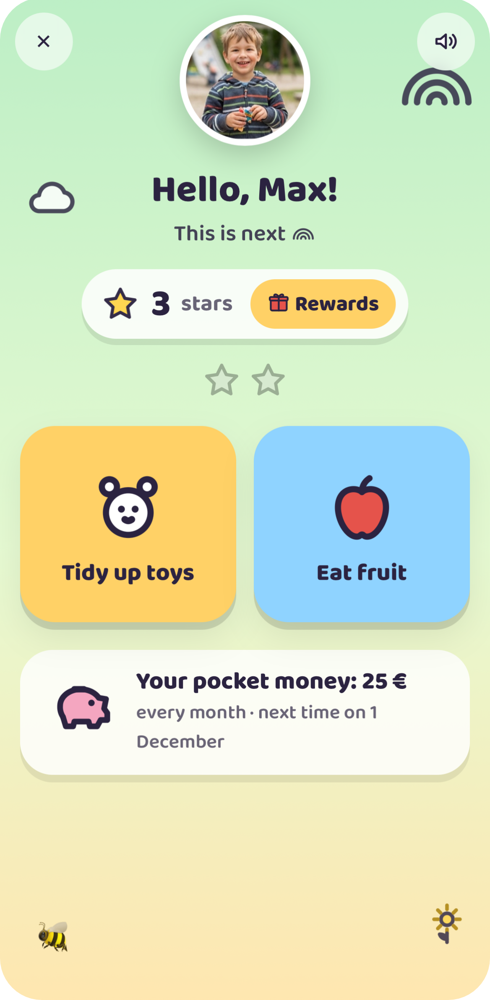

<p align="center">
  
</p>

<p align="center">
  <a href="https://github.com/pinn-shost/pinn/releases/latest"></a>
  <a href="LICENSE"></a>
  
  
  
  <a href="https://ko-fi.com/pinnapp"></a>
</p>

<p align="center">
  <a href="README.md">🇬🇧 English</a> ·
  <a href="README.de.md">🇩🇪 Deutsch</a> ·
  <a href="README.es.md">🇪🇸 Español</a> ·
  <a href="README.fr.md">🇫🇷 Français</a> ·
  <a href="README.it.md">🇮🇹 Italiano</a> ·
  <a href="README.pt.md">🇧🇷 Português</a> ·
  <a href="README.zh.md">🇨🇳 中文</a> ·
  <a href="README.ja.md">🇯🇵 日本語</a> ·
  <a href="README.ko.md">🇰🇷 한국어</a> ·
  <a href="README.ru.md">🇷🇺 Русский</a> ·
  <a href="README.nl.md">🇳🇱 Nederlands</a> ·
  <a href="README.tr.md">🇹🇷 Türkçe</a> ·
  <a href="README.pl.md">🇵🇱 Polski</a> ·
  <a href="README.uk.md">🇺🇦 Українська</a> ·
  <b>🇨🇿 Čeština</b> ·
  <a href="README.sv.md">🇸🇪 Svenska</a> ·
  <a href="README.da.md">🇩🇰 Dansk</a> ·
  <a href="README.nb.md">🇳🇴 Norsk</a> ·
  <a href="README.fi.md">🇫🇮 Suomi</a> ·
  <a href="README.hu.md">🇭🇺 Magyar</a>
</p>


---

pinn. je jedna aplikace pro všechno, co drží domácnost v chodu: společný kalendář, jídla na tento týden, nákupní seznam, kdo vynáší odpad, kapesné a pojištění, které je potřeba vypovědět do března. Běží v Dockeru na **tvém vlastním NAS** a instaluje se na každý iPhone, iPad a telefon s Androidem v rodině jako skutečná aplikace.

Žádný cloudový účet. Žádné předplatné. Žádné reklamy ani sledování. Data rodiny nikdy neopustí tvůj domov.

> Toto je krátký úvod. Úplný popis s FAQ a strukturou repozitáře najdeš v [English README](README.md) a [Deutsch](README.de.md).

<a id="screenshots"></a>

## Snímky obrazovky

### Na iPadu

Sdílený iPad na zdi nebo na kuchyňském stole ukazuje celou rodinu na první pohled.

<table>
  <tr>
    <td align="center" width="50%"><a href=".github/assets/screenshots/dashboard.png"></a><br><sub><b>Dashboard</b> – vyber se jedním klepnutím</sub></td>
    <td align="center" width="50%"><a href=".github/assets/screenshots/ipad-overview.png"></a><br><sub><b>Přehled</b> – počasí, kalendář a úkoly na jedné obrazovce</sub></td>
  </tr>
</table>

### Na telefonu

Vždy u tebe: pinn. se instaluje na každý iPhone a telefon s Androidem jako skutečná aplikace.

<table>
  <tr>
    <td align="center" width="33%"><a href=".github/assets/screenshots/home.png"></a><br><sub><b>Úvod</b> – dnešek na první pohled</sub></td>
    <td align="center" width="33%"><a href=".github/assets/screenshots/calendar.png"></a><br><sub><b>Kalendář</b> – iCloud a Google v jednom zobrazení</sub></td>
    <td align="center" width="33%"><a href=".github/assets/screenshots/meals.png"></a><br><sub><b>Jídla</b> – naplánuj týden, nákup jedním klepnutím</sub></td>
  </tr>
  <tr>
    <td align="center" width="33%"><a href=".github/assets/screenshots/lists.png"></a><br><sub><b>Seznamy</b> – nákupy, zásoby, balicí seznamy</sub></td>
    <td align="center" width="33%"><a href=".github/assets/screenshots/finance.png"></a><br><sub><b>Finance</b> – rozpočet, spoření, kapesné</sub></td>
    <td align="center" width="33%"><a href=".github/assets/screenshots/chat.png"></a><br><sub><b>Chat</b> – koncové šifrování, s hlasovými zprávami a polohou</sub></td>
  </tr>
</table>

### Další obrazovky

Klepnutím na obrázek ho otevřeš v plné velikosti.

<details>
<summary><b>Zobrazit další snímky obrazovky</b></summary>

<br>

<table>
  <tr>
    <td align="center" width="25%"><a href=".github/assets/screenshots/house.png"></a><br><sub><b>Domov</b> – byt, náklady, úvěr, vady a odečty měřičů na jednom místě</sub></td>
    <td align="center" width="25%"><a href=".github/assets/screenshots/tasks.png"></a><br><sub><b>Úkoly</b> – automatická připomenutí, např. STK a výměna pneumatik, s rychlým přechodem</sub></td>
    <td align="center" width="25%"><a href=".github/assets/screenshots/vehicles.png"></a><br><sub><b>Vozidla</b> – STK, pneumatiky, palivo a nabíjení</sub></td>
    <td align="center" width="25%"><a href=".github/assets/screenshots/scan_pantry.png"></a><br><sub><b>Skenování spíže</b> – naskenuj kód, ulož do spíže nebo spotřebuj</sub></td>
  </tr>
  <tr>
    <td align="center" width="25%"><a href=".github/assets/screenshots/weekly_summary_1.png"></a><br><sub><b>Týdenní náhled</b> – počasí a co je potřeba udělat</sub></td>
    <td align="center" width="25%"><a href=".github/assets/screenshots/weekly_summary_2.png"></a><br><sub><b>Týdenní náhled</b> – den po dni: úklid, odpad, platby</sub></td>
    <td align="center" width="25%"><a href=".github/assets/screenshots/weekly_summary_3.png"></a><br><sub><b>Minulý týden ve zkratce</b> – události, jídla, výdaje – a rychlé přechody</sub></td>
    <td align="center" width="25%"><a href=".github/assets/screenshots/kids.png"></a><br><sub><b>Děti</b> – denní rutina hravě</sub></td>
  </tr>
</table>

</details>

<sub>📁 <a href=".github/assets/screenshots">Všechny obrázky v jedné složce</a></sub>

## Co pinn. umí

- 📅 **Kalendář** – společný rodinný kalendář, propojení s iCloudem a Googlem, státní svátky a školní prázdniny
- ✅ **Úkoly a domácnost** – úkoly, střídání, odpad, úklid, „Kdo kolik dělá?“
- 🍽️ **Jídla** – týdenní plán jídel, import receptů, spíž se skenerem, nákupní seznam
- 💶 **Finance** – výdaje, rozpočet, pokladny s vyrovnáním, smlouvy s výpovědními lhůtami, kapesné
- 👨‍👩‍👧 **Rodina** – nouzové karty, poloha, SOS, „Jdu domů“, mazlíčci, škola a školka
- 🏠 **Domov a vozidla** – odečty měřičů, náklady, vady, auta s palivem a STK, chytrá domácnost
- 🎙️ **Hlasové ovládání** – „Hey Siri, pinn“: přidat na nákupní seznam, přečíst ho, vytvořit úkoly, vyslechnout si dnešek (zatím Siri odpovídá anglicky)
- 💬 **Chat** – rodinný a soukromý chat s koncovým šifrováním, push oznámeními a potvrzením o přečtení
- 🔔 **Oznámení** – osobní push zprávy na iPhonu, iPadu a Androidu a zvonek, který sbírá všechny změny v rodině

pinn. mluví jazyky: **🇬🇧 English, 🇩🇪 Deutsch, 🇪🇸 Español, 🇫🇷 Français, 🇮🇹 Italiano, 🇧🇷 Português, 🇨🇳 中文, 🇯🇵 日本語, 🇰🇷 한국어, 🇷🇺 Русский, 🇳🇱 Nederlands, 🇹🇷 Türkçe, 🇵🇱 Polski, 🇺🇦 Українська, 🇨🇿 Čeština, 🇸🇪 Svenska, 🇩🇰 Dansk, 🇳🇴 Norsk, 🇫🇮 Suomi a 🇭🇺 Magyar**; přizpůsobí měnu a tísňová čísla tvému regionu a přepíná mezi pojmy **rodina** a **společná domácnost**. Jeden server může hostit více rodin, každou s vlastními správci.

## Co je nového v 1.160.1

**Oprava: nepřeložené texty**

- Opraveno: kategorie dokumentů (např. „Doklady o koupi a záruka“) a poznámka „vyplaceno“ v Finance → Kapesné se nyní všude zobrazují v jazyce aplikace.

## Co je nového v 1.160.0

**Maďarština**

- Nové: maďarština (Magyar) je nový jazyk aplikace – všechny asi 7 500 textů aplikace, průvodce nastavením, export dat, push zprávy ze serveru a maďarské tísňové číslo (112). Je k dispozici i varianta pro společnou domácnost („háztartás“, „lakótárs“) s maďarskými koncovkami. Vybírá se v Nastavení → Jazyk a region.
- Poznámka: překlad nezkontrolovali rodilí mluvčí – návrhy na zlepšení jsou vítány jako GitHub issue. Hlasové ovládání přes Siri/Android zatím maďarštině nerozumí a odpovídá anglicky.
- Změněno: `i18n/hu.i18n.js` (new), `README.hu.md` (new), `js/`, `pb_hooks/`, `einrichtung.js`, `datenexport.js`, `.github/scripts/`, `src/`, `index.html`, README.

## Požadavky

- NAS nebo mini PC s nainstalovaným **Dockerem** a **Docker Compose** (např. Synology, UGREEN, QNAP nebo běžný server s Linuxem)
- přístup přes SSH
- pro přístup zvenčí: VPN (WireGuard nebo Tailscale) nebo vlastní doména s HTTPS

## Instalace

1. Stáhni a rozbal ZIP [nejnovější verze](https://github.com/pinn-shost/pinn/releases/latest).
2. Vytvoř na NAS složku, např. `/volume1/docker/Pocketbase`, a vlož do ní rozbalenou složku (např. `pinn-1.160.1` nebo `pinn-main`) beze změn.
3. Připoj se přes SSH a spusť:
   ```sh
   cd /volume1/docker/Pocketbase && sudo sh pinn-*/pinn-setup.sh
   ```
4. Otevři `http://<IP adresa NAS>:8090` → **Přihlásit se jako hlavní správce** → heslo `Admin` → nastav si vlastní heslo.
5. **Průvodce nastavením** tě provede zbytkem krok za krokem – HTTPS, přístup zvenčí, Google, umělá inteligence, poloha a Home Assistant – v 20 jazycích.
6. Otevři pinn. na každém telefonu přes adresu HTTPS a přidej na plochu:
   - **iPhone/iPad (Safari):** „Sdílet“ → *Přidat na plochu* (pro oznámení je potřeba iOS 16.4 nebo novější)
   - **Android (Chrome):** Nastavení → Oznámení → *nainstalovat pinn. jako aplikaci* nebo menu Chrome ⋮ → *Nainstalovat aplikaci*

**Aktualizace:** stáhni nový ZIP, vlož rozbalenou složku do stejné složky a znovu spusť `sudo sh pinn-*/pinn-setup.sh`. Změněné soubory skončí ve složce `_alt/`, tvá data zůstanou nedotčena. **Zálohy** se vytvářejí každou noc ve složce `./backups` a uchovávají se 14 dní.

### Stack Portainer (bez skriptu)

Dáváš přednost Portaineru? Pak nepotřebuješ ani SSH, ani instalační skript:

1. V Portaineru otevři **Stacks → Add stack**, pojmenuj ho `pinn` a vyber **Web editor**.
2. Vlož obsah [`docker/docker-compose.portainer.yaml`](docker/docker-compose.portainer.yaml).
3. Volitelně: v **Environment variables** změň port (`PINN_PORT`, výchozí 8090) nebo připni verzi (`PINN_IMAGE_TAG`, např. `1.151.0`). Klikni na **Deploy the stack**.
4. Otevři `http://<IP-NAS>:8090` → **Přihlásit se jako hlavní správce** → průvodce nastavením jako v krocích 4–6 výše.

Hotový obraz se bere z `ghcr.io/pinn-shost/pinn` (amd64 a arm64). Data jsou uložena v svazcích, složky nejsou potřeba. Stack nepoužívá pevné názvy kontejnerů, takže se nedostane do konfliktu s existujícími. Pokud na NAS už běží Tailscale, odstraň blok `tailscale`; s vlastní adresou HTTPS nebo reverzním proxy odstraň také `caddy` a `duckdns`.

**Aktualizace:** Stack → Editor → *Update the stack* se zapnutým *Re-pull image and redeploy*. **Zálohy:** blok `wartung` stacku dělá zálohu každou noc (uchovává 7 dní + 4 týdny) a stojí za tlačítky „Uložit nyní“ a „Obnovit“ v pinn. → Nastavení → Systém. Zálohy leží ve svazku `backups` – nebo ve složce NAS, pokud nastavíš `PINN_BACKUP_DIR` (např. `/volume1/docker/pinn-backups`). K obnovení potřebuje přístup k Dockeru, aby pinn. nakrátko zastavil; pokud svazky zálohuješ sám, blok odstraň. Aktualizace se dělají v Portaineru, ne tlačítkem.

### Přístup z internetu přes vlastní reverzní proxy

Rodina nechce používat Tailscale? Pak dej pinn. za reverzní proxy: přijímá požadavky z internetu, zajišťuje HTTPS pro tvou doménu a předává je pinn.

1. Nasměruj proxy na `http://<IP-NAS>:8090` (stack Portainer: port `PINN_PORT`). Živé aktualizace jdou obyčejným HTTP – websockets nejsou potřeba, jen nezapínej ukládání odpovědí do vyrovnávací paměti. Povol nahrávání až 70 MB (videa v chatu).
   - **Nginx Proxy Manager:** *Hosts → Proxy Hosts → Add*: tvá doména, schéma `http`, IP NAS, port `8090`; karta *SSL*: nový certifikát, *Force SSL* zapnuto.
   - **Cloudflare Tunnel:** přesměrování portů není potřeba – *Public hostname* → služba `http://<IP-NAS>:8090`.
   - **Traefik, Caddy a další:** router/web pro tvou doménu s přesměrováním na `http://<IP-NAS>:8090`.
2. Na každém telefonu otevři `https://<doména>`, přihlas se, znovu přidej na plochu a znovu zapni oznámení (aplikace je vázaná na svou adresu).
3. Kalendáře Google (volitelné): přidej `https://<doména>/api/pinn/google/callback` jako povolený URI pro přesměrování v konzoli Google Cloud.

Co pinn. dělá samo: adrese návštěvníka od proxy (`X-Forwarded-For`) věří, jen když požadavek přišel z domácí sítě, sítě Dockeru nebo Tailscale – blokování po chybných heslech se tak nedá obejít. Z internetu je administrace PocketBase (`/_/`) zavřená a počáteční heslo `Admin` nefunguje. Stojí proxy jinde (pronajatý server nebo oranžový mrak Cloudflare před tvou proxy)? Pak nastav `PINN_PROXY_NETZE` (v `.env` nebo proměnných prostředí stacku), např. `privat, cloudflare` nebo `privat, 203.0.113.5`.

**Důležité:** pinn. je pak dostupné celému internetu. Dej každému profilu dlouhé vlastní heslo, aktualizuj proxy a nikdy neotvírej port 8090 v routeru přímo – jen přes proxy s HTTPS.

## Soukromí

Všechna data zůstávají na tvém NAS v jedné databázi PocketBase. Neexistuje žádný server pinn. ani telemetrie. Veškerý kód a všechny knihovny pocházejí z tvého vlastního NAS. Push oznámení nenesou žádný obsah: Apple, Google a Mozilla předávají jen prázdný signál a samotnou zprávu si zařízení vyzvedne z tvého NAS.

## Podpoř pinn.

pinn. je zdarma a otevřený. Pokud ti je užitečný, můžeš projekt podpořit přes [Ko-fi](https://ko-fi.com/pinnapp).

## Licence

[MIT](LICENSE)
