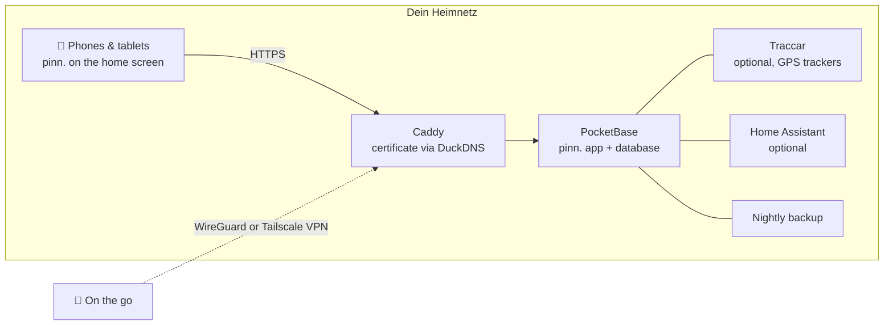

<p align="center">
  
</p>

<p align="center">
  <a href="https://github.com/pinn-shost/pinn/releases/latest"></a>
  <a href="LICENSE"></a>
  
  
  
  <a href="https://ko-fi.com/pinnapp"></a>
</p>

<p align="center">
  <a href="README.md">🇬🇧 English</a> ·
  <b>🇩🇪 Deutsch</b> ·
  <a href="README.es.md">🇪🇸 Español</a> ·
  <a href="README.fr.md">🇫🇷 Français</a> ·
  <a href="README.it.md">🇮🇹 Italiano</a> ·
  <a href="README.pt.md">🇧🇷 Português</a> ·
  <a href="README.zh.md">🇨🇳 中文</a> ·
  <a href="README.ja.md">🇯🇵 日本語</a> ·
  <a href="README.ko.md">🇰🇷 한국어</a> ·
  <a href="README.ru.md">🇷🇺 Русский</a> ·
  <a href="README.nl.md">🇳🇱 Nederlands</a> ·
  <a href="README.tr.md">🇹🇷 Türkçe</a> ·
  <a href="README.pl.md">🇵🇱 Polski</a> ·
  <a href="README.uk.md">🇺🇦 Українська</a>
</p>

<p align="center">
  <a href="#screenshots">Screenshots</a> ·
  <a href="#what-pinn-does">Funktionen</a> ·
  <a href="#installation">Installation</a> ·
  <a href="#privacy">Datenschutz</a> ·
  <a href="#faq">FAQ</a>
</p>

---

pinn. ist eine App für alles, was einen Haushalt am Laufen hält: den gemeinsamen Kalender, die Mahlzeiten der Woche, die Einkaufsliste, wer den Müll rausbringt, das Taschengeld und die Versicherung, die im März gekündigt werden muss. Sie läuft auf **deinem eigenen NAS** mit Docker und lässt sich auf jedem iPhone, iPad und Android-Handy der Familie wie eine echte App installieren.

Kein Cloud-Konto. Kein Abo. Keine Werbung, kein Tracking. Die Daten deiner Familie verlassen nie dein Zuhause.

<a id="screenshots"></a>

## Screenshots

### Auf dem iPad

An die Wand gehängt oder auf den Küchentisch gelegt: Das gemeinsame iPad zeigt die ganze Familie auf einmal.

<table>
  <tr>
    <td align="center" width="50%">
      <a href=".github/assets/screenshots/dashboard.png"></a><br>
      <sub><b>Dashboard</b> – alle tippen auf ihr eigenes Bild, optional mit PIN</sub>
    </td>
    <td align="center" width="50%">
      <a href=".github/assets/screenshots/ipad-overview.png"></a><br>
      <sub><b>Übersicht</b> – Wetter, Termine, Aufgaben, Essen und die Familie auf einen Blick</sub>
    </td>
  </tr>
</table>

### Auf dem Handy

Immer dabei: pinn. lässt sich auf jedem iPhone und Android-Handy wie eine echte App installieren.

<table>
  <tr>
    <td align="center" width="33%"><a href=".github/assets/screenshots/home.png"></a><br><sub><b>Übersicht</b> – dein Tag auf einen Blick</sub></td>
    <td align="center" width="33%"><a href=".github/assets/screenshots/calendar.png"></a><br><sub><b>Kalender</b> – iCloud und Google in einer Ansicht</sub></td>
    <td align="center" width="33%"><a href=".github/assets/screenshots/meals.png"></a><br><sub><b>Essen</b> – die Woche planen, mit einem Tipp einkaufen</sub></td>
  </tr>
  <tr>
    <td align="center" width="33%"><a href=".github/assets/screenshots/lists.png"></a><br><sub><b>Listen</b> – Einkauf, Vorrat, Packen</sub></td>
    <td align="center" width="33%"><a href=".github/assets/screenshots/finance.png"></a><br><sub><b>Finanzen</b> – Budget, Sparen, Taschengeld</sub></td>
    <td align="center" width="33%"><a href=".github/assets/screenshots/chat.png"></a><br><sub><b>Chat</b> – Ende-zu-Ende verschlüsselt, mit Sprachnachrichten und Standort</sub></td>
  </tr>
</table>

### Weitere Screens

Ein Klick auf ein Bild öffnet es in voller Größe.

<details>
<summary><b>Weitere Screenshots anzeigen</b></summary>

<br>

<table>
  <tr>
    <td align="center" width="25%"><a href=".github/assets/screenshots/house.png"></a><br><sub><b>Zuhause</b> – Haus, Kosten, Kredit, Mängel und Zähler an einem Ort</sub></td>
    <td align="center" width="25%"><a href=".github/assets/screenshots/tasks.png"></a><br><sub><b>Aufgaben</b> – automatische Erinnerungen, z. B. an TÜV und Reifenwechsel, mit Direkt-Button</sub></td>
    <td align="center" width="25%"><a href=".github/assets/screenshots/vehicles.png"></a><br><sub><b>Fahrzeuge</b> – TÜV, Reifen, Tanken und Laden</sub></td>
    <td align="center" width="25%"><a href=".github/assets/screenshots/scan_pantry.png"></a><br><sub><b>Vorrat scannen</b> – Strichcode scannen, einlagern oder verbrauchen</sub></td>
  </tr>
  <tr>
    <td align="center" width="25%"><a href=".github/assets/screenshots/weekly_summary_1.png"></a><br><sub><b>Wochenvorschau</b> – Wetter und was noch offen ist</sub></td>
    <td align="center" width="25%"><a href=".github/assets/screenshots/weekly_summary_2.png"></a><br><sub><b>Wochenvorschau</b> – Tag für Tag: Putzen, Müll, Zahlungen</sub></td>
    <td align="center" width="25%"><a href=".github/assets/screenshots/weekly_summary_3.png"></a><br><sub><b>Letzte Woche kompakt</b> – Termine, Essen, Ausgaben – und Abkürzungen</sub></td>
    <td align="center" width="25%"><a href=".github/assets/screenshots/kids.png"></a><br><sub><b>Kinder</b> – ein spielerischer Tagesablauf</sub></td>
  </tr>
</table>

</details>

<sub>📁 <a href=".github/assets/screenshots">Alle Bilder in einem Ordner</a></sub>

<a id="what-pinn-does"></a>

## Was pinn. kann

| | |
|---|---|
| 📅 **Kalender** | iCloud- und Google-Kalender pro Person, privat oder mit der Familie geteilt. Feiertage, Schulferien, Müllabfuhrtermine und Geburtstage aus deinen Kontakten erscheinen automatisch. |
| 🍝 **Essen & Rezepte** | Plane die Woche und schicke die Zutaten direkt auf die Einkaufsliste. Importiere Rezepte aus Text, PDF, Fotos oder einem Link – wahlweise mit KI. Teile Lieblingsrezepte mit anderen Familien auf deinem Server. |
| 🛒 **Listen** | Einkaufslisten pro Geschäft, ein Vorrat, der die Liste auffüllt, wenn etwas zur Neige geht, Packlisten aus Vorlagen (Urlaub, Kliniktasche, Party) sowie Geschenk- und Wunschlisten mit einem Geschenkplaner „Wer schenkt was“, den der Beschenkte nie sieht. |
| ✅ **Aufgaben & Haushalt** | Aufgaben mit Push-Erinnerungen, Putzpläne und Mülltonnen – dazu eine Kinderseite mit animierten Routinen, die nur zeigt, was zur Tageszeit passt. |
| 💶 **Finanzen** | Gemeinsame oder private Kassen, ein Haushaltsbudget, Sparen und Depots mit ETFs und Aktien, Taschengeld, wiederkehrende Zahlungen und Verträge mit Kündigungserinnerungen. WGs können Kosten teilen und sehen, wer wem etwas schuldet. |
| 📄 **Dokumente & Fahrzeuge** | Belege und Garantien, Ausweise mit Ablauferinnerung. Autos und Fahrräder mit Prüfterminen, Reifenwechsel, Verbrauch und Gesamtkosten. |
| 🏡 **Zuhause** | Für Mieter, Eigentümer und Vermieter: Miet- oder Kaufvertrag, Darlehen, Mängel mit Fotos, Rechnungen, Renovierungsplan, Zählerstände mit Prognose, Schlüssel und Mieteinnahmen für vermietete Wohnungen, Häuser und Garagen. Garten & Pflanzen mit einem Gießplan, der weiß, wann es geregnet hat. |
| 📍 **Familie & Standort** | Teile deinen Standort direkt in pinn. – einmalig oder für eine gewählte Zeit – und im Hintergrund über die kostenlose App Traccar Client (sendet direkt an pinn., kein zusätzlicher Server). Dazu ein „Auf dem Heimweg“-Modus, ein SOS-Alarm mit Position und Notrufnummern, Notfallpässe und Ankunftsmeldungen für Orte. |
| 🎒 **Schule & Kita** | Pro Kind: Stundenplan (eintippen oder fotografieren – die KI füllt ihn aus), Bringen und Abholen, Hausaufgaben auf der Kinderseite, Elternbriefe mit Fristen, die zu Erinnerungen werden, und Schließtage direkt im Kalender. |
| 🐾 **Haustiere** | Profile für Hunde, Katzen, Kaninchen & Co. mit Fütterungszeiten zum Abhaken, Gassirunden, einem „Wer ist dran?“-Plan, Impfungen und Entwurmung mit Push-Erinnerungen, Gewichtsverlauf, Tierarzt und Notdienst, einem Heimtierblatt für den Sitter zum Teilen, einem druckbaren „Vermisst“-Plakat und einer Erinnerung ans Auffüllen des Futterautomaten. |
| 🌦️ **Wetter & Urlaub** | Tippe aufs Wetter (Kachel auf dem Handy, oben neben Datum und Uhrzeit auf iPad und Computer) und sieh 14 Tage mit Details zu jedem Tag. Packlisten mit Ziel und Datum zeigen das Urlaubswetter – Vorhersage oder typische Werte – und schlagen vor, was mitzunehmen ist. |
| 🏠 **Smart Home** | Starte Apple-Kurzbefehle oder Home-Assistant-Aktionen aus einer Aufgabe – der Saugroboter putzt die Küche, wenn der Putzdienst fällig ist, Mähroboter und Bewässerung folgen dem Gartenplan, der Futterautomat meldet, wenn er leer wird. |
| 🎙️ **Sprachsteuerung** | „Hey Siri, pinn“: auf die Einkaufsliste setzen, sie vorlesen lassen, Aufgaben anlegen und hören, was heute ansteht – auch auf Android. |
| 💬 **Chat** | Familienchat und private Chats, Ende-zu-Ende verschlüsselt, mit Push, Lesehaken und Antworten. |
| 🔔 **Benachrichtigungen** | Persönliche Push-Nachrichten auf iPhone, iPad und Android sowie eine Glocke, die jede Änderung in der Familie sammelt. |
| 🧩 **Und mehr** | Familien-Pinnwand mit verschiebbaren Zetteln, globale Suche, Offline-Modus mit automatischem Abgleich, Dunkelmodus, iPad-Dashboard mit Profil-PINs, Gastzugang, Kindersicherung. |

pinn. spricht **🇬🇧 English, 🇩🇪 Deutsch, 🇪🇸 Español, 🇫🇷 Français, 🇮🇹 Italiano, 🇧🇷 Português, 🇨🇳 中文, 🇯🇵 日本語, 🇰🇷 한국어, 🇷🇺 Русский, 🇳🇱 Nederlands, 🇹🇷 Türkçe, 🇵🇱 Polski und 🇺🇦 Українська**, passt Währung und Notrufnummern an deine Region an und wechselt zwischen den Begriffen **Familie** und **WG**. Ein Server kann mehrere Familien beherbergen, jede mit eigenen Admins.

## Neu in 1.150.2

**Shortcuts bleiben auf der Übersicht**

- **Fenster statt Sprung.** Ein Tipp auf Trinken, Medikamente, Einkauf, Heute kochen, Putzplan, Haustiere, Vorrat, SOS oder Unterwegs öffnet das Fenster unten; dort klickst du dich durch, und ein kurzer Hinweis sagt, was passiert ist.
- **Fenster und Links.** Aufgabe, Termin, Zettel, Ausgabe und Einnahme öffnen ihr gewohntes Fenster, Hände waschen zählt +1. Chat, Finanzen und Pflanzen sind einfache Links; „Öffnen ›“ im Fenster führt zur ganzen Seite.
- **Behoben.** Nach dem Wechsel auf eine andere Seite (z. B. Rezepte oder Einkauf) steht unten nicht mehr die Kachel „Shortcuts“.
- **Eine oder mehrere Reihen.** Unter Einstellungen → Shortcuts wählst du getrennt für das Handy und für Tablet & Computer: eine Reihe (zur Seite wischen für die übrigen) oder mehrere Reihen (alle Shortcuts nach unten aufgefüllt).
- Geändert: `js/kurzbefehle.js`, `js/kurzfenster.js`, `css/kurzbefehle.css`, `js/uebersicht.js`, `js/design.js`, `js/ansichten.js`, `js/rezepte.js`, `js/sprachen.js`, `js/versionslog.js`, `i18n/`, `src/`, `index.html`, README (+ 1.150.1).

## Neu in 1.150.1

**Shortcuts im eigenen Menüpunkt**

- **Eigener Menüpunkt.** Die Auswahl der Apps steht jetzt unter Einstellungen → Shortcuts. Vorher klappte beim Öffnen von „Shortcuts“ die Übersicht-Einstellung zu, und die Seite ließ sich nicht mehr scrollen.
- **Ein/Aus unter Übersicht.** Die Kachel „Shortcuts“ schaltest du wie jede andere Kachel ein oder aus; „Apps wählen“ führt direkt zur Auswahl.
- **Sofort sichtbar.** Solange du nichts selbst gewählt hast, zeigt die Kachel eine Standardauswahl (Trinken, Einkauf, Aufgabe, Termin, Heute kochen, Zettel, Ausgabe, Putzplan). Ist keine App gewählt, bietet sie „Apps wählen“ an, statt zu verschwinden.
- Geändert: `js/kurzbefehle.js`, `css/kurzbefehle.css`, `js/uebersicht.js`, `js/uebersichteinstellungen.js`, `js/design.js`, `js/sprachen.js`, `js/versionslog.js`, `i18n/`, `src/`, `index.html`, README.

## Neu in 1.150.0

**Zeiten in deiner Region · Shortcuts auf der Übersicht · Schnellfenster für die Shortcuts**

- **Erinnerungen zur richtigen Uhrzeit.** pinn. rechnet Erinnerungen jetzt in der Zeitzone deines Geräts, mit Sommer- und Winterzeit deiner Region. Du musst nichts einstellen – das Gerät meldet dem Server still seine Zeitzone, auch nach einem Umzug oder auf Reisen.
- **Zuerst die Gesundheits-Erinnerungen.** Medikamente, Trinken und Hände waschen folgen schon der eigenen Uhr jeder Person; alle künftigen Erinnerungen nutzen dieselbe Uhr. Ältere Erinnerungen (Geburtstage, Haustiere, Packliste, Vorrat, Verträge, Dokumente, Wochenvorschau) laufen noch nach mitteleuropäischer Zeit und folgen später.
- **Kachel „Shortcuts“.** Eine neue Kachel auf der Übersicht zeigt App-Symbole, die direkt eine Funktion öffnen: Trinken, Hände waschen (+1 pro Tipp), Medikamente, Einkauf, neue Aufgabe, neuer Termin, Zettel, Chat, Putzplan, Pflanzen, Haustiere, Vorrat, Ausgabe erfassen, Einnahme erfassen, Finanzen, SOS und Unterwegs.
- **Deine Auswahl.** Einstellungen → Übersicht → Shortcuts: die gewünschten Apps einschalten. Gilt pro Profil; ohne gewählte App bleibt die Kachel ausgeblendet. Gäste sehen keine Gesundheits-, SOS- und Finanz-Apps.
- **Langes Drücken.** Ein langes Drücken auf einen Shortcut (am Computer Rechtsklick) öffnet ein kleines Fenster für genau diese Funktion: Trinken (Getränk, Menge, Rückgängig 10 Minuten lang), Hände waschen (+/−), Medikamente, Einkauf, Aufgaben, Putzplan, Termine, Kochen, Zettel, Haustiere, Vorrat, Ausgabe und Einnahme, SOS und Unterwegs. Ein kurzer Tipp wirkt wie bisher.
- **Bleibt offen.** Das Fenster bleibt nach einer Aktion offen, mehrere Dinge nacheinander sind möglich; „Öffnen“ führt zur vollständigen Funktion.
- Geändert: `pb_hooks/pinn-zeit.js`, `pb_hooks/zeit.pb.js`, `js/zeit.js`, `js/kurzbefehle.js`, `js/kurzfenster.js`, `css/kurzbefehle.css`, `pb_hooks/pinn-gesundheit.js`, `js/appstart.js`, `js/uebersicht.js`, `js/uebersichteinstellungen.js`, `js/ansichten.js`, `js/design.js`, `js/gesundheit.js`, `js/sprachen.js`, `js/versionslog.js`, `i18n/`, `src/`, `index.html`, `pinn-setup.sh`, README (+ 1.149.1).

## Neu in 1.149.1

**Push-Erinnerungen**

- **Erinnerungen für Gesundheit.** Auf der Gesundheitsseite lässt sich je Baustein eine Push-Erinnerung einschalten: Medikamente & Vitamine zu ihren Uhrzeiten, Trinken im Abstand zwischen zwei Uhrzeiten (mit der noch fehlenden Menge), Hände waschen zu festen Uhrzeiten.
- **Nur für die Person selbst.** Die Erinnerungen gehen an die Geräte dieser Person; an andere Familienmitglieder wird nichts geschickt. Tippen auf die Meldung öffnet die Gesundheitsseite – beim Trinken gleich das Trink-Popup.
- Geändert: `pb_hooks/pinn-gesundheit.js`, `pb_hooks/gesundheit.pb.js`, `js/gesundheit.js`, `css/gesundheit.css`, `js/hinweise.js`, `js/fortsetzen.js`, `js/sprachen.js`, `js/versionslog.js`, `i18n/`, `src/`, `index.html`, alle READMEs. Enthält 1.149.0.

## Neu in 1.149.0

**Gesundheit**

- **Gesundheit unter Familie.** Der Reiter „Notfall“ heißt jetzt „Gesundheit“, ebenso der Knopf in der Familien-Übersicht. Jede Person bekommt eine eigene Gesundheitsseite aus Bausteinen wie bei Zuhause: Trinken, Medikamente & Vitamine, Hände waschen, Werte, Impfungen und Arzttermine.
- **Trinken.** Tagesziel wählen, dann „Getrunken“ antippen: Getränk aussuchen (Wasser, Saft, Kaffee, Tee, Milch, Limo & Schorle) und die Menge als mehr oder weniger volles Glas. pinn. zählt mit und sagt, wie viel noch fehlt und ob du im Plan liegst.
- **Notfallpass integriert.** Auf der Gesundheitsseite mit einem Haken einschalten; ein leerer Pass öffnet gleich das Formular. Bisherige Notfallpässe bleiben erhalten und für die ganze Familie sichtbar, auch offline.
- **Privat.** Gesundheitsdaten sieht nur die Person selbst, bei Kindern auch die Erwachsenen. Push-Erinnerungen folgen mit 1.149.1.
- Geändert: `js/gesundheit.js`, `css/gesundheit.css`, `pb_hooks/gesundheit.pb.js`, `pb_hooks/pinn-gesundheit.js`, `pb_hooks/pinn-schema.js`, `js/familie.js`, `js/serverzugriff.js`, `js/sprachen.js`, `js/versionslog.js`, `i18n/`, `src/`, `index.html`, `pinn-setup.sh`, alle READMEs. Mit Server-Teil (neue Sammlung „gesundheit“). Enthält 1.148.2.

## Neu in 1.148.2

**Andere Familie am Dashboard-Gerät**

- **Anmeldung mit einer anderen Familie.** Meldest du dich auf einem Dashboard-Gerät über „Mit Passwort anmelden“ mit einem Profil einer anderen Familie an, ist das jetzt eine ganz normale Sitzung: Der Dashboard-Knopf fehlt und „Abmelden“ beendet sie. Vorher führte der Knopf zurück zum Dashboard der ersten Familie.
- **Klarer Hinweis in den Einstellungen.** Der Dashboard-Bereich sagt jetzt, dass dieses Gerät das Dashboard einer anderen Familie ist – ein Gerät kann nur ein Dashboard sein.
- Geändert: `js/dashboard.js`, `js/anmeldung.js`, `js/profilauswahl.js`, `js/dashboardkonto.js`, `js/sprachen.js`, `js/versionslog.js`, `i18n/`, `src/`, `index.html`, alle READMEs. Kein Server-Teil.

## Neu in 1.148.1

**Rezept bleibt am Dashboard offen**

- **Familien-Dashboard.** Nach „Zur Profilauswahl“ und der PIN ist ein offenes Rezept jetzt wirklich wieder offen. Der erste Bildschirm-Wechsel nach dem Start (z. B. wenn das iPad die App wieder zeigt) baute die Seite neu auf und schloss das Rezept – behoben.
- **Auch wenn iOS die App beendet.** Auf einem Dashboard bleibt die Notiz jetzt erhalten, auch wenn iOS die App beendet, während sie auf der Profilauswahl wartet (höchstens 12 Stunden). Ein übrig gebliebener Zusatz in der Adresse verhindert das Weitermachen nicht mehr.
- **iPad drehen** lässt ein offenes Rezept offen, mit Personenzahl und Lesestelle.
- Geändert: `js/fortsetzen.js`, `js/ansichten.js`, `js/appstart.js`, `js/sprachen.js`, `js/versionslog.js`, `src/`, `index.html`, alle READMEs. Kein Server-Teil.

## Neu in 1.148.0

**Weiter, wo du aufgehört hast**

- **Familien-Dashboard.** Öffnest du dein Profil nach einer Pause wieder mit der PIN, landest du dort, wo du aufgehört hast – nicht mehr auf der Übersicht. Ein offenes Rezept ist wieder offen, mit der eingestellten Personenzahl und an der Stelle, bis zu der du gelesen hast.
- **Nicht nur Rezepte.** Gemerkt werden auch die Seite (z. B. Listen, Aufgaben, Finanzen), die geöffnete Liste, der Reiter in Zuhause und bei Fahrzeugen und auf dem Handy der Reiter der Übersicht. Jedes Profil hat seinen eigenen Platz.
- **Wie lange.** Solange die App geöffnet bleibt (auch im Hintergrund), höchstens 12 Stunden. Nach dem Schließen der App, nach „Abmelden“ auf dem eigenen Gerät oder über einen Link aus einer Benachrichtigung startest du wie gewohnt. Auch auf dem eigenen Gerät bleibt die Seite erhalten, wenn die App neu lädt, z. B. nach einem Update.
- Geändert: `js/fortsetzen.js` (neu), `js/appstart.js`, `js/dashboard.js`, `js/anmeldung.js`, `js/rezepte.js`, `js/sprachen.js`, `js/versionslog.js`, `src/`, `index.html`, `pinn-setup.sh`, alle READMEs. Kein Server-Teil.

## Neu in 1.147.1

**Geräte einmal in der Liste, Link in den Anleitungen**

- **Angemeldete Geräte.** Ein Gerät, das sich zweimal gleichzeitig angemeldet hat (z. B. das Familien-Dashboard am Mac), stand doppelt mit derselben ID in der Liste. Jetzt steht es einmal da, zählt einmal, und „Abmelden“ entfernt es ganz.
- **Kein „Nur Benachrichtigungen“ mehr.** Eine übrig gebliebene Benachrichtigungs-Adresse eines Geräts, das schon angemeldet ist, wird automatisch entfernt – damit nichts doppelt ankommt.
- **Sprachsteuerung & Widgets.** Der persönliche Link steht jetzt direkt in den Feldern „Siri-Kurzbefehl“ und „Android“ (mit Kopieren-Knopf) statt in der Gesamtübersicht.
- Geändert: `js/geraete.js`, `js/sprachsteuerung.js`, `js/sprachen.js`, `pb_hooks/pinn-sitzungen.js`, `src/`, `index.html`, `i18n/`, alle READMEs. Server-Teil: Hooks einspielen, PocketBase startet neu.

## Neu in 1.147.0

**Face ID & Fingerabdruck, Geräte richtig erkannt, Widget mit Haus & Garten**

- **Face ID, Touch ID, Fingerabdruck.** Unter Konto lässt sich pinn. pro Gerät sperren: beim Öffnen und nach einer Pause (sofort, 1, 5 oder 15 Minuten) fragt das Gerät nach Gesicht oder Finger – iPhone, iPad, Android, Mac mit Touch ID, Windows Hello. Das Gerät prüft selbst, nichts wird gesendet. Klappt es einmal nicht, meldest du dich mit dem Passwort neu an.
- **Angemeldete Geräte.** Die App meldet bei jedem Start Name und Art des Geräts – kein „Browser“ mit Laptop-Symbol mehr auf dem Handy. Jeder Eintrag zeigt eine kurze ID, mit ✏️ bekommt er einen eigenen Namen, und Geräte, die nur Benachrichtigungen bekommen, stehen jetzt in der Liste und lassen sich entfernen.
- **Widget.** Offene Aufgaben mit leerem Kreis, erledigte mit Haken, dazu die neue Gruppe „Haus & Garten“ für den Wartungsplan (schon vorab mit Datum). Skript einmal neu kopieren.
- **Jahreszeiten.** Unter Darstellung → Jahreszeiten öffnen „Winter“ und „Weihnachten“ ein Fenster: Zeitraum selbst wählen (voreingestellt 1.12.–6.1. bzw. 1.–26.12.) und jeden Teil an- oder ausschalten – Schnee auf Schrift und Kacheln, Schneefall über den Bildschirm, Dashboard-Landschaft, Lichterkette, Weihnachtsmann, Mütze und Stechpalme. „Sprachsteuerung & Widgets“ startet mit zugeklappten Anleitungen.
- Geändert: `js/entsperren.js` (neu), `js/geraete.js`, `js/verbindung.js`, `js/sprachsteuerung.js`, `js/winterzeit.js`, `pb_hooks/pinn-sitzungen.js`, `pb_hooks/sitzungen.pb.js`, `pb_hooks/pinn-sprache.js`, `src/`, `index.html`, `pinn-setup.sh`, `i18n/`, alle READMEs. Server-Teil: Hooks einspielen, PocketBase startet neu.

## Neu in 1.146.1

**Schnee auf jedem Buchstaben, Winter auf dem Dashboard**

- **Schnee wie echter Schnee.** Der Schnee liegt jetzt auf jedem einzelnen Buchstaben, nur ganz oben: eine Schicht auf flachen Kanten (oberer Balken von B oder L, die beiden oberen Enden vom K), ein Klecks in der Mitte von Rundungen (O), nichts an steilen Seiten, am Fuß des L oder in den Lücken. Emoji bleiben frei. Auch der Familienname in der Kopfzeile bekommt Schnee und passt sich an, wenn er geändert wird.
- **Winter auf dem Familien-Dashboard.** Schnee auf Familienname, Uhrzeit und Temperatur, eine Schneehaube auf jeder Kachel (jede etwas anders) und unten eine kleine Winterlandschaft.
- **Der Weihnachtsmann** fliegt nur noch halb so oft (alle 10–18 Minuten, an Heiligabend alle 4–6).
- Geändert: `js/winterzeit.js`, `css/winterzeit.css`, `src/`, `index.html`, alle READMEs. Kein Server-Teil.

## Neu in 1.146.0

**Schnee passend zu jeder Überschrift, Update-Uhrzeit nach Region**

- **Schnee nach Maß.** pinn. misst jeden Buchstaben einer Überschrift in der echten Schrift und legt den Schnee genau darauf – auf hohen Buchstaben höher, auf kleinen tiefer, mit Klumpen und hier und da einem Tropfen. Lücken zwischen Wörtern bleiben frei, Emoji bekommen keinen Schnee, nichts wird gestreckt, und es klappt in jeder Sprache und Schrift.
- **Automatische Updates nach Region.** Die eingestellte Uhrzeit gilt jetzt in der Zeitzone des Geräts, auf dem sie gespeichert wird (Sommer- und Winterzeit inklusive), nicht mehr fest in deutscher Zeit. Die Einstellungen zeigen, welche Zeitzone gilt.
- **Gesperrtes Dashboard lädt neue Versionen selbst.** Ein iPad mit gesperrtem Familien-Dashboard (oder die Anmeldung) lädt etwa eine Minute nach einem Update neu, wenn gerade niemand tippt. Läuft zur Update-Zeit eine Sicherung, zeigt die App „wartet“.
- Geändert: `js/winterzeit.js`, `css/winterzeit.css`, `js/versionspruefung.js`, `js/sicherungen.js`, `pb_hooks/pinn-system.js`, `pb_hooks/system.pb.js`, `i18n/`, `src/`, `index.html`, alle READMEs. Server-Teil: Hooks einspielen, PocketBase startet neu.

## Neu in 1.145.0

**Winter- und Weihnachtsdesign**

- **Winterdesign vom 1. Dezember bis 6. Januar.** Schnee auf dem pinn.-Logo, auf den Überschriften und unten in der Seitenleiste, dazu ein kurzer Schneeschauer beim Öffnen der App. Tippe aufs Logo für mehr Schnee.
- **Weihnachtsextras bis zum 26. Dezember.** Lichterkette unter der Kopfzeile, Weihnachtsmütze auf dem Logo, Stechpalme an Überschriften und Glocke, ein kleiner Tannenbaum in der Seitenleiste – und ab und zu fliegt der Weihnachtsmann mit Schlitten und Rentieren oben durchs Bild.
- **Standardmäßig an, pro Profil abschaltbar** unter Einstellungen → Darstellung; „Vorschau“ zeigt es jederzeit eine Minute lang. Akkuschonend und eine eigene Schicht: Im Ruhemodus bewegt sich nichts, und am Aufbau der App verschiebt sich nichts.
- Geändert: `js/winterzeit.js` (neu), `css/winterzeit.css` (neu), `js/design.js`, `js/sprachen.js`, `js/versionslog.js`, `i18n/versionslog.en.js`, `i18n/`, `src/`, `pinn-setup.sh`, `index.html`, alle READMEs. Kein Server-Teil.

## So funktioniert’s



Alles läuft als Docker-Container auf einem Gerät. HTTPS funktioniert **ohne Portfreigabe** – das Zertifikat wird per DNS-Prüfung ausgestellt. Von außen ist pinn. nur über dein eigenes VPN erreichbar.

## Voraussetzungen

- Ein NAS oder Server mit **Docker** und **Docker Compose 2.17+** – entwickelt auf einem UGREEN NAS mit UGOS, läuft auf jedem Linux-Docker-Host (amd64, arm64, armv7)
- SSH-Zugang dazu
- Optional, aber empfohlen: eine kostenlose [DuckDNS](https://www.duckdns.org)-Subdomain für HTTPS – nötig für Push-Benachrichtigungen und die Installation von pinn. als App

<a id="installation"></a>

## Installation

1. Lade das ZIP des [neuesten Releases](https://github.com/pinn-shost/pinn/releases/latest) herunter und entpacke es.
2. Lege auf dem NAS einen Ordner an, z. B. `/volume1/docker/Pocketbase`, und kopiere den entpackten Ordner (z. B. `pinn-1.150.2` oder `pinn-main`) unverändert hinein.
3. Melde dich per SSH an und führe aus:
   ```sh
   cd /volume1/docker/Pocketbase && sudo sh pinn-*/pinn-setup.sh
   ```
   Das Skript kopiert jede Datei an ihren Platz, lädt die Bibliotheken für PDF-Import und Texterkennung in Fotos herunter und startet pinn.
4. Öffne `http://<NAS-IP>:8090` → **Als Hauptadmin anmelden** → Passwort `Admin` → wähle dein eigenes Passwort.
5. Der **Einrichtungsassistent** führt dich durch den Rest – HTTPS, Fernzugriff über WireGuard oder Tailscale, Google, KI, Standort und Home Assistant – Schritt für Schritt, in vierzehn Sprachen.
6. Öffne pinn. auf jedem Handy über die HTTPS-Adresse und füge es zum Home-Bildschirm hinzu:
   - **iPhone/iPad (Safari):** Teilen → *Zum Home-Bildschirm* (für Benachrichtigungen iOS 16.4 oder neuer)
   - **Android (Chrome):** Einstellungen → Benachrichtigungen → *pinn. als App installieren* oder Chrome-Menü ⋮ → *App installieren*

   Schalte dann auf jedem Gerät unter **Einstellungen → Benachrichtigungen → Auf diesem Gerät aktivieren** die Benachrichtigungen ein.

**Aktualisieren:** Lade das neue ZIP herunter, lege den entpackten Ordner in denselben Ordner und führe `sudo sh pinn-*/pinn-setup.sh` erneut aus. Ersetzte Dateien bleiben in `_alt/` erhalten, deine Daten bleiben unberührt.

**Sicherungen** laufen jede Nacht in `./backups` und werden 14 Tage aufbewahrt.

<a id="privacy"></a>

## Datenschutz

pinn. wurde für Daten gebaut, die du nie einem Cloud-Dienst geben würdest: Kontoauszüge, Gesundheitsunterlagen, wo sich deine Kinder aufhalten. Deshalb:

- **Alle Daten liegen auf deinem NAS** in einer einzigen PocketBase-Datenbank. Es gibt keinen pinn.-Server und keine Telemetrie.
- **Keine Skripte von fremden Servern.** Aller Code und alle Bibliotheken kommen von deinem NAS.
- **Push-Nachrichten enthalten keine Inhalte.** Apple, Google und Mozilla liefern nur ein leeres Wecksignal; das Gerät holt die Nachricht dann von deinem NAS.
- **Passwörter für iCloud und Google** werden verschlüsselt in einer gesperrten Sammlung gespeichert.
- **Nicht aus dem Internet erreichbar.** Der Fernzugriff läuft über dein eigenes VPN.

pinn. kontaktiert externe Dienste nur für Funktionen, die sie brauchen:

| Dienst | Wofür | Wann |
|---|---|---|
| [Open-Meteo](https://open-meteo.com) | Wettervorhersage | wenn eine Heimadresse gesetzt ist |
| [OpenStreetMap Nominatim](https://nominatim.openstreetmap.org) | Adressen in Kartenpositionen umwandeln | beim Eingeben von Adressen |
| [OpenStreetMap-Kacheln](https://www.openstreetmap.org) | Kartenhintergrund | auf der Standortseite, über dein NAS geladen |
| [Google Fonts](https://fonts.google.com) | Schriftarten | beim Laden der App |
| [OpenHolidays API](https://www.openholidaysapi.org) | Feiertage und Schulferien | wenn eine Heimadresse gesetzt ist |
| [DuckDNS](https://www.duckdns.org) | HTTPS-Zertifikat und Adresse | falls eingerichtet |
| iCloud / Google | Kalender und Kontakte | nur für Konten, die du verbindest |
| Google Gemini | Rezepte und Dokumente einlesen | nur wenn du einen API-Schlüssel hinzufügst |
| jsDelivr | einmaliger Download von pdf.js und Tesseract | nur bei der Installation |

<a id="faq"></a>

## FAQ

<details>
<summary><b>Muss ich Ports an meinem Router öffnen?</b></summary>
<br>
Nein. Das HTTPS-Zertifikat wird per DNS-Prüfung ausgestellt, und der Fernzugriff läuft über ein VPN – WireGuard auf einer FRITZ!Box oder Tailscale für jeden anderen Router.
</details>

<details>
<summary><b>Funktioniert es ohne NAS?</b></summary>
<br>
Jedes dauerhaft laufende Gerät mit Docker funktioniert: ein Mini-PC, ein Raspberry Pi 4/5 oder ein Linux-Server.
</details>

<details>
<summary><b>Ist pinn. eine „echte“ App aus dem App Store?</b></summary>
<br>
pinn. ist eine Web-App, die du zum Home-Bildschirm hinzufügst. Sie öffnet sich dann im Vollbild wie eine native App, funktioniert offline, zeigt ein Abzeichen mit offenen Aufgaben und empfängt Push-Nachrichten – ganz ohne App Store.
</details>

<details>
<summary><b>Können mehrere Familien eine Installation nutzen?</b></summary>
<br>
Ja. Der Hauptadmin legt Familien an, jede Familie bekommt eigene Admins, Kalender und Daten. Rezepte lassen sich optional zwischen Familien teilen.
</details>

<details>
<summary><b>Und die Kinder?</b></summary>
<br>
Profile mit Kindersicherung sehen nur ihre eigenen Aufgaben und können nichts löschen oder ändern. Finanzen, Dokumente und Fahrzeuge bleiben verborgen. Kleinere Kinder bekommen eine eigene spielerische Seite mit Tagesroutinen.
</details>

<details>
<summary><b>Was kostet es?</b></summary>
<br>
Nichts – pinn. ist kostenlos und Open Source unter der MIT-Lizenz. Optionale Dienste wie die Gemini-KI haben kostenlose Kontingente.
</details>

## Aufbau des Repositorys

Das Repository hat denselben Aufbau wie eine Installation auf dem NAS – jede Datei liegt dort, wo sie am Ende landet:

```
pinn/
├── pb_hooks/            server: *.pb.js hooks and their helper modules (pinn-*.js, calendar-sync.js)
├── pb_public/           web app served by PocketBase
│   ├── index.html       the app page, built from src/ (HTML, start check) – do not edit by hand
│   ├── js/              app code split out of index.html, plain <script> files without a build step
│   │                    (ruhemodus.js, textkern.js, sprachen.js, region.js, grundlagen.js, popups.js, verbindung.js, benutzer.js, mitteilungen.js, serverzugriff.js, tastatur.js, anmeldemaske.js, dashboard.js, dashboardhintergrund.js, profilauswahl.js, pineingabe.js, dashboardsitzung.js, dashboardkonto.js, familienverwalten.js, einrichten.js, exportieren.js, hauptadminseite.js, anmeldung.js, konto.js, profilverwaltung.js, zustand.js, bedienzustand.js, rezeptbilder.js, zusammenfuehren.js, speichern.js, design.js, sprache.js, uebersicht.js, familienkachel.js, wobistdu.js, geburtstagsfeier.js, wetterkachel.js, geburtstage.js, uebersichteinstellungen.js, familiensync.js, bereiche.js, kalenderquellen.js, icsparser.js, zeitleiste.js, termindetails.js, kalenderdatei.js, wetter.js, wohnort.js, feiertage.js, muellkalender.js, mitglieder.js, profilbild.js, mitglied.js, kinderseite.js, kinderroutine.js, sterne.js, kalenderansicht.js, essenplanen.js, rezeptparser.js, rezeptdialog.js, rezeptbild.js, rezeptmengen.js, einkauf.js, einkaufslisten.js, einkaufseingabe.js, rezepte.js, offline.js, aufgabenextras.js, appbadge.js, reisen.js, aufgabendaten.js, haushalt.js, reihum.js, aufgaben.js, smarthome.js, sprachsteuerung.js, termine.js, ansichten.js, versionspruefung.js, sicherungen.js, geraete.js, fehlerprotokoll.js, versionslog.js, einstellungen.js, kalenderkonto.js, finanzen.js, kassen.js, vorrat.js, vorrat2.js, sparen.js, vertraege.js, fahrzeuge.js, zuhause.js, dokumente.js, pdflesen.js, appstart.js, pinnwand.js, listen.js, familie.js, hinweise.js, ausblick.js – ausblick.js always comes last)
│   ├── css/             app styles split out of index.html, plain CSS without a build step (ergaenzung.css, energiesparen.css, basis.css … haustierewetter.css, terminal.css, glocke.css)
│   ├── einrichtung.js   setup assistant · datenexport.js  data export
│   ├── i18n/            texts by key (de, en, fr, es, it, pt, zh, ja, ko) – English is the reference
│   └── vendor/          pinn.css, pocketbase/ (pdf.js and Tesseract are downloaded by the setup)
├── .github/             GitHub Actions (workflows/check.yml), checks (scripts/), CONTRIBUTING.md, SECURITY.md, images – not installed
├── src/                 sources of index.html (build.js, rahmen.html, teile/) – not installed
├── caddy/Caddyfile      HTTPS reverse proxy
├── docker-compose.yaml  all containers
├── env.txt              template for .env
├── pinn-setup.sh        install & update
├── pinn-wartung.sh      backups & updates (container "wartung")
├── pinn-pocketbase-update.sh
├── index.html           placeholder only, never installed (keeps the update button of 1.38 working)
└── README.md            this page · README.<code>.md in de, es, fr, it, pt, zh, ja, ko
```

`pinn-setup.sh` kopiert `pb_hooks/`, `pb_public/` und `caddy/Caddyfile` 1:1 in den Projektordner; Datenordner (`pb_data/`, `konfig/`, `backups/`, `caddy/data/` …) werden nie angerührt.

## Mitmachen

Fehlerberichte, Ideen und Übersetzungen sind herzlich willkommen – siehe [CONTRIBUTING.md](.github/CONTRIBUTING.md). Bitte melde Sicherheitslücken privat, wie in [SECURITY.md](.github/SECURITY.md) beschrieben. Führe vor einem Pull Request bitte `node .github/scripts/check-all.js` aus – dieselben Prüfungen laufen automatisch auf GitHub.

## pinn. unterstützen

pinn. ist kostenlos und bleibt es – komplett, für alle. Es entsteht in meiner Freizeit. Wenn es dir den Alltag ein wenig erleichtert, freue ich mich über einen kleinen Beitrag, ganz freiwillig:

<p>
  <a href="https://ko-fi.com/pinnapp"></a>
  <a href="https://buymeacoffee.com/pinn"></a>
</p>

Ein ⭐ hilft auch – damit finden andere Familien pinn. leichter.

## Gebaut mit

[PocketBase](https://pocketbase.io) (MIT) · [Tailwind CSS](https://tailwindcss.com) (MIT) · [pdf.js](https://mozilla.github.io/pdf.js/) (Apache-2.0) · [Tesseract.js](https://tesseract.projectnaptha.com) (Apache-2.0) · [Traccar](https://www.traccar.org) (Apache-2.0) · [Caddy](https://caddyserver.com) (Apache-2.0)

## Lizenz

[MIT](LICENSE) – nutze es, ändere es, teile es.
