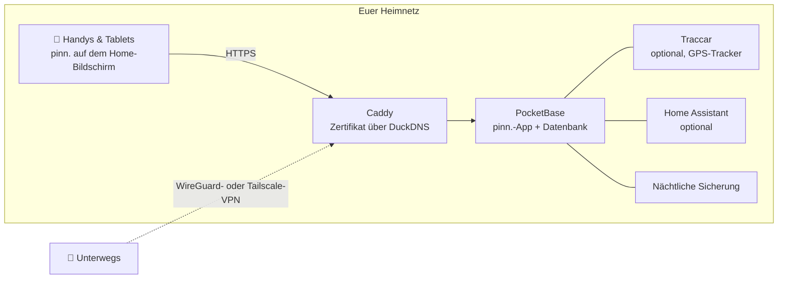

<p align="center">
  
</p>

<p align="center">
  <a href="https://github.com/pinn-shost/pinn/releases/latest"></a>
  <a href="LICENSE"></a>
  
  
  
  <a href="https://ko-fi.com/pinnapp"></a>
</p>

<p align="center">
  <a href="README.md">🇬🇧 English</a> ·
  <b>🇩🇪 Deutsch</b> ·
  <a href="README.es.md">🇪🇸 Español</a> ·
  <a href="README.fr.md">🇫🇷 Français</a>
</p>

<p align="center">
  <a href="#screenshots">Screenshots</a> ·
  <a href="#was-pinn-kann">Funktionen</a> ·
  <a href="#installation">Installation</a> ·
  <a href="#datenschutz">Datenschutz</a> ·
  <a href="#faq">FAQ</a>
</p>

---

pinn. ist eine App für alles, was einen Haushalt am Laufen hält: der gemeinsame Kalender, das Essen der Woche, die Einkaufsliste, wer den Müll rausbringt, das Taschengeld und die Versicherung, die im März gekündigt werden muss. Sie läuft auf **eurem eigenen NAS** mit Docker und lässt sich auf jedem iPhone, iPad und Android-Handy der Familie wie eine echte App installieren.

Kein Cloud-Konto. Kein Abo. Keine Werbung, kein Tracking. Die Daten eurer Familie verlassen nie euer Zuhause.

## Screenshots

### Auf dem iPad

An der Wand oder auf dem Küchentisch: Das gemeinsame iPad zeigt die ganze Familie auf einen Blick.

<table>
  <tr>
    <td align="center" width="50%">
      <br>
      <sub><b>Dashboard</b> – jeder tippt auf sein eigenes Bild, auf Wunsch mit PIN</sub>
    </td>
    <td align="center" width="50%">
      <br>
      <sub><b>Übersicht</b> – Wetter, Termine, Aufgaben, Essen und die Familie auf einen Blick</sub>
    </td>
  </tr>
</table>

### Auf dem Handy

Immer dabei: pinn. lässt sich auf jedem iPhone und Android-Handy wie eine echte App installieren.

<table>
  <tr>
    <td align="center" width="33%"><br><sub><b>Übersicht</b> – dein Tag auf einen Blick</sub></td>
    <td align="center" width="33%"><br><sub><b>Kalender</b> – iCloud und Google in einer Ansicht</sub></td>
    <td align="center" width="33%"><br><sub><b>Essen</b> – Woche planen, mit einem Tipp einkaufen</sub></td>
  </tr>
  <tr>
    <td align="center" width="33%"><br><sub><b>Listen</b> – Einkauf, Vorrat, Packen</sub></td>
    <td align="center" width="33%"><br><sub><b>Finanzen</b> – Budget, Sparen, Taschengeld</sub></td>
    <td align="center" width="33%"><br><sub><b>Kinder</b> – ein verspielter Tagesablauf</sub></td>
  </tr>
</table>

## Was pinn. kann

| | |
|---|---|
| 📅 **Kalender** | iCloud- und Google-Kalender pro Person, privat oder mit der Familie geteilt. Feiertage, Schulferien, Abfuhrtermine und Geburtstage aus euren Kontakten erscheinen automatisch. |
| 🍝 **Essen & Rezepte** | Woche planen, dann die Zutaten direkt auf die Einkaufsliste schicken. Rezepte aus Text, PDF, Fotos oder einem Link übernehmen – auf Wunsch mit KI. Lieblingsrezepte mit anderen Familien auf eurem Server teilen. |
| 🛒 **Listen** | Einkaufslisten pro Laden, ein Vorrat, der die Liste auffüllt, wenn etwas zur Neige geht, Packlisten aus Vorlagen (Urlaub, Kliniktasche, Party), Geschenke und Wunschzettel. |
| ✅ **Aufgaben & Haushalt** | Aufgaben mit Push-Erinnerung, Putzpläne und Mülleimer – dazu eine Kinderseite mit bunten Tagesabläufen, die nur zeigt, was zur Tageszeit passt. |
| 💶 **Finanzen** | Gemeinsame oder private Kassen, Haushaltsbudget, Sparen und Depots mit ETFs und Aktien, Taschengeld, regelmäßige Buchungen und Verträge mit Kündigungserinnerung. WGs können Kosten aufteilen und sehen, wer wem etwas schuldet. |
| 📄 **Dokumente & Fahrzeuge** | Belege und Garantien, Ausweise mit Ablauf-Erinnerung. Autos und Räder mit HU-Terminen, Reifenwechsel, Verbrauch und Gesamtkosten. |
| 🏡 **Zuhause** | Für Mieter, Eigentümer und Vermieter: Miet- oder Kaufvertrag, Kredit, Mängel mit Fotos, Rechnungen, Sanierungsplan, Zählerstände mit Prognose, Schlüssel und Mieteinnahmen für vermietete Wohnungen, Häuser und Garagen. Garten & Pflanzen mit einem Gießplan, der weiß, wann es geregnet hat. |
| 📍 **Familie & Ortung** | Standort direkt aus pinn. teilen – einmalig oder für eine gewählte Zeit – und im Hintergrund über die kostenlose App Traccar Client (sendet direkt an pinn., kein extra Server). Dazu ein „Heimweg“-Modus, ein SOS-Alarm mit Standort und Notrufnummern, Notfallpässe und Ankunfts-Meldungen für Orte. |
| 🎒 **Schule & Kita** | Pro Kind: Stundenplan (eintippen oder abfotografieren – die KI füllt ihn aus), Bringen und Abholen, Hausaufgaben auf der Kinderseite, Elternbriefe mit Fristen, aus denen Erinnerungen werden, und Schließtage direkt im Kalender. |
| 🐾 **Haustiere** | Steckbriefe für Hund, Katze, Kaninchen & Co. mit Fütterungszeiten zum Abhaken, Gassi-Runden, „Wer ist dran“-Plan, Impfungen und Entwurmung mit Push-Erinnerung, Gewichtsverlauf, Tierarzt und Tiernotdienst, ein Blatt für den Tiersitter zum Teilen und ein druckbares „Vermisst“-Plakat. |
| 🌦️ **Wetter & Urlaub** | Ein Tipp auf die Wetter-Kachel zeigt 14 Tage mit Details für jeden Tag. Packlisten mit Reiseziel und Datum zeigen das Urlaubswetter – Vorhersage oder typische Werte – und schlagen vor, was mit muss. |
| 🏠 **Smarthome** | Apple-Kurzbefehle oder Home-Assistant-Aktionen direkt aus einer Aufgabe starten – der Saugroboter putzt die Küche, sobald die Aufgabe dran ist. |
| 🎙️ **Sprachsteuerung** | „Hey Siri, pinn“: etwas auf die Einkaufsliste setzen, sie vorlesen lassen, Aufgaben anlegen und hören, was heute ansteht – auch auf Android. |
| 🔔 **Benachrichtigungen** | Persönliche Push-Nachrichten auf iPhone, iPad und Android, dazu eine Glocke, die jede Änderung in der Familie sammelt. |
| 🧩 **Alles andere** | Familien-Pinnwand mit verschiebbaren Zetteln, globale Suche, Offline-Modus mit automatischem Abgleich, Dunkelmodus, iPad-Dashboard mit Profil-PINs, Gastkonto, Kindersicherung. |

pinn. spricht **English, Deutsch, Français und Español**, passt Währung und Notrufnummern an eure Region an und wechselt zwischen den Bezeichnungen für **Familie** und **WG**. Ein Server kann mehrere Familien aufnehmen, jede mit eigenen Admins.

## Neu in 1.58

**App-Code aufgeteilt, Teil 16 – für euch ändert sich nichts**

- **Für Mitwirkende:** Finanzen – Ausgaben & Einnahmen, Haushaltsbudget, Kategorien, regelmäßige Buchungen und das Popup für Ausgaben – liegt jetzt in einer eigenen Datei (`pb_public/js/finanzen.js`). An der Bedienung ändert sich nichts.
- Nur App-Dateien geändert (`index.html` und `js/finanzen.js`), am Server ändert sich nichts. Installation wie gewohnt (`sudo sh pinn-*/pinn-setup.sh` oder der Update-Knopf).

## Neu in 1.57

**Aufgaben: Erinnerungen und direkte Eingabe**

- **Extra-Erinnerung per Push:** Beim Anlegen oder Bearbeiten einer Aufgabe – und bei allen Regeln, die Aufgaben automatisch anlegen (Reinigung, Mülleimer, Wartung, Gartenjahr, Fahrzeuge) – *Extra-Erinnerung per Push* anhaken und eine Uhrzeit wählen. Am Fälligkeitstag bekommen die Zuständigen dann zu dieser Zeit eine Push.
- **Zählerstände in einem Rutsch:** Antippen der Aufgabe *Zählerstände ablesen* öffnet direkt das Eintragen – bei mehreren Zählern einer nach dem anderen. Sind alle Stände eingetragen, hakt sich die Aufgabe selbst ab, auch wenn du sie unter *Zuhause* einträgst.
- **Fahrzeug-Aufgaben:** HU/TÜV, Inspektion, Reifenwechsel, Versicherungskennzeichen und eigene Fristen öffnen beim Antippen direkt das passende Eintragen und haken sich nach dem Speichern selbst ab.
- **Zuhause:** Überfällige Wartungen in der Übersicht führen jetzt zur Eingabe bzw. zur Aufgabe mit *✓ Erledigt* statt zum Wartungsplan. Im Wartungsplan gibt es dafür einen eigenen Knopf.
- **Korrektur:** Zwei gleich benannte Wartungen (z. B. im Gartenjahr) teilten sich ihre Aufgabe – beim Bearbeiten geriet dadurch die Fälligkeit durcheinander. Gleiche Namen bekommen jetzt automatisch eine Nummer, z. B. „Rasen düngen (2)“; vorhandene Doppelte werden einmalig repariert.
- App- und Server-Dateien geändert. Installation wie gewohnt (`sudo sh pinn-*/pinn-setup.sh` oder der Update-Knopf) – das neue Feld für die Erinnerung legt der Server selbst an.

## So funktioniert es



Alles läuft als Docker-Container auf einem Gerät. HTTPS funktioniert **ohne Portfreigabe** – das Zertifikat wird über eine DNS-Prüfung ausgestellt. Von außen ist pinn. nur über euer eigenes VPN erreichbar.

## Voraussetzungen

- Ein NAS oder Server mit **Docker** und **Docker Compose 2.17+** – entwickelt auf einem UGREEN-NAS mit UGOS, läuft auf jedem Linux-Docker-Host (amd64, arm64, armv7)
- SSH-Zugang dazu
- Optional, aber empfohlen: eine kostenlose [DuckDNS](https://www.duckdns.org)-Subdomain für HTTPS – nötig für Push-Benachrichtigungen und um pinn. als App zu installieren

## Installation

1. Die ZIP der [neuesten Version](https://github.com/pinn-shost/pinn/releases/latest) herunterladen und entpacken.
2. Auf dem NAS einen Ordner anlegen, z. B. `/volume1/docker/Pocketbase`, und den entpackten Ordner (z. B. `pinn-1.58.0` oder `pinn-main`) so, wie er ist, hineinlegen.
3. Per SSH anmelden und ausführen:
   ```sh
   cd /volume1/docker/Pocketbase && sudo sh pinn-*/pinn-setup.sh
   ```
   Das Skript legt alle Dateien an ihren Platz, lädt die Bibliotheken für PDF-Import und Texterkennung auf Fotos herunter und startet pinn.
4. `http://<NAS-IP>:8090` öffnen → **Als Hauptadmin anmelden** → Passwort `Admin` → eigenes Passwort wählen.
5. Der **Einrichtungsassistent** führt durch den Rest – HTTPS, Fernzugriff über WireGuard oder Tailscale, Google, KI, Ortung und Home Assistant – Schritt für Schritt, in vier Sprachen.
6. pinn. auf jedem Handy über seine HTTPS-Adresse öffnen und zum Home-Bildschirm hinzufügen:
   - **iPhone/iPad (Safari):** Teilen → *Zum Home-Bildschirm* (ab iOS 16.4 für Benachrichtigungen)
   - **Android (Chrome):** Einstellungen → Benachrichtigungen → *pinn. als App installieren*, oder Chrome-Menü ⋮ → *App installieren*

   Danach auf jedem Gerät unter **Einstellungen → Benachrichtigungen → Auf diesem Gerät aktivieren** die Benachrichtigungen einschalten.

**Aktualisieren:** die neue ZIP herunterladen, den entpackten Ordner in denselben Ordner legen und `sudo sh pinn-*/pinn-setup.sh` erneut ausführen – oder in der App den Update-Knopf nutzen. Ersetzte Dateien landen in `_alt/`, eure Daten bleiben unberührt.

**Sicherungen** laufen jede Nacht nach `./backups` und werden 14 Tage aufbewahrt.

## Datenschutz

pinn. ist für Daten gebaut, die man nie einem Cloud-Dienst geben würde: Kontoauszüge, Gesundheitsunterlagen, wo eure Kinder gerade sind. Deshalb:

- **Alle Daten liegen auf eurem NAS** in einer einzigen PocketBase-Datenbank. Es gibt keinen pinn.-Server und keine Telemetrie.
- **Keine Skripte von fremden Servern.** Aller Code und alle Bibliotheken kommen von eurem NAS.
- **Push-Nachrichten enthalten keinen Inhalt.** Apple, Google und Mozilla liefern nur ein leeres Wecksignal; das Gerät holt die Nachricht dann von eurem NAS.
- **Passwörter für iCloud und Google** liegen verschlüsselt in einer gesperrten Sammlung.
- **Nicht aus dem Internet erreichbar.** Der Fernzugriff läuft über euer eigenes VPN.

pinn. nutzt Dienste von außen nur für Funktionen, die sie brauchen:

| Dienst | Wofür | Wann |
|---|---|---|
| [Open-Meteo](https://open-meteo.com) | Wettervorhersage | wenn eine Adresse fürs Zuhause hinterlegt ist |
| [OpenStreetMap Nominatim](https://nominatim.openstreetmap.org) | Adressen in Kartenpositionen umwandeln | beim Eingeben von Adressen |
| [OpenStreetMap-Kacheln](https://www.openstreetmap.org) | Kartenhintergrund | auf der Ortungsseite, geladen über euer NAS |
| [Google Fonts](https://fonts.google.com) | Schriften | beim Laden der App |
| [OpenHolidays API](https://www.openholidaysapi.org) | Feiertage und Schulferien | wenn eine Adresse fürs Zuhause hinterlegt ist |
| [DuckDNS](https://www.duckdns.org) | HTTPS-Zertifikat und Adresse | wenn eingerichtet |
| iCloud / Google | Kalender und Kontakte | nur für Konten, die ihr verbindet |
| Google Gemini | Rezepte und Dokumente auslesen | nur, wenn ihr einen API-Schlüssel hinterlegt |
| jsDelivr | Einmaliger Download von pdf.js und Tesseract | nur bei der Installation |

## FAQ

<details>
<summary><b>Muss ich Ports am Router öffnen?</b></summary>
<br>
Nein. Das HTTPS-Zertifikat wird über eine DNS-Prüfung ausgestellt, und der Fernzugriff läuft über ein VPN – WireGuard an einer FRITZ!Box oder Tailscale bei jedem anderen Router.
</details>

<details>
<summary><b>Geht es auch ohne NAS?</b></summary>
<br>
Jedes Gerät mit Docker, das ständig läuft, funktioniert: ein Mini-PC, ein Raspberry Pi 4/5 oder ein Linux-Server.
</details>

<details>
<summary><b>Ist pinn. eine „echte“ App aus dem App Store?</b></summary>
<br>
pinn. ist eine Web-App, die man zum Home-Bildschirm hinzufügt. Sie öffnet sich dann im Vollbild wie eine echte App, funktioniert offline, zeigt eine Plakette mit offenen Aufgaben und bekommt Push-Benachrichtigungen – ganz ohne App Store.
</details>

<details>
<summary><b>Können mehrere Familien eine Installation nutzen?</b></summary>
<br>
Ja. Der Hauptadmin legt Familien an, jede Familie bekommt eigene Admins, Kalender und Daten. Rezepte lassen sich auf Wunsch zwischen Familien teilen.
</details>

<details>
<summary><b>Und die Kinder?</b></summary>
<br>
Profile mit Kindersicherung sehen nur ihre eigenen Aufgaben und können nichts löschen oder ändern. Finanzen, Dokumente und Fahrzeuge bleiben verborgen. Jüngere Kinder bekommen eine eigene, verspielte Seite mit ihrem Tagesablauf.
</details>

<details>
<summary><b>Was kostet das?</b></summary>
<br>
Nichts – pinn. ist kostenlos und Open Source unter der MIT-Lizenz. Optionale Dienste wie die Gemini-KI haben kostenlose Kontingente.
</details>

## Aufbau des Repositorys

Das Repository ist genauso aufgebaut wie eine Installation auf dem NAS – jede Datei liegt dort, wo sie am Ende landet:

```
pinn/
├── pb_hooks/            Server: *.pb.js-Hooks und ihre Hilfsmodule (pinn-*.js, calendar-sync.js)
├── pb_public/           Web-App, ausgeliefert von PocketBase
│   ├── index.html       die App (HTML, Styles und der größte Teil des Codes)
│   ├── js/              aus der index.html ausgelagerter App-Code, einfache <script>-Dateien ohne Build-Schritt
│   │                    (finanzen.js, kassen.js, vorrat.js, vorrat2.js, sparen.js, vertraege.js, fahrzeuge.js, zuhause.js, dokumente.js, pdflesen.js, appstart.js, pinnwand.js, listen.js, familie.js, hinweise.js, ausblick.js – ausblick.js kommt immer zuletzt)
│   ├── einrichtung.js   Einrichtungsassistent · datenexport.js  Datenexport
│   ├── lang/            Übersetzungen (en, fr, es)
│   └── vendor/          pinn.css, pocketbase/ (pdf.js und Tesseract lädt die Einrichtung herunter)
├── caddy/Caddyfile      HTTPS-Reverse-Proxy
├── docker-compose.yaml  alle Container
├── env.txt              Vorlage für .env
├── pinn-setup.sh        Installation & Update
├── pinn-wartung.sh      Sicherungen & Updates (Container „wartung“)
├── pinn-pocketbase-update.sh
├── index.html           nur Platzhalter, wird nie installiert (hält den Update-Knopf von 1.38 am Laufen)
└── README.md            englische Startseite · README.de.md (diese Seite) · README.es.md · README.fr.md
```

`pinn-setup.sh` kopiert `pb_hooks/`, `pb_public/` und `caddy/Caddyfile` 1:1 in den Projektordner; Datenordner (`pb_data/`, `konfig/`, `backups/`, `caddy/data/` …) werden nie angefasst.

## Mitmachen

Fehlermeldungen, Ideen und Übersetzungen sind sehr willkommen – siehe [CONTRIBUTING.md](.github/CONTRIBUTING.md). Sicherheitslücken bitte vertraulich melden, wie in [SECURITY.md](.github/SECURITY.md) beschrieben.

## pinn. unterstützen

pinn. ist kostenlos und bleibt es – vollständig, für alle. Es entsteht in meiner Freizeit. Wenn es euch den Alltag ein bisschen leichter macht, freue ich mich über eine kleine Unterstützung – ganz freiwillig:

<p>
  <a href="https://ko-fi.com/pinnapp"></a>
  <a href="https://buymeacoffee.com/pinn"></a>
</p>

Auch ein ⭐ hilft – so finden andere Familien pinn. leichter.

## Gebaut mit

[PocketBase](https://pocketbase.io) (MIT) · [Tailwind CSS](https://tailwindcss.com) (MIT) · [pdf.js](https://mozilla.github.io/pdf.js/) (Apache-2.0) · [Tesseract.js](https://tesseract.projectnaptha.com) (Apache-2.0) · [Traccar](https://www.traccar.org) (Apache-2.0) · [Caddy](https://caddyserver.com) (Apache-2.0)

## Lizenz

[MIT](LICENSE) – nutzen, ändern, weitergeben.
