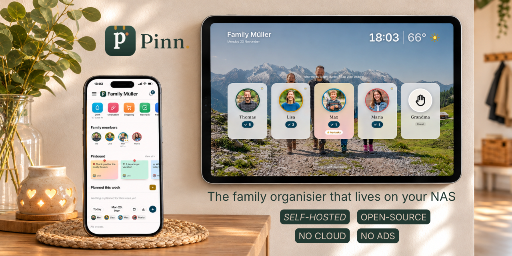
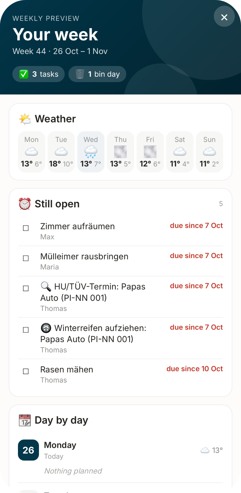
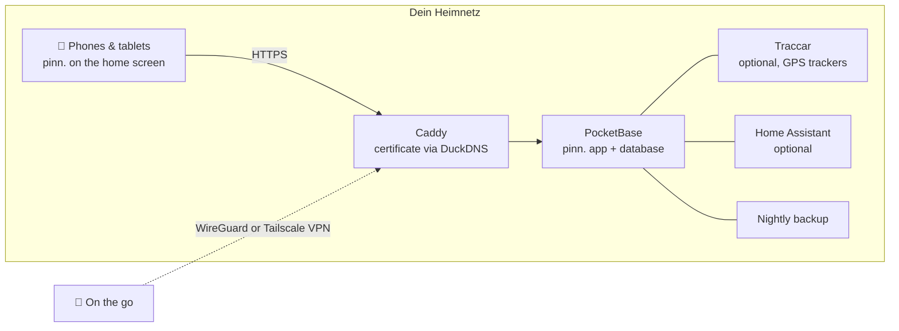

<p align="center">
  
</p>

<p align="center">
  <a href="https://github.com/pinn-shost/pinn/releases/latest"></a>
  <a href="LICENSE"></a>
  
  
  
  <a href="https://ko-fi.com/pinnapp"></a>
</p>

<p align="center">
  <a href="README.md">🇬🇧 English</a> ·
  <b>🇩🇪 Deutsch</b> ·
  <a href="README.es.md">🇪🇸 Español</a> ·
  <a href="README.fr.md">🇫🇷 Français</a> ·
  <a href="README.it.md">🇮🇹 Italiano</a> ·
  <a href="README.pt.md">🇧🇷 Português</a> ·
  <a href="README.zh.md">🇨🇳 中文</a> ·
  <a href="README.ja.md">🇯🇵 日本語</a> ·
  <a href="README.ko.md">🇰🇷 한국어</a> ·
  <a href="README.ru.md">🇷🇺 Русский</a> ·
  <a href="README.nl.md">🇳🇱 Nederlands</a> ·
  <a href="README.tr.md">🇹🇷 Türkçe</a> ·
  <a href="README.pl.md">🇵🇱 Polski</a> ·
  <a href="README.uk.md">🇺🇦 Українська</a>
</p>

<p align="center">
  <a href="#screenshots">Screenshots</a> ·
  <a href="#what-pinn-does">Funktionen</a> ·
  <a href="#installation">Installation</a> ·
  <a href="#privacy">Datenschutz</a> ·
  <a href="#faq">FAQ</a>
</p>

---

pinn. ist eine App für alles, was einen Haushalt am Laufen hält: den gemeinsamen Kalender, die Mahlzeiten der Woche, die Einkaufsliste, wer den Müll rausbringt, das Taschengeld und die Versicherung, die im März gekündigt werden muss. Sie läuft auf **deinem eigenen NAS** mit Docker und lässt sich auf jedem iPhone, iPad und Android-Handy der Familie wie eine echte App installieren.

Kein Cloud-Konto. Kein Abo. Keine Werbung, kein Tracking. Die Daten deiner Familie verlassen nie dein Zuhause.

<a id="screenshots"></a>

## Screenshots

### Auf dem iPad

An die Wand gehängt oder auf den Küchentisch gelegt: Das gemeinsame iPad zeigt die ganze Familie auf einmal.

<table>
  <tr>
    <td align="center" width="50%">
      <a href=".github/assets/screenshots/dashboard.png"></a><br>
      <sub><b>Dashboard</b> – alle tippen auf ihr eigenes Bild, optional mit PIN</sub>
    </td>
    <td align="center" width="50%">
      <a href=".github/assets/screenshots/ipad-overview.png"></a><br>
      <sub><b>Übersicht</b> – Wetter, Termine, Aufgaben, Essen und die Familie auf einen Blick</sub>
    </td>
  </tr>
</table>

### Auf dem Handy

Immer dabei: pinn. lässt sich auf jedem iPhone und Android-Handy wie eine echte App installieren.

<table>
  <tr>
    <td align="center" width="33%"><a href=".github/assets/screenshots/home.png"></a><br><sub><b>Übersicht</b> – dein Tag auf einen Blick</sub></td>
    <td align="center" width="33%"><a href=".github/assets/screenshots/calendar.png"></a><br><sub><b>Kalender</b> – iCloud und Google in einer Ansicht</sub></td>
    <td align="center" width="33%"><a href=".github/assets/screenshots/meals.png"></a><br><sub><b>Essen</b> – die Woche planen, mit einem Tipp einkaufen</sub></td>
  </tr>
  <tr>
    <td align="center" width="33%"><a href=".github/assets/screenshots/lists.png"></a><br><sub><b>Listen</b> – Einkauf, Vorrat, Packen</sub></td>
    <td align="center" width="33%"><a href=".github/assets/screenshots/finance.png"></a><br><sub><b>Finanzen</b> – Budget, Sparen, Taschengeld</sub></td>
    <td align="center" width="33%"><a href=".github/assets/screenshots/chat.png"></a><br><sub><b>Chat</b> – Ende-zu-Ende verschlüsselt, mit Sprachnachrichten und Standort</sub></td>
  </tr>
</table>

### Weitere Screens

Ein Klick auf ein Bild öffnet es in voller Größe.

<details>
<summary><b>Weitere Screenshots anzeigen</b></summary>

<br>

<table>
  <tr>
    <td align="center" width="25%"><a href=".github/assets/screenshots/house.png"></a><br><sub><b>Zuhause</b> – Haus, Kosten, Kredit, Mängel und Zähler an einem Ort</sub></td>
    <td align="center" width="25%"><a href=".github/assets/screenshots/tasks.png"></a><br><sub><b>Aufgaben</b> – automatische Erinnerungen, z. B. an TÜV und Reifenwechsel, mit Direkt-Button</sub></td>
    <td align="center" width="25%"><a href=".github/assets/screenshots/vehicles.png"></a><br><sub><b>Fahrzeuge</b> – TÜV, Reifen, Tanken und Laden</sub></td>
    <td align="center" width="25%"><a href=".github/assets/screenshots/scan_pantry.png"></a><br><sub><b>Vorrat scannen</b> – Strichcode scannen, einlagern oder verbrauchen</sub></td>
  </tr>
  <tr>
    <td align="center" width="25%"><a href=".github/assets/screenshots/weekly_summary_1.png"></a><br><sub><b>Wochenvorschau</b> – Wetter und was noch offen ist</sub></td>
    <td align="center" width="25%"><a href=".github/assets/screenshots/weekly_summary_2.png"></a><br><sub><b>Wochenvorschau</b> – Tag für Tag: Putzen, Müll, Zahlungen</sub></td>
    <td align="center" width="25%"><a href=".github/assets/screenshots/weekly_summary_3.png"></a><br><sub><b>Letzte Woche kompakt</b> – Termine, Essen, Ausgaben – und Abkürzungen</sub></td>
    <td align="center" width="25%"><a href=".github/assets/screenshots/kids.png"></a><br><sub><b>Kinder</b> – ein spielerischer Tagesablauf</sub></td>
  </tr>
</table>

</details>

<sub>📁 <a href=".github/assets/screenshots">Alle Bilder in einem Ordner</a></sub>

<a id="what-pinn-does"></a>

## Was pinn. kann

| | |
|---|---|
| 📅 **Kalender** | iCloud- und Google-Kalender pro Person, privat oder mit der Familie geteilt. Feiertage, Schulferien, Müllabfuhrtermine und Geburtstage aus deinen Kontakten erscheinen automatisch. |
| 🍝 **Essen & Rezepte** | Plane die Woche und schicke die Zutaten direkt auf die Einkaufsliste. Importiere Rezepte aus Text, PDF, Fotos oder einem Link – wahlweise mit KI. Teile Lieblingsrezepte mit anderen Familien auf deinem Server. |
| 🛒 **Listen** | Einkaufslisten pro Geschäft, ein Vorrat, der die Liste auffüllt, wenn etwas zur Neige geht, Packlisten aus Vorlagen (Urlaub, Kliniktasche, Party) sowie Geschenk- und Wunschlisten mit einem Geschenkplaner „Wer schenkt was“, den der Beschenkte nie sieht. |
| ✅ **Aufgaben & Haushalt** | Aufgaben mit Push-Erinnerungen, Putzpläne und Mülltonnen – dazu eine Kinderseite mit animierten Routinen, die nur zeigt, was zur Tageszeit passt. |
| 💶 **Finanzen** | Gemeinsame oder private Kassen, ein Haushaltsbudget, Sparen und Depots mit ETFs und Aktien, Taschengeld, wiederkehrende Zahlungen und Verträge mit Kündigungserinnerungen. WGs können Kosten teilen und sehen, wer wem etwas schuldet. |
| 📄 **Dokumente & Fahrzeuge** | Belege und Garantien, Ausweise mit Ablauferinnerung. Autos und Fahrräder mit Prüfterminen, Reifenwechsel, Verbrauch und Gesamtkosten. |
| 🏡 **Zuhause** | Für Mieter, Eigentümer und Vermieter: Miet- oder Kaufvertrag, Darlehen, Mängel mit Fotos, Rechnungen, Renovierungsplan, Zählerstände mit Prognose, Schlüssel und Mieteinnahmen für vermietete Wohnungen, Häuser und Garagen. Garten & Pflanzen mit einem Gießplan, der weiß, wann es geregnet hat. |
| 📍 **Familie & Standort** | Teile deinen Standort direkt in pinn. – einmalig oder für eine gewählte Zeit – und im Hintergrund über die kostenlose App Traccar Client (sendet direkt an pinn., kein zusätzlicher Server). Dazu ein „Auf dem Heimweg“-Modus, ein SOS-Alarm mit Position und Notrufnummern, Notfallpässe und Ankunftsmeldungen für Orte. |
| 🎒 **Schule & Kita** | Pro Kind: Stundenplan (eintippen oder fotografieren – die KI füllt ihn aus), Bringen und Abholen, Hausaufgaben auf der Kinderseite, Elternbriefe mit Fristen, die zu Erinnerungen werden, und Schließtage direkt im Kalender. |
| 🐾 **Haustiere** | Profile für Hunde, Katzen, Kaninchen & Co. mit Fütterungszeiten zum Abhaken, Gassirunden, einem „Wer ist dran?“-Plan, Impfungen und Entwurmung mit Push-Erinnerungen, Gewichtsverlauf, Tierarzt und Notdienst, einem Heimtierblatt für den Sitter zum Teilen, einem druckbaren „Vermisst“-Plakat und einer Erinnerung ans Auffüllen des Futterautomaten. |
| 🌦️ **Wetter & Urlaub** | Tippe aufs Wetter (Kachel auf dem Handy, oben neben Datum und Uhrzeit auf iPad und Computer) und sieh 14 Tage mit Details zu jedem Tag. Packlisten mit Ziel und Datum zeigen das Urlaubswetter – Vorhersage oder typische Werte – und schlagen vor, was mitzunehmen ist. |
| 🏠 **Smart Home** | Starte Apple-Kurzbefehle oder Home-Assistant-Aktionen aus einer Aufgabe – der Saugroboter putzt die Küche, wenn der Putzdienst fällig ist, Mähroboter und Bewässerung folgen dem Gartenplan, der Futterautomat meldet, wenn er leer wird. |
| 🎙️ **Sprachsteuerung** | „Hey Siri, pinn“: auf die Einkaufsliste setzen, sie vorlesen lassen, Aufgaben anlegen und hören, was heute ansteht – auch auf Android. |
| 💬 **Chat** | Familienchat und private Chats, Ende-zu-Ende verschlüsselt, mit Push, Lesehaken und Antworten. |
| 🔔 **Benachrichtigungen** | Persönliche Push-Nachrichten auf iPhone, iPad und Android sowie eine Glocke, die jede Änderung in der Familie sammelt. |
| 🧩 **Und mehr** | Familien-Pinnwand mit verschiebbaren Zetteln, globale Suche, Offline-Modus mit automatischem Abgleich, Dunkelmodus, iPad-Dashboard mit Profil-PINs, Gastzugang, Kindersicherung. |

pinn. spricht **🇬🇧 English, 🇩🇪 Deutsch, 🇪🇸 Español, 🇫🇷 Français, 🇮🇹 Italiano, 🇧🇷 Português, 🇨🇳 中文, 🇯🇵 日本語, 🇰🇷 한국어, 🇷🇺 Русский, 🇳🇱 Nederlands, 🇹🇷 Türkçe, 🇵🇱 Polski und 🇺🇦 Українська**, passt Währung und Notrufnummern an deine Region an und wechselt zwischen den Begriffen **Familie** und **WG**. Ein Server kann mehrere Familien beherbergen, jede mit eigenen Admins.

## Neu in 1.151.0

**Portainer-Stack, fertiges Image**

- Neu: pinn. lässt sich ohne SSH und ohne Setup-Skript über die Portainer-Stack-Oberfläche installieren. Bei jedem Release wird ein fertiges Image (amd64, arm64) gebaut und unter `ghcr.io/pinn-shost/pinn` veröffentlicht; die neue Datei `docker/docker-compose.portainer.yaml` nutzt es mit Volumes und ohne feste Container-Namen (kein Konflikt mehr mit einem vorhandenen Tailscale-Container). In der App verweist „Sicherungen & Updates“ auf Portainer, wenn pinn. als Image läuft. Siehe „Portainer-Stack (ohne Skript)“ unter Installation.
- Geändert: `docker/` (new), `.github/workflows/image.yml` (new), `pb_hooks/pinn-system.js`, `js/sicherungen.js`, `i18n/`, `js/sprachen.js`, `js/versionslog.js`, `src/`, `index.html`.

## Neu in 1.150.11

**Symbole und Kleinigkeiten**

- Kamm-Symbol bei „Haare kämmen“ auf der Kinderseite; kein Emoji-Feld mehr neben dem Depot-Namen; Kassen-Auswahllisten ohne Emoji; das Werkzeug ist jetzt ein Maulschlüssel; „Menüs für Gäste“ mit dem Zwei-Personen-Symbol; ein Tipp auf das Logo neben dem Familiennamen führt zur Übersicht; die Karte „Benachrichtigungen“ wird zuerst gefüllt, damit „Auf diesem Gerät aktivieren“ immer erscheint; Shortcut-Symbole sind im Dunkelmodus grau.
- Geändert: `js/symbole.js`, `js/symbole3.js`, `js/ansichten.js`, `js/konto.js`, `css/dunkelfarbe.css`, `js/sprachen.js`, `js/versionslog.js`, `i18n/versionslog.en.js`, `src/`, `index.html`.

## Neu in 1.150.10

**Dunkelmodus, mehr Symbole, neuer Haustiere-Banner, Tier-Tagebuch**

- **Dunkelmodus.** Blaue Schrift ist jetzt Gold (Geräte, Listen, „Einkauf planen“, Haken bei Tieren, Gesundheit und Aufgaben); die Balken bei Haushalt haben die Raumfarbe; Chat-Hinweise, Vertrags-Hinweise und „Im Blick“-Texte sind lesbar. **Mehr Symbole statt Emoji:** Profilbilder (Baby, Junge, Mädchen, Mann, Frau, Opa, Oma), Familie und WG, Tiere (Hund, Katze, Kaninchen, Hamster, Vogel, Küken, Fisch, Pferd, Schildkröte, Schlange) – auch bei Kliniktasche, Geschenkliste „Ostern“, Checklisten und Finanz-Kategorien; Auswahllisten zeigen nur den Text. **Neuer Haustiere-Banner** mit bunten Tieren. **Tier-Tagebuch:** Eine abgehakte Vorsorge steht im Tagebuch, mit dem × nimmst du ein versehentliches Abhaken zurück.
- Geändert: `css/dunkelfarbe.css` (new), `js/symbole3.js` (new), `js/symbole.js`, `js/szenen.js`, `js/familie.js`, `js/haushalt.js`, `css/symbolfarbe.css`, `css/haustierewetter.css`, `js/sprachen.js`, `js/versionslog.js`, `i18n/`, `src/`, `pinn-setup.sh`, `index.html`.

## Neu in 1.150.9

**Farbe bei den Symbolen, Fahrzeug- und Pflanzen-Symbole**

- **Farbe am Tag.** Die Symbole sind jetzt leicht ausgemalt (weiße Flächen, Sonne gelb, Regen blau, Auto rot, Werkzeug grau, Pflanzen grün) – im gleichen Linien-Stil; der Dunkelmodus bleibt wie er war. **Fahrzeug-Symbole:** statt des Auto-Emojis wählst du ein Linien-Symbol (Limousine, SUV, Taxi, Transporter, Pick-up, Traktor, Wohnwagen, Fahrrad, E-Bike …). Auch die **Pflanzen-Symbole** wählst du aus der App, mit neuen Symbolen für Kaktus, Palme, Tulpe, Sonnenblume, Rose und mehr. In den Bannern von Fahrzeuge und Zuhause leuchten die Autos nur nachts – vorne gelblich, hinten rot.
- Geändert: `js/symbole2.js`, `css/symbolfarbe.css` (new), `js/symbole.js`, `js/wetterlogos.js`, `js/symbolwahl.js`, `js/fahrzeuge.js`, `js/zuhause.js`, `js/dokumente.js`, `css/fahrzeuge.css`, `js/sprachen.js`, `js/versionslog.js`, `i18n/`, `src/`, `pinn-setup.sh`, `index.html`.

## Neu in 1.150.8

**Symbole überall, Auswahl aus der App**

- **Eigene Symbole überall.** Auch Essen, Haushalt, Fahrzeuge, Pflanzen, Kleidung, Spielzeug und Sport haben jetzt eigene Linien-Symbole (Räume, Müll-Arten, Fahrzeug-Arten, Garten, Wecker, Kalender-Umschalter, Countdown). **Kategorie-Symbole** in Finanzen, Verträgen, Dokumenten und Vorrat wählst du aus rund 150 fertigen Symbolen statt mit der Emoji-Tastatur; gleiche Kategorien haben überall dasselbe Symbol. Die Szenen von Zuhause und Fahrzeuge zeigen neue bunte Fahrzeuge. Kleinigkeiten: Wetter „Jetzt“ ohne gestrichelten Rand, Uhr-Schrift am Dashboard, Symbol der Essensplanungs-Liste, Symbole sitzen auf der Textlinie.
- Geändert: `js/szenen.js`, `js/symbolwahl.js` (new), `js/symbole.js`, `css/wetterlogos.css`, `js/zustand.js`, `js/zuhause.js`, `js/fahrzeuge.js`, `js/gesundheit.js`, `js/finanzen.js`, `js/vertraege.js`, `js/dokumente.js`, `js/vorrat.js`, `js/vorrat2.js`, `js/einkauf.js`, `js/profilauswahl.js`, `js/sprachen.js`, `js/versionslog.js`, `i18n/`, `src/`, `pinn-setup.sh`, `index.html`.

## Neu in 1.150.7

**Eigene Wetter-Symbole**

- **Wetter-Symbole.** Die Wetter-Ansichten haben jetzt eigene, schlichte Linien-Symbole statt der Apple-Emojis – im gleichen Stil wie die Shortcut-Symbole: Sonne, Mond, Wolken, Regen, Schnee, Gewitter, Wind, UV, Sonnenaufgang, Wasser und die Kleidungs-Tipps. Im Dunkelmodus wechseln sie mit.
- **Eigene Symbole überall.** Rund 150 schlichte Linien-Symbole ersetzen jetzt in der ganzen App die Apple-Emojis (Sterne, Haken, Warnungen, Orte, Geschenke, Uhr, Kalender, Schloss, Post, Werkzeug, Gesundheit, Haus, Geld und mehr). Tiere, Essen, Kleidung, Pflanzen, Fahrzeuge, Sport und Spielzeug, selbst gewählte oder getippte Emojis (Profilbilder, Chat-Texte, Eingabefelder) und Push-Nachrichten bleiben Emojis.
- Geändert: `js/symbole.js` (new), `js/wetterlogos.js`, `css/wetterlogos.css` (new), `js/familie.js`, `js/grundlagen.js`, `js/profilauswahl.js`, `js/wetterkachel.js`, `js/sprachen.js`, `js/versionslog.js`, `i18n/`, `src/`, `pinn-setup.sh`, `index.html`.

## Neu in 1.150.6

**Face ID entsperrt wieder von selbst**

- **Face ID.** pinn. fragt beim Öffnen wieder von selbst nach Face ID, wie vor 1.150.5. iOS zeigt immer sein eigenes Fenster „Passkey verwenden“ davor – ein Tipp darauf, dann Face ID; die Web-App kann es nicht überspringen, und der zusätzliche Knopf bedeutete nur einen zweiten Tipp. Der große Knopf unten bleibt, falls du das Fenster wegwischst.
- Geändert: `js/entsperren.js`, `js/sprachen.js`, `js/versionslog.js`, `i18n/`, `src/`, `index.html`.

## Neu in 1.150.5

**Neues Gesundheits-Banner · Trinken aufgeräumt**

- **Gesundheits-Banner.** Die Gesundheitsseite und die Seite jeder Person haben wieder ein Banner: Wasser, das mit dem Getrunkenen steigt, Bläschen, Herzschlag und schwebende Dinge – nachts mit Sternen.
- **Trinken.** Ziel, heutige Getränke und Erinnerung stehen jetzt im aufklappbaren Feld „Einstellungen“ unter dem Knopf. Der Shortcut „Heute kochen“ heißt jetzt „Kochen“.
- **Face ID.** Entsperren startet nur noch mit dem Knopf (kein Fenster „Passkey verwenden“ mehr); der Knopf sitzt unten, mit dem Daumen erreichbar.
- Geändert: `js/gesundheit.js`, `css/gesundheit.css`, `js/entsperren.js`, `js/sprachen.js`, `js/versionslog.js`, `i18n/`, `src/`, `index.html`.

## Neu in 1.150.4

**Benachrichtigungen bleiben nach Updates an**

- **Push übersteht Updates.** Konnte der Server seinen Push-Schlüssel während eines Updates kurz nicht lesen, legte er einen neuen an – und alle Geräte waren von den Benachrichtigungen abgemeldet. Der Schlüssel wird jetzt nie ersetzt, solange er vorhanden ist, sicher gespeichert und zusätzlich als Sicherungskopie aufbewahrt.
- **Ein Tipp genügt.** Verliert ein Gerät seine Anmeldung trotzdem (z. B. weil iOS sie zurückgesetzt hat), meldet pinn. es von selbst wieder an – oder zeigt unten „Wieder einschalten“, ohne Umweg über die Einstellungen.
- Geändert: `pb_hooks/pinn-push.js`, `pb_hooks/push.pb.js`, `pb_hooks/pinn-sitzungen.js`, `js/mitteilungen.js`, `js/appstart.js`, `js/sprachen.js`, `js/versionslog.js`, `i18n/`, `src/`, `index.html`.

## Neu in 1.150.3

**Alle Erinnerungen nach deiner Uhr · Eltern erinnern mit**

- **Alle Erinnerungen nach deiner Uhr.** Geburtstage, Haustiere, Packliste, Vorrat, Verträge, Dokumente, Wochenvorschau, Monatsausblick und Jahresrückblick, Termin-Erinnerungen, Tagesübersicht, Aufgaben- und Müll-Erinnerung, Pinnwand, Sprachsteuerung, Smarthome und Ortungs-Meldungen richten sich jetzt nach der Zeitzone deines Geräts, mit Sommer- und Winterzeit. Nichts einzustellen.
- **Eltern erinnern mit.** Bei Kindern bekommen auch die Eltern die Erinnerungen zum Trinken, zu Medikamenten und zum Händewaschen – mit dem Namen des Kindes davor. Schalter „Eltern auch erinnern“ pro Kind (Standard: an).
- **Shortcuts ohne Überschrift.** Die Kachel auf der Übersicht zeigt nur noch die Apps, getrennt durch die Linie.
- Geändert: alle Erinnerungs-Module in `pb_hooks/` (`pinn-zeit.js` und 13 weitere), `js/gesundheit.js`, `js/sprachen.js`, `js/versionslog.js`, `i18n/`, `src/`, `index.html`, README (+ 1.150.2).

## Neu in 1.150.2

**Shortcuts bleiben auf der Übersicht**

- **Fenster statt Sprung.** Ein Tipp auf Trinken, Medikamente, Einkauf, Heute kochen, Putzplan, Haustiere, Vorrat, SOS oder Unterwegs öffnet das Fenster unten; dort klickst du dich durch, und ein kurzer Hinweis sagt, was passiert ist.
- **Fenster und Links.** Aufgabe, Termin, Zettel, Ausgabe und Einnahme öffnen ihr gewohntes Fenster, Hände waschen zählt +1. Chat, Finanzen und Pflanzen sind einfache Links; „Öffnen ›“ im Fenster führt zur ganzen Seite.
- **Behoben.** Nach dem Wechsel auf eine andere Seite (z. B. Rezepte oder Einkauf) steht unten nicht mehr die Kachel „Shortcuts“.
- **Eine oder mehrere Reihen.** Unter Einstellungen → Shortcuts wählst du getrennt für das Handy und für Tablet & Computer: eine Reihe (zur Seite wischen für die übrigen) oder mehrere Reihen (alle Shortcuts nach unten aufgefüllt).
- Geändert: `js/kurzbefehle.js`, `js/kurzfenster.js`, `css/kurzbefehle.css`, `js/uebersicht.js`, `js/design.js`, `js/ansichten.js`, `js/rezepte.js`, `js/sprachen.js`, `js/versionslog.js`, `i18n/`, `src/`, `index.html`, README (+ 1.150.1).

## Neu in 1.150.1

**Shortcuts im eigenen Menüpunkt**

- **Eigener Menüpunkt.** Die Auswahl der Apps steht jetzt unter Einstellungen → Shortcuts. Vorher klappte beim Öffnen von „Shortcuts“ die Übersicht-Einstellung zu, und die Seite ließ sich nicht mehr scrollen.
- **Ein/Aus unter Übersicht.** Die Kachel „Shortcuts“ schaltest du wie jede andere Kachel ein oder aus; „Apps wählen“ führt direkt zur Auswahl.
- **Sofort sichtbar.** Solange du nichts selbst gewählt hast, zeigt die Kachel eine Standardauswahl (Trinken, Einkauf, Aufgabe, Termin, Heute kochen, Zettel, Ausgabe, Putzplan). Ist keine App gewählt, bietet sie „Apps wählen“ an, statt zu verschwinden.
- Geändert: `js/kurzbefehle.js`, `css/kurzbefehle.css`, `js/uebersicht.js`, `js/uebersichteinstellungen.js`, `js/design.js`, `js/sprachen.js`, `js/versionslog.js`, `i18n/`, `src/`, `index.html`, README.

## Neu in 1.150.0

**Zeiten in deiner Region · Shortcuts auf der Übersicht · Schnellfenster für die Shortcuts**

- **Erinnerungen zur richtigen Uhrzeit.** pinn. rechnet Erinnerungen jetzt in der Zeitzone deines Geräts, mit Sommer- und Winterzeit deiner Region. Du musst nichts einstellen – das Gerät meldet dem Server still seine Zeitzone, auch nach einem Umzug oder auf Reisen.
- **Zuerst die Gesundheits-Erinnerungen.** Medikamente, Trinken und Hände waschen folgen schon der eigenen Uhr jeder Person; alle künftigen Erinnerungen nutzen dieselbe Uhr. Ältere Erinnerungen (Geburtstage, Haustiere, Packliste, Vorrat, Verträge, Dokumente, Wochenvorschau) laufen noch nach mitteleuropäischer Zeit und folgen später.
- **Kachel „Shortcuts“.** Eine neue Kachel auf der Übersicht zeigt App-Symbole, die direkt eine Funktion öffnen: Trinken, Hände waschen (+1 pro Tipp), Medikamente, Einkauf, neue Aufgabe, neuer Termin, Zettel, Chat, Putzplan, Pflanzen, Haustiere, Vorrat, Ausgabe erfassen, Einnahme erfassen, Finanzen, SOS und Unterwegs.
- **Deine Auswahl.** Einstellungen → Übersicht → Shortcuts: die gewünschten Apps einschalten. Gilt pro Profil; ohne gewählte App bleibt die Kachel ausgeblendet. Gäste sehen keine Gesundheits-, SOS- und Finanz-Apps.
- **Langes Drücken.** Ein langes Drücken auf einen Shortcut (am Computer Rechtsklick) öffnet ein kleines Fenster für genau diese Funktion: Trinken (Getränk, Menge, Rückgängig 10 Minuten lang), Hände waschen (+/−), Medikamente, Einkauf, Aufgaben, Putzplan, Termine, Kochen, Zettel, Haustiere, Vorrat, Ausgabe und Einnahme, SOS und Unterwegs. Ein kurzer Tipp wirkt wie bisher.
- **Bleibt offen.** Das Fenster bleibt nach einer Aktion offen, mehrere Dinge nacheinander sind möglich; „Öffnen“ führt zur vollständigen Funktion.
- Geändert: `pb_hooks/pinn-zeit.js`, `pb_hooks/zeit.pb.js`, `js/zeit.js`, `js/kurzbefehle.js`, `js/kurzfenster.js`, `css/kurzbefehle.css`, `pb_hooks/pinn-gesundheit.js`, `js/appstart.js`, `js/uebersicht.js`, `js/uebersichteinstellungen.js`, `js/ansichten.js`, `js/design.js`, `js/gesundheit.js`, `js/sprachen.js`, `js/versionslog.js`, `i18n/`, `src/`, `index.html`, `pinn-setup.sh`, README (+ 1.149.1).

## So funktioniert’s



Alles läuft als Docker-Container auf einem Gerät. HTTPS funktioniert **ohne Portfreigabe** – das Zertifikat wird per DNS-Prüfung ausgestellt. Von außen ist pinn. nur über dein eigenes VPN erreichbar.

## Voraussetzungen

- Ein NAS oder Server mit **Docker** und **Docker Compose 2.17+** – entwickelt auf einem UGREEN NAS mit UGOS, läuft auf jedem Linux-Docker-Host (amd64, arm64, armv7)
- SSH-Zugang dazu
- Optional, aber empfohlen: eine kostenlose [DuckDNS](https://www.duckdns.org)-Subdomain für HTTPS – nötig für Push-Benachrichtigungen und die Installation von pinn. als App

<a id="installation"></a>

## Installation

1. Lade das ZIP des [neuesten Releases](https://github.com/pinn-shost/pinn/releases/latest) herunter und entpacke es.
2. Lege auf dem NAS einen Ordner an, z. B. `/volume1/docker/Pocketbase`, und kopiere den entpackten Ordner (z. B. `pinn-1.151.0` oder `pinn-main`) unverändert hinein.
3. Melde dich per SSH an und führe aus:
   ```sh
   cd /volume1/docker/Pocketbase && sudo sh pinn-*/pinn-setup.sh
   ```
   Das Skript kopiert jede Datei an ihren Platz, lädt die Bibliotheken für PDF-Import und Texterkennung in Fotos herunter und startet pinn.
4. Öffne `http://<NAS-IP>:8090` → **Als Hauptadmin anmelden** → Passwort `Admin` → wähle dein eigenes Passwort.
5. Der **Einrichtungsassistent** führt dich durch den Rest – HTTPS, Fernzugriff über WireGuard oder Tailscale, Google, KI, Standort und Home Assistant – Schritt für Schritt, in vierzehn Sprachen.
6. Öffne pinn. auf jedem Handy über die HTTPS-Adresse und füge es zum Home-Bildschirm hinzu:
   - **iPhone/iPad (Safari):** Teilen → *Zum Home-Bildschirm* (für Benachrichtigungen iOS 16.4 oder neuer)
   - **Android (Chrome):** Einstellungen → Benachrichtigungen → *pinn. als App installieren* oder Chrome-Menü ⋮ → *App installieren*

   Schalte dann auf jedem Gerät unter **Einstellungen → Benachrichtigungen → Auf diesem Gerät aktivieren** die Benachrichtigungen ein.

**Aktualisieren:** Lade das neue ZIP herunter, lege den entpackten Ordner in denselben Ordner und führe `sudo sh pinn-*/pinn-setup.sh` erneut aus. Ersetzte Dateien bleiben in `_alt/` erhalten, deine Daten bleiben unberührt.

**Sicherungen** laufen jede Nacht in `./backups` und werden 14 Tage aufbewahrt.

<a id="privacy"></a>

### Portainer-Stack (ohne Skript)

Lieber Portainer? Dann brauchst du weder SSH noch das Setup-Skript:

1. In Portainer **Stacks → Add stack** öffnen, Namen `pinn` vergeben und **Web editor** wählen.
2. Den Inhalt von [`docker/docker-compose.portainer.yaml`](docker/docker-compose.portainer.yaml) einfügen.
3. Optional unter **Environment variables** den Port (`PINN_PORT`, Standard 8090) ändern oder eine Version festlegen (`PINN_IMAGE_TAG`, z. B. `1.151.0`). Dann **Deploy the stack**.
4. `http://<NAS-IP>:8090` öffnen → **Als Hauptadmin anmelden** → der Einrichtungsassistent, wie in Schritt 4–6 oben.

Das Image kommt fertig von `ghcr.io/pinn-shost/pinn` (amd64 und arm64). Die Daten liegen in Volumes, Ordner sind nicht nötig. Der Stack vergibt keine festen Container-Namen und kollidiert deshalb nicht mit vorhandenen Containern. Läuft Tailscale schon auf dem NAS, den Block `tailscale` löschen; bei eigener HTTPS-Adresse oder eigenem Reverse Proxy auch `caddy` und `duckdns`.

**Update:** Stack → Editor → *Update the stack* mit eingeschaltetem *Re-pull image and redeploy*. **Sicherungen:** Portainer sichert deine Volumes nicht von selbst – kopiere die Volumes `data` und `konfig` regelmäßig (z. B. NAS-Snapshot oder ein Volume-Backup-Werkzeug). In der App zeigt „Sicherungen & Updates“ einen Hinweis statt der Knöpfe. Nicht im Stack enthalten: Traccar (GPS-Tracker mit SIM-Karte) und der Umweg zu Home Assistant – Handys brauchen beides nicht.

## Datenschutz

pinn. wurde für Daten gebaut, die du nie einem Cloud-Dienst geben würdest: Kontoauszüge, Gesundheitsunterlagen, wo sich deine Kinder aufhalten. Deshalb:

- **Alle Daten liegen auf deinem NAS** in einer einzigen PocketBase-Datenbank. Es gibt keinen pinn.-Server und keine Telemetrie.
- **Keine Skripte von fremden Servern.** Aller Code und alle Bibliotheken kommen von deinem NAS.
- **Push-Nachrichten enthalten keine Inhalte.** Apple, Google und Mozilla liefern nur ein leeres Wecksignal; das Gerät holt die Nachricht dann von deinem NAS.
- **Passwörter für iCloud und Google** werden verschlüsselt in einer gesperrten Sammlung gespeichert.
- **Nicht aus dem Internet erreichbar.** Der Fernzugriff läuft über dein eigenes VPN.

pinn. kontaktiert externe Dienste nur für Funktionen, die sie brauchen:

| Dienst | Wofür | Wann |
|---|---|---|
| [Open-Meteo](https://open-meteo.com) | Wettervorhersage | wenn eine Heimadresse gesetzt ist |
| [OpenStreetMap Nominatim](https://nominatim.openstreetmap.org) | Adressen in Kartenpositionen umwandeln | beim Eingeben von Adressen |
| [OpenStreetMap-Kacheln](https://www.openstreetmap.org) | Kartenhintergrund | auf der Standortseite, über dein NAS geladen |
| [Google Fonts](https://fonts.google.com) | Schriftarten | beim Laden der App |
| [OpenHolidays API](https://www.openholidaysapi.org) | Feiertage und Schulferien | wenn eine Heimadresse gesetzt ist |
| [DuckDNS](https://www.duckdns.org) | HTTPS-Zertifikat und Adresse | falls eingerichtet |
| iCloud / Google | Kalender und Kontakte | nur für Konten, die du verbindest |
| Google Gemini | Rezepte und Dokumente einlesen | nur wenn du einen API-Schlüssel hinzufügst |
| jsDelivr | einmaliger Download von pdf.js und Tesseract | nur bei der Installation |

<a id="faq"></a>

## FAQ

<details>
<summary><b>Muss ich Ports an meinem Router öffnen?</b></summary>
<br>
Nein. Das HTTPS-Zertifikat wird per DNS-Prüfung ausgestellt, und der Fernzugriff läuft über ein VPN – WireGuard auf einer FRITZ!Box oder Tailscale für jeden anderen Router.
</details>

<details>
<summary><b>Funktioniert es ohne NAS?</b></summary>
<br>
Jedes dauerhaft laufende Gerät mit Docker funktioniert: ein Mini-PC, ein Raspberry Pi 4/5 oder ein Linux-Server.
</details>

<details>
<summary><b>Ist pinn. eine „echte“ App aus dem App Store?</b></summary>
<br>
pinn. ist eine Web-App, die du zum Home-Bildschirm hinzufügst. Sie öffnet sich dann im Vollbild wie eine native App, funktioniert offline, zeigt ein Abzeichen mit offenen Aufgaben und empfängt Push-Nachrichten – ganz ohne App Store.
</details>

<details>
<summary><b>Können mehrere Familien eine Installation nutzen?</b></summary>
<br>
Ja. Der Hauptadmin legt Familien an, jede Familie bekommt eigene Admins, Kalender und Daten. Rezepte lassen sich optional zwischen Familien teilen.
</details>

<details>
<summary><b>Und die Kinder?</b></summary>
<br>
Profile mit Kindersicherung sehen nur ihre eigenen Aufgaben und können nichts löschen oder ändern. Finanzen, Dokumente und Fahrzeuge bleiben verborgen. Kleinere Kinder bekommen eine eigene spielerische Seite mit Tagesroutinen.
</details>

<details>
<summary><b>Was kostet es?</b></summary>
<br>
Nichts – pinn. ist kostenlos und Open Source unter der MIT-Lizenz. Optionale Dienste wie die Gemini-KI haben kostenlose Kontingente.
</details>

## Aufbau des Repositorys

Das Repository hat denselben Aufbau wie eine Installation auf dem NAS – jede Datei liegt dort, wo sie am Ende landet:

```
pinn/
├── pb_hooks/            server: *.pb.js hooks and their helper modules (pinn-*.js, calendar-sync.js)
├── pb_public/           web app served by PocketBase
│   ├── index.html       the app page, built from src/ (HTML, start check) – do not edit by hand
│   ├── js/              app code split out of index.html, plain <script> files without a build step
│   │                    (ruhemodus.js, textkern.js, sprachen.js, region.js, grundlagen.js, popups.js, verbindung.js, benutzer.js, mitteilungen.js, serverzugriff.js, tastatur.js, anmeldemaske.js, dashboard.js, dashboardhintergrund.js, profilauswahl.js, pineingabe.js, dashboardsitzung.js, dashboardkonto.js, familienverwalten.js, einrichten.js, exportieren.js, hauptadminseite.js, anmeldung.js, konto.js, profilverwaltung.js, zustand.js, bedienzustand.js, rezeptbilder.js, zusammenfuehren.js, speichern.js, design.js, sprache.js, uebersicht.js, familienkachel.js, wobistdu.js, geburtstagsfeier.js, wetterkachel.js, geburtstage.js, uebersichteinstellungen.js, familiensync.js, bereiche.js, kalenderquellen.js, icsparser.js, zeitleiste.js, termindetails.js, kalenderdatei.js, wetter.js, wohnort.js, feiertage.js, muellkalender.js, mitglieder.js, profilbild.js, mitglied.js, kinderseite.js, kinderroutine.js, sterne.js, kalenderansicht.js, essenplanen.js, rezeptparser.js, rezeptdialog.js, rezeptbild.js, rezeptmengen.js, einkauf.js, einkaufslisten.js, einkaufseingabe.js, rezepte.js, offline.js, aufgabenextras.js, appbadge.js, reisen.js, aufgabendaten.js, haushalt.js, reihum.js, aufgaben.js, smarthome.js, sprachsteuerung.js, termine.js, ansichten.js, versionspruefung.js, sicherungen.js, geraete.js, fehlerprotokoll.js, versionslog.js, einstellungen.js, kalenderkonto.js, finanzen.js, kassen.js, vorrat.js, vorrat2.js, sparen.js, vertraege.js, fahrzeuge.js, zuhause.js, dokumente.js, pdflesen.js, appstart.js, pinnwand.js, listen.js, familie.js, hinweise.js, ausblick.js – ausblick.js always comes last)
│   ├── css/             app styles split out of index.html, plain CSS without a build step (ergaenzung.css, energiesparen.css, basis.css … haustierewetter.css, terminal.css, glocke.css)
│   ├── einrichtung.js   setup assistant · datenexport.js  data export
│   ├── i18n/            texts by key (de, en, fr, es, it, pt, zh, ja, ko) – English is the reference
│   └── vendor/          pinn.css, pocketbase/ (pdf.js and Tesseract are downloaded by the setup)
├── .github/             GitHub Actions (workflows/check.yml), checks (scripts/), CONTRIBUTING.md, SECURITY.md, images – not installed
├── src/                 sources of index.html (build.js, rahmen.html, teile/) – not installed
├── caddy/Caddyfile      HTTPS reverse proxy
├── docker-compose.yaml  all containers
├── env.txt              template for .env
├── pinn-setup.sh        install & update
├── pinn-wartung.sh      backups & updates (container "wartung")
├── pinn-pocketbase-update.sh
├── index.html           placeholder only, never installed (keeps the update button of 1.38 working)
└── README.md            this page · README.<code>.md in de, es, fr, it, pt, zh, ja, ko
```

`pinn-setup.sh` kopiert `pb_hooks/`, `pb_public/` und `caddy/Caddyfile` 1:1 in den Projektordner; Datenordner (`pb_data/`, `konfig/`, `backups/`, `caddy/data/` …) werden nie angerührt.

## Mitmachen

Fehlerberichte, Ideen und Übersetzungen sind herzlich willkommen – siehe [CONTRIBUTING.md](.github/CONTRIBUTING.md). Bitte melde Sicherheitslücken privat, wie in [SECURITY.md](.github/SECURITY.md) beschrieben. Führe vor einem Pull Request bitte `node .github/scripts/check-all.js` aus – dieselben Prüfungen laufen automatisch auf GitHub.

## pinn. unterstützen

pinn. ist kostenlos und bleibt es – komplett, für alle. Es entsteht in meiner Freizeit. Wenn es dir den Alltag ein wenig erleichtert, freue ich mich über einen kleinen Beitrag, ganz freiwillig:

<p>
  <a href="https://ko-fi.com/pinnapp"></a>
  <a href="https://buymeacoffee.com/pinn"></a>
</p>

Ein ⭐ hilft auch – damit finden andere Familien pinn. leichter.

## Gebaut mit

[PocketBase](https://pocketbase.io) (MIT) · [Tailwind CSS](https://tailwindcss.com) (MIT) · [pdf.js](https://mozilla.github.io/pdf.js/) (Apache-2.0) · [Tesseract.js](https://tesseract.projectnaptha.com) (Apache-2.0) · [Traccar](https://www.traccar.org) (Apache-2.0) · [Caddy](https://caddyserver.com) (Apache-2.0)

## Lizenz

[MIT](LICENSE) – nutze es, ändere es, teile es.
