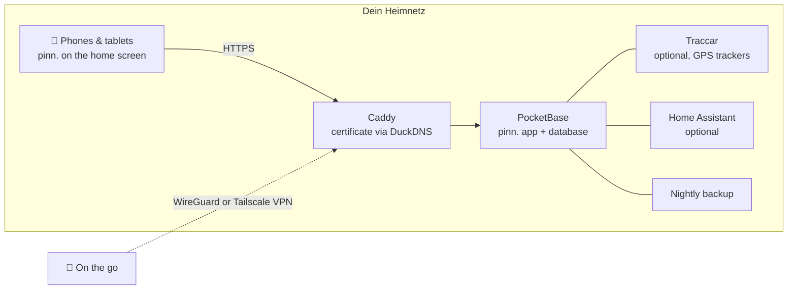

<p align="center">
  
</p>

<p align="center">
  <a href="https://github.com/pinn-shost/pinn/releases/latest"></a>
  <a href="LICENSE"></a>
  
  
  
  <a href="https://ko-fi.com/pinnapp"></a>
</p>

<p align="center">
  <a href="README.md">🇬🇧 English</a> ·
  <b>🇩🇪 Deutsch</b> ·
  <a href="README.es.md">🇪🇸 Español</a> ·
  <a href="README.fr.md">🇫🇷 Français</a> ·
  <a href="README.it.md">🇮🇹 Italiano</a> ·
  <a href="README.pt.md">🇧🇷 Português</a> ·
  <a href="README.zh.md">🇨🇳 中文</a> ·
  <a href="README.ja.md">🇯🇵 日本語</a> ·
  <a href="README.ko.md">🇰🇷 한국어</a> ·
  <a href="README.ru.md">🇷🇺 Русский</a> ·
  <a href="README.nl.md">🇳🇱 Nederlands</a> ·
  <a href="README.tr.md">🇹🇷 Türkçe</a> ·
  <a href="README.pl.md">🇵🇱 Polski</a> ·
  <a href="README.uk.md">🇺🇦 Українська</a>
</p>

<p align="center">
  <a href="#screenshots">Screenshots</a> ·
  <a href="#what-pinn-does">Funktionen</a> ·
  <a href="#installation">Installation</a> ·
  <a href="#privacy">Datenschutz</a> ·
  <a href="#faq">FAQ</a>
</p>

---

pinn. ist eine App für alles, was einen Haushalt am Laufen hält: den gemeinsamen Kalender, die Mahlzeiten der Woche, die Einkaufsliste, wer den Müll rausbringt, das Taschengeld und die Versicherung, die im März gekündigt werden muss. Sie läuft auf **deinem eigenen NAS** mit Docker und lässt sich auf jedem iPhone, iPad und Android-Handy der Familie wie eine echte App installieren.

Kein Cloud-Konto. Kein Abo. Keine Werbung, kein Tracking. Die Daten deiner Familie verlassen nie dein Zuhause.

<a id="screenshots"></a>

## Screenshots

### Auf dem iPad

An die Wand gehängt oder auf den Küchentisch gelegt: Das gemeinsame iPad zeigt die ganze Familie auf einmal.

<table>
  <tr>
    <td align="center" width="50%">
      <a href=".github/assets/screenshots/dashboard.png"></a><br>
      <sub><b>Dashboard</b> – alle tippen auf ihr eigenes Bild, optional mit PIN</sub>
    </td>
    <td align="center" width="50%">
      <a href=".github/assets/screenshots/ipad-overview.png"></a><br>
      <sub><b>Übersicht</b> – Wetter, Termine, Aufgaben, Essen und die Familie auf einen Blick</sub>
    </td>
  </tr>
</table>

### Auf dem Handy

Immer dabei: pinn. lässt sich auf jedem iPhone und Android-Handy wie eine echte App installieren.

<table>
  <tr>
    <td align="center" width="33%"><a href=".github/assets/screenshots/home.png"></a><br><sub><b>Übersicht</b> – dein Tag auf einen Blick</sub></td>
    <td align="center" width="33%"><a href=".github/assets/screenshots/calendar.png"></a><br><sub><b>Kalender</b> – iCloud und Google in einer Ansicht</sub></td>
    <td align="center" width="33%"><a href=".github/assets/screenshots/meals.png"></a><br><sub><b>Essen</b> – die Woche planen, mit einem Tipp einkaufen</sub></td>
  </tr>
  <tr>
    <td align="center" width="33%"><a href=".github/assets/screenshots/lists.png"></a><br><sub><b>Listen</b> – Einkauf, Vorrat, Packen</sub></td>
    <td align="center" width="33%"><a href=".github/assets/screenshots/finance.png"></a><br><sub><b>Finanzen</b> – Budget, Sparen, Taschengeld</sub></td>
    <td align="center" width="33%"><a href=".github/assets/screenshots/chat.png"></a><br><sub><b>Chat</b> – Ende-zu-Ende verschlüsselt, mit Sprachnachrichten und Standort</sub></td>
  </tr>
</table>

### Weitere Screens

Ein Klick auf ein Bild öffnet es in voller Größe.

<details>
<summary><b>Weitere Screenshots anzeigen</b></summary>

<br>

<table>
  <tr>
    <td align="center" width="25%"><a href=".github/assets/screenshots/house.png"></a><br><sub><b>Zuhause</b> – Haus, Kosten, Kredit, Mängel und Zähler an einem Ort</sub></td>
    <td align="center" width="25%"><a href=".github/assets/screenshots/tasks.png"></a><br><sub><b>Aufgaben</b> – automatische Erinnerungen, z. B. an TÜV und Reifenwechsel, mit Direkt-Button</sub></td>
    <td align="center" width="25%"><a href=".github/assets/screenshots/vehicles.png"></a><br><sub><b>Fahrzeuge</b> – TÜV, Reifen, Tanken und Laden</sub></td>
    <td align="center" width="25%"><a href=".github/assets/screenshots/scan_pantry.png"></a><br><sub><b>Vorrat scannen</b> – Strichcode scannen, einlagern oder verbrauchen</sub></td>
  </tr>
  <tr>
    <td align="center" width="25%"><a href=".github/assets/screenshots/weekly_summary_1.png"></a><br><sub><b>Wochenvorschau</b> – Wetter und was noch offen ist</sub></td>
    <td align="center" width="25%"><a href=".github/assets/screenshots/weekly_summary_2.png"></a><br><sub><b>Wochenvorschau</b> – Tag für Tag: Putzen, Müll, Zahlungen</sub></td>
    <td align="center" width="25%"><a href=".github/assets/screenshots/weekly_summary_3.png"></a><br><sub><b>Letzte Woche kompakt</b> – Termine, Essen, Ausgaben – und Abkürzungen</sub></td>
    <td align="center" width="25%"><a href=".github/assets/screenshots/kids.png"></a><br><sub><b>Kinder</b> – ein spielerischer Tagesablauf</sub></td>
  </tr>
</table>

</details>

<sub>📁 <a href=".github/assets/screenshots">Alle Bilder in einem Ordner</a></sub>

<a id="what-pinn-does"></a>

## Was pinn. kann

| | |
|---|---|
| 📅 **Kalender** | iCloud- und Google-Kalender pro Person, privat oder mit der Familie geteilt. Feiertage, Schulferien, Müllabfuhrtermine und Geburtstage aus deinen Kontakten erscheinen automatisch. |
| 🍝 **Essen & Rezepte** | Plane die Woche und schicke die Zutaten direkt auf die Einkaufsliste. Importiere Rezepte aus Text, PDF, Fotos oder einem Link – wahlweise mit KI. Teile Lieblingsrezepte mit anderen Familien auf deinem Server. |
| 🛒 **Listen** | Einkaufslisten pro Geschäft, ein Vorrat, der die Liste auffüllt, wenn etwas zur Neige geht, Packlisten aus Vorlagen (Urlaub, Kliniktasche, Party) sowie Geschenk- und Wunschlisten mit einem Geschenkplaner „Wer schenkt was“, den der Beschenkte nie sieht. |
| ✅ **Aufgaben & Haushalt** | Aufgaben mit Push-Erinnerungen, Putzpläne und Mülltonnen – dazu eine Kinderseite mit animierten Routinen, die nur zeigt, was zur Tageszeit passt. |
| 💶 **Finanzen** | Gemeinsame oder private Kassen, ein Haushaltsbudget, Sparen und Depots mit ETFs und Aktien, Taschengeld, wiederkehrende Zahlungen und Verträge mit Kündigungserinnerungen. WGs können Kosten teilen und sehen, wer wem etwas schuldet. |
| 📄 **Dokumente & Fahrzeuge** | Belege und Garantien, Ausweise mit Ablauferinnerung. Autos und Fahrräder mit Prüfterminen, Reifenwechsel, Verbrauch und Gesamtkosten. |
| 🏡 **Zuhause** | Für Mieter, Eigentümer und Vermieter: Miet- oder Kaufvertrag, Darlehen, Mängel mit Fotos, Rechnungen, Renovierungsplan, Zählerstände mit Prognose, Schlüssel und Mieteinnahmen für vermietete Wohnungen, Häuser und Garagen. Garten & Pflanzen mit einem Gießplan, der weiß, wann es geregnet hat. |
| 📍 **Familie & Standort** | Teile deinen Standort direkt in pinn. – einmalig oder für eine gewählte Zeit – und im Hintergrund über die kostenlose App Traccar Client (sendet direkt an pinn., kein zusätzlicher Server). Dazu ein „Auf dem Heimweg“-Modus, ein SOS-Alarm mit Position und Notrufnummern, Notfallpässe und Ankunftsmeldungen für Orte. |
| 🎒 **Schule & Kita** | Pro Kind: Stundenplan (eintippen oder fotografieren – die KI füllt ihn aus), Bringen und Abholen, Hausaufgaben auf der Kinderseite, Elternbriefe mit Fristen, die zu Erinnerungen werden, und Schließtage direkt im Kalender. |
| 🐾 **Haustiere** | Profile für Hunde, Katzen, Kaninchen & Co. mit Fütterungszeiten zum Abhaken, Gassirunden, einem „Wer ist dran?“-Plan, Impfungen und Entwurmung mit Push-Erinnerungen, Gewichtsverlauf, Tierarzt und Notdienst, einem Heimtierblatt für den Sitter zum Teilen, einem druckbaren „Vermisst“-Plakat und einer Erinnerung ans Auffüllen des Futterautomaten. |
| 🌦️ **Wetter & Urlaub** | Tippe aufs Wetter (Kachel auf dem Handy, oben neben Datum und Uhrzeit auf iPad und Computer) und sieh 14 Tage mit Details zu jedem Tag. Packlisten mit Ziel und Datum zeigen das Urlaubswetter – Vorhersage oder typische Werte – und schlagen vor, was mitzunehmen ist. |
| 🏠 **Smart Home** | Starte Apple-Kurzbefehle oder Home-Assistant-Aktionen aus einer Aufgabe – der Saugroboter putzt die Küche, wenn der Putzdienst fällig ist, Mähroboter und Bewässerung folgen dem Gartenplan, der Futterautomat meldet, wenn er leer wird. |
| 🎙️ **Sprachsteuerung** | „Hey Siri, pinn“: auf die Einkaufsliste setzen, sie vorlesen lassen, Aufgaben anlegen und hören, was heute ansteht – auch auf Android. |
| 💬 **Chat** | Familienchat und private Chats, Ende-zu-Ende verschlüsselt, mit Push, Lesehaken und Antworten. |
| 🔔 **Benachrichtigungen** | Persönliche Push-Nachrichten auf iPhone, iPad und Android sowie eine Glocke, die jede Änderung in der Familie sammelt. |
| 🧩 **Und mehr** | Familien-Pinnwand mit verschiebbaren Zetteln, globale Suche, Offline-Modus mit automatischem Abgleich, Dunkelmodus, iPad-Dashboard mit Profil-PINs, Gastzugang, Kindersicherung. |

pinn. spricht **🇬🇧 English, 🇩🇪 Deutsch, 🇪🇸 Español, 🇫🇷 Français, 🇮🇹 Italiano, 🇧🇷 Português, 🇨🇳 中文, 🇯🇵 日本語, 🇰🇷 한국어, 🇷🇺 Русский, 🇳🇱 Nederlands, 🇹🇷 Türkçe, 🇵🇱 Polski und 🇺🇦 Українська**, passt Währung und Notrufnummern an deine Region an und wechselt zwischen den Begriffen **Familie** und **WG**. Ein Server kann mehrere Familien beherbergen, jede mit eigenen Admins.

## Neu in 1.141.1

**Widgets: Apple-Stil und ein Schnellzugriff-Widget**

- **Aussehen wie Apple Aufgaben.** Das Aufgaben-Widget ist jetzt dunkelgrau mit großer weißer Schrift und runden Kreisen. Abgehakte Aufgaben rutschen nach unten, werden grau und der Kreis füllt sich. Die Einkaufslisten sind nicht mehr Teil des Widgets; du wählst zwischen Terminen, Aufgaben und Haushaltsaufgaben.
- **Schnellzugriff-Widget.** Ein zweites Skript („Schnellzugriff-Skript kopieren“) macht ein Widget mit drei Kacheln: Listen, Finanzen (mit dem Währungszeichen deiner Region) und Aufgaben. Ein Tipp öffnet die Seite von pinn. in Safari, weil iOS die installierte App nicht über einen Link öffnet – melde dich dort einmal an.
- Geändert: `js/sprachsteuerung.js`, `js/appstart.js`, `js/sprachen.js`, `js/versionslog.js`, `i18n/` (neue und geänderte Texte in allen vierzehn Sprachen), `src/` (Version), `index.html`, `.github/scripts/check-hooks.js`, alle READMEs. Server (Hooks ersetzen, PocketBase startet neu): `pb_hooks/pinn-sprache.js`, `pb_hooks/sprache.pb.js`.

## Neu in 1.141.0

**Widgets: getrennt wählbar und direkt abhakbar**

- **Widgets nach Wunsch.** In den Einstellungen unter „Sprachsteuerung“ → „Widgets & Apple Watch“ hakst du Termine von heute, Aufgaben (ohne Haushalt), Haushaltsaufgaben und jede Einkaufsliste einzeln an und kopierst dann das Skript in Scriptable – für jedes Widget ein eigenes Skript. Aufgaben und Haushaltsaufgaben zusammen angehakt ergeben „Aufgaben mit Haushalt“.
- **Abhaken im Widget.** Im mittleren und großen Widget tippst du eine Aufgabe oder einen Einkaufs-Eintrag an, und er ist auch in pinn. abgehakt (iOS öffnet dafür kurz Scriptable). Abgehakte Einträge bleiben durchgestrichen auf der Liste; „Einkauf abschließen“ machst du wie gewohnt in pinn. (ein Knopf unten im Widget öffnet die App). Profile mit Kindersperre können nichts abhaken. Wer das Skript aus 1.140.0 nutzt, kopiert es neu und ersetzt es in Scriptable.
- Geändert: `js/sprachsteuerung.js`, `js/sprachen.js`, `js/versionslog.js`, `i18n/` (7 neue Texte in allen vierzehn Sprachen), `src/` (Version), `index.html`, `.github/scripts/check-hooks.js`, alle READMEs. Server (Hooks ersetzen, PocketBase startet neu): `pb_hooks/pinn-sprache.js`, `pb_hooks/sprache.pb.js`.

## Neu in 1.140.0

**Widgets & Apple Watch**

- **Widgets.** In den Einstellungen unter „Sprachsteuerung“ gibt es jetzt „Widgets & Apple Watch“. Mit der kostenlosen App Scriptable zeigt ein Widget auf dem Home- oder Sperrbildschirm die heutigen Termine, offene Aufgaben und die Zahl der Einkaufs-Einträge; das fertige Skript kopierst du mit einem Tippen.
- **Apple Watch.** Mit einem Kurzbefehl („Inhalte von URL abrufen“ → „Ergebnis anzeigen“, „Auf Apple Watch anzeigen“) siehst du heute, morgen, die Einkaufsliste oder alles auf der Uhr – oder lässt es dir vorlesen. Die Schritte stehen in der App.
- Es ist derselbe geheime Link wie bei Siri, nur zum Lesen, und Gäste haben ihn nicht. Die Texte kommen in der Sprache des Profils.
- Geändert: `js/sprachsteuerung.js`, `js/versionslog.js`, `i18n/` (16 neue Texte und ein geänderter Untertitel in allen vierzehn Sprachen), `src/` (`index.html`, Einstellungen), `.github/scripts/check-hooks.js`, alle READMEs. Server (Hooks ersetzen, PocketBase startet neu): `pb_hooks/pinn-sprache.js`, `pb_hooks/sprache.pb.js`.

## Neu in 1.139.0

**Geschenkplaner: wer schenkt was – ohne dass der Beschenkte es sieht**

- **Wer schenkt was.** Auf dem Reiter „Geschenke“ zeigt pinn. jetzt alles Geplante pro Person – Geschenkideen aus deinen Listen und die reservierten Wünsche der anderen – mit Termin, Stand, Schenkendem und Summe. Wer etwas bekommen soll, sieht es dort nie.
- **Vor den Beschenkten verstecken.** In einer Geschenkliste (nicht privat) wählst du „Verstecken vor“; diese Personen sehen die Liste nicht, so können mehrere gemeinsam planen (z. B. die Eltern für die Kinder). Ein Geschenk, das für dich selbst eingetragen ist, siehst du nie. Wie bei privaten Listen gilt das für die Ansicht in der App; es ist keine Verschlüsselung.
- **Wer schenkt es? / Sammelgeschenke.** Bei jedem Geschenk wählst du, wer es schenkt. Bei einem schon reservierten Wunsch eines anderen tippst du auf „Ich mache mit“; die anderen sehen, wer mitmacht, der Wünschende nicht.
- Geändert: `js/listen.js`, `css/listen.css`, `js/sprachen.js`, `js/versionslog.js`, `i18n/` (12 neue Texte und eine geänderte Einleitung in allen vierzehn Sprachen), `src/` (`index.html`, Popup Listen), alle READMEs. Kein Server-Teil – PocketBase muss nicht neu starten.

## Neu in 1.138.0

**Automatischer Dunkelmodus und automatische Updates**

- **Dunkelmodus.** Unter Einstellungen → Darstellung kann pinn. jetzt nach Uhrzeit (z. B. 20:00 bis 07:00) oder von Sonnenuntergang bis Sonnenaufgang auf Dunkel umschalten. Die Sonnenzeiten werden auf dem Gerät für die Wohnadresse der Familie (sonst den Wetterort) berechnet – ohne Standortfreigabe. Schaltest du von Hand um, gilt das bis zum nächsten automatischen Wechsel. Die Einstellung gehört zu deinem Profil und gilt auf all deinen Geräten.
- **Automatische Updates.** Unter Einstellungen → System → Sicherungen & Updates kann pinn. zu einer festen Uhrzeit, täglich oder einmal pro Woche, nach einer neuen Version suchen, zuerst eine Sicherung anlegen und dann das Update installieren. Vorabversionen werden nie automatisch installiert, und schlägt die Sicherung fehl, wird nichts installiert. Ergebnis und nächster Termin stehen im selben Fenster, Fehler im Fehlerprotokoll. Nur für Admins, die Updates installieren dürfen.
- **Tiere.** Mehrere Fütterungszeiten pro Tier: Im Tier-Editor fügst du beliebig viele Zeiten (bis zu 12) mit Zeitwähler und optionaler Notiz zu Menge oder Futter hinzu (z. B. „1 Tasse Trockenfutter“). Die Notiz erscheint am Fütterungs-Knopf und in der Futter-Karte. Neues Banner auf der Tiere-Seite: eine Wiese mit Zaun, an der die Tiere deiner Familie vorbeilaufen – nachts mit Sternen.
- Geändert: `js/dunkelzeit.js` (neu), `js/design.js`, `js/familie.js`, `css/haustierewetter.css`, `js/einstellungen.js`, `js/sicherungen.js`, `js/sprachen.js`, `js/versionslog.js`, `i18n/` (19 neue Texte in allen vierzehn Sprachen), `src/` (`index.html`), `pinn-setup.sh`, `.github/scripts/check-hooks.js`, alle READMEs. Server (Hooks ersetzen, PocketBase startet neu): `pb_hooks/pinn-system.js`, `pb_hooks/system.pb.js`.

## Neu in 1.137.0

**Sprachsteuerung auf Türkisch, Polnisch und Ukrainisch**

- **Sprachsteuerung.** „Hey Siri, pinn“ (auf Android HTTP Shortcuts) versteht jetzt auch Türkisch, Polnisch und Ukrainisch und antwortet in der Sprache deines Profils: auf die Einkaufsliste setzen (mit Menge und Geschäft), Liste vorlesen, Aufgabe anlegen und hören, was heute oder morgen ansteht. Siri antwortet bei Ukrainisch nicht mehr auf Englisch. Die Einrichtung des Kurzbefehls bleibt gleich.
- Geändert: `js/sprachen.js`, `js/versionslog.js`, `i18n/versionslog.en.js`, `src/` (`index.html`), `.github/scripts/check-hooks.js`, alle READMEs. Server (Hook ersetzen, PocketBase startet neu): `pb_hooks/pinn-sprache.js`.

## Neu in 1.136.0

**Ukrainisch freigeschaltet**

- **Ukrainisch.** Ukrainisch ist jetzt für alle da: In Einstellungen → Sprache & Region lässt sich Українська wählen; bei ukrainischer Browsersprache stellt pinn. es automatisch ein. Alle 6994 Texte, die Push-Benachrichtigungen, der Einrichtungsassistent und der Datenexport sind auf Ukrainisch; für die Ukraine gelten die Notrufnummern 102, 103, 101 und 112. pinn. spricht damit vierzehn Sprachen. Siri antwortet bei Ukrainisch weiter auf Englisch.
- Geändert: `js/sprachen.js`, `js/versionslog.js`, `i18n/versionslog.en.js`, `src/` (`index.html`), alle READMEs (Sprachliste, „vierzehn Sprachen“). Seit 1.134.0 außerdem: `i18n/uk.i18n.js`, `js/textkern.js`, `js/region.js`, `einrichtung.js`, `datenexport.js`, `js/einrichten.js`, `js/exportieren.js`, `.github/scripts/`. Server (Hooks ersetzen, PocketBase startet neu): `pb_hooks/pinn-textkern.js`, `pinn-pushtext.js`, `pinn-aufgaben.js`, `pinn-ausblick.js`, `pinn-chat.js`, `pinn-einrichtung.js`, `pinn-familie-geburtstag.js`, `pinn-haustiere.js`, `pinn-ortung.js`, `pinn-packliste.js`, `pinn-wobistdu.js`.

## Neu in 1.135.17

**Ukrainisch – Etappe 18**

- **Ukrainisch.** Der Einrichtungs-Assistent und der Datenexport sprechen jetzt Ukrainisch: alle Schritt-für-Schritt-Anleitungen (Heimnetz, DuckDNS, VPN, Google, KI, Ortung, Home Assistant, Apps) und alle Exporttexte. Die ukrainischen Notrufnummern (102, 103, 101 und 112) wurden geprüft. Neu ist eine kurze `README.uk.md`. Die Sprache ist noch versteckt – in der App ändert sich nichts.
- Geändert: `einrichtung.js`, `datenexport.js`, `js/einrichten.js`, `js/exportieren.js`, `js/sprachen.js`, `js/versionslog.js`, `i18n/versionslog.en.js`, `src/` (`index.html`), `README.uk.md`. Kein Server-Teil.

## Neu in 1.135.16

**Ukrainisch – Etappe 17**

- **Ukrainisch.** Alle 6994 Texte sind jetzt übersetzt, auch die Push-Benachrichtigungen (Server-Texte, WG-Begriffe und Land Ukraine in den Benachrichtigungs-Hooks). Die Sprache ist noch versteckt – in der App ändert sich nichts.
- Geändert: `i18n/uk.i18n.js`, `js/sprachen.js`, `js/versionslog.js`, `i18n/versionslog.en.js`, `src/` (`index.html`), `.github/scripts/check-hooks.js`. Server (Hooks ersetzen, PocketBase startet neu): `pb_hooks/pinn-pushtext.js`, `pinn-aufgaben.js`, `pinn-ausblick.js`, `pinn-chat.js`, `pinn-einrichtung.js`, `pinn-familie-geburtstag.js`, `pinn-haustiere.js`, `pinn-ortung.js`, `pinn-packliste.js`, `pinn-wobistdu.js`.

## Neu in 1.135.15

**Ukrainisch – Etappe 16**

- **Ukrainisch.** Ukrainisch ist weiter übersetzt: Ausblick, Hilfe & Tutorial, Familienkachel, Mitglieder, Meldungen des Servers, SOS, Sprachsteuerung und die restlichen kleinen Bereiche (6847 von 6994 Texten). Die Sprache ist noch versteckt – in der App ändert sich nichts.
- Geändert: `i18n/uk.i18n.js`, `js/sprachen.js`, `js/versionslog.js`, `i18n/versionslog.en.js`, `src/` (`index.html`). Kein Server-Teil.

## So funktioniert’s



Alles läuft als Docker-Container auf einem Gerät. HTTPS funktioniert **ohne Portfreigabe** – das Zertifikat wird per DNS-Prüfung ausgestellt. Von außen ist pinn. nur über dein eigenes VPN erreichbar.

## Voraussetzungen

- Ein NAS oder Server mit **Docker** und **Docker Compose 2.17+** – entwickelt auf einem UGREEN NAS mit UGOS, läuft auf jedem Linux-Docker-Host (amd64, arm64, armv7)
- SSH-Zugang dazu
- Optional, aber empfohlen: eine kostenlose [DuckDNS](https://www.duckdns.org)-Subdomain für HTTPS – nötig für Push-Benachrichtigungen und die Installation von pinn. als App

<a id="installation"></a>

## Installation

1. Lade das ZIP des [neuesten Releases](https://github.com/pinn-shost/pinn/releases/latest) herunter und entpacke es.
2. Lege auf dem NAS einen Ordner an, z. B. `/volume1/docker/Pocketbase`, und kopiere den entpackten Ordner (z. B. `pinn-1.141.1` oder `pinn-main`) unverändert hinein.
3. Melde dich per SSH an und führe aus:
   ```sh
   cd /volume1/docker/Pocketbase && sudo sh pinn-*/pinn-setup.sh
   ```
   Das Skript kopiert jede Datei an ihren Platz, lädt die Bibliotheken für PDF-Import und Texterkennung in Fotos herunter und startet pinn.
4. Öffne `http://<NAS-IP>:8090` → **Als Hauptadmin anmelden** → Passwort `Admin` → wähle dein eigenes Passwort.
5. Der **Einrichtungsassistent** führt dich durch den Rest – HTTPS, Fernzugriff über WireGuard oder Tailscale, Google, KI, Standort und Home Assistant – Schritt für Schritt, in vierzehn Sprachen.
6. Öffne pinn. auf jedem Handy über die HTTPS-Adresse und füge es zum Home-Bildschirm hinzu:
   - **iPhone/iPad (Safari):** Teilen → *Zum Home-Bildschirm* (für Benachrichtigungen iOS 16.4 oder neuer)
   - **Android (Chrome):** Einstellungen → Benachrichtigungen → *pinn. als App installieren* oder Chrome-Menü ⋮ → *App installieren*

   Schalte dann auf jedem Gerät unter **Einstellungen → Benachrichtigungen → Auf diesem Gerät aktivieren** die Benachrichtigungen ein.

**Aktualisieren:** Lade das neue ZIP herunter, lege den entpackten Ordner in denselben Ordner und führe `sudo sh pinn-*/pinn-setup.sh` erneut aus. Ersetzte Dateien bleiben in `_alt/` erhalten, deine Daten bleiben unberührt.

**Sicherungen** laufen jede Nacht in `./backups` und werden 14 Tage aufbewahrt.

<a id="privacy"></a>

## Datenschutz

pinn. wurde für Daten gebaut, die du nie einem Cloud-Dienst geben würdest: Kontoauszüge, Gesundheitsunterlagen, wo sich deine Kinder aufhalten. Deshalb:

- **Alle Daten liegen auf deinem NAS** in einer einzigen PocketBase-Datenbank. Es gibt keinen pinn.-Server und keine Telemetrie.
- **Keine Skripte von fremden Servern.** Aller Code und alle Bibliotheken kommen von deinem NAS.
- **Push-Nachrichten enthalten keine Inhalte.** Apple, Google und Mozilla liefern nur ein leeres Wecksignal; das Gerät holt die Nachricht dann von deinem NAS.
- **Passwörter für iCloud und Google** werden verschlüsselt in einer gesperrten Sammlung gespeichert.
- **Nicht aus dem Internet erreichbar.** Der Fernzugriff läuft über dein eigenes VPN.

pinn. kontaktiert externe Dienste nur für Funktionen, die sie brauchen:

| Dienst | Wofür | Wann |
|---|---|---|
| [Open-Meteo](https://open-meteo.com) | Wettervorhersage | wenn eine Heimadresse gesetzt ist |
| [OpenStreetMap Nominatim](https://nominatim.openstreetmap.org) | Adressen in Kartenpositionen umwandeln | beim Eingeben von Adressen |
| [OpenStreetMap-Kacheln](https://www.openstreetmap.org) | Kartenhintergrund | auf der Standortseite, über dein NAS geladen |
| [Google Fonts](https://fonts.google.com) | Schriftarten | beim Laden der App |
| [OpenHolidays API](https://www.openholidaysapi.org) | Feiertage und Schulferien | wenn eine Heimadresse gesetzt ist |
| [DuckDNS](https://www.duckdns.org) | HTTPS-Zertifikat und Adresse | falls eingerichtet |
| iCloud / Google | Kalender und Kontakte | nur für Konten, die du verbindest |
| Google Gemini | Rezepte und Dokumente einlesen | nur wenn du einen API-Schlüssel hinzufügst |
| jsDelivr | einmaliger Download von pdf.js und Tesseract | nur bei der Installation |

<a id="faq"></a>

## FAQ

<details>
<summary><b>Muss ich Ports an meinem Router öffnen?</b></summary>
<br>
Nein. Das HTTPS-Zertifikat wird per DNS-Prüfung ausgestellt, und der Fernzugriff läuft über ein VPN – WireGuard auf einer FRITZ!Box oder Tailscale für jeden anderen Router.
</details>

<details>
<summary><b>Funktioniert es ohne NAS?</b></summary>
<br>
Jedes dauerhaft laufende Gerät mit Docker funktioniert: ein Mini-PC, ein Raspberry Pi 4/5 oder ein Linux-Server.
</details>

<details>
<summary><b>Ist pinn. eine „echte“ App aus dem App Store?</b></summary>
<br>
pinn. ist eine Web-App, die du zum Home-Bildschirm hinzufügst. Sie öffnet sich dann im Vollbild wie eine native App, funktioniert offline, zeigt ein Abzeichen mit offenen Aufgaben und empfängt Push-Nachrichten – ganz ohne App Store.
</details>

<details>
<summary><b>Können mehrere Familien eine Installation nutzen?</b></summary>
<br>
Ja. Der Hauptadmin legt Familien an, jede Familie bekommt eigene Admins, Kalender und Daten. Rezepte lassen sich optional zwischen Familien teilen.
</details>

<details>
<summary><b>Und die Kinder?</b></summary>
<br>
Profile mit Kindersicherung sehen nur ihre eigenen Aufgaben und können nichts löschen oder ändern. Finanzen, Dokumente und Fahrzeuge bleiben verborgen. Kleinere Kinder bekommen eine eigene spielerische Seite mit Tagesroutinen.
</details>

<details>
<summary><b>Was kostet es?</b></summary>
<br>
Nichts – pinn. ist kostenlos und Open Source unter der MIT-Lizenz. Optionale Dienste wie die Gemini-KI haben kostenlose Kontingente.
</details>

## Aufbau des Repositorys

Das Repository hat denselben Aufbau wie eine Installation auf dem NAS – jede Datei liegt dort, wo sie am Ende landet:

```
pinn/
├── pb_hooks/            server: *.pb.js hooks and their helper modules (pinn-*.js, calendar-sync.js)
├── pb_public/           web app served by PocketBase
│   ├── index.html       the app page, built from src/ (HTML, start check) – do not edit by hand
│   ├── js/              app code split out of index.html, plain <script> files without a build step
│   │                    (ruhemodus.js, textkern.js, sprachen.js, region.js, grundlagen.js, popups.js, verbindung.js, benutzer.js, mitteilungen.js, serverzugriff.js, tastatur.js, anmeldemaske.js, dashboard.js, dashboardhintergrund.js, profilauswahl.js, pineingabe.js, dashboardsitzung.js, dashboardkonto.js, familienverwalten.js, einrichten.js, exportieren.js, hauptadminseite.js, anmeldung.js, konto.js, profilverwaltung.js, zustand.js, bedienzustand.js, rezeptbilder.js, zusammenfuehren.js, speichern.js, design.js, sprache.js, uebersicht.js, familienkachel.js, wobistdu.js, geburtstagsfeier.js, wetterkachel.js, geburtstage.js, uebersichteinstellungen.js, familiensync.js, bereiche.js, kalenderquellen.js, icsparser.js, zeitleiste.js, termindetails.js, kalenderdatei.js, wetter.js, wohnort.js, feiertage.js, muellkalender.js, mitglieder.js, profilbild.js, mitglied.js, kinderseite.js, kinderroutine.js, sterne.js, kalenderansicht.js, essenplanen.js, rezeptparser.js, rezeptdialog.js, rezeptbild.js, rezeptmengen.js, einkauf.js, einkaufslisten.js, einkaufseingabe.js, rezepte.js, offline.js, aufgabenextras.js, appbadge.js, reisen.js, aufgabendaten.js, haushalt.js, reihum.js, aufgaben.js, smarthome.js, sprachsteuerung.js, termine.js, ansichten.js, versionspruefung.js, sicherungen.js, geraete.js, fehlerprotokoll.js, versionslog.js, einstellungen.js, kalenderkonto.js, finanzen.js, kassen.js, vorrat.js, vorrat2.js, sparen.js, vertraege.js, fahrzeuge.js, zuhause.js, dokumente.js, pdflesen.js, appstart.js, pinnwand.js, listen.js, familie.js, hinweise.js, ausblick.js – ausblick.js always comes last)
│   ├── css/             app styles split out of index.html, plain CSS without a build step (ergaenzung.css, energiesparen.css, basis.css … haustierewetter.css, terminal.css, glocke.css)
│   ├── einrichtung.js   setup assistant · datenexport.js  data export
│   ├── i18n/            texts by key (de, en, fr, es, it, pt, zh, ja, ko) – English is the reference
│   └── vendor/          pinn.css, pocketbase/ (pdf.js and Tesseract are downloaded by the setup)
├── .github/             GitHub Actions (workflows/check.yml), checks (scripts/), CONTRIBUTING.md, SECURITY.md, images – not installed
├── src/                 sources of index.html (build.js, rahmen.html, teile/) – not installed
├── caddy/Caddyfile      HTTPS reverse proxy
├── docker-compose.yaml  all containers
├── env.txt              template for .env
├── pinn-setup.sh        install & update
├── pinn-wartung.sh      backups & updates (container "wartung")
├── pinn-pocketbase-update.sh
├── index.html           placeholder only, never installed (keeps the update button of 1.38 working)
└── README.md            this page · README.<code>.md in de, es, fr, it, pt, zh, ja, ko
```

`pinn-setup.sh` kopiert `pb_hooks/`, `pb_public/` und `caddy/Caddyfile` 1:1 in den Projektordner; Datenordner (`pb_data/`, `konfig/`, `backups/`, `caddy/data/` …) werden nie angerührt.

## Mitmachen

Fehlerberichte, Ideen und Übersetzungen sind herzlich willkommen – siehe [CONTRIBUTING.md](.github/CONTRIBUTING.md). Bitte melde Sicherheitslücken privat, wie in [SECURITY.md](.github/SECURITY.md) beschrieben. Führe vor einem Pull Request bitte `node .github/scripts/check-all.js` aus – dieselben Prüfungen laufen automatisch auf GitHub.

## pinn. unterstützen

pinn. ist kostenlos und bleibt es – komplett, für alle. Es entsteht in meiner Freizeit. Wenn es dir den Alltag ein wenig erleichtert, freue ich mich über einen kleinen Beitrag, ganz freiwillig:

<p>
  <a href="https://ko-fi.com/pinnapp"></a>
  <a href="https://buymeacoffee.com/pinn"></a>
</p>

Ein ⭐ hilft auch – damit finden andere Familien pinn. leichter.

## Gebaut mit

[PocketBase](https://pocketbase.io) (MIT) · [Tailwind CSS](https://tailwindcss.com) (MIT) · [pdf.js](https://mozilla.github.io/pdf.js/) (Apache-2.0) · [Tesseract.js](https://tesseract.projectnaptha.com) (Apache-2.0) · [Traccar](https://www.traccar.org) (Apache-2.0) · [Caddy](https://caddyserver.com) (Apache-2.0)

## Lizenz

[MIT](LICENSE) – nutze es, ändere es, teile es.
