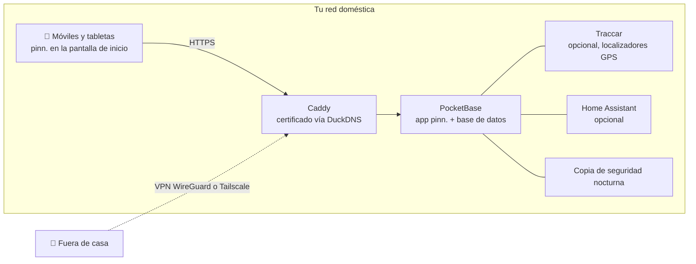

<p align="center">
  
</p>

<p align="center">
  <a href="https://github.com/pinn-shost/pinn/releases/latest"></a>
  <a href="LICENSE"></a>
  
  
  
  <a href="https://ko-fi.com/pinnapp"></a>
</p>

<p align="center">
  <a href="README.md">🇬🇧 English</a> ·
  <a href="README.de.md">🇩🇪 Deutsch</a> ·
  <b>🇪🇸 Español</b> ·
  <a href="README.fr.md">🇫🇷 Français</a> ·
  <a href="README.it.md">🇮🇹 Italiano</a> ·
  <a href="README.pt.md">🇧🇷 Português</a> ·
  <a href="README.zh.md">🇨🇳 中文</a> ·
  <a href="README.ja.md">🇯🇵 日本語</a> ·
  <a href="README.ko.md">🇰🇷 한국어</a>
</p>

<p align="center">
  <a href="#capturas-de-pantalla">Capturas</a> ·
  <a href="#qué-hace-pinn">Funciones</a> ·
  <a href="#instalación">Instalación</a> ·
  <a href="#privacidad">Privacidad</a> ·
  <a href="#preguntas-frecuentes">Preguntas frecuentes</a>
</p>

---

pinn. es una sola app para todo lo que hace funcionar un hogar: el calendario compartido, las comidas de la semana, la lista de la compra, a quién le toca sacar la basura, la paga de los niños y el seguro que hay que cancelar en marzo. Funciona en **tu propio NAS** con Docker y se instala como una app nativa en cada iPhone, iPad y móvil Android de la familia.

Sin cuenta en la nube. Sin suscripción. Sin anuncios ni rastreo. Los datos de tu familia nunca salen de casa.

## Capturas de pantalla

### En el iPad

Colgado en la pared o sobre la mesa de la cocina: el iPad compartido muestra a toda la familia de un vistazo.

<table>
  <tr>
    <td align="center" width="50%">
      <br>
      <sub><b>Panel</b> – cada uno toca su propia foto, con PIN opcional</sub>
    </td>
    <td align="center" width="50%">
      <br>
      <sub><b>Resumen</b> – tiempo, citas, tareas, comidas y la familia de un vistazo</sub>
    </td>
  </tr>
</table>

### En el móvil

Siempre contigo: pinn. se instala en cada iPhone y móvil Android como una app nativa.

<table>
  <tr>
    <td align="center" width="33%"><br><sub><b>Resumen</b> – tu día de un vistazo</sub></td>
    <td align="center" width="33%"><br><sub><b>Calendario</b> – iCloud y Google en una sola vista</sub></td>
    <td align="center" width="33%"><br><sub><b>Comidas</b> – planifica la semana, compra con un toque</sub></td>
  </tr>
  <tr>
    <td align="center" width="33%"><br><sub><b>Listas</b> – compra, despensa, equipaje</sub></td>
    <td align="center" width="33%"><br><sub><b>Finanzas</b> – presupuesto, ahorro, paga</sub></td>
    <td align="center" width="33%"><br><sub><b>Niños</b> – una rutina diaria divertida</sub></td>
  </tr>
</table>

## Qué hace pinn.

| | |
|---|---|
| 📅 **Calendario** | Calendarios de iCloud y Google por persona, privados o compartidos con la familia. Festivos, vacaciones escolares, días de recogida de basura y cumpleaños de tus contactos aparecen automáticamente. |
| 🍝 **Comidas y recetas** | Planifica la semana y manda los ingredientes directamente a la lista de la compra. Importa recetas desde texto, PDF, fotos o un enlace – opcionalmente con IA. Comparte tus recetas favoritas con otras familias de tu servidor. |
| 🛒 **Listas** | Listas de la compra por tienda, una despensa que rellena la lista cuando algo se acaba, listas de equipaje a partir de plantillas (vacaciones, bolsa del hospital, fiesta), listas de regalos y de deseos. |
| ✅ **Tareas y hogar** | Tareas con recordatorios push, planes de limpieza y cubos de basura – y una página infantil con rutinas animadas que solo muestra lo que toca a esa hora del día. |
| 💶 **Finanzas** | Cajas compartidas o privadas, presupuesto del hogar, ahorro y depósitos con ETF y acciones, paga, pagos periódicos y contratos con recordatorio de cancelación. Los pisos compartidos reparten gastos y ven quién debe a quién. |
| 📄 **Documentos y vehículos** | Tiques y garantías, documentos de identidad con aviso de caducidad. Coches y bicis con fechas de ITV, cambio de neumáticos, consumo y coste total. |
| 🏡 **Casa** | Para inquilinos, propietarios y arrendadores: contrato de alquiler o de compra, préstamo, desperfectos con fotos, tiques, plan de reformas, lecturas de contadores con previsión, llaves e ingresos de alquiler de pisos, casas y garajes alquilados. Jardín y plantas con un plan de riego que sabe cuándo ha llovido. |
| 📍 **Familia y ubicación** | Comparte tu ubicación directamente desde pinn. – una vez o durante un tiempo elegido – y en segundo plano con la app gratuita Traccar Client (envía directamente a pinn., sin servidor adicional). Además, un modo «de camino a casa», una alerta SOS con posición y números de emergencia, fichas de emergencia y avisos de llegada a lugares. |
| 🎒 **Colegio y guardería** | Por niño: horario (escríbelo o hazle una foto – la IA lo rellena), llevar y recoger, deberes en la página infantil, circulares con plazos que se convierten en recordatorios y días de cierre directamente en el calendario. |
| 🐾 **Mascotas** | Perfiles para perros, gatos, conejos y demás, con horas de comida para marcar, paseos, turnos de «a quién le toca», vacunas y desparasitaciones con recordatorio push, gráfica de peso, veterinario y urgencias veterinarias, una ficha para cuidadores para compartir y un cartel imprimible de «se busca» y un aviso para rellenar el comedero automático. |
| 🌦️ **Tiempo y vacaciones** | Toca el tiempo (una tarjeta en el móvil, arriba junto a la fecha y la hora en iPad y ordenador) para ver 14 días con detalles de cada día. Las listas de equipaje con destino y fechas muestran el tiempo de las vacaciones – previsión o valores típicos – y sugieren qué llevar. |
| 🏠 **Casa inteligente** | Lanza Atajos de Apple o acciones de Home Assistant desde una tarea – el robot aspirador limpia la cocina cuando toca la tarea, el robot cortacésped y el riego siguen el plan del jardín y el comedero avisa cuando se vacía. |
| 🎙️ **Control por voz** | «Oye Siri, pinn»: añade a la lista de la compra, que te la lea, crea tareas y escucha lo que hay hoy – también en Android. |
| 🔔 **Notificaciones** | Mensajes push personales en iPhone, iPad y Android, y una campana que recoge todos los cambios de la familia. |
| 🧩 **Todo lo demás** | Tablón familiar con notas movibles, búsqueda global, modo sin conexión con sincronización automática, modo oscuro, panel para iPad con PIN por perfil, cuenta de invitado, control parental. |

pinn. habla **🇬🇧 English, 🇩🇪 Deutsch, 🇪🇸 Español, 🇫🇷 Français, 🇮🇹 Italiano, 🇧🇷 Português, 🇨🇳 中文, 🇯🇵 日本語 y 🇰🇷 한국어**, adapta la moneda y los números de emergencia a tu región y cambia entre los términos **familia** y **piso compartido**. Un servidor puede alojar varias familias, cada una con sus propios administradores.

## Novedades de la 1.120.8

**Ruso – novena etapa**

- Traducido al ruso: la campana de notificaciones (actividad de la familia, caminos a casa, compras, SOS), el tablón (notas, listas, encuestas, cuentas atrás, agradecimientos, fotos, archivo), la previsión (vista semanal y previsión financiera mensual), el control por voz (atajo de Siri, HTTP Shortcuts), la lectura de PDF y tickets, los nombres de las categorías estándar, lugares de almacenamiento, unidades, aparatos, cajas y tipos de residuos, así como los mensajes del servidor – ya 6565 de 6712 textos.
- Mejorado (todos los idiomas): los pequeños contadores de la vista semanal («3 citas», «2 tareas» …) ahora son textos completos con sus propias formas de plural (el ruso lo necesita) – cinco textos nuevos sustituyen a nueve antiguos.
- El ruso sigue **oculto** hasta que todo esté traducido (se puede activar en un dispositivo como se describe en la 1.120.0).
- Próximamente: la última etapa del ruso (notificaciones push del servidor) y la activación del ruso.
- Modificado: `index.html`, `js/sprachen.js`, `js/ausblick.js`, `js/versionslog.js`, `i18n/*.i18n.js` (todos los idiomas, incluido `ru.i18n.js`), `i18n/versionslog.en.js` – en el servidor no cambia nada. Instala como de costumbre (`sudo sh pinn-*/pinn-setup.sh` o el botón de actualización).


## Novedades de la 1.120.7

**Ruso – octava etapa**

- Traducido al ruso: vehículos (lista y detalles, repostaje, carga, taller, juegos de neumáticos con edad y dibujo, plazos de ITV y revisión, matrículas de seguro, calculadoras para eléctrico o combustión, GLP, bicicleta en lugar de coche, desvío a una gasolinera más barata) y hogar inteligente (dispositivos, acciones, Atajos de Apple, Home Assistant, automatización, habitaciones del robot aspirador) – ya 5954 de 6716 textos.
- Corregido (todos los idiomas): «ahorrado» y «de más» en la calculadora del desvío, «último» en el campo del cuentakilómetros y «opcional» en dos campos eran textos fijos y ahora se traducen.
- El ruso sigue **oculto** hasta que todo esté traducido (se puede activar en un dispositivo como se describe en la 1.120.0).
- Próximamente: más etapas del ruso (avisos, tablón, perspectivas, nombres estándar …).
- Cambiado: `index.html`, `js/sprachen.js`, `js/fahrzeuge.js`, `js/versionslog.js`, `i18n/*.i18n.js` (todos los idiomas, incluido `ru.i18n.js`), `i18n/versionslog.en.js` – el servidor no cambia. Instálalo como siempre (`sudo sh pinn-*/pinn-setup.sh` o el botón de actualización).

## Novedades de la 1.120.6

**Ruso – séptima etapa**

- Traducido al ruso: el hogar (pisos y casas en alquiler, en propiedad y para alquilar, defectos con la notificación al arrendador, contadores con lectura por foto y previsión, costes fijos y préstamo, reformas y proyectos, plan de mantenimiento, jardín y plantas con el año del jardín, llaves) y los documentos (plazos, garantía, recordatorios, documentos de varias páginas, archivo sin conexión) – ya son 5230 de 6715 textos.
- Corregido (todos los idiomas): «archivado» en los vehículos del formulario de documentos, «N.º» y «última vez» en contadores y mantenimiento, y «del» en el título automático del documento eran textos fijos y ahora se traducen.
- El ruso sigue **oculto** hasta que esté todo traducido (se puede activar en un dispositivo como se describe en la 1.120.0).
- Próximo: más etapas del ruso (vehículos, casa inteligente …).
- Modificado: `index.html`, `js/sprachen.js`, `js/dokumente.js`, `js/zuhause.js`, `js/versionslog.js`, `i18n/*.i18n.js` (todos los idiomas, incluido `ru.i18n.js`), `i18n/versionslog.en.js` – en el servidor no cambia nada. Instalar como siempre (`sudo sh pinn-*/pinn-setup.sh` o el botón de actualización).

## Novedades de la 1.120.5

**Ruso – sexta etapa**

- Traducido al ruso: el área familiar (fichas de emergencia, resumen familiar con ubicaciones en vivo, «Voy de camino a casa»), mascotas (perfil, comida, paseos, prevención y vacunas, cartel de desaparecido, cuidador), colegio y guardería (horario, deberes, cartas a los padres, días de cierre, lectura con IA), ubicación (compartir, lugares, tiendas, rastreadores GPS, SOS), la página infantil con recompensas de estrellas, miembros de la familia, SOS y «¿Dónde estás?» – ya son 4417 de 6713 textos.
- Corregido (todos los idiomas): la pregunta «¿Dónde estás?» mostraba el nombre equivocado fuera del alemán; «en … días» en cumpleaños y prevención de mascotas y «recoge» en el resumen del día escolar eran textos fijos y ahora se traducen.
- El ruso sigue **oculto** hasta que esté todo traducido (se puede activar en un dispositivo como se describe en la 1.120.0).
- Próximo: más etapas del ruso (hogar, documentos, vehículos, casa inteligente …).
- Modificado: `index.html`, `js/sprachen.js`, `js/familie.js`, `js/familienkachel.js`, `js/wobistdu.js`, `js/versionslog.js`, `i18n/*.i18n.js` (todos los idiomas, incluido `ru.i18n.js`), `i18n/versionslog.en.js` – en el servidor no cambia nada. Instalar como siempre (`sudo sh pinn-*/pinn-setup.sh` o el botón de actualización).

## Novedades de la 1.120.4

**Ruso – quinta etapa**

- Traducido al ruso: finanzas (gastos, ingresos, presupuesto, categorías, movimientos recurrentes, estadísticas), cajas con reparto y liquidación, el depósito (posiciones, planes de ahorro, importación desde CSV/PDF, cotizaciones), contratos (duración, baja incluida la carta de baja, recordatorios, documentos) y la paga – ya son 3524 de 6714 textos.
- El ruso sigue **oculto** hasta que esté todo traducido (se puede activar en un dispositivo como se describe en la 1.120.0).
- Próximo: más etapas del ruso (familia, mascotas, colegio, ubicación, página infantil …).
- Modificado: `index.html`, `js/sprachen.js`, `js/versionslog.js`, `i18n/ru.i18n.js`, `i18n/versionslog.en.js` – en el servidor no cambia nada. Instalar como siempre (`sudo sh pinn-*/pinn-setup.sh` o el botón de actualización).

## Novedades de la 1.120.3

**Ruso – cuarta etapa**

- Traducido al ruso: listas (equipaje, regalos, deseos, checklists, ideas – con todas las plantillas), la compra, la despensa con el escáner y «¿Qué puedo cocinar?», y las recetas con importación, recetas públicas y papelera – ya son 2656 de 6714 textos.
- El ruso sigue **oculto** hasta que esté todo traducido (se puede activar en un dispositivo como se describe en la 1.120.0).
- Próximo: más etapas del ruso (finanzas, cajas, depósito, contratos …).
- Modificado: `index.html`, `js/sprachen.js`, `js/versionslog.js`, `i18n/ru.i18n.js`, `i18n/versionslog.en.js` – en el servidor no cambia nada. Instalar como siempre (`sudo sh pinn-*/pinn-setup.sh` o el botón de actualización).

## Novedades de la 1.120.2

**Ruso – tercera etapa**

- Traducido al ruso: el calendario (eventos, añadir calendarios, iCloud/Google), tareas, el hogar con turnos rotativos, el plan de comidas, el resumen con sus tarjetas, el tiempo y el tiempo de vacaciones, festivos y vacaciones escolares, la búsqueda y las fotos de perfil – ya son 1545 de 6714 textos.
- El ruso sigue **oculto** hasta que esté todo traducido (se puede activar en un dispositivo como se describe en la 1.120.0).
- Próximo: más etapas del ruso (listas, despensa, recetas …).
- Modificado: `index.html`, `js/sprachen.js`, `js/versionslog.js`, `i18n/ru.i18n.js`, `i18n/versionslog.en.js` – en el servidor no cambia nada. Instalar como siempre (`sudo sh pinn-*/pinn-setup.sh` o el botón de actualización).

## Novedades de la 1.120.1

**Ruso – segunda etapa**

- Traducido al ruso: la cuenta (contraseña, PIN, perfiles, invitados, notificaciones, panel familiar), dispositivos e inicio de sesión, el registro de errores y copias de seguridad y actualizaciones – ya son 874 de 6714 textos, de nuevo con las tres formas de plural y los términos de piso compartido.
- El ruso sigue **oculto** hasta que esté todo traducido (se puede activar en un dispositivo como se describe en la 1.120.0).
- Próximo: más etapas del ruso (calendario, tareas, hogar …).
- Modificado: `index.html`, `js/sprachen.js`, `js/versionslog.js`, `i18n/ru.i18n.js`, `i18n/versionslog.en.js` – en el servidor no cambia nada. Instalar como siempre (`sudo sh pinn-*/pinn-setup.sh` o el botón de actualización).

## Novedades de la 1.120.0

**Ruso – primera etapa**

- pinn. se está traduciendo al **ruso** paso a paso. La primera etapa abarca el inicio de sesión, el panel, el menú, la página del administrador principal y todos los ajustes, además del asistente de configuración completo y la exportación de datos – unos 500 textos, con las tres formas de plural del ruso y los términos de piso compartido.
- El ruso sigue **oculto** hasta que esté todo traducido. Para probarlo en un dispositivo, escribe `localStorage.setItem('pinn.sprachen.alle', '1')` en la consola del navegador y elige Русский; los textos aún sin traducir aparecen en inglés.
- Servidor: la configuración acepta ahora también el ruso como idioma (`pb_hooks/pinn-einrichtung.js`).
- Para colaboradores: `i18n-keys.js` tiene dos comandos nuevos – `todo` (las claves que le faltan a un idioma, con el texto en inglés) y `lang` (escribe los textos traducidos de un idioma, comprueba plurales y marcadores, añade la variante de piso compartido).
- Próximo: más etapas del ruso (calendario, tareas, hogar …).
- Cambiado: `index.html`, `js/sprachen.js`, `js/einrichten.js`, `js/exportieren.js`, `js/versionslog.js`, `einrichtung.js`, `datenexport.js`, `i18n/ru.i18n.js` (nuevo), `i18n/versionslog.en.js`, `pb_hooks/pinn-einrichtung.js`, `.github/`. Instalación como siempre (`sudo sh pinn-*/pinn-setup.sh` o el botón de actualización).

## Novedades de la 1.119.3

**Limpieza: el traductor antiguo ha desaparecido**

- Todos los textos de pinn. vienen ahora directamente de los archivos de idioma en `i18n/`. Los diccionarios antiguos (carpeta `pb_public/lang/`, unos 4 MB) y el traductor que reescribía la pantalla mientras usabas la app se han eliminado: pinn. arranca más rápido y necesita menos memoria, sobre todo en móviles y tabletas antiguos.
- La actualización mueve los archivos antiguos a `_alt/<fecha>/` en el NAS (no se borra nada) y elimina la carpeta vacía `lang/`.
- Detalles: la fecha y la hora en la pantalla de inicio, el dashboard, la vista semanal, Finanzas y «Hogar» se muestran directamente en el formato de tu idioma; «Guardado» en los ajustes de la previsión está traducido; en un piso compartido, el menú, la tarjeta de resumen y los ajustes muestran el icono 🧑‍🤝‍🧑; los textos escritos por ti (p. ej. una nota «Hola familia» en el tablón) ya no se modifican en un piso compartido.
- Para colaboradores: `check-lang.js`, `translate.js` y el workflow «Translate» desaparecen; `i18n-keys.js` escribe ahora los textos nuevos en cada idioma (`put`, `set`, `remove`, `format`).
- Próximo: ruso, paso a paso (oculto hasta que esté completo).
- Cambiado: `index.html`, `js/sprachen.js`, `js/zustand.js`, `js/uebersicht.js`, `js/familie.js`, `js/listen.js`, `js/sterne.js`, `js/ausblick.js`, `js/grundlagen.js`, `js/profilauswahl.js`, `js/wohnort.js`, `js/finanzen.js`, `js/einstellungen.js`, `js/smarthome.js`, `js/versionslog.js`, `i18n/versionslog.en.js`, `pinn-setup.sh`, `.github/` – eliminado: `pb_public/lang/` – nada cambia en el servidor. Instalar como siempre (`sudo sh pinn-*/pinn-setup.sh` o botón de actualización).

## Cómo funciona



Todo funciona como contenedores Docker en una sola máquina. HTTPS funciona **sin abrir puertos** – el certificado se emite mediante una comprobación DNS. Desde fuera, pinn. solo es accesible a través de tu propia VPN.

## Requisitos

- Un NAS o servidor con **Docker** y **Docker Compose 2.17+** – desarrollado en un NAS UGREEN con UGOS, funciona en cualquier host Linux con Docker (amd64, arm64, armv7)
- Acceso SSH a él
- Opcional pero recomendado: un subdominio gratuito de [DuckDNS](https://www.duckdns.org) para HTTPS – necesario para las notificaciones push y para instalar pinn. como app

## Instalación

1. Descarga el ZIP de la [última versión](https://github.com/pinn-shost/pinn/releases/latest) y descomprímelo.
2. Crea una carpeta en el NAS, p. ej. `/volume1/docker/Pocketbase`, y coloca dentro la carpeta descomprimida (p. ej. `pinn-1.120.8` o `pinn-main`) tal cual.
3. Inicia sesión por SSH y ejecuta:
   ```sh
   cd /volume1/docker/Pocketbase && sudo sh pinn-*/pinn-setup.sh
   ```
   El script coloca cada archivo en su sitio, descarga las bibliotecas para importar PDF y reconocer texto en fotos, e inicia pinn.
4. Abre `http://<IP-del-NAS>:8090` → **Iniciar sesión como admin principal** → contraseña `Admin` → elige tu propia contraseña.
5. El **asistente de configuración** te guía en el resto – HTTPS, acceso remoto con WireGuard o Tailscale, Google, IA, ubicación y Home Assistant – paso a paso, en nueve idiomas.
6. Abre pinn. en cada móvil con su dirección HTTPS y añádelo a la pantalla de inicio:
   - **iPhone/iPad (Safari):** Compartir → *Añadir a pantalla de inicio* (iOS 16.4 o posterior para las notificaciones)
   - **Android (Chrome):** Ajustes → Notificaciones → *Instalar pinn. como app*, o menú de Chrome ⋮ → *Instalar app*

   Después activa las notificaciones en cada dispositivo en **Ajustes → Notificaciones → Activar en este dispositivo**.

**Actualizar:** descarga el nuevo ZIP, coloca la carpeta descomprimida en la misma carpeta y vuelve a ejecutar `sudo sh pinn-*/pinn-setup.sh`. Los archivos sustituidos se guardan en `_alt/`, tus datos no se tocan.

**Las copias de seguridad** se hacen cada noche en `./backups` y se conservan 14 días.

## Privacidad

pinn. se creó para datos que nunca darías a un servicio en la nube: extractos bancarios, documentos médicos, dónde están tus hijos. Por eso:

- **Todos los datos están en tu NAS** en una única base de datos PocketBase. No existe un servidor de pinn. ni telemetría.
- **Ningún script de servidores de terceros.** Todo el código y las bibliotecas se sirven desde tu NAS.
- **Las notificaciones push no llevan contenido.** Apple, Google y Mozilla solo entregan una señal vacía para despertar el dispositivo; este recoge el mensaje de tu NAS.
- **Las contraseñas de iCloud y Google** se guardan cifradas en una colección bloqueada.
- **No es accesible desde internet.** El acceso remoto pasa por tu propia VPN.

pinn. solo contacta con servicios externos para las funciones que los necesitan:

| Servicio | Para qué | Cuándo |
|---|---|---|
| [Open-Meteo](https://open-meteo.com) | Previsión del tiempo | cuando hay una dirección de casa |
| [OpenStreetMap Nominatim](https://nominatim.openstreetmap.org) | Convertir direcciones en posiciones del mapa | al introducir direcciones |
| [Teselas de OpenStreetMap](https://www.openstreetmap.org) | Fondo del mapa | en la página de ubicación, cargado a través de tu NAS |
| [Google Fonts](https://fonts.google.com) | Tipografías | al cargar la app |
| [OpenHolidays API](https://www.openholidaysapi.org) | Festivos y vacaciones escolares | cuando hay una dirección de casa |
| [DuckDNS](https://www.duckdns.org) | Certificado HTTPS y dirección | si está configurado |
| iCloud / Google | Calendarios y contactos | solo para las cuentas que conectes |
| Google Gemini | Leer recetas y documentos | solo si añades una clave de API |
| jsDelivr | Descarga única de pdf.js y Tesseract | solo durante la instalación |

## Preguntas frecuentes

<details>
<summary><b>¿Tengo que abrir puertos en el router?</b></summary>
<br>
No. El certificado HTTPS se emite mediante una comprobación DNS y el acceso remoto va por VPN – WireGuard en una FRITZ!Box o Tailscale en cualquier otro router.
</details>

<details>
<summary><b>¿Funciona sin NAS?</b></summary>
<br>
Sirve cualquier equipo siempre encendido con Docker: un mini PC, una Raspberry Pi 4/5 o un servidor Linux.
</details>

<details>
<summary><b>¿Es pinn. una app «de verdad» de la App Store?</b></summary>
<br>
pinn. es una app web que añades a la pantalla de inicio. Después se abre a pantalla completa como una app nativa, funciona sin conexión, muestra un globo con las tareas pendientes y recibe notificaciones push – sin ninguna tienda de apps.
</details>

<details>
<summary><b>¿Pueden varias familias usar una misma instalación?</b></summary>
<br>
Sí. El administrador principal crea familias y cada una tiene sus propios administradores, calendarios y datos. Las recetas se pueden compartir entre familias si se quiere.
</details>

<details>
<summary><b>¿Y los niños?</b></summary>
<br>
Los perfiles con control parental solo ven sus propias tareas y no pueden borrar ni cambiar nada. Finanzas, documentos y vehículos quedan ocultos. Los más pequeños tienen su propia página divertida con rutinas diarias.
</details>

<details>
<summary><b>¿Cuánto cuesta?</b></summary>
<br>
Nada – pinn. es gratuito y de código abierto con licencia MIT. Los servicios opcionales como la IA Gemini tienen planes gratuitos.
</details>

## Estructura del repositorio

El repositorio tiene la misma estructura que una instalación en el NAS – cada archivo está donde terminará:

```
pinn/
├── pb_hooks/            servidor: hooks *.pb.js y sus módulos auxiliares (pinn-*.js, calendar-sync.js)
├── pb_public/           app web servida por PocketBase
│   ├── index.html       la página de la app, construida desde src/ (HTML, comprobación de inicio) – no editar a mano
│   ├── js/              código de la app separado de index.html, archivos <script> simples sin paso de compilación
│   │                    (ruhemodus.js, textkern.js, sprachen.js, region.js, grundlagen.js, popups.js, verbindung.js, benutzer.js, mitteilungen.js, serverzugriff.js, tastatur.js, anmeldemaske.js, dashboard.js, dashboardhintergrund.js, profilauswahl.js, pineingabe.js, dashboardsitzung.js, dashboardkonto.js, familienverwalten.js, einrichten.js, exportieren.js, hauptadminseite.js, anmeldung.js, konto.js, profilverwaltung.js, zustand.js, bedienzustand.js, rezeptbilder.js, zusammenfuehren.js, speichern.js, design.js, sprache.js, uebersicht.js, familienkachel.js, wobistdu.js, geburtstagsfeier.js, wetterkachel.js, geburtstage.js, uebersichteinstellungen.js, familiensync.js, bereiche.js, kalenderquellen.js, icsparser.js, zeitleiste.js, termindetails.js, kalenderdatei.js, wetter.js, wohnort.js, feiertage.js, muellkalender.js, mitglieder.js, profilbild.js, mitglied.js, kinderseite.js, kinderroutine.js, sterne.js, kalenderansicht.js, essenplanen.js, rezeptparser.js, rezeptdialog.js, rezeptbild.js, rezeptmengen.js, einkauf.js, einkaufslisten.js, einkaufseingabe.js, rezepte.js, offline.js, aufgabenextras.js, appbadge.js, reisen.js, aufgabendaten.js, haushalt.js, reihum.js, aufgaben.js, smarthome.js, sprachsteuerung.js, termine.js, ansichten.js, versionspruefung.js, sicherungen.js, geraete.js, fehlerprotokoll.js, versionslog.js, einstellungen.js, kalenderkonto.js, finanzen.js, kassen.js, vorrat.js, vorrat2.js, sparen.js, vertraege.js, fahrzeuge.js, zuhause.js, dokumente.js, pdflesen.js, appstart.js, pinnwand.js, listen.js, familie.js, hinweise.js, ausblick.js – ausblick.js siempre va al final)
│   ├── css/             estilos de la app separados de index.html, CSS simple sin paso de compilación (ergaenzung.css, energiesparen.css, basis.css … haustierewetter.css, terminal.css, glocke.css)
│   ├── einrichtung.js   asistente de configuración · datenexport.js  exportación de datos
│   ├── i18n/            textos por clave (de, en, fr, es, it, pt, zh, ja, ko) – el inglés es la referencia
│   └── vendor/          pinn.css, pocketbase/ (pdf.js y Tesseract los descarga la instalación)
├── .github/             GitHub Actions (workflows/check.yml), comprobaciones (scripts/), CONTRIBUTING.md, SECURITY.md, imágenes – no se instala
├── src/                 fuentes de index.html (build.js, rahmen.html, teile/) – no se instala
├── caddy/Caddyfile      proxy inverso HTTPS
├── docker-compose.yaml  todos los contenedores
├── env.txt              plantilla para .env
├── pinn-setup.sh        instalar y actualizar
├── pinn-wartung.sh      copias de seguridad y actualizaciones (contenedor «wartung»)
├── pinn-pocketbase-update.sh
├── index.html           solo un marcador, nunca se instala (mantiene funcionando el botón de actualizar de la 1.38)
└── README.md            página en inglés · README.<code>.md en de, es (esta página), fr, it, pt, zh, ja, ko
```

`pinn-setup.sh` copia `pb_hooks/`, `pb_public/` y `caddy/Caddyfile` tal cual en la carpeta del proyecto; las carpetas de datos (`pb_data/`, `konfig/`, `backups/`, `caddy/data/` …) nunca se tocan.

## Colaborar

Los informes de errores, ideas y traducciones son muy bienvenidos – consulta [CONTRIBUTING.md](.github/CONTRIBUTING.md). Informa de los problemas de seguridad de forma privada como se describe en [SECURITY.md](.github/SECURITY.md). Antes de un pull request, ejecuta `node .github/scripts/check-all.js` – las mismas comprobaciones se ejecutan automáticamente en GitHub.

## Apoya pinn.

pinn. es gratuito y seguirá siéndolo – completo, para todos. Lo desarrollo en mi tiempo libre. Si te hace el día a día un poco más fácil, una pequeña aportación es muy bienvenida, pero totalmente voluntaria:

<p>
  <a href="https://ko-fi.com/pinnapp"></a>
  <a href="https://buymeacoffee.com/pinn"></a>
</p>

Una ⭐ también ayuda – así otras familias encuentran pinn. más fácilmente.

## Hecho con

[PocketBase](https://pocketbase.io) (MIT) · [Tailwind CSS](https://tailwindcss.com) (MIT) · [pdf.js](https://mozilla.github.io/pdf.js/) (Apache-2.0) · [Tesseract.js](https://tesseract.projectnaptha.com) (Apache-2.0) · [Traccar](https://www.traccar.org) (Apache-2.0) · [Caddy](https://caddyserver.com) (Apache-2.0)

## Licencia

[MIT](LICENSE) – úsalo, cámbialo, compártelo.
