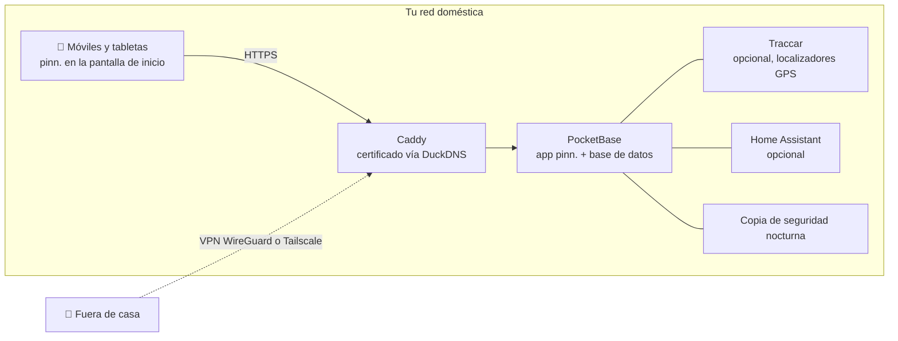

<p align="center">
  
</p>

<p align="center">
  <a href="https://github.com/pinn-shost/pinn/releases/latest"></a>
  <a href="LICENSE"></a>
  
  
  
  <a href="https://ko-fi.com/pinnapp"></a>
</p>

<p align="center">
  <a href="README.md">🇬🇧 English</a> ·
  <a href="README.de.md">🇩🇪 Deutsch</a> ·
  <b>🇪🇸 Español</b> ·
  <a href="README.fr.md">🇫🇷 Français</a> ·
  <a href="README.it.md">🇮🇹 Italiano</a> ·
  <a href="README.pt.md">🇧🇷 Português</a> ·
  <a href="README.zh.md">🇨🇳 中文</a> ·
  <a href="README.ja.md">🇯🇵 日本語</a> ·
  <a href="README.ko.md">🇰🇷 한국어</a> ·
  <a href="README.ru.md">🇷🇺 Русский</a> ·
  <a href="README.nl.md">🇳🇱 Nederlands</a> ·
  <a href="README.tr.md">🇹🇷 Türkçe</a> ·
  <a href="README.pl.md">🇵🇱 Polski</a> ·
  <a href="README.uk.md">🇺🇦 Українська</a>
</p>

<p align="center">
  <a href="#capturas-de-pantalla">Capturas</a> ·
  <a href="#qué-hace-pinn">Funciones</a> ·
  <a href="#instalación">Instalación</a> ·
  <a href="#privacidad">Privacidad</a> ·
  <a href="#preguntas-frecuentes">Preguntas frecuentes</a>
</p>

---

pinn. es una sola app para todo lo que hace funcionar un hogar: el calendario compartido, las comidas de la semana, la lista de la compra, a quién le toca sacar la basura, la paga de los niños y el seguro que hay que cancelar en marzo. Funciona en **tu propio NAS** con Docker y se instala como una app nativa en cada iPhone, iPad y móvil Android de la familia.

Sin cuenta en la nube. Sin suscripción. Sin anuncios ni rastreo. Los datos de tu familia nunca salen de casa.

## Capturas de pantalla

### En el iPad

Colgado en la pared o sobre la mesa de la cocina: el iPad compartido muestra a toda la familia de un vistazo.

<table>
  <tr>
    <td align="center" width="50%">
      <a href=".github/assets/screenshots/dashboard.png"></a><br>
      <sub><b>Panel</b> – cada uno toca su propia foto, con PIN opcional</sub>
    </td>
    <td align="center" width="50%">
      <a href=".github/assets/screenshots/ipad-overview.png"></a><br>
      <sub><b>Resumen</b> – tiempo, citas, tareas, comidas y la familia de un vistazo</sub>
    </td>
  </tr>
</table>

### En el móvil

Siempre contigo: pinn. se instala en cada iPhone y móvil Android como una app nativa.

<table>
  <tr>
    <td align="center" width="33%"><a href=".github/assets/screenshots/home.png"></a><br><sub><b>Resumen</b> – tu día de un vistazo</sub></td>
    <td align="center" width="33%"><a href=".github/assets/screenshots/calendar.png"></a><br><sub><b>Calendario</b> – iCloud y Google en una sola vista</sub></td>
    <td align="center" width="33%"><a href=".github/assets/screenshots/meals.png"></a><br><sub><b>Comidas</b> – planifica la semana, compra con un toque</sub></td>
  </tr>
  <tr>
    <td align="center" width="33%"><a href=".github/assets/screenshots/lists.png"></a><br><sub><b>Listas</b> – compra, despensa, equipaje</sub></td>
    <td align="center" width="33%"><a href=".github/assets/screenshots/finance.png"></a><br><sub><b>Finanzas</b> – presupuesto, ahorro, paga</sub></td>
    <td align="center" width="33%"><a href=".github/assets/screenshots/chat.png"></a><br><sub><b>Chat</b> – cifrado de extremo a extremo, con mensajes de voz y ubicación</sub></td>
  </tr>
</table>

### Más pantallas

Pulsa cualquier imagen para verla en tamaño completo.

<details>
<summary><b>Mostrar más capturas</b></summary>

<br>

<table>
  <tr>
    <td align="center" width="25%"><a href=".github/assets/screenshots/house.png"></a><br><sub><b>Hogar</b> – casa, costes, préstamo, defectos y contadores en un solo lugar</sub></td>
    <td align="center" width="25%"><a href=".github/assets/screenshots/tasks.png"></a><br><sub><b>Tareas</b> – recordatorios automáticos, p. ej. ITV y cambio de neumáticos, con botón directo</sub></td>
    <td align="center" width="25%"><a href=".github/assets/screenshots/vehicles.png"></a><br><sub><b>Vehículos</b> – ITV, neumáticos, repostaje y carga</sub></td>
    <td align="center" width="25%"><a href=".github/assets/screenshots/scan_pantry.png"></a><br><sub><b>Escanear la despensa</b> – escanea el código de barras, guarda o consume</sub></td>
  </tr>
  <tr>
    <td align="center" width="25%"><a href=".github/assets/screenshots/weekly_summary_1.png"></a><br><sub><b>Vista semanal</b> – el tiempo y lo que sigue pendiente</sub></td>
    <td align="center" width="25%"><a href=".github/assets/screenshots/weekly_summary_2.png"></a><br><sub><b>Vista semanal</b> – día a día: limpieza, basura, pagos</sub></td>
    <td align="center" width="25%"><a href=".github/assets/screenshots/weekly_summary_3.png"></a><br><sub><b>La semana pasada en breve</b> – citas, comidas, gastos – y accesos directos</sub></td>
    <td align="center" width="25%"><a href=".github/assets/screenshots/kids.png"></a><br><sub><b>Niños</b> – una rutina diaria divertida</sub></td>
  </tr>
</table>

</details>

<sub>📁 <a href=".github/assets/screenshots">Todas las imágenes en una carpeta</a></sub>

## Qué hace pinn.

| | |
|---|---|
| 📅 **Calendario** | Calendarios de iCloud y Google por persona, privados o compartidos con la familia. Festivos, vacaciones escolares, días de recogida de basura y cumpleaños de tus contactos aparecen automáticamente. |
| 🍝 **Comidas y recetas** | Planifica la semana y manda los ingredientes directamente a la lista de la compra. Importa recetas desde texto, PDF, fotos o un enlace – opcionalmente con IA. Comparte tus recetas favoritas con otras familias de tu servidor. |
| 🛒 **Listas** | Listas de la compra por tienda, una despensa que rellena la lista cuando algo se acaba, listas de equipaje a partir de plantillas (vacaciones, bolsa del hospital, fiesta), listas de regalos y de deseos con un planificador «quién regala qué» que quien recibe nunca ve. |
| ✅ **Tareas y hogar** | Tareas con recordatorios push, planes de limpieza y cubos de basura – y una página infantil con rutinas animadas que solo muestra lo que toca a esa hora del día. |
| 💶 **Finanzas** | Cajas compartidas o privadas, presupuesto del hogar, ahorro y depósitos con ETF y acciones, paga, pagos periódicos y contratos con recordatorio de cancelación. Los pisos compartidos reparten gastos y ven quién debe a quién. |
| 📄 **Documentos y vehículos** | Tiques y garantías, documentos de identidad con aviso de caducidad. Coches y bicis con fechas de ITV, cambio de neumáticos, consumo y coste total. |
| 🏡 **Casa** | Para inquilinos, propietarios y arrendadores: contrato de alquiler o de compra, préstamo, desperfectos con fotos, tiques, plan de reformas, lecturas de contadores con previsión, llaves e ingresos de alquiler de pisos, casas y garajes alquilados. Jardín y plantas con un plan de riego que sabe cuándo ha llovido. |
| 📍 **Familia y ubicación** | Comparte tu ubicación directamente desde pinn. – una vez o durante un tiempo elegido – y en segundo plano con la app gratuita Traccar Client (envía directamente a pinn., sin servidor adicional). Además, un modo «de camino a casa», una alerta SOS con posición y números de emergencia, fichas de emergencia y avisos de llegada a lugares. |
| 🎒 **Colegio y guardería** | Por niño: horario (escríbelo o hazle una foto – la IA lo rellena), llevar y recoger, deberes en la página infantil, circulares con plazos que se convierten en recordatorios y días de cierre directamente en el calendario. |
| 🐾 **Mascotas** | Perfiles para perros, gatos, conejos y demás, con horas de comida para marcar, paseos, turnos de «a quién le toca», vacunas y desparasitaciones con recordatorio push, gráfica de peso, veterinario y urgencias veterinarias, una ficha para cuidadores para compartir y un cartel imprimible de «se busca» y un aviso para rellenar el comedero automático. |
| 🌦️ **Tiempo y vacaciones** | Toca el tiempo (una tarjeta en el móvil, arriba junto a la fecha y la hora en iPad y ordenador) para ver 14 días con detalles de cada día. Las listas de equipaje con destino y fechas muestran el tiempo de las vacaciones – previsión o valores típicos – y sugieren qué llevar. |
| 🏠 **Casa inteligente** | Lanza Atajos de Apple o acciones de Home Assistant desde una tarea – el robot aspirador limpia la cocina cuando toca la tarea, el robot cortacésped y el riego siguen el plan del jardín y el comedero avisa cuando se vacía. |
| 🎙️ **Control por voz** | «Oye Siri, pinn»: añade a la lista de la compra, que te la lea, crea tareas y escucha lo que hay hoy – también en Android. |
| 💬 **Chat** | Chat familiar y privado con cifrado de extremo a extremo, push, marcas de lectura y respuestas. |
| 🔔 **Notificaciones** | Mensajes push personales en iPhone, iPad y Android, y una campana que recoge todos los cambios de la familia. |
| 🧩 **Todo lo demás** | Tablón familiar con notas movibles, búsqueda global, modo sin conexión con sincronización automática, modo oscuro, panel para iPad con PIN por perfil, cuenta de invitado, control parental. |

pinn. habla **🇬🇧 English, 🇩🇪 Deutsch, 🇪🇸 Español, 🇫🇷 Français, 🇮🇹 Italiano, 🇧🇷 Português, 🇨🇳 中文, 🇯🇵 日本語, 🇰🇷 한국어, 🇷🇺 Русский, 🇳🇱 Nederlands, 🇹🇷 Türkçe, 🇵🇱 Polski y 🇺🇦 Українська**, adapta la moneda y los números de emergencia a tu región y cambia entre los términos **familia** y **piso compartido**. Un servidor puede alojar varias familias, cada una con sus propios administradores.

## Novedades de la 1.150.2

**Los accesos directos se quedan en el resumen**

- **Ventana en lugar de salto.** Un toque en beber, medicamentos, compra, cocinar hoy, plan de limpieza, mascotas, despensa, SOS o en camino abre la ventana abajo; allí vas paso a paso y un breve aviso dice qué ha pasado.
- **Ventanas y enlaces.** Tarea, cita, nota, gasto e ingreso abren su ventana de siempre; lavarse las manos suma +1. Chat, finanzas y plantas son enlaces simples; «Abrir ›» en la ventana lleva a la página completa.
- **Corregido.** Al cambiar a otra página (p. ej. recetas o compra) el mosaico Accesos directos ya no se queda abajo.
- **Una o varias filas.** En Ajustes → Accesos directos eliges por separado para el móvil y para tableta y ordenador: una fila (desliza hacia el lado para ver el resto) o varias filas (todos los accesos directos hacia abajo).
- Modificado: `js/kurzbefehle.js`, `js/kurzfenster.js`, `css/kurzbefehle.css`, `js/uebersicht.js`, `js/design.js`, `js/ansichten.js`, `js/rezepte.js`, `js/sprachen.js`, `js/versionslog.js`, `i18n/`, `src/`, `index.html`, README (+ 1.150.1).

## Novedades de la 1.150.1

**Accesos directos en su propio apartado**

- **Apartado propio.** Las apps se eligen ahora en Ajustes → Accesos directos. Antes, al abrir «Accesos directos» se plegaba el ajuste del Resumen y la página ya no se podía desplazar.
- **Activar o desactivar en Resumen.** El mosaico Accesos directos se activa o desactiva como cualquier otro; «Elegir apps» lleva directamente a la selección.
- **Visible de inmediato.** Mientras no elijas nada, el mosaico muestra una selección estándar (beber, compra, tarea, cita, cocinar hoy, nota, gasto, plan de limpieza). Sin ninguna app elegida ofrece «Elegir apps» en lugar de desaparecer.
- Modificado: `js/kurzbefehle.js`, `css/kurzbefehle.css`, `js/uebersicht.js`, `js/uebersichteinstellungen.js`, `js/design.js`, `js/sprachen.js`, `js/versionslog.js`, `i18n/`, `src/`, `index.html`, README.

## Novedades de la 1.150.0

**Horas en tu región · Accesos directos en el resumen · Ventanas rápidas para los accesos directos**

- **Recordatorios a la hora correcta.** pinn. calcula ahora los recordatorios en la zona horaria de tu dispositivo, con el horario de verano e invierno de tu región. No hay nada que configurar: el dispositivo comunica al servidor su zona horaria, también tras una mudanza o de viaje.
- **Primero los recordatorios de salud.** Los de medicación, beber y lavarse las manos ya siguen el reloj de cada persona; todos los recordatorios futuros usarán el mismo reloj. Los recordatorios anteriores (cumpleaños, mascotas, lista de equipaje, despensa, contratos, documentos, avance semanal) siguen con la hora de Europa Central y se actualizarán más adelante.
- **Mosaico de accesos directos.** Un nuevo mosaico del resumen muestra iconos de app que abren una función directamente: beber, lavarse las manos (+1 por toque), medicación, compras, nueva tarea, nuevo evento, nota, chat, limpieza, plantas, mascotas, despensa, anotar gasto, anotar ingreso, finanzas, SOS y de camino.
- **Tu elección.** Ajustes → Resumen → Accesos directos: activa las apps que quieras. Vale por perfil; sin ninguna app el mosaico permanece oculto. Los invitados no ven apps de salud, SOS ni finanzas.
- **Pulsación larga.** Mantener pulsado un acceso directo (clic derecho en el ordenador) abre una pequeña ventana para esa función: beber (bebida, cantidad, deshacer durante 10 minutos), lavarse las manos (+/−), medicación, compras, tareas, limpieza, eventos, cocinar, notas, mascotas, despensa, gasto e ingreso, SOS y de camino. Un toque corto funciona como antes.
- **Se mantiene abierta.** La ventana sigue abierta tras una acción, así que se pueden hacer varias cosas seguidas; «Abrir» lleva a la función completa.
- Modificado: `pb_hooks/pinn-zeit.js`, `pb_hooks/zeit.pb.js`, `js/zeit.js`, `js/kurzbefehle.js`, `js/kurzfenster.js`, `css/kurzbefehle.css`, `pb_hooks/pinn-gesundheit.js`, `js/appstart.js`, `js/uebersicht.js`, `js/uebersichteinstellungen.js`, `js/ansichten.js`, `js/design.js`, `js/gesundheit.js`, `js/sprachen.js`, `js/versionslog.js`, `i18n/`, `src/`, `index.html`, `pinn-setup.sh`, README (+ 1.149.1).

## Novedades de la 1.149.1

**Recordatorios push**

- **Recordatorios de salud.** En la página de salud se puede activar un recordatorio push por bloque: medicamentos y vitaminas a sus horas, beber a intervalos entre dos horas del día (con la cantidad que falta) y lavado de manos a horas fijas.
- **Solo para la propia persona.** Los recordatorios van a los dispositivos de esa persona; no se envía nada a otros miembros de la familia. Al tocar el aviso se abre la página de salud; al beber, directamente la ventana de bebida.
- Cambios: `pb_hooks/pinn-gesundheit.js`, `pb_hooks/gesundheit.pb.js`, `js/gesundheit.js`, `css/gesundheit.css`, `js/hinweise.js`, `js/fortsetzen.js`, `js/sprachen.js`, `js/versionslog.js`, `i18n/`, `src/`, `index.html`, todos los README. Incluye 1.149.0.

## Novedades de la 1.149.0

**Salud**

- **Salud en Familia.** La pestaña «Emergencia» ahora se llama «Salud», igual que el botón del resumen familiar. Cada persona tiene su propia página de salud por bloques, como en Hogar: bebida, medicamentos y vitaminas, lavado de manos, valores, vacunas y citas médicas.
- **Bebida.** Elige un objetivo diario y toca «He bebido»: la bebida (agua, zumo, café, té, leche, refresco) y la cantidad como un vaso más o menos lleno. pinn. lo suma y te dice cuánto falta y si vas bien.
- **Ficha de emergencia integrada.** Se activa con una casilla en la página de salud; si está vacía, se abre el formulario. Las fichas existentes se conservan y siguen visibles para toda la familia, también sin conexión.
- **Privado.** Los datos de salud solo los ve la propia persona; en los niños, también los adultos. Los recordatorios push llegan con la 1.149.1.
- Cambios: `js/gesundheit.js`, `css/gesundheit.css`, `pb_hooks/gesundheit.pb.js`, `pb_hooks/pinn-gesundheit.js`, `pb_hooks/pinn-schema.js`, `js/familie.js`, `js/serverzugriff.js`, `js/sprachen.js`, `js/versionslog.js`, `i18n/`, `src/`, `index.html`, `pinn-setup.sh`, todos los README. Con parte de servidor (nueva colección «gesundheit»). Incluye 1.148.2.

## Novedades de la 1.148.2

**Otra familia en el dispositivo del panel**

- **Iniciar sesión con otra familia.** Si en un dispositivo con panel usas «Iniciar sesión con contraseña» con un perfil de otra familia, ahora es una sesión normal: el botón del panel desaparece y «Cerrar sesión» la termina. Antes el botón llevaba al panel de la primera familia.
- **Aviso claro en Ajustes.** La sección del panel indica ahora que este dispositivo es el panel de otra familia: un dispositivo solo puede ser un panel.
- Cambios: `js/dashboard.js`, `js/anmeldung.js`, `js/profilauswahl.js`, `js/dashboardkonto.js`, `js/sprachen.js`, `js/versionslog.js`, `i18n/`, `src/`, `index.html`, todos los README. Sin parte de servidor.

## Novedades de la 1.148.1

**La receta sigue abierta en el panel**

- **Panel familiar.** Tras «A la selección de perfil» y el PIN, una receta abierta vuelve a estar abierta de verdad. El primer cambio de pantalla tras el inicio (p. ej. cuando el iPad vuelve a mostrar la app) reconstruía la página y cerraba la receta: corregido.
- **También si iOS cierra la app.** En un panel, la nota se conserva aunque iOS cierre la app mientras espera en la selección de perfil (12 horas como máximo). Un añadido sobrante en la dirección ya no lo impide.
- **Girar el iPad** deja abierta la receta, con raciones y posición de lectura.
- Cambios: `js/fortsetzen.js`, `js/ansichten.js`, `js/appstart.js`, `js/sprachen.js`, `js/versionslog.js`, `src/`, `index.html`, todos los README. Sin parte de servidor.

## Novedades de la 1.148.0

**Sigue donde lo dejaste**

- **Panel familiar.** Cuando vuelves a abrir tu perfil con el PIN tras una pausa, llegas adonde lo dejaste y no al resumen. Una receta abierta vuelve a estar abierta, con el número de raciones elegido y en el punto hasta el que habías leído.
- **No solo recetas.** También se recuerdan la página (p. ej. Listas, Tareas, Finanzas), la lista abierta, la pestaña de Hogar y de Vehículos y, en el móvil, la pestaña del resumen. Cada perfil tiene su propio lugar.
- **Cuánto tiempo.** Mientras la app siga abierta (también en segundo plano), 12 horas como máximo. Tras cerrar la app, tras «Cerrar sesión» en tu propio dispositivo o al llegar desde un enlace de una notificación empiezas como siempre. En tu propio dispositivo la página también se conserva cuando la app se recarga, p. ej. tras una actualización.
- Cambiado: `js/fortsetzen.js` (nuevo), `js/appstart.js`, `js/dashboard.js`, `js/anmeldung.js`, `js/rezepte.js`, `js/sprachen.js`, `js/versionslog.js`, `src/`, `index.html`, `pinn-setup.sh`, todos los README. Sin parte de servidor.

## Novedades de la 1.147.1

**Dispositivos una sola vez, enlace dentro de las guías**

- **Dispositivos conectados.** Un dispositivo que inició sesión dos veces a la vez (p. ej. el panel familiar en un Mac) aparecía dos veces con el mismo ID. Ahora aparece una vez, cuenta una vez y «Cerrar sesión» lo elimina por completo.
- **Se acabó «Solo notificaciones».** Una dirección de notificaciones sobrante de un dispositivo que ya tiene sesión se elimina automáticamente, para que nada llegue por duplicado.
- **Control por voz y widgets.** El enlace personal está ahora dentro de los campos «Atajo de Siri» y «Android» (con su botón de copiar) en lugar de la vista general.
- Cambiado: `js/geraete.js`, `js/sprachsteuerung.js`, `js/sprachen.js`, `pb_hooks/pinn-sitzungen.js`, `src/`, `index.html`, `i18n/`, todos los README. Parte del servidor: instalar los hooks, PocketBase se reinicia.

## Novedades de la 1.147.0

**Face ID y huella, dispositivos bien reconocidos, widget con casa y jardín**

- **Face ID, Touch ID, huella.** En Cuenta puedes bloquear pinn. en cada dispositivo: al abrirlo y tras una pausa (inmediatamente, 1, 5 o 15 minutos) el dispositivo pide tu cara o tu dedo – iPhone, iPad, Android, Mac con Touch ID, Windows Hello. Lo comprueba el propio dispositivo, no se envía nada. Si alguna vez falla, vuelve a entrar con tu contraseña.
- **Dispositivos conectados.** La app indica el nombre y el tipo de dispositivo en cada inicio – se acabó el «Navegador» con icono de portátil en el móvil. Cada entrada muestra un ID corto, ✏️ le da un nombre propio y los dispositivos que solo reciben notificaciones aparecen en la lista y se pueden quitar.
- **Widget.** Tareas abiertas con un círculo vacío, hechas con una marca, y el nuevo grupo «Casa y jardín» para el plan de mantenimiento (con antelación y fecha). Copia el script de nuevo una vez.
- **Estaciones.** En Apariencia → Estaciones, los botones «Invierno» y «Navidad» abren una ventana para elegir el periodo (por defecto 1/12–6/1 y 1–26/12) y activar o desactivar cada parte: nieve en texto y mosaicos, nevada en pantalla, paisaje del panel, luces, Papá Noel, gorro y acebo. «Control por voz y widgets» empieza con las guías cerradas.
- Cambiado: `js/entsperren.js` (nuevo), `js/geraete.js`, `js/verbindung.js`, `js/sprachsteuerung.js`, `js/winterzeit.js`, `pb_hooks/pinn-sitzungen.js`, `pb_hooks/sitzungen.pb.js`, `pb_hooks/pinn-sprache.js`, `src/`, `index.html`, `pinn-setup.sh`, `i18n/`, todos los README. Parte del servidor: instalar los hooks, PocketBase se reinicia.

## Novedades de la 1.146.1

**Nieve en cada letra, invierno en el panel**

- **Nieve como la de verdad.** La nieve se posa ahora en cada letra, solo arriba del todo: una capa en los bordes planos (barra superior de la B o la L, los dos extremos superiores de la K), un montoncito en el centro de las curvas (O), nada en los lados empinados, en el pie de la L ni en los huecos. Los emoji quedan libres. El apellido de la familia en la cabecera también lleva nieve, que se adapta cuando cambia.
- **Invierno en el panel familiar.** Nieve sobre el apellido, la hora y la temperatura, un gorro de nieve en cada tarjeta (cada uno algo distinto) y abajo un pequeño paisaje invernal.
- **Papá Noel** pasa solo la mitad de veces (cada 10–18 minutos, cada 4–6 en Nochebuena).
- Cambiado: `js/winterzeit.js`, `css/winterzeit.css`, `src/`, `index.html`, todos los README. Sin parte del servidor.

## Novedades de la 1.146.0

**Nieve a la medida de cada título, hora de actualización según la región**

- **Nieve a medida.** pinn. mide cada letra de un título con la fuente real y coloca la nieve justo encima: más alta sobre las letras altas, más baja sobre las pequeñas, con montoncitos y alguna gota. Los espacios entre palabras quedan libres, los emoji no llevan nieve, nada se estira y funciona en todos los idiomas y escrituras.
- **Actualizaciones automáticas según la región.** La hora elegida se aplica ahora en la zona horaria del dispositivo en el que se guarda (incluido el horario de verano e invierno), ya no siempre en hora alemana. Los ajustes muestran qué zona horaria se aplica.
- **El panel bloqueado carga solo las nuevas versiones.** Un iPad con el panel familiar bloqueado (o la pantalla de inicio de sesión) se recarga aproximadamente un minuto después de una actualización si nadie está escribiendo. La app muestra «en espera» si a esa hora se está haciendo una copia de seguridad.
- Cambiado: `js/winterzeit.js`, `css/winterzeit.css`, `js/versionspruefung.js`, `js/sicherungen.js`, `pb_hooks/pinn-system.js`, `pb_hooks/system.pb.js`, `i18n/`, `src/`, `index.html`, todos los README. Parte del servidor: copiar los hooks, PocketBase se reinicia.

## Novedades de la 1.145.0

**Diseño de invierno y Navidad**

- **Diseño de invierno del 1 de diciembre al 6 de enero.** Nieve sobre el logo de pinn., los títulos y la parte inferior de la barra lateral, y una breve nevada al abrir la app. Toca el logo para más nieve.
- **Extras navideños hasta el 26 de diciembre.** Guirnalda de luces bajo la cabecera, gorro de Papá Noel en el logo, acebo en los títulos y la campana, un arbolito en la barra lateral – y de vez en cuando Papá Noel cruza volando con su trineo y sus renos.
- **Activado por defecto, se puede desactivar por perfil** en Ajustes → Apariencia; «Vista previa» lo muestra un minuto en cualquier momento. Cuida la batería y es una capa propia: en reposo no se mueve nada y no se desplaza nada del diseño.
- Cambiado: `js/winterzeit.js` (nuevo), `css/winterzeit.css` (nuevo), `js/design.js`, `js/sprachen.js`, `js/versionslog.js`, `i18n/versionslog.en.js`, `i18n/`, `src/`, `pinn-setup.sh`, `index.html`, todos los README. Sin parte de servidor.

## Novedades de la 1.144.2

**Actualizaciones automáticas: también para hoy**

- **Mismo día posible.** Si la hora elegida aún no ha llegado, pinn. comprueba ese mismo día, aunque ya haya comprobado hoy. Así se puede probar enseguida un nuevo ajuste. Una hora ya pasada al guardar vale a partir de mañana; «Próxima comprobación» lo muestra correctamente.
- Cambiado: `pb_hooks/pinn-system.js`, `.github/scripts/check-hooks.js`, `js/sprachen.js`, `js/versionslog.js`, `i18n/versionslog.en.js`, `src/`, `index.html`, todos los README. Servidor (sustituir los hooks, PocketBase se reinicia): `pb_hooks/pinn-system.js`.

## Novedades de la 1.144.1

**Corrección: actualizaciones automáticas a la hora correcta**

- **Las actualizaciones automáticas** no se ejecutaban a la hora elegida: el servidor calculaba en UTC en lugar de la hora de Europe/Berlin y se desviaba una o dos horas; «Próxima comprobación» también mostraba una hora errónea. Ahora la hora funciona como en los demás recordatorios (horario de verano e invierno incluidos).
- Cambiado: `pb_hooks/pinn-system.js`, `.github/scripts/check-hooks.js`, `js/sprachen.js`, `js/versionslog.js`, `i18n/versionslog.en.js`, `src/`, `index.html`, todos los README. Servidor (sustituir los hooks, PocketBase se reinicia): `pb_hooks/pinn-system.js`.

## Novedades de la 1.144.0

**Panel: chats no leídos y tareas abiertas bajo cada persona**

- **Dos números bajo cada persona.** En la selección de perfiles del panel familiar (iPad), un bocadillo muestra los mensajes de chat no leídos y una marca las tareas abiertas y vencidas, visibles sin iniciar sesión. Con 0 desaparece, por encima de 9 muestra 9⁺. Los números se actualizan cada minuto.
- **Activado por defecto.** El ajuste de la 1.143.0 estaba desactivado y solo mostraba tareas; ahora ambos números están activos en todas las familias. Un administrador puede desactivarlos en Cuenta → «Tareas y chats en el panel». Los chats silenciados no cuentan; los marcados como no leídos cuentan uno, igual que el número junto a «Chat» en el menú.
- Cambiado: `js/profilauswahl.js`, `js/dashboardkonto.js`, `js/zustand.js`, `js/speichern.js`, `js/familiensync.js`, `css/dashboard.css`, `js/sprachen.js`, `js/versionslog.js`, `i18n/versionslog.en.js`, `i18n/` (1 texto nuevo y 4 modificados en los catorce idiomas), `src/` (versión, página de la cuenta), `index.html`, todos los README. Servidor (sustituir los hooks, PocketBase se reinicia): `pb_hooks/pinn-chat.js`, `pb_hooks/pinn-dashboard.js`, `pb_hooks/dashboard.pb.js`, `pb_hooks/pinn-bereiche.js`.

## Cómo funciona



Todo funciona como contenedores Docker en una sola máquina. HTTPS funciona **sin abrir puertos** – el certificado se emite mediante una comprobación DNS. Desde fuera, pinn. solo es accesible a través de tu propia VPN.

## Requisitos

- Un NAS o servidor con **Docker** y **Docker Compose 2.17+** – desarrollado en un NAS UGREEN con UGOS, funciona en cualquier host Linux con Docker (amd64, arm64, armv7)
- Acceso SSH a él
- Opcional pero recomendado: un subdominio gratuito de [DuckDNS](https://www.duckdns.org) para HTTPS – necesario para las notificaciones push y para instalar pinn. como app

## Instalación

1. Descarga el ZIP de la [última versión](https://github.com/pinn-shost/pinn/releases/latest) y descomprímelo.
2. Crea una carpeta en el NAS, p. ej. `/volume1/docker/Pocketbase`, y coloca dentro la carpeta descomprimida (p. ej. `pinn-1.150.2` o `pinn-main`) tal cual.
3. Inicia sesión por SSH y ejecuta:
   ```sh
   cd /volume1/docker/Pocketbase && sudo sh pinn-*/pinn-setup.sh
   ```
   El script coloca cada archivo en su sitio, descarga las bibliotecas para importar PDF y reconocer texto en fotos, e inicia pinn.
4. Abre `http://<IP-del-NAS>:8090` → **Iniciar sesión como admin principal** → contraseña `Admin` → elige tu propia contraseña.
5. El **asistente de configuración** te guía en el resto – HTTPS, acceso remoto con WireGuard o Tailscale, Google, IA, ubicación y Home Assistant – paso a paso, en catorce idiomas.
6. Abre pinn. en cada móvil con su dirección HTTPS y añádelo a la pantalla de inicio:
   - **iPhone/iPad (Safari):** Compartir → *Añadir a pantalla de inicio* (iOS 16.4 o posterior para las notificaciones)
   - **Android (Chrome):** Ajustes → Notificaciones → *Instalar pinn. como app*, o menú de Chrome ⋮ → *Instalar app*

   Después activa las notificaciones en cada dispositivo en **Ajustes → Notificaciones → Activar en este dispositivo**.

**Actualizar:** descarga el nuevo ZIP, coloca la carpeta descomprimida en la misma carpeta y vuelve a ejecutar `sudo sh pinn-*/pinn-setup.sh`. Los archivos sustituidos se guardan en `_alt/`, tus datos no se tocan.

**Las copias de seguridad** se hacen cada noche en `./backups` y se conservan 14 días.

## Privacidad

pinn. se creó para datos que nunca darías a un servicio en la nube: extractos bancarios, documentos médicos, dónde están tus hijos. Por eso:

- **Todos los datos están en tu NAS** en una única base de datos PocketBase. No existe un servidor de pinn. ni telemetría.
- **Ningún script de servidores de terceros.** Todo el código y las bibliotecas se sirven desde tu NAS.
- **Las notificaciones push no llevan contenido.** Apple, Google y Mozilla solo entregan una señal vacía para despertar el dispositivo; este recoge el mensaje de tu NAS.
- **Las contraseñas de iCloud y Google** se guardan cifradas en una colección bloqueada.
- **No es accesible desde internet.** El acceso remoto pasa por tu propia VPN.

pinn. solo contacta con servicios externos para las funciones que los necesitan:

| Servicio | Para qué | Cuándo |
|---|---|---|
| [Open-Meteo](https://open-meteo.com) | Previsión del tiempo | cuando hay una dirección de casa |
| [OpenStreetMap Nominatim](https://nominatim.openstreetmap.org) | Convertir direcciones en posiciones del mapa | al introducir direcciones |
| [Teselas de OpenStreetMap](https://www.openstreetmap.org) | Fondo del mapa | en la página de ubicación, cargado a través de tu NAS |
| [Google Fonts](https://fonts.google.com) | Tipografías | al cargar la app |
| [OpenHolidays API](https://www.openholidaysapi.org) | Festivos y vacaciones escolares | cuando hay una dirección de casa |
| [DuckDNS](https://www.duckdns.org) | Certificado HTTPS y dirección | si está configurado |
| iCloud / Google | Calendarios y contactos | solo para las cuentas que conectes |
| Google Gemini | Leer recetas y documentos | solo si añades una clave de API |
| jsDelivr | Descarga única de pdf.js y Tesseract | solo durante la instalación |

## Preguntas frecuentes

<details>
<summary><b>¿Tengo que abrir puertos en el router?</b></summary>
<br>
No. El certificado HTTPS se emite mediante una comprobación DNS y el acceso remoto va por VPN – WireGuard en una FRITZ!Box o Tailscale en cualquier otro router.
</details>

<details>
<summary><b>¿Funciona sin NAS?</b></summary>
<br>
Sirve cualquier equipo siempre encendido con Docker: un mini PC, una Raspberry Pi 4/5 o un servidor Linux.
</details>

<details>
<summary><b>¿Es pinn. una app «de verdad» de la App Store?</b></summary>
<br>
pinn. es una app web que añades a la pantalla de inicio. Después se abre a pantalla completa como una app nativa, funciona sin conexión, muestra un globo con las tareas pendientes y recibe notificaciones push – sin ninguna tienda de apps.
</details>

<details>
<summary><b>¿Pueden varias familias usar una misma instalación?</b></summary>
<br>
Sí. El administrador principal crea familias y cada una tiene sus propios administradores, calendarios y datos. Las recetas se pueden compartir entre familias si se quiere.
</details>

<details>
<summary><b>¿Y los niños?</b></summary>
<br>
Los perfiles con control parental solo ven sus propias tareas y no pueden borrar ni cambiar nada. Finanzas, documentos y vehículos quedan ocultos. Los más pequeños tienen su propia página divertida con rutinas diarias.
</details>

<details>
<summary><b>¿Cuánto cuesta?</b></summary>
<br>
Nada – pinn. es gratuito y de código abierto con licencia MIT. Los servicios opcionales como la IA Gemini tienen planes gratuitos.
</details>

## Estructura del repositorio

El repositorio tiene la misma estructura que una instalación en el NAS – cada archivo está donde terminará:

```
pinn/
├── pb_hooks/            servidor: hooks *.pb.js y sus módulos auxiliares (pinn-*.js, calendar-sync.js)
├── pb_public/           app web servida por PocketBase
│   ├── index.html       la página de la app, construida desde src/ (HTML, comprobación de inicio) – no editar a mano
│   ├── js/              código de la app separado de index.html, archivos <script> simples sin paso de compilación
│   │                    (ruhemodus.js, textkern.js, sprachen.js, region.js, grundlagen.js, popups.js, verbindung.js, benutzer.js, mitteilungen.js, serverzugriff.js, tastatur.js, anmeldemaske.js, dashboard.js, dashboardhintergrund.js, profilauswahl.js, pineingabe.js, dashboardsitzung.js, dashboardkonto.js, familienverwalten.js, einrichten.js, exportieren.js, hauptadminseite.js, anmeldung.js, konto.js, profilverwaltung.js, zustand.js, bedienzustand.js, rezeptbilder.js, zusammenfuehren.js, speichern.js, design.js, sprache.js, uebersicht.js, familienkachel.js, wobistdu.js, geburtstagsfeier.js, wetterkachel.js, geburtstage.js, uebersichteinstellungen.js, familiensync.js, bereiche.js, kalenderquellen.js, icsparser.js, zeitleiste.js, termindetails.js, kalenderdatei.js, wetter.js, wohnort.js, feiertage.js, muellkalender.js, mitglieder.js, profilbild.js, mitglied.js, kinderseite.js, kinderroutine.js, sterne.js, kalenderansicht.js, essenplanen.js, rezeptparser.js, rezeptdialog.js, rezeptbild.js, rezeptmengen.js, einkauf.js, einkaufslisten.js, einkaufseingabe.js, rezepte.js, offline.js, aufgabenextras.js, appbadge.js, reisen.js, aufgabendaten.js, haushalt.js, reihum.js, aufgaben.js, smarthome.js, sprachsteuerung.js, termine.js, ansichten.js, versionspruefung.js, sicherungen.js, geraete.js, fehlerprotokoll.js, versionslog.js, einstellungen.js, kalenderkonto.js, finanzen.js, kassen.js, vorrat.js, vorrat2.js, sparen.js, vertraege.js, fahrzeuge.js, zuhause.js, dokumente.js, pdflesen.js, appstart.js, pinnwand.js, listen.js, familie.js, hinweise.js, ausblick.js – ausblick.js siempre va al final)
│   ├── css/             estilos de la app separados de index.html, CSS simple sin paso de compilación (ergaenzung.css, energiesparen.css, basis.css … haustierewetter.css, terminal.css, glocke.css)
│   ├── einrichtung.js   asistente de configuración · datenexport.js  exportación de datos
│   ├── i18n/            textos por clave (de, en, fr, es, it, pt, zh, ja, ko) – el inglés es la referencia
│   └── vendor/          pinn.css, pocketbase/ (pdf.js y Tesseract los descarga la instalación)
├── .github/             GitHub Actions (workflows/check.yml), comprobaciones (scripts/), CONTRIBUTING.md, SECURITY.md, imágenes – no se instala
├── src/                 fuentes de index.html (build.js, rahmen.html, teile/) – no se instala
├── caddy/Caddyfile      proxy inverso HTTPS
├── docker-compose.yaml  todos los contenedores
├── env.txt              plantilla para .env
├── pinn-setup.sh        instalar y actualizar
├── pinn-wartung.sh      copias de seguridad y actualizaciones (contenedor «wartung»)
├── pinn-pocketbase-update.sh
├── index.html           solo un marcador, nunca se instala (mantiene funcionando el botón de actualizar de la 1.38)
└── README.md            página en inglés · README.<code>.md en de, es (esta página), fr, it, pt, zh, ja, ko
```

`pinn-setup.sh` copia `pb_hooks/`, `pb_public/` y `caddy/Caddyfile` tal cual en la carpeta del proyecto; las carpetas de datos (`pb_data/`, `konfig/`, `backups/`, `caddy/data/` …) nunca se tocan.

## Colaborar

Los informes de errores, ideas y traducciones son muy bienvenidos – consulta [CONTRIBUTING.md](.github/CONTRIBUTING.md). Informa de los problemas de seguridad de forma privada como se describe en [SECURITY.md](.github/SECURITY.md). Antes de un pull request, ejecuta `node .github/scripts/check-all.js` – las mismas comprobaciones se ejecutan automáticamente en GitHub.

## Apoya pinn.

pinn. es gratuito y seguirá siéndolo – completo, para todos. Lo desarrollo en mi tiempo libre. Si te hace el día a día un poco más fácil, una pequeña aportación es muy bienvenida, pero totalmente voluntaria:

<p>
  <a href="https://ko-fi.com/pinnapp"></a>
  <a href="https://buymeacoffee.com/pinn"></a>
</p>

Una ⭐ también ayuda – así otras familias encuentran pinn. más fácilmente.

## Hecho con

[PocketBase](https://pocketbase.io) (MIT) · [Tailwind CSS](https://tailwindcss.com) (MIT) · [pdf.js](https://mozilla.github.io/pdf.js/) (Apache-2.0) · [Tesseract.js](https://tesseract.projectnaptha.com) (Apache-2.0) · [Traccar](https://www.traccar.org) (Apache-2.0) · [Caddy](https://caddyserver.com) (Apache-2.0)

## Licencia

[MIT](LICENSE) – úsalo, cámbialo, compártelo.
