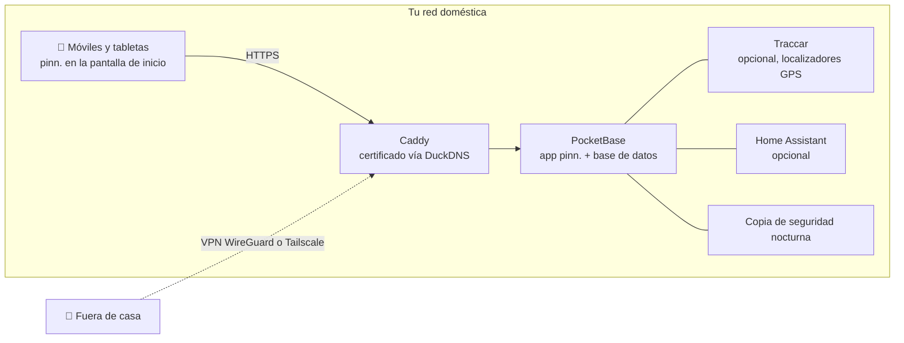

<p align="center">
  
</p>

<p align="center">
  <a href="https://github.com/pinn-shost/pinn/releases/latest"></a>
  <a href="LICENSE"></a>
  
  
  
  <a href="https://ko-fi.com/pinnapp"></a>
</p>

<p align="center">
  <a href="README.md">🇬🇧 English</a> ·
  <a href="README.de.md">🇩🇪 Deutsch</a> ·
  <b>🇪🇸 Español</b> ·
  <a href="README.fr.md">🇫🇷 Français</a> ·
  <a href="README.it.md">🇮🇹 Italiano</a> ·
  <a href="README.pt.md">🇧🇷 Português</a> ·
  <a href="README.zh.md">🇨🇳 中文</a> ·
  <a href="README.ja.md">🇯🇵 日本語</a> ·
  <a href="README.ko.md">🇰🇷 한국어</a> ·
  <a href="README.ru.md">🇷🇺 Русский</a> ·
  <a href="README.nl.md">🇳🇱 Nederlands</a>
</p>

<p align="center">
  <a href="#capturas-de-pantalla">Capturas</a> ·
  <a href="#qué-hace-pinn">Funciones</a> ·
  <a href="#instalación">Instalación</a> ·
  <a href="#privacidad">Privacidad</a> ·
  <a href="#preguntas-frecuentes">Preguntas frecuentes</a>
</p>

---

pinn. es una sola app para todo lo que hace funcionar un hogar: el calendario compartido, las comidas de la semana, la lista de la compra, a quién le toca sacar la basura, la paga de los niños y el seguro que hay que cancelar en marzo. Funciona en **tu propio NAS** con Docker y se instala como una app nativa en cada iPhone, iPad y móvil Android de la familia.

Sin cuenta en la nube. Sin suscripción. Sin anuncios ni rastreo. Los datos de tu familia nunca salen de casa.

## Capturas de pantalla

### En el iPad

Colgado en la pared o sobre la mesa de la cocina: el iPad compartido muestra a toda la familia de un vistazo.

<table>
  <tr>
    <td align="center" width="50%">
      <a href=".github/assets/screenshots/dashboard.png"></a><br>
      <sub><b>Panel</b> – cada uno toca su propia foto, con PIN opcional</sub>
    </td>
    <td align="center" width="50%">
      <a href=".github/assets/screenshots/ipad-overview.png"></a><br>
      <sub><b>Resumen</b> – tiempo, citas, tareas, comidas y la familia de un vistazo</sub>
    </td>
  </tr>
</table>

### En el móvil

Siempre contigo: pinn. se instala en cada iPhone y móvil Android como una app nativa.

<table>
  <tr>
    <td align="center" width="33%"><a href=".github/assets/screenshots/home.png"></a><br><sub><b>Resumen</b> – tu día de un vistazo</sub></td>
    <td align="center" width="33%"><a href=".github/assets/screenshots/calendar.png"></a><br><sub><b>Calendario</b> – iCloud y Google en una sola vista</sub></td>
    <td align="center" width="33%"><a href=".github/assets/screenshots/meals.png"></a><br><sub><b>Comidas</b> – planifica la semana, compra con un toque</sub></td>
  </tr>
  <tr>
    <td align="center" width="33%"><a href=".github/assets/screenshots/lists.png"></a><br><sub><b>Listas</b> – compra, despensa, equipaje</sub></td>
    <td align="center" width="33%"><a href=".github/assets/screenshots/finance.png"></a><br><sub><b>Finanzas</b> – presupuesto, ahorro, paga</sub></td>
    <td align="center" width="33%"><a href=".github/assets/screenshots/chat.png"></a><br><sub><b>Chat</b> – cifrado de extremo a extremo, con mensajes de voz y ubicación</sub></td>
  </tr>
</table>

### Más pantallas

Pulsa cualquier imagen para verla en tamaño completo.

<details>
<summary><b>Mostrar más capturas</b></summary>

<br>

<table>
  <tr>
    <td align="center" width="25%"><a href=".github/assets/screenshots/house.png"></a><br><sub><b>Hogar</b> – casa, costes, préstamo, defectos y contadores en un solo lugar</sub></td>
    <td align="center" width="25%"><a href=".github/assets/screenshots/tasks.png"></a><br><sub><b>Tareas</b> – recordatorios automáticos, p. ej. ITV y cambio de neumáticos, con botón directo</sub></td>
    <td align="center" width="25%"><a href=".github/assets/screenshots/vehicles.png"></a><br><sub><b>Vehículos</b> – ITV, neumáticos, repostaje y carga</sub></td>
    <td align="center" width="25%"><a href=".github/assets/screenshots/scan_pantry.png"></a><br><sub><b>Escanear la despensa</b> – escanea el código de barras, guarda o consume</sub></td>
  </tr>
  <tr>
    <td align="center" width="25%"><a href=".github/assets/screenshots/weekly_summary_1.png"></a><br><sub><b>Vista semanal</b> – el tiempo y lo que sigue pendiente</sub></td>
    <td align="center" width="25%"><a href=".github/assets/screenshots/weekly_summary_2.png"></a><br><sub><b>Vista semanal</b> – día a día: limpieza, basura, pagos</sub></td>
    <td align="center" width="25%"><a href=".github/assets/screenshots/weekly_summary_3.png"></a><br><sub><b>La semana pasada en breve</b> – citas, comidas, gastos – y accesos directos</sub></td>
    <td align="center" width="25%"><a href=".github/assets/screenshots/kids.png"></a><br><sub><b>Niños</b> – una rutina diaria divertida</sub></td>
  </tr>
</table>

</details>

<sub>📁 <a href=".github/assets/screenshots">Todas las imágenes en una carpeta</a></sub>

## Qué hace pinn.

| | |
|---|---|
| 📅 **Calendario** | Calendarios de iCloud y Google por persona, privados o compartidos con la familia. Festivos, vacaciones escolares, días de recogida de basura y cumpleaños de tus contactos aparecen automáticamente. |
| 🍝 **Comidas y recetas** | Planifica la semana y manda los ingredientes directamente a la lista de la compra. Importa recetas desde texto, PDF, fotos o un enlace – opcionalmente con IA. Comparte tus recetas favoritas con otras familias de tu servidor. |
| 🛒 **Listas** | Listas de la compra por tienda, una despensa que rellena la lista cuando algo se acaba, listas de equipaje a partir de plantillas (vacaciones, bolsa del hospital, fiesta), listas de regalos y de deseos. |
| ✅ **Tareas y hogar** | Tareas con recordatorios push, planes de limpieza y cubos de basura – y una página infantil con rutinas animadas que solo muestra lo que toca a esa hora del día. |
| 💶 **Finanzas** | Cajas compartidas o privadas, presupuesto del hogar, ahorro y depósitos con ETF y acciones, paga, pagos periódicos y contratos con recordatorio de cancelación. Los pisos compartidos reparten gastos y ven quién debe a quién. |
| 📄 **Documentos y vehículos** | Tiques y garantías, documentos de identidad con aviso de caducidad. Coches y bicis con fechas de ITV, cambio de neumáticos, consumo y coste total. |
| 🏡 **Casa** | Para inquilinos, propietarios y arrendadores: contrato de alquiler o de compra, préstamo, desperfectos con fotos, tiques, plan de reformas, lecturas de contadores con previsión, llaves e ingresos de alquiler de pisos, casas y garajes alquilados. Jardín y plantas con un plan de riego que sabe cuándo ha llovido. |
| 📍 **Familia y ubicación** | Comparte tu ubicación directamente desde pinn. – una vez o durante un tiempo elegido – y en segundo plano con la app gratuita Traccar Client (envía directamente a pinn., sin servidor adicional). Además, un modo «de camino a casa», una alerta SOS con posición y números de emergencia, fichas de emergencia y avisos de llegada a lugares. |
| 🎒 **Colegio y guardería** | Por niño: horario (escríbelo o hazle una foto – la IA lo rellena), llevar y recoger, deberes en la página infantil, circulares con plazos que se convierten en recordatorios y días de cierre directamente en el calendario. |
| 🐾 **Mascotas** | Perfiles para perros, gatos, conejos y demás, con horas de comida para marcar, paseos, turnos de «a quién le toca», vacunas y desparasitaciones con recordatorio push, gráfica de peso, veterinario y urgencias veterinarias, una ficha para cuidadores para compartir y un cartel imprimible de «se busca» y un aviso para rellenar el comedero automático. |
| 🌦️ **Tiempo y vacaciones** | Toca el tiempo (una tarjeta en el móvil, arriba junto a la fecha y la hora en iPad y ordenador) para ver 14 días con detalles de cada día. Las listas de equipaje con destino y fechas muestran el tiempo de las vacaciones – previsión o valores típicos – y sugieren qué llevar. |
| 🏠 **Casa inteligente** | Lanza Atajos de Apple o acciones de Home Assistant desde una tarea – el robot aspirador limpia la cocina cuando toca la tarea, el robot cortacésped y el riego siguen el plan del jardín y el comedero avisa cuando se vacía. |
| 🎙️ **Control por voz** | «Oye Siri, pinn»: añade a la lista de la compra, que te la lea, crea tareas y escucha lo que hay hoy – también en Android. |
| 💬 **Chat** | Chat familiar y privado con cifrado de extremo a extremo, push, marcas de lectura y respuestas. |
| 🔔 **Notificaciones** | Mensajes push personales en iPhone, iPad y Android, y una campana que recoge todos los cambios de la familia. |
| 🧩 **Todo lo demás** | Tablón familiar con notas movibles, búsqueda global, modo sin conexión con sincronización automática, modo oscuro, panel para iPad con PIN por perfil, cuenta de invitado, control parental. |

pinn. habla **🇬🇧 English, 🇩🇪 Deutsch, 🇪🇸 Español, 🇫🇷 Français, 🇮🇹 Italiano, 🇧🇷 Português, 🇨🇳 中文, 🇯🇵 日本語, 🇰🇷 한국어, 🇷🇺 Русский y 🇳🇱 Nederlands**, adapta la moneda y los números de emergencia a tu región y cambia entre los términos **familia** y **piso compartido**. Un servidor puede alojar varias familias, cada una con sus propios administradores.

## Novedades de la 1.129.1

**Correcciones del chat y los últimos comentarios en inglés**

- **Encuestas en el chat.** Una encuesta compartida en el chat que también está en el tablón ya no aparece a los demás durante unos 20 segundos como «La encuesta se ha eliminado». Hasta que llega la nota del tablón se ve brevemente «Sincronizando con el tablón …» y la encuesta aparece a los pocos segundos.
- **Fotos nítidas en el chat.** Las fotos se ven nítidas antes de abrirlas: la vista previa es el doble de grande y, en cuanto una foto es visible, pinn. carga la imagen real en segundo plano, también en mensajes antiguos.
- **Comentarios en inglés.** Se convirtieron los últimos comentarios en alemán. Una nueva comprobación automática (`check-comments.js`, parte de las comprobaciones de GitHub) vigila que todos sigan en inglés.
- **README.** Nueva captura del chat al principio; la página de los niños pasó a las capturas adicionales.
- Cambiado: `js/chat.js`, `js/chatextras.js`, `js/chatmedien.js`, `js/sprachen.js`, `js/versionslog.js`, `i18n/` (todos los idiomas), `src/` (`index.html`), comentarios en algunos hooks, `datenexport.js`, `einrichtung.js`, `.github/` (nueva comprobación) y todos los README. Servidor: solo cambian comentarios; aun así, conviene sustituir los hooks.

## Novedades de la 1.129.0

**Comentarios en inglés en todos los archivos**

- **Comentarios en inglés.** Todos los comentarios de código del proyecto están ahora en inglés: partes del servidor, scripts de instalación y mantenimiento, `docker-compose.yaml`, la plantilla `.env`, el Caddyfile y los archivos de la app. No cambia nada en la app, sus textos ni su comportamiento.
- Cambiado: `pb_hooks/` (todos los archivos), `pinn-setup.sh`, `pinn-wartung.sh`, `pinn-pocketbase-update.sh`, `docker-compose.yaml`, `env.txt`, `caddy/Caddyfile`, `js/sprachen.js`, `datenexport.js`, `einrichtung.js`, `js/versionslog.js`, `i18n/versionslog.en.js`, `src/` (`index.html`) y todos los README. Parte del servidor: los archivos de hooks – reemplázalos también.

## Novedades de la 1.128.0

**Control por voz en todos los idiomas de la app**

- **Once idiomas.** Siri («HTTP Shortcuts» en Android) ahora también entiende neerlandés, italiano, portugués, chino, japonés y coreano: añadir a la lista de la compra, leer la lista, crear una tarea, «¿Qué hay hoy?». La respuesta llega en el idioma del perfil. El atajo y el enlace existentes siguen funcionando.
- **Ejemplos.** “Zet melk en eieren op het boodschappenlijstje”, “Aggiungi latte e uova alla lista della spesa”, “Adicione leite e ovos à lista de compras”, “把牛奶和鸡蛋加到购物清单”, “買い物リストに牛乳と卵を追加して”, “장보기 목록에 우유랑 달걀 추가해 줘”.
- **Pequeñas correcciones.** Se entienden los apóstrofos del dictado («c’è») y los signos al final de la frase (。！？), y cantidades como «2 Decken» ya no se cortan.
- Cambiado: `pb_hooks/pinn-sprache.js`, `js/sprachen.js`, `js/versionslog.js`, `i18n/versionslog.en.js`, todos los `i18n/*.i18n.js`, `src/` (`index.html`), `.github/scripts/check-hooks.js` and todos los READMEs. Parte del servidor: `pb_hooks/pinn-sprache.js` – sustituye también los hooks.

## Novedades de la 1.127.6

**Chat: los mensajes borrados dejan constancia, seguridad**

- **Lo borrado sigue visible.** Un mensaje borrado ya no desaparece sin más: en su lugar todos ven «Este mensaje fue eliminado» y, en una encuesta, «La encuesta fue eliminada».
- **Borrado en el tablón.** Si una encuesta que también está en el tablón se borra allí, el chat también dice «La encuesta fue eliminada»; una tarjeta de una nota borrada del tablón lo indica en vez de no llevar a ninguna parte.
- **Seguridad.** Las tres alertas del escáner de código «DOM text reinterpreted as HTML» en la vista previa de fotos y vídeos del chat (`js/chatmedien.js`) quedan resueltas: las direcciones de objeto se comprueban de forma estricta y se escapan para HTML.
- Cambiado: `js/chat.js`, `js/chatextras.js`, `js/chatmedien.js`, `js/sprachen.js`, `js/versionslog.js`, `i18n/versionslog.en.js`, todos los `i18n/*.i18n.js`, `src/` (`index.html`) y todos los README. Parte del servidor: `pb_hooks/pinn-chat.js` – sustituye también los hooks; un campo se añade automáticamente al arrancar.

## Novedades de la 1.127.5

**Chat: votaciones más rápidas, finanzas en el chat, seguridad**

- **Las votaciones reaccionan más rápido.** Una votación del chat que también está en el tablón se actualiza para todos en unos 10 segundos en lugar de hasta un minuto.
- **Finanzas en el chat.** Gastos, ingresos, entradas periódicas y posiciones de ahorro tienen ahora un botón **Chat** (💬) en su ventana: elige un chat, la entrada llega como tarjeta y al tocarla se abre de nuevo.
- **Botones más cortos.** «Comentar en el chat» ahora es simplemente **Chat** en todas partes.
- **Seguridad.** Se han cerrado las tres alertas del escáner de código «DOM text reinterpreted as HTML» en la vista previa de fotos y vídeos del chat.
- Cambiado: `js/chatmedien.js`, `js/chatstimme.js`, `js/chat.js`, `js/chatextras.js`, `js/finanzen.js`, `js/sparen.js`, `js/vertraege.js`, `js/sprachen.js`, `js/versionslog.js`, `i18n/versionslog.en.js`, todos los `i18n/*.i18n.js`, `src/` (`index.html`) y todos los README. Sin parte de servidor.

## Novedades de la 1.127.4

**Chat: mensajes de voz, ubicación, encuestas, PDF, búsqueda, silenciar – y cifrado desactivable**

- **Mensajes de voz.** Un botón de micrófono sustituye al de enviar mientras no se escribe nada: tocar, hablar, enviar (hasta 5 minutos). Forma de onda, reproducir/pausa, 1×/1,5×/2× y saltar tocando la onda. Cifrados de extremo a extremo como las fotos.
- **El clip ahora es un menú:** foto/vídeo, **documento PDF** (hasta 20 MB; abrir / compartir / guardar / archivar en pinn.), **ubicación** y **encuesta**.
- **Ubicación.** Vista previa del mapa y etiqueta (se sugiere un lugar guardado del mapa de ubicación, p. ej. «Casa»). Al tocarla se ve el mapa: **«Mostrar en el mapa de ubicación»** abre Familia → Ubicación con una marca; «Abrir en la app de mapas» inicia la navegación.
- **Encuestas.** Una pregunta y hasta 8 respuestas, varias por persona si se desea. Con la casilla **«Mostrar también en el tablón»** se crea a la vez una encuesta del tablón: se vota aquí o allí y el resultado es el mismo.
- **Búsqueda** en el chat (lupa arriba), **silenciar** por chat (8 horas, 1 semana, siempre; sin notificación y sin contar en el número junto a «Chat» del menú) y **disolver un grupo** (creador y administradores).
- **Cifrado desactivable** por familia (administradores, «Seguridad del chat»). Entonces las notificaciones muestran el texto (en Android también una vista previa de las fotos) y nadie necesita código de recuperación. Por defecto sigue cifrado de extremo a extremo.
- «Comentar en el chat» (💬) también en citas, documentos y vehículos. Corregido: «Archivar en pinn.» se abría bajo la foto, los títulos del chat usan la fuente de la app y el número del menú se actualiza con más fiabilidad.
- Cambiado: `js/chatextras.js` y `js/chatstimme.js` (nuevos), `js/chat.js`, `js/chatmedien.js`, `js/chatgruppen.js`, `js/familie.js`, `js/pinnwand.js`, `js/termindetails.js`, `js/dokumente.js`, `js/fahrzeuge.js`, `js/hinweise.js`, `css/chat.css`, `js/sprachen.js`, `js/versionslog.js`, `i18n/versionslog.en.js`, todos los `i18n/*.i18n.js`, `pinn-setup.sh`, `src/` y todos los README. **Parte del servidor:** `pb_hooks/chat.pb.js`, `pinn-chat.js`, `pinn-push.js` y `sw.pb.js`: sustituye también los hooks; algunos campos se añaden solos al arrancar.


## Novedades de la 1.127.3

**Chat: grupos propios, chats fijados, deslizar y imágenes del chat**

- **Crea tus propios grupos.** El nuevo botón de personas junto al escudo: pon un nombre al grupo y marca quién debe estar – entran al instante, **sin invitación**. El creador y los admins cambian nombre, miembros e imagen; cualquiera puede salir. Quien se añada más tarde solo lee los mensajes nuevos.
- **Orden y fijar.** Arriba va el mensaje más reciente, enviado o recibido; los chats se pueden **fijar** para que se queden arriba. **Desliza un chat hacia la izquierda** y aparecen dos botones: fijar / soltar y marcar como leído / no leído (según el estado). En el ordenador, el botón «⋯» o un clic derecho abre lo mismo. Un chat marcado como no leído muestra un punto hasta que lo abres; fijados y marcas son iguales en todos los dispositivos.
- **Imágenes.** El admin de la familia toca la imagen en el chat familiar abierto y elige una foto, recortada en círculo como la foto de perfil; el creador y los admins de un grupo hacen lo mismo con el grupo.
- Los nombres e imágenes de los grupos no están cifrados de extremo a extremo (el servidor necesita los miembros para las claves); los mensajes sí.
- Cambiado: `js/chatgruppen.js` (nuevo), `js/chat.js`, `css/chat.css`, `js/sprachen.js`, `js/versionslog.js`, `i18n/versionslog.en.js`, todos los `i18n/*.i18n.js`, `index.html`, `pinn-setup.sh`, `src/` y todos los README. **Parte de servidor:** `pb_hooks/chat.pb.js` y `pb_hooks/pinn-chat.js` – cambia también los hooks; se crean tres colecciones más automáticamente.


## Novedades de la 1.127.2

**Chat: hablar de tareas, notas del tablón y plazos de contratos**

- **💬 «Comentar en el chat»** en una tarea, en una nota del tablón y en un contrato (p. ej. un plazo de baja próximo): elige el chat familiar o a una persona y el chat se abre con el elemento como tarjeta en la línea de entrada. Añade unas palabras o simplemente envíalo.
- **La tarjeta abre el elemento:** un toque en el mensaje lleva a la tarea (parpadea un momento en la lista), a la nota o al contrato. Si ya no existe o no tienes acceso, un aviso breve lo indica.
- **Sigue cifrado de extremo a extremo:** la tarjeta se cifra igual que el texto; tu NAS no ve nada.
- Cambiado: `js/chat.js`, `css/chat.css`, `js/aufgaben.js`, `js/pinnwand.js`, `js/vertraege.js`, `js/sprachen.js`, `js/versionslog.js`, `i18n/versionslog.en.js`, todos los `i18n/*.i18n.js`, `index.html`, `src/` y todos los README. **Sin parte de servidor:** los hooks no cambian.


## Novedades de la 1.127.1

**Fotos y vídeos en el chat**

- **Enviar fotos y vídeos** con el botón del clip, con vista previa y pie. Como en WhatsApp, un **botón HD** te deja elegir cada vez: Estándar reduce las fotos a unos 0,3 MB; HD envía el original (fotos hasta 20 MB, vídeos hasta 50 MB). Los vídeos se reducen donde el dispositivo puede; si no, se envía el original.
- **También con cifrado de extremo a extremo:** cada archivo tiene su propia clave; tu NAS no ve ni la imagen ni su nombre. Visor a pantalla completa en el chat, **compartir** (WhatsApp, correo …) o **guardar en el dispositivo**.
- **Guardar en pinn.:** guarda una foto como documento o asígnala a una vivienda, un defecto o un vehículo. Los vídeos se comparten o guardan, no se archivan como documentos.
- **Borrado automático:** los administradores eligen en «Seguridad del chat» tras cuántos días se borran, cada noche y para todos, los mensajes y/o las fotos y vídeos (por defecto: nunca).
- Cambios: `js/chatmedien.js` (nuevo), `css/chat.css`, `js/chat.js`, `js/sprachen.js`, `js/versionslog.js`, `i18n/versionslog.en.js`, todos los `i18n/*.i18n.js`, `pinn-setup.sh`, `src/` y todos los README. **Parte del servidor:** `pb_hooks/chat.pb.js` y `pb_hooks/pinn-chat.js`; hay que sustituir también los hooks.


## Novedades de la 1.127.0

**Chat con cifrado de extremo a extremo**

- **Chat familiar y chats privados.** Aspecto de mensajería con los colores de pinn., con respuestas, enlaces, separadores de fecha y contadores de no leídos. Una marca = llegó al servidor; dos marcas de color = leído (las confirmaciones de lectura se pueden desactivar).
- **Cifrado de extremo a extremo.** Los mensajes se cifran en el dispositivo; tu NAS solo ve quién escribe y cuándo, nunca el contenido. Al abrir el chat por primera vez se crean una clave y un código de recuperación que desbloquea el chat en un dispositivo nuevo. «Seguridad del chat» muestra números de seguridad para comparar; si una clave cambia, el envío se detiene hasta aceptar el número nuevo.
- **Notificaciones push.** «Mensaje nuevo» sin texto (el servidor no puede leerlo), ajustable en Cuenta → Notificaciones → Chat. No para invitados ni en el panel.
- **Preparado para el siguiente paso:** los mensajes pueden llevar una referencia (tarea, nota, baja de contrato …) como tarjeta. Límites: sin forward secrecy, sin imágenes todavía (previsto para 1.127.1).
- Cambios: `index.html`, `js/chat.js` y `css/chat.css` (nuevos), varios `js/*.js`, todos los `i18n/*.i18n.js`, `pinn-setup.sh` y todos los README. **Parte del servidor:** `pb_hooks/chat.pb.js` y `pb_hooks/pinn-chat.js` (nuevos), `pb_hooks/pinn-push.js`, `pb_hooks/pinn-schema.js`; hay que sustituir también los hooks.


## Novedades de la 1.125.0

**Tutorial, resumen diario y matrículas**

- **Tutorial revisado.** El botón «Muéstramelo» ahora se llama **«Pausar»**. El segundo paso abre el menú ☰ y lo explica (la barra inferior del móvil ya no existe). El último paso remite a la página de ayuda y a las Discusiones de GitHub para preguntas al desarrollador.
- **Resumen diario por push: tareas del hogar a elegir.** En Cuenta → Notificaciones puedes elegir si las tareas del hogar se incluyen en el resumen diario. Por defecto: sí, así que no cambia nada mientras no lo desactives.
- **Matrículas de vehículos.** La franja azul muestra ahora el círculo de estrellas de la UE en lugar de «D». Las matrículas de otras regiones llegarán más adelante.
- Limpieza: se eliminó el código sin uso de la antigua barra del móvil.
- Cambiado: `index.html`, archivos de `js/`, `css/` e `i18n/`, en el servidor `pb_hooks/pinn-push.js` y `src/` (la parte `menueleiste.html` desaparece). Instalación como siempre (`sudo sh pinn-*/pinn-setup.sh` o el botón de actualización).


## Cómo funciona



Todo funciona como contenedores Docker en una sola máquina. HTTPS funciona **sin abrir puertos** – el certificado se emite mediante una comprobación DNS. Desde fuera, pinn. solo es accesible a través de tu propia VPN.

## Requisitos

- Un NAS o servidor con **Docker** y **Docker Compose 2.17+** – desarrollado en un NAS UGREEN con UGOS, funciona en cualquier host Linux con Docker (amd64, arm64, armv7)
- Acceso SSH a él
- Opcional pero recomendado: un subdominio gratuito de [DuckDNS](https://www.duckdns.org) para HTTPS – necesario para las notificaciones push y para instalar pinn. como app

## Instalación

1. Descarga el ZIP de la [última versión](https://github.com/pinn-shost/pinn/releases/latest) y descomprímelo.
2. Crea una carpeta en el NAS, p. ej. `/volume1/docker/Pocketbase`, y coloca dentro la carpeta descomprimida (p. ej. `pinn-1.129.1` o `pinn-main`) tal cual.
3. Inicia sesión por SSH y ejecuta:
   ```sh
   cd /volume1/docker/Pocketbase && sudo sh pinn-*/pinn-setup.sh
   ```
   El script coloca cada archivo en su sitio, descarga las bibliotecas para importar PDF y reconocer texto en fotos, e inicia pinn.
4. Abre `http://<IP-del-NAS>:8090` → **Iniciar sesión como admin principal** → contraseña `Admin` → elige tu propia contraseña.
5. El **asistente de configuración** te guía en el resto – HTTPS, acceso remoto con WireGuard o Tailscale, Google, IA, ubicación y Home Assistant – paso a paso, en once idiomas.
6. Abre pinn. en cada móvil con su dirección HTTPS y añádelo a la pantalla de inicio:
   - **iPhone/iPad (Safari):** Compartir → *Añadir a pantalla de inicio* (iOS 16.4 o posterior para las notificaciones)
   - **Android (Chrome):** Ajustes → Notificaciones → *Instalar pinn. como app*, o menú de Chrome ⋮ → *Instalar app*

   Después activa las notificaciones en cada dispositivo en **Ajustes → Notificaciones → Activar en este dispositivo**.

**Actualizar:** descarga el nuevo ZIP, coloca la carpeta descomprimida en la misma carpeta y vuelve a ejecutar `sudo sh pinn-*/pinn-setup.sh`. Los archivos sustituidos se guardan en `_alt/`, tus datos no se tocan.

**Las copias de seguridad** se hacen cada noche en `./backups` y se conservan 14 días.

## Privacidad

pinn. se creó para datos que nunca darías a un servicio en la nube: extractos bancarios, documentos médicos, dónde están tus hijos. Por eso:

- **Todos los datos están en tu NAS** en una única base de datos PocketBase. No existe un servidor de pinn. ni telemetría.
- **Ningún script de servidores de terceros.** Todo el código y las bibliotecas se sirven desde tu NAS.
- **Las notificaciones push no llevan contenido.** Apple, Google y Mozilla solo entregan una señal vacía para despertar el dispositivo; este recoge el mensaje de tu NAS.
- **Las contraseñas de iCloud y Google** se guardan cifradas en una colección bloqueada.
- **No es accesible desde internet.** El acceso remoto pasa por tu propia VPN.

pinn. solo contacta con servicios externos para las funciones que los necesitan:

| Servicio | Para qué | Cuándo |
|---|---|---|
| [Open-Meteo](https://open-meteo.com) | Previsión del tiempo | cuando hay una dirección de casa |
| [OpenStreetMap Nominatim](https://nominatim.openstreetmap.org) | Convertir direcciones en posiciones del mapa | al introducir direcciones |
| [Teselas de OpenStreetMap](https://www.openstreetmap.org) | Fondo del mapa | en la página de ubicación, cargado a través de tu NAS |
| [Google Fonts](https://fonts.google.com) | Tipografías | al cargar la app |
| [OpenHolidays API](https://www.openholidaysapi.org) | Festivos y vacaciones escolares | cuando hay una dirección de casa |
| [DuckDNS](https://www.duckdns.org) | Certificado HTTPS y dirección | si está configurado |
| iCloud / Google | Calendarios y contactos | solo para las cuentas que conectes |
| Google Gemini | Leer recetas y documentos | solo si añades una clave de API |
| jsDelivr | Descarga única de pdf.js y Tesseract | solo durante la instalación |

## Preguntas frecuentes

<details>
<summary><b>¿Tengo que abrir puertos en el router?</b></summary>
<br>
No. El certificado HTTPS se emite mediante una comprobación DNS y el acceso remoto va por VPN – WireGuard en una FRITZ!Box o Tailscale en cualquier otro router.
</details>

<details>
<summary><b>¿Funciona sin NAS?</b></summary>
<br>
Sirve cualquier equipo siempre encendido con Docker: un mini PC, una Raspberry Pi 4/5 o un servidor Linux.
</details>

<details>
<summary><b>¿Es pinn. una app «de verdad» de la App Store?</b></summary>
<br>
pinn. es una app web que añades a la pantalla de inicio. Después se abre a pantalla completa como una app nativa, funciona sin conexión, muestra un globo con las tareas pendientes y recibe notificaciones push – sin ninguna tienda de apps.
</details>

<details>
<summary><b>¿Pueden varias familias usar una misma instalación?</b></summary>
<br>
Sí. El administrador principal crea familias y cada una tiene sus propios administradores, calendarios y datos. Las recetas se pueden compartir entre familias si se quiere.
</details>

<details>
<summary><b>¿Y los niños?</b></summary>
<br>
Los perfiles con control parental solo ven sus propias tareas y no pueden borrar ni cambiar nada. Finanzas, documentos y vehículos quedan ocultos. Los más pequeños tienen su propia página divertida con rutinas diarias.
</details>

<details>
<summary><b>¿Cuánto cuesta?</b></summary>
<br>
Nada – pinn. es gratuito y de código abierto con licencia MIT. Los servicios opcionales como la IA Gemini tienen planes gratuitos.
</details>

## Estructura del repositorio

El repositorio tiene la misma estructura que una instalación en el NAS – cada archivo está donde terminará:

```
pinn/
├── pb_hooks/            servidor: hooks *.pb.js y sus módulos auxiliares (pinn-*.js, calendar-sync.js)
├── pb_public/           app web servida por PocketBase
│   ├── index.html       la página de la app, construida desde src/ (HTML, comprobación de inicio) – no editar a mano
│   ├── js/              código de la app separado de index.html, archivos <script> simples sin paso de compilación
│   │                    (ruhemodus.js, textkern.js, sprachen.js, region.js, grundlagen.js, popups.js, verbindung.js, benutzer.js, mitteilungen.js, serverzugriff.js, tastatur.js, anmeldemaske.js, dashboard.js, dashboardhintergrund.js, profilauswahl.js, pineingabe.js, dashboardsitzung.js, dashboardkonto.js, familienverwalten.js, einrichten.js, exportieren.js, hauptadminseite.js, anmeldung.js, konto.js, profilverwaltung.js, zustand.js, bedienzustand.js, rezeptbilder.js, zusammenfuehren.js, speichern.js, design.js, sprache.js, uebersicht.js, familienkachel.js, wobistdu.js, geburtstagsfeier.js, wetterkachel.js, geburtstage.js, uebersichteinstellungen.js, familiensync.js, bereiche.js, kalenderquellen.js, icsparser.js, zeitleiste.js, termindetails.js, kalenderdatei.js, wetter.js, wohnort.js, feiertage.js, muellkalender.js, mitglieder.js, profilbild.js, mitglied.js, kinderseite.js, kinderroutine.js, sterne.js, kalenderansicht.js, essenplanen.js, rezeptparser.js, rezeptdialog.js, rezeptbild.js, rezeptmengen.js, einkauf.js, einkaufslisten.js, einkaufseingabe.js, rezepte.js, offline.js, aufgabenextras.js, appbadge.js, reisen.js, aufgabendaten.js, haushalt.js, reihum.js, aufgaben.js, smarthome.js, sprachsteuerung.js, termine.js, ansichten.js, versionspruefung.js, sicherungen.js, geraete.js, fehlerprotokoll.js, versionslog.js, einstellungen.js, kalenderkonto.js, finanzen.js, kassen.js, vorrat.js, vorrat2.js, sparen.js, vertraege.js, fahrzeuge.js, zuhause.js, dokumente.js, pdflesen.js, appstart.js, pinnwand.js, listen.js, familie.js, hinweise.js, ausblick.js – ausblick.js siempre va al final)
│   ├── css/             estilos de la app separados de index.html, CSS simple sin paso de compilación (ergaenzung.css, energiesparen.css, basis.css … haustierewetter.css, terminal.css, glocke.css)
│   ├── einrichtung.js   asistente de configuración · datenexport.js  exportación de datos
│   ├── i18n/            textos por clave (de, en, fr, es, it, pt, zh, ja, ko) – el inglés es la referencia
│   └── vendor/          pinn.css, pocketbase/ (pdf.js y Tesseract los descarga la instalación)
├── .github/             GitHub Actions (workflows/check.yml), comprobaciones (scripts/), CONTRIBUTING.md, SECURITY.md, imágenes – no se instala
├── src/                 fuentes de index.html (build.js, rahmen.html, teile/) – no se instala
├── caddy/Caddyfile      proxy inverso HTTPS
├── docker-compose.yaml  todos los contenedores
├── env.txt              plantilla para .env
├── pinn-setup.sh        instalar y actualizar
├── pinn-wartung.sh      copias de seguridad y actualizaciones (contenedor «wartung»)
├── pinn-pocketbase-update.sh
├── index.html           solo un marcador, nunca se instala (mantiene funcionando el botón de actualizar de la 1.38)
└── README.md            página en inglés · README.<code>.md en de, es (esta página), fr, it, pt, zh, ja, ko
```

`pinn-setup.sh` copia `pb_hooks/`, `pb_public/` y `caddy/Caddyfile` tal cual en la carpeta del proyecto; las carpetas de datos (`pb_data/`, `konfig/`, `backups/`, `caddy/data/` …) nunca se tocan.

## Colaborar

Los informes de errores, ideas y traducciones son muy bienvenidos – consulta [CONTRIBUTING.md](.github/CONTRIBUTING.md). Informa de los problemas de seguridad de forma privada como se describe en [SECURITY.md](.github/SECURITY.md). Antes de un pull request, ejecuta `node .github/scripts/check-all.js` – las mismas comprobaciones se ejecutan automáticamente en GitHub.

## Apoya pinn.

pinn. es gratuito y seguirá siéndolo – completo, para todos. Lo desarrollo en mi tiempo libre. Si te hace el día a día un poco más fácil, una pequeña aportación es muy bienvenida, pero totalmente voluntaria:

<p>
  <a href="https://ko-fi.com/pinnapp"></a>
  <a href="https://buymeacoffee.com/pinn"></a>
</p>

Una ⭐ también ayuda – así otras familias encuentran pinn. más fácilmente.

## Hecho con

[PocketBase](https://pocketbase.io) (MIT) · [Tailwind CSS](https://tailwindcss.com) (MIT) · [pdf.js](https://mozilla.github.io/pdf.js/) (Apache-2.0) · [Tesseract.js](https://tesseract.projectnaptha.com) (Apache-2.0) · [Traccar](https://www.traccar.org) (Apache-2.0) · [Caddy](https://caddyserver.com) (Apache-2.0)

## Licencia

[MIT](LICENSE) – úsalo, cámbialo, compártelo.
