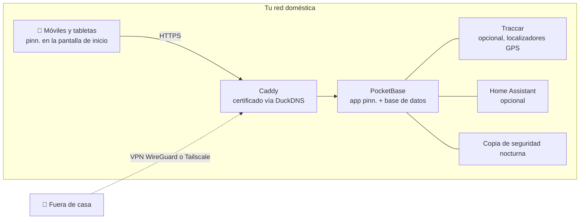

<p align="center">
  
</p>

<p align="center">
  <a href="https://github.com/pinn-shost/pinn/releases/latest"></a>
  <a href="LICENSE"></a>
  
  
  
  <a href="https://ko-fi.com/pinnapp"></a>
</p>

<p align="center">
  <a href="README.md">🇬🇧 English</a> ·
  <a href="README.de.md">🇩🇪 Deutsch</a> ·
  <b>🇪🇸 Español</b> ·
  <a href="README.fr.md">🇫🇷 Français</a>
</p>

<p align="center">
  <a href="#capturas-de-pantalla">Capturas</a> ·
  <a href="#qué-hace-pinn">Funciones</a> ·
  <a href="#instalación">Instalación</a> ·
  <a href="#privacidad">Privacidad</a> ·
  <a href="#preguntas-frecuentes">Preguntas frecuentes</a>
</p>

---

pinn. es una sola app para todo lo que mantiene un hogar en marcha: el calendario compartido, las comidas de esta semana, la lista de la compra, a quién le toca sacar la basura, la paga de los niños y el seguro que hay que cancelar en marzo. Funciona en **tu propio NAS** con Docker y se instala como una app nativa en cada iPhone, iPad y móvil Android de la familia.

Sin cuenta en la nube. Sin suscripción. Sin anuncios ni rastreo. Los datos de tu familia nunca salen de casa.

## Capturas de pantalla

### En el iPad

Colgado en la pared o sobre la mesa de la cocina: el iPad compartido muestra a toda la familia a la vez.

<table>
  <tr>
    <td align="center" width="50%">
      <br>
      <sub><b>Dashboard</b> – cada uno toca su propia foto, con PIN opcional</sub>
    </td>
    <td align="center" width="50%">
      <br>
      <sub><b>Vista general</b> – el tiempo, citas, tareas, comidas y la familia de un vistazo</sub>
    </td>
  </tr>
</table>

### En el móvil

Siempre contigo: pinn. se instala en cualquier iPhone y móvil Android como una app de verdad.

<table>
  <tr>
    <td align="center" width="33%"><br><sub><b>Vista general</b> – tu día de un vistazo</sub></td>
    <td align="center" width="33%"><br><sub><b>Calendario</b> – iCloud y Google en una sola vista</sub></td>
    <td align="center" width="33%"><br><sub><b>Comidas</b> – planifica la semana, compra con un toque</sub></td>
  </tr>
  <tr>
    <td align="center" width="33%"><br><sub><b>Listas</b> – compra, despensa, equipaje</sub></td>
    <td align="center" width="33%"><br><sub><b>Finanzas</b> – presupuesto, ahorros, paga de los niños</sub></td>
    <td align="center" width="33%"><br><sub><b>Niños</b> – una rutina diaria muy divertida</sub></td>
  </tr>
</table>

## Qué hace pinn.

| | |
|---|---|
| 📅 **Calendario** | Calendarios de iCloud y Google por persona, privados o compartidos con la familia. Los festivos, las vacaciones escolares, los días de recogida de basura y los cumpleaños de tus contactos aparecen automáticamente. |
| 🍝 **Comidas y recetas** | Planifica la semana y envía los ingredientes directamente a la lista de la compra. Importa recetas desde texto, PDF, fotos o un enlace – con IA si quieres. Comparte tus recetas favoritas con otras familias de tu servidor. |
| 🛒 **Listas** | Listas de la compra por tienda, una despensa que rellena la lista cuando algo se acaba, listas de equipaje a partir de plantillas (vacaciones, bolsa para el hospital, fiesta), listas de regalos y de deseos. |
| ✅ **Tareas y hogar** | Tareas con recordatorios push, planes de limpieza y cubos de basura – y una página infantil con rutinas animadas que solo muestra lo que toca a esa hora del día. |
| 💶 **Finanzas** | Cajas compartidas o privadas, un presupuesto familiar, ahorros y carteras de valores con ETF y acciones, paga de los niños, pagos periódicos y contratos con recordatorio de cancelación. Los pisos compartidos pueden repartir gastos y ver quién debe qué a quién. |
| 📄 **Documentos y vehículos** | Recibos y garantías, documentos de identidad con aviso antes de que caduquen. Coches y bicicletas con fechas de inspección, cambio de neumáticos, consumo y coste total. |
| 🏡 **Hogar** | Para inquilinos, propietarios y arrendadores: contrato de alquiler o de compra, préstamo, desperfectos con fotos, facturas, plan de reformas, lecturas de contadores con previsión, llaves e ingresos por alquiler de pisos, casas y garajes que alquilas. Jardín y plantas con un plan de riego que sabe cuándo ha llovido. |
| 📍 **Familia y ubicación** | Comparte tu ubicación directamente desde pinn. – una vez o durante el tiempo que elijas – y en segundo plano con la app gratuita Traccar Client (envía directamente a pinn., sin servidor adicional). Además, un modo «de camino a casa», una alerta SOS con posición y números de emergencia, fichas de emergencia y avisos al llegar a lugares. |
| 🎒 **Colegio y guardería** | Por cada niño: horario (escríbelo o hazle una foto – la IA lo rellena), horas de llevar y recoger, deberes en la página infantil, circulares con plazos que se convierten en recordatorios y días de cierre directamente en el calendario. |
| 🐾 **Mascotas** | Fichas para perros, gatos, conejos y compañía con horarios de comida para marcar, paseos, un turno de «¿a quién le toca?», vacunas y desparasitación con recordatorios push, gráfico de peso, veterinario y urgencias veterinarias, una ficha para el cuidador para compartir y un cartel de «se busca» para imprimir. |
| 🌦️ **Tiempo y vacaciones** | Toca la tarjeta del tiempo para ver 14 días con detalles de cada día. Las listas de equipaje con destino y fechas muestran el tiempo de las vacaciones – previsión o valores habituales – y sugieren qué llevar. |
| 🏠 **Hogar inteligente** | Lanza Atajos de Apple o acciones de Home Assistant desde una tarea – el robot aspirador limpia la cocina cuando toca. |
| 🎙️ **Control por voz** | «Oye Siri, pinn»: añade cosas a la lista de la compra, haz que te la lea, crea tareas y escucha lo que hay hoy – también en Android. |
| 🔔 **Notificaciones** | Mensajes push personales en iPhone, iPad y Android, y una campana que recoge todos los cambios de la familia. |
| 🧩 **Todo lo demás** | Tablón familiar con notas que se pueden mover, búsqueda global, modo sin conexión con sincronización automática, modo oscuro, dashboard para iPad con PIN por perfil, cuenta de invitado, control parental. |

pinn. habla **English, Deutsch, Français y Español**, adapta la moneda y los números de emergencia a tu región y cambia entre los textos de **familia** y de **piso compartido**. Un servidor puede alojar varias familias, cada una con sus propios administradores.

## Novedades en 1.46

**El código de la app se divide en archivos separados (parte 6)**

- **Sexto archivo: `js/appstart.js`** – el arranque de la app (`bootApp`: comprobar el inicio de sesión, cargar los datos de la familia, abrir la primera vista, recoger los enlaces de los mensajes push e iniciar las consultas en segundo plano) está ahora en su propio archivo en `pb_public/js/`. El código se ha movido sin cambios; solo sus comentarios están ahora en inglés.
- **Orden de carga:** `appstart.js` se carga justo después del código de la app en `index.html`, antes de `js/pinnwand.js`, `js/listen.js`, `js/familie.js`, `js/hinweise.js` y `js/ausblick.js`. `ausblick.js` sigue siendo el último y llama a `bootApp()`, así que la app solo arranca cuando todos los demás archivos están cargados. El control parental (ver 1.44) sigue protegiendo los seis editores.
- **Para ti no cambia nada:** la app se ve y funciona exactamente igual que antes, también sin conexión. La comprobación de inicio también avisa si falta `js/appstart.js` en el NAS.
- **Capturas del móvil:** esta página muestra ahora también la app en el móvil – vista general, calendario, comidas, listas, finanzas y niños.
- La instalación y la actualización funcionan como siempre (`sudo sh pinn-*/pinn-setup.sh` o el botón de actualizar). Un `appstart.js` suelto se coloca automáticamente en `pb_public/js/`. Tus datos no se tocan.

## Cómo funciona



Todo funciona como contenedores Docker en una sola máquina. HTTPS funciona **sin abrir puertos** – el certificado se emite mediante una comprobación DNS. Desde fuera, pinn. solo es accesible a través de tu propia VPN.

## Requisitos

- Un NAS o servidor con **Docker** y **Docker Compose 2.17+** – desarrollado en un NAS UGREEN con UGOS, funciona en cualquier host Linux con Docker (amd64, arm64, armv7)
- Acceso SSH a él
- Opcional pero recomendado: un subdominio gratuito de [DuckDNS](https://www.duckdns.org) para HTTPS – necesario para las notificaciones push y para instalar pinn. como app

## Instalación

1. Descarga el ZIP de la [última versión](https://github.com/pinn-shost/pinn/releases/latest) y descomprímelo.
2. Crea una carpeta en el NAS, p. ej. `/volume1/docker/Pocketbase`, y coloca dentro la carpeta descomprimida (p. ej. `pinn-1.46.0` o `pinn-main`) tal cual.
3. Conéctate por SSH y ejecuta:
   ```sh
   cd /volume1/docker/Pocketbase && sudo sh pinn-*/pinn-setup.sh
   ```
   El script coloca cada archivo en su sitio, descarga las bibliotecas para la importación de PDF y el reconocimiento de texto en fotos, y arranca pinn.
4. Abre `http://<IP-del-NAS>:8090` → **Iniciar sesión como administrador principal** → contraseña `Admin` → elige tu propia contraseña.
5. El **asistente de configuración** te guía por el resto – HTTPS, acceso remoto con WireGuard o Tailscale, Google, IA, ubicación y Home Assistant – paso a paso, en cuatro idiomas.
6. Abre pinn. en cada móvil con su dirección HTTPS y añádelo a la pantalla de inicio:
   - **iPhone/iPad (Safari):** Compartir → *Añadir a pantalla de inicio* (iOS 16.4 o posterior para las notificaciones)
   - **Android (Chrome):** Ajustes → Notificaciones → *Instalar pinn. como app*, o menú de Chrome ⋮ → *Instalar app*

   Después activa las notificaciones en cada dispositivo en **Ajustes → Notificaciones → Activar en este dispositivo**.

**Actualizar:** descarga el nuevo ZIP, coloca la carpeta descomprimida en la misma carpeta y vuelve a ejecutar `sudo sh pinn-*/pinn-setup.sh`. Los archivos sustituidos se guardan en `_alt/`; tus datos no se tocan.

**Las copias de seguridad** se hacen cada noche en `./backups` y se conservan 14 días.

## Privacidad

pinn. está hecho para datos que nunca darías a un servicio en la nube: extractos bancarios, documentos médicos, dónde están tus hijos. Por eso:

- **Todos los datos están en tu NAS**, en una única base de datos PocketBase. No existe ningún servidor de pinn. ni telemetría.
- **Ningún script de servidores ajenos.** Todo el código y todas las bibliotecas se sirven desde tu NAS.
- **Las notificaciones push no llevan contenido.** Apple, Google y Mozilla solo entregan una señal vacía para despertar el dispositivo; este recoge después el mensaje de tu NAS.
- **Las contraseñas de iCloud y Google** se guardan cifradas en una colección bloqueada.
- **No accesible desde internet.** El acceso remoto pasa por tu propia VPN.

pinn. solo contacta con servicios externos para las funciones que los necesitan:

| Servicio | Para qué | Cuándo |
|---|---|---|
| [Open-Meteo](https://open-meteo.com) | Previsión del tiempo | cuando hay una dirección de casa |
| [OpenStreetMap Nominatim](https://nominatim.openstreetmap.org) | Convertir direcciones en posiciones del mapa | al introducir direcciones |
| [Teselas de OpenStreetMap](https://www.openstreetmap.org) | Fondo del mapa | en la página de ubicación, cargadas a través de tu NAS |
| [Google Fonts](https://fonts.google.com) | Tipografías | al cargar la app |
| [OpenHolidays API](https://www.openholidaysapi.org) | Festivos y vacaciones escolares | cuando hay una dirección de casa |
| [DuckDNS](https://www.duckdns.org) | Certificado HTTPS y dirección | si está configurado |
| iCloud / Google | Calendarios y contactos | solo para las cuentas que conectes |
| Google Gemini | Leer recetas y documentos | solo si añades una clave de API |
| jsDelivr | Descarga única de pdf.js y Tesseract | solo durante la instalación |

## Preguntas frecuentes

<details>
<summary><b>¿Tengo que abrir puertos en el router?</b></summary>
<br>
No. El certificado HTTPS se emite mediante una comprobación DNS y el acceso remoto va por VPN – WireGuard en un FRITZ!Box o Tailscale con cualquier otro router.
</details>

<details>
<summary><b>¿Funciona sin un NAS?</b></summary>
<br>
Sirve cualquier equipo encendido permanentemente con Docker: un mini PC, una Raspberry Pi 4/5 o un servidor Linux.
</details>

<details>
<summary><b>¿Es pinn. una app «de verdad» de la App Store?</b></summary>
<br>
pinn. es una app web que añades a la pantalla de inicio. Se abre a pantalla completa como una app nativa, funciona sin conexión, muestra un globo con las tareas pendientes y recibe notificaciones push – sin ninguna tienda de apps.
</details>

<details>
<summary><b>¿Pueden varias familias usar una misma instalación?</b></summary>
<br>
Sí. El administrador principal crea las familias y cada una tiene sus propios administradores, calendarios y datos. Las recetas se pueden compartir entre familias si se desea.
</details>

<details>
<summary><b>¿Y los niños?</b></summary>
<br>
Los perfiles con control parental solo ven sus propias tareas y no pueden borrar ni cambiar nada. Finanzas, documentos y vehículos quedan ocultos. Los más pequeños tienen su propia página divertida con sus rutinas diarias.
</details>

<details>
<summary><b>¿Cuánto cuesta?</b></summary>
<br>
Nada – pinn. es gratuito y de código abierto bajo la licencia MIT. Los servicios opcionales como la IA Gemini tienen planes gratuitos.
</details>

## Estructura del repositorio

El repositorio tiene la misma estructura que una instalación en el NAS – cada archivo está donde acabará:

```
pinn/
├── pb_hooks/            servidor: hooks *.pb.js y sus módulos auxiliares (pinn-*.js, calendar-sync.js)
├── pb_public/           app web servida por PocketBase
│   ├── index.html       la app (HTML, estilos y la mayor parte del código)
│   ├── js/              código de la app separado de index.html, archivos <script> simples sin paso de compilación
│   │                    (appstart.js, pinnwand.js, listen.js, familie.js, hinweise.js, ausblick.js – ausblick.js siempre va el último)
│   ├── einrichtung.js   asistente de configuración · datenexport.js  exportación de datos
│   ├── lang/            traducciones (en, fr, es)
│   └── vendor/          pinn.css, pocketbase/ (pdf.js y Tesseract los descarga el script de instalación)
├── caddy/Caddyfile      proxy inverso HTTPS
├── docker-compose.yaml  todos los contenedores
├── env.txt              plantilla para .env
├── pinn-setup.sh        instalación y actualización
├── pinn-wartung.sh      copias de seguridad y actualizaciones (contenedor «wartung»)
├── pinn-pocketbase-update.sh
├── index.html           solo un marcador, nunca se instala (mantiene funcionando el botón de actualizar de la 1.38)
└── README.md            página de inicio (inglés) · README.de.md · README.es.md · README.fr.md
```

`pinn-setup.sh` copia `pb_hooks/`, `pb_public/` y `caddy/Caddyfile` tal cual en la carpeta del proyecto; las carpetas de datos (`pb_data/`, `konfig/`, `backups/`, `caddy/data/` …) nunca se tocan.

## Contribuir

Los informes de errores, las ideas y las traducciones son muy bienvenidos – consulta [CONTRIBUTING.md](.github/CONTRIBUTING.md). Por favor, comunica los problemas de seguridad de forma privada como se describe en [SECURITY.md](.github/SECURITY.md).

## Apoya pinn.

pinn. es gratuito y lo seguirá siendo – por completo y para todos. Lo desarrollo en mi tiempo libre. Si te hace el día a día un poco más fácil, una pequeña aportación es muy bienvenida, pero totalmente voluntaria:

<p>
  <a href="https://ko-fi.com/pinnapp"></a>
  <a href="https://buymeacoffee.com/pinn"></a>
</p>

Una ⭐ también ayuda – así otras familias encuentran pinn. más fácilmente.

## Hecho con

[PocketBase](https://pocketbase.io) (MIT) · [Tailwind CSS](https://tailwindcss.com) (MIT) · [pdf.js](https://mozilla.github.io/pdf.js/) (Apache-2.0) · [Tesseract.js](https://tesseract.projectnaptha.com) (Apache-2.0) · [Traccar](https://www.traccar.org) (Apache-2.0) · [Caddy](https://caddyserver.com) (Apache-2.0)

## Licencia

[MIT](LICENSE) – úsalo, modifícalo, compártelo.
