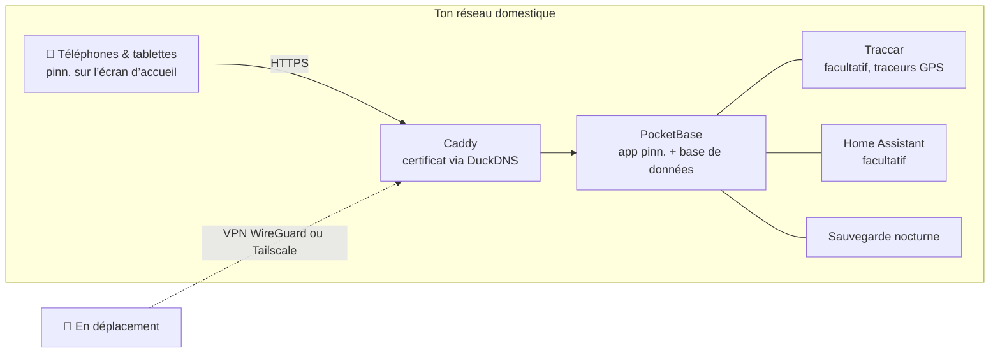

<p align="center">
  
</p>

<p align="center">
  <a href="https://github.com/pinn-shost/pinn/releases/latest"></a>
  <a href="LICENSE"></a>
  
  
  
  <a href="https://ko-fi.com/pinnapp"></a>
</p>

<p align="center">
  <a href="README.md">🇬🇧 English</a> ·
  <a href="README.de.md">🇩🇪 Deutsch</a> ·
  <a href="README.es.md">🇪🇸 Español</a> ·
  <b>🇫🇷 Français</b>
</p>

<p align="center">
  <a href="#captures-décran">Captures</a> ·
  <a href="#ce-que-fait-pinn">Fonctions</a> ·
  <a href="#installation">Installation</a> ·
  <a href="#confidentialité">Confidentialité</a> ·
  <a href="#faq">FAQ</a>
</p>

---

pinn. est une seule app pour tout ce qui fait tourner un foyer : le calendrier partagé, les repas de la semaine, la liste de courses, qui sort les poubelles, l’argent de poche et l’assurance à résilier en mars. Elle tourne sur **ton propre NAS** avec Docker et s’installe comme une vraie app sur chaque iPhone, iPad et téléphone Android de la famille.

Pas de compte cloud. Pas d’abonnement. Pas de publicité, pas de pistage. Les données de ta famille ne quittent jamais la maison.

## Captures d'écran

### Sur l’iPad

Accroché au mur ou posé sur la table de la cuisine : l’iPad partagé montre toute la famille d’un coup d’œil.

<table>
  <tr>
    <td align="center" width="50%">
      <br>
      <sub><b>Tableau de bord</b> – chacun touche sa propre photo, avec PIN facultatif</sub>
    </td>
    <td align="center" width="50%">
      <br>
      <sub><b>Aperçu</b> – météo, rendez-vous, tâches, repas et la famille d’un coup d’œil</sub>
    </td>
  </tr>
</table>

### Sur le téléphone

Toujours avec toi : pinn. s’installe sur chaque iPhone et téléphone Android comme une vraie app.

<table>
  <tr>
    <td align="center" width="33%"><br><sub><b>Aperçu</b> – ta journée d’un coup d’œil</sub></td>
    <td align="center" width="33%"><br><sub><b>Calendrier</b> – iCloud et Google dans une seule vue</sub></td>
    <td align="center" width="33%"><br><sub><b>Repas</b> – planifier la semaine, faire les courses d’un toucher</sub></td>
  </tr>
  <tr>
    <td align="center" width="33%"><br><sub><b>Listes</b> – courses, stock, bagages</sub></td>
    <td align="center" width="33%"><br><sub><b>Finances</b> – budget, épargne, argent de poche</sub></td>
    <td align="center" width="33%"><br><sub><b>Enfants</b> – une routine quotidienne ludique</sub></td>
  </tr>
</table>

## Ce que fait pinn.

| | |
|---|---|
| 📅 **Calendrier** | Calendriers iCloud et Google par personne, privés ou partagés avec la famille. Jours fériés, vacances scolaires, collectes des déchets et anniversaires des contacts apparaissent automatiquement. |
| 🍝 **Repas & recettes** | Planifie la semaine, puis envoie les ingrédients directement sur la liste de courses. Importe des recettes depuis un texte, un PDF, des photos ou un lien – avec l’IA si tu veux. Partage tes recettes préférées avec les autres familles de ton serveur. |
| 🛒 **Listes** | Listes de courses par magasin, un stock qui remplit la liste quand quelque chose vient à manquer, listes de bagages à partir de modèles (vacances, sac de maternité, fête), listes de cadeaux et de souhaits. |
| ✅ **Tâches & ménage** | Tâches avec rappels push, plans de ménage et poubelles – plus une page enfant avec des routines animées qui ne montre que ce qui correspond au moment de la journée. |
| 💶 **Finances** | Caisses communes ou privées, budget du foyer, épargne et dépôts avec ETF et actions, argent de poche, paiements récurrents et contrats avec rappel de résiliation. Les colocations partagent les frais et voient qui doit combien à qui. |
| 📄 **Documents & véhicules** | Justificatifs et garanties, pièces d’identité avec rappel d’expiration. Voitures et vélos avec contrôle technique, changement de pneus, consommation et coût total. |
| 🏡 **Domicile** | Pour locataires, propriétaires et bailleurs : bail ou contrat d’achat, prêt, défauts avec photos, justificatifs, plan de rénovation, relevés de compteurs avec prévision, clés et loyers des appartements, maisons et garages loués. Jardin & plantes avec un plan d’arrosage qui sait quand il a plu. |
| 📍 **Famille & localisation** | Partage ta position directement depuis pinn. – une fois ou pour une durée choisie – et en arrière-plan avec l’app gratuite Traccar Client (envoie directement à pinn., sans serveur supplémentaire). Plus un mode « trajet retour », une alerte SOS avec position et numéros d’urgence, des fiches d’urgence et des avis d’arrivée sur des lieux. |
| 🎒 **École & crèche** | Par enfant : emploi du temps (à saisir ou à photographier – l’IA le remplit), dépose et récupération, devoirs sur la page enfant, mots aux parents avec échéances qui deviennent des rappels, et jours de fermeture directement dans le calendrier. |
| 🐾 **Animaux** | Profils pour chiens, chats, lapins & co. avec repas à cocher, promenades, tour de rôle « à qui le tour », vaccins et vermifuges avec rappel push, courbe de poids, vétérinaire et urgences vétérinaires, une fiche pour le pet-sitter à partager et une affiche « perdu » à imprimer. |
| 🌦️ **Météo & vacances** | Touche la météo (une tuile sur le téléphone, en haut à côté de la date et de l’heure sur iPad et ordinateur) pour voir 14 jours avec les détails de chaque jour. Les listes de bagages avec destination et dates affichent la météo des vacances – prévision ou valeurs typiques – et suggèrent quoi emporter. |
| 🏠 **Maison connectée** | Lance des Raccourcis Apple ou des actions Home Assistant depuis une tâche – le robot aspirateur nettoie la cuisine quand la tâche est due. |
| 🎙️ **Commande vocale** | « Dis Siri, pinn » : ajouter à la liste de courses, se la faire lire, créer des tâches et entendre le programme du jour – aussi sur Android. |
| 🔔 **Notifications** | Messages push personnels sur iPhone, iPad et Android, plus une cloche qui rassemble chaque changement dans la famille. |
| 🧩 **Tout le reste** | Tableau familial avec notes déplaçables, recherche globale, mode hors ligne avec synchronisation automatique, mode sombre, tableau de bord iPad avec PIN par profil, compte invité, contrôle parental. |

pinn. parle **English, Deutsch, Français et Español**, adapte la devise et les numéros d’urgence à ta région, et bascule entre les termes **famille** et **colocation**. Un serveur peut héberger plusieurs familles, chacune avec ses propres admins.

## Nouveautés de la 1.61

**Plus de place dans l’aperçu**

- **iPad et ordinateur :** la météo se trouve désormais en haut à droite, à côté de la date et de l’heure – la météo actuelle avec l’indice UV, plus aujourd’hui, demain et après-demain. À sa gauche ne restent que la date et l’heure. Un appui ouvre la vue météo comme avant. Le calendrier, les repas et les tâches ont ainsi plus de place.
- **iPad et ordinateur :** les repas prévus dans l’aperçu sont un peu plus petits, l’image à peu près de la taille d’un jour de météo.
- **Nouveau repas : petit-déjeuner.** Dans le calendrier, un symbole remplace « Midi » ou « Soir » devant le repas (🌅 petit-déjeuner, ☀️ midi, 🌙 soir) – cela fait gagner de la place. L’aperçu de la semaine connaît aussi le petit-déjeuner.
- **Tâches :** le compteur affiche désormais les tâches terminées et toutes les tâches affichées, p. ex. *3/8*. Sur iPad et ordinateur, il se trouve en petit juste à côté du titre.
- **Calendrier :** « + Ajouter un repas » devient simplement « + Repas », et « Toute la journée » ne déborde plus sur les rendez-vous. Toutes les modifications sont traduites en anglais, allemand, français et espagnol.
- Seuls des fichiers de l’app changent (`index.html`, `js/ausblick.js`, `js/vorrat2.js` et les fichiers de langue dans `lang/`), rien ne change sur le serveur. Installe comme d’habitude (`sudo sh pinn-*/pinn-setup.sh` ou le bouton de mise à jour).

## Nouveautés de la 1.60

**Le code de l’app est découpé, partie 18 – rien ne change pour toi**

- **Pour les contributeurs :** Réglages – famille ou colocation, membres de la famille, catégories directement sur les pages, vue par défaut, couleurs, mode sombre et réinitialisation – se trouvent maintenant dans un fichier à part (`pb_public/js/einstellungen.js`). Rien ne change dans l’utilisation de l’app.
- Seuls des fichiers de l’app ont changé (`index.html` et `js/einstellungen.js`), rien ne change sur le serveur. Installation comme d’habitude (`sudo sh pinn-*/pinn-setup.sh` ou le bouton de mise à jour).

## Comment ça marche



Tout tourne en conteneurs Docker sur une seule machine. HTTPS fonctionne **sans redirection de port** – le certificat est délivré via une vérification DNS. De l’extérieur, pinn. n’est accessible que par ton propre VPN.

## Prérequis

- Un NAS ou un serveur avec **Docker** et **Docker Compose 2.17+** – développé sur un NAS UGREEN sous UGOS, fonctionne sur tout hôte Linux avec Docker (amd64, arm64, armv7)
- Un accès SSH
- Facultatif mais recommandé : un sous-domaine gratuit [DuckDNS](https://www.duckdns.org) pour HTTPS – nécessaire pour les notifications push et pour installer pinn. comme app

## Installation

1. Télécharge le ZIP de la [dernière version](https://github.com/pinn-shost/pinn/releases/latest) et décompresse-le.
2. Crée un dossier sur le NAS, p. ex. `/volume1/docker/Pocketbase`, et mets-y le dossier décompressé (p. ex. `pinn-1.61.1` ou `pinn-main`) tel quel.
3. Connecte-toi en SSH et exécute :
   ```sh
   cd /volume1/docker/Pocketbase && sudo sh pinn-*/pinn-setup.sh
   ```
   Le script met chaque fichier à sa place, télécharge les bibliothèques pour l’import PDF et la reconnaissance de texte sur photo, et démarre pinn.
4. Ouvre `http://<IP-du-NAS>:8090` → **Se connecter en admin principal** → mot de passe `Admin` → choisis ton propre mot de passe.
5. L’**assistant de configuration** t’accompagne pour le reste – HTTPS, accès à distance via WireGuard ou Tailscale, Google, IA, localisation et Home Assistant – étape par étape, en quatre langues.
6. Ouvre pinn. sur chaque téléphone via son adresse HTTPS et ajoute-le à l’écran d’accueil :
   - **iPhone/iPad (Safari) :** Partager → *Sur l’écran d’accueil* (iOS 16.4 ou plus récent pour les notifications)
   - **Android (Chrome) :** Réglages → Notifications → *Installer pinn. comme app*, ou menu Chrome ⋮ → *Installer l’application*

   Active ensuite les notifications sur chaque appareil sous **Réglages → Notifications → Activer sur cet appareil**.

**Mettre à jour :** télécharge le nouveau ZIP, mets le dossier décompressé dans le même dossier et relance `sudo sh pinn-*/pinn-setup.sh`. Les fichiers remplacés sont conservés dans `_alt/`, tes données restent intactes.

**Les sauvegardes** ont lieu chaque nuit dans `./backups` et sont conservées 14 jours.

## Confidentialité

pinn. a été conçu pour des données qu’on ne confierait jamais à un service cloud : relevés bancaires, documents médicaux, l’endroit où se trouvent tes enfants. C’est pourquoi :

- **Toutes les données restent sur ton NAS** dans une seule base de données PocketBase. Il n’y a pas de serveur pinn. ni de télémétrie.
- **Aucun script de serveurs tiers.** Tout le code et toutes les bibliothèques sont servis par ton NAS.
- **Les notifications push ne contiennent rien.** Apple, Google et Mozilla ne transmettent qu’un signal de réveil vide ; l’appareil récupère ensuite le message sur ton NAS.
- **Les mots de passe iCloud et Google** sont stockés chiffrés dans une collection verrouillée.
- **Pas accessible depuis internet.** L’accès à distance passe par ton propre VPN.

pinn. ne contacte des services externes que pour les fonctions qui en ont besoin :

| Service | Utilisé pour | Quand |
|---|---|---|
| [Open-Meteo](https://open-meteo.com) | Prévisions météo | quand une adresse de domicile est définie |
| [OpenStreetMap Nominatim](https://nominatim.openstreetmap.org) | Convertir des adresses en positions sur la carte | lors de la saisie d’adresses |
| [Tuiles OpenStreetMap](https://www.openstreetmap.org) | Fond de carte | sur la page de localisation, chargé via ton NAS |
| [Google Fonts](https://fonts.google.com) | Polices | au chargement de l’app |
| [OpenHolidays API](https://www.openholidaysapi.org) | Jours fériés et vacances scolaires | quand une adresse de domicile est définie |
| [DuckDNS](https://www.duckdns.org) | Certificat HTTPS et adresse | si configuré |
| iCloud / Google | Calendriers et contacts | seulement pour les comptes que tu connectes |
| Google Gemini | Lire des recettes et des documents | seulement si tu ajoutes une clé API |
| jsDelivr | Téléchargement unique de pdf.js et Tesseract | seulement pendant l’installation |

## FAQ

<details>
<summary><b>Dois-je ouvrir des ports sur mon routeur ?</b></summary>
<br>
Non. Le certificat HTTPS est délivré via une vérification DNS, et l’accès à distance passe par un VPN – WireGuard sur une FRITZ!Box, ou Tailscale pour tout autre routeur.
</details>

<details>
<summary><b>Est-ce que ça marche sans NAS ?</b></summary>
<br>
Toute machine allumée en permanence avec Docker convient : un mini-PC, un Raspberry Pi 4/5 ou un serveur Linux.
</details>

<details>
<summary><b>pinn. est-elle une « vraie » app de l’App Store ?</b></summary>
<br>
pinn. est une web-app que tu ajoutes à l’écran d’accueil. Elle s’ouvre alors en plein écran comme une vraie app, fonctionne hors ligne, affiche une pastille avec les tâches en cours et reçoit des notifications push – sans aucun store.
</details>

<details>
<summary><b>Plusieurs familles peuvent-elles utiliser une même installation ?</b></summary>
<br>
Oui. L’admin principal crée les familles, chaque famille a ses propres admins, calendriers et données. Les recettes peuvent être partagées entre familles si on le souhaite.
</details>

<details>
<summary><b>Et les enfants ?</b></summary>
<br>
Les profils avec contrôle parental ne voient que leurs propres tâches et ne peuvent rien supprimer ni modifier. Finances, documents et véhicules restent masqués. Les plus jeunes ont leur propre page ludique avec des routines quotidiennes.
</details>

<details>
<summary><b>Combien ça coûte ?</b></summary>
<br>
Rien – pinn. est gratuit et open source sous licence MIT. Les services facultatifs comme l’IA Gemini ont des offres gratuites.
</details>

## Structure du dépôt

Le dépôt a la même structure qu’une installation sur le NAS – chaque fichier se trouve là où il finira :

```
pinn/
├── pb_hooks/            serveur : hooks *.pb.js et leurs modules auxiliaires (pinn-*.js, calendar-sync.js)
├── pb_public/           web-app servie par PocketBase
│   ├── index.html       l’app (HTML, styles et la plus grande partie du code)
│   ├── js/              code de l’app sorti d’index.html, simples fichiers <script> sans étape de build
│   │                    (einstellungen.js, kalenderkonto.js, finanzen.js, kassen.js, vorrat.js, vorrat2.js, sparen.js, vertraege.js, fahrzeuge.js, zuhause.js, dokumente.js, pdflesen.js, appstart.js, pinnwand.js, listen.js, familie.js, hinweise.js, ausblick.js – ausblick.js toujours en dernier)
│   ├── einrichtung.js   assistant de configuration · datenexport.js  export des données
│   ├── lang/            traductions (en, fr, es)
│   └── vendor/          pinn.css, pocketbase/ (pdf.js et Tesseract sont téléchargés par l’installation)
├── caddy/Caddyfile      proxy inverse HTTPS
├── docker-compose.yaml  tous les conteneurs
├── env.txt              modèle pour .env
├── pinn-setup.sh        installer & mettre à jour
├── pinn-wartung.sh      sauvegardes & mises à jour (conteneur « wartung »)
├── pinn-pocketbase-update.sh
├── index.html           simple espace réservé, jamais installé (garde le bouton de mise à jour de la 1.38 fonctionnel)
└── README.md            page en anglais · README.de.md · README.es.md · README.fr.md (cette page)
```

`pinn-setup.sh` copie `pb_hooks/`, `pb_public/` et `caddy/Caddyfile` tels quels dans le dossier du projet ; les dossiers de données (`pb_data/`, `konfig/`, `backups/`, `caddy/data/` …) ne sont jamais touchés.

## Contribuer

Rapports de bugs, idées et traductions sont les bienvenus – voir [CONTRIBUTING.md](.github/CONTRIBUTING.md). Merci de signaler les problèmes de sécurité en privé comme décrit dans [SECURITY.md](.github/SECURITY.md).

## Soutenir pinn.

pinn. est gratuit et le restera – entièrement, pour tout le monde. Je le développe sur mon temps libre. S’il te simplifie un peu le quotidien, une petite contribution fait très plaisir, mais reste entièrement facultative :

<p>
  <a href="https://ko-fi.com/pinnapp"></a>
  <a href="https://buymeacoffee.com/pinn"></a>
</p>

Une ⭐ aide aussi – elle permet à d’autres familles de trouver pinn. plus facilement.

## Réalisé avec

[PocketBase](https://pocketbase.io) (MIT) · [Tailwind CSS](https://tailwindcss.com) (MIT) · [pdf.js](https://mozilla.github.io/pdf.js/) (Apache-2.0) · [Tesseract.js](https://tesseract.projectnaptha.com) (Apache-2.0) · [Traccar](https://www.traccar.org) (Apache-2.0) · [Caddy](https://caddyserver.com) (Apache-2.0)

## Licence

[MIT](LICENSE) – utilise-le, modifie-le, partage-le.
