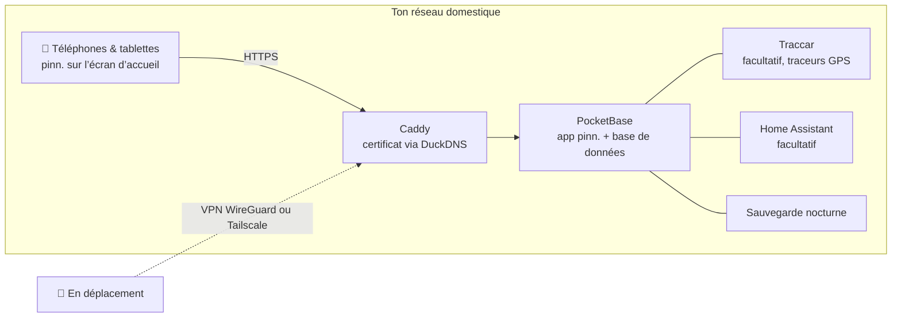

<p align="center">
  
</p>

<p align="center">
  <a href="https://github.com/pinn-shost/pinn/releases/latest"></a>
  <a href="LICENSE"></a>
  
  
  
  <a href="https://ko-fi.com/pinnapp"></a>
</p>

<p align="center">
  <a href="README.md">🇬🇧 English</a> ·
  <a href="README.de.md">🇩🇪 Deutsch</a> ·
  <a href="README.es.md">🇪🇸 Español</a> ·
  <b>🇫🇷 Français</b> ·
  <a href="README.it.md">🇮🇹 Italiano</a> ·
  <a href="README.pt.md">🇧🇷 Português</a> ·
  <a href="README.zh.md">🇨🇳 中文</a> ·
  <a href="README.ja.md">🇯🇵 日本語</a> ·
  <a href="README.ko.md">🇰🇷 한국어</a> ·
  <a href="README.ru.md">🇷🇺 Русский</a> ·
  <a href="README.nl.md">🇳🇱 Nederlands</a> ·
  <a href="README.tr.md">🇹🇷 Türkçe</a> ·
  <a href="README.pl.md">🇵🇱 Polski</a> ·
  <a href="README.uk.md">🇺🇦 Українська</a>
</p>

<p align="center">
  <a href="#captures-décran">Captures</a> ·
  <a href="#ce-que-fait-pinn">Fonctions</a> ·
  <a href="#installation">Installation</a> ·
  <a href="#confidentialité">Confidentialité</a> ·
  <a href="#faq">FAQ</a>
</p>

---

pinn. est une seule app pour tout ce qui fait tourner un foyer : le calendrier partagé, les repas de la semaine, la liste de courses, qui sort les poubelles, l’argent de poche et l’assurance à résilier en mars. Elle tourne sur **ton propre NAS** avec Docker et s’installe comme une vraie app sur chaque iPhone, iPad et téléphone Android de la famille.

Pas de compte cloud. Pas d’abonnement. Pas de publicité, pas de pistage. Les données de ta famille ne quittent jamais la maison.

## Captures d'écran

### Sur l’iPad

Accroché au mur ou posé sur la table de la cuisine : l’iPad partagé montre toute la famille d’un coup d’œil.

<table>
  <tr>
    <td align="center" width="50%">
      <a href=".github/assets/screenshots/dashboard.png"></a><br>
      <sub><b>Tableau de bord</b> – chacun touche sa propre photo, avec PIN facultatif</sub>
    </td>
    <td align="center" width="50%">
      <a href=".github/assets/screenshots/ipad-overview.png"></a><br>
      <sub><b>Aperçu</b> – météo, rendez-vous, tâches, repas et la famille d’un coup d’œil</sub>
    </td>
  </tr>
</table>

### Sur le téléphone

Toujours avec toi : pinn. s’installe sur chaque iPhone et téléphone Android comme une vraie app.

<table>
  <tr>
    <td align="center" width="33%"><a href=".github/assets/screenshots/home.png"></a><br><sub><b>Aperçu</b> – ta journée d’un coup d’œil</sub></td>
    <td align="center" width="33%"><a href=".github/assets/screenshots/calendar.png"></a><br><sub><b>Calendrier</b> – iCloud et Google dans une seule vue</sub></td>
    <td align="center" width="33%"><a href=".github/assets/screenshots/meals.png"></a><br><sub><b>Repas</b> – planifier la semaine, faire les courses d’un toucher</sub></td>
  </tr>
  <tr>
    <td align="center" width="33%"><a href=".github/assets/screenshots/lists.png"></a><br><sub><b>Listes</b> – courses, stock, bagages</sub></td>
    <td align="center" width="33%"><a href=".github/assets/screenshots/finance.png"></a><br><sub><b>Finances</b> – budget, épargne, argent de poche</sub></td>
    <td align="center" width="33%"><a href=".github/assets/screenshots/chat.png"></a><br><sub><b>Chat</b> – chiffré de bout en bout, avec messages vocaux et position</sub></td>
  </tr>
</table>

### Plus d’écrans

Touche une image pour l’ouvrir en taille réelle.

<details>
<summary><b>Afficher plus de captures</b></summary>

<br>

<table>
  <tr>
    <td align="center" width="25%"><a href=".github/assets/screenshots/house.png"></a><br><sub><b>Maison</b> – maison, coûts, prêt, défauts et compteurs au même endroit</sub></td>
    <td align="center" width="25%"><a href=".github/assets/screenshots/tasks.png"></a><br><sub><b>Tâches</b> – rappels automatiques, p. ex. contrôle technique et changement de pneus, avec bouton direct</sub></td>
    <td align="center" width="25%"><a href=".github/assets/screenshots/vehicles.png"></a><br><sub><b>Véhicules</b> – contrôle technique, pneus, plein et recharge</sub></td>
    <td align="center" width="25%"><a href=".github/assets/screenshots/scan_pantry.png"></a><br><sub><b>Scanner le stock</b> – scanne le code-barres, range ou consomme</sub></td>
  </tr>
  <tr>
    <td align="center" width="25%"><a href=".github/assets/screenshots/weekly_summary_1.png"></a><br><sub><b>Aperçu de la semaine</b> – la météo et ce qui reste à faire</sub></td>
    <td align="center" width="25%"><a href=".github/assets/screenshots/weekly_summary_2.png"></a><br><sub><b>Aperçu de la semaine</b> – jour par jour : ménage, poubelles, paiements</sub></td>
    <td align="center" width="25%"><a href=".github/assets/screenshots/weekly_summary_3.png"></a><br><sub><b>La semaine dernière en bref</b> – rendez-vous, repas, dépenses – et raccourcis</sub></td>
    <td align="center" width="25%"><a href=".github/assets/screenshots/kids.png"></a><br><sub><b>Enfants</b> – une routine quotidienne ludique</sub></td>
  </tr>
</table>

</details>

<sub>📁 <a href=".github/assets/screenshots">Toutes les images dans un dossier</a></sub>

## Ce que fait pinn.

| | |
|---|---|
| 📅 **Calendrier** | Calendriers iCloud et Google par personne, privés ou partagés avec la famille. Jours fériés, vacances scolaires, collectes des déchets et anniversaires des contacts apparaissent automatiquement. |
| 🍝 **Repas & recettes** | Planifie la semaine, puis envoie les ingrédients directement sur la liste de courses. Importe des recettes depuis un texte, un PDF, des photos ou un lien – avec l’IA si tu veux. Partage tes recettes préférées avec les autres familles de ton serveur. |
| 🛒 **Listes** | Listes de courses par magasin, un stock qui remplit la liste quand quelque chose vient à manquer, listes de bagages à partir de modèles (vacances, sac de maternité, fête), listes de cadeaux et de souhaits avec un planificateur « qui offre quoi » que le destinataire ne voit jamais. |
| ✅ **Tâches & ménage** | Tâches avec rappels push, plans de ménage et poubelles – plus une page enfant avec des routines animées qui ne montre que ce qui correspond au moment de la journée. |
| 💶 **Finances** | Caisses communes ou privées, budget du foyer, épargne et dépôts avec ETF et actions, argent de poche, paiements récurrents et contrats avec rappel de résiliation. Les colocations partagent les frais et voient qui doit combien à qui. |
| 📄 **Documents & véhicules** | Justificatifs et garanties, pièces d’identité avec rappel d’expiration. Voitures et vélos avec contrôle technique, changement de pneus, consommation et coût total. |
| 🏡 **Domicile** | Pour locataires, propriétaires et bailleurs : bail ou contrat d’achat, prêt, défauts avec photos, justificatifs, plan de rénovation, relevés de compteurs avec prévision, clés et loyers des appartements, maisons et garages loués. Jardin & plantes avec un plan d’arrosage qui sait quand il a plu. |
| 📍 **Famille & localisation** | Partage ta position directement depuis pinn. – une fois ou pour une durée choisie – et en arrière-plan avec l’app gratuite Traccar Client (envoie directement à pinn., sans serveur supplémentaire). Plus un mode « trajet retour », une alerte SOS avec position et numéros d’urgence, des fiches d’urgence et des avis d’arrivée sur des lieux. |
| 🎒 **École & crèche** | Par enfant : emploi du temps (à saisir ou à photographier – l’IA le remplit), dépose et récupération, devoirs sur la page enfant, mots aux parents avec échéances qui deviennent des rappels, et jours de fermeture directement dans le calendrier. |
| 🐾 **Animaux** | Profils pour chiens, chats, lapins & co. avec repas à cocher, promenades, tour de rôle « à qui le tour », vaccins et vermifuges avec rappel push, courbe de poids, vétérinaire et urgences vétérinaires, une fiche pour le pet-sitter à partager et une affiche « perdu » à imprimer et un rappel de remplissage du distributeur de croquettes. |
| 🌦️ **Météo & vacances** | Touche la météo (une tuile sur le téléphone, en haut à côté de la date et de l’heure sur iPad et ordinateur) pour voir 14 jours avec les détails de chaque jour. Les listes de bagages avec destination et dates affichent la météo des vacances – prévision ou valeurs typiques – et suggèrent quoi emporter. |
| 🏠 **Maison connectée** | Lance des Raccourcis Apple ou des actions Home Assistant depuis une tâche – le robot aspirateur nettoie la cuisine quand la tâche est due, le robot tondeuse et l'arrosage suivent le plan du jardin, le distributeur de croquettes prévient quand il se vide. |
| 🎙️ **Commande vocale** | « Dis Siri, pinn » : ajouter à la liste de courses, se la faire lire, créer des tâches et entendre le programme du jour – aussi sur Android. |
| 💬 **Chat** | Chat de famille et privé, chiffré de bout en bout, avec push, coches de lecture et réponses. |
| 🔔 **Notifications** | Messages push personnels sur iPhone, iPad et Android, plus une cloche qui rassemble chaque changement dans la famille. |
| 🧩 **Tout le reste** | Tableau familial avec notes déplaçables, recherche globale, mode hors ligne avec synchronisation automatique, mode sombre, tableau de bord iPad avec PIN par profil, compte invité, contrôle parental. |

pinn. parle **🇬🇧 English, 🇩🇪 Deutsch, 🇪🇸 Español, 🇫🇷 Français, 🇮🇹 Italiano, 🇧🇷 Português, 🇨🇳 中文, 🇯🇵 日本語, 🇰🇷 한국어, 🇷🇺 Русский, 🇳🇱 Nederlands, 🇹🇷 Türkçe, 🇵🇱 Polski et 🇺🇦 Українська**, adapte la devise et les numéros d’urgence à ta région, et bascule entre les termes **famille** et **colocation**. Un serveur peut héberger plusieurs familles, chacune avec ses propres admins.

## Nouveautés de la 1.150.0

**Les heures dans votre région · Raccourcis sur l’aperçu · Fenêtres rapides pour les raccourcis**

- **Des rappels à la bonne heure.** pinn. calcule désormais les rappels dans le fuseau horaire de votre appareil, avec l’heure d’été et d’hiver de votre région. Rien à régler : l’appareil indique discrètement son fuseau au serveur, aussi après un déménagement ou en voyage.
- **D’abord les rappels santé.** Médicaments, boisson et lavage des mains suivent déjà l’horloge de chaque personne ; tous les futurs rappels utiliseront la même horloge. Les anciens rappels (anniversaires, animaux, liste de bagages, réserves, contrats, documents, aperçu de la semaine) utilisent encore l’heure d’Europe centrale et suivront plus tard.
- **Tuile Raccourcis.** Une nouvelle tuile de l’aperçu affiche des icônes d’applis qui ouvrent directement une fonction : boire, se laver les mains (+1 par appui), médicaments, courses, nouvelle tâche, nouvel événement, note, chat, ménage, plantes, animaux, réserves, saisir une dépense, saisir un revenu, finances, SOS et en route.
- **Votre choix.** Réglages → Aperçu → Raccourcis : activez les applis souhaitées. Valable par profil ; sans appli choisie, la tuile reste masquée. Les invités ne voient ni santé, ni SOS, ni finances.
- **Appui long.** Un appui long sur un raccourci (clic droit sur ordinateur) ouvre une petite fenêtre pour cette fonction : boire (boisson, quantité, annuler pendant 10 minutes), lavage des mains (+/−), médicaments, courses, tâches, ménage, événements, cuisine, notes, animaux, réserves, dépense et revenu, SOS et en route. Un appui court fonctionne comme avant.
- **Reste ouverte.** La fenêtre reste ouverte après une action, on peut donc enchaîner plusieurs choses ; « Ouvrir » mène à la fonction complète.
- Modifié: `pb_hooks/pinn-zeit.js`, `pb_hooks/zeit.pb.js`, `js/zeit.js`, `js/kurzbefehle.js`, `js/kurzfenster.js`, `css/kurzbefehle.css`, `pb_hooks/pinn-gesundheit.js`, `js/appstart.js`, `js/uebersicht.js`, `js/uebersichteinstellungen.js`, `js/ansichten.js`, `js/design.js`, `js/gesundheit.js`, `js/sprachen.js`, `js/versionslog.js`, `i18n/`, `src/`, `index.html`, `pinn-setup.sh`, README (+ 1.149.1).

## Nouveautés de la 1.149.1

**Rappels push**

- **Rappels pour la santé.** Sur la page santé, on peut activer un rappel push par bloc : médicaments et vitamines à leurs heures, boire à intervalles entre deux heures de la journée (avec la quantité qu’il reste) et lavage des mains à heures fixes.
- **Uniquement pour la personne elle-même.** Les rappels vont sur les appareils de cette personne ; rien n’est envoyé aux autres membres de la famille. Toucher la notification ouvre la page santé – pour boire, directement la fenêtre de boisson.
- Modifié : `pb_hooks/pinn-gesundheit.js`, `pb_hooks/gesundheit.pb.js`, `js/gesundheit.js`, `css/gesundheit.css`, `js/hinweise.js`, `js/fortsetzen.js`, `js/sprachen.js`, `js/versionslog.js`, `i18n/`, `src/`, `index.html`, tous les README. Inclut 1.149.0.

## Nouveautés de la 1.149.0

**Santé**

- **Santé dans Famille.** L’onglet « Urgence » s’appelle désormais « Santé », tout comme le bouton de l’aperçu familial. Chaque personne a sa propre page santé faite de blocs, comme Maison : boire, médicaments et vitamines, lavage des mains, mesures, vaccinations et rendez-vous médicaux.
- **Boire.** Choisis un objectif du jour puis touche « J’ai bu » : la boisson (eau, jus, café, thé, lait, soda) et la quantité sous forme de verre plus ou moins plein. pinn. additionne et indique ce qu’il reste et si tu es dans les temps.
- **Fiche d’urgence intégrée.** Activée par une case sur la page santé ; une fiche vide ouvre aussitôt le formulaire. Les fiches existantes sont conservées et restent visibles par toute la famille, même hors ligne.
- **Privé.** Les données de santé ne sont visibles que par la personne, pour les enfants aussi par les adultes. Les rappels push arrivent avec la 1.149.1.
- Modifié : `js/gesundheit.js`, `css/gesundheit.css`, `pb_hooks/gesundheit.pb.js`, `pb_hooks/pinn-gesundheit.js`, `pb_hooks/pinn-schema.js`, `js/familie.js`, `js/serverzugriff.js`, `js/sprachen.js`, `js/versionslog.js`, `i18n/`, `src/`, `index.html`, `pinn-setup.sh`, tous les README. Avec partie serveur (nouvelle collection « gesundheit »). Inclut 1.148.2.

## Nouveautés de la 1.148.2

**Une autre famille sur l'appareil du tableau de bord**

- **Connexion avec une autre famille.** Si tu utilises « Se connecter avec mot de passe » sur un appareil tableau de bord avec un profil d'une autre famille, c'est désormais une session normale : le bouton du tableau de bord disparaît et « Se déconnecter » la termine. Avant, le bouton ramenait au tableau de bord de la première famille.
- **Indication claire dans les réglages.** La section du tableau de bord indique maintenant que cet appareil est le tableau de bord d'une autre famille – un appareil ne peut être qu'un seul tableau de bord.
- Modifié : `js/dashboard.js`, `js/anmeldung.js`, `js/profilauswahl.js`, `js/dashboardkonto.js`, `js/sprachen.js`, `js/versionslog.js`, `i18n/`, `src/`, `index.html`, tous les README. Pas de partie serveur.

## Nouveautés de la 1.148.1

**La recette reste ouverte sur le tableau de bord**

- **Tableau de bord familial.** Après « Vers la sélection du profil » et le code PIN, une recette ouverte est maintenant vraiment rouverte. Le premier changement d’écran après le démarrage (p. ex. quand l’iPad réaffiche l’app) reconstruisait la page et fermait la recette – corrigé.
- **Même si iOS ferme l’app.** Sur un tableau de bord, la note est conservée même si iOS ferme l’app pendant qu’elle attend sur la sélection du profil (12 heures au maximum). Un reste dans l’adresse ne l’empêche plus.
- **Tourner l’iPad** laisse la recette ouverte, avec le nombre de personnes et la position de lecture.
- Modifié : `js/fortsetzen.js`, `js/ansichten.js`, `js/appstart.js`, `js/sprachen.js`, `js/versionslog.js`, `src/`, `index.html`, tous les README. Pas de partie serveur.

## Nouveautés de la 1.148.0

**Reprends là où tu t'étais arrêté**

- **Tableau de bord familial.** Quand tu rouvres ton profil avec le code PIN après une pause, tu arrives là où tu t'étais arrêté et non plus sur l'aperçu. Une recette ouverte est de nouveau ouverte, avec le nombre de portions choisi et à l'endroit où tu en étais.
- **Pas seulement les recettes.** La page (p. ex. Listes, Tâches, Finances), la liste ouverte, l'onglet dans Maison et dans Véhicules et, sur le téléphone, l'onglet de l'aperçu sont aussi mémorisés. Chaque profil a sa propre place.
- **Combien de temps.** Tant que l'app reste ouverte (aussi en arrière-plan), 12 heures au maximum. Après la fermeture de l'app, après « Se déconnecter » sur ton propre appareil ou en arrivant par un lien d'une notification, tu démarres comme d'habitude. Sur ton propre appareil, la page est aussi conservée quand l'app se recharge, p. ex. après une mise à jour.
- Modifié : `js/fortsetzen.js` (nouveau), `js/appstart.js`, `js/dashboard.js`, `js/anmeldung.js`, `js/rezepte.js`, `js/sprachen.js`, `js/versionslog.js`, `src/`, `index.html`, `pinn-setup.sh`, tous les README. Pas de partie serveur.

## Nouveautés de la 1.147.1

**Appareils listés une seule fois, lien dans les guides**

- **Appareils connectés.** Un appareil connecté deux fois au même moment (p. ex. le tableau de bord familial sur un Mac) apparaissait deux fois avec le même ID. Il est désormais listé une fois, compté une fois, et « Se déconnecter » le supprime entièrement.
- **Plus de « Notifications uniquement ».** Une adresse de notification restante d'un appareil déjà connecté est supprimée automatiquement, pour que rien n'arrive en double.
- **Commande vocale et widgets.** Le lien personnel se trouve maintenant dans les champs « Raccourci Siri » et « Android » (avec son bouton de copie) et plus dans la vue d'ensemble.
- Modifié : `js/geraete.js`, `js/sprachsteuerung.js`, `js/sprachen.js`, `pb_hooks/pinn-sitzungen.js`, `src/`, `index.html`, `i18n/`, tous les README. Partie serveur : installer les hooks, PocketBase redémarre.

## Nouveautés de la 1.147.0

**Face ID et empreinte, appareils bien reconnus, widget avec maison & jardin**

- **Face ID, Touch ID, empreinte.** Sous Compte, pinn. peut être verrouillé par appareil : à l'ouverture et après une pause (immédiatement, 1, 5 ou 15 minutes), l'appareil demande ton visage ou ton doigt – iPhone, iPad, Android, Mac avec Touch ID, Windows Hello. L'appareil vérifie lui-même, rien n'est envoyé. En cas d'échec, reconnecte-toi avec ton mot de passe.
- **Appareils connectés.** L'application indique le nom et le type d'appareil à chaque démarrage – fini le « Navigateur » avec une icône d'ordinateur sur le téléphone. Chaque entrée affiche un court ID, ✏️ lui donne un nom, et les appareils qui reçoivent seulement des notifications apparaissent dans la liste et peuvent être retirés.
- **Widget.** Tâches ouvertes avec un cercle vide, terminées avec une coche, et le nouveau groupe « Maison & jardin » pour le plan d'entretien (à l'avance avec la date). Copie le script une nouvelle fois.
- **Saisons.** Sous Apparence → Saisons, les boutons « Hiver » et « Noël » ouvrent une fenêtre pour choisir la période (par défaut 1/12–6/1 et 1–26/12) et activer ou désactiver chaque élément : neige sur le texte et les tuiles, chute de neige à l'écran, paysage du tableau de bord, guirlande, père Noël, bonnet et houx. « Commande vocale & widgets » s'ouvre avec les guides fermés.
- Modifié : `js/entsperren.js` (nouveau), `js/geraete.js`, `js/verbindung.js`, `js/sprachsteuerung.js`, `js/winterzeit.js`, `pb_hooks/pinn-sitzungen.js`, `pb_hooks/sitzungen.pb.js`, `pb_hooks/pinn-sprache.js`, `src/`, `index.html`, `pinn-setup.sh`, `i18n/`, tous les README. Partie serveur : installer les hooks, PocketBase redémarre.

## Nouveautés de la 1.146.1

**De la neige sur chaque lettre, l’hiver sur le tableau de bord**

- **De la neige comme la vraie.** La neige se pose désormais sur chaque lettre, tout en haut seulement : une couche sur les bords plats (barre du haut du B ou du L, les deux extrémités hautes du K), un petit tas au milieu des arrondis (O), rien sur les flancs raides, au pied du L ou dans les espaces. Les emoji restent libres. Le nom de famille dans l’en-tête reçoit aussi de la neige, qui s’adapte quand il change.
- **L’hiver sur le tableau de bord familial.** De la neige sur le nom de famille, l’heure et la température, un chapeau de neige sur chaque tuile (chacun un peu différent) et un petit paysage d’hiver en bas.
- **Le père Noël** passe deux fois moins souvent (toutes les 10–18 minutes, toutes les 4–6 la veille de Noël).
- Modifié : `js/winterzeit.js`, `css/winterzeit.css`, `src/`, `index.html`, tous les README. Pas de partie serveur.

## Nouveautés de la 1.146.0

**De la neige à la taille de chaque titre, heure de mise à jour selon la région**

- **Neige sur mesure.** pinn. mesure chaque lettre d’un titre dans la vraie police et pose la neige juste dessus – plus haut sur les grandes lettres, plus bas sur les petites, avec des amas et quelques gouttes. Les espaces entre les mots restent libres, les emoji n’ont pas de neige, rien n’est étiré, et cela fonctionne dans toutes les langues et écritures.
- **Mises à jour automatiques selon la région.** L’heure choisie s’applique désormais dans le fuseau horaire de l’appareil sur lequel elle est enregistrée (heure d’été et d’hiver comprises), et non plus toujours à l’heure allemande. Les réglages indiquent le fuseau horaire utilisé.
- **Le tableau de bord verrouillé charge seul les nouvelles versions.** Un iPad avec le tableau de bord familial verrouillé (ou l’écran de connexion) se recharge environ une minute après une mise à jour si personne ne tape. L’app affiche « en attente » si une sauvegarde est en cours à l’heure prévue.
- Modifié : `js/winterzeit.js`, `css/winterzeit.css`, `js/versionspruefung.js`, `js/sicherungen.js`, `pb_hooks/pinn-system.js`, `pb_hooks/system.pb.js`, `i18n/`, `src/`, `index.html`, tous les README. Partie serveur : copier les hooks, PocketBase redémarre.

## Nouveautés de la 1.145.0

**Thème hiver et Noël**

- **Thème hiver du 1er décembre au 6 janvier.** De la neige sur le logo pinn., sur les titres et en bas de la barre latérale, et une courte averse de neige à l’ouverture de l’app. Touchez le logo pour plus de neige.
- **Extras de Noël jusqu’au 26 décembre.** Guirlande lumineuse sous l’en-tête, bonnet de Père Noël sur le logo, houx sur les titres et la cloche, un petit sapin dans la barre latérale – et de temps en temps, le Père Noël passe avec son traîneau et ses rennes.
- **Activé par défaut, désactivable par profil** dans Réglages → Apparence ; « Aperçu » l’affiche une minute à tout moment. Économe en batterie et sur une couche à part : rien ne bouge en veille et rien ne se décale dans la mise en page.
- Modifié : `js/winterzeit.js` (nouveau), `css/winterzeit.css` (nouveau), `js/design.js`, `js/sprachen.js`, `js/versionslog.js`, `i18n/versionslog.en.js`, `i18n/`, `src/`, `pinn-setup.sh`, `index.html`, tous les README. Pas de partie serveur.

## Nouveautés de la 1.144.2

**Mises à jour automatiques : aussi pour aujourd’hui**

- **Le jour même.** Si l’heure choisie est encore à venir, pinn. vérifie le jour même – même s’il a déjà vérifié aujourd’hui. On peut ainsi tester tout de suite un nouveau réglage. Une heure déjà passée à l’enregistrement vaut à partir de demain ; « Prochaine vérification » l’affiche correctement.
- Modifié : `pb_hooks/pinn-system.js`, `.github/scripts/check-hooks.js`, `js/sprachen.js`, `js/versionslog.js`, `i18n/versionslog.en.js`, `src/`, `index.html`, tous les README. Serveur (remplacer les hooks, PocketBase redémarre) : `pb_hooks/pinn-system.js`.

## Nouveautés de la 1.144.1

**Correctif : mises à jour automatiques à la bonne heure**

- **Les mises à jour automatiques** ne se lançaient pas à l’heure choisie : le serveur calculait en UTC au lieu de l’heure d’Europe/Berlin et se décalait d’une à deux heures ; « Prochaine vérification » affichait aussi une mauvaise heure. Désormais, l’heure fonctionne comme pour tous les autres rappels (heure d’été et d’hiver comprises).
- Modifié : `pb_hooks/pinn-system.js`, `.github/scripts/check-hooks.js`, `js/sprachen.js`, `js/versionslog.js`, `i18n/versionslog.en.js`, `src/`, `index.html`, tous les README. Serveur (remplacer les hooks, PocketBase redémarre) : `pb_hooks/pinn-system.js`.

## Nouveautés de la 1.144.0

**Tableau de bord : discussions non lues et tâches ouvertes sous chaque personne**

- **Deux nombres sous chaque personne.** Sur la sélection des profils du tableau de bord familial (iPad), une bulle indique les messages non lus et une coche les tâches ouvertes et échues – visibles sans connexion. À 0 la pastille disparaît, au-delà de 9 elle affiche 9⁺. Les nombres sont actualisés chaque minute.
- **Activé par défaut.** Le réglage de la 1.143.0 était désactivé et ne montrait que les tâches ; désormais les deux nombres sont actifs pour chaque famille. Un administrateur peut les désactiver sous Compte → « Tâches et discussions sur le tableau de bord ». Les discussions en sourdine ne comptent pas, celles marquées comme non lues comptent pour une – comme le nombre à côté de « Chat » dans le menu.
- Modifié : `js/profilauswahl.js`, `js/dashboardkonto.js`, `js/zustand.js`, `js/speichern.js`, `js/familiensync.js`, `css/dashboard.css`, `js/sprachen.js`, `js/versionslog.js`, `i18n/versionslog.en.js`, `i18n/` (1 texte nouveau et 4 modifiés dans les quatorze langues), `src/` (version, page du compte), `index.html`, tous les README. Serveur (remplacer les hooks, PocketBase redémarre) : `pb_hooks/pinn-chat.js`, `pb_hooks/pinn-dashboard.js`, `pb_hooks/dashboard.pb.js`, `pb_hooks/pinn-bereiche.js`.

## Nouveautés de la 1.143.0

**Tableau de bord : tâches ouvertes sous la photo de profil et chat sur l’iPad**

- **Tâches ouvertes sous la photo.** Dans la sélection des profils du tableau de bord familial, pinn. peut afficher sous la photo de chaque personne le nombre de ses tâches ouvertes et échues – comme le chiffre sur l’icône de l’app sur l’iPhone. Un admin l’active sous Compte → « Tâches ouvertes sur le tableau de bord » ; cela vaut pour tous les tableaux de bord de la famille.
- **Chat sur le tableau de bord.** Celui qui a ouvert son profil avec son code PIN peut désormais aussi utiliser le chat. Pas les invités ni les enfants avec « page enfant uniquement ». La première fois sur l’appareil, le chat demande comme d’habitude le code de récupération.
- Modifié : `pb_hooks/pinn-push.js`, `pb_hooks/pinn-dashboard.js`, `pb_hooks/dashboard.pb.js`, `pb_hooks/pinn-bereiche.js`, `js/profilauswahl.js`, `js/dashboard.js`, `js/dashboardkonto.js`, `js/konto.js`, `js/zustand.js`, `js/speichern.js`, `js/familiensync.js`, `css/dashboard.css`, `js/sprachen.js`, `js/versionslog.js`, `i18n/versionslog.en.js`, `i18n/` (5 textes nouveaux dans les quatorze langues), `src/` (version, page du compte), `index.html`, tous les README. Serveur (remplacer les hooks, PocketBase redémarre) : `pb_hooks/pinn-push.js`, `pb_hooks/pinn-dashboard.js`, `pb_hooks/dashboard.pb.js`, `pb_hooks/pinn-bereiche.js`.

## Nouveautés de la 1.142.2

**Bilan de l’année : revenus, rendez-vous, tâches, anniversaires et photos de voyage**

- **Plus dans le bilan de l’année.** Sous les dépenses, tu vois maintenant aussi les revenus et le solde. De nouvelles cartes montrent les rendez-vous (avec le mois le plus chargé), les tâches terminées (avec la part du ménage) et les anniversaires fêtés (dont les spéciaux, comme 18, 30, 40 …). Chaque voyage affiche les photos du panneau publiées pendant le voyage.
- **Le serveur compte les tâches terminées,** car elles sont supprimées après un ou deux jours. Pour cette année, le décompte commence le jour de la mise à jour.
- Modifié : `js/ausblick.js`, `css/hinweise.css`, `js/sprachen.js`, `js/versionslog.js`, `i18n/versionslog.en.js`, `i18n/` (14 textes nouveaux et un texte modifié dans les quatorze langues), `src/` (version), `index.html`, tous les README. Serveur (remplacer les hooks, PocketBase redémarre) : `pb_hooks/pinn-ausblick.js`, `pb_hooks/pinn-aufgaben.js`, `pb_hooks/ausblick.pb.js`.

## Comment ça marche



Tout tourne en conteneurs Docker sur une seule machine. HTTPS fonctionne **sans redirection de port** – le certificat est délivré via une vérification DNS. De l’extérieur, pinn. n’est accessible que par ton propre VPN.

## Prérequis

- Un NAS ou un serveur avec **Docker** et **Docker Compose 2.17+** – développé sur un NAS UGREEN sous UGOS, fonctionne sur tout hôte Linux avec Docker (amd64, arm64, armv7)
- Un accès SSH
- Facultatif mais recommandé : un sous-domaine gratuit [DuckDNS](https://www.duckdns.org) pour HTTPS – nécessaire pour les notifications push et pour installer pinn. comme app

## Installation

1. Télécharge le ZIP de la [dernière version](https://github.com/pinn-shost/pinn/releases/latest) et décompresse-le.
2. Crée un dossier sur le NAS, p. ex. `/volume1/docker/Pocketbase`, et mets-y le dossier décompressé (p. ex. `pinn-1.150.0` ou `pinn-main`) tel quel.
3. Connecte-toi en SSH et exécute :
   ```sh
   cd /volume1/docker/Pocketbase && sudo sh pinn-*/pinn-setup.sh
   ```
   Le script met chaque fichier à sa place, télécharge les bibliothèques pour l’import PDF et la reconnaissance de texte sur photo, et démarre pinn.
4. Ouvre `http://<IP-du-NAS>:8090` → **Se connecter en admin principal** → mot de passe `Admin` → choisis ton propre mot de passe.
5. L’**assistant de configuration** t’accompagne pour le reste – HTTPS, accès à distance via WireGuard ou Tailscale, Google, IA, localisation et Home Assistant – étape par étape, en quatorze langues.
6. Ouvre pinn. sur chaque téléphone via son adresse HTTPS et ajoute-le à l’écran d’accueil :
   - **iPhone/iPad (Safari) :** Partager → *Sur l’écran d’accueil* (iOS 16.4 ou plus récent pour les notifications)
   - **Android (Chrome) :** Réglages → Notifications → *Installer pinn. comme app*, ou menu Chrome ⋮ → *Installer l’application*

   Active ensuite les notifications sur chaque appareil sous **Réglages → Notifications → Activer sur cet appareil**.

**Mettre à jour :** télécharge le nouveau ZIP, mets le dossier décompressé dans le même dossier et relance `sudo sh pinn-*/pinn-setup.sh`. Les fichiers remplacés sont conservés dans `_alt/`, tes données restent intactes.

**Les sauvegardes** ont lieu chaque nuit dans `./backups` et sont conservées 14 jours.

## Confidentialité

pinn. a été conçu pour des données qu’on ne confierait jamais à un service cloud : relevés bancaires, documents médicaux, l’endroit où se trouvent tes enfants. C’est pourquoi :

- **Toutes les données restent sur ton NAS** dans une seule base de données PocketBase. Il n’y a pas de serveur pinn. ni de télémétrie.
- **Aucun script de serveurs tiers.** Tout le code et toutes les bibliothèques sont servis par ton NAS.
- **Les notifications push ne contiennent rien.** Apple, Google et Mozilla ne transmettent qu’un signal de réveil vide ; l’appareil récupère ensuite le message sur ton NAS.
- **Les mots de passe iCloud et Google** sont stockés chiffrés dans une collection verrouillée.
- **Pas accessible depuis internet.** L’accès à distance passe par ton propre VPN.

pinn. ne contacte des services externes que pour les fonctions qui en ont besoin :

| Service | Utilisé pour | Quand |
|---|---|---|
| [Open-Meteo](https://open-meteo.com) | Prévisions météo | quand une adresse de domicile est définie |
| [OpenStreetMap Nominatim](https://nominatim.openstreetmap.org) | Convertir des adresses en positions sur la carte | lors de la saisie d’adresses |
| [Tuiles OpenStreetMap](https://www.openstreetmap.org) | Fond de carte | sur la page de localisation, chargé via ton NAS |
| [Google Fonts](https://fonts.google.com) | Polices | au chargement de l’app |
| [OpenHolidays API](https://www.openholidaysapi.org) | Jours fériés et vacances scolaires | quand une adresse de domicile est définie |
| [DuckDNS](https://www.duckdns.org) | Certificat HTTPS et adresse | si configuré |
| iCloud / Google | Calendriers et contacts | seulement pour les comptes que tu connectes |
| Google Gemini | Lire des recettes et des documents | seulement si tu ajoutes une clé API |
| jsDelivr | Téléchargement unique de pdf.js et Tesseract | seulement pendant l’installation |

## FAQ

<details>
<summary><b>Dois-je ouvrir des ports sur mon routeur ?</b></summary>
<br>
Non. Le certificat HTTPS est délivré via une vérification DNS, et l’accès à distance passe par un VPN – WireGuard sur une FRITZ!Box, ou Tailscale pour tout autre routeur.
</details>

<details>
<summary><b>Est-ce que ça marche sans NAS ?</b></summary>
<br>
Toute machine allumée en permanence avec Docker convient : un mini-PC, un Raspberry Pi 4/5 ou un serveur Linux.
</details>

<details>
<summary><b>pinn. est-elle une « vraie » app de l’App Store ?</b></summary>
<br>
pinn. est une web-app que tu ajoutes à l’écran d’accueil. Elle s’ouvre alors en plein écran comme une vraie app, fonctionne hors ligne, affiche une pastille avec les tâches en cours et reçoit des notifications push – sans aucun store.
</details>

<details>
<summary><b>Plusieurs familles peuvent-elles utiliser une même installation ?</b></summary>
<br>
Oui. L’admin principal crée les familles, chaque famille a ses propres admins, calendriers et données. Les recettes peuvent être partagées entre familles si on le souhaite.
</details>

<details>
<summary><b>Et les enfants ?</b></summary>
<br>
Les profils avec contrôle parental ne voient que leurs propres tâches et ne peuvent rien supprimer ni modifier. Finances, documents et véhicules restent masqués. Les plus jeunes ont leur propre page ludique avec des routines quotidiennes.
</details>

<details>
<summary><b>Combien ça coûte ?</b></summary>
<br>
Rien – pinn. est gratuit et open source sous licence MIT. Les services facultatifs comme l’IA Gemini ont des offres gratuites.
</details>

## Structure du dépôt

Le dépôt a la même structure qu’une installation sur le NAS – chaque fichier se trouve là où il finira :

```
pinn/
├── pb_hooks/            serveur : hooks *.pb.js et leurs modules auxiliaires (pinn-*.js, calendar-sync.js)
├── pb_public/           web-app servie par PocketBase
│   ├── index.html       la page de l’app, construite depuis src/ (HTML, vérification au démarrage) – ne pas modifier à la main
│   ├── js/              code de l’app sorti d’index.html, simples fichiers <script> sans étape de build
│   │                    (ruhemodus.js, textkern.js, sprachen.js, region.js, grundlagen.js, popups.js, verbindung.js, benutzer.js, mitteilungen.js, serverzugriff.js, tastatur.js, anmeldemaske.js, dashboard.js, dashboardhintergrund.js, profilauswahl.js, pineingabe.js, dashboardsitzung.js, dashboardkonto.js, familienverwalten.js, einrichten.js, exportieren.js, hauptadminseite.js, anmeldung.js, konto.js, profilverwaltung.js, zustand.js, bedienzustand.js, rezeptbilder.js, zusammenfuehren.js, speichern.js, design.js, sprache.js, uebersicht.js, familienkachel.js, wobistdu.js, geburtstagsfeier.js, wetterkachel.js, geburtstage.js, uebersichteinstellungen.js, familiensync.js, bereiche.js, kalenderquellen.js, icsparser.js, zeitleiste.js, termindetails.js, kalenderdatei.js, wetter.js, wohnort.js, feiertage.js, muellkalender.js, mitglieder.js, profilbild.js, mitglied.js, kinderseite.js, kinderroutine.js, sterne.js, kalenderansicht.js, essenplanen.js, rezeptparser.js, rezeptdialog.js, rezeptbild.js, rezeptmengen.js, einkauf.js, einkaufslisten.js, einkaufseingabe.js, rezepte.js, offline.js, aufgabenextras.js, appbadge.js, reisen.js, aufgabendaten.js, haushalt.js, reihum.js, aufgaben.js, smarthome.js, sprachsteuerung.js, termine.js, ansichten.js, versionspruefung.js, sicherungen.js, geraete.js, fehlerprotokoll.js, versionslog.js, einstellungen.js, kalenderkonto.js, finanzen.js, kassen.js, vorrat.js, vorrat2.js, sparen.js, vertraege.js, fahrzeuge.js, zuhause.js, dokumente.js, pdflesen.js, appstart.js, pinnwand.js, listen.js, familie.js, hinweise.js, ausblick.js – ausblick.js toujours en dernier)
│   ├── css/             styles de l’app sortis d’index.html, CSS simple sans étape de build (ergaenzung.css, energiesparen.css, basis.css … haustierewetter.css, terminal.css, glocke.css)
│   ├── einrichtung.js   assistant de configuration · datenexport.js  export des données
│   ├── i18n/            textes par clé (de, en, fr, es, it, pt, zh, ja, ko) – l’anglais sert de référence
│   └── vendor/          pinn.css, pocketbase/ (pdf.js et Tesseract sont téléchargés par l’installation)
├── .github/             GitHub Actions (workflows/check.yml), vérifications (scripts/), CONTRIBUTING.md, SECURITY.md, images – non installé
├── src/                 sources d’index.html (build.js, rahmen.html, teile/) – non installé
├── caddy/Caddyfile      proxy inverse HTTPS
├── docker-compose.yaml  tous les conteneurs
├── env.txt              modèle pour .env
├── pinn-setup.sh        installer & mettre à jour
├── pinn-wartung.sh      sauvegardes & mises à jour (conteneur « wartung »)
├── pinn-pocketbase-update.sh
├── index.html           simple espace réservé, jamais installé (garde le bouton de mise à jour de la 1.38 fonctionnel)
└── README.md            page en anglais · README.<code>.md en de, es, fr (cette page), it, pt, zh, ja, ko
```

`pinn-setup.sh` copie `pb_hooks/`, `pb_public/` et `caddy/Caddyfile` tels quels dans le dossier du projet ; les dossiers de données (`pb_data/`, `konfig/`, `backups/`, `caddy/data/` …) ne sont jamais touchés.

## Contribuer

Rapports de bugs, idées et traductions sont les bienvenus – voir [CONTRIBUTING.md](.github/CONTRIBUTING.md). Merci de signaler les problèmes de sécurité en privé comme décrit dans [SECURITY.md](.github/SECURITY.md). Avant une pull request, lance `node .github/scripts/check-all.js` – les mêmes vérifications tournent automatiquement sur GitHub.

## Soutenir pinn.

pinn. est gratuit et le restera – entièrement, pour tout le monde. Je le développe sur mon temps libre. S’il te simplifie un peu le quotidien, une petite contribution fait très plaisir, mais reste entièrement facultative :

<p>
  <a href="https://ko-fi.com/pinnapp"></a>
  <a href="https://buymeacoffee.com/pinn"></a>
</p>

Une ⭐ aide aussi – elle permet à d’autres familles de trouver pinn. plus facilement.

## Réalisé avec

[PocketBase](https://pocketbase.io) (MIT) · [Tailwind CSS](https://tailwindcss.com) (MIT) · [pdf.js](https://mozilla.github.io/pdf.js/) (Apache-2.0) · [Tesseract.js](https://tesseract.projectnaptha.com) (Apache-2.0) · [Traccar](https://www.traccar.org) (Apache-2.0) · [Caddy](https://caddyserver.com) (Apache-2.0)

## Licence

[MIT](LICENSE) – utilise-le, modifie-le, partage-le.
