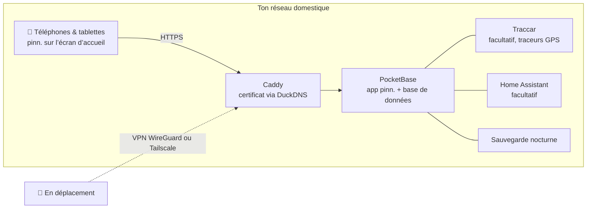

<p align="center">
  
</p>

<p align="center">
  <a href="https://github.com/pinn-shost/pinn/releases/latest"></a>
  <a href="LICENSE"></a>
  
  
  
  <a href="https://ko-fi.com/pinnapp"></a>
</p>

<p align="center">
  <a href="README.md">🇬🇧 English</a> ·
  <a href="README.de.md">🇩🇪 Deutsch</a> ·
  <a href="README.es.md">🇪🇸 Español</a> ·
  <b>🇫🇷 Français</b> ·
  <a href="README.it.md">🇮🇹 Italiano</a> ·
  <a href="README.pt.md">🇧🇷 Português</a> ·
  <a href="README.zh.md">🇨🇳 中文</a> ·
  <a href="README.ja.md">🇯🇵 日本語</a> ·
  <a href="README.ko.md">🇰🇷 한국어</a> ·
  <a href="README.ru.md">🇷🇺 Русский</a>
</p>

<p align="center">
  <a href="#captures-décran">Captures</a> ·
  <a href="#ce-que-fait-pinn">Fonctions</a> ·
  <a href="#installation">Installation</a> ·
  <a href="#confidentialité">Confidentialité</a> ·
  <a href="#faq">FAQ</a>
</p>

---

pinn. est une seule app pour tout ce qui fait tourner un foyer : le calendrier partagé, les repas de la semaine, la liste de courses, qui sort les poubelles, l’argent de poche et l’assurance à résilier en mars. Elle tourne sur **ton propre NAS** avec Docker et s’installe comme une vraie app sur chaque iPhone, iPad et téléphone Android de la famille.

Pas de compte cloud. Pas d’abonnement. Pas de publicité, pas de pistage. Les données de ta famille ne quittent jamais la maison.

## Captures d'écran

### Sur l’iPad

Accroché au mur ou posé sur la table de la cuisine : l’iPad partagé montre toute la famille d’un coup d’œil.

<table>
  <tr>
    <td align="center" width="50%">
      <a href=".github/assets/screenshots/dashboard.png"></a><br>
      <sub><b>Tableau de bord</b> – chacun touche sa propre photo, avec PIN facultatif</sub>
    </td>
    <td align="center" width="50%">
      <a href=".github/assets/screenshots/ipad-overview.png"></a><br>
      <sub><b>Aperçu</b> – météo, rendez-vous, tâches, repas et la famille d’un coup d’œil</sub>
    </td>
  </tr>
</table>

### Sur le téléphone

Toujours avec toi : pinn. s’installe sur chaque iPhone et téléphone Android comme une vraie app.

<table>
  <tr>
    <td align="center" width="33%"><a href=".github/assets/screenshots/home.png"></a><br><sub><b>Aperçu</b> – ta journée d’un coup d’œil</sub></td>
    <td align="center" width="33%"><a href=".github/assets/screenshots/calendar.png"></a><br><sub><b>Calendrier</b> – iCloud et Google dans une seule vue</sub></td>
    <td align="center" width="33%"><a href=".github/assets/screenshots/meals.png"></a><br><sub><b>Repas</b> – planifier la semaine, faire les courses d’un toucher</sub></td>
  </tr>
  <tr>
    <td align="center" width="33%"><a href=".github/assets/screenshots/lists.png"></a><br><sub><b>Listes</b> – courses, stock, bagages</sub></td>
    <td align="center" width="33%"><a href=".github/assets/screenshots/finance.png"></a><br><sub><b>Finances</b> – budget, épargne, argent de poche</sub></td>
    <td align="center" width="33%"><a href=".github/assets/screenshots/kids.png"></a><br><sub><b>Enfants</b> – une routine quotidienne ludique</sub></td>
  </tr>
</table>

### Plus d’écrans

Touche une image pour l’ouvrir en taille réelle.

<details>
<summary><b>Afficher plus de captures</b></summary>

<br>

<table>
  <tr>
    <td align="center" width="25%"><a href=".github/assets/screenshots/house.png"></a><br><sub><b>Maison</b> – maison, coûts, prêt, défauts et compteurs au même endroit</sub></td>
    <td align="center" width="25%"><a href=".github/assets/screenshots/tasks.png"></a><br><sub><b>Tâches</b> – rappels automatiques, p. ex. contrôle technique et changement de pneus, avec bouton direct</sub></td>
    <td align="center" width="25%"><a href=".github/assets/screenshots/vehicles.png"></a><br><sub><b>Véhicules</b> – contrôle technique, pneus, plein et recharge</sub></td>
    <td align="center" width="25%"><a href=".github/assets/screenshots/scan_pantry.png"></a><br><sub><b>Scanner le stock</b> – scanne le code-barres, range ou consomme</sub></td>
  </tr>
  <tr>
    <td align="center" width="25%"><a href=".github/assets/screenshots/weekly_summary_1.png"></a><br><sub><b>Aperçu de la semaine</b> – la météo et ce qui reste à faire</sub></td>
    <td align="center" width="25%"><a href=".github/assets/screenshots/weekly_summary_2.png"></a><br><sub><b>Aperçu de la semaine</b> – jour par jour : ménage, poubelles, paiements</sub></td>
    <td align="center" width="25%"><a href=".github/assets/screenshots/weekly_summary_3.png"></a><br><sub><b>La semaine dernière en bref</b> – rendez-vous, repas, dépenses – et raccourcis</sub></td>
  </tr>
</table>

</details>

<sub>📁 <a href=".github/assets/screenshots">Toutes les images dans un dossier</a></sub>

## Ce que fait pinn.

| | |
|---|---|
| 📅 **Calendrier** | Calendriers iCloud et Google par personne, privés ou partagés avec la famille. Jours fériés, vacances scolaires, collectes des déchets et anniversaires des contacts apparaissent automatiquement. |
| 🍝 **Repas & recettes** | Planifie la semaine, puis envoie les ingrédients directement sur la liste de courses. Importe des recettes depuis un texte, un PDF, des photos ou un lien – avec l’IA si tu veux. Partage tes recettes préférées avec les autres familles de ton serveur. |
| 🛒 **Listes** | Listes de courses par magasin, un stock qui remplit la liste quand quelque chose vient à manquer, listes de bagages à partir de modèles (vacances, sac de maternité, fête), listes de cadeaux et de souhaits. |
| ✅ **Tâches & ménage** | Tâches avec rappels push, plans de ménage et poubelles – plus une page enfant avec des routines animées qui ne montre que ce qui correspond au moment de la journée. |
| 💶 **Finances** | Caisses communes ou privées, budget du foyer, épargne et dépôts avec ETF et actions, argent de poche, paiements récurrents et contrats avec rappel de résiliation. Les colocations partagent les frais et voient qui doit combien à qui. |
| 📄 **Documents & véhicules** | Justificatifs et garanties, pièces d’identité avec rappel d’expiration. Voitures et vélos avec contrôle technique, changement de pneus, consommation et coût total. |
| 🏡 **Domicile** | Pour locataires, propriétaires et bailleurs : bail ou contrat d’achat, prêt, défauts avec photos, justificatifs, plan de rénovation, relevés de compteurs avec prévision, clés et loyers des appartements, maisons et garages loués. Jardin & plantes avec un plan d’arrosage qui sait quand il a plu. |
| 📍 **Famille & localisation** | Partage ta position directement depuis pinn. – une fois ou pour une durée choisie – et en arrière-plan avec l’app gratuite Traccar Client (envoie directement à pinn., sans serveur supplémentaire). Plus un mode « trajet retour », une alerte SOS avec position et numéros d’urgence, des fiches d’urgence et des avis d’arrivée sur des lieux. |
| 🎒 **École & crèche** | Par enfant : emploi du temps (à saisir ou à photographier – l’IA le remplit), dépose et récupération, devoirs sur la page enfant, mots aux parents avec échéances qui deviennent des rappels, et jours de fermeture directement dans le calendrier. |
| 🐾 **Animaux** | Profils pour chiens, chats, lapins & co. avec repas à cocher, promenades, tour de rôle « à qui le tour », vaccins et vermifuges avec rappel push, courbe de poids, vétérinaire et urgences vétérinaires, une fiche pour le pet-sitter à partager et une affiche « perdu » à imprimer et un rappel de remplissage du distributeur de croquettes. |
| 🌦️ **Météo & vacances** | Touche la météo (une tuile sur le téléphone, en haut à côté de la date et de l’heure sur iPad et ordinateur) pour voir 14 jours avec les détails de chaque jour. Les listes de bagages avec destination et dates affichent la météo des vacances – prévision ou valeurs typiques – et suggèrent quoi emporter. |
| 🏠 **Maison connectée** | Lance des Raccourcis Apple ou des actions Home Assistant depuis une tâche – le robot aspirateur nettoie la cuisine quand la tâche est due, le robot tondeuse et l'arrosage suivent le plan du jardin, le distributeur de croquettes prévient quand il se vide. |
| 🎙️ **Commande vocale** | « Dis Siri, pinn » : ajouter à la liste de courses, se la faire lire, créer des tâches et entendre le programme du jour – aussi sur Android. |
| 🔔 **Notifications** | Messages push personnels sur iPhone, iPad et Android, plus une cloche qui rassemble chaque changement dans la famille. |
| 🧩 **Tout le reste** | Tableau familial avec notes déplaçables, recherche globale, mode hors ligne avec synchronisation automatique, mode sombre, tableau de bord iPad avec PIN par profil, compte invité, contrôle parental. |

pinn. parle **🇬🇧 English, 🇩🇪 Deutsch, 🇪🇸 Español, 🇫🇷 Français, 🇮🇹 Italiano, 🇧🇷 Português, 🇨🇳 中文, 🇯🇵 日本語, 🇰🇷 한국어 et 🇷🇺 Русский**, adapte la devise et les numéros d’urgence à ta région, et bascule entre les termes **famille** et **colocation**. Un serveur peut héberger plusieurs familles, chacune avec ses propres admins.

## Nouveautés de la 1.123.2

**Néerlandais – troisième étape**

- **Encore plus de pinn. en néerlandais.** Le calendrier (rendez-vous, comptes de calendrier, jours fériés, vacances scolaires, collecte des déchets), le plan des repas, les tâches, la maison, l’aperçu (tuiles de la famille, anniversaires), la météo et la recherche sont maintenant traduits (1545 textes sur 6722).
- Le néerlandais reste **masqué** tant que tout n’est pas traduit (activable sur un appareil pour l’essayer ; les textes manquants apparaissent alors en anglais). Rien ne change de visible pour les autres.
- Modifié : `index.html`, `js/sprachen.js`, `js/versionslog.js`, `i18n/nl.i18n.js`, `i18n/versionslog.en.js` et tous les README. Installation comme toujours (`sudo sh pinn-*/pinn-setup.sh` ou le bouton de mise à jour).

## Nouveautés de la 1.123.1

**Néerlandais – deuxième étape**

- **Plus de pinn. en néerlandais.** Compte (profils, PIN, appareil tableau de bord, invités, notifications), appareils et connexion, journal d’erreurs ainsi que sauvegardes et mises à jour sont désormais traduits (874 textes sur 6722).
- Le néerlandais reste **masqué** tant que tout n’est pas traduit (activable sur un appareil pour l’essayer ; les textes manquants s’affichent alors en anglais). Pour les autres, rien ne change visiblement.
- Modifié : `index.html`, `js/sprachen.js`, `js/versionslog.js`, `i18n/nl.i18n.js`, `i18n/versionslog.en.js` et tous les README. Installation comme d’habitude (`sudo sh pinn-*/pinn-setup.sh` ou le bouton de mise à jour).

## Nouveautés de la 1.123.0

**Néerlandais – première étape**

- **Le néerlandais arrive.** pinn. est traduit en néerlandais pas à pas. On commence par la connexion, le tableau de bord, le menu, la page de l’administrateur principal et tous les réglages (504 textes sur 6722).
- Le néerlandais reste **masqué** tant que tout n’est pas traduit (activable sur un appareil pour l’essayer ; les textes manquants s’affichent alors en anglais). Pour les autres, rien ne change visiblement.
- Modifié : `index.html`, `js/sprachen.js`, `js/textkern.js`, `js/versionslog.js`, `i18n/nl.i18n.js`, `i18n/versionslog.en.js`, `pb_hooks/pinn-textkern.js`, `.github/scripts/i18n-keys.js` et tous les README. Installation comme d’habitude (`sudo sh pinn-*/pinn-setup.sh` ou le bouton de mise à jour).

## Nouveautés de la 1.122.2

**Correction de sécurité**

- **Dernière alerte de l’analyseur de code de GitHub corrigée.** La voie inutilisée pour insérer du balisage des fichiers de langue dans la page (`data-tk-html`) est supprimée ; les textes des fichiers de langue ne sont plus insérés que comme texte brut.
- Rien ne change visuellement.
- Modifié : `index.html`, `js/sprachen.js`, `js/versionslog.js`, `i18n/versionslog.en.js` et tous les README. Installation comme d’habitude (`sudo sh pinn-*/pinn-setup.sh` ou le bouton de mise à jour).

## Nouveautés de la 1.122.1

**Corrections de sécurité**

- **Les 20 alertes de l’analyseur de code de GitHub sont corrigées.** Les textes des champs de saisie (noms, avatars, réactions, adresses de photos) sont désormais toujours insérés dans les pages de façon sûre, y compris entre guillemets.
- Le cache des anniversaires n’est plus conservé en clair dans `localStorage` (il se trouve maintenant dans la base de données de l’appareil ; les anciennes entrées sont supprimées une fois).
- Les nouveaux événements reçoivent leur identifiant du générateur aléatoire sécurisé. Également renforcés : la vérification par Google de l’autorisation du calendrier, la reconnaissance des messages de courses, la fusion des anciennes données et la conversion des textes des pages de recettes.
- Rien ne change visuellement.
- Modifié : `index.html`, `js/grundlagen.js`, `js/mitglieder.js`, `js/pinnwand.js`, `js/sprachen.js`, `js/einkaufseingabe.js`, `js/geburtstage.js`, `js/versionslog.js`, `i18n/versionslog.en.js`, `pb_hooks/pinn-kalender.js`, `pb_hooks/calendar-sync.js`, `pb_hooks/pinn-google.js`, `pb_hooks/pinn-ki.js`, `pb_hooks/pinn-bereiche.js`, `pb_hooks/pinn-kassen.js`, `.github/scripts/common.js`, `.github/scripts/check-hooks.js` et tous les README. Installation comme d’habitude (`sudo sh pinn-*/pinn-setup.sh` ou le bouton de mise à jour).

## Nouveautés de la 1.122.0

**Rangement en coulisses**

- **Plantes avec action intelligente** (Maison → Jardin et plantes) : le serveur les lit désormais dans les caisses, où elles se trouvent depuis l’introduction des caisses. Avant, il cherchait dans l’ancien enregistrement familial, si bien que l’arrosage et la tonte automatiques via Home Assistant pouvaient les manquer.
- Les anciens réglages de vue, d’avant la séparation entre ordinateur et téléphone, sont repris une fois dans les réglages et retirés de l’ancien enregistrement familial. Une copie de sauvegarde de l’enregistrement familial est d’abord écrite dans `pb_data/pinn_umzug` (conservée 30 jours). Rien ne change à l’écran.
- À venir : la compatibilité avec les très anciennes versions de l’appli doit rester jusqu’au 22 novembre 2026 environ (30 jours après le déplacement) ; c’est l’étape suivante.
- Modifié : `index.html`, `js/sprachen.js`, `js/speichern.js`, `js/versionslog.js`, `i18n/versionslog.en.js`, `pb_hooks/pinn-bereiche.js`, `pb_hooks/pinn-schema.js`, `pb_hooks/pinn-kassen.js`, `pb_hooks/pinn-smarthome.js` et tous les README. Installation comme d’habitude (`sudo sh pinn-*/pinn-setup.sh` ou le bouton de mise à jour).

## Nouveautés de la 1.121.1

**Plus de captures**

- Sous « Captures d’écran », une zone dépliable **« Afficher plus de captures »** propose sept images de plus : Maison, Tâches, Véhicules, Scanner le stock et l’aperçu de la semaine (trois images). Chaque image s’ouvre en taille réelle d’un clic, et le dossier contenant toutes les images est lié.
- La même galerie figure dans tous les README de langue, y compris le russe.
- L’appli fonctionne exactement comme avant : seuls le numéro de version et l’entrée du journal des versions sont nouveaux.
- Modifié : `index.html`, `js/sprachen.js`, `js/versionslog.js`, `i18n/versionslog.en.js` et tous les README. Rien ne change côté serveur. Installation comme d’habitude (`sudo sh pinn-*/pinn-setup.sh` ou le bouton de mise à jour).

## Nouveautés de la 1.121.0

**Russe débloqué**

- **Русский est désormais disponible pour tous** : à choisir sous Réglages → Langue et région. Les 6 722 textes de l’app, les notifications push du serveur, l’assistant de configuration et l’export des données sont en russe.
- Région **Russie** (rouble, numéros d’urgence 102/103/101/112) et signes d’unités russes (км, л, мм, кг, кВт·ч, км/ч) pour les véhicules, la maison, la famille, la météo et les avis. Un compte avec le pays Russie reçoit automatiquement les notifications push en russe.
- La **commande vocale comprend le russe** («Добавь молоко и яйца в список покупок», «Напомни завтра вынести мусор», «Что в списке покупок?», «Что запланировано на сегодня?») et répond en russe.
- Petits détails : la commande vocale reconnaît maintenant les doublons avec des noms en cyrillique ; la note « Aussi en … » sous la commande vocale mentionne le russe.
- Modifié : `index.html`, `js/sprachen.js`, `js/region.js`, `js/fahrzeuge.js`, `js/familie.js`, `js/hinweise.js`, `js/zuhause.js`, `js/sprachsteuerung.js`, `js/versionslog.js`, `einrichtung.js`, `i18n/*.i18n.js`, `i18n/versionslog.en.js`, `pb_hooks/pinn-sprache.js`, `pb_hooks/pinn-ausblick.js`, `pb_hooks/pinn-familie-geburtstag.js`, `pb_hooks/pinn-haustiere.js`, `pb_hooks/pinn-ortung.js`, `pb_hooks/pinn-wobistdu.js`. Installation comme d’habitude (`sudo sh pinn-*/pinn-setup.sh` ou bouton de mise à jour). Après la mise à jour, envoie une notification de test en russe (Réglages → Notifications → Test).

## Nouveautés de la 1.120.9

**Russe – dixième étape : notifications push**

- Traduit en russe : toutes les notifications push du serveur (147 textes) – résumé du jour, rendez-vous, tâches, demandes de récompense, anniversaires, animaux, courses, SOS, localisation, « Où es-tu ? », listes de bagages, aperçu de la semaine et perspectives financières, tableau d’affichage, documents, contrats et réserve – y compris avec le vocabulaire de colocation. Le russe est ainsi complet : 6712 textes sur 6712.
- Le serveur envoie désormais les notifications push en russe (jusqu’ici un profil russe les recevait en anglais) : le module des textes push connaît le russe (trois formes de pluriel, termes de colocation en cyrillique), tout comme les textes des anniversaires, animaux, courses, « Où es-tu ? », listes de bagages, perspectives hebdomadaires et mensuelles et demandes de récompense.
- Le russe reste **masqué** pour l’instant (activable sur un appareil comme décrit pour la 1.120.0). Prochainement : activer le russe pour tout le monde.
- Modifié : `index.html`, `js/sprachen.js`, `js/versionslog.js`, `i18n/ru.i18n.js`, `i18n/versionslog.en.js`, `pb_hooks/pinn-pushtext.js`, `pb_hooks/pinn-ausblick.js`, `pb_hooks/pinn-familie-geburtstag.js`, `pb_hooks/pinn-haustiere.js`, `pb_hooks/pinn-ortung.js`, `pb_hooks/pinn-wobistdu.js`, `pb_hooks/pinn-packliste.js`, `pb_hooks/pinn-aufgaben.js`, `.github/`. Installe comme d’habitude (`sudo sh pinn-*/pinn-setup.sh` ou le bouton de mise à jour).

## Nouveautés de la 1.120.8

**Russe – neuvième étape**

- Traduit en russe : la cloche de notifications (activité de la famille, retours à la maison, courses, SOS), le tableau d’affichage (notes, listes, sondages, comptes à rebours, remerciements, photos, archives), les perspectives (aperçu de la semaine et perspectives financières du mois), la commande vocale (raccourci Siri, HTTP Shortcuts), la lecture des PDF et tickets de caisse, les noms des catégories standard, lieux de stockage, unités, appareils, caisses et types de déchets ainsi que les messages du serveur – désormais 6565 textes sur 6712.
- Amélioré (toutes les langues) : les petits compteurs de l’aperçu de la semaine (« 3 rendez-vous », « 2 tâches » …) sont désormais des textes complets avec leurs propres formes de pluriel (le russe en a besoin) – cinq nouveaux textes remplacent neuf anciens.
- Le russe reste **masqué** tant que tout n’est pas traduit (activable sur un appareil comme décrit pour la 1.120.0).
- Prochainement : la dernière étape du russe (notifications push du serveur) et l’activation du russe.
- Modifié : `index.html`, `js/sprachen.js`, `js/ausblick.js`, `js/versionslog.js`, `i18n/*.i18n.js` (toutes les langues, y compris `ru.i18n.js`), `i18n/versionslog.en.js` – rien ne change sur le serveur. Installe comme d’habitude (`sudo sh pinn-*/pinn-setup.sh` ou le bouton de mise à jour).


## Comment ça marche



Tout tourne en conteneurs Docker sur une seule machine. HTTPS fonctionne **sans redirection de port** – le certificat est délivré via une vérification DNS. De l’extérieur, pinn. n’est accessible que par ton propre VPN.

## Prérequis

- Un NAS ou un serveur avec **Docker** et **Docker Compose 2.17+** – développé sur un NAS UGREEN sous UGOS, fonctionne sur tout hôte Linux avec Docker (amd64, arm64, armv7)
- Un accès SSH
- Facultatif mais recommandé : un sous-domaine gratuit [DuckDNS](https://www.duckdns.org) pour HTTPS – nécessaire pour les notifications push et pour installer pinn. comme app

## Installation

1. Télécharge le ZIP de la [dernière version](https://github.com/pinn-shost/pinn/releases/latest) et décompresse-le.
2. Crée un dossier sur le NAS, p. ex. `/volume1/docker/Pocketbase`, et mets-y le dossier décompressé (p. ex. `pinn-1.123.2` ou `pinn-main`) tel quel.
3. Connecte-toi en SSH et exécute :
   ```sh
   cd /volume1/docker/Pocketbase && sudo sh pinn-*/pinn-setup.sh
   ```
   Le script met chaque fichier à sa place, télécharge les bibliothèques pour l’import PDF et la reconnaissance de texte sur photo, et démarre pinn.
4. Ouvre `http://<IP-du-NAS>:8090` → **Se connecter en admin principal** → mot de passe `Admin` → choisis ton propre mot de passe.
5. L’**assistant de configuration** t’accompagne pour le reste – HTTPS, accès à distance via WireGuard ou Tailscale, Google, IA, localisation et Home Assistant – étape par étape, en dix langues.
6. Ouvre pinn. sur chaque téléphone via son adresse HTTPS et ajoute-le à l’écran d’accueil :
   - **iPhone/iPad (Safari) :** Partager → *Sur l’écran d’accueil* (iOS 16.4 ou plus récent pour les notifications)
   - **Android (Chrome) :** Réglages → Notifications → *Installer pinn. comme app*, ou menu Chrome ⋮ → *Installer l’application*

   Active ensuite les notifications sur chaque appareil sous **Réglages → Notifications → Activer sur cet appareil**.

**Mettre à jour :** télécharge le nouveau ZIP, mets le dossier décompressé dans le même dossier et relance `sudo sh pinn-*/pinn-setup.sh`. Les fichiers remplacés sont conservés dans `_alt/`, tes données restent intactes.

**Les sauvegardes** ont lieu chaque nuit dans `./backups` et sont conservées 14 jours.

## Confidentialité

pinn. a été conçu pour des données qu’on ne confierait jamais à un service cloud : relevés bancaires, documents médicaux, l’endroit où se trouvent tes enfants. C’est pourquoi :

- **Toutes les données restent sur ton NAS** dans une seule base de données PocketBase. Il n’y a pas de serveur pinn. ni de télémétrie.
- **Aucun script de serveurs tiers.** Tout le code et toutes les bibliothèques sont servis par ton NAS.
- **Les notifications push ne contiennent rien.** Apple, Google et Mozilla ne transmettent qu’un signal de réveil vide ; l’appareil récupère ensuite le message sur ton NAS.
- **Les mots de passe iCloud et Google** sont stockés chiffrés dans une collection verrouillée.
- **Pas accessible depuis internet.** L’accès à distance passe par ton propre VPN.

pinn. ne contacte des services externes que pour les fonctions qui en ont besoin :

| Service | Utilisé pour | Quand |
|---|---|---|
| [Open-Meteo](https://open-meteo.com) | Prévisions météo | quand une adresse de domicile est définie |
| [OpenStreetMap Nominatim](https://nominatim.openstreetmap.org) | Convertir des adresses en positions sur la carte | lors de la saisie d’adresses |
| [Tuiles OpenStreetMap](https://www.openstreetmap.org) | Fond de carte | sur la page de localisation, chargé via ton NAS |
| [Google Fonts](https://fonts.google.com) | Polices | au chargement de l’app |
| [OpenHolidays API](https://www.openholidaysapi.org) | Jours fériés et vacances scolaires | quand une adresse de domicile est définie |
| [DuckDNS](https://www.duckdns.org) | Certificat HTTPS et adresse | si configuré |
| iCloud / Google | Calendriers et contacts | seulement pour les comptes que tu connectes |
| Google Gemini | Lire des recettes et des documents | seulement si tu ajoutes une clé API |
| jsDelivr | Téléchargement unique de pdf.js et Tesseract | seulement pendant l’installation |

## FAQ

<details>
<summary><b>Dois-je ouvrir des ports sur mon routeur ?</b></summary>
<br>
Non. Le certificat HTTPS est délivré via une vérification DNS, et l’accès à distance passe par un VPN – WireGuard sur une FRITZ!Box, ou Tailscale pour tout autre routeur.
</details>

<details>
<summary><b>Est-ce que ça marche sans NAS ?</b></summary>
<br>
Toute machine allumée en permanence avec Docker convient : un mini-PC, un Raspberry Pi 4/5 ou un serveur Linux.
</details>

<details>
<summary><b>pinn. est-elle une « vraie » app de l’App Store ?</b></summary>
<br>
pinn. est une web-app que tu ajoutes à l’écran d’accueil. Elle s’ouvre alors en plein écran comme une vraie app, fonctionne hors ligne, affiche une pastille avec les tâches en cours et reçoit des notifications push – sans aucun store.
</details>

<details>
<summary><b>Plusieurs familles peuvent-elles utiliser une même installation ?</b></summary>
<br>
Oui. L’admin principal crée les familles, chaque famille a ses propres admins, calendriers et données. Les recettes peuvent être partagées entre familles si on le souhaite.
</details>

<details>
<summary><b>Et les enfants ?</b></summary>
<br>
Les profils avec contrôle parental ne voient que leurs propres tâches et ne peuvent rien supprimer ni modifier. Finances, documents et véhicules restent masqués. Les plus jeunes ont leur propre page ludique avec des routines quotidiennes.
</details>

<details>
<summary><b>Combien ça coûte ?</b></summary>
<br>
Rien – pinn. est gratuit et open source sous licence MIT. Les services facultatifs comme l’IA Gemini ont des offres gratuites.
</details>

## Structure du dépôt

Le dépôt a la même structure qu’une installation sur le NAS – chaque fichier se trouve là où il finira :

```
pinn/
├── pb_hooks/            serveur : hooks *.pb.js et leurs modules auxiliaires (pinn-*.js, calendar-sync.js)
├── pb_public/           web-app servie par PocketBase
│   ├── index.html       la page de l’app, construite depuis src/ (HTML, vérification au démarrage) – ne pas modifier à la main
│   ├── js/              code de l’app sorti d’index.html, simples fichiers <script> sans étape de build
│   │                    (ruhemodus.js, textkern.js, sprachen.js, region.js, grundlagen.js, popups.js, verbindung.js, benutzer.js, mitteilungen.js, serverzugriff.js, tastatur.js, anmeldemaske.js, dashboard.js, dashboardhintergrund.js, profilauswahl.js, pineingabe.js, dashboardsitzung.js, dashboardkonto.js, familienverwalten.js, einrichten.js, exportieren.js, hauptadminseite.js, anmeldung.js, konto.js, profilverwaltung.js, zustand.js, bedienzustand.js, rezeptbilder.js, zusammenfuehren.js, speichern.js, design.js, sprache.js, uebersicht.js, familienkachel.js, wobistdu.js, geburtstagsfeier.js, wetterkachel.js, geburtstage.js, uebersichteinstellungen.js, familiensync.js, bereiche.js, kalenderquellen.js, icsparser.js, zeitleiste.js, termindetails.js, kalenderdatei.js, wetter.js, wohnort.js, feiertage.js, muellkalender.js, mitglieder.js, profilbild.js, mitglied.js, kinderseite.js, kinderroutine.js, sterne.js, kalenderansicht.js, essenplanen.js, rezeptparser.js, rezeptdialog.js, rezeptbild.js, rezeptmengen.js, einkauf.js, einkaufslisten.js, einkaufseingabe.js, rezepte.js, offline.js, aufgabenextras.js, appbadge.js, reisen.js, aufgabendaten.js, haushalt.js, reihum.js, aufgaben.js, smarthome.js, sprachsteuerung.js, termine.js, ansichten.js, versionspruefung.js, sicherungen.js, geraete.js, fehlerprotokoll.js, versionslog.js, einstellungen.js, kalenderkonto.js, finanzen.js, kassen.js, vorrat.js, vorrat2.js, sparen.js, vertraege.js, fahrzeuge.js, zuhause.js, dokumente.js, pdflesen.js, appstart.js, pinnwand.js, listen.js, familie.js, hinweise.js, ausblick.js – ausblick.js toujours en dernier)
│   ├── css/             styles de l’app sortis d’index.html, CSS simple sans étape de build (ergaenzung.css, energiesparen.css, basis.css … haustierewetter.css, terminal.css, glocke.css)
│   ├── einrichtung.js   assistant de configuration · datenexport.js  export des données
│   ├── i18n/            textes par clé (de, en, fr, es, it, pt, zh, ja, ko) – l’anglais sert de référence
│   └── vendor/          pinn.css, pocketbase/ (pdf.js et Tesseract sont téléchargés par l’installation)
├── .github/             GitHub Actions (workflows/check.yml), vérifications (scripts/), CONTRIBUTING.md, SECURITY.md, images – non installé
├── src/                 sources d’index.html (build.js, rahmen.html, teile/) – non installé
├── caddy/Caddyfile      proxy inverse HTTPS
├── docker-compose.yaml  tous les conteneurs
├── env.txt              modèle pour .env
├── pinn-setup.sh        installer & mettre à jour
├── pinn-wartung.sh      sauvegardes & mises à jour (conteneur « wartung »)
├── pinn-pocketbase-update.sh
├── index.html           simple espace réservé, jamais installé (garde le bouton de mise à jour de la 1.38 fonctionnel)
└── README.md            page en anglais · README.<code>.md en de, es, fr (cette page), it, pt, zh, ja, ko
```

`pinn-setup.sh` copie `pb_hooks/`, `pb_public/` et `caddy/Caddyfile` tels quels dans le dossier du projet ; les dossiers de données (`pb_data/`, `konfig/`, `backups/`, `caddy/data/` …) ne sont jamais touchés.

## Contribuer

Rapports de bugs, idées et traductions sont les bienvenus – voir [CONTRIBUTING.md](.github/CONTRIBUTING.md). Merci de signaler les problèmes de sécurité en privé comme décrit dans [SECURITY.md](.github/SECURITY.md). Avant une pull request, lance `node .github/scripts/check-all.js` – les mêmes vérifications tournent automatiquement sur GitHub.

## Soutenir pinn.

pinn. est gratuit et le restera – entièrement, pour tout le monde. Je le développe sur mon temps libre. S’il te simplifie un peu le quotidien, une petite contribution fait très plaisir, mais reste entièrement facultative :

<p>
  <a href="https://ko-fi.com/pinnapp"></a>
  <a href="https://buymeacoffee.com/pinn"></a>
</p>

Une ⭐ aide aussi – elle permet à d’autres familles de trouver pinn. plus facilement.

## Réalisé avec

[PocketBase](https://pocketbase.io) (MIT) · [Tailwind CSS](https://tailwindcss.com) (MIT) · [pdf.js](https://mozilla.github.io/pdf.js/) (Apache-2.0) · [Tesseract.js](https://tesseract.projectnaptha.com) (Apache-2.0) · [Traccar](https://www.traccar.org) (Apache-2.0) · [Caddy](https://caddyserver.com) (Apache-2.0)

## Licence

[MIT](LICENSE) – utilise-le, modifie-le, partage-le.
