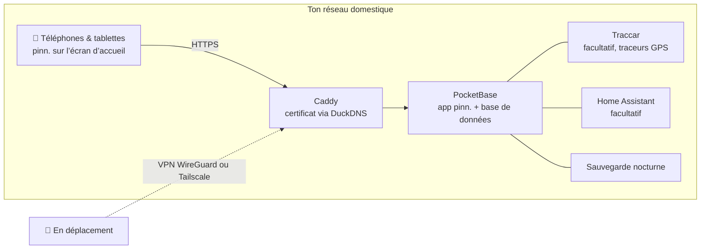

<p align="center">
  
</p>

<p align="center">
  <a href="https://github.com/pinn-shost/pinn/releases/latest"></a>
  <a href="LICENSE"></a>
  
  
  
  <a href="https://ko-fi.com/pinnapp"></a>
</p>

<p align="center">
  <a href="README.md">🇬🇧 English</a> ·
  <a href="README.de.md">🇩🇪 Deutsch</a> ·
  <a href="README.es.md">🇪🇸 Español</a> ·
  <b>🇫🇷 Français</b> ·
  <a href="README.it.md">🇮🇹 Italiano</a> ·
  <a href="README.pt.md">🇧🇷 Português</a> ·
  <a href="README.zh.md">🇨🇳 中文</a> ·
  <a href="README.ja.md">🇯🇵 日本語</a> ·
  <a href="README.ko.md">🇰🇷 한국어</a> ·
  <a href="README.ru.md">🇷🇺 Русский</a> ·
  <a href="README.nl.md">🇳🇱 Nederlands</a> ·
  <a href="README.tr.md">🇹🇷 Türkçe</a> ·
  <a href="README.pl.md">🇵🇱 Polski</a> ·
  <a href="README.uk.md">🇺🇦 Українська</a>
</p>

<p align="center">
  <a href="#captures-décran">Captures</a> ·
  <a href="#ce-que-fait-pinn">Fonctions</a> ·
  <a href="#installation">Installation</a> ·
  <a href="#confidentialité">Confidentialité</a> ·
  <a href="#faq">FAQ</a>
</p>

---

pinn. est une seule app pour tout ce qui fait tourner un foyer : le calendrier partagé, les repas de la semaine, la liste de courses, qui sort les poubelles, l’argent de poche et l’assurance à résilier en mars. Elle tourne sur **ton propre NAS** avec Docker et s’installe comme une vraie app sur chaque iPhone, iPad et téléphone Android de la famille.

Pas de compte cloud. Pas d’abonnement. Pas de publicité, pas de pistage. Les données de ta famille ne quittent jamais la maison.

## Captures d'écran

### Sur l’iPad

Accroché au mur ou posé sur la table de la cuisine : l’iPad partagé montre toute la famille d’un coup d’œil.

<table>
  <tr>
    <td align="center" width="50%">
      <a href=".github/assets/screenshots/dashboard.png"></a><br>
      <sub><b>Tableau de bord</b> – chacun touche sa propre photo, avec PIN facultatif</sub>
    </td>
    <td align="center" width="50%">
      <a href=".github/assets/screenshots/ipad-overview.png"></a><br>
      <sub><b>Aperçu</b> – météo, rendez-vous, tâches, repas et la famille d’un coup d’œil</sub>
    </td>
  </tr>
</table>

### Sur le téléphone

Toujours avec toi : pinn. s’installe sur chaque iPhone et téléphone Android comme une vraie app.

<table>
  <tr>
    <td align="center" width="33%"><a href=".github/assets/screenshots/home.png"></a><br><sub><b>Aperçu</b> – ta journée d’un coup d’œil</sub></td>
    <td align="center" width="33%"><a href=".github/assets/screenshots/calendar.png"></a><br><sub><b>Calendrier</b> – iCloud et Google dans une seule vue</sub></td>
    <td align="center" width="33%"><a href=".github/assets/screenshots/meals.png"></a><br><sub><b>Repas</b> – planifier la semaine, faire les courses d’un toucher</sub></td>
  </tr>
  <tr>
    <td align="center" width="33%"><a href=".github/assets/screenshots/lists.png"></a><br><sub><b>Listes</b> – courses, stock, bagages</sub></td>
    <td align="center" width="33%"><a href=".github/assets/screenshots/finance.png"></a><br><sub><b>Finances</b> – budget, épargne, argent de poche</sub></td>
    <td align="center" width="33%"><a href=".github/assets/screenshots/chat.png"></a><br><sub><b>Chat</b> – chiffré de bout en bout, avec messages vocaux et position</sub></td>
  </tr>
</table>

### Plus d’écrans

Touche une image pour l’ouvrir en taille réelle.

<details>
<summary><b>Afficher plus de captures</b></summary>

<br>

<table>
  <tr>
    <td align="center" width="25%"><a href=".github/assets/screenshots/house.png"></a><br><sub><b>Maison</b> – maison, coûts, prêt, défauts et compteurs au même endroit</sub></td>
    <td align="center" width="25%"><a href=".github/assets/screenshots/tasks.png"></a><br><sub><b>Tâches</b> – rappels automatiques, p. ex. contrôle technique et changement de pneus, avec bouton direct</sub></td>
    <td align="center" width="25%"><a href=".github/assets/screenshots/vehicles.png"></a><br><sub><b>Véhicules</b> – contrôle technique, pneus, plein et recharge</sub></td>
    <td align="center" width="25%"><a href=".github/assets/screenshots/scan_pantry.png"></a><br><sub><b>Scanner le stock</b> – scanne le code-barres, range ou consomme</sub></td>
  </tr>
  <tr>
    <td align="center" width="25%"><a href=".github/assets/screenshots/weekly_summary_1.png"></a><br><sub><b>Aperçu de la semaine</b> – la météo et ce qui reste à faire</sub></td>
    <td align="center" width="25%"><a href=".github/assets/screenshots/weekly_summary_2.png"></a><br><sub><b>Aperçu de la semaine</b> – jour par jour : ménage, poubelles, paiements</sub></td>
    <td align="center" width="25%"><a href=".github/assets/screenshots/weekly_summary_3.png"></a><br><sub><b>La semaine dernière en bref</b> – rendez-vous, repas, dépenses – et raccourcis</sub></td>
    <td align="center" width="25%"><a href=".github/assets/screenshots/kids.png"></a><br><sub><b>Enfants</b> – une routine quotidienne ludique</sub></td>
  </tr>
</table>

</details>

<sub>📁 <a href=".github/assets/screenshots">Toutes les images dans un dossier</a></sub>

## Ce que fait pinn.

| | |
|---|---|
| 📅 **Calendrier** | Calendriers iCloud et Google par personne, privés ou partagés avec la famille. Jours fériés, vacances scolaires, collectes des déchets et anniversaires des contacts apparaissent automatiquement. |
| 🍝 **Repas & recettes** | Planifie la semaine, puis envoie les ingrédients directement sur la liste de courses. Importe des recettes depuis un texte, un PDF, des photos ou un lien – avec l’IA si tu veux. Partage tes recettes préférées avec les autres familles de ton serveur. |
| 🛒 **Listes** | Listes de courses par magasin, un stock qui remplit la liste quand quelque chose vient à manquer, listes de bagages à partir de modèles (vacances, sac de maternité, fête), listes de cadeaux et de souhaits avec un planificateur « qui offre quoi » que le destinataire ne voit jamais. |
| ✅ **Tâches & ménage** | Tâches avec rappels push, plans de ménage et poubelles – plus une page enfant avec des routines animées qui ne montre que ce qui correspond au moment de la journée. |
| 💶 **Finances** | Caisses communes ou privées, budget du foyer, épargne et dépôts avec ETF et actions, argent de poche, paiements récurrents et contrats avec rappel de résiliation. Les colocations partagent les frais et voient qui doit combien à qui. |
| 📄 **Documents & véhicules** | Justificatifs et garanties, pièces d’identité avec rappel d’expiration. Voitures et vélos avec contrôle technique, changement de pneus, consommation et coût total. |
| 🏡 **Domicile** | Pour locataires, propriétaires et bailleurs : bail ou contrat d’achat, prêt, défauts avec photos, justificatifs, plan de rénovation, relevés de compteurs avec prévision, clés et loyers des appartements, maisons et garages loués. Jardin & plantes avec un plan d’arrosage qui sait quand il a plu. |
| 📍 **Famille & localisation** | Partage ta position directement depuis pinn. – une fois ou pour une durée choisie – et en arrière-plan avec l’app gratuite Traccar Client (envoie directement à pinn., sans serveur supplémentaire). Plus un mode « trajet retour », une alerte SOS avec position et numéros d’urgence, des fiches d’urgence et des avis d’arrivée sur des lieux. |
| 🎒 **École & crèche** | Par enfant : emploi du temps (à saisir ou à photographier – l’IA le remplit), dépose et récupération, devoirs sur la page enfant, mots aux parents avec échéances qui deviennent des rappels, et jours de fermeture directement dans le calendrier. |
| 🐾 **Animaux** | Profils pour chiens, chats, lapins & co. avec repas à cocher, promenades, tour de rôle « à qui le tour », vaccins et vermifuges avec rappel push, courbe de poids, vétérinaire et urgences vétérinaires, une fiche pour le pet-sitter à partager et une affiche « perdu » à imprimer et un rappel de remplissage du distributeur de croquettes. |
| 🌦️ **Météo & vacances** | Touche la météo (une tuile sur le téléphone, en haut à côté de la date et de l’heure sur iPad et ordinateur) pour voir 14 jours avec les détails de chaque jour. Les listes de bagages avec destination et dates affichent la météo des vacances – prévision ou valeurs typiques – et suggèrent quoi emporter. |
| 🏠 **Maison connectée** | Lance des Raccourcis Apple ou des actions Home Assistant depuis une tâche – le robot aspirateur nettoie la cuisine quand la tâche est due, le robot tondeuse et l'arrosage suivent le plan du jardin, le distributeur de croquettes prévient quand il se vide. |
| 🎙️ **Commande vocale** | « Dis Siri, pinn » : ajouter à la liste de courses, se la faire lire, créer des tâches et entendre le programme du jour – aussi sur Android. |
| 💬 **Chat** | Chat de famille et privé, chiffré de bout en bout, avec push, coches de lecture et réponses. |
| 🔔 **Notifications** | Messages push personnels sur iPhone, iPad et Android, plus une cloche qui rassemble chaque changement dans la famille. |
| 🧩 **Tout le reste** | Tableau familial avec notes déplaçables, recherche globale, mode hors ligne avec synchronisation automatique, mode sombre, tableau de bord iPad avec PIN par profil, compte invité, contrôle parental. |

pinn. parle **🇬🇧 English, 🇩🇪 Deutsch, 🇪🇸 Español, 🇫🇷 Français, 🇮🇹 Italiano, 🇧🇷 Português, 🇨🇳 中文, 🇯🇵 日本語, 🇰🇷 한국어, 🇷🇺 Русский, 🇳🇱 Nederlands, 🇹🇷 Türkçe, 🇵🇱 Polski et 🇺🇦 Українська**, adapte la devise et les numéros d’urgence à ta région, et bascule entre les termes **famille** et **colocation**. Un serveur peut héberger plusieurs familles, chacune avec ses propres admins.

## Nouveautés de la 1.143.0

**Tableau de bord : tâches ouvertes sous la photo de profil et chat sur l’iPad**

- **Tâches ouvertes sous la photo.** Dans la sélection des profils du tableau de bord familial, pinn. peut afficher sous la photo de chaque personne le nombre de ses tâches ouvertes et échues – comme le chiffre sur l’icône de l’app sur l’iPhone. Un admin l’active sous Compte → « Tâches ouvertes sur le tableau de bord » ; cela vaut pour tous les tableaux de bord de la famille.
- **Chat sur le tableau de bord.** Celui qui a ouvert son profil avec son code PIN peut désormais aussi utiliser le chat. Pas les invités ni les enfants avec « page enfant uniquement ». La première fois sur l’appareil, le chat demande comme d’habitude le code de récupération.
- Modifié : `pb_hooks/pinn-push.js`, `pb_hooks/pinn-dashboard.js`, `pb_hooks/dashboard.pb.js`, `pb_hooks/pinn-bereiche.js`, `js/profilauswahl.js`, `js/dashboard.js`, `js/dashboardkonto.js`, `js/konto.js`, `js/zustand.js`, `js/speichern.js`, `js/familiensync.js`, `css/dashboard.css`, `js/sprachen.js`, `js/versionslog.js`, `i18n/versionslog.en.js`, `i18n/` (5 textes nouveaux dans les quatorze langues), `src/` (version, page du compte), `index.html`, tous les README. Serveur (remplacer les hooks, PocketBase redémarre) : `pb_hooks/pinn-push.js`, `pb_hooks/pinn-dashboard.js`, `pb_hooks/dashboard.pb.js`, `pb_hooks/pinn-bereiche.js`.

## Nouveautés de la 1.142.2

**Bilan de l’année : revenus, rendez-vous, tâches, anniversaires et photos de voyage**

- **Plus dans le bilan de l’année.** Sous les dépenses, tu vois maintenant aussi les revenus et le solde. De nouvelles cartes montrent les rendez-vous (avec le mois le plus chargé), les tâches terminées (avec la part du ménage) et les anniversaires fêtés (dont les spéciaux, comme 18, 30, 40 …). Chaque voyage affiche les photos du panneau publiées pendant le voyage.
- **Le serveur compte les tâches terminées,** car elles sont supprimées après un ou deux jours. Pour cette année, le décompte commence le jour de la mise à jour.
- Modifié : `js/ausblick.js`, `css/hinweise.css`, `js/sprachen.js`, `js/versionslog.js`, `i18n/versionslog.en.js`, `i18n/` (14 textes nouveaux et un texte modifié dans les quatorze langues), `src/` (version), `index.html`, tous les README. Serveur (remplacer les hooks, PocketBase redémarre) : `pb_hooks/pinn-ausblick.js`, `pb_hooks/pinn-aufgaben.js`, `pb_hooks/ausblick.pb.js`.

## Nouveautés de la 1.142.1

**Avertissement en supprimant la liste de bagages d’un voyage**

- **Avertissement à la suppression.** Si vous supprimez une liste de bagages avec destination et dates, pinn. prévient désormais que le voyage disparaît aussi du calendrier et du bilan de l’année.
- Modifié : `js/listen.js`, `js/sprachen.js`, `js/versionslog.js`, `i18n/versionslog.en.js`, `i18n/` (un nouveau texte dans les quatorze langues), `src/` (version), `index.html`, tous les README. Pas de partie serveur.

## Nouveautés de la 1.142.0

**Bilan de l’année : dépenses, repas cuisinés et voyages**

- **Bilan de l’année.** Le 28 décembre à partir de 18 h (et à tout moment sous Réglages → Perspectives) pinn. montre votre année en un coup d’œil : dépenses avec barres mensuelles, catégories et plus grosse dépense, repas cuisinés avec vos favoris, et tous les voyages avec les jours passés ailleurs. Les flèches en haut permettent de remonter aux années précédentes.
- **Notification et push comme pour les autres aperçus.** Un message en haut jusqu’au 10 janvier et une notification push que vous pouvez désactiver dans les réglages. Les dépenses ne sont visibles qu’avec l’accès aux finances ; les invités ne reçoivent pas de notification push.
- Modifié : `js/ausblick.js`, `js/hinweise.js`, `css/hinweise.css`, `js/sprachen.js`, `js/versionslog.js`, `i18n/versionslog.en.js`, `i18n/` (32 textes nouveaux et modifiés dans les quatorze langues), `src/` (version, réglages), `index.html`, tous les README. Serveur (remplacer les hooks, PocketBase redémarre) : `pb_hooks/pinn-ausblick.js`, `pb_hooks/ausblick.pb.js`.

## Nouveautés de la 1.141.2

**Widgets : doré au lieu de vert, coches, tuiles plus modernes**

- **Doré et coches.** Les widgets utilisent maintenant le doré de l’app au lieu du vert, et les tâches ouvertes affichent une coche au lieu d’un cercle. Les tâches cochées gardent une coche grise et restent sous les tâches ouvertes.
- **Widget d’accès rapide.** Les tuiles sont un peu plus petites, pour que tout reste dans le widget, et plus modernes : une pastille dorée ronde avec le symbole, un fin contour et un dégradé sombre. Un appui ouvre toujours pinn. dans Safari, car iOS n’ouvre pas l’app installée depuis un lien.
- Modifié : `js/sprachsteuerung.js`, `js/sprachen.js`, `js/versionslog.js`, `i18n/versionslog.en.js`, `src/` (version), `index.html`, tous les README. Pas de partie serveur. Copiez de nouveau les scripts et remplacez-les dans Scriptable.

## Nouveautés de la 1.141.1

**Widgets : style Apple et un widget d’accès rapide**

- **Look des Rappels d’Apple.** Le widget de tâches est maintenant gris foncé, avec un grand texte blanc et des cercles ronds. Les tâches cochées descendent, deviennent grises et le cercle se remplit. Les listes de courses ne font plus partie du widget ; vous choisissez entre rendez-vous, tâches et tâches ménagères.
- **Widget d’accès rapide.** Un second script (« Copier le script d’accès rapide ») crée un widget avec trois tuiles : listes, finances (avec le symbole de la devise de votre région) et tâches. Un appui ouvre cette page de pinn. dans Safari, car iOS n’ouvre pas l’app installée depuis un lien ; connectez-vous-y une fois.
- Modifié : `js/sprachsteuerung.js`, `js/appstart.js`, `js/sprachen.js`, `js/versionslog.js`, `i18n/` (textes nouveaux et modifiés dans les quatorze langues), `src/` (version), `index.html`, `.github/scripts/check-hooks.js`, tous les README. Serveur (remplacer les hooks, PocketBase redémarre) : `pb_hooks/pinn-sprache.js`, `pb_hooks/sprache.pb.js`.

## Nouveautés de la 1.141.0

**Widgets : choisissez ce que chacun affiche et cochez directement dans le widget**

- **Choisir ce que le widget affiche.** Dans Réglages → Commande vocale → « Widgets et Apple Watch », vous cochez séparément les rendez-vous du jour, les tâches (sans ménage), les tâches ménagères et chaque liste de courses, puis vous copiez le script dans Scriptable – un script par widget. Tâches et tâches ménagères cochées ensemble donnent « tâches avec ménage ».
- **Cocher dans le widget.** Dans le widget moyen ou grand, touchez une tâche ou un article : c’est aussi coché dans pinn. (iOS ouvre brièvement Scriptable). Ce qui est coché reste dans la liste, barré ; « Terminer les courses » se fait comme d’habitude dans pinn. (un bouton en bas du widget ouvre l’app). Les profils avec contrôle parental ne peuvent rien cocher. Si vous utilisez déjà le script de la 1.140.0, copiez-le de nouveau et remplacez-le dans Scriptable.
- Modifié : `js/sprachsteuerung.js`, `js/sprachen.js`, `js/versionslog.js`, `i18n/` (7 nouveaux textes dans les quatorze langues), `src/` (version), `index.html`, `.github/scripts/check-hooks.js`, tous les README. Serveur (remplacer les hooks, PocketBase redémarre) : `pb_hooks/pinn-sprache.js`, `pb_hooks/sprache.pb.js`.

## Nouveautés de la 1.140.0

**Widgets et Apple Watch**

- **Widgets.** Dans Réglages → Commande vocale, il y a maintenant « Widgets et Apple Watch ». Avec l’app gratuite Scriptable, un widget sur l’écran d’accueil ou de verrouillage affiche les rendez-vous du jour, les tâches ouvertes et le nombre d’articles de courses ; le script prêt à l’emploi se copie d’un geste.
- **Apple Watch.** Avec un raccourci (« Obtenir le contenu de l’URL » → « Afficher le résultat », « Afficher sur l’Apple Watch »), vous voyez aujourd’hui, demain, la liste de courses ou tout sur la montre, ou vous vous le faites lire. Les étapes sont dans l’app.
- C’est le même lien secret que pour Siri, en lecture seule, et les invités ne l’ont pas. Les textes sont dans la langue du profil.
- Modifié : `js/sprachsteuerung.js`, `js/versionslog.js`, `i18n/` (16 nouveaux textes et un sous-titre modifié dans les quatorze langues), `src/` (`index.html`, réglages), `.github/scripts/check-hooks.js`, tous les README. Serveur (remplacer les hooks, PocketBase redémarre) : `pb_hooks/pinn-sprache.js`, `pb_hooks/sprache.pb.js`.

## Nouveautés de la 1.139.0

**Planificateur de cadeaux : qui offre quoi, sans que le destinataire le voie**

- **Qui offre quoi.** Dans l'onglet « Cadeaux », pinn. affiche désormais tout ce qui est prévu par personne (idées de cadeaux de tes listes et souhaits réservés par les autres) avec date, état, donateur et total. Celui qui doit recevoir quelque chose ne le voit jamais ici.
- **Cacher aux destinataires.** Dans une liste de cadeaux (non privée), tu choisis « Cacher à » ; ces personnes ne voient pas la liste, donc plusieurs peuvent préparer ensemble (p. ex. les parents pour les enfants). Un cadeau saisi pour toi ne t'est jamais montré. Comme pour les listes privées, cela vaut pour l'affichage dans l'appli ; ce n'est pas du chiffrement.
- **Qui l'offre ? / Cadeaux à plusieurs.** Pour chaque cadeau, tu choisis qui l'offre. Sur un souhait déjà réservé par quelqu'un d'autre, touche « Je participe » ; les autres voient qui participe, pas la personne qui l'a souhaité.
- Modifié : `js/listen.js`, `css/listen.css`, `js/sprachen.js`, `js/versionslog.js`, `i18n/` (12 nouveaux textes et une introduction modifiée dans les quatorze langues), `src/` (`index.html`, fenêtre des listes), tous les README. Pas de partie serveur : PocketBase n'a pas besoin de redémarrer.

## Nouveautés de la 1.138.0

**Mode sombre automatique et mises à jour automatiques**

- **Mode sombre.** Sous Réglages → Affichage, pinn. peut désormais passer en mode sombre selon l’heure (p. ex. de 20 h à 7 h) ou du coucher au lever du soleil. Les heures du soleil sont calculées sur l’appareil pour l’adresse du domicile de la famille (sinon le lieu météo), sans accès à la position. Si vous changez à la main, cela vaut jusqu’au prochain changement automatique. Le réglage appartient à votre profil et s’applique sur tous vos appareils.
- **Mises à jour automatiques.** Sous Réglages → Système → Sauvegardes & mises à jour, pinn. peut rechercher une nouvelle version à une heure fixe, chaque jour ou une fois par semaine, créer d’abord une sauvegarde puis installer la mise à jour. Les versions préliminaires ne sont jamais installées automatiquement, et si la sauvegarde échoue, rien n’est installé. Le résultat et la prochaine exécution s’affichent dans la même fenêtre, les erreurs dans le journal des erreurs. Réservé aux administrateurs autorisés à installer les mises à jour.
- **Animaux.** Plusieurs heures de repas par animal : dans l’éditeur, vous ajoutez autant d’heures que vous voulez (jusqu’à 12) avec un sélecteur d’heure et une note facultative sur la quantité ou la nourriture (p. ex. « 1 tasse de croquettes »). La note apparaît sur le bouton du repas et dans la carte nourriture. Nouvelle bannière sur la page des animaux : une prairie avec une clôture où passent les animaux de la famille, la nuit avec des étoiles.
- Modifié : `js/dunkelzeit.js` (nouveau), `js/design.js`, `js/familie.js`, `css/haustierewetter.css`, `js/einstellungen.js`, `js/sicherungen.js`, `js/sprachen.js`, `js/versionslog.js`, `i18n/` (19 nouveaux textes dans les quatorze langues), `src/` (`index.html`), `pinn-setup.sh`, `.github/scripts/check-hooks.js`, tous les README. Serveur (remplacer les hooks, PocketBase redémarre) : `pb_hooks/pinn-system.js`, `pb_hooks/system.pb.js`.

## Nouveautés de la 1.137.0

**Commande vocale en turc, polonais et ukrainien**

- **Commande vocale.** « Dis Siri, pinn » (sur Android, HTTP Shortcuts) comprend désormais aussi le turc, le polonais et l’ukrainien et répond dans la langue de ton profil : ajouter à la liste de courses (avec quantité et magasin), lire la liste, créer une tâche et entendre ce qui est prévu aujourd’hui ou demain. Siri ne répond plus en anglais pour l’ukrainien. La configuration du raccourci reste la même.
- Modifié : `js/sprachen.js`, `js/versionslog.js`, `i18n/versionslog.en.js`, `src/` (`index.html`), `.github/scripts/check-hooks.js`, tous les README. Serveur (remplacer le hook, PocketBase redémarre) : `pb_hooks/pinn-sprache.js`.

## Nouveautés de la 1.136.0

**Ukrainien activé**

- **Ukrainien.** L’ukrainien est désormais disponible pour tous : choisis Українська dans Réglages → Langue et région ; si le navigateur est en ukrainien, pinn. le sélectionne automatiquement. Les 6994 textes, les notifications push, l’assistant de configuration et l’export de données sont en ukrainien ; les numéros d’urgence de l’Ukraine sont 102, 103, 101 et 112. pinn. parle maintenant quatorze langues. Siri répond encore en anglais pour l’ukrainien.
- Modifié : `js/sprachen.js`, `js/versionslog.js`, `i18n/versionslog.en.js`, `src/` (`index.html`), tous les README (liste des langues, « quatorze langues »). Depuis la 1.134.0 aussi : `i18n/uk.i18n.js`, `js/textkern.js`, `js/region.js`, `einrichtung.js`, `datenexport.js`, `js/einrichten.js`, `js/exportieren.js`, `.github/scripts/`. Serveur (remplacer les hooks, PocketBase redémarre) : `pb_hooks/pinn-textkern.js`, `pinn-pushtext.js`, `pinn-aufgaben.js`, `pinn-ausblick.js`, `pinn-chat.js`, `pinn-einrichtung.js`, `pinn-familie-geburtstag.js`, `pinn-haustiere.js`, `pinn-ortung.js`, `pinn-packliste.js`, `pinn-wobistdu.js`.

## Nouveautés de la 1.135.17

**Ukrainien – étape 18**

- **Ukrainien.** L’assistant de configuration et l’export des données parlent désormais ukrainien : tous les guides pas à pas (réseau domestique, DuckDNS, VPN, Google, IA, localisation, Home Assistant, applis) et tous les textes de l’export. Les numéros d’urgence ukrainiens (102, 103, 101 et 112) ont été vérifiés. Un court `README.uk.md` est nouveau. La langue est encore masquée – rien ne change dans l’appli.
- Modifié : `einrichtung.js`, `datenexport.js`, `js/einrichten.js`, `js/exportieren.js`, `js/sprachen.js`, `js/versionslog.js`, `i18n/versionslog.en.js`, `src/` (`index.html`), `README.uk.md`. Pas de partie serveur.

## Nouveautés de la 1.135.16

**Ukrainien – étape 17**

- **Ukrainien.** Les 6994 textes sont désormais traduits, y compris les notifications push (textes du serveur, termes de colocation et pays Ukraine dans les hooks de notification). La langue est encore masquée – rien ne change dans l’appli.
- Modifié : `i18n/uk.i18n.js`, `js/sprachen.js`, `js/versionslog.js`, `i18n/versionslog.en.js`, `src/` (`index.html`), `.github/scripts/check-hooks.js`. Serveur (remplacer les hooks, PocketBase redémarre) : `pb_hooks/pinn-pushtext.js`, `pinn-aufgaben.js`, `pinn-ausblick.js`, `pinn-chat.js`, `pinn-einrichtung.js`, `pinn-familie-geburtstag.js`, `pinn-haustiere.js`, `pinn-ortung.js`, `pinn-packliste.js`, `pinn-wobistdu.js`.

## Nouveautés de la 1.135.15

**Ukrainien – étape 16**

- **Ukrainien.** L’ukrainien est traduit plus loin : aperçu, aide et tutoriel, tuile famille, membres, messages du serveur, SOS, commande vocale et les derniers petits domaines (6847 textes sur 6994). La langue est encore masquée – rien ne change dans l’appli.
- Modifié : `i18n/uk.i18n.js`, `js/sprachen.js`, `js/versionslog.js`, `i18n/versionslog.en.js`, `src/` (`index.html`). Pas de partie serveur.

## Comment ça marche



Tout tourne en conteneurs Docker sur une seule machine. HTTPS fonctionne **sans redirection de port** – le certificat est délivré via une vérification DNS. De l’extérieur, pinn. n’est accessible que par ton propre VPN.

## Prérequis

- Un NAS ou un serveur avec **Docker** et **Docker Compose 2.17+** – développé sur un NAS UGREEN sous UGOS, fonctionne sur tout hôte Linux avec Docker (amd64, arm64, armv7)
- Un accès SSH
- Facultatif mais recommandé : un sous-domaine gratuit [DuckDNS](https://www.duckdns.org) pour HTTPS – nécessaire pour les notifications push et pour installer pinn. comme app

## Installation

1. Télécharge le ZIP de la [dernière version](https://github.com/pinn-shost/pinn/releases/latest) et décompresse-le.
2. Crée un dossier sur le NAS, p. ex. `/volume1/docker/Pocketbase`, et mets-y le dossier décompressé (p. ex. `pinn-1.143.0` ou `pinn-main`) tel quel.
3. Connecte-toi en SSH et exécute :
   ```sh
   cd /volume1/docker/Pocketbase && sudo sh pinn-*/pinn-setup.sh
   ```
   Le script met chaque fichier à sa place, télécharge les bibliothèques pour l’import PDF et la reconnaissance de texte sur photo, et démarre pinn.
4. Ouvre `http://<IP-du-NAS>:8090` → **Se connecter en admin principal** → mot de passe `Admin` → choisis ton propre mot de passe.
5. L’**assistant de configuration** t’accompagne pour le reste – HTTPS, accès à distance via WireGuard ou Tailscale, Google, IA, localisation et Home Assistant – étape par étape, en quatorze langues.
6. Ouvre pinn. sur chaque téléphone via son adresse HTTPS et ajoute-le à l’écran d’accueil :
   - **iPhone/iPad (Safari) :** Partager → *Sur l’écran d’accueil* (iOS 16.4 ou plus récent pour les notifications)
   - **Android (Chrome) :** Réglages → Notifications → *Installer pinn. comme app*, ou menu Chrome ⋮ → *Installer l’application*

   Active ensuite les notifications sur chaque appareil sous **Réglages → Notifications → Activer sur cet appareil**.

**Mettre à jour :** télécharge le nouveau ZIP, mets le dossier décompressé dans le même dossier et relance `sudo sh pinn-*/pinn-setup.sh`. Les fichiers remplacés sont conservés dans `_alt/`, tes données restent intactes.

**Les sauvegardes** ont lieu chaque nuit dans `./backups` et sont conservées 14 jours.

## Confidentialité

pinn. a été conçu pour des données qu’on ne confierait jamais à un service cloud : relevés bancaires, documents médicaux, l’endroit où se trouvent tes enfants. C’est pourquoi :

- **Toutes les données restent sur ton NAS** dans une seule base de données PocketBase. Il n’y a pas de serveur pinn. ni de télémétrie.
- **Aucun script de serveurs tiers.** Tout le code et toutes les bibliothèques sont servis par ton NAS.
- **Les notifications push ne contiennent rien.** Apple, Google et Mozilla ne transmettent qu’un signal de réveil vide ; l’appareil récupère ensuite le message sur ton NAS.
- **Les mots de passe iCloud et Google** sont stockés chiffrés dans une collection verrouillée.
- **Pas accessible depuis internet.** L’accès à distance passe par ton propre VPN.

pinn. ne contacte des services externes que pour les fonctions qui en ont besoin :

| Service | Utilisé pour | Quand |
|---|---|---|
| [Open-Meteo](https://open-meteo.com) | Prévisions météo | quand une adresse de domicile est définie |
| [OpenStreetMap Nominatim](https://nominatim.openstreetmap.org) | Convertir des adresses en positions sur la carte | lors de la saisie d’adresses |
| [Tuiles OpenStreetMap](https://www.openstreetmap.org) | Fond de carte | sur la page de localisation, chargé via ton NAS |
| [Google Fonts](https://fonts.google.com) | Polices | au chargement de l’app |
| [OpenHolidays API](https://www.openholidaysapi.org) | Jours fériés et vacances scolaires | quand une adresse de domicile est définie |
| [DuckDNS](https://www.duckdns.org) | Certificat HTTPS et adresse | si configuré |
| iCloud / Google | Calendriers et contacts | seulement pour les comptes que tu connectes |
| Google Gemini | Lire des recettes et des documents | seulement si tu ajoutes une clé API |
| jsDelivr | Téléchargement unique de pdf.js et Tesseract | seulement pendant l’installation |

## FAQ

<details>
<summary><b>Dois-je ouvrir des ports sur mon routeur ?</b></summary>
<br>
Non. Le certificat HTTPS est délivré via une vérification DNS, et l’accès à distance passe par un VPN – WireGuard sur une FRITZ!Box, ou Tailscale pour tout autre routeur.
</details>

<details>
<summary><b>Est-ce que ça marche sans NAS ?</b></summary>
<br>
Toute machine allumée en permanence avec Docker convient : un mini-PC, un Raspberry Pi 4/5 ou un serveur Linux.
</details>

<details>
<summary><b>pinn. est-elle une « vraie » app de l’App Store ?</b></summary>
<br>
pinn. est une web-app que tu ajoutes à l’écran d’accueil. Elle s’ouvre alors en plein écran comme une vraie app, fonctionne hors ligne, affiche une pastille avec les tâches en cours et reçoit des notifications push – sans aucun store.
</details>

<details>
<summary><b>Plusieurs familles peuvent-elles utiliser une même installation ?</b></summary>
<br>
Oui. L’admin principal crée les familles, chaque famille a ses propres admins, calendriers et données. Les recettes peuvent être partagées entre familles si on le souhaite.
</details>

<details>
<summary><b>Et les enfants ?</b></summary>
<br>
Les profils avec contrôle parental ne voient que leurs propres tâches et ne peuvent rien supprimer ni modifier. Finances, documents et véhicules restent masqués. Les plus jeunes ont leur propre page ludique avec des routines quotidiennes.
</details>

<details>
<summary><b>Combien ça coûte ?</b></summary>
<br>
Rien – pinn. est gratuit et open source sous licence MIT. Les services facultatifs comme l’IA Gemini ont des offres gratuites.
</details>

## Structure du dépôt

Le dépôt a la même structure qu’une installation sur le NAS – chaque fichier se trouve là où il finira :

```
pinn/
├── pb_hooks/            serveur : hooks *.pb.js et leurs modules auxiliaires (pinn-*.js, calendar-sync.js)
├── pb_public/           web-app servie par PocketBase
│   ├── index.html       la page de l’app, construite depuis src/ (HTML, vérification au démarrage) – ne pas modifier à la main
│   ├── js/              code de l’app sorti d’index.html, simples fichiers <script> sans étape de build
│   │                    (ruhemodus.js, textkern.js, sprachen.js, region.js, grundlagen.js, popups.js, verbindung.js, benutzer.js, mitteilungen.js, serverzugriff.js, tastatur.js, anmeldemaske.js, dashboard.js, dashboardhintergrund.js, profilauswahl.js, pineingabe.js, dashboardsitzung.js, dashboardkonto.js, familienverwalten.js, einrichten.js, exportieren.js, hauptadminseite.js, anmeldung.js, konto.js, profilverwaltung.js, zustand.js, bedienzustand.js, rezeptbilder.js, zusammenfuehren.js, speichern.js, design.js, sprache.js, uebersicht.js, familienkachel.js, wobistdu.js, geburtstagsfeier.js, wetterkachel.js, geburtstage.js, uebersichteinstellungen.js, familiensync.js, bereiche.js, kalenderquellen.js, icsparser.js, zeitleiste.js, termindetails.js, kalenderdatei.js, wetter.js, wohnort.js, feiertage.js, muellkalender.js, mitglieder.js, profilbild.js, mitglied.js, kinderseite.js, kinderroutine.js, sterne.js, kalenderansicht.js, essenplanen.js, rezeptparser.js, rezeptdialog.js, rezeptbild.js, rezeptmengen.js, einkauf.js, einkaufslisten.js, einkaufseingabe.js, rezepte.js, offline.js, aufgabenextras.js, appbadge.js, reisen.js, aufgabendaten.js, haushalt.js, reihum.js, aufgaben.js, smarthome.js, sprachsteuerung.js, termine.js, ansichten.js, versionspruefung.js, sicherungen.js, geraete.js, fehlerprotokoll.js, versionslog.js, einstellungen.js, kalenderkonto.js, finanzen.js, kassen.js, vorrat.js, vorrat2.js, sparen.js, vertraege.js, fahrzeuge.js, zuhause.js, dokumente.js, pdflesen.js, appstart.js, pinnwand.js, listen.js, familie.js, hinweise.js, ausblick.js – ausblick.js toujours en dernier)
│   ├── css/             styles de l’app sortis d’index.html, CSS simple sans étape de build (ergaenzung.css, energiesparen.css, basis.css … haustierewetter.css, terminal.css, glocke.css)
│   ├── einrichtung.js   assistant de configuration · datenexport.js  export des données
│   ├── i18n/            textes par clé (de, en, fr, es, it, pt, zh, ja, ko) – l’anglais sert de référence
│   └── vendor/          pinn.css, pocketbase/ (pdf.js et Tesseract sont téléchargés par l’installation)
├── .github/             GitHub Actions (workflows/check.yml), vérifications (scripts/), CONTRIBUTING.md, SECURITY.md, images – non installé
├── src/                 sources d’index.html (build.js, rahmen.html, teile/) – non installé
├── caddy/Caddyfile      proxy inverse HTTPS
├── docker-compose.yaml  tous les conteneurs
├── env.txt              modèle pour .env
├── pinn-setup.sh        installer & mettre à jour
├── pinn-wartung.sh      sauvegardes & mises à jour (conteneur « wartung »)
├── pinn-pocketbase-update.sh
├── index.html           simple espace réservé, jamais installé (garde le bouton de mise à jour de la 1.38 fonctionnel)
└── README.md            page en anglais · README.<code>.md en de, es, fr (cette page), it, pt, zh, ja, ko
```

`pinn-setup.sh` copie `pb_hooks/`, `pb_public/` et `caddy/Caddyfile` tels quels dans le dossier du projet ; les dossiers de données (`pb_data/`, `konfig/`, `backups/`, `caddy/data/` …) ne sont jamais touchés.

## Contribuer

Rapports de bugs, idées et traductions sont les bienvenus – voir [CONTRIBUTING.md](.github/CONTRIBUTING.md). Merci de signaler les problèmes de sécurité en privé comme décrit dans [SECURITY.md](.github/SECURITY.md). Avant une pull request, lance `node .github/scripts/check-all.js` – les mêmes vérifications tournent automatiquement sur GitHub.

## Soutenir pinn.

pinn. est gratuit et le restera – entièrement, pour tout le monde. Je le développe sur mon temps libre. S’il te simplifie un peu le quotidien, une petite contribution fait très plaisir, mais reste entièrement facultative :

<p>
  <a href="https://ko-fi.com/pinnapp"></a>
  <a href="https://buymeacoffee.com/pinn"></a>
</p>

Une ⭐ aide aussi – elle permet à d’autres familles de trouver pinn. plus facilement.

## Réalisé avec

[PocketBase](https://pocketbase.io) (MIT) · [Tailwind CSS](https://tailwindcss.com) (MIT) · [pdf.js](https://mozilla.github.io/pdf.js/) (Apache-2.0) · [Tesseract.js](https://tesseract.projectnaptha.com) (Apache-2.0) · [Traccar](https://www.traccar.org) (Apache-2.0) · [Caddy](https://caddyserver.com) (Apache-2.0)

## Licence

[MIT](LICENSE) – utilise-le, modifie-le, partage-le.
