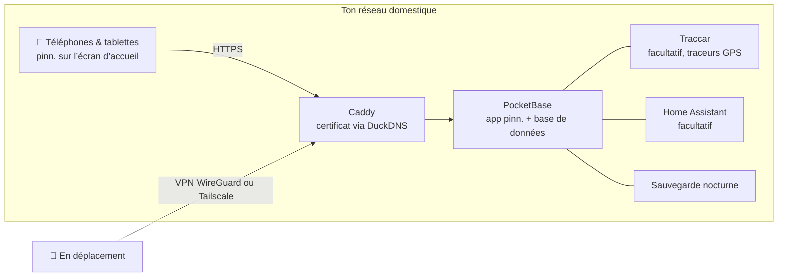

<p align="center">
  
</p>

<p align="center">
  <a href="https://github.com/pinn-shost/pinn/releases/latest"></a>
  <a href="LICENSE"></a>
  
  
  
  <a href="https://ko-fi.com/pinnapp"></a>
</p>

<p align="center">
  <a href="README.md">🇬🇧 English</a> ·
  <a href="README.de.md">🇩🇪 Deutsch</a> ·
  <a href="README.es.md">🇪🇸 Español</a> ·
  <b>🇫🇷 Français</b> ·
  <a href="README.it.md">🇮🇹 Italiano</a> ·
  <a href="README.pt.md">🇧🇷 Português</a> ·
  <a href="README.zh.md">🇨🇳 中文</a> ·
  <a href="README.ja.md">🇯🇵 日本語</a> ·
  <a href="README.ko.md">🇰🇷 한국어</a> ·
  <a href="README.ru.md">🇷🇺 Русский</a> ·
  <a href="README.nl.md">🇳🇱 Nederlands</a> ·
  <a href="README.tr.md">🇹🇷 Türkçe</a> ·
  <a href="README.pl.md">🇵🇱 Polski</a> ·
  <a href="README.uk.md">🇺🇦 Українська</a>
</p>

<p align="center">
  <a href="#captures-décran">Captures</a> ·
  <a href="#ce-que-fait-pinn">Fonctions</a> ·
  <a href="#installation">Installation</a> ·
  <a href="#confidentialité">Confidentialité</a> ·
  <a href="#faq">FAQ</a>
</p>

---

pinn. est une seule app pour tout ce qui fait tourner un foyer : le calendrier partagé, les repas de la semaine, la liste de courses, qui sort les poubelles, l’argent de poche et l’assurance à résilier en mars. Elle tourne sur **ton propre NAS** avec Docker et s’installe comme une vraie app sur chaque iPhone, iPad et téléphone Android de la famille.

Pas de compte cloud. Pas d’abonnement. Pas de publicité, pas de pistage. Les données de ta famille ne quittent jamais la maison.

## Captures d'écran

### Sur l’iPad

Accroché au mur ou posé sur la table de la cuisine : l’iPad partagé montre toute la famille d’un coup d’œil.

<table>
  <tr>
    <td align="center" width="50%">
      <a href=".github/assets/screenshots/dashboard.png"></a><br>
      <sub><b>Tableau de bord</b> – chacun touche sa propre photo, avec PIN facultatif</sub>
    </td>
    <td align="center" width="50%">
      <a href=".github/assets/screenshots/ipad-overview.png"></a><br>
      <sub><b>Aperçu</b> – météo, rendez-vous, tâches, repas et la famille d’un coup d’œil</sub>
    </td>
  </tr>
</table>

### Sur le téléphone

Toujours avec toi : pinn. s’installe sur chaque iPhone et téléphone Android comme une vraie app.

<table>
  <tr>
    <td align="center" width="33%"><a href=".github/assets/screenshots/home.png"></a><br><sub><b>Aperçu</b> – ta journée d’un coup d’œil</sub></td>
    <td align="center" width="33%"><a href=".github/assets/screenshots/calendar.png"></a><br><sub><b>Calendrier</b> – iCloud et Google dans une seule vue</sub></td>
    <td align="center" width="33%"><a href=".github/assets/screenshots/meals.png"></a><br><sub><b>Repas</b> – planifier la semaine, faire les courses d’un toucher</sub></td>
  </tr>
  <tr>
    <td align="center" width="33%"><a href=".github/assets/screenshots/lists.png"></a><br><sub><b>Listes</b> – courses, stock, bagages</sub></td>
    <td align="center" width="33%"><a href=".github/assets/screenshots/finance.png"></a><br><sub><b>Finances</b> – budget, épargne, argent de poche</sub></td>
    <td align="center" width="33%"><a href=".github/assets/screenshots/chat.png"></a><br><sub><b>Chat</b> – chiffré de bout en bout, avec messages vocaux et position</sub></td>
  </tr>
</table>

### Plus d’écrans

Touche une image pour l’ouvrir en taille réelle.

<details>
<summary><b>Afficher plus de captures</b></summary>

<br>

<table>
  <tr>
    <td align="center" width="25%"><a href=".github/assets/screenshots/house.png"></a><br><sub><b>Maison</b> – maison, coûts, prêt, défauts et compteurs au même endroit</sub></td>
    <td align="center" width="25%"><a href=".github/assets/screenshots/tasks.png"></a><br><sub><b>Tâches</b> – rappels automatiques, p. ex. contrôle technique et changement de pneus, avec bouton direct</sub></td>
    <td align="center" width="25%"><a href=".github/assets/screenshots/vehicles.png"></a><br><sub><b>Véhicules</b> – contrôle technique, pneus, plein et recharge</sub></td>
    <td align="center" width="25%"><a href=".github/assets/screenshots/scan_pantry.png"></a><br><sub><b>Scanner le stock</b> – scanne le code-barres, range ou consomme</sub></td>
  </tr>
  <tr>
    <td align="center" width="25%"><a href=".github/assets/screenshots/weekly_summary_1.png"></a><br><sub><b>Aperçu de la semaine</b> – la météo et ce qui reste à faire</sub></td>
    <td align="center" width="25%"><a href=".github/assets/screenshots/weekly_summary_2.png"></a><br><sub><b>Aperçu de la semaine</b> – jour par jour : ménage, poubelles, paiements</sub></td>
    <td align="center" width="25%"><a href=".github/assets/screenshots/weekly_summary_3.png"></a><br><sub><b>La semaine dernière en bref</b> – rendez-vous, repas, dépenses – et raccourcis</sub></td>
    <td align="center" width="25%"><a href=".github/assets/screenshots/kids.png"></a><br><sub><b>Enfants</b> – une routine quotidienne ludique</sub></td>
  </tr>
</table>

</details>

<sub>📁 <a href=".github/assets/screenshots">Toutes les images dans un dossier</a></sub>

## Ce que fait pinn.

| | |
|---|---|
| 📅 **Calendrier** | Calendriers iCloud et Google par personne, privés ou partagés avec la famille. Jours fériés, vacances scolaires, collectes des déchets et anniversaires des contacts apparaissent automatiquement. |
| 🍝 **Repas & recettes** | Planifie la semaine, puis envoie les ingrédients directement sur la liste de courses. Importe des recettes depuis un texte, un PDF, des photos ou un lien – avec l’IA si tu veux. Partage tes recettes préférées avec les autres familles de ton serveur. |
| 🛒 **Listes** | Listes de courses par magasin, un stock qui remplit la liste quand quelque chose vient à manquer, listes de bagages à partir de modèles (vacances, sac de maternité, fête), listes de cadeaux et de souhaits avec un planificateur « qui offre quoi » que le destinataire ne voit jamais. |
| ✅ **Tâches & ménage** | Tâches avec rappels push, plans de ménage et poubelles – plus une page enfant avec des routines animées qui ne montre que ce qui correspond au moment de la journée. |
| 💶 **Finances** | Caisses communes ou privées, budget du foyer, épargne et dépôts avec ETF et actions, argent de poche, paiements récurrents et contrats avec rappel de résiliation. Les colocations partagent les frais et voient qui doit combien à qui. |
| 📄 **Documents & véhicules** | Justificatifs et garanties, pièces d’identité avec rappel d’expiration. Voitures et vélos avec contrôle technique, changement de pneus, consommation et coût total. |
| 🏡 **Domicile** | Pour locataires, propriétaires et bailleurs : bail ou contrat d’achat, prêt, défauts avec photos, justificatifs, plan de rénovation, relevés de compteurs avec prévision, clés et loyers des appartements, maisons et garages loués. Jardin & plantes avec un plan d’arrosage qui sait quand il a plu. |
| 📍 **Famille & localisation** | Partage ta position directement depuis pinn. – une fois ou pour une durée choisie – et en arrière-plan avec l’app gratuite Traccar Client (envoie directement à pinn., sans serveur supplémentaire). Plus un mode « trajet retour », une alerte SOS avec position et numéros d’urgence, des fiches d’urgence et des avis d’arrivée sur des lieux. |
| 🎒 **École & crèche** | Par enfant : emploi du temps (à saisir ou à photographier – l’IA le remplit), dépose et récupération, devoirs sur la page enfant, mots aux parents avec échéances qui deviennent des rappels, et jours de fermeture directement dans le calendrier. |
| 🐾 **Animaux** | Profils pour chiens, chats, lapins & co. avec repas à cocher, promenades, tour de rôle « à qui le tour », vaccins et vermifuges avec rappel push, courbe de poids, vétérinaire et urgences vétérinaires, une fiche pour le pet-sitter à partager et une affiche « perdu » à imprimer et un rappel de remplissage du distributeur de croquettes. |
| 🌦️ **Météo & vacances** | Touche la météo (une tuile sur le téléphone, en haut à côté de la date et de l’heure sur iPad et ordinateur) pour voir 14 jours avec les détails de chaque jour. Les listes de bagages avec destination et dates affichent la météo des vacances – prévision ou valeurs typiques – et suggèrent quoi emporter. |
| 🏠 **Maison connectée** | Lance des Raccourcis Apple ou des actions Home Assistant depuis une tâche – le robot aspirateur nettoie la cuisine quand la tâche est due, le robot tondeuse et l'arrosage suivent le plan du jardin, le distributeur de croquettes prévient quand il se vide. |
| 🎙️ **Commande vocale** | « Dis Siri, pinn » : ajouter à la liste de courses, se la faire lire, créer des tâches et entendre le programme du jour – aussi sur Android. |
| 💬 **Chat** | Chat de famille et privé, chiffré de bout en bout, avec push, coches de lecture et réponses. |
| 🔔 **Notifications** | Messages push personnels sur iPhone, iPad et Android, plus une cloche qui rassemble chaque changement dans la famille. |
| 🧩 **Tout le reste** | Tableau familial avec notes déplaçables, recherche globale, mode hors ligne avec synchronisation automatique, mode sombre, tableau de bord iPad avec PIN par profil, compte invité, contrôle parental. |

pinn. parle **🇬🇧 English, 🇩🇪 Deutsch, 🇪🇸 Español, 🇫🇷 Français, 🇮🇹 Italiano, 🇧🇷 Português, 🇨🇳 中文, 🇯🇵 日本語, 🇰🇷 한국어, 🇷🇺 Русский, 🇳🇱 Nederlands, 🇹🇷 Türkçe, 🇵🇱 Polski et 🇺🇦 Українська**, adapte la devise et les numéros d’urgence à ta région, et bascule entre les termes **famille** et **colocation**. Un serveur peut héberger plusieurs familles, chacune avec ses propres admins.

## Nouveautés de la 1.153.1

**Santé : cinq nouveaux blocs, « Moi » dans ton propre profil**

- Nouveau sur la page santé : **crème solaire** (indice UV du jour au domicile, rappel seulement les jours ensoleillés), **sommeil** (rappel avant le coucher, le matin « Comment as-tu dormi ? »), **fruits et légumes** (portions par jour), **contrôle des tiques** (avril–octobre) et **bilans de santé** (dentiste, bilan … avec intervalle ; pour les enfants les examens U allemands selon l'âge). Pour les enfants, les parents reçoivent aussi les rappels.
- Nouveau : dans ton propre profil, pinn. affiche « Moi » au lieu de ton nom – filtre du calendrier, tâches, famille et partout ailleurs, accordé dans les phrases. En plus : icône linéaire pour la flèche de restauration, nouvelle icône de jante, même doré pour les textes jaunes en mode sombre.
- Modifié: `pb_hooks/pinn-gesundheit.js`, `js/gesundheit.js`, `css/gesundheit.css`, `js/mitglieder.js`, `js/symbole.js`, `css/dunkelfarbe.css`, `js/aufgaben.js`, `js/termine.js`, `js/listen.js`, `js/sparen.js`, `js/vertraege.js`, `js/familie.js`, `js/hinweise.js`, `js/kassen.js`, `js/zuhause.js`, `js/dokumente.js`, `js/fahrzeuge.js`, `js/ausblick.js`, `js/sterne.js`, `js/vorrat2.js`, `i18n/`, `js/sprachen.js`, `js/versionslog.js`, `index.html`.

## Nouveautés de la 1.153.0

**Sécurité depuis Home Assistant**

- Nouveau : **Sécurité** – les admins de la famille regroupent des appareils Home Assistant dans Réglages → Sécurité : fenêtres et portes, serrures, caméras, porte de garage et volets, détecteurs de fumée et d'eau, alarme, détecteurs de mouvement. Le tableau de bord familial affiche une barre en bas (p. ex. « Tout est fermé », « Fenêtre cuisine est ouvert », « 1 caméra est allumée », en rouge en cas d'alarme) et l'aperçu reçoit la tuile « Sécurité », où les adultes peuvent verrouiller une serrure ouverte (jamais déverrouiller). **Vérification du soir** en option : à l'heure choisie, tous les admins reçoivent une notification si quelque chose est encore ouvert, déverrouillé ou si l'alarme est désactivée. Condition : Home Assistant connecté dans Réglages → Maison connectée.
- Corrigé : en mode sombre, les boutons sous le titre d'une tâche (démarrage maison connectée, relevé de compteurs …) étaient bleu sur bleu – désormais dorés.
- Modifié: `pb_hooks/pinn-sicherheit.js` (new), `pb_hooks/sicherheit.pb.js` (new), `pb_hooks/pinn-smarthome.js`, `pb_hooks/pinn-schema.js`, `js/sicherheit.js` (new), `css/sicherheit.css` (new), `js/uebersicht.js`, `js/profilauswahl.js`, `js/einstellungen.js`, `css/dunkelfarbe.css`, `i18n/`, `js/sprachen.js`, `js/versionslog.js`, `pinn-setup.sh`, `src/`, `index.html`.

## Nouveautés de la 1.152.1

**La restauration des sauvegardes fonctionne à nouveau**

- Corrigé : la restauration d’une sauvegarde (Réglages → Système → Sauvegardes et mises à jour) s’arrêtait toujours à « Vérifier la sauvegarde », que l’on choisisse seulement les données ou tout. La sauvegarde de l’état actuel faite juste avant nettoyait les anciennes sauvegardes et écrasait le nom de la sauvegarde choisie, qui n’était alors plus trouvée. Chaque échec laissait une sauvegarde « Avant une restauration » – elles sont sans danger et sont supprimées automatiquement (les 3 dernières sont gardées). La mise à jour renouvelle `pinn-wartung.sh` ; le conteneur « wartung » redémarre tout seul.
- Stack Portainer : les sauvegardes fonctionnent enfin vraiment. Le service « wartung » du stack n’avait rien à démarrer, car une partie de la 1.151.0 manquait dans le dépôt. L’image contient maintenant le script de sauvegarde, qui trouve tout seul le conteneur pinn du stack – sauvegarde nocturne, « Sauvegarder maintenant » et « Restaurer » (données et configuration) fonctionnent comme avec l’installation par script. Les mises à jour restent dans Portainer. Ensuite : dans Portainer « Update the stack » avec « Re-pull image and redeploy ».
- Modifié: `pinn-wartung.sh`, `docker/Dockerfile`, `.github/workflows/image.yml`, `pb_hooks/pinn-system.js`, `js/sicherungen.js`, `js/serverzugriff.js`, `i18n/`, `js/versionslog.js`, `js/sprachen.js`, `src/`, `index.html`.

## Nouveautés de la 1.152.0

**Ton propre proxy inverse au lieu de Tailscale**

- Nouveau : accès depuis Internet via ton propre proxy inverse (Nginx Proxy Manager, Traefik, Cloudflare Tunnel …) – voir « Accès depuis Internet avec ton propre proxy inverse » dans Installation. pinn. ne croit l’adresse du visiteur que de proxys de confiance (`PINN_PROXY_NETZE`), le blocage après de mauvais mots de passe ne peut donc pas être contourné (IPv6 : par /64). Depuis Internet, l’administration PocketBase et ses propres voies de connexion sont bloquées, le mot de passe initial `Admin` ne fonctionne pas et deviner des ID de traceurs est freiné. Pour de telles tentatives, les admins reçoivent une notification « 🚨 Alerte de sécurité » (adresse, réseau domestique ou Internet, appareil) ; tous les détails sont dans le journal des erreurs sous « Sécurité ». Rien ne change dans le réseau domestique.
- Modifié: `pb_hooks/pinn-netz.js` (new), `pb_hooks/netz.pb.js` (new), `pb_hooks/pinn-alarm.js` (new), `pb_hooks/pinn-sitzungen.js`, `pb_hooks/benutzer.pb.js`, `pb_hooks/dashboard.pb.js`, `pb_hooks/zuhause.pb.js`, `pb_hooks/sprache.pb.js`, `pb_hooks/smarthome.pb.js`, `pb_hooks/pinn-ortung.js`, `pb_hooks/pinn-protokoll.js`, `pb_hooks/pinn-pushtext.js`, `js/anmeldemaske.js`, `js/fehlerprotokoll.js`, `js/hinweise.js`, `js/appstart.js`, `i18n/`, `docker/docker-compose.portainer.yaml`, `env.txt`, `js/sprachen.js`, `js/versionslog.js`, `src/`, `index.html`.

## Nouveautés de la 1.151.0

**Stack Portainer, image prête à l’emploi**

- Nouveau : pinn. s’installe depuis l’interface de stacks de Portainer, sans SSH et sans script d’installation. À chaque version, une image prête (amd64, arm64) est construite et publiée sur `ghcr.io/pinn-shost/pinn` ; le nouveau fichier `docker/docker-compose.portainer.yaml` l’utilise avec des volumes et sans noms de conteneur fixes (plus de conflit avec un conteneur Tailscale existant). Le stack contient aussi un service de sauvegarde (sauvegarde nocturne, « Sauvegarder maintenant » et « Restaurer » dans l’app ; les mises à jour restent dans Portainer) ainsi que des blocs facultatifs en commentaire pour Traccar et la déviation vers Home Assistant. Voir « Stack Portainer (sans script) » dans Installation.
- Modifié: `docker/` (new), `.github/workflows/image.yml` (new), `pinn-wartung.sh`, `pb_hooks/pinn-system.js`, `js/sicherungen.js`, `i18n/`, `js/sprachen.js`, `js/versionslog.js`, `src/`, `index.html`.

## Nouveautés de la 1.150.11

**Icônes et petites corrections**

- Icône de peigne pour « Se coiffer » sur la page enfants ; plus de champ emoji à côté du nom du portefeuille ; listes déroulantes des caisses sans emoji ; l’outil est désormais une clé plate ; « Menus pour les invités » avec l’icône à deux personnes ; un appui sur le logo à côté du nom de la famille mène à l’aperçu ; la carte Notifications se remplit en premier pour que « Activer sur cet appareil » apparaisse toujours ; icônes des raccourcis en gris en mode sombre.
- Modifié: `js/symbole.js`, `js/symbole3.js`, `js/ansichten.js`, `js/konto.js`, `css/dunkelfarbe.css`, `js/sprachen.js`, `js/versionslog.js`, `i18n/versionslog.en.js`, `src/`, `index.html`.

## Nouveautés de la 1.150.10

**Mode sombre, plus d’icônes, nouvelle bannière des animaux, journal des animaux**

- **Mode sombre.** Le texte bleu devient doré (appareils, listes, « Planifier les courses », coches pour les animaux, la santé et les tâches) ; les barres du Ménage ont la couleur de la pièce ; les messages du chat, des contrats et « En un coup d’œil » sont lisibles. **Plus d’icônes à la place des émojis :** photos de profil (bébé, garçon, fille, homme, femme, grand-père, grand-mère), famille et colocation, animaux (chien, chat, lapin, hamster, oiseau, poussin, poisson, cheval, tortue, serpent) ; les listes déroulantes n’affichent que le texte. **Nouvelle bannière des animaux** avec des animaux colorés. **Journal des animaux :** un suivi coché apparaît dans le journal, la × annule une coche accidentelle.
- Modifié : `css/dunkelfarbe.css` (new), `js/symbole3.js` (new), `js/symbole.js`, `js/szenen.js`, `js/familie.js`, `js/haushalt.js`, `css/symbolfarbe.css`, `css/haustierewetter.css`, `js/sprachen.js`, `js/versionslog.js`, `i18n/`, `src/`, `pinn-setup.sh`, `index.html`.

## Nouveautés de la 1.150.9

**De la couleur pour les icônes, icônes de véhicules et de plantes**

- **Couleur de jour.** Les icônes sont maintenant légèrement colorées (surfaces blanches, soleil jaune, pluie bleue, voiture rouge, outils gris, plantes vertes) dans le même style de trait ; le mode sombre reste inchangé. **Icônes de véhicule :** au lieu de l’emoji de voiture, on choisit une icône en trait (berline, SUV, taxi, camionnette, pick-up, tracteur, caravane, vélo, vélo électrique …). Les **icônes de plantes** se choisissent aussi dans l’appli, avec de nouvelles icônes de cactus, palmier, tulipe, tournesol, rose et plus. Dans les bannières Véhicules et Maison, les voitures ne brillent que la nuit : jaunâtre à l’avant, rouge à l’arrière.
- Modifié : `js/symbole2.js`, `css/symbolfarbe.css` (new), `js/symbole.js`, `js/wetterlogos.js`, `js/symbolwahl.js`, `js/fahrzeuge.js`, `js/zuhause.js`, `js/dokumente.js`, `css/fahrzeuge.css`, `js/sprachen.js`, `js/versionslog.js`, `i18n/`, `src/`, `pinn-setup.sh`, `index.html`.

## Nouveautés de la 1.150.8

**Des icônes partout, à choisir dans l’appli**

- **Des icônes maison partout.** Nourriture, maison, véhicules, plantes, vêtements, jouets et sport ont maintenant eux aussi leurs icônes en trait (pièces, types de déchets, types de véhicules, jardin, réveil, bascule du calendrier, compte à rebours). Les **icônes de catégorie** dans Finances, Contrats, Documents et Réserves se choisissent parmi environ 150 icônes prêtes à l’emploi au lieu du clavier d’emojis, et un même type de catégorie a partout la même icône. Les scènes de Maison et Véhicules montrent de nouveaux véhicules colorés. Détails : météo « Maintenant » sans bordure en pointillés, police de l’horloge du tableau de bord, icône de la liste du plan de repas, icônes alignées sur la ligne de texte.
- Modifié : `js/szenen.js`, `js/symbolwahl.js` (new), `js/symbole.js`, `css/wetterlogos.css`, `js/zustand.js`, `js/zuhause.js`, `js/fahrzeuge.js`, `js/gesundheit.js`, `js/finanzen.js`, `js/vertraege.js`, `js/dokumente.js`, `js/vorrat.js`, `js/vorrat2.js`, `js/einkauf.js`, `js/profilauswahl.js`, `js/sprachen.js`, `js/versionslog.js`, `i18n/`, `src/`, `pinn-setup.sh`, `index.html`.

## Nouveautés de la 1.150.7

**Icônes météo maison**

- **Icônes météo.** Les vues météo ont maintenant leurs propres icônes en trait simple à la place des emojis Apple, dans le même style que les icônes des raccourcis : soleil, lune, nuages, pluie, neige, orage, vent, UV, lever du soleil, eau et les conseils vestimentaires. En mode sombre, elles changent de couleur.
- **Des icônes maison partout.** Environ 150 icônes en trait simple remplacent désormais les emojis Apple dans toute l’appli (étoiles, coches, avertissements, lieux, cadeaux, horloge, calendrier, cadenas, courrier, outils, santé, maison, argent et plus). Animaux, nourriture, vêtements, plantes, véhicules, sport et jouets, les emojis que vous choisissez ou saisissez (photos des membres, textes du chat, champs de saisie) et les notifications push restent des emojis.
- Modifié : `js/symbole.js` (new), `js/wetterlogos.js`, `css/wetterlogos.css` (new), `js/familie.js`, `js/grundlagen.js`, `js/profilauswahl.js`, `js/wetterkachel.js`, `js/sprachen.js`, `js/versionslog.js`, `i18n/`, `src/`, `pinn-setup.sh`, `index.html`.

## Nouveautés de la 1.150.6

**Face ID déverrouille de nouveau tout seul**

- **Face ID.** pinn. redemande Face ID de lui-même à l’ouverture, comme avant la 1.150.5. iOS affiche toujours d’abord sa propre fenêtre « Utiliser la clé d’identification » : un toucher dessus, puis Face ID ; le web ne peut pas la sauter, et le bouton supplémentaire ne faisait qu’ajouter un second toucher. Le grand bouton en bas reste, au cas où tu fermerais la fenêtre.
- Modifié : `js/entsperren.js`, `js/sprachen.js`, `js/versionslog.js`, `i18n/`, `src/`, `index.html`.

## Nouveautés de la 1.150.5

**Nouvelle bannière santé · boissons rangées**

- **Bannière santé.** La page santé et celle de chaque personne ont de nouveau une bannière : de l’eau qui monte avec ce qui a été bu, des bulles, un battement de cœur et des objets flottants – la nuit, des étoiles.
- **Boire.** L’objectif, les boissons du jour et le rappel sont désormais dans une section repliable « Réglages » sous le bouton. Le raccourci s’appelle toujours « Cuisiner ».
- **Face ID.** Le déverrouillage ne démarre plus qu’avec le bouton (plus de fenêtre « Utiliser la clé d’identification ») ; le bouton est en bas, à portée du pouce.
- Modifié : `js/gesundheit.js`, `css/gesundheit.css`, `js/entsperren.js`, `js/sprachen.js`, `js/versionslog.js`, `i18n/`, `src/`, `index.html`.

## Nouveautés de la 1.150.4

**Les notifications restent actives après les mises à jour**

- **Le push survit aux mises à jour.** Si le serveur ne parvenait pas à lire sa clé push un court instant pendant une mise à jour, il en créait une nouvelle – et tous les appareils perdaient les notifications. Désormais, la clé n’est jamais remplacée tant qu’elle existe, elle est enregistrée de façon sûre et conservée en copie de secours.
- **Un toucher suffit.** Si un appareil perd malgré tout son inscription (p. ex. réinitialisée par iOS), pinn. le réinscrit tout seul – ou affiche en bas « Réactiver », sans passer par les réglages.
- Modifié : `pb_hooks/pinn-push.js`, `pb_hooks/push.pb.js`, `pb_hooks/pinn-sitzungen.js`, `js/mitteilungen.js`, `js/appstart.js`, `js/sprachen.js`, `js/versionslog.js`, `i18n/`, `src/`, `index.html`.

## Nouveautés de la 1.150.3

**Tous les rappels à votre heure · les parents aussi**

- **Tous les rappels à votre heure.** Anniversaires, animaux, liste de bagages, garde-manger, contrats, documents, aperçu de la semaine, perspectives du mois et bilan de l'année, rappels de rendez-vous, aperçu du jour, rappels de tâches et de poubelles, tableau d'affichage, commande vocale, maison connectée et messages de localisation suivent désormais le fuseau horaire de votre appareil, heure d'été et d'hiver comprises. Rien à régler.
- **Les parents aussi.** Pour les enfants, les parents reçoivent aussi les rappels pour boire, les médicaments et le lavage des mains, avec le prénom de l'enfant devant. Interrupteur « Rappeler aussi les parents » par enfant (par défaut : activé).
- **Shortcuts sans titre.** La tuile de l'aperçu n'affiche plus que les applis, séparées par la ligne.
- Modifié: tous les modules de rappels dans `pb_hooks/` (`pinn-zeit.js` et 13 autres), `js/gesundheit.js`, `js/sprachen.js`, `js/versionslog.js`, `i18n/`, `src/`, `index.html`, README (+ 1.150.2).

## Nouveautés de la 1.150.2

**Les raccourcis restent sur l’aperçu**

- **Fenêtre au lieu d’un saut.** Un appui sur boire, médicaments, courses, cuisiner aujourd’hui, plan de ménage, animaux, provisions, SOS ou en route ouvre la fenêtre en bas ; on y avance étape par étape et un court message indique ce qui s’est passé.
- **Fenêtres et liens.** Tâche, rendez-vous, note, dépense et revenu ouvrent leur fenêtre habituelle, se laver les mains compte +1. Chat, finances et plantes sont de simples liens ; « Ouvrir › » dans la fenêtre mène à la page complète.
- **Corrigé.** Après le passage à une autre page (p. ex. recettes ou courses), la tuile Raccourcis ne reste plus en bas.
- **Une ou plusieurs rangées.** Sous Réglages → Raccourcis, vous choisissez séparément pour le téléphone et pour tablette et ordinateur : une rangée (balayer sur le côté pour voir le reste) ou plusieurs rangées (tous les raccourcis remplis vers le bas).
- Modifié: `js/kurzbefehle.js`, `js/kurzfenster.js`, `css/kurzbefehle.css`, `js/uebersicht.js`, `js/design.js`, `js/ansichten.js`, `js/rezepte.js`, `js/sprachen.js`, `js/versionslog.js`, `i18n/`, `src/`, `index.html`, README (+ 1.150.1).

## Nouveautés de la 1.150.1

**Raccourcis dans leur propre rubrique**

- **Rubrique à part.** Le choix des applis se trouve désormais sous Réglages → Raccourcis. Avant, ouvrir « Raccourcis » refermait le réglage Aperçu et la page ne défilait plus.
- **Activer ou masquer sous Aperçu.** La tuile Raccourcis s’active ou se masque comme toutes les autres ; « Choisir les applis » mène directement au choix.
- **Visible tout de suite.** Tant que vous n’avez rien choisi, la tuile affiche une sélection par défaut (boire, courses, tâche, rendez-vous, cuisiner aujourd’hui, note, dépense, plan de ménage). Sans appli choisie, elle propose « Choisir les applis » au lieu de disparaître.
- Modifié: `js/kurzbefehle.js`, `css/kurzbefehle.css`, `js/uebersicht.js`, `js/uebersichteinstellungen.js`, `js/design.js`, `js/sprachen.js`, `js/versionslog.js`, `i18n/`, `src/`, `index.html`, README.

## Comment ça marche



Tout tourne en conteneurs Docker sur une seule machine. HTTPS fonctionne **sans redirection de port** – le certificat est délivré via une vérification DNS. De l’extérieur, pinn. n’est accessible que par ton propre VPN.

## Prérequis

- Un NAS ou un serveur avec **Docker** et **Docker Compose 2.17+** – développé sur un NAS UGREEN sous UGOS, fonctionne sur tout hôte Linux avec Docker (amd64, arm64, armv7)
- Un accès SSH
- Facultatif mais recommandé : un sous-domaine gratuit [DuckDNS](https://www.duckdns.org) pour HTTPS – nécessaire pour les notifications push et pour installer pinn. comme app

## Installation

1. Télécharge le ZIP de la [dernière version](https://github.com/pinn-shost/pinn/releases/latest) et décompresse-le.
2. Crée un dossier sur le NAS, p. ex. `/volume1/docker/Pocketbase`, et mets-y le dossier décompressé (p. ex. `pinn-1.153.1` ou `pinn-main`) tel quel.
3. Connecte-toi en SSH et exécute :
   ```sh
   cd /volume1/docker/Pocketbase && sudo sh pinn-*/pinn-setup.sh
   ```
   Le script met chaque fichier à sa place, télécharge les bibliothèques pour l’import PDF et la reconnaissance de texte sur photo, et démarre pinn.
4. Ouvre `http://<IP-du-NAS>:8090` → **Se connecter en admin principal** → mot de passe `Admin` → choisis ton propre mot de passe.
5. L’**assistant de configuration** t’accompagne pour le reste – HTTPS, accès à distance via WireGuard ou Tailscale, Google, IA, localisation et Home Assistant – étape par étape, en quatorze langues.
6. Ouvre pinn. sur chaque téléphone via son adresse HTTPS et ajoute-le à l’écran d’accueil :
   - **iPhone/iPad (Safari) :** Partager → *Sur l’écran d’accueil* (iOS 16.4 ou plus récent pour les notifications)
   - **Android (Chrome) :** Réglages → Notifications → *Installer pinn. comme app*, ou menu Chrome ⋮ → *Installer l’application*

   Active ensuite les notifications sur chaque appareil sous **Réglages → Notifications → Activer sur cet appareil**.

**Mettre à jour :** télécharge le nouveau ZIP, mets le dossier décompressé dans le même dossier et relance `sudo sh pinn-*/pinn-setup.sh`. Les fichiers remplacés sont conservés dans `_alt/`, tes données restent intactes.

**Les sauvegardes** ont lieu chaque nuit dans `./backups` et sont conservées 14 jours.

### Stack Portainer (sans script)

Vous préférez Portainer ? Alors ni SSH ni le script d’installation ne sont nécessaires :

1. Dans Portainer, ouvrez **Stacks → Add stack**, nommez-le `pinn` et choisissez **Web editor**.
2. Collez le contenu de [`docker/docker-compose.portainer.yaml`](docker/docker-compose.portainer.yaml).
3. Facultatif : sous **Environment variables**, changez le port (`PINN_PORT`, 8090 par défaut) ou fixez une version (`PINN_IMAGE_TAG`, p. ex. `1.151.0`). Cliquez sur **Deploy the stack**.
4. Ouvrez `http://<IP-du-NAS>:8090` → **Se connecter en tant qu’administrateur principal** → l’assistant de configuration, comme aux étapes 4 à 6 ci-dessus.

L’image est fournie toute prête par `ghcr.io/pinn-shost/pinn` (amd64 et arm64). Les données sont dans des volumes, aucun dossier n’est nécessaire. Le stack n’utilise pas de noms de conteneur fixes ; il n’entre donc pas en conflit avec vos conteneurs existants. Si Tailscale tourne déjà sur votre NAS, supprimez le bloc `tailscale` ; avec votre propre adresse HTTPS ou reverse proxy, supprimez aussi `caddy` et `duckdns`.

**Mise à jour :** Stack → Editor → *Update the stack* avec *Re-pull image and redeploy* activé. **Sauvegardes :** le bloc `wartung` du stack sauvegarde chaque nuit (7 jours + 4 semaines conservés) et alimente les boutons « Sauvegarder maintenant » et « Restaurer » dans pinn. → Réglages → Système. Les sauvegardes vont dans le volume `backups` – ou dans un dossier du NAS si tu définis `PINN_BACKUP_DIR` (p. ex. `/volume1/docker/pinn-backups`). Il a besoin de l’accès à Docker pour arrêter brièvement pinn. lors d’une restauration ; supprime le bloc si tu sauvegardes toi-même les volumes. Les mises à jour se font dans Portainer, pas par bouton. Facultatif, en commentaire à la fin du fichier (retire le `#` pour l’activer) : Traccar (traceurs GPS avec carte SIM) et la déviation vers Home Assistant – les téléphones n’ont besoin ni de l’un ni de l’autre.

### Accès depuis Internet avec ton propre proxy inverse

Ta famille ne veut pas utiliser Tailscale ? Place alors pinn. derrière un proxy inverse : il reçoit les requêtes d’Internet, fournit le HTTPS pour ton propre domaine et les transmet à pinn.

1. Fais pointer le proxy vers `http://<NAS-IP>:8090` (stack Portainer : le port `PINN_PORT`). Les mises à jour en direct passent par du HTTP normal – pas besoin de websockets, laisse simplement la mise en tampon des réponses désactivée. Autorise les envois jusqu’à 70 Mo (vidéos du chat).
   - **Nginx Proxy Manager :** *Hosts → Proxy Hosts → Add* : ton domaine, schéma `http`, IP du NAS, port `8090` ; onglet *SSL* : nouveau certificat, *Force SSL* activé.
   - **Cloudflare Tunnel :** aucune redirection de port – *Public hostname* → service `http://<NAS-IP>:8090`.
   - **Traefik, Caddy et autres :** un routeur/site pour ton domaine qui transmet à `http://<NAS-IP>:8090`.
2. Sur chaque téléphone, ouvre `https://<domain>`, connecte-toi, ajoute-le de nouveau à l’écran d’accueil et réactive les notifications (l’app est liée à son adresse).
3. Agendas Google (facultatif) : ajoute `https://<domain>/api/pinn/google/callback` comme URI de redirection autorisée dans la console Google Cloud.

Ce que pinn. fait tout seul : il ne croit l’adresse du visiteur transmise par le proxy (`X-Forwarded-For`) que si la requête vient du réseau domestique, d’un réseau Docker ou de Tailscale – le blocage après de mauvais mots de passe ne peut donc pas être contourné. Depuis Internet, l’administration PocketBase (`/_/`) est bloquée et le mot de passe initial `Admin` ne fonctionne pas. Ton proxy est ailleurs (serveur loué, ou nuage orange de Cloudflare devant ton proxy) ? Définis alors `PINN_PROXY_NETZE` (dans `.env` ou les variables d’environnement du stack), p. ex. `privat, cloudflare` ou `privat, 203.0.113.5`.

**Important :** pinn. est alors accessible à tout Internet. Donne à chaque profil un mot de passe long et unique, garde le proxy à jour et n’ouvre jamais le port 8090 directement dans le routeur – toujours via le proxy en HTTPS.

## Confidentialité

pinn. a été conçu pour des données qu’on ne confierait jamais à un service cloud : relevés bancaires, documents médicaux, l’endroit où se trouvent tes enfants. C’est pourquoi :

- **Toutes les données restent sur ton NAS** dans une seule base de données PocketBase. Il n’y a pas de serveur pinn. ni de télémétrie.
- **Aucun script de serveurs tiers.** Tout le code et toutes les bibliothèques sont servis par ton NAS.
- **Les notifications push ne contiennent rien.** Apple, Google et Mozilla ne transmettent qu’un signal de réveil vide ; l’appareil récupère ensuite le message sur ton NAS.
- **Les mots de passe iCloud et Google** sont stockés chiffrés dans une collection verrouillée.
- **Pas accessible depuis internet.** L’accès à distance passe par ton propre VPN.

pinn. ne contacte des services externes que pour les fonctions qui en ont besoin :

| Service | Utilisé pour | Quand |
|---|---|---|
| [Open-Meteo](https://open-meteo.com) | Prévisions météo | quand une adresse de domicile est définie |
| [OpenStreetMap Nominatim](https://nominatim.openstreetmap.org) | Convertir des adresses en positions sur la carte | lors de la saisie d’adresses |
| [Tuiles OpenStreetMap](https://www.openstreetmap.org) | Fond de carte | sur la page de localisation, chargé via ton NAS |
| [Google Fonts](https://fonts.google.com) | Polices | au chargement de l’app |
| [OpenHolidays API](https://www.openholidaysapi.org) | Jours fériés et vacances scolaires | quand une adresse de domicile est définie |
| [DuckDNS](https://www.duckdns.org) | Certificat HTTPS et adresse | si configuré |
| iCloud / Google | Calendriers et contacts | seulement pour les comptes que tu connectes |
| Google Gemini | Lire des recettes et des documents | seulement si tu ajoutes une clé API |
| jsDelivr | Téléchargement unique de pdf.js et Tesseract | seulement pendant l’installation |

## FAQ

<details>
<summary><b>Dois-je ouvrir des ports sur mon routeur ?</b></summary>
<br>
Non. Le certificat HTTPS est délivré via une vérification DNS, et l’accès à distance passe par un VPN – WireGuard sur une FRITZ!Box, ou Tailscale pour tout autre routeur.
</details>

<details>
<summary><b>Est-ce que ça marche sans NAS ?</b></summary>
<br>
Toute machine allumée en permanence avec Docker convient : un mini-PC, un Raspberry Pi 4/5 ou un serveur Linux.
</details>

<details>
<summary><b>pinn. est-elle une « vraie » app de l’App Store ?</b></summary>
<br>
pinn. est une web-app que tu ajoutes à l’écran d’accueil. Elle s’ouvre alors en plein écran comme une vraie app, fonctionne hors ligne, affiche une pastille avec les tâches en cours et reçoit des notifications push – sans aucun store.
</details>

<details>
<summary><b>Plusieurs familles peuvent-elles utiliser une même installation ?</b></summary>
<br>
Oui. L’admin principal crée les familles, chaque famille a ses propres admins, calendriers et données. Les recettes peuvent être partagées entre familles si on le souhaite.
</details>

<details>
<summary><b>Et les enfants ?</b></summary>
<br>
Les profils avec contrôle parental ne voient que leurs propres tâches et ne peuvent rien supprimer ni modifier. Finances, documents et véhicules restent masqués. Les plus jeunes ont leur propre page ludique avec des routines quotidiennes.
</details>

<details>
<summary><b>Combien ça coûte ?</b></summary>
<br>
Rien – pinn. est gratuit et open source sous licence MIT. Les services facultatifs comme l’IA Gemini ont des offres gratuites.
</details>

## Structure du dépôt

Le dépôt a la même structure qu’une installation sur le NAS – chaque fichier se trouve là où il finira :

```
pinn/
├── pb_hooks/            serveur : hooks *.pb.js et leurs modules auxiliaires (pinn-*.js, calendar-sync.js)
├── pb_public/           web-app servie par PocketBase
│   ├── index.html       la page de l’app, construite depuis src/ (HTML, vérification au démarrage) – ne pas modifier à la main
│   ├── js/              code de l’app sorti d’index.html, simples fichiers <script> sans étape de build
│   │                    (ruhemodus.js, textkern.js, sprachen.js, region.js, grundlagen.js, popups.js, verbindung.js, benutzer.js, mitteilungen.js, serverzugriff.js, tastatur.js, anmeldemaske.js, dashboard.js, dashboardhintergrund.js, profilauswahl.js, pineingabe.js, dashboardsitzung.js, dashboardkonto.js, familienverwalten.js, einrichten.js, exportieren.js, hauptadminseite.js, anmeldung.js, konto.js, profilverwaltung.js, zustand.js, bedienzustand.js, rezeptbilder.js, zusammenfuehren.js, speichern.js, design.js, sprache.js, uebersicht.js, familienkachel.js, wobistdu.js, geburtstagsfeier.js, wetterkachel.js, geburtstage.js, uebersichteinstellungen.js, familiensync.js, bereiche.js, kalenderquellen.js, icsparser.js, zeitleiste.js, termindetails.js, kalenderdatei.js, wetter.js, wohnort.js, feiertage.js, muellkalender.js, mitglieder.js, profilbild.js, mitglied.js, kinderseite.js, kinderroutine.js, sterne.js, kalenderansicht.js, essenplanen.js, rezeptparser.js, rezeptdialog.js, rezeptbild.js, rezeptmengen.js, einkauf.js, einkaufslisten.js, einkaufseingabe.js, rezepte.js, offline.js, aufgabenextras.js, appbadge.js, reisen.js, aufgabendaten.js, haushalt.js, reihum.js, aufgaben.js, smarthome.js, sprachsteuerung.js, termine.js, ansichten.js, versionspruefung.js, sicherungen.js, geraete.js, fehlerprotokoll.js, versionslog.js, einstellungen.js, kalenderkonto.js, finanzen.js, kassen.js, vorrat.js, vorrat2.js, sparen.js, vertraege.js, fahrzeuge.js, zuhause.js, dokumente.js, pdflesen.js, appstart.js, pinnwand.js, listen.js, familie.js, hinweise.js, ausblick.js – ausblick.js toujours en dernier)
│   ├── css/             styles de l’app sortis d’index.html, CSS simple sans étape de build (ergaenzung.css, energiesparen.css, basis.css … haustierewetter.css, terminal.css, glocke.css)
│   ├── einrichtung.js   assistant de configuration · datenexport.js  export des données
│   ├── i18n/            textes par clé (de, en, fr, es, it, pt, zh, ja, ko) – l’anglais sert de référence
│   └── vendor/          pinn.css, pocketbase/ (pdf.js et Tesseract sont téléchargés par l’installation)
├── .github/             GitHub Actions (workflows/check.yml), vérifications (scripts/), CONTRIBUTING.md, SECURITY.md, images – non installé
├── src/                 sources d’index.html (build.js, rahmen.html, teile/) – non installé
├── caddy/Caddyfile      proxy inverse HTTPS
├── docker-compose.yaml  tous les conteneurs
├── env.txt              modèle pour .env
├── pinn-setup.sh        installer & mettre à jour
├── pinn-wartung.sh      sauvegardes & mises à jour (conteneur « wartung »)
├── pinn-pocketbase-update.sh
├── index.html           simple espace réservé, jamais installé (garde le bouton de mise à jour de la 1.38 fonctionnel)
└── README.md            page en anglais · README.<code>.md en de, es, fr (cette page), it, pt, zh, ja, ko
```

`pinn-setup.sh` copie `pb_hooks/`, `pb_public/` et `caddy/Caddyfile` tels quels dans le dossier du projet ; les dossiers de données (`pb_data/`, `konfig/`, `backups/`, `caddy/data/` …) ne sont jamais touchés.

## Contribuer

Rapports de bugs, idées et traductions sont les bienvenus – voir [CONTRIBUTING.md](.github/CONTRIBUTING.md). Merci de signaler les problèmes de sécurité en privé comme décrit dans [SECURITY.md](.github/SECURITY.md). Avant une pull request, lance `node .github/scripts/check-all.js` – les mêmes vérifications tournent automatiquement sur GitHub.

## Soutenir pinn.

pinn. est gratuit et le restera – entièrement, pour tout le monde. Je le développe sur mon temps libre. S’il te simplifie un peu le quotidien, une petite contribution fait très plaisir, mais reste entièrement facultative :

<p>
  <a href="https://ko-fi.com/pinnapp"></a>
  <a href="https://buymeacoffee.com/pinn"></a>
</p>

Une ⭐ aide aussi – elle permet à d’autres familles de trouver pinn. plus facilement.

## Réalisé avec

[PocketBase](https://pocketbase.io) (MIT) · [Tailwind CSS](https://tailwindcss.com) (MIT) · [pdf.js](https://mozilla.github.io/pdf.js/) (Apache-2.0) · [Tesseract.js](https://tesseract.projectnaptha.com) (Apache-2.0) · [Traccar](https://www.traccar.org) (Apache-2.0) · [Caddy](https://caddyserver.com) (Apache-2.0)

## Licence

[MIT](LICENSE) – utilise-le, modifie-le, partage-le.
