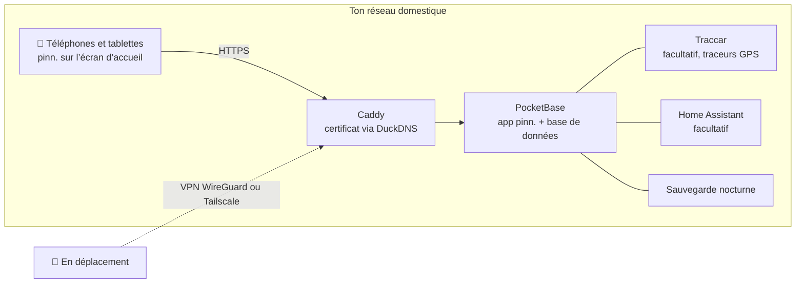

<p align="center">
  
</p>

<p align="center">
  <a href="https://github.com/pinn-shost/pinn/releases/latest"></a>
  <a href="LICENSE"></a>
  
  
  
  <a href="https://ko-fi.com/pinnapp"></a>
</p>

<p align="center">
  <a href="README.md">🇬🇧 English</a> ·
  <a href="README.de.md">🇩🇪 Deutsch</a> ·
  <a href="README.es.md">🇪🇸 Español</a> ·
  <b>🇫🇷 Français</b>
</p>

<p align="center">
  <a href="#captures-décran">Captures d’écran</a> ·
  <a href="#ce-que-fait-pinn">Fonctionnalités</a> ·
  <a href="#installation">Installation</a> ·
  <a href="#confidentialité">Confidentialité</a> ·
  <a href="#faq">FAQ</a>
</p>

---

pinn. est une seule app pour tout ce qui fait tourner un foyer : le calendrier partagé, les repas de la semaine, la liste de courses, qui sort les poubelles, l’argent de poche et l’assurance à résilier en mars. Elle fonctionne sur **ton propre NAS** avec Docker et s’installe comme une vraie app sur chaque iPhone, iPad et téléphone Android de la famille.

Pas de compte cloud. Pas d’abonnement. Ni publicité ni pistage. Les données de ta famille ne quittent jamais la maison.

## Captures d’écran

### Sur l’iPad

Accroché au mur ou posé sur la table de la cuisine : l’iPad commun montre toute la famille d’un seul coup.

<table>
  <tr>
    <td align="center" width="50%">
      <br>
      <sub><b>Dashboard</b> – chacun touche sa propre photo, avec un code PIN facultatif</sub>
    </td>
    <td align="center" width="50%">
      <br>
      <sub><b>Vue d’ensemble</b> – météo, rendez-vous, tâches, repas et la famille en un coup d’œil</sub>
    </td>
  </tr>
</table>

### Sur le téléphone

Toujours avec toi : pinn. s’installe sur chaque iPhone et téléphone Android comme une vraie app.

<table>
  <tr>
    <td align="center" width="33%"><br><sub><b>Vue d’ensemble</b> – ta journée en un coup d’œil</sub></td>
    <td align="center" width="33%"><br><sub><b>Calendrier</b> – iCloud et Google dans une seule vue</sub></td>
    <td align="center" width="33%"><br><sub><b>Repas</b> – planifie la semaine, fais tes courses d’un geste</sub></td>
  </tr>
  <tr>
    <td align="center" width="33%"><br><sub><b>Listes</b> – courses, garde-manger, bagages</sub></td>
    <td align="center" width="33%"><br><sub><b>Finances</b> – budget, épargne, argent de poche</sub></td>
    <td align="center" width="33%"><br><sub><b>Enfants</b> – une routine quotidienne ludique</sub></td>
  </tr>
</table>

## Ce que fait pinn.

| | |
|---|---|
| 📅 **Calendrier** | Calendriers iCloud et Google par personne, privés ou partagés avec la famille. Jours fériés, vacances scolaires, jours de collecte des déchets et anniversaires de tes contacts apparaissent automatiquement. |
| 🍝 **Repas et recettes** | Planifie la semaine, puis envoie les ingrédients directement sur la liste de courses. Importe des recettes depuis un texte, un PDF, des photos ou un lien – avec l’IA si tu veux. Partage tes recettes préférées avec d’autres familles de ton serveur. |
| 🛒 **Listes** | Listes de courses par magasin, un garde-manger qui remplit la liste quand le stock baisse, listes de bagages à partir de modèles (vacances, valise de maternité, fête), listes de cadeaux et de souhaits. |
| ✅ **Tâches et maison** | Tâches avec rappels push, plannings de ménage et poubelles – plus une page enfants avec des routines animées qui n’affiche que ce qui correspond au moment de la journée. |
| 💶 **Finances** | Caisses communes ou privées, un budget du foyer, épargne et portefeuilles avec ETF et actions, argent de poche, paiements récurrents et contrats avec rappel de résiliation. En colocation, on peut partager les frais et voir qui doit combien à qui. |
| 📄 **Documents et véhicules** | Tickets et garanties, pièces d’identité avec rappel avant expiration. Voitures et vélos avec dates de contrôle technique, changement de pneus, consommation et coût total. |
| 🏡 **Chez soi** | Pour locataires, propriétaires et bailleurs : bail ou acte d’achat, prêt, défauts avec photos, factures, plan de rénovation, relevés de compteurs avec prévision, clés et revenus locatifs pour les appartements, maisons et garages que tu loues. Jardin et plantes avec un plan d’arrosage qui sait quand il a plu. |
| 📍 **Famille et localisation** | Partage ta position directement depuis pinn. – une fois ou pour la durée choisie – et en arrière-plan via l’app gratuite Traccar Client (elle envoie directement à pinn., sans serveur supplémentaire). En plus : un mode « sur le chemin du retour », une alerte SOS avec position et numéros d’urgence, des fiches d’urgence et des notifications d’arrivée à des lieux. |
| 🎒 **École et crèche** | Pour chaque enfant : emploi du temps (à saisir ou à prendre en photo – l’IA le remplit), dépôt et récupération, devoirs sur la page enfants, mots des enseignants avec échéances qui deviennent des rappels, et jours de fermeture directement dans le calendrier. |
| 🐾 **Animaux** | Fiches pour chiens, chats, lapins et compagnie avec horaires de repas à cocher, promenades, un planning « à qui le tour ? », vaccins et vermifuges avec rappels push, courbe de poids, vétérinaire et urgences vétérinaires, une fiche pour le pet-sitter à partager et une affiche « perdu » à imprimer. |
| 🌦️ **Météo et vacances** | Touche la tuile météo pour 14 jours avec les détails de chaque jour. Les listes de bagages avec destination et dates affichent la météo des vacances – prévisions ou valeurs habituelles – et suggèrent quoi emporter. |
| 🏠 **Maison connectée** | Lance des Raccourcis Apple ou des actions Home Assistant depuis une tâche – le robot aspirateur nettoie la cuisine quand c’est son tour. |
| 🎙️ **Commande vocale** | « Dis Siri, pinn » : ajoute des articles à la liste de courses, fais-la lire à voix haute, crée des tâches et écoute le programme du jour – aussi sur Android. |
| 🔔 **Notifications** | Messages push personnels sur iPhone, iPad et Android, plus une cloche qui rassemble tous les changements de la famille. |
| 🧩 **Tout le reste** | Tableau familial avec notes déplaçables, recherche globale, mode hors ligne avec synchronisation automatique, mode sombre, dashboard iPad avec code PIN par profil, compte invité, contrôle parental. |

pinn. parle **English, Deutsch, Français et Español**, adapte la devise et les numéros d’urgence à ta région et bascule entre les textes **famille** et **colocation**. Un serveur peut accueillir plusieurs familles, chacune avec ses propres administrateurs.

## Nouveautés de la 1.58

**Code de l’app découpé, partie 16 – rien ne change pour toi**

- **Pour les contributeurs :** Finances – dépenses et revenus, budget du foyer, catégories, opérations récurrentes et la fenêtre des dépenses – se trouve maintenant dans son propre fichier (`pb_public/js/finanzen.js`). Rien ne change à l’utilisation.
- Seuls des fichiers de l’app changent (`index.html` et `js/finanzen.js`), rien ne change sur le serveur. Installation comme d’habitude (`sudo sh pinn-*/pinn-setup.sh` ou le bouton de mise à jour).

## Nouveautés de la 1.57

**Tâches : rappels et saisie directe**

- **Rappel supplémentaire par notification :** en créant ou modifiant une tâche – et dans toutes les règles qui créent des tâches automatiquement (nettoyage, poubelles, entretien, année du jardin, véhicules) – coche *Rappel supplémentaire par notification* et choisis une heure. Le jour d’échéance, les responsables reçoivent une notification à cette heure.
- **Relevés en une fois :** toucher la tâche *Relever les compteurs* ouvre directement la saisie – avec plusieurs compteurs, l’un après l’autre. Une fois tous les relevés saisis, la tâche se coche toute seule, même si tu les saisis sous *Maison*.
- **Tâches des véhicules :** contrôle technique, révision, changement de pneus, plaque d’assurance et échéances propres ouvrent directement la bonne saisie et se cochent toutes seules après l’enregistrement.
- **Maison :** les entretiens en retard dans l’aperçu mènent maintenant à la saisie ou à la tâche avec *✓ Fait* au lieu du plan d’entretien. Le plan d’entretien a son propre bouton pour cela.
- **Correction :** deux entretiens du même nom (p. ex. dans l’année du jardin) partageaient leur tâche, ce qui mélangeait les échéances lors de la modification. Les noms identiques reçoivent maintenant automatiquement un numéro, p. ex. « Rasen düngen (2) » ; les doublons existants sont réparés une fois.
- Fichiers de l’app et du serveur modifiés. Installation comme d’habitude (`sudo sh pinn-*/pinn-setup.sh` ou le bouton de mise à jour) – le serveur ajoute lui-même le nouveau champ de rappel.

## Comment ça marche



Tout tourne sous forme de conteneurs Docker sur une seule machine. HTTPS fonctionne **sans redirection de ports** – le certificat est délivré via une vérification DNS. De l’extérieur, pinn. n’est accessible que par ton propre VPN.

## Prérequis

- Un NAS ou un serveur avec **Docker** et **Docker Compose 2.17+** – développé sur un NAS UGREEN sous UGOS, fonctionne sur tout hôte Linux avec Docker (amd64, arm64, armv7)
- Un accès SSH à celui-ci
- Facultatif mais recommandé : un sous-domaine [DuckDNS](https://www.duckdns.org) gratuit pour HTTPS – nécessaire pour les notifications push et pour installer pinn. comme app

## Installation

1. Télécharge le ZIP de la [dernière version](https://github.com/pinn-shost/pinn/releases/latest) et décompresse-le.
2. Crée un dossier sur le NAS, p. ex. `/volume1/docker/Pocketbase`, et places-y le dossier décompressé (p. ex. `pinn-1.58.0` ou `pinn-main`) tel quel.
3. Connecte-toi en SSH et lance :
   ```sh
   cd /volume1/docker/Pocketbase && sudo sh pinn-*/pinn-setup.sh
   ```
   Le script met chaque fichier à sa place, télécharge les bibliothèques pour l’import de PDF et la reconnaissance de texte sur photo, puis démarre pinn.
4. Ouvre `http://<IP-du-NAS>:8090` → **Se connecter en tant qu’administrateur principal** → mot de passe `Admin` → choisis ton propre mot de passe.
5. L’**assistant de configuration** te guide pour le reste – HTTPS, accès à distance via WireGuard ou Tailscale, Google, IA, localisation et Home Assistant – étape par étape, en quatre langues.
6. Ouvre pinn. sur chaque téléphone via son adresse HTTPS et ajoute-le à l’écran d’accueil :
   - **iPhone/iPad (Safari) :** Partager → *Sur l’écran d’accueil* (iOS 16.4 ou plus récent pour les notifications)
   - **Android (Chrome) :** Réglages → Notifications → *Installer pinn. comme app*, ou menu Chrome ⋮ → *Installer l’application*

   Active ensuite les notifications sur chaque appareil dans **Réglages → Notifications → Activer sur cet appareil**.

**Mettre à jour :** télécharge le nouveau ZIP, place le dossier décompressé dans le même dossier et relance `sudo sh pinn-*/pinn-setup.sh`. Les fichiers remplacés sont conservés dans `_alt/`, tes données ne sont pas touchées.

**Les sauvegardes** sont faites chaque nuit dans `./backups` et conservées 14 jours.

## Confidentialité

pinn. est conçu pour des données qu’on ne confierait jamais à un service cloud : relevés bancaires, documents médicaux, l’endroit où se trouvent tes enfants. C’est pourquoi :

- **Toutes les données sont sur ton NAS**, dans une seule base de données PocketBase. Il n’y a ni serveur pinn. ni télémétrie.
- **Aucun script provenant de serveurs tiers.** Tout le code et toutes les bibliothèques sont servis depuis ton NAS.
- **Les notifications push ne transportent aucun contenu.** Apple, Google et Mozilla ne délivrent qu’un signal de réveil vide ; l’appareil récupère ensuite le message sur ton NAS.
- **Les mots de passe iCloud et Google** sont stockés chiffrés dans une collection verrouillée.
- **Inaccessible depuis Internet.** L’accès à distance passe par ton propre VPN.

pinn. ne contacte des services externes que pour les fonctions qui en ont besoin :

| Service | Utilisé pour | Quand |
|---|---|---|
| [Open-Meteo](https://open-meteo.com) | Prévisions météo | quand une adresse du domicile est renseignée |
| [OpenStreetMap Nominatim](https://nominatim.openstreetmap.org) | Convertir des adresses en positions sur la carte | lors de la saisie d’adresses |
| [Tuiles OpenStreetMap](https://www.openstreetmap.org) | Fond de carte | sur la page de localisation, chargées via ton NAS |
| [Google Fonts](https://fonts.google.com) | Polices | au chargement de l’app |
| [OpenHolidays API](https://www.openholidaysapi.org) | Jours fériés et vacances scolaires | quand une adresse du domicile est renseignée |
| [DuckDNS](https://www.duckdns.org) | Certificat HTTPS et adresse | si configuré |
| iCloud / Google | Calendriers et contacts | uniquement pour les comptes que tu connectes |
| Google Gemini | Lire des recettes et des documents | uniquement si tu ajoutes une clé API |
| jsDelivr | Téléchargement unique de pdf.js et Tesseract | uniquement lors de l’installation |

## FAQ

<details>
<summary><b>Dois-je ouvrir des ports sur ma box ?</b></summary>
<br>
Non. Le certificat HTTPS est délivré via une vérification DNS, et l’accès à distance passe par un VPN – WireGuard sur une FRITZ!Box, ou Tailscale avec n’importe quel autre routeur.
</details>

<details>
<summary><b>Est-ce que ça marche sans NAS ?</b></summary>
<br>
N’importe quelle machine allumée en permanence avec Docker convient : un mini-PC, un Raspberry Pi 4/5 ou un serveur Linux.
</details>

<details>
<summary><b>pinn. est-elle une « vraie » app de l’App Store ?</b></summary>
<br>
pinn. est une app web que tu ajoutes à l’écran d’accueil. Elle s’ouvre alors en plein écran comme une app native, fonctionne hors ligne, affiche une pastille avec les tâches en cours et reçoit des notifications push – sans aucune boutique d’applications.
</details>

<details>
<summary><b>Plusieurs familles peuvent-elles utiliser une même installation ?</b></summary>
<br>
Oui. L’administrateur principal crée les familles, et chaque famille a ses propres administrateurs, calendriers et données. Les recettes peuvent être partagées entre familles si on le souhaite.
</details>

<details>
<summary><b>Et les enfants ?</b></summary>
<br>
Les profils avec contrôle parental ne voient que leurs propres tâches et ne peuvent rien supprimer ni modifier. Finances, documents et véhicules restent masqués. Les plus jeunes ont leur propre page ludique avec leurs routines quotidiennes.
</details>

<details>
<summary><b>Combien ça coûte ?</b></summary>
<br>
Rien – pinn. est gratuit et open source sous licence MIT. Les services facultatifs comme l’IA Gemini proposent des offres gratuites.
</details>

## Structure du dépôt

Le dépôt a la même structure qu’une installation sur le NAS – chaque fichier se trouve là où il sera installé :

```
pinn/
├── pb_hooks/            serveur : hooks *.pb.js et leurs modules d’aide (pinn-*.js, calendar-sync.js)
├── pb_public/           app web servie par PocketBase
│   ├── index.html       l’app (HTML, styles et la plus grande partie du code)
│   ├── js/              code de l’app sorti d’index.html, simples fichiers <script> sans étape de build
│   │                    (finanzen.js, kassen.js, vorrat.js, vorrat2.js, sparen.js, vertraege.js, fahrzeuge.js, zuhause.js, dokumente.js, pdflesen.js, appstart.js, pinnwand.js, listen.js, familie.js, hinweise.js, ausblick.js – ausblick.js vient toujours en dernier)
│   ├── einrichtung.js   assistant de configuration · datenexport.js  export des données
│   ├── lang/            traductions (en, fr, es)
│   └── vendor/          pinn.css, pocketbase/ (pdf.js et Tesseract sont téléchargés par le script d’installation)
├── caddy/Caddyfile      proxy inverse HTTPS
├── docker-compose.yaml  tous les conteneurs
├── env.txt              modèle pour .env
├── pinn-setup.sh        installation et mise à jour
├── pinn-wartung.sh      sauvegardes et mises à jour (conteneur « wartung »)
├── pinn-pocketbase-update.sh
├── index.html           simple fichier de remplacement, jamais installé (garde le bouton de mise à jour de la 1.38 fonctionnel)
└── README.md            page d’accueil (anglais) · README.de.md · README.es.md · README.fr.md
```

`pinn-setup.sh` copie `pb_hooks/`, `pb_public/` et `caddy/Caddyfile` tels quels dans le dossier du projet ; les dossiers de données (`pb_data/`, `konfig/`, `backups/`, `caddy/data/` …) ne sont jamais touchés.

## Contribuer

Les rapports de bugs, les idées et les traductions sont les bienvenus – voir [CONTRIBUTING.md](.github/CONTRIBUTING.md). Merci de signaler les problèmes de sécurité en privé, comme décrit dans [SECURITY.md](.github/SECURITY.md).

## Soutenir pinn.

pinn. est gratuit et le restera – entièrement, pour tout le monde. Je le développe sur mon temps libre. S’il te facilite un peu le quotidien, une petite contribution fait très plaisir, mais reste entièrement facultative :

<p>
  <a href="https://ko-fi.com/pinnapp"></a>
  <a href="https://buymeacoffee.com/pinn"></a>
</p>

Une ⭐ aide aussi – elle permet à d’autres familles de trouver pinn. plus facilement.

## Construit avec

[PocketBase](https://pocketbase.io) (MIT) · [Tailwind CSS](https://tailwindcss.com) (MIT) · [pdf.js](https://mozilla.github.io/pdf.js/) (Apache-2.0) · [Tesseract.js](https://tesseract.projectnaptha.com) (Apache-2.0) · [Traccar](https://www.traccar.org) (Apache-2.0) · [Caddy](https://caddyserver.com) (Apache-2.0)

## Licence

[MIT](LICENSE) – utilise-le, modifie-le, partage-le.
