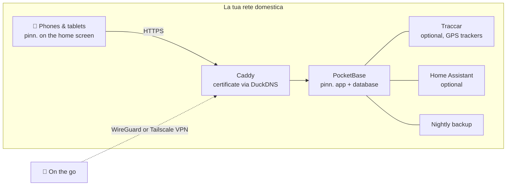

<p align="center">
  
</p>

<p align="center">
  <a href="https://github.com/pinn-shost/pinn/releases/latest"></a>
  <a href="LICENSE"></a>
  
  
  
  <a href="https://ko-fi.com/pinnapp"></a>
</p>

<p align="center">
  <a href="README.md">🇬🇧 English</a> ·
  <a href="README.de.md">🇩🇪 Deutsch</a> ·
  <a href="README.es.md">🇪🇸 Español</a> ·
  <a href="README.fr.md">🇫🇷 Français</a> ·
  <b>🇮🇹 Italiano</b> ·
  <a href="README.pt.md">🇧🇷 Português</a> ·
  <a href="README.zh.md">🇨🇳 中文</a> ·
  <a href="README.ja.md">🇯🇵 日本語</a> ·
  <a href="README.ko.md">🇰🇷 한국어</a> ·
  <a href="README.ru.md">🇷🇺 Русский</a> ·
  <a href="README.nl.md">🇳🇱 Nederlands</a> ·
  <a href="README.tr.md">🇹🇷 Türkçe</a> ·
  <a href="README.pl.md">🇵🇱 Polski</a> ·
  <a href="README.uk.md">🇺🇦 Українська</a>
</p>

<p align="center">
  <a href="#screenshots">Screenshot</a> ·
  <a href="#what-pinn-does">Funzioni</a> ·
  <a href="#installation">Installazione</a> ·
  <a href="#privacy">Privacy</a> ·
  <a href="#faq">FAQ</a>
</p>

---

pinn. è un’unica app per tutto ciò che fa funzionare una casa: il calendario condiviso, i pasti della settimana, la lista della spesa, chi porta fuori la spazzatura, la paghetta e l’assicurazione da disdire a marzo. Gira sul **tuo NAS** con Docker e si installa come un’app nativa su ogni iPhone, iPad e telefono Android della famiglia.

Nessun account cloud. Nessun abbonamento. Niente pubblicità, niente tracciamento. I dati della tua famiglia non lasciano mai casa tua.

<a id="screenshots"></a>

## Screenshot

### Su iPad

Appeso al muro o appoggiato sul tavolo della cucina: l’iPad condiviso mostra tutta la famiglia in un colpo solo.

<table>
  <tr>
    <td align="center" width="50%">
      <a href=".github/assets/screenshots/dashboard.png"></a><br>
      <sub><b>Dashboard</b> – ognuno tocca la propria foto, con PIN facoltativo</sub>
    </td>
    <td align="center" width="50%">
      <a href=".github/assets/screenshots/ipad-overview.png"></a><br>
      <sub><b>Panoramica</b> – meteo, appuntamenti, attività, pasti e famiglia in un colpo d’occhio</sub>
    </td>
  </tr>
</table>

### Sul telefono

Sempre con te: pinn. si installa su ogni iPhone e telefono Android come un’app nativa.

<table>
  <tr>
    <td align="center" width="33%"><a href=".github/assets/screenshots/home.png"></a><br><sub><b>Panoramica</b> – la tua giornata in un colpo d’occhio</sub></td>
    <td align="center" width="33%"><a href=".github/assets/screenshots/calendar.png"></a><br><sub><b>Calendario</b> – iCloud e Google in un’unica vista</sub></td>
    <td align="center" width="33%"><a href=".github/assets/screenshots/meals.png"></a><br><sub><b>Pasti</b> – pianifica la settimana, fai la spesa con un tocco</sub></td>
  </tr>
  <tr>
    <td align="center" width="33%"><a href=".github/assets/screenshots/lists.png"></a><br><sub><b>Liste</b> – spesa, dispensa, valigia</sub></td>
    <td align="center" width="33%"><a href=".github/assets/screenshots/finance.png"></a><br><sub><b>Finanze</b> – budget, risparmi, paghetta</sub></td>
    <td align="center" width="33%"><a href=".github/assets/screenshots/chat.png"></a><br><sub><b>Chat</b> – crittografata end-to-end, con messaggi vocali e posizione</sub></td>
  </tr>
</table>

### Altre schermate

Tocca un’immagine per aprirla a dimensione intera.

<details>
<summary><b>Mostra altri screenshot</b></summary>

<br>

<table>
  <tr>
    <td align="center" width="25%"><a href=".github/assets/screenshots/house.png"></a><br><sub><b>Casa</b> – casa, costi, mutuo, difetti e contatori in un unico posto</sub></td>
    <td align="center" width="25%"><a href=".github/assets/screenshots/tasks.png"></a><br><sub><b>Attività</b> – promemoria automatici, ad es. revisione e cambio gomme, con pulsante diretto</sub></td>
    <td align="center" width="25%"><a href=".github/assets/screenshots/vehicles.png"></a><br><sub><b>Veicoli</b> – revisione, gomme, rifornimento e ricarica</sub></td>
    <td align="center" width="25%"><a href=".github/assets/screenshots/scan_pantry.png"></a><br><sub><b>Scansione dispensa</b> – scansiona il codice a barre, riponi o consuma</sub></td>
  </tr>
  <tr>
    <td align="center" width="25%"><a href=".github/assets/screenshots/weekly_summary_1.png"></a><br><sub><b>Anteprima settimanale</b> – meteo e ciò che è ancora aperto</sub></td>
    <td align="center" width="25%"><a href=".github/assets/screenshots/weekly_summary_2.png"></a><br><sub><b>Anteprima settimanale</b> – giorno per giorno: pulizie, rifiuti, pagamenti</sub></td>
    <td align="center" width="25%"><a href=".github/assets/screenshots/weekly_summary_3.png"></a><br><sub><b>La settimana scorsa in breve</b> – appuntamenti, pasti, spese – e scorciatoie</sub></td>
    <td align="center" width="25%"><a href=".github/assets/screenshots/kids.png"></a><br><sub><b>Bambini</b> – una routine quotidiana giocosa</sub></td>
  </tr>
</table>

</details>

<sub>📁 <a href=".github/assets/screenshots">Tutte le immagini in una cartella</a></sub>

<a id="what-pinn-does"></a>

## Cosa fa pinn.

| | |
|---|---|
| 📅 **Calendario** | Calendari iCloud e Google per persona, privati o condivisi con la famiglia. Festività, vacanze scolastiche, date della raccolta rifiuti e compleanni dai tuoi contatti compaiono automaticamente. |
| 🍝 **Pasti e ricette** | Pianifica la settimana e invia gli ingredienti direttamente alla lista della spesa. Importa ricette da testo, PDF, foto o link, se vuoi con l’IA. Condividi le ricette preferite con altre famiglie sul tuo server. |
| 🛒 **Liste** | Liste della spesa per negozio, una dispensa che riempie la lista quando le scorte calano, liste valigia da modelli (vacanza, borsa per l’ospedale, festa), liste regalo e dei desideri con un pianificatore «chi regala cosa» che chi riceve non vede mai. |
| ✅ **Attività e casa** | Attività con promemoria push, piani di pulizia e bidoni – più una pagina per i bambini con routine animate che mostra solo ciò che si addice al momento della giornata. |
| 💶 **Finanze** | Casse comuni o private, un budget familiare, risparmi e depositi titoli con ETF e azioni, paghetta, pagamenti ricorrenti e contratti con promemoria di disdetta. Le coinquiline e i coinquilini possono dividere le spese e vedere chi deve cosa a chi. |
| 📄 **Documenti e veicoli** | Scontrini e garanzie, documenti d’identità con promemoria di scadenza. Auto e bici con scadenze di revisione, cambi gomme, consumi e costo totale. |
| 🏡 **Casa** | Per inquilini, proprietari e locatori: contratto di affitto o di acquisto, mutuo, difetti con foto, fatture, piano di ristrutturazione, letture dei contatori con previsione, chiavi ed entrate da affitti per appartamenti, case e garage che affitti. Giardino e piante con un piano di irrigazione che sa quando ha piovuto. |
| 📍 **Famiglia e posizione** | Condividi la tua posizione direttamente da pinn. – una volta o per un tempo scelto – e in background con l’app gratuita Traccar Client (invia direttamente a pinn., nessun server aggiuntivo). In più la modalità “sto tornando a casa”, un allarme SOS con posizione e numeri di emergenza, schede di emergenza e notifiche di arrivo per i luoghi. |
| 🎒 **Scuola e asilo** | Per ogni bambino: orario (scrivilo o fotografalo – l’IA lo compila), accompagnamento e ritiro, compiti nella pagina dei bambini, circolari per i genitori con scadenze che diventano promemoria e giorni di chiusura direttamente nel calendario. |
| 🐾 **Animali domestici** | Profili per cani, gatti, conigli e altri con orari dei pasti da spuntare, passeggiate, un turno “a chi tocca?”, vaccinazioni e sverminazioni con promemoria push, grafico del peso, veterinario e pronto soccorso veterinario, una scheda per il pet sitter da condividere, un manifesto “smarrito” da stampare e un promemoria per ricaricare il distributore di cibo. |
| 🌦️ **Meteo e vacanze** | Tocca il meteo (un riquadro sul telefono, in alto accanto a data e ora su iPad e computer) per vedere 14 giorni con i dettagli di ogni giorno. Le liste valigia con destinazione e date mostrano il meteo della vacanza – previsione o valori tipici – e suggeriscono cosa mettere in valigia. |
| 🏠 **Casa intelligente** | Avvia Comandi rapidi Apple o azioni di Home Assistant da un’attività – il robot aspirapolvere pulisce la cucina quando scade il turno, il robot tagliaerba e l’irrigazione seguono il piano del giardino, il distributore di cibo segnala quando sta per finire. |
| 🎙️ **Controllo vocale** | “Ehi Siri, pinn”: aggiungi alla lista della spesa, fattela leggere, crea attività e ascolta cosa c’è oggi – anche su Android. |
| 💬 **Chat** | Chat di famiglia e privata con crittografia end-to-end, push, spunte di lettura e risposte. |
| 🔔 **Notifiche** | Messaggi push personali su iPhone, iPad e Android, più una campanella che raccoglie ogni modifica in famiglia. |
| 🧩 **Tutto il resto** | Bacheca di famiglia con note spostabili, ricerca globale, modalità offline con sincronizzazione automatica, modalità scura, dashboard su iPad con PIN dei profili, account ospite, blocco bambini. |

pinn. parla **🇬🇧 English, 🇩🇪 Deutsch, 🇪🇸 Español, 🇫🇷 Français, 🇮🇹 Italiano, 🇧🇷 Português, 🇨🇳 中文, 🇯🇵 日本語, 🇰🇷 한국어, 🇷🇺 Русский, 🇳🇱 Nederlands, 🇹🇷 Türkçe, 🇵🇱 Polski e 🇺🇦 Українська**, adatta valuta e numeri di emergenza alla tua regione e passa dai termini **famiglia** a quelli di **casa condivisa**. Un server può ospitare più famiglie, ciascuna con i propri amministratori.

## Novità della 1.153.1

**Salute: cinque nuovi blocchi, «Io» nel tuo profilo**

- Novità nella pagina salute: **crema solare** (indice UV di oggi a casa, promemoria solo nei giorni di sole), **sonno** (promemoria prima di dormire, al mattino «Come hai dormito?»), **frutta e verdura** (porzioni al giorno), **controllo zecche** (aprile–ottobre) e **controlli** (dentista, check-up … con intervallo; per i bambini gli esami U tedeschi in base all'età). Per i bambini i promemoria arrivano anche ai genitori.
- Novità: nel tuo profilo pinn. mostra «Io» invece del tuo nome – filtro del calendario, attività, famiglia e ovunque, adattato nelle frasi. Inoltre: icona a linee per la freccia di ripristino, nuova icona del cerchione, lo stesso oro per i testi gialli in modalità scura.
- Modificato: `pb_hooks/pinn-gesundheit.js`, `js/gesundheit.js`, `css/gesundheit.css`, `js/mitglieder.js`, `js/symbole.js`, `css/dunkelfarbe.css`, `js/aufgaben.js`, `js/termine.js`, `js/listen.js`, `js/sparen.js`, `js/vertraege.js`, `js/familie.js`, `js/hinweise.js`, `js/kassen.js`, `js/zuhause.js`, `js/dokumente.js`, `js/fahrzeuge.js`, `js/ausblick.js`, `js/sterne.js`, `js/vorrat2.js`, `i18n/`, `js/sprachen.js`, `js/versionslog.js`, `index.html`.

## Novità della 1.153.0

**Sicurezza da Home Assistant**

- Novità: **Sicurezza** – gli admin della famiglia raggruppano i dispositivi di Home Assistant in Impostazioni → Sicurezza: finestre e porte, serrature, telecamere, garage e tapparelle, rilevatori di fumo e acqua, allarme, sensori di movimento. La dashboard di famiglia mostra una barra in basso (es. «Tutto chiuso», «Finestra cucina è aperto», «1 telecamera è accesa», in rosso in caso di allarme) e la panoramica riceve il riquadro «Sicurezza», dove gli adulti possono chiudere a chiave una serratura aperta (mai aprirla). **Controllo serale** facoltativo: all'ora scelta tutti gli admin ricevono una notifica se qualcosa è ancora aperto, non chiuso a chiave o se l'allarme è disinserito. Requisito: Home Assistant collegato in Impostazioni → Domotica.
- Corretto: in modalità scura i pulsanti sotto il titolo di un'attività (avvio domotica, lettura contatori …) erano blu su blu – ora sono dorati.
- Modificato: `pb_hooks/pinn-sicherheit.js` (new), `pb_hooks/sicherheit.pb.js` (new), `pb_hooks/pinn-smarthome.js`, `pb_hooks/pinn-schema.js`, `js/sicherheit.js` (new), `css/sicherheit.css` (new), `js/uebersicht.js`, `js/profilauswahl.js`, `js/einstellungen.js`, `css/dunkelfarbe.css`, `i18n/`, `js/sprachen.js`, `js/versionslog.js`, `pinn-setup.sh`, `src/`, `index.html`.

## Novità della 1.152.1

**Il ripristino dei backup funziona di nuovo**

- Corretto: il ripristino di un backup (Impostazioni → Sistema → Backup e aggiornamenti) si fermava sempre a «Controlla backup», sia con solo i dati sia con tutto. Il backup dello stato attuale fatto subito prima puliva i vecchi backup e sovrascriveva il nome del backup scelto, che poi non veniva trovato. Ogni tentativo fallito lasciava un backup «Prima di un ripristino»: sono innocui e vengono eliminati da soli (restano gli ultimi 3). L’aggiornamento rinnova `pinn-wartung.sh`; il container «wartung» si riavvia da solo.
- Stack Portainer: i backup ora funzionano davvero. Il servizio «wartung» dello stack non aveva nulla da avviare, perché nel repository mancava una parte della 1.151.0. Ora l’immagine contiene lo script dei backup, che trova da solo il container pinn dello stack: backup notturno, «Esegui backup ora» e «Ripristina» (dati e configurazione) funzionano come nell’installazione con script. Gli aggiornamenti restano in Portainer. Dopo: in Portainer «Update the stack» con «Re-pull image and redeploy».
- Modificato: `pinn-wartung.sh`, `docker/Dockerfile`, `.github/workflows/image.yml`, `pb_hooks/pinn-system.js`, `js/sicherungen.js`, `js/serverzugriff.js`, `i18n/`, `js/versionslog.js`, `js/sprachen.js`, `src/`, `index.html`.

## Novità della 1.152.0

**Un tuo reverse proxy al posto di Tailscale**

- Novità: accesso da Internet tramite un tuo reverse proxy (Nginx Proxy Manager, Traefik, Cloudflare Tunnel …) – vedi «Accesso da Internet con un tuo reverse proxy» in Installazione. pinn. crede all’indirizzo del visitatore solo da proxy fidati (`PINN_PROXY_NETZE`), così il blocco dopo password errate non si aggira (IPv6: per /64). Da Internet l’amministrazione di PocketBase e le sue vie di accesso sono bloccate, la password iniziale `Admin` non funziona e indovinare gli ID dei localizzatori viene rallentato. Per questi tentativi gli admin ricevono una notifica «🚨 Avviso di sicurezza» (indirizzo, rete di casa o Internet, dispositivo); tutti i dettagli sono nel registro errori sotto «Sicurezza». Nella rete di casa non cambia nulla.
- Modificato: `pb_hooks/pinn-netz.js` (new), `pb_hooks/netz.pb.js` (new), `pb_hooks/pinn-alarm.js` (new), `pb_hooks/pinn-sitzungen.js`, `pb_hooks/benutzer.pb.js`, `pb_hooks/dashboard.pb.js`, `pb_hooks/zuhause.pb.js`, `pb_hooks/sprache.pb.js`, `pb_hooks/smarthome.pb.js`, `pb_hooks/pinn-ortung.js`, `pb_hooks/pinn-protokoll.js`, `pb_hooks/pinn-pushtext.js`, `js/anmeldemaske.js`, `js/fehlerprotokoll.js`, `js/hinweise.js`, `js/appstart.js`, `i18n/`, `docker/docker-compose.portainer.yaml`, `env.txt`, `js/sprachen.js`, `js/versionslog.js`, `src/`, `index.html`.

## Novità della 1.151.0

**Stack di Portainer, immagine già pronta**

- Novità: pinn. si può installare dall’interfaccia degli stack di Portainer, senza SSH e senza lo script di installazione. A ogni versione viene creata un’immagine pronta (amd64, arm64) e pubblicata su `ghcr.io/pinn-shost/pinn`; il nuovo file `docker/docker-compose.portainer.yaml` la usa con volumi e senza nomi di container fissi (niente più conflitti con un container Tailscale esistente). Lo stack include anche un servizio di backup (backup notturno, «Salva ora» e «Ripristina» nell’app; gli aggiornamenti restano in Portainer) e blocchi facoltativi commentati per Traccar e la deviazione verso Home Assistant. Vedi «Stack di Portainer (senza script)» in Installazione.
- Modificato: `docker/` (new), `.github/workflows/image.yml` (new), `pinn-wartung.sh`, `pb_hooks/pinn-system.js`, `js/sicherungen.js`, `i18n/`, `js/sprachen.js`, `js/versionslog.js`, `src/`, `index.html`.

## Novità della 1.150.11

**Icone e piccole correzioni**

- Icona del pettine per «Pettinarsi» nella pagina dei bambini; niente più campo emoji accanto al nome del deposito; elenchi a discesa delle casse senza emoji; lo strumento ora è una chiave fissa; «Menu per gli ospiti» con l’icona di due persone; un tocco sul logo accanto al nome della famiglia porta alla panoramica; la scheda Notifiche viene riempita per prima, così «Attiva su questo dispositivo» compare sempre; icone dei collegamenti grigie in modalità scura.
- Modificato: `js/symbole.js`, `js/symbole3.js`, `js/ansichten.js`, `js/konto.js`, `css/dunkelfarbe.css`, `js/sprachen.js`, `js/versionslog.js`, `i18n/versionslog.en.js`, `src/`, `index.html`.

## Novità della 1.150.10

**Modalità scura, più icone, nuovo banner degli animali, diario degli animali**

- **Modalità scura.** Il testo blu ora è oro (dispositivi, liste, «Pianifica la spesa», spunte per animali, salute e compiti); le barre di Casa hanno il colore della stanza; avvisi della chat, dei contratti e «In primo piano» sono leggibili. **Più icone al posto delle emoji:** foto profilo (neonato, bambino, bambina, uomo, donna, nonno, nonna), famiglia e coinquilini, animali (cane, gatto, coniglio, criceto, uccello, pulcino, pesce, cavallo, tartaruga, serpente); i menu a tendina mostrano solo il testo. **Nuovo banner degli animali** con animali colorati. **Diario degli animali:** un controllo spuntato compare nel diario e con la × si annulla una spunta accidentale.
- Modificato: `css/dunkelfarbe.css` (new), `js/symbole3.js` (new), `js/symbole.js`, `js/szenen.js`, `js/familie.js`, `js/haushalt.js`, `css/symbolfarbe.css`, `css/haustierewetter.css`, `js/sprachen.js`, `js/versionslog.js`, `i18n/`, `src/`, `pinn-setup.sh`, `index.html`.

## Novità della 1.150.9

**Colore per le icone, icone di veicoli e piante**

- **Colore di giorno.** Le icone sono ora leggermente colorate (superfici bianche, sole giallo, pioggia blu, auto rossa, attrezzi grigi, piante verdi) nello stesso stile a linee; la modalità scura resta invariata. **Icone dei veicoli:** al posto dell’emoji dell’auto si sceglie un’icona a linee (berlina, SUV, taxi, furgone, pickup, trattore, roulotte, bicicletta, e-bike …). Anche le **icone delle piante** si scelgono nell’app, con nuove icone per cactus, palma, tulipano, girasole, rosa e altro. Nei banner di Veicoli e Casa le auto brillano solo di notte: giallastre davanti, rosse dietro.
- Modificato: `js/symbole2.js`, `css/symbolfarbe.css` (new), `js/symbole.js`, `js/wetterlogos.js`, `js/symbolwahl.js`, `js/fahrzeuge.js`, `js/zuhause.js`, `js/dokumente.js`, `css/fahrzeuge.css`, `js/sprachen.js`, `js/versionslog.js`, `i18n/`, `src/`, `pinn-setup.sh`, `index.html`.

## Novità della 1.150.8

**Icone ovunque, da scegliere nell’app**

- **Icone proprie ovunque.** Anche cibo, casa, veicoli, piante, abiti, giocattoli e sport hanno ora icone a linea proprie (stanze, tipi di rifiuti, tipi di veicolo, giardino, sveglia, selettore del calendario, conto alla rovescia). Le **icone delle categorie** in Finanze, Contratti, Documenti e Dispensa si scelgono tra circa 150 icone pronte invece che con la tastiera delle emoji, e lo stesso tipo di categoria ha ovunque la stessa icona. Le scene di Casa e Veicoli mostrano nuovi veicoli colorati. Dettagli: meteo «Adesso» senza bordo tratteggiato, carattere dell’orologio nel pannello, icona dell’elenco del piano pasti, icone sulla linea del testo.
- Modificato: `js/szenen.js`, `js/symbolwahl.js` (new), `js/symbole.js`, `css/wetterlogos.css`, `js/zustand.js`, `js/zuhause.js`, `js/fahrzeuge.js`, `js/gesundheit.js`, `js/finanzen.js`, `js/vertraege.js`, `js/dokumente.js`, `js/vorrat.js`, `js/vorrat2.js`, `js/einkauf.js`, `js/profilauswahl.js`, `js/sprachen.js`, `js/versionslog.js`, `i18n/`, `src/`, `pinn-setup.sh`, `index.html`.

## Novità della 1.150.7

**Icone meteo tutte nuove**

- **Icone meteo.** Le schermate del meteo hanno ora icone a linea semplici e proprie al posto delle emoji Apple, con lo stesso stile delle icone degli shortcut: sole, luna, nuvole, pioggia, neve, temporale, vento, UV, alba, acqua e i consigli sull’abbigliamento. Nella modalità scura cambiano colore.
- **Icone proprie ovunque.** Circa 150 icone a linea semplici sostituiscono ora le emoji Apple in tutta l’app (stelle, spunte, avvisi, luoghi, regali, orologio, calendario, lucchetto, posta, attrezzi, salute, casa, denaro e altro). Animali, cibo, abbigliamento, piante, veicoli, sport e giocattoli, le emoji che scegli o scrivi tu (immagini dei membri, testi della chat, campi di inserimento) e le notifiche push restano emoji.
- Modificato: `js/symbole.js` (new), `js/wetterlogos.js`, `css/wetterlogos.css` (new), `js/familie.js`, `js/grundlagen.js`, `js/profilauswahl.js`, `js/wetterkachel.js`, `js/sprachen.js`, `js/versionslog.js`, `i18n/`, `src/`, `pinn-setup.sh`, `index.html`.

## Novità della 1.150.6

**Face ID sblocca di nuovo da solo**

- **Face ID.** pinn. chiede di nuovo Face ID da solo all’apertura, come prima della 1.150.5. iOS mostra sempre prima la sua finestra «Usa passkey»: un tocco su di essa, poi Face ID; il web non può saltarla e il pulsante in più significava solo un secondo tocco. Il grande pulsante in basso resta, nel caso chiudessi la finestra.
- Modificato: `js/entsperren.js`, `js/sprachen.js`, `js/versionslog.js`, `i18n/`, `src/`, `index.html`.

## Novità della 1.150.5

**Nuovo banner salute · bevande in ordine**

- **Banner salute.** La pagina salute e quella di ogni persona hanno di nuovo un banner: acqua che sale con ciò che si è bevuto, bollicine, battito cardiaco e oggetti fluttuanti – di notte, stelle.
- **Bere.** Obiettivo, bevande di oggi e promemoria sono ora in una sezione richiudibile «Impostazioni» sotto il pulsante.
- **Face ID.** Lo sblocco parte solo con il pulsante (niente più finestra «Usa passkey»); il pulsante è in basso, a portata di pollice.
- Modificato: `js/gesundheit.js`, `css/gesundheit.css`, `js/entsperren.js`, `js/sprachen.js`, `js/versionslog.js`, `i18n/`, `src/`, `index.html`.

## Come funziona



Tutto gira come container Docker su un’unica macchina. HTTPS funziona **senza port forwarding** – il certificato viene emesso tramite un controllo DNS. Dall’esterno, pinn. è raggiungibile solo tramite la tua VPN.

## Requisiti

- Un NAS o server con **Docker** e **Docker Compose 2.17+** – sviluppato su un NAS UGREEN con UGOS, funziona su qualsiasi host Linux con Docker (amd64, arm64, armv7)
- Accesso SSH
- Facoltativo ma consigliato: un sottodominio gratuito [DuckDNS](https://www.duckdns.org) per HTTPS – necessario per le notifiche push e per installare pinn. come app

<a id="installation"></a>

## Installazione

1. Scarica lo ZIP dell’[ultima release](https://github.com/pinn-shost/pinn/releases/latest) e decomprimilo.
2. Crea una cartella sul NAS, ad es. `/volume1/docker/Pocketbase`, e copiaci dentro la cartella decompressa (ad es. `pinn-1.153.1` o `pinn-main`) così com’è.
3. Accedi via SSH ed esegui:
   ```sh
   cd /volume1/docker/Pocketbase && sudo sh pinn-*/pinn-setup.sh
   ```
   Lo script copia ogni file al suo posto, scarica le librerie per l’importazione dei PDF e il riconoscimento del testo nelle foto e avvia pinn.
4. Apri `http://<IP-NAS>:8090` → **Accedi come amministratore principale** → password `Admin` → scegli la tua password.
5. L’**assistente di configurazione** ti guida nel resto – HTTPS, accesso remoto con WireGuard o Tailscale, Google, IA, posizione e Home Assistant – passo dopo passo, in quattordici lingue.
6. Apri pinn. dal suo indirizzo HTTPS su ogni telefono e aggiungilo alla schermata Home:
   - **iPhone/iPad (Safari):** Condividi → *Aggiungi alla schermata Home* (iOS 16.4 o successivo per le notifiche)
   - **Android (Chrome):** Impostazioni → Notifiche → *Installa pinn. come app*, oppure menu di Chrome ⋮ → *Installa app*

   Poi attiva le notifiche su ogni dispositivo in **Impostazioni → Notifiche → Attiva su questo dispositivo**.

**Aggiornamento:** scarica il nuovo ZIP, metti la cartella decompressa nella stessa cartella ed esegui di nuovo `sudo sh pinn-*/pinn-setup.sh`. I file sostituiti restano in `_alt/`, i tuoi dati non vengono toccati.

I **backup** vengono eseguiti ogni notte in `./backups` e conservati per 14 giorni.

<a id="privacy"></a>

### Stack di Portainer (senza script)

Preferisci Portainer? Allora non servono né SSH né lo script di installazione:

1. In Portainer apri **Stacks → Add stack**, chiamalo `pinn` e scegli **Web editor**.
2. Incolla il contenuto di [`docker/docker-compose.portainer.yaml`](docker/docker-compose.portainer.yaml).
3. Facoltativo: in **Environment variables** cambia la porta (`PINN_PORT`, predefinita 8090) o fissa una versione (`PINN_IMAGE_TAG`, ad es. `1.151.0`). Clicca **Deploy the stack**.
4. Apri `http://<IP-del-NAS>:8090` → **Accedi come amministratore principale** → procedura guidata, come ai passaggi 4–6 sopra.

L’immagine arriva già pronta da `ghcr.io/pinn-shost/pinn` (amd64 e arm64). I dati stanno in volumi, non servono cartelle. Lo stack non usa nomi di container fissi, quindi non entra in conflitto con quelli che hai già. Se Tailscale gira già sul tuo NAS, elimina il blocco `tailscale`; con un indirizzo HTTPS o un reverse proxy tuo, elimina anche `caddy` e `duckdns`.

**Aggiornamento:** Stack → Editor → *Update the stack* con *Re-pull image and redeploy* attivo. **Backup:** il blocco `wartung` dello stack esegue un backup ogni notte (si conservano 7 giorni + 4 settimane) ed è dietro i pulsanti «Salva ora» e «Ripristina» in pinn. → Impostazioni → Sistema. I backup finiscono nel volume `backups` – o in una cartella del NAS se imposti `PINN_BACKUP_DIR` (ad es. `/volume1/docker/pinn-backups`). Per il ripristino ha bisogno dell’accesso a Docker per fermare brevemente pinn.; se salvi tu i volumi, elimina il blocco. Gli aggiornamenti si fanno in Portainer, non con un pulsante. Facoltativi, commentati a fine file (togli il `#` per attivarli): Traccar (localizzatori GPS con SIM) e la deviazione verso Home Assistant – i telefoni non ne hanno bisogno.

### Accesso da Internet con un tuo reverse proxy

La tua famiglia non vuole usare Tailscale? Allora metti pinn. dietro un reverse proxy: riceve le richieste da Internet, fornisce l’HTTPS per il tuo dominio e le passa a pinn.

1. Fai puntare il proxy a `http://<NAS-IP>:8090` (stack Portainer: la porta `PINN_PORT`). Gli aggiornamenti in tempo reale usano il normale HTTP – non servono websocket, basta lasciare disattivato il buffering delle risposte. Consenti caricamenti fino a 70 MB (video della chat).
   - **Nginx Proxy Manager:** *Hosts → Proxy Hosts → Add*: il tuo dominio, schema `http`, IP del NAS, porta `8090`; scheda *SSL*: nuovo certificato, *Force SSL* attivo.
   - **Cloudflare Tunnel:** nessun port forwarding – *Public hostname* → servizio `http://<NAS-IP>:8090`.
   - **Traefik, Caddy e altri:** un router/sito per il tuo dominio che inoltra a `http://<NAS-IP>:8090`.
2. Su ogni telefono apri `https://<domain>`, accedi, aggiungilo di nuovo alla schermata Home e riattiva le notifiche (l’app appartiene al suo indirizzo).
3. Calendari Google (facoltativo): aggiungi `https://<domain>/api/pinn/google/callback` come URI di reindirizzamento autorizzato nella console Google Cloud.

Cosa fa pinn. da solo: crede all’indirizzo del visitatore passato dal proxy (`X-Forwarded-For`) solo se la richiesta arriva dalla rete di casa, da una rete Docker o da Tailscale – così il blocco dopo password errate non si può aggirare. Da Internet l’amministrazione di PocketBase (`/_/`) è bloccata e la password iniziale `Admin` non funziona. Il tuo proxy è altrove (server a noleggio o nuvola arancione di Cloudflare davanti al proxy)? Allora imposta `PINN_PROXY_NETZE` (in `.env` o nelle variabili d’ambiente dello stack), ad es. `privat, cloudflare` o `privat, 203.0.113.5`.

**Importante:** pinn. è allora raggiungibile da tutta Internet. Dai a ogni profilo una password lunga e propria, tieni aggiornato il proxy e non aprire mai la porta 8090 direttamente nel router – sempre tramite il proxy con HTTPS.

## Privacy

pinn. è stato creato per dati che non daresti mai a un servizio cloud: estratti conto, documenti sanitari, dove si trovano i tuoi figli. Per questo:

- **Tutti i dati restano sul tuo NAS** in un unico database PocketBase. Non esiste alcun server pinn. e non c’è telemetria.
- **Nessuno script da server di terzi.** Tutto il codice e tutte le librerie sono serviti dal tuo NAS.
- **Le notifiche push non contengono contenuti.** Apple, Google e Mozilla consegnano solo un segnale di risveglio vuoto; poi il dispositivo recupera il messaggio dal tuo NAS.
- **Le password di iCloud e Google** sono memorizzate cifrate in una raccolta protetta.
- **Non raggiungibile da Internet.** L’accesso remoto passa dalla tua VPN.

pinn. contatta servizi esterni solo per le funzioni che ne hanno bisogno:

| Servizio | Usato per | Quando |
|---|---|---|
| [Open-Meteo](https://open-meteo.com) | Previsioni meteo | quando è impostato un indirizzo di casa |
| [OpenStreetMap Nominatim](https://nominatim.openstreetmap.org) | Trasformare indirizzi in posizioni sulla mappa | quando si inseriscono indirizzi |
| [Tessere OpenStreetMap](https://www.openstreetmap.org) | Sfondo della mappa | nella pagina della posizione, caricate tramite il tuo NAS |
| [Google Fonts](https://fonts.google.com) | Caratteri tipografici | al caricamento dell’app |
| [OpenHolidays API](https://www.openholidaysapi.org) | Festività e vacanze scolastiche | quando è impostato un indirizzo di casa |
| [DuckDNS](https://www.duckdns.org) | Certificato HTTPS e indirizzo | se configurato |
| iCloud / Google | Calendari e contatti | solo per gli account che colleghi |
| Google Gemini | Lettura di ricette e documenti | solo se aggiungi una chiave API |
| jsDelivr | Download una tantum di pdf.js e Tesseract | solo durante l’installazione |

<a id="faq"></a>

## FAQ

<details>
<summary><b>Devo aprire porte sul router?</b></summary>
<br>
No. Il certificato HTTPS viene emesso tramite un controllo DNS e l’accesso remoto passa da una VPN – WireGuard su una FRITZ!Box oppure Tailscale per qualsiasi altro router.
</details>

<details>
<summary><b>Funziona senza NAS?</b></summary>
<br>
Va bene qualsiasi macchina sempre accesa con Docker: un mini PC, un Raspberry Pi 4/5 o un server Linux.
</details>

<details>
<summary><b>pinn. è una “vera” app dell’App Store?</b></summary>
<br>
pinn. è una web app che aggiungi alla schermata Home. Poi si apre a schermo intero come un’app nativa, funziona offline, mostra un badge con le attività aperte e riceve notifiche push – senza alcuno store.
</details>

<details>
<summary><b>Più famiglie possono usare un’unica installazione?</b></summary>
<br>
Sì. L’amministratore principale crea le famiglie; ogni famiglia ha i propri amministratori, calendari e dati. Le ricette possono essere condivise facoltativamente tra famiglie.
</details>

<details>
<summary><b>E i bambini?</b></summary>
<br>
I profili con blocco bambini vedono solo le proprie attività e non possono eliminare né modificare nulla. Finanze, documenti e veicoli restano nascosti. I bambini più piccoli hanno una pagina giocosa con le routine quotidiane.
</details>

<details>
<summary><b>Quanto costa?</b></summary>
<br>
Niente – pinn. è gratuito e open source con licenza MIT. I servizi facoltativi come l’IA Gemini hanno piani gratuiti.
</details>

## Struttura del repository

Il repository ha la stessa struttura di un’installazione sul NAS – ogni file si trova dove finirà:

```
pinn/
├── pb_hooks/            server: *.pb.js hooks and their helper modules (pinn-*.js, calendar-sync.js)
├── pb_public/           web app served by PocketBase
│   ├── index.html       the app page, built from src/ (HTML, start check) – do not edit by hand
│   ├── js/              app code split out of index.html, plain <script> files without a build step
│   │                    (ruhemodus.js, textkern.js, sprachen.js, region.js, grundlagen.js, popups.js, verbindung.js, benutzer.js, mitteilungen.js, serverzugriff.js, tastatur.js, anmeldemaske.js, dashboard.js, dashboardhintergrund.js, profilauswahl.js, pineingabe.js, dashboardsitzung.js, dashboardkonto.js, familienverwalten.js, einrichten.js, exportieren.js, hauptadminseite.js, anmeldung.js, konto.js, profilverwaltung.js, zustand.js, bedienzustand.js, rezeptbilder.js, zusammenfuehren.js, speichern.js, design.js, sprache.js, uebersicht.js, familienkachel.js, wobistdu.js, geburtstagsfeier.js, wetterkachel.js, geburtstage.js, uebersichteinstellungen.js, familiensync.js, bereiche.js, kalenderquellen.js, icsparser.js, zeitleiste.js, termindetails.js, kalenderdatei.js, wetter.js, wohnort.js, feiertage.js, muellkalender.js, mitglieder.js, profilbild.js, mitglied.js, kinderseite.js, kinderroutine.js, sterne.js, kalenderansicht.js, essenplanen.js, rezeptparser.js, rezeptdialog.js, rezeptbild.js, rezeptmengen.js, einkauf.js, einkaufslisten.js, einkaufseingabe.js, rezepte.js, offline.js, aufgabenextras.js, appbadge.js, reisen.js, aufgabendaten.js, haushalt.js, reihum.js, aufgaben.js, smarthome.js, sprachsteuerung.js, termine.js, ansichten.js, versionspruefung.js, sicherungen.js, geraete.js, fehlerprotokoll.js, versionslog.js, einstellungen.js, kalenderkonto.js, finanzen.js, kassen.js, vorrat.js, vorrat2.js, sparen.js, vertraege.js, fahrzeuge.js, zuhause.js, dokumente.js, pdflesen.js, appstart.js, pinnwand.js, listen.js, familie.js, hinweise.js, ausblick.js – ausblick.js always comes last)
│   ├── css/             app styles split out of index.html, plain CSS without a build step (ergaenzung.css, energiesparen.css, basis.css … haustierewetter.css, terminal.css, glocke.css)
│   ├── einrichtung.js   setup assistant · datenexport.js  data export
│   ├── i18n/            texts by key (de, en, fr, es, it, pt, zh, ja, ko) – English is the reference
│   └── vendor/          pinn.css, pocketbase/ (pdf.js and Tesseract are downloaded by the setup)
├── .github/             GitHub Actions (workflows/check.yml), checks (scripts/), CONTRIBUTING.md, SECURITY.md, images – not installed
├── src/                 sources of index.html (build.js, rahmen.html, teile/) – not installed
├── caddy/Caddyfile      HTTPS reverse proxy
├── docker-compose.yaml  all containers
├── env.txt              template for .env
├── pinn-setup.sh        install & update
├── pinn-wartung.sh      backups & updates (container "wartung")
├── pinn-pocketbase-update.sh
├── index.html           placeholder only, never installed (keeps the update button of 1.38 working)
└── README.md            this page · README.<code>.md in de, es, fr, it, pt, zh, ja, ko
```

`pinn-setup.sh` copia `pb_hooks/`, `pb_public/` e `caddy/Caddyfile` 1:1 nella cartella del progetto; le cartelle dei dati (`pb_data/`, `konfig/`, `backups/`, `caddy/data/` …) non vengono mai toccate.

## Contribuire

Segnalazioni di errori, idee e traduzioni sono molto benvenute – vedi [CONTRIBUTING.md](.github/CONTRIBUTING.md). Segnala le vulnerabilità di sicurezza in privato, come descritto in [SECURITY.md](.github/SECURITY.md). Prima di una pull request esegui `node .github/scripts/check-all.js` – gli stessi controlli girano automaticamente su GitHub.

## Sostieni pinn.

pinn. è gratuito e resta gratuito – completamente, per tutti. Nasce nel mio tempo libero. Se ti rende un po’ più facile la vita di tutti i giorni, un piccolo contributo è benvenuto, ma del tutto volontario:

<p>
  <a href="https://ko-fi.com/pinnapp"></a>
  <a href="https://buymeacoffee.com/pinn"></a>
</p>

Anche una ⭐ aiuta – rende pinn. più facile da trovare per altre famiglie.

## Realizzato con

[PocketBase](https://pocketbase.io) (MIT) · [Tailwind CSS](https://tailwindcss.com) (MIT) · [pdf.js](https://mozilla.github.io/pdf.js/) (Apache-2.0) · [Tesseract.js](https://tesseract.projectnaptha.com) (Apache-2.0) · [Traccar](https://www.traccar.org) (Apache-2.0) · [Caddy](https://caddyserver.com) (Apache-2.0)

## Licenza

[MIT](LICENSE) – usalo, modificalo, condividilo.
