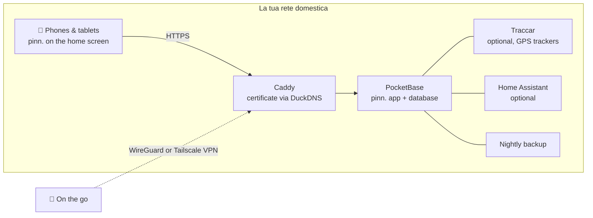

<p align="center">
  
</p>

<p align="center">
  <a href="https://github.com/pinn-shost/pinn/releases/latest"></a>
  <a href="LICENSE"></a>
  
  
  
  <a href="https://ko-fi.com/pinnapp"></a>
</p>

<p align="center">
  <a href="README.md">🇬🇧 English</a> ·
  <a href="README.de.md">🇩🇪 Deutsch</a> ·
  <a href="README.es.md">🇪🇸 Español</a> ·
  <a href="README.fr.md">🇫🇷 Français</a> ·
  <b>🇮🇹 Italiano</b> ·
  <a href="README.pt.md">🇧🇷 Português</a> ·
  <a href="README.zh.md">🇨🇳 中文</a> ·
  <a href="README.ja.md">🇯🇵 日本語</a> ·
  <a href="README.ko.md">🇰🇷 한국어</a>
</p>

<p align="center">
  <a href="#screenshots">Screenshot</a> ·
  <a href="#what-pinn-does">Funzioni</a> ·
  <a href="#installation">Installazione</a> ·
  <a href="#privacy">Privacy</a> ·
  <a href="#faq">FAQ</a>
</p>

---

pinn. è un’unica app per tutto ciò che fa funzionare una casa: il calendario condiviso, i pasti della settimana, la lista della spesa, chi porta fuori la spazzatura, la paghetta e l’assicurazione da disdire a marzo. Gira sul **tuo NAS** con Docker e si installa come un’app nativa su ogni iPhone, iPad e telefono Android della famiglia.

Nessun account cloud. Nessun abbonamento. Niente pubblicità, niente tracciamento. I dati della tua famiglia non lasciano mai casa tua.

<a id="screenshots"></a>

## Screenshot

### Su iPad

Appeso al muro o appoggiato sul tavolo della cucina: l’iPad condiviso mostra tutta la famiglia in un colpo solo.

<table>
  <tr>
    <td align="center" width="50%">
      <br>
      <sub><b>Dashboard</b> – ognuno tocca la propria foto, con PIN facoltativo</sub>
    </td>
    <td align="center" width="50%">
      <br>
      <sub><b>Panoramica</b> – meteo, appuntamenti, attività, pasti e famiglia in un colpo d’occhio</sub>
    </td>
  </tr>
</table>

### Sul telefono

Sempre con te: pinn. si installa su ogni iPhone e telefono Android come un’app nativa.

<table>
  <tr>
    <td align="center" width="33%"><br><sub><b>Panoramica</b> – la tua giornata in un colpo d’occhio</sub></td>
    <td align="center" width="33%"><br><sub><b>Calendario</b> – iCloud e Google in un’unica vista</sub></td>
    <td align="center" width="33%"><br><sub><b>Pasti</b> – pianifica la settimana, fai la spesa con un tocco</sub></td>
  </tr>
  <tr>
    <td align="center" width="33%"><br><sub><b>Liste</b> – spesa, dispensa, valigia</sub></td>
    <td align="center" width="33%"><br><sub><b>Finanze</b> – budget, risparmi, paghetta</sub></td>
    <td align="center" width="33%"><br><sub><b>Bambini</b> – una routine quotidiana giocosa</sub></td>
  </tr>
</table>

<a id="what-pinn-does"></a>

## Cosa fa pinn.

| | |
|---|---|
| 📅 **Calendario** | Calendari iCloud e Google per persona, privati o condivisi con la famiglia. Festività, vacanze scolastiche, date della raccolta rifiuti e compleanni dai tuoi contatti compaiono automaticamente. |
| 🍝 **Pasti e ricette** | Pianifica la settimana e invia gli ingredienti direttamente alla lista della spesa. Importa ricette da testo, PDF, foto o link, se vuoi con l’IA. Condividi le ricette preferite con altre famiglie sul tuo server. |
| 🛒 **Liste** | Liste della spesa per negozio, una dispensa che riempie la lista quando le scorte calano, liste valigia da modelli (vacanza, borsa per l’ospedale, festa), liste regalo e dei desideri. |
| ✅ **Attività e casa** | Attività con promemoria push, piani di pulizia e bidoni – più una pagina per i bambini con routine animate che mostra solo ciò che si addice al momento della giornata. |
| 💶 **Finanze** | Casse comuni o private, un budget familiare, risparmi e depositi titoli con ETF e azioni, paghetta, pagamenti ricorrenti e contratti con promemoria di disdetta. Le coinquiline e i coinquilini possono dividere le spese e vedere chi deve cosa a chi. |
| 📄 **Documenti e veicoli** | Scontrini e garanzie, documenti d’identità con promemoria di scadenza. Auto e bici con scadenze di revisione, cambi gomme, consumi e costo totale. |
| 🏡 **Casa** | Per inquilini, proprietari e locatori: contratto di affitto o di acquisto, mutuo, difetti con foto, fatture, piano di ristrutturazione, letture dei contatori con previsione, chiavi ed entrate da affitti per appartamenti, case e garage che affitti. Giardino e piante con un piano di irrigazione che sa quando ha piovuto. |
| 📍 **Famiglia e posizione** | Condividi la tua posizione direttamente da pinn. – una volta o per un tempo scelto – e in background con l’app gratuita Traccar Client (invia direttamente a pinn., nessun server aggiuntivo). In più la modalità “sto tornando a casa”, un allarme SOS con posizione e numeri di emergenza, schede di emergenza e notifiche di arrivo per i luoghi. |
| 🎒 **Scuola e asilo** | Per ogni bambino: orario (scrivilo o fotografalo – l’IA lo compila), accompagnamento e ritiro, compiti nella pagina dei bambini, circolari per i genitori con scadenze che diventano promemoria e giorni di chiusura direttamente nel calendario. |
| 🐾 **Animali domestici** | Profili per cani, gatti, conigli e altri con orari dei pasti da spuntare, passeggiate, un turno “a chi tocca?”, vaccinazioni e sverminazioni con promemoria push, grafico del peso, veterinario e pronto soccorso veterinario, una scheda per il pet sitter da condividere, un manifesto “smarrito” da stampare e un promemoria per ricaricare il distributore di cibo. |
| 🌦️ **Meteo e vacanze** | Tocca il meteo (un riquadro sul telefono, in alto accanto a data e ora su iPad e computer) per vedere 14 giorni con i dettagli di ogni giorno. Le liste valigia con destinazione e date mostrano il meteo della vacanza – previsione o valori tipici – e suggeriscono cosa mettere in valigia. |
| 🏠 **Casa intelligente** | Avvia Comandi rapidi Apple o azioni di Home Assistant da un’attività – il robot aspirapolvere pulisce la cucina quando scade il turno, il robot tagliaerba e l’irrigazione seguono il piano del giardino, il distributore di cibo segnala quando sta per finire. |
| 🎙️ **Controllo vocale** | “Ehi Siri, pinn”: aggiungi alla lista della spesa, fattela leggere, crea attività e ascolta cosa c’è oggi – anche su Android. |
| 🔔 **Notifiche** | Messaggi push personali su iPhone, iPad e Android, più una campanella che raccoglie ogni modifica in famiglia. |
| 🧩 **Tutto il resto** | Bacheca di famiglia con note spostabili, ricerca globale, modalità offline con sincronizzazione automatica, modalità scura, dashboard su iPad con PIN dei profili, account ospite, blocco bambini. |

pinn. parla **🇬🇧 English, 🇩🇪 Deutsch, 🇪🇸 Español, 🇫🇷 Français, 🇮🇹 Italiano, 🇧🇷 Português, 🇨🇳 中文, 🇯🇵 日本語 e 🇰🇷 한국어**, adatta valuta e numeri di emergenza alla tua regione e passa dai termini **famiglia** a quelli di **casa condivisa**. Un server può ospitare più famiglie, ciascuna con i propri amministratori.

## Novità della 1.120.2

**Russo – terza tappa**

- Tradotti in russo: il calendario (eventi, aggiunta di calendari, iCloud/Google), le attività, la casa con i turni, il piano dei pasti, la panoramica con i suoi riquadri, meteo e meteo delle vacanze, festività e vacanze scolastiche, la ricerca e le foto profilo – ora 1545 testi su 6714.
- Il russo resta **nascosto** finché non è tutto tradotto (attivabile su un dispositivo come descritto per la 1.120.0).
- Prossimamente: altre tappe del russo (liste, dispensa, ricette …).
- Modificati: `index.html`, `js/sprachen.js`, `js/versionslog.js`, `i18n/ru.i18n.js`, `i18n/versionslog.en.js` – sul server non cambia nulla. Installazione come sempre (`sudo sh pinn-*/pinn-setup.sh` o pulsante di aggiornamento).

## Novità della 1.120.1

**Russo – seconda tappa**

- Tradotti in russo: l’account (password, PIN, profili, ospiti, notifiche, dashboard di famiglia), dispositivi e accesso, il registro errori e backup e aggiornamenti – ora 874 testi su 6714, sempre con le tre forme plurali e i termini della casa condivisa.
- Il russo resta **nascosto** finché non è tutto tradotto (attivabile su un dispositivo come descritto per la 1.120.0).
- Prossimamente: altre tappe del russo (calendario, attività, casa …).
- Modificati: `index.html`, `js/sprachen.js`, `js/versionslog.js`, `i18n/ru.i18n.js`, `i18n/versionslog.en.js` – sul server non cambia nulla. Installazione come sempre (`sudo sh pinn-*/pinn-setup.sh` o pulsante di aggiornamento).

## Novità della 1.120.0

**Russo – prima tappa**

- pinn. viene tradotto in **russo** passo dopo passo. La prima tappa comprende accesso, dashboard, menu, pagina dell’amministratore principale e tutte le impostazioni, oltre all’assistente di configurazione completo e all’esportazione dei dati – circa 500 testi, con le tre forme plurali del russo e i termini della casa condivisa.
- Il russo resta **nascosto** finché non è tutto tradotto. Per provarlo su un dispositivo, digita `localStorage.setItem('pinn.sprachen.alle', '1')` nella console del browser e scegli Русский; i testi non ancora tradotti compaiono in inglese.
- Server: la configurazione ora accetta anche il russo come lingua (`pb_hooks/pinn-einrichtung.js`).
- Prossimamente: altre tappe del russo (calendario, attività, casa …).
- Modificati: `index.html`, `js/sprachen.js`, `js/einrichten.js`, `js/exportieren.js`, `js/versionslog.js`, `einrichtung.js`, `datenexport.js`, `i18n/ru.i18n.js` (nuovo), `i18n/versionslog.en.js`, `pb_hooks/pinn-einrichtung.js`, `.github/`. Installazione come sempre (`sudo sh pinn-*/pinn-setup.sh` o pulsante di aggiornamento).

## Novità della 1.119.3

**Pulizia: il vecchio traduttore non c’è più**

- Tutti i testi di pinn. arrivano ora direttamente dai file di lingua in `i18n/`. I vecchi dizionari (cartella `pb_public/lang/`, circa 4 MB) e il traduttore che riscriveva lo schermo durante l’uso sono stati rimossi: pinn. si avvia più velocemente e usa meno memoria, soprattutto su telefoni e tablet meno recenti.
- L’aggiornamento sposta i vecchi file in `_alt/<data>/` sul NAS (nulla viene cancellato) e rimuove la cartella vuota `lang/`.
- Piccole cose: data e ora nella schermata iniziale, nella dashboard, nella vista settimanale, in Finanze e in «Casa» sono subito nel formato della tua lingua; «Salvato» nelle impostazioni della panoramica è tradotto; in una casa condivisa menu, riquadro della panoramica e impostazioni mostrano l’icona 🧑‍🤝‍🧑; i testi scritti da te (ad es. un biglietto «Hallo Familie» sulla bacheca) non vengono più modificati in una casa condivisa.
- Prossimamente: il russo, passo dopo passo (nascosto finché non è completo).
- Modificato: `index.html`, `js/sprachen.js`, `js/zustand.js`, `js/uebersicht.js`, `js/familie.js`, `js/listen.js`, `js/sterne.js`, `js/ausblick.js`, `js/grundlagen.js`, `js/profilauswahl.js`, `js/wohnort.js`, `js/finanzen.js`, `js/einstellungen.js`, `js/smarthome.js`, `js/versionslog.js`, `i18n/versionslog.en.js`, `pinn-setup.sh`, `.github/` – rimosso: `pb_public/lang/` – sul server non cambia nulla. Installare come al solito (`sudo sh pinn-*/pinn-setup.sh` o pulsante di aggiornamento).

## Novità della 1.119.2

**Scanner della dispensa: foto invece della fotocamera dal vivo**

- Se pinn. viene aperto tramite `http://…` invece del suo indirizzo HTTPS, i browser non concedono la fotocamera dal vivo – su iPhone e iPad mai. Prima lo scanner mostrava un’immagine nera; ora spiega che la fotocamera dal vivo richiede l’indirizzo HTTPS e offre **📷 Fotografa il codice a barre**: scatta una foto e pinn. legge il codice. Funziona anche se la fotocamera è bloccata o non si avvia.
- Prossimamente: 1.119.3 rimuove il vecchio traduttore e `lang/`.
- Modificato: `index.html`, `js/vorrat2.js`, `js/sprachen.js`, `js/versionslog.js`, `i18n/versionslog.en.js`, tutti i file di lingua in `i18n/`, per chi contribuisce `.github/scripts/check-keys.js` – sul server non cambia nulla.

## Come funziona



Tutto gira come container Docker su un’unica macchina. HTTPS funziona **senza port forwarding** – il certificato viene emesso tramite un controllo DNS. Dall’esterno, pinn. è raggiungibile solo tramite la tua VPN.

## Requisiti

- Un NAS o server con **Docker** e **Docker Compose 2.17+** – sviluppato su un NAS UGREEN con UGOS, funziona su qualsiasi host Linux con Docker (amd64, arm64, armv7)
- Accesso SSH
- Facoltativo ma consigliato: un sottodominio gratuito [DuckDNS](https://www.duckdns.org) per HTTPS – necessario per le notifiche push e per installare pinn. come app

<a id="installation"></a>

## Installazione

1. Scarica lo ZIP dell’[ultima release](https://github.com/pinn-shost/pinn/releases/latest) e decomprimilo.
2. Crea una cartella sul NAS, ad es. `/volume1/docker/Pocketbase`, e copiaci dentro la cartella decompressa (ad es. `pinn-1.120.2` o `pinn-main`) così com’è.
3. Accedi via SSH ed esegui:
   ```sh
   cd /volume1/docker/Pocketbase && sudo sh pinn-*/pinn-setup.sh
   ```
   Lo script copia ogni file al suo posto, scarica le librerie per l’importazione dei PDF e il riconoscimento del testo nelle foto e avvia pinn.
4. Apri `http://<IP-NAS>:8090` → **Accedi come amministratore principale** → password `Admin` → scegli la tua password.
5. L’**assistente di configurazione** ti guida nel resto – HTTPS, accesso remoto con WireGuard o Tailscale, Google, IA, posizione e Home Assistant – passo dopo passo, in nove lingue.
6. Apri pinn. dal suo indirizzo HTTPS su ogni telefono e aggiungilo alla schermata Home:
   - **iPhone/iPad (Safari):** Condividi → *Aggiungi alla schermata Home* (iOS 16.4 o successivo per le notifiche)
   - **Android (Chrome):** Impostazioni → Notifiche → *Installa pinn. come app*, oppure menu di Chrome ⋮ → *Installa app*

   Poi attiva le notifiche su ogni dispositivo in **Impostazioni → Notifiche → Attiva su questo dispositivo**.

**Aggiornamento:** scarica il nuovo ZIP, metti la cartella decompressa nella stessa cartella ed esegui di nuovo `sudo sh pinn-*/pinn-setup.sh`. I file sostituiti restano in `_alt/`, i tuoi dati non vengono toccati.

I **backup** vengono eseguiti ogni notte in `./backups` e conservati per 14 giorni.

<a id="privacy"></a>

## Privacy

pinn. è stato creato per dati che non daresti mai a un servizio cloud: estratti conto, documenti sanitari, dove si trovano i tuoi figli. Per questo:

- **Tutti i dati restano sul tuo NAS** in un unico database PocketBase. Non esiste alcun server pinn. e non c’è telemetria.
- **Nessuno script da server di terzi.** Tutto il codice e tutte le librerie sono serviti dal tuo NAS.
- **Le notifiche push non contengono contenuti.** Apple, Google e Mozilla consegnano solo un segnale di risveglio vuoto; poi il dispositivo recupera il messaggio dal tuo NAS.
- **Le password di iCloud e Google** sono memorizzate cifrate in una raccolta protetta.
- **Non raggiungibile da Internet.** L’accesso remoto passa dalla tua VPN.

pinn. contatta servizi esterni solo per le funzioni che ne hanno bisogno:

| Servizio | Usato per | Quando |
|---|---|---|
| [Open-Meteo](https://open-meteo.com) | Previsioni meteo | quando è impostato un indirizzo di casa |
| [OpenStreetMap Nominatim](https://nominatim.openstreetmap.org) | Trasformare indirizzi in posizioni sulla mappa | quando si inseriscono indirizzi |
| [Tessere OpenStreetMap](https://www.openstreetmap.org) | Sfondo della mappa | nella pagina della posizione, caricate tramite il tuo NAS |
| [Google Fonts](https://fonts.google.com) | Caratteri tipografici | al caricamento dell’app |
| [OpenHolidays API](https://www.openholidaysapi.org) | Festività e vacanze scolastiche | quando è impostato un indirizzo di casa |
| [DuckDNS](https://www.duckdns.org) | Certificato HTTPS e indirizzo | se configurato |
| iCloud / Google | Calendari e contatti | solo per gli account che colleghi |
| Google Gemini | Lettura di ricette e documenti | solo se aggiungi una chiave API |
| jsDelivr | Download una tantum di pdf.js e Tesseract | solo durante l’installazione |

<a id="faq"></a>

## FAQ

<details>
<summary><b>Devo aprire porte sul router?</b></summary>
<br>
No. Il certificato HTTPS viene emesso tramite un controllo DNS e l’accesso remoto passa da una VPN – WireGuard su una FRITZ!Box oppure Tailscale per qualsiasi altro router.
</details>

<details>
<summary><b>Funziona senza NAS?</b></summary>
<br>
Va bene qualsiasi macchina sempre accesa con Docker: un mini PC, un Raspberry Pi 4/5 o un server Linux.
</details>

<details>
<summary><b>pinn. è una “vera” app dell’App Store?</b></summary>
<br>
pinn. è una web app che aggiungi alla schermata Home. Poi si apre a schermo intero come un’app nativa, funziona offline, mostra un badge con le attività aperte e riceve notifiche push – senza alcuno store.
</details>

<details>
<summary><b>Più famiglie possono usare un’unica installazione?</b></summary>
<br>
Sì. L’amministratore principale crea le famiglie; ogni famiglia ha i propri amministratori, calendari e dati. Le ricette possono essere condivise facoltativamente tra famiglie.
</details>

<details>
<summary><b>E i bambini?</b></summary>
<br>
I profili con blocco bambini vedono solo le proprie attività e non possono eliminare né modificare nulla. Finanze, documenti e veicoli restano nascosti. I bambini più piccoli hanno una pagina giocosa con le routine quotidiane.
</details>

<details>
<summary><b>Quanto costa?</b></summary>
<br>
Niente – pinn. è gratuito e open source con licenza MIT. I servizi facoltativi come l’IA Gemini hanno piani gratuiti.
</details>

## Struttura del repository

Il repository ha la stessa struttura di un’installazione sul NAS – ogni file si trova dove finirà:

```
pinn/
├── pb_hooks/            server: *.pb.js hooks and their helper modules (pinn-*.js, calendar-sync.js)
├── pb_public/           web app served by PocketBase
│   ├── index.html       the app page, built from src/ (HTML, start check) – do not edit by hand
│   ├── js/              app code split out of index.html, plain <script> files without a build step
│   │                    (ruhemodus.js, textkern.js, sprachen.js, region.js, grundlagen.js, popups.js, verbindung.js, benutzer.js, mitteilungen.js, serverzugriff.js, tastatur.js, anmeldemaske.js, dashboard.js, dashboardhintergrund.js, profilauswahl.js, pineingabe.js, dashboardsitzung.js, dashboardkonto.js, familienverwalten.js, einrichten.js, exportieren.js, hauptadminseite.js, anmeldung.js, konto.js, profilverwaltung.js, zustand.js, bedienzustand.js, rezeptbilder.js, zusammenfuehren.js, speichern.js, design.js, sprache.js, uebersicht.js, familienkachel.js, wobistdu.js, geburtstagsfeier.js, wetterkachel.js, geburtstage.js, uebersichteinstellungen.js, familiensync.js, bereiche.js, kalenderquellen.js, icsparser.js, zeitleiste.js, termindetails.js, kalenderdatei.js, wetter.js, wohnort.js, feiertage.js, muellkalender.js, mitglieder.js, profilbild.js, mitglied.js, kinderseite.js, kinderroutine.js, sterne.js, kalenderansicht.js, essenplanen.js, rezeptparser.js, rezeptdialog.js, rezeptbild.js, rezeptmengen.js, einkauf.js, einkaufslisten.js, einkaufseingabe.js, rezepte.js, offline.js, aufgabenextras.js, appbadge.js, reisen.js, aufgabendaten.js, haushalt.js, reihum.js, aufgaben.js, smarthome.js, sprachsteuerung.js, termine.js, ansichten.js, versionspruefung.js, sicherungen.js, geraete.js, fehlerprotokoll.js, versionslog.js, einstellungen.js, kalenderkonto.js, finanzen.js, kassen.js, vorrat.js, vorrat2.js, sparen.js, vertraege.js, fahrzeuge.js, zuhause.js, dokumente.js, pdflesen.js, appstart.js, pinnwand.js, listen.js, familie.js, hinweise.js, ausblick.js – ausblick.js always comes last)
│   ├── css/             app styles split out of index.html, plain CSS without a build step (ergaenzung.css, energiesparen.css, basis.css … haustierewetter.css, terminal.css, glocke.css)
│   ├── einrichtung.js   setup assistant · datenexport.js  data export
│   ├── i18n/            texts by key (de, en, fr, es, it, pt, zh, ja, ko) – English is the reference
│   └── vendor/          pinn.css, pocketbase/ (pdf.js and Tesseract are downloaded by the setup)
├── .github/             GitHub Actions (workflows/check.yml), checks (scripts/), CONTRIBUTING.md, SECURITY.md, images – not installed
├── src/                 sources of index.html (build.js, rahmen.html, teile/) – not installed
├── caddy/Caddyfile      HTTPS reverse proxy
├── docker-compose.yaml  all containers
├── env.txt              template for .env
├── pinn-setup.sh        install & update
├── pinn-wartung.sh      backups & updates (container "wartung")
├── pinn-pocketbase-update.sh
├── index.html           placeholder only, never installed (keeps the update button of 1.38 working)
└── README.md            this page · README.<code>.md in de, es, fr, it, pt, zh, ja, ko
```

`pinn-setup.sh` copia `pb_hooks/`, `pb_public/` e `caddy/Caddyfile` 1:1 nella cartella del progetto; le cartelle dei dati (`pb_data/`, `konfig/`, `backups/`, `caddy/data/` …) non vengono mai toccate.

## Contribuire

Segnalazioni di errori, idee e traduzioni sono molto benvenute – vedi [CONTRIBUTING.md](.github/CONTRIBUTING.md). Segnala le vulnerabilità di sicurezza in privato, come descritto in [SECURITY.md](.github/SECURITY.md). Prima di una pull request esegui `node .github/scripts/check-all.js` – gli stessi controlli girano automaticamente su GitHub.

## Sostieni pinn.

pinn. è gratuito e resta gratuito – completamente, per tutti. Nasce nel mio tempo libero. Se ti rende un po’ più facile la vita di tutti i giorni, un piccolo contributo è benvenuto, ma del tutto volontario:

<p>
  <a href="https://ko-fi.com/pinnapp"></a>
  <a href="https://buymeacoffee.com/pinn"></a>
</p>

Anche una ⭐ aiuta – rende pinn. più facile da trovare per altre famiglie.

## Realizzato con

[PocketBase](https://pocketbase.io) (MIT) · [Tailwind CSS](https://tailwindcss.com) (MIT) · [pdf.js](https://mozilla.github.io/pdf.js/) (Apache-2.0) · [Tesseract.js](https://tesseract.projectnaptha.com) (Apache-2.0) · [Traccar](https://www.traccar.org) (Apache-2.0) · [Caddy](https://caddyserver.com) (Apache-2.0)

## Licenza

[MIT](LICENSE) – usalo, modificalo, condividilo.
