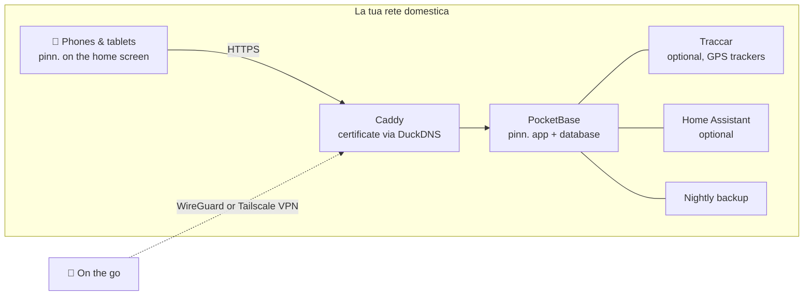

<p align="center">
  
</p>

<p align="center">
  <a href="https://github.com/pinn-shost/pinn/releases/latest"></a>
  <a href="LICENSE"></a>
  
  
  
  <a href="https://ko-fi.com/pinnapp"></a>
</p>

<p align="center">
  <a href="README.md">🇬🇧 English</a> ·
  <a href="README.de.md">🇩🇪 Deutsch</a> ·
  <a href="README.es.md">🇪🇸 Español</a> ·
  <a href="README.fr.md">🇫🇷 Français</a> ·
  <b>🇮🇹 Italiano</b> ·
  <a href="README.pt.md">🇧🇷 Português</a> ·
  <a href="README.zh.md">🇨🇳 中文</a> ·
  <a href="README.ja.md">🇯🇵 日本語</a> ·
  <a href="README.ko.md">🇰🇷 한국어</a> ·
  <a href="README.ru.md">🇷🇺 Русский</a> ·
  <a href="README.nl.md">🇳🇱 Nederlands</a>
</p>

<p align="center">
  <a href="#screenshots">Screenshot</a> ·
  <a href="#what-pinn-does">Funzioni</a> ·
  <a href="#installation">Installazione</a> ·
  <a href="#privacy">Privacy</a> ·
  <a href="#faq">FAQ</a>
</p>

---

pinn. è un’unica app per tutto ciò che fa funzionare una casa: il calendario condiviso, i pasti della settimana, la lista della spesa, chi porta fuori la spazzatura, la paghetta e l’assicurazione da disdire a marzo. Gira sul **tuo NAS** con Docker e si installa come un’app nativa su ogni iPhone, iPad e telefono Android della famiglia.

Nessun account cloud. Nessun abbonamento. Niente pubblicità, niente tracciamento. I dati della tua famiglia non lasciano mai casa tua.

<a id="screenshots"></a>

## Screenshot

### Su iPad

Appeso al muro o appoggiato sul tavolo della cucina: l’iPad condiviso mostra tutta la famiglia in un colpo solo.

<table>
  <tr>
    <td align="center" width="50%">
      <a href=".github/assets/screenshots/dashboard.png"></a><br>
      <sub><b>Dashboard</b> – ognuno tocca la propria foto, con PIN facoltativo</sub>
    </td>
    <td align="center" width="50%">
      <a href=".github/assets/screenshots/ipad-overview.png"></a><br>
      <sub><b>Panoramica</b> – meteo, appuntamenti, attività, pasti e famiglia in un colpo d’occhio</sub>
    </td>
  </tr>
</table>

### Sul telefono

Sempre con te: pinn. si installa su ogni iPhone e telefono Android come un’app nativa.

<table>
  <tr>
    <td align="center" width="33%"><a href=".github/assets/screenshots/home.png"></a><br><sub><b>Panoramica</b> – la tua giornata in un colpo d’occhio</sub></td>
    <td align="center" width="33%"><a href=".github/assets/screenshots/calendar.png"></a><br><sub><b>Calendario</b> – iCloud e Google in un’unica vista</sub></td>
    <td align="center" width="33%"><a href=".github/assets/screenshots/meals.png"></a><br><sub><b>Pasti</b> – pianifica la settimana, fai la spesa con un tocco</sub></td>
  </tr>
  <tr>
    <td align="center" width="33%"><a href=".github/assets/screenshots/lists.png"></a><br><sub><b>Liste</b> – spesa, dispensa, valigia</sub></td>
    <td align="center" width="33%"><a href=".github/assets/screenshots/finance.png"></a><br><sub><b>Finanze</b> – budget, risparmi, paghetta</sub></td>
    <td align="center" width="33%"><a href=".github/assets/screenshots/kids.png"></a><br><sub><b>Bambini</b> – una routine quotidiana giocosa</sub></td>
  </tr>
</table>

### Altre schermate

Tocca un’immagine per aprirla a dimensione intera.

<details>
<summary><b>Mostra altri screenshot</b></summary>

<br>

<table>
  <tr>
    <td align="center" width="25%"><a href=".github/assets/screenshots/house.png"></a><br><sub><b>Casa</b> – casa, costi, mutuo, difetti e contatori in un unico posto</sub></td>
    <td align="center" width="25%"><a href=".github/assets/screenshots/tasks.png"></a><br><sub><b>Attività</b> – promemoria automatici, ad es. revisione e cambio gomme, con pulsante diretto</sub></td>
    <td align="center" width="25%"><a href=".github/assets/screenshots/vehicles.png"></a><br><sub><b>Veicoli</b> – revisione, gomme, rifornimento e ricarica</sub></td>
    <td align="center" width="25%"><a href=".github/assets/screenshots/scan_pantry.png"></a><br><sub><b>Scansione dispensa</b> – scansiona il codice a barre, riponi o consuma</sub></td>
  </tr>
  <tr>
    <td align="center" width="25%"><a href=".github/assets/screenshots/weekly_summary_1.png"></a><br><sub><b>Anteprima settimanale</b> – meteo e ciò che è ancora aperto</sub></td>
    <td align="center" width="25%"><a href=".github/assets/screenshots/weekly_summary_2.png"></a><br><sub><b>Anteprima settimanale</b> – giorno per giorno: pulizie, rifiuti, pagamenti</sub></td>
    <td align="center" width="25%"><a href=".github/assets/screenshots/weekly_summary_3.png"></a><br><sub><b>La settimana scorsa in breve</b> – appuntamenti, pasti, spese – e scorciatoie</sub></td>
  </tr>
</table>

</details>

<sub>📁 <a href=".github/assets/screenshots">Tutte le immagini in una cartella</a></sub>

<a id="what-pinn-does"></a>

## Cosa fa pinn.

| | |
|---|---|
| 📅 **Calendario** | Calendari iCloud e Google per persona, privati o condivisi con la famiglia. Festività, vacanze scolastiche, date della raccolta rifiuti e compleanni dai tuoi contatti compaiono automaticamente. |
| 🍝 **Pasti e ricette** | Pianifica la settimana e invia gli ingredienti direttamente alla lista della spesa. Importa ricette da testo, PDF, foto o link, se vuoi con l’IA. Condividi le ricette preferite con altre famiglie sul tuo server. |
| 🛒 **Liste** | Liste della spesa per negozio, una dispensa che riempie la lista quando le scorte calano, liste valigia da modelli (vacanza, borsa per l’ospedale, festa), liste regalo e dei desideri. |
| ✅ **Attività e casa** | Attività con promemoria push, piani di pulizia e bidoni – più una pagina per i bambini con routine animate che mostra solo ciò che si addice al momento della giornata. |
| 💶 **Finanze** | Casse comuni o private, un budget familiare, risparmi e depositi titoli con ETF e azioni, paghetta, pagamenti ricorrenti e contratti con promemoria di disdetta. Le coinquiline e i coinquilini possono dividere le spese e vedere chi deve cosa a chi. |
| 📄 **Documenti e veicoli** | Scontrini e garanzie, documenti d’identità con promemoria di scadenza. Auto e bici con scadenze di revisione, cambi gomme, consumi e costo totale. |
| 🏡 **Casa** | Per inquilini, proprietari e locatori: contratto di affitto o di acquisto, mutuo, difetti con foto, fatture, piano di ristrutturazione, letture dei contatori con previsione, chiavi ed entrate da affitti per appartamenti, case e garage che affitti. Giardino e piante con un piano di irrigazione che sa quando ha piovuto. |
| 📍 **Famiglia e posizione** | Condividi la tua posizione direttamente da pinn. – una volta o per un tempo scelto – e in background con l’app gratuita Traccar Client (invia direttamente a pinn., nessun server aggiuntivo). In più la modalità “sto tornando a casa”, un allarme SOS con posizione e numeri di emergenza, schede di emergenza e notifiche di arrivo per i luoghi. |
| 🎒 **Scuola e asilo** | Per ogni bambino: orario (scrivilo o fotografalo – l’IA lo compila), accompagnamento e ritiro, compiti nella pagina dei bambini, circolari per i genitori con scadenze che diventano promemoria e giorni di chiusura direttamente nel calendario. |
| 🐾 **Animali domestici** | Profili per cani, gatti, conigli e altri con orari dei pasti da spuntare, passeggiate, un turno “a chi tocca?”, vaccinazioni e sverminazioni con promemoria push, grafico del peso, veterinario e pronto soccorso veterinario, una scheda per il pet sitter da condividere, un manifesto “smarrito” da stampare e un promemoria per ricaricare il distributore di cibo. |
| 🌦️ **Meteo e vacanze** | Tocca il meteo (un riquadro sul telefono, in alto accanto a data e ora su iPad e computer) per vedere 14 giorni con i dettagli di ogni giorno. Le liste valigia con destinazione e date mostrano il meteo della vacanza – previsione o valori tipici – e suggeriscono cosa mettere in valigia. |
| 🏠 **Casa intelligente** | Avvia Comandi rapidi Apple o azioni di Home Assistant da un’attività – il robot aspirapolvere pulisce la cucina quando scade il turno, il robot tagliaerba e l’irrigazione seguono il piano del giardino, il distributore di cibo segnala quando sta per finire. |
| 🎙️ **Controllo vocale** | “Ehi Siri, pinn”: aggiungi alla lista della spesa, fattela leggere, crea attività e ascolta cosa c’è oggi – anche su Android. |
| 💬 **Chat** | Chat di famiglia e privata con crittografia end-to-end, push, spunte di lettura e risposte. |
| 🔔 **Notifiche** | Messaggi push personali su iPhone, iPad e Android, più una campanella che raccoglie ogni modifica in famiglia. |
| 🧩 **Tutto il resto** | Bacheca di famiglia con note spostabili, ricerca globale, modalità offline con sincronizzazione automatica, modalità scura, dashboard su iPad con PIN dei profili, account ospite, blocco bambini. |

pinn. parla **🇬🇧 English, 🇩🇪 Deutsch, 🇪🇸 Español, 🇫🇷 Français, 🇮🇹 Italiano, 🇧🇷 Português, 🇨🇳 中文, 🇯🇵 日本語, 🇰🇷 한국어, 🇷🇺 Русский e 🇳🇱 Nederlands**, adatta valuta e numeri di emergenza alla tua regione e passa dai termini **famiglia** a quelli di **casa condivisa**. Un server può ospitare più famiglie, ciascuna con i propri amministratori.

## Novità della 1.128.0

**Controllo vocale in tutte le lingue dell’app**

- **Undici lingue.** Siri («HTTP Shortcuts» su Android) ora capisce anche olandese, italiano, portoghese, cinese, giapponese e coreano: aggiungere alla lista della spesa, leggere la lista, creare un’attività, «Cosa c’è in programma oggi?». La risposta arriva nella lingua del profilo. Il comando rapido e il link esistenti continuano a funzionare.
- **Esempi.** “Zet melk en eieren op het boodschappenlijstje”, “Aggiungi latte e uova alla lista della spesa”, “Adicione leite e ovos à lista de compras”, “把牛奶和鸡蛋加到购物清单”, “買い物リストに牛乳と卵を追加して”, “장보기 목록에 우유랑 달걀 추가해 줘”.
- **Piccole correzioni.** Gli apostrofi della dettatura («c’è») e la punteggiatura a fine frase (。！？) vengono gestiti, e quantità come «2 Decken» non vengono più spezzate.
- Modificato: `pb_hooks/pinn-sprache.js`, `js/sprachen.js`, `js/versionslog.js`, `i18n/versionslog.en.js`, tutti i `i18n/*.i18n.js`, `src/` (`index.html`), `.github/scripts/check-hooks.js` and tutti i READMEs. Parte server: `pb_hooks/pinn-sprache.js` – sostituisci anche gli hook.

## Novità della 1.127.6

**Chat: i messaggi eliminati lasciano traccia, sicurezza**

- **Eliminato resta visibile.** Un messaggio eliminato non sparisce più e basta: al suo posto tutti vedono «Questo messaggio è stato eliminato», per un sondaggio «Il sondaggio è stato eliminato».
- **Eliminato in bacheca.** Se un sondaggio presente anche in bacheca viene eliminato lì, anche la chat dice «Il sondaggio è stato eliminato»; una scheda di una nota eliminata dalla bacheca lo segnala invece di non portare da nessuna parte.
- **Sicurezza.** I tre avvisi dello scanner di codice «DOM text reinterpreted as HTML» nell’anteprima di foto e video della chat (`js/chatmedien.js`) sono risolti: gli indirizzi oggetto vengono controllati rigorosamente ed escapati per l’HTML.
- Modificati: `js/chat.js`, `js/chatextras.js`, `js/chatmedien.js`, `js/sprachen.js`, `js/versionslog.js`, `i18n/versionslog.en.js`, tutti i `i18n/*.i18n.js`, `src/` (`index.html`) e tutti i README. Parte server: `pb_hooks/pinn-chat.js` – sostituisci anche gli hook; un campo viene aggiunto automaticamente all’avvio.

## Novità della 1.127.5

**Chat: sondaggi più veloci, finanze in chat, sicurezza**

- **I sondaggi reagiscono più in fretta.** Un sondaggio della chat che è anche in bacheca si aggiorna per tutti in circa 10 secondi invece che fino a un minuto.
- **Finanze in chat.** Spese, entrate, voci ricorrenti e posizioni di risparmio hanno ora un pulsante **Chat** (💬) nella finestra: scegli una chat, la voce arriva come scheda e toccandola si riapre.
- **Pulsanti più corti.** «Discutine in chat» ora è semplicemente **Chat** ovunque.
- **Sicurezza.** Chiusi i tre avvisi dello scanner di codice «DOM text reinterpreted as HTML» nell'anteprima di foto e video della chat.
- Modificato: `js/chatmedien.js`, `js/chatstimme.js`, `js/chat.js`, `js/chatextras.js`, `js/finanzen.js`, `js/sparen.js`, `js/vertraege.js`, `js/sprachen.js`, `js/versionslog.js`, `i18n/versionslog.en.js`, tutti gli `i18n/*.i18n.js`, `src/` (`index.html`) e tutti i README. Nessuna parte server.

## Novità della 1.127.4

**Chat: messaggi vocali, posizione, sondaggi, PDF, ricerca, silenziamento – e crittografia disattivabile**

- **Messaggi vocali.** Un pulsante microfono sostituisce quello di invio finché non si scrive nulla: tocca, parla, invia (fino a 5 minuti). Forma d’onda, riproduzione/pausa, 1×/1,5×/2× e salto toccando l’onda. Crittografati end-to-end come le foto.
- **La graffetta ora è un menu:** foto/video, **documento PDF** (fino a 20 MB; apri / condividi / salva / archivia in pinn.), **posizione** e **sondaggio**.
- **Posizione.** Anteprima della mappa ed etichetta (viene suggerito un luogo salvato della mappa di localizzazione, ad es. «Casa»). Toccandola si vede la mappa: **«Mostra sulla mappa di localizzazione»** apre Famiglia → Localizzazione con un segnaposto; «Apri nell’app mappe» avvia la navigazione.
- **Sondaggi.** Una domanda e fino a 8 risposte, più risposte per persona se si vuole. Con la casella **«Mostra anche in bacheca»** si crea contemporaneamente un sondaggio in bacheca: si vota qui o là, il risultato è lo stesso.
- **Ricerca** nella chat (lente in alto), **silenziamento** per chat (8 ore, 1 settimana, sempre; nessuna notifica e non conta nel numero accanto a «Chat» nel menu) e **scioglimento di un gruppo** (creatore e admin).
- **Crittografia disattivabile** per famiglia (admin, «Sicurezza della chat»). Le notifiche mostrano allora il testo (su Android anche un’anteprima delle foto) e nessuno ha bisogno di un codice di recupero. Per impostazione predefinita resta la crittografia end-to-end.
- «Discuti in chat» (💬) ora anche per appuntamenti, documenti e veicoli. Corretto: «Archivia in pinn.» si apriva sotto la foto, i titoli della chat usano il carattere dell’app, il numero nel menu si aggiorna in modo più affidabile.
- Modificato: `js/chatextras.js` e `js/chatstimme.js` (nuovi), `js/chat.js`, `js/chatmedien.js`, `js/chatgruppen.js`, `js/familie.js`, `js/pinnwand.js`, `js/termindetails.js`, `js/dokumente.js`, `js/fahrzeuge.js`, `js/hinweise.js`, `css/chat.css`, `js/sprachen.js`, `js/versionslog.js`, `i18n/versionslog.en.js`, tutti i `i18n/*.i18n.js`, `pinn-setup.sh`, `src/` e tutti i README. **Parte server:** `pb_hooks/chat.pb.js`, `pinn-chat.js`, `pinn-push.js` e `sw.pb.js` – sostituisci anche gli hook; alcuni campi vengono aggiunti automaticamente all’avvio.


## Novità della 1.127.3

**Chat: gruppi propri, chat fissate, scorrimento e immagini della chat**

- **Crea i tuoi gruppi.** Il nuovo pulsante delle persone accanto allo scudo: dai un nome al gruppo e spunta chi ne fa parte – le persone entrano subito, **senza invito**. Il creatore e gli admin cambiano nome, membri e immagine; tutti possono uscire. Chi viene aggiunto dopo legge solo i messaggi più recenti.
- **Ordine e fissare.** In alto c’è il messaggio più recente, inviato o ricevuto; le chat si possono **fissare** e restano in alto. **Scorri una chat verso sinistra** per due pulsanti: fissa / rimuovi e segna come letto / non letto (secondo lo stato). Sul computer il pulsante «⋯» o un clic destro apre lo stesso. Una chat segnata come non letta mostra un punto finché non la apri; fissate e segni sono uguali su ogni dispositivo.
- **Immagini.** L’admin della famiglia tocca l’immagine nella chat di famiglia aperta e sceglie una foto, ritagliata in cerchio come la foto del profilo; il creatore e gli admin di un gruppo fanno lo stesso per il gruppo.
- Nomi e immagini dei gruppi non sono crittografati end-to-end (il server ha bisogno dei membri per le chiavi); i messaggi sì.
- Modificato: `js/chatgruppen.js` (nuovo), `js/chat.js`, `css/chat.css`, `js/sprachen.js`, `js/versionslog.js`, `i18n/versionslog.en.js`, tutti gli `i18n/*.i18n.js`, `index.html`, `pinn-setup.sh`, `src/` e tutti i README. **Parte server:** `pb_hooks/chat.pb.js` e `pb_hooks/pinn-chat.js` – sostituisci anche gli hook; vengono create automaticamente altre tre raccolte.


## Novità della 1.127.2

**Chat: parlare di attività, note della bacheca e scadenze dei contratti**

- **💬 «Discutine in chat»** su un’attività, in una nota della bacheca e in un contratto (ad es. una scadenza di disdetta imminente): scegli la chat di famiglia o una persona e la chat si apre con l’elemento come scheda nella riga di scrittura. Aggiungi qualche parola o invialo e basta.
- **La scheda apre l’elemento:** un tocco nel messaggio porta all’attività (lampeggia un attimo nell’elenco), alla nota o al contratto. Se non esiste più o non hai accesso, un breve avviso lo segnala.
- **Sempre crittografato end-to-end:** la scheda è crittografata come il testo; il tuo NAS non ne vede nulla.
- Modificato: `js/chat.js`, `css/chat.css`, `js/aufgaben.js`, `js/pinnwand.js`, `js/vertraege.js`, `js/sprachen.js`, `js/versionslog.js`, `i18n/versionslog.en.js`, tutti gli `i18n/*.i18n.js`, `index.html`, `src/` e tutti i README. **Nessuna parte server:** gli hook restano invariati.


## Novità della 1.127.1

**Foto e video nella chat**

- **Invia foto e video** con il pulsante graffetta, con anteprima e didascalia. Come in WhatsApp, un **pulsante HD** ti lascia scegliere ogni volta: Standard riduce le foto a circa 0,3 MB, HD invia l’originale (foto fino a 20 MB, video fino a 50 MB). I video vengono ridotti dove il dispositivo può, altrimenti si invia l’originale.
- **Anche con crittografia end-to-end:** ogni file ha la sua chiave; il tuo NAS non vede né l’immagine né il nome. Visualizzatore a schermo intero nella chat, **condivisione** (WhatsApp, e-mail …) o **salvataggio sul dispositivo**.
- **Archivia in pinn.:** salva una foto come documento o assegnala a un’abitazione, un difetto o un veicolo. I video si condividono e si salvano, ma non si archiviano come documenti.
- **Eliminazione automatica:** gli amministratori scelgono in «Sicurezza della chat» dopo quanti giorni messaggi e/o foto e video vengono eliminati per tutti, di notte (predefinito: mai).
- Modificato: `js/chatmedien.js` (nuovo), `css/chat.css`, `js/chat.js`, `js/sprachen.js`, `js/versionslog.js`, `i18n/versionslog.en.js`, tutti gli `i18n/*.i18n.js`, `pinn-setup.sh`, `src/` e tutti i README. **Lato server:** `pb_hooks/chat.pb.js` e `pb_hooks/pinn-chat.js` – sostituire anche gli hook.


## Come funziona



Tutto gira come container Docker su un’unica macchina. HTTPS funziona **senza port forwarding** – il certificato viene emesso tramite un controllo DNS. Dall’esterno, pinn. è raggiungibile solo tramite la tua VPN.

## Requisiti

- Un NAS o server con **Docker** e **Docker Compose 2.17+** – sviluppato su un NAS UGREEN con UGOS, funziona su qualsiasi host Linux con Docker (amd64, arm64, armv7)
- Accesso SSH
- Facoltativo ma consigliato: un sottodominio gratuito [DuckDNS](https://www.duckdns.org) per HTTPS – necessario per le notifiche push e per installare pinn. come app

<a id="installation"></a>

## Installazione

1. Scarica lo ZIP dell’[ultima release](https://github.com/pinn-shost/pinn/releases/latest) e decomprimilo.
2. Crea una cartella sul NAS, ad es. `/volume1/docker/Pocketbase`, e copiaci dentro la cartella decompressa (ad es. `pinn-1.128.0` o `pinn-main`) così com’è.
3. Accedi via SSH ed esegui:
   ```sh
   cd /volume1/docker/Pocketbase && sudo sh pinn-*/pinn-setup.sh
   ```
   Lo script copia ogni file al suo posto, scarica le librerie per l’importazione dei PDF e il riconoscimento del testo nelle foto e avvia pinn.
4. Apri `http://<IP-NAS>:8090` → **Accedi come amministratore principale** → password `Admin` → scegli la tua password.
5. L’**assistente di configurazione** ti guida nel resto – HTTPS, accesso remoto con WireGuard o Tailscale, Google, IA, posizione e Home Assistant – passo dopo passo, in undici lingue.
6. Apri pinn. dal suo indirizzo HTTPS su ogni telefono e aggiungilo alla schermata Home:
   - **iPhone/iPad (Safari):** Condividi → *Aggiungi alla schermata Home* (iOS 16.4 o successivo per le notifiche)
   - **Android (Chrome):** Impostazioni → Notifiche → *Installa pinn. come app*, oppure menu di Chrome ⋮ → *Installa app*

   Poi attiva le notifiche su ogni dispositivo in **Impostazioni → Notifiche → Attiva su questo dispositivo**.

**Aggiornamento:** scarica il nuovo ZIP, metti la cartella decompressa nella stessa cartella ed esegui di nuovo `sudo sh pinn-*/pinn-setup.sh`. I file sostituiti restano in `_alt/`, i tuoi dati non vengono toccati.

I **backup** vengono eseguiti ogni notte in `./backups` e conservati per 14 giorni.

<a id="privacy"></a>

## Privacy

pinn. è stato creato per dati che non daresti mai a un servizio cloud: estratti conto, documenti sanitari, dove si trovano i tuoi figli. Per questo:

- **Tutti i dati restano sul tuo NAS** in un unico database PocketBase. Non esiste alcun server pinn. e non c’è telemetria.
- **Nessuno script da server di terzi.** Tutto il codice e tutte le librerie sono serviti dal tuo NAS.
- **Le notifiche push non contengono contenuti.** Apple, Google e Mozilla consegnano solo un segnale di risveglio vuoto; poi il dispositivo recupera il messaggio dal tuo NAS.
- **Le password di iCloud e Google** sono memorizzate cifrate in una raccolta protetta.
- **Non raggiungibile da Internet.** L’accesso remoto passa dalla tua VPN.

pinn. contatta servizi esterni solo per le funzioni che ne hanno bisogno:

| Servizio | Usato per | Quando |
|---|---|---|
| [Open-Meteo](https://open-meteo.com) | Previsioni meteo | quando è impostato un indirizzo di casa |
| [OpenStreetMap Nominatim](https://nominatim.openstreetmap.org) | Trasformare indirizzi in posizioni sulla mappa | quando si inseriscono indirizzi |
| [Tessere OpenStreetMap](https://www.openstreetmap.org) | Sfondo della mappa | nella pagina della posizione, caricate tramite il tuo NAS |
| [Google Fonts](https://fonts.google.com) | Caratteri tipografici | al caricamento dell’app |
| [OpenHolidays API](https://www.openholidaysapi.org) | Festività e vacanze scolastiche | quando è impostato un indirizzo di casa |
| [DuckDNS](https://www.duckdns.org) | Certificato HTTPS e indirizzo | se configurato |
| iCloud / Google | Calendari e contatti | solo per gli account che colleghi |
| Google Gemini | Lettura di ricette e documenti | solo se aggiungi una chiave API |
| jsDelivr | Download una tantum di pdf.js e Tesseract | solo durante l’installazione |

<a id="faq"></a>

## FAQ

<details>
<summary><b>Devo aprire porte sul router?</b></summary>
<br>
No. Il certificato HTTPS viene emesso tramite un controllo DNS e l’accesso remoto passa da una VPN – WireGuard su una FRITZ!Box oppure Tailscale per qualsiasi altro router.
</details>

<details>
<summary><b>Funziona senza NAS?</b></summary>
<br>
Va bene qualsiasi macchina sempre accesa con Docker: un mini PC, un Raspberry Pi 4/5 o un server Linux.
</details>

<details>
<summary><b>pinn. è una “vera” app dell’App Store?</b></summary>
<br>
pinn. è una web app che aggiungi alla schermata Home. Poi si apre a schermo intero come un’app nativa, funziona offline, mostra un badge con le attività aperte e riceve notifiche push – senza alcuno store.
</details>

<details>
<summary><b>Più famiglie possono usare un’unica installazione?</b></summary>
<br>
Sì. L’amministratore principale crea le famiglie; ogni famiglia ha i propri amministratori, calendari e dati. Le ricette possono essere condivise facoltativamente tra famiglie.
</details>

<details>
<summary><b>E i bambini?</b></summary>
<br>
I profili con blocco bambini vedono solo le proprie attività e non possono eliminare né modificare nulla. Finanze, documenti e veicoli restano nascosti. I bambini più piccoli hanno una pagina giocosa con le routine quotidiane.
</details>

<details>
<summary><b>Quanto costa?</b></summary>
<br>
Niente – pinn. è gratuito e open source con licenza MIT. I servizi facoltativi come l’IA Gemini hanno piani gratuiti.
</details>

## Struttura del repository

Il repository ha la stessa struttura di un’installazione sul NAS – ogni file si trova dove finirà:

```
pinn/
├── pb_hooks/            server: *.pb.js hooks and their helper modules (pinn-*.js, calendar-sync.js)
├── pb_public/           web app served by PocketBase
│   ├── index.html       the app page, built from src/ (HTML, start check) – do not edit by hand
│   ├── js/              app code split out of index.html, plain <script> files without a build step
│   │                    (ruhemodus.js, textkern.js, sprachen.js, region.js, grundlagen.js, popups.js, verbindung.js, benutzer.js, mitteilungen.js, serverzugriff.js, tastatur.js, anmeldemaske.js, dashboard.js, dashboardhintergrund.js, profilauswahl.js, pineingabe.js, dashboardsitzung.js, dashboardkonto.js, familienverwalten.js, einrichten.js, exportieren.js, hauptadminseite.js, anmeldung.js, konto.js, profilverwaltung.js, zustand.js, bedienzustand.js, rezeptbilder.js, zusammenfuehren.js, speichern.js, design.js, sprache.js, uebersicht.js, familienkachel.js, wobistdu.js, geburtstagsfeier.js, wetterkachel.js, geburtstage.js, uebersichteinstellungen.js, familiensync.js, bereiche.js, kalenderquellen.js, icsparser.js, zeitleiste.js, termindetails.js, kalenderdatei.js, wetter.js, wohnort.js, feiertage.js, muellkalender.js, mitglieder.js, profilbild.js, mitglied.js, kinderseite.js, kinderroutine.js, sterne.js, kalenderansicht.js, essenplanen.js, rezeptparser.js, rezeptdialog.js, rezeptbild.js, rezeptmengen.js, einkauf.js, einkaufslisten.js, einkaufseingabe.js, rezepte.js, offline.js, aufgabenextras.js, appbadge.js, reisen.js, aufgabendaten.js, haushalt.js, reihum.js, aufgaben.js, smarthome.js, sprachsteuerung.js, termine.js, ansichten.js, versionspruefung.js, sicherungen.js, geraete.js, fehlerprotokoll.js, versionslog.js, einstellungen.js, kalenderkonto.js, finanzen.js, kassen.js, vorrat.js, vorrat2.js, sparen.js, vertraege.js, fahrzeuge.js, zuhause.js, dokumente.js, pdflesen.js, appstart.js, pinnwand.js, listen.js, familie.js, hinweise.js, ausblick.js – ausblick.js always comes last)
│   ├── css/             app styles split out of index.html, plain CSS without a build step (ergaenzung.css, energiesparen.css, basis.css … haustierewetter.css, terminal.css, glocke.css)
│   ├── einrichtung.js   setup assistant · datenexport.js  data export
│   ├── i18n/            texts by key (de, en, fr, es, it, pt, zh, ja, ko) – English is the reference
│   └── vendor/          pinn.css, pocketbase/ (pdf.js and Tesseract are downloaded by the setup)
├── .github/             GitHub Actions (workflows/check.yml), checks (scripts/), CONTRIBUTING.md, SECURITY.md, images – not installed
├── src/                 sources of index.html (build.js, rahmen.html, teile/) – not installed
├── caddy/Caddyfile      HTTPS reverse proxy
├── docker-compose.yaml  all containers
├── env.txt              template for .env
├── pinn-setup.sh        install & update
├── pinn-wartung.sh      backups & updates (container "wartung")
├── pinn-pocketbase-update.sh
├── index.html           placeholder only, never installed (keeps the update button of 1.38 working)
└── README.md            this page · README.<code>.md in de, es, fr, it, pt, zh, ja, ko
```

`pinn-setup.sh` copia `pb_hooks/`, `pb_public/` e `caddy/Caddyfile` 1:1 nella cartella del progetto; le cartelle dei dati (`pb_data/`, `konfig/`, `backups/`, `caddy/data/` …) non vengono mai toccate.

## Contribuire

Segnalazioni di errori, idee e traduzioni sono molto benvenute – vedi [CONTRIBUTING.md](.github/CONTRIBUTING.md). Segnala le vulnerabilità di sicurezza in privato, come descritto in [SECURITY.md](.github/SECURITY.md). Prima di una pull request esegui `node .github/scripts/check-all.js` – gli stessi controlli girano automaticamente su GitHub.

## Sostieni pinn.

pinn. è gratuito e resta gratuito – completamente, per tutti. Nasce nel mio tempo libero. Se ti rende un po’ più facile la vita di tutti i giorni, un piccolo contributo è benvenuto, ma del tutto volontario:

<p>
  <a href="https://ko-fi.com/pinnapp"></a>
  <a href="https://buymeacoffee.com/pinn"></a>
</p>

Anche una ⭐ aiuta – rende pinn. più facile da trovare per altre famiglie.

## Realizzato con

[PocketBase](https://pocketbase.io) (MIT) · [Tailwind CSS](https://tailwindcss.com) (MIT) · [pdf.js](https://mozilla.github.io/pdf.js/) (Apache-2.0) · [Tesseract.js](https://tesseract.projectnaptha.com) (Apache-2.0) · [Traccar](https://www.traccar.org) (Apache-2.0) · [Caddy](https://caddyserver.com) (Apache-2.0)

## Licenza

[MIT](LICENSE) – usalo, modificalo, condividilo.
