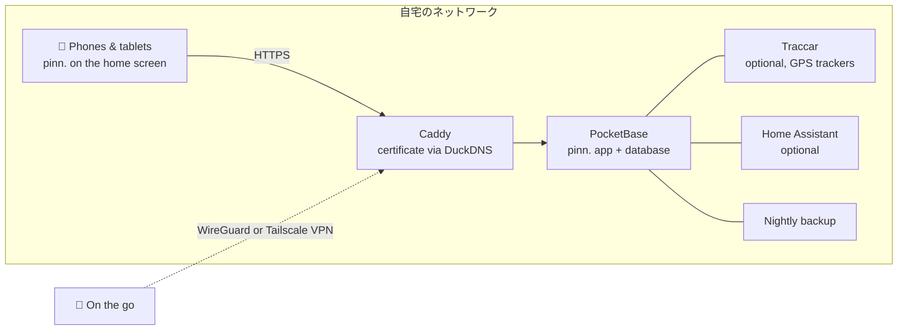

<p align="center">
  
</p>

<p align="center">
  <a href="https://github.com/pinn-shost/pinn/releases/latest"></a>
  <a href="LICENSE"></a>
  
  
  
  <a href="https://ko-fi.com/pinnapp"></a>
</p>

<p align="center">
  <a href="README.md">🇬🇧 English</a> ·
  <a href="README.de.md">🇩🇪 Deutsch</a> ·
  <a href="README.es.md">🇪🇸 Español</a> ·
  <a href="README.fr.md">🇫🇷 Français</a> ·
  <a href="README.it.md">🇮🇹 Italiano</a> ·
  <a href="README.pt.md">🇧🇷 Português</a> ·
  <a href="README.zh.md">🇨🇳 中文</a> ·
  <b>🇯🇵 日本語</b> ·
  <a href="README.ko.md">🇰🇷 한국어</a> ·
  <a href="README.ru.md">🇷🇺 Русский</a> ·
  <a href="README.nl.md">🇳🇱 Nederlands</a>
</p>

<p align="center">
  <a href="#screenshots">スクリーンショット</a> ·
  <a href="#what-pinn-does">機能</a> ·
  <a href="#installation">インストール</a> ·
  <a href="#privacy">プライバシー</a> ·
  <a href="#faq">FAQ</a>
</p>

---

pinn.は、家庭を回すためのすべてをまとめたアプリです。共有カレンダー、今週の献立、買い物リスト、ごみ出しの担当、お小遣い、3月に解約しなければならない保険など。**あなた自身のNAS**でDockerを使って動き、家族のすべてのiPhone、iPad、Androidスマートフォンにネイティブアプリのようにインストールできます。

クラウドアカウントは不要。定期購読もありません。広告も追跡もありません。家族のデータは家の外に出ません。

<a id="screenshots"></a>

## スクリーンショット

### iPadで

壁に掛けても、キッチンのテーブルに置いても。共有のiPadが家族全員の様子をいっぺんに映し出します。

<table>
  <tr>
    <td align="center" width="50%">
      <a href=".github/assets/screenshots/dashboard.png"></a><br>
      <sub><b>ダッシュボード</b>：それぞれが自分の写真をタップ、PINは任意</sub>
    </td>
    <td align="center" width="50%">
      <a href=".github/assets/screenshots/ipad-overview.png"></a><br>
      <sub><b>概要</b>：天気、予定、タスク、食事、家族がひと目でわかる</sub>
    </td>
  </tr>
</table>

### スマートフォンで

いつでも一緒：pinn.は、すべてのiPhoneとAndroidスマートフォンにネイティブアプリのようにインストールできます。

<table>
  <tr>
    <td align="center" width="33%"><a href=".github/assets/screenshots/home.png"></a><br><sub><b>概要</b>：あなたの一日がひと目でわかる</sub></td>
    <td align="center" width="33%"><a href=".github/assets/screenshots/calendar.png"></a><br><sub><b>カレンダー</b>：iCloudとGoogleをひとつの画面で</sub></td>
    <td align="center" width="33%"><a href=".github/assets/screenshots/meals.png"></a><br><sub><b>食事</b>：一週間を計画して、ワンタップで買い物</sub></td>
  </tr>
  <tr>
    <td align="center" width="33%"><a href=".github/assets/screenshots/lists.png"></a><br><sub><b>リスト</b>：買い物、ストック、荷造り</sub></td>
    <td align="center" width="33%"><a href=".github/assets/screenshots/finance.png"></a><br><sub><b>家計</b>：予算、貯蓄、お小遣い</sub></td>
    <td align="center" width="33%"><a href=".github/assets/screenshots/kids.png"></a><br><sub><b>子ども</b>：楽しい毎日の流れ</sub></td>
  </tr>
</table>

### そのほかの画面

画像をタップすると大きく表示されます。

<details>
<summary><b>そのほかのスクリーンショットを表示</b></summary>

<br>

<table>
  <tr>
    <td align="center" width="25%"><a href=".github/assets/screenshots/house.png"></a><br><sub><b>住まい</b> – 住宅・費用・ローン・不具合・メーターを一か所に</sub></td>
    <td align="center" width="25%"><a href=".github/assets/screenshots/tasks.png"></a><br><sub><b>タスク</b> – 車検やタイヤ交換などの自動リマインダーとワンタップのボタン</sub></td>
    <td align="center" width="25%"><a href=".github/assets/screenshots/vehicles.png"></a><br><sub><b>車両</b> – 車検、タイヤ、給油と充電</sub></td>
    <td align="center" width="25%"><a href=".github/assets/screenshots/scan_pantry.png"></a><br><sub><b>ストックのスキャン</b> – バーコードを読み取って、しまう・使い切る</sub></td>
  </tr>
  <tr>
    <td align="center" width="25%"><a href=".github/assets/screenshots/weekly_summary_1.png"></a><br><sub><b>週のプレビュー</b> – 天気とまだ終わっていないこと</sub></td>
    <td align="center" width="25%"><a href=".github/assets/screenshots/weekly_summary_2.png"></a><br><sub><b>週のプレビュー</b> – 日ごとに：掃除、ごみ、支払い</sub></td>
    <td align="center" width="25%"><a href=".github/assets/screenshots/weekly_summary_3.png"></a><br><sub><b>先週のまとめ</b> – 予定、食事、支出——とショートカット</sub></td>
  </tr>
</table>

</details>

<sub>📁 <a href=".github/assets/screenshots">すべての画像はこのフォルダにあります</a></sub>

<a id="what-pinn-does"></a>

## pinn.でできること

| | |
|---|---|
| 📅 **カレンダー** | 人ごとのiCloudとGoogleカレンダーを、非公開にも家族との共有にもできます。祝日、学校の休み、ごみ回収日、連絡先の誕生日が自動で表示されます。 |
| 🍝 **食事とレシピ** | 一週間を計画し、材料をそのまま買い物リストへ。テキスト、PDF、写真、リンクからレシピを取り込めます（AIの利用は任意）。お気に入りのレシピを同じサーバー上のほかの家族と共有できます。 |
| 🛒 **リスト** | お店ごとの買い物リスト、在庫が減るとリストを補充するストック、テンプレートからの持ち物リスト（旅行、入院バッグ、パーティー）、ギフトリストとほしいものリスト。 |
| ✅ **タスクと家事** | プッシュのリマインダー付きタスク、掃除計画、ごみ箱。さらに、時間帯に合うことだけを表示するアニメーション付きの日課を備えた子どものページ。 |
| 💶 **家計** | 共有または個人の財布、家計の予算、ETFや株式を扱う貯蓄と証券口座、お小遣い、定期的な支払い、解約リマインダー付きの契約。ルームシェアでは費用を分け合い、だれがだれにいくら支払うかを確認できます。 |
| 📄 **書類と乗り物** | レシートと保証、期限リマインダー付きの身分証。車と自転車の車検日、タイヤ交換、燃費、総費用。 |
| 🏡 **住まい** | 借主、所有者、貸主向け：賃貸借または売買契約書、ローン、写真付きの不具合、請求書、リフォーム計画、予測つきの検針、鍵、貸している部屋・家・ガレージの家賃収入。雨が降った日を把握している水やり計画つきの庭と植物。 |
| 📍 **家族と位置情報** | pinn.から直接、一度だけ、または選んだ時間だけ位置情報を共有できます。無料アプリのTraccar Clientを使えばバックグラウンドでも共有できます（pinn.に直接送信、追加サーバー不要）。さらに「帰宅中」モード、位置と緊急番号つきのSOSアラート、緊急カード、場所への到着通知。 |
| 🎒 **学校と保育園** | 子どもごとに：時間割（入力するか、写真を撮るとAIが入力）、送り迎え、子どものページの宿題、期限がリマインダーになる保護者向けのお便り、カレンダーに直接表示される休園・休校日。 |
| 🐾 **ペット** | 犬、猫、うさぎなどのプロフィール。チェックできる食事の時間、散歩、「だれの番？」の当番表、プッシュのリマインダー付きの予防接種と駆虫、体重グラフ、獣医と救急動物病院、共有できるペットシッター用シート、印刷できる「迷子」ポスター、自動給餌器の補充リマインダー。 |
| 🌦️ **天気と休暇** | 天気をタップすると（スマートフォンではタイル、iPadとパソコンでは日付と時刻の横の上部）、14日分と各日の詳細を確認できます。目的地と日程を入れた持ち物リストには休暇中の天気（予報または平年値）が表示され、持っていくものを提案します。 |
| 🏠 **スマートホーム** | タスクからAppleショートカットやHome Assistantのアクションを開始：家事の期日にロボット掃除機がキッチンを掃除し、ロボット芝刈り機と水やりは庭の計画に従い、自動給餌器は空になりそうなときに知らせます。 |
| 🎙️ **音声操作** | 「Hey Siri、pinn」：買い物リストに追加、読み上げ、タスクの作成、今日の予定の確認。Androidでも使えます。 |
| 💬 **チャット** | 家族チャットと個別チャット。エンドツーエンド暗号化、プッシュ、既読チェック、返信に対応。 |
| 🔔 **通知** | iPhone、iPad、Androidに届く個人向けのプッシュメッセージと、家族内のあらゆる変更を集めるベル。 |
| 🧩 **そのほか** | 動かせるメモ付きの家族の掲示板、全体検索、自動同期付きのオフラインモード、ダークモード、プロフィールPIN付きのiPadダッシュボード、ゲストアカウント、チャイルドロック。 |

pinn.は **🇬🇧 English、🇩🇪 Deutsch、🇪🇸 Español、🇫🇷 Français、🇮🇹 Italiano、🇧🇷 Português、🇨🇳 中文、🇯🇵 日本語、🇰🇷 한국어、🇷🇺 Русский、🇳🇱 Nederlands** に対応し、通貨と緊急番号をお住まいの地域に合わせ、**家族**と**ルームシェア**の表現を切り替えます。1台のサーバーで複数の家族を運用でき、それぞれに管理者を置けます。

## 1.127.6の新機能

**チャット：削除したメッセージに表示が残る、セキュリティ**

- **削除しても表示が残ります。** 削除したチャットメッセージがそのまま消えることはなくなりました。その場所に全員に「このメッセージは削除されました」、アンケートなら「このアンケートは削除されました」と表示されます。
- **掲示板で削除。** 掲示板にも載っているアンケートを掲示板で削除すると、チャットにも「このアンケートは削除されました」と表示されます。削除された掲示板の投稿へのカードもその旨を表示します。
- **セキュリティ。** チャットの写真・動画プレビュー（`js/chatmedien.js`）にあったコードスキャンの警告「DOM text reinterpreted as HTML」3件を解決しました。オブジェクトアドレスを厳しく確認し、HTML用にエスケープします。
- 変更：`js/chat.js`, `js/chatextras.js`, `js/chatmedien.js`, `js/sprachen.js`, `js/versionslog.js`, `i18n/versionslog.en.js`, すべての `i18n/*.i18n.js`, `src/` (`index.html`) 、 すべてのREADME. サーバー部分: `pb_hooks/pinn-chat.js` – フックも置き換えてください。起動時にフィールドが1つ自動で追加されます。

## 1.127.5の新機能

**チャット：投票の高速化、家計をチャットで相談、セキュリティ**

- **投票の反応が速くなりました。** 掲示板にも載せたチャットの投票は、最大1分ではなく約10秒で全員に反映されます。
- **家計もチャットで。** 支出・収入・定期項目・貯蓄項目のポップアップに **チャット** ボタン（💬）が付きました。チャットを選ぶと項目がカードとして届き、タップするとまた開けます。
- **ボタンを短く。** 「チャットで相談」はすべて **チャット** になりました。
- **セキュリティ。** チャットの写真・動画プレビューに関するコードスキャナーの警告「DOM text reinterpreted as HTML」3件を修正しました。
- 変更：`js/chatmedien.js`、`js/chatstimme.js`、`js/chat.js`、`js/chatextras.js`、`js/finanzen.js`、`js/sparen.js`、`js/vertraege.js`、`js/sprachen.js`、`js/versionslog.js`、`i18n/versionslog.en.js`、すべての `i18n/*.i18n.js`、`src/`（`index.html`）、すべての README。サーバー側の変更はありません。

## 1.127.4の新機能

**チャット：ボイスメッセージ、位置情報、アンケート、PDF、検索、ミュート――暗号化はオフにも可能**

- **ボイスメッセージ。** 何も入力していない間は送信ボタンの代わりにマイクボタンが表示されます。タップして話し、送信（最長5分）。波形、再生/一時停止、1×/1.5×/2×、波形をタップしてジャンプ。写真と同じくエンドツーエンド暗号化。
- **クリップボタンがメニューになりました：** 写真/動画、**PDF書類**（20 MBまで。開く／共有／保存／pinn.に保存）、**位置情報**、**アンケート**。
- **位置情報。** 地図プレビューとラベル付き（位置情報マップに保存した場所、例：「自宅」を提案）。タップで地図を表示：**「位置情報マップで表示」** で「家族 → 位置情報」を開いて印を表示、「マップアプリで開く」でナビを開始。
- **アンケート。** 質問と最大8つの回答、希望すれば1人が複数回答可。**「掲示板にも表示」** にチェックすると掲示板のアンケートも同時に作成され、どちらで投票しても結果は同じです。
- チャット内**検索**（上部の虫眼鏡）、チャットごとの**ミュート**（8時間・1週間・常に。通知なし、メニューの「チャット」横の数にも含まれません）、**グループの解散**（作成者と管理者）。
- **暗号化をオフにできます**（家族ごと、管理者が「チャットのセキュリティ」で設定）。オフにすると通知にテキストが表示され（Androidでは写真のプレビューも）、復元コードは不要です。標準はエンドツーエンド暗号化のままです。
- 「チャットで話す」（💬）が予定・書類・車両にも追加されました。修正：「pinn.に保存」が写真の下に開いていた問題、チャットの見出しをアプリのフォントに統一、メニューの数をより確実に更新。
- 変更：`js/chatextras.js` と `js/chatstimme.js`（新規）、`js/chat.js`、`js/chatmedien.js`、`js/chatgruppen.js`、`js/familie.js`、`js/pinnwand.js`、`js/termindetails.js`、`js/dokumente.js`、`js/fahrzeuge.js`、`js/hinweise.js`、`css/chat.css`、`js/sprachen.js`、`js/versionslog.js`、`i18n/versionslog.en.js`、すべての `i18n/*.i18n.js`、`pinn-setup.sh`、`src/`、すべての README。**サーバー側：** `pb_hooks/chat.pb.js`、`pinn-chat.js`、`pinn-push.js`、`sw.pb.js` ――フックも入れ替えてください。起動時にいくつかのフィールドが自動で追加されます。


## 1.127.3の新機能

**チャット：自分でグループ作成、ピン留め、スワイプ操作、チャット画像**

- **自分でグループを作れます。** 盾アイコンの隣に新しい「人」ボタン：グループに名前を付け、入れる人にチェックを付けると、**招待なしで**すぐに参加します。作成者と管理者が名前・メンバー・画像を変更でき、誰でも退出できます。後から加わった人は、それ以降のメッセージだけ読めます。
- **並び順とピン留め。** 送受信にかかわらず最新のメッセージが一番上に来ます。チャットは**ピン留め**して上に固定できます。**チャットを左にスワイプ**すると、ピン留め／解除と、既読／未読にする（状態に応じて）の2つのボタンが出ます。パソコンでは「⋯」ボタンか右クリックで同じ操作ができます。未読にしたチャットは、開くまで点が表示されます。ピン留めと印はどの端末でも同じです。
- **画像。** 家族の管理者が開いた家族チャットで画像をタップして写真を選ぶと、プロフィール画像と同じように丸く切り抜けます。グループの作成者と管理者も、グループで同じことができます。
- グループの名前と画像はエンドツーエンド暗号化されません（鍵の準備にサーバーがメンバーを必要とするため）。メッセージは引き続き暗号化されます。
- 変更：`js/chatgruppen.js`（新規）、`js/chat.js`、`css/chat.css`、`js/sprachen.js`、`js/versionslog.js`、`i18n/versionslog.en.js`、すべての `i18n/*.i18n.js`、`index.html`、`pinn-setup.sh`、`src/`、すべてのREADME。**サーバー側：** `pb_hooks/chat.pb.js` と `pb_hooks/pinn-chat.js` も入れ替えてください。コレクションが3つ自動で追加されます。


## 1.127.2の新機能

**チャット：タスク、掲示板のメモ、契約の期限について話せます**

- **💬「チャットで相談」**がタスク、掲示板のメモ、契約（例：解約期限が近いもの）に付きました。家族チャットか個人を選ぶと、その項目がカードとして入力欄に入った状態でチャットが開きます。ひとこと添えるか、そのまま送信できます。
- **カードから項目を開けます：**メッセージ内のカードをタップすると、タスク（一覧で一瞬点滅）、メモ、契約へ移動します。項目がすでにない場合やアクセス権がない場合は、短いメッセージでお知らせします。
- **これまでどおりエンドツーエンド暗号化：**カードもテキストと同じく暗号化され、NASには何も見えません。
- 変更：`js/chat.js`、`css/chat.css`、`js/aufgaben.js`、`js/pinnwand.js`、`js/vertraege.js`、`js/sprachen.js`、`js/versionslog.js`、`i18n/versionslog.en.js`、すべての `i18n/*.i18n.js`、`index.html`、`src/`、すべてのREADME。**サーバー側の変更なし**（hooksはそのままです）。


## 1.127.1 の新機能

**チャットで写真と動画**

- **写真と動画を送信:** クリップのボタンから、プレビューとキャプション付きで。WhatsApp のように **HD ボタン** で毎回選べます。標準は写真を約 0.3 MB に縮小、HD は元のまま(写真は 20 MB、動画は 50 MB まで)。動画は端末が対応していれば縮小し、そうでなければ元の動画を送ります。
- **こちらもエンドツーエンド暗号化:** ファイルごとに専用の鍵があり、NAS には画像もファイル名も見えません。チャット内で全画面表示、**共有**(WhatsApp、メールなど)や **端末への保存** ができます。
- **pinn. に保存:** 写真を書類として保存したり、物件・不具合・車両に紐付けたりできます。動画は共有と保存のみで、書類にはできません。
- **自動削除:** 管理者が「チャットのセキュリティ」で、何日後にメッセージや写真・動画を夜間に全員分削除するか設定します(標準:しない)。
- 変更:`js/chatmedien.js`(新規)、`css/chat.css`、`js/chat.js`、`js/sprachen.js`、`js/versionslog.js`、`i18n/versionslog.en.js`、すべての `i18n/*.i18n.js`、`pinn-setup.sh`、`src/`、すべての README。**サーバー側:** `pb_hooks/chat.pb.js` と `pb_hooks/pinn-chat.js` – フックも入れ替えてください。


## 1.127.0 の新機能

**チャット(エンドツーエンド暗号化)**

- **家族チャットと個別チャット。** pinn. の色を使ったメッセンジャー風の画面で、返信、リンク、日付区切り、未読カウンターに対応。チェック1つはサーバーに届いた、色付きチェック2つは既読(既読通知はオフにできます)。
- **エンドツーエンド暗号化。** メッセージは端末で暗号化され、NAS には「誰がいつ書いたか」しか見えず、内容は見えません。初めて開くと鍵と復元コードが作られ、復元コードで新しい端末のチャットを開けます。「チャットのセキュリティ」で安全番号を照合でき、鍵が変わると新しい番号を承認するまで送信できません。
- **プッシュ通知。** 本文なしの「新しいメッセージ」(サーバーは読めません)。アカウント → 通知 → チャット で設定できます。ゲストとダッシュボードでは使えません。
- **次の段階に向けた準備:** メッセージに関連項目(タスク、掲示板のメモ、契約の解約など)をカードとして付けられます。制限:前方秘匿性なし、画像はまだ非対応(1.127.1 で予定)。
- 変更:`index.html`、`js/chat.js` と `css/chat.css`(新規)、複数の `js/*.js`、すべての `i18n/*.i18n.js`、`pinn-setup.sh`、すべての README。**サーバー側:** `pb_hooks/chat.pb.js` と `pb_hooks/pinn-chat.js`(新規)、`pb_hooks/pinn-push.js`、`pb_hooks/pinn-schema.js` – フックも入れ替えてください。


## しくみ



すべては1台のマシン上でDockerコンテナとして動きます。HTTPSは**ポート開放なし**で動作し、証明書はDNS確認で発行されます。外部からpinn.に接続できるのは、あなた自身のVPN経由のみです。

## 必要なもの

- **Docker**と**Docker Compose 2.17以降**が使えるNASまたはサーバー：UGOSを搭載したUGREEN NASで開発され、Dockerが動くあらゆるLinuxホスト（amd64、arm64、armv7）で動作します
- そのSSHアクセス
- 任意ですが推奨：HTTPS用の無料の[DuckDNS](https://www.duckdns.org)サブドメイン（プッシュ通知とpinn.のアプリとしてのインストールに必要）

<a id="installation"></a>

## インストール

1. [最新リリース](https://github.com/pinn-shost/pinn/releases/latest)のZIPをダウンロードして展開します。
2. NASにフォルダを作成し（例：`/volume1/docker/Pocketbase`）、展開したフォルダ（例：`pinn-1.127.6`または`pinn-main`）をそのまま入れます。
3. SSHでログインして次を実行します：
   ```sh
   cd /volume1/docker/Pocketbase && sudo sh pinn-*/pinn-setup.sh
   ```
   スクリプトがすべてのファイルを所定の場所にコピーし、PDF取り込みと写真の文字認識に必要なライブラリをダウンロードして、pinn.を起動します。
4. `http://<NASのIP>:8090`を開き、**メイン管理者としてログイン** → パスワード`Admin` → 自分のパスワードを設定します。
5. **セットアップアシスタント**が、HTTPS、WireGuardまたはTailscaleでのリモートアクセス、Google、AI、位置情報、Home Assistantといった残りの設定を、11の言語で順番に案内します。
6. 各スマートフォンでHTTPSアドレスからpinn.を開き、ホーム画面に追加します：
   - **iPhone/iPad（Safari）：** 共有 → *ホーム画面に追加*（通知にはiOS 16.4以降が必要）
   - **Android（Chrome）：** 設定 → 通知 → *pinn.をアプリとしてインストール*、またはChromeのメニュー ⋮ → *アプリをインストール*

   そのあと、各デバイスで**設定 → 通知 → このデバイスで有効にする**から通知をオンにします。

**アップデート：**新しいZIPをダウンロードし、展開したフォルダを同じフォルダに入れて、もう一度`sudo sh pinn-*/pinn-setup.sh`を実行します。置き換えられたファイルは`_alt/`に残り、データには手を付けません。

**バックアップ**は毎晩`./backups`に作成され、14日間保存されます。

<a id="privacy"></a>

## プライバシー

pinn.は、クラウドサービスには決して預けたくないデータのために作られました。銀行の取引明細、健康に関する書類、子どもたちの居場所などです。そのため：

- **すべてのデータはあなたのNASに**、1つのPocketBaseデータベースとして保存されます。pinn.のサーバーはなく、テレメトリもありません。
- **外部サーバーのスクリプトは使いません。**すべてのコードとライブラリはあなたのNASから配信されます。
- **プッシュ通知に内容は含まれません。**Apple、Google、Mozillaは空の起動シグナルを届けるだけで、デバイスがあなたのNASからメッセージを取得します。
- **iCloudとGoogleのパスワード**は、ロックされたコレクションに暗号化して保存されます。
- **インターネットからは接続できません。**リモートアクセスはあなた自身のVPN経由です。

pinn.が外部サービスに接続するのは、それを必要とする機能のときだけです：

| サービス | 用途 | いつ |
|---|---|---|
| [Open-Meteo](https://open-meteo.com) | 天気予報 | 自宅の住所が設定されているとき |
| [OpenStreetMap Nominatim](https://nominatim.openstreetmap.org) | 住所を地図上の位置に変換 | 住所を入力するとき |
| [OpenStreetMapタイル](https://www.openstreetmap.org) | 地図の背景 | 位置情報ページで、あなたのNAS経由で読み込み |
| [Google Fonts](https://fonts.google.com) | 書体 | アプリの読み込み時 |
| [OpenHolidays API](https://www.openholidaysapi.org) | 祝日と学校の休み | 自宅の住所が設定されているとき |
| [DuckDNS](https://www.duckdns.org) | HTTPS証明書とアドレス | 設定した場合 |
| iCloud / Google | カレンダーと連絡先 | 接続したアカウントのみ |
| Google Gemini | レシピと書類の読み取り | APIキーを追加した場合のみ |
| jsDelivr | pdf.jsとTesseractの1回限りのダウンロード | インストール中のみ |

<a id="faq"></a>

## FAQ

<details>
<summary><b>ルーターのポートを開ける必要はありますか？</b></summary>
<br>
いいえ。HTTPS証明書はDNS確認で発行され、リモートアクセスはVPN経由です。FRITZ!BoxではWireGuard、そのほかのルーターではTailscaleを使います。
</details>

<details>
<summary><b>NASがなくても使えますか？</b></summary>
<br>
Dockerが動く常時稼働のマシンなら使えます。ミニPC、Raspberry Pi 4/5、Linuxサーバーなどです。
</details>

<details>
<summary><b>pinn.はApp Storeの「本物」のアプリですか？</b></summary>
<br>
pinn.はホーム画面に追加するWebアプリです。追加するとネイティブアプリのように全画面で開き、オフラインでも動作し、未完了のタスクをバッジで表示し、プッシュ通知も受け取れます。アプリストアは不要です。
</details>

<details>
<summary><b>1つのインストールを複数の家族で使えますか？</b></summary>
<br>
はい。メイン管理者が家族を作成し、各家族に専用の管理者、カレンダー、データが用意されます。レシピは家族間で任意に共有できます。
</details>

<details>
<summary><b>子どもはどうなりますか？</b></summary>
<br>
チャイルドロックのあるプロフィールは自分のタスクだけが見え、何も削除や変更ができません。家計、書類、乗り物は非表示のままです。小さな子どもには、毎日の日課を載せた楽しい専用ページがあります。
</details>

<details>
<summary><b>費用はかかりますか？</b></summary>
<br>
かかりません。pinn.は無料で、MITライセンスのオープンソースです。Gemini AIなどのオプションサービスには無料枠があります。
</details>

## リポジトリの構成

リポジトリは、NAS上のインストールと同じ構成です。すべてのファイルが最終的に置かれる場所にあります：

```
pinn/
├── pb_hooks/            server: *.pb.js hooks and their helper modules (pinn-*.js, calendar-sync.js)
├── pb_public/           web app served by PocketBase
│   ├── index.html       the app page, built from src/ (HTML, start check) – do not edit by hand
│   ├── js/              app code split out of index.html, plain <script> files without a build step
│   │                    (ruhemodus.js, textkern.js, sprachen.js, region.js, grundlagen.js, popups.js, verbindung.js, benutzer.js, mitteilungen.js, serverzugriff.js, tastatur.js, anmeldemaske.js, dashboard.js, dashboardhintergrund.js, profilauswahl.js, pineingabe.js, dashboardsitzung.js, dashboardkonto.js, familienverwalten.js, einrichten.js, exportieren.js, hauptadminseite.js, anmeldung.js, konto.js, profilverwaltung.js, zustand.js, bedienzustand.js, rezeptbilder.js, zusammenfuehren.js, speichern.js, design.js, sprache.js, uebersicht.js, familienkachel.js, wobistdu.js, geburtstagsfeier.js, wetterkachel.js, geburtstage.js, uebersichteinstellungen.js, familiensync.js, bereiche.js, kalenderquellen.js, icsparser.js, zeitleiste.js, termindetails.js, kalenderdatei.js, wetter.js, wohnort.js, feiertage.js, muellkalender.js, mitglieder.js, profilbild.js, mitglied.js, kinderseite.js, kinderroutine.js, sterne.js, kalenderansicht.js, essenplanen.js, rezeptparser.js, rezeptdialog.js, rezeptbild.js, rezeptmengen.js, einkauf.js, einkaufslisten.js, einkaufseingabe.js, rezepte.js, offline.js, aufgabenextras.js, appbadge.js, reisen.js, aufgabendaten.js, haushalt.js, reihum.js, aufgaben.js, smarthome.js, sprachsteuerung.js, termine.js, ansichten.js, versionspruefung.js, sicherungen.js, geraete.js, fehlerprotokoll.js, versionslog.js, einstellungen.js, kalenderkonto.js, finanzen.js, kassen.js, vorrat.js, vorrat2.js, sparen.js, vertraege.js, fahrzeuge.js, zuhause.js, dokumente.js, pdflesen.js, appstart.js, pinnwand.js, listen.js, familie.js, hinweise.js, ausblick.js – ausblick.js always comes last)
│   ├── css/             app styles split out of index.html, plain CSS without a build step (ergaenzung.css, energiesparen.css, basis.css … haustierewetter.css, terminal.css, glocke.css)
│   ├── einrichtung.js   setup assistant · datenexport.js  data export
│   ├── i18n/            texts by key (de, en, fr, es, it, pt, zh, ja, ko) – English is the reference
│   └── vendor/          pinn.css, pocketbase/ (pdf.js and Tesseract are downloaded by the setup)
├── .github/             GitHub Actions (workflows/check.yml), checks (scripts/), CONTRIBUTING.md, SECURITY.md, images – not installed
├── src/                 sources of index.html (build.js, rahmen.html, teile/) – not installed
├── caddy/Caddyfile      HTTPS reverse proxy
├── docker-compose.yaml  all containers
├── env.txt              template for .env
├── pinn-setup.sh        install & update
├── pinn-wartung.sh      backups & updates (container "wartung")
├── pinn-pocketbase-update.sh
├── index.html           placeholder only, never installed (keeps the update button of 1.38 working)
└── README.md            this page · README.<code>.md in de, es, fr, it, pt, zh, ja, ko
```

`pinn-setup.sh`は、`pb_hooks/`、`pb_public/`、`caddy/Caddyfile`をそのままプロジェクトフォルダにコピーします。データフォルダ（`pb_data/`、`konfig/`、`backups/`、`caddy/data/`など）には決して手を付けません。

## 参加する

不具合の報告、アイデア、翻訳を心から歓迎します。[CONTRIBUTING.md](.github/CONTRIBUTING.md)をご覧ください。セキュリティの問題は、[SECURITY.md](.github/SECURITY.md)の説明に従って非公開で報告してください。プルリクエストの前に`node .github/scripts/check-all.js`を実行してください。同じチェックがGitHubでも自動的に実行されます。

## pinn.を応援する

pinn.は無料で、これからもずっと、すべての人に完全に無料です。私の空き時間に作っています。毎日が少し楽になったなら、ささやかな支援をいただけるとうれしいです。ただし完全に任意です：

<p>
  <a href="https://ko-fi.com/pinnapp"></a>
  <a href="https://buymeacoffee.com/pinn"></a>
</p>

⭐もうれしいです。ほかの家族がpinn.を見つけやすくなります。

## 使用しているもの

[PocketBase](https://pocketbase.io) (MIT) · [Tailwind CSS](https://tailwindcss.com) (MIT) · [pdf.js](https://mozilla.github.io/pdf.js/) (Apache-2.0) · [Tesseract.js](https://tesseract.projectnaptha.com) (Apache-2.0) · [Traccar](https://www.traccar.org) (Apache-2.0) · [Caddy](https://caddyserver.com) (Apache-2.0)

## ライセンス

[MIT](LICENSE)：自由に使い、変更し、共有してください。
