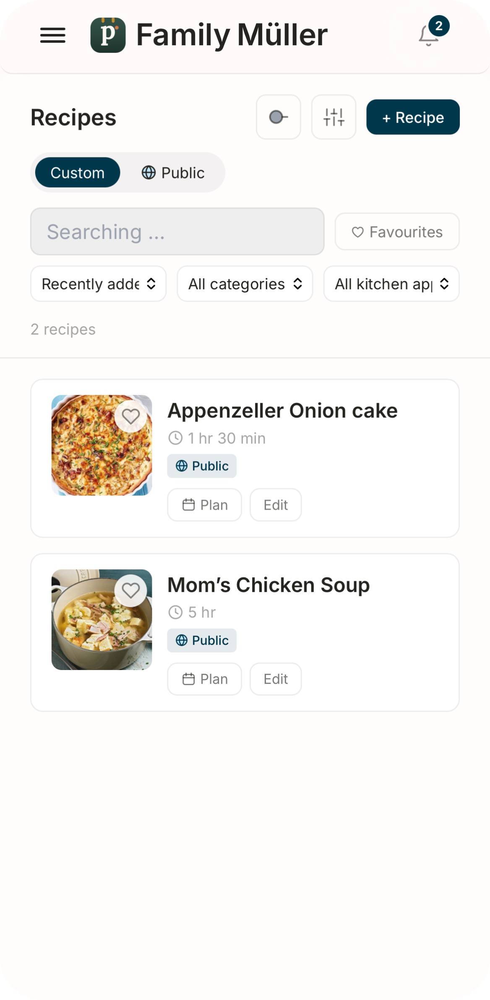
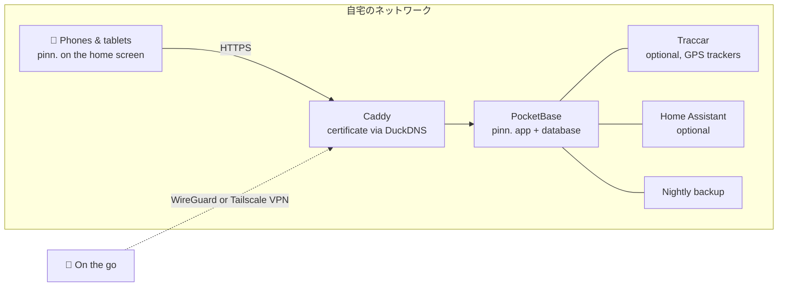

<p align="center">
  
</p>

<p align="center">
  <a href="https://github.com/pinn-shost/pinn/releases/latest"></a>
  <a href="LICENSE"></a>
  
  
  
  <a href="https://ko-fi.com/pinnapp"></a>
</p>

<p align="center">
  <a href="README.md">🇬🇧 English</a> ·
  <a href="README.de.md">🇩🇪 Deutsch</a> ·
  <a href="README.es.md">🇪🇸 Español</a> ·
  <a href="README.fr.md">🇫🇷 Français</a> ·
  <a href="README.it.md">🇮🇹 Italiano</a> ·
  <a href="README.pt.md">🇧🇷 Português</a> ·
  <a href="README.zh.md">🇨🇳 中文</a> ·
  <b>🇯🇵 日本語</b> ·
  <a href="README.ko.md">🇰🇷 한국어</a> ·
  <a href="README.ru.md">🇷🇺 Русский</a> ·
  <a href="README.nl.md">🇳🇱 Nederlands</a> ·
  <a href="README.tr.md">🇹🇷 Türkçe</a> ·
  <a href="README.pl.md">🇵🇱 Polski</a> ·
  <a href="README.uk.md">🇺🇦 Українська</a>
</p>

<p align="center">
  <a href="#screenshots">スクリーンショット</a> ·
  <a href="#what-pinn-does">機能</a> ·
  <a href="#installation">インストール</a> ·
  <a href="#privacy">プライバシー</a> ·
  <a href="#faq">FAQ</a>
</p>

---

pinn.は、家庭を回すためのすべてをまとめたアプリです。共有カレンダー、今週の献立、買い物リスト、ごみ出しの担当、お小遣い、3月に解約しなければならない保険など。**あなた自身のNAS**でDockerを使って動き、家族のすべてのiPhone、iPad、Androidスマートフォンにネイティブアプリのようにインストールできます。

クラウドアカウントは不要。定期購読もありません。広告も追跡もありません。家族のデータは家の外に出ません。

<a id="screenshots"></a>

## スクリーンショット

### iPadで

壁に掛けても、キッチンのテーブルに置いても。共有のiPadが家族全員の様子をいっぺんに映し出します。

<table>
  <tr>
    <td align="center" width="50%">
      <a href=".github/assets/screenshots/dashboard.png"></a><br>
      <sub><b>ダッシュボード</b>：それぞれが自分の写真をタップ、PINは任意</sub>
    </td>
    <td align="center" width="50%">
      <a href=".github/assets/screenshots/ipad-overview.png"></a><br>
      <sub><b>概要</b>：天気、予定、タスク、食事、家族がひと目でわかる</sub>
    </td>
  </tr>
</table>

### スマートフォンで

いつでも一緒：pinn.は、すべてのiPhoneとAndroidスマートフォンにネイティブアプリのようにインストールできます。

<table>
  <tr>
    <td align="center" width="33%"><a href=".github/assets/screenshots/home.png"></a><br><sub><b>概要</b>：あなたの一日がひと目でわかる</sub></td>
    <td align="center" width="33%"><a href=".github/assets/screenshots/calendar.png"></a><br><sub><b>カレンダー</b>：iCloudとGoogleをひとつの画面で</sub></td>
    <td align="center" width="33%"><a href=".github/assets/screenshots/meals.png"></a><br><sub><b>食事</b>：一週間を計画して、ワンタップで買い物</sub></td>
  </tr>
  <tr>
    <td align="center" width="33%"><a href=".github/assets/screenshots/lists.png"></a><br><sub><b>リスト</b>：買い物、ストック、荷造り</sub></td>
    <td align="center" width="33%"><a href=".github/assets/screenshots/finance.png"></a><br><sub><b>家計</b>：予算、貯蓄、お小遣い</sub></td>
    <td align="center" width="33%"><a href=".github/assets/screenshots/chat.png"></a><br><sub><b>チャット</b>：エンドツーエンド暗号化、ボイスメッセージと位置情報つき</sub></td>
  </tr>
</table>

### そのほかの画面

画像をタップすると大きく表示されます。

<details>
<summary><b>そのほかのスクリーンショットを表示</b></summary>

<br>

<table>
  <tr>
    <td align="center" width="25%"><a href=".github/assets/screenshots/house.png"></a><br><sub><b>住まい</b> – 住宅・費用・ローン・不具合・メーターを一か所に</sub></td>
    <td align="center" width="25%"><a href=".github/assets/screenshots/tasks.png"></a><br><sub><b>タスク</b> – 車検やタイヤ交換などの自動リマインダーとワンタップのボタン</sub></td>
    <td align="center" width="25%"><a href=".github/assets/screenshots/vehicles.png"></a><br><sub><b>車両</b> – 車検、タイヤ、給油と充電</sub></td>
    <td align="center" width="25%"><a href=".github/assets/screenshots/scan_pantry.png"></a><br><sub><b>ストックのスキャン</b> – バーコードを読み取って、しまう・使い切る</sub></td>
  </tr>
  <tr>
    <td align="center" width="25%"><a href=".github/assets/screenshots/weekly_summary_1.png"></a><br><sub><b>週のプレビュー</b> – 天気とまだ終わっていないこと</sub></td>
    <td align="center" width="25%"><a href=".github/assets/screenshots/weekly_summary_2.png"></a><br><sub><b>週のプレビュー</b> – 日ごとに：掃除、ごみ、支払い</sub></td>
    <td align="center" width="25%"><a href=".github/assets/screenshots/weekly_summary_3.png"></a><br><sub><b>先週のまとめ</b> – 予定、食事、支出——とショートカット</sub></td>
    <td align="center" width="25%"><a href=".github/assets/screenshots/kids.png"></a><br><sub><b>子ども</b>：楽しい毎日の流れ</sub></td>
  </tr>
</table>

</details>

<sub>📁 <a href=".github/assets/screenshots">すべての画像はこのフォルダにあります</a></sub>

<a id="what-pinn-does"></a>

## pinn.でできること

| | |
|---|---|
| 📅 **カレンダー** | 人ごとのiCloudとGoogleカレンダーを、非公開にも家族との共有にもできます。祝日、学校の休み、ごみ回収日、連絡先の誕生日が自動で表示されます。 |
| 🍝 **食事とレシピ** | 一週間を計画し、材料をそのまま買い物リストへ。テキスト、PDF、写真、リンクからレシピを取り込めます（AIの利用は任意）。お気に入りのレシピを同じサーバー上のほかの家族と共有できます。 |
| 🛒 **リスト** | お店ごとの買い物リスト、在庫が減るとリストを補充するストック、テンプレートからの持ち物リスト（旅行、入院バッグ、パーティー）、ギフトリストとほしいものリスト（贈られる本人には見えない「誰が何を贈る」プランナー付き）。 |
| ✅ **タスクと家事** | プッシュのリマインダー付きタスク、掃除計画、ごみ箱。さらに、時間帯に合うことだけを表示するアニメーション付きの日課を備えた子どものページ。 |
| 💶 **家計** | 共有または個人の財布、家計の予算、ETFや株式を扱う貯蓄と証券口座、お小遣い、定期的な支払い、解約リマインダー付きの契約。ルームシェアでは費用を分け合い、だれがだれにいくら支払うかを確認できます。 |
| 📄 **書類と乗り物** | レシートと保証、期限リマインダー付きの身分証。車と自転車の車検日、タイヤ交換、燃費、総費用。 |
| 🏡 **住まい** | 借主、所有者、貸主向け：賃貸借または売買契約書、ローン、写真付きの不具合、請求書、リフォーム計画、予測つきの検針、鍵、貸している部屋・家・ガレージの家賃収入。雨が降った日を把握している水やり計画つきの庭と植物。 |
| 📍 **家族と位置情報** | pinn.から直接、一度だけ、または選んだ時間だけ位置情報を共有できます。無料アプリのTraccar Clientを使えばバックグラウンドでも共有できます（pinn.に直接送信、追加サーバー不要）。さらに「帰宅中」モード、位置と緊急番号つきのSOSアラート、緊急カード、場所への到着通知。 |
| 🎒 **学校と保育園** | 子どもごとに：時間割（入力するか、写真を撮るとAIが入力）、送り迎え、子どものページの宿題、期限がリマインダーになる保護者向けのお便り、カレンダーに直接表示される休園・休校日。 |
| 🐾 **ペット** | 犬、猫、うさぎなどのプロフィール。チェックできる食事の時間、散歩、「だれの番？」の当番表、プッシュのリマインダー付きの予防接種と駆虫、体重グラフ、獣医と救急動物病院、共有できるペットシッター用シート、印刷できる「迷子」ポスター、自動給餌器の補充リマインダー。 |
| 🌦️ **天気と休暇** | 天気をタップすると（スマートフォンではタイル、iPadとパソコンでは日付と時刻の横の上部）、14日分と各日の詳細を確認できます。目的地と日程を入れた持ち物リストには休暇中の天気（予報または平年値）が表示され、持っていくものを提案します。 |
| 🏠 **スマートホーム** | タスクからAppleショートカットやHome Assistantのアクションを開始：家事の期日にロボット掃除機がキッチンを掃除し、ロボット芝刈り機と水やりは庭の計画に従い、自動給餌器は空になりそうなときに知らせます。 |
| 🎙️ **音声操作** | 「Hey Siri、pinn」：買い物リストに追加、読み上げ、タスクの作成、今日の予定の確認。Androidでも使えます。 |
| 💬 **チャット** | 家族チャットと個別チャット。エンドツーエンド暗号化、プッシュ、既読チェック、返信に対応。 |
| 🔔 **通知** | iPhone、iPad、Androidに届く個人向けのプッシュメッセージと、家族内のあらゆる変更を集めるベル。 |
| 🧩 **そのほか** | 動かせるメモ付きの家族の掲示板、全体検索、自動同期付きのオフラインモード、ダークモード、プロフィールPIN付きのiPadダッシュボード、ゲストアカウント、チャイルドロック。 |

pinn.は **🇬🇧 English、🇩🇪 Deutsch、🇪🇸 Español、🇫🇷 Français、🇮🇹 Italiano、🇧🇷 Português、🇨🇳 中文、🇯🇵 日本語、🇰🇷 한국어、🇷🇺 Русский、🇳🇱 Nederlands、🇹🇷 Türkçe、🇵🇱 Polski、🇺🇦 Українська** に対応し、通貨と緊急番号をお住まいの地域に合わせ、**家族**と**ルームシェア**の表現を切り替えます。1台のサーバーで複数の家族を運用でき、それぞれに管理者を置けます。

## 1.154.0の新機能

**カレンダーアドレスのセキュリティ修正**

- 修正：カレンダーのアドレスを検証するようになりました。iCloud や Google で予定を削除・変更・取得するとき、サーバーは家族カレンダーのログイン情報を使い、送信先は Apple と Google のサーバーだけです。以前は、ログイン済みのプロフィールが細工したリクエストでログイン情報を任意のサーバーへ送らせることができました。すでに動作しているカレンダーへの影響はありません。
- 変更: `pb_hooks/calendar-sync.js`, `js/versionslog.js`, `js/sprachen.js`, `i18n/versionslog.en.js`, `src/`, `index.html`, README.

## 1.153.2の新機能

**「AQ.」で始まる Gemini キー、ステータス表示、エラーログ**

- 修正：セットアップウィザードが、`AQ.` で始まる新しい Google Gemini キー（ドットを含みます）を受け付けるようになりました。以前は「確認」で有効と表示されても「次へ」で拒否されていました。
- 修正：家族メンバーの状態（「移動中」「最終位置」）が常にドイツ語だった問題を直し、すべての言語で表示されるようにしました。
- 変更：エラーログのメッセージは、ドイツ語ではドイツ語、それ以外のすべての言語では英語で表示されます。
- 変更: `pb_hooks/pinn-einrichtung.js`, `pb_hooks/pinn-protokoll.js`, `pb_hooks/protokoll.pb.js`, `einrichtung.js`, `js/fehlerprotokoll.js`, `js/familie.js`, `js/familienkachel.js`, `js/versionslog.js`, `js/sprachen.js`, `i18n/`, `src/`, `index.html`, README.

## 1.153.1の新機能

**健康：新しいブロック5つ、自分のプロフィールは「自分」表示**

- 健康ページに新登場：**日焼け止め**（自宅の今日のUV指数、晴れの日だけ通知）、**睡眠**（就寝前の通知、朝に「よく眠れましたか？」）、**果物と野菜**（1日の皿数）、**マダニチェック**（4〜10月）、**健診**（歯科、一般健診 … 間隔つき。子どもは年齢に応じたドイツのU健診）。子どもの通知は保護者にも届きます。
- 新機能：自分のプロフィールでは名前の代わりに「自分」と表示 – カレンダーの絞り込み、タスク、家族などあらゆる場所で、文中でも自然な形に。ほかに：復元の矢印を線アイコンに、新しいホイールのアイコン、ダークモードの黄色い注意書きを同じ金色に。
- 変更: `pb_hooks/pinn-gesundheit.js`, `js/gesundheit.js`, `css/gesundheit.css`, `js/mitglieder.js`, `js/symbole.js`, `css/dunkelfarbe.css`, `js/aufgaben.js`, `js/termine.js`, `js/listen.js`, `js/sparen.js`, `js/vertraege.js`, `js/familie.js`, `js/hinweise.js`, `js/kassen.js`, `js/zuhause.js`, `js/dokumente.js`, `js/fahrzeuge.js`, `js/ausblick.js`, `js/sterne.js`, `js/vorrat2.js`, `i18n/`, `js/sprachen.js`, `js/versionslog.js`, `index.html`.

## 1.153.0の新機能

**Home Assistant のセキュリティ表示**

- 新機能：**セキュリティ** – 家族の管理者は 設定 → セキュリティ で Home Assistant のデバイスを名前付きグループにまとめられます：窓とドア、ドアロック、カメラ、ガレージとシャッター、煙・水漏れ検知器、警報システム、人感センサー。ファミリーダッシュボードの下部にバーが表示され（例：「すべて閉まっています」「キッチンの窓 が開いています」「1 台のカメラがオンです」、警報時は赤）、概要には「セキュリティ」タイルが加わり、大人は開いているドアロックを施錠できます（解錠は不可）。任意の**夜のチェック**：指定時刻にまだ開いている・未施錠・警報解除のものがあれば、管理者全員にプッシュ通知が届きます。前提：設定 → スマートホーム で Home Assistant が接続されていること。
- 修正：ダークモードでタスク名の下のボタン（スマートホーム開始、メーター読み取り …）が青地に青だった問題 – 金色になりました。
- 変更: `pb_hooks/pinn-sicherheit.js` (new), `pb_hooks/sicherheit.pb.js` (new), `pb_hooks/pinn-smarthome.js`, `pb_hooks/pinn-schema.js`, `js/sicherheit.js` (new), `css/sicherheit.css` (new), `js/uebersicht.js`, `js/profilauswahl.js`, `js/einstellungen.js`, `css/dunkelfarbe.css`, `i18n/`, `js/sprachen.js`, `js/versionslog.js`, `pinn-setup.sh`, `src/`, `index.html`.

## 1.152.1の新機能

**バックアップの復元が再び使えるように**

- 修正：バックアップの復元（設定 → システム → バックアップと更新）が、データのみでもすべてでも、必ず「バックアップを確認」で止まっていました。直前に行う現在の状態のバックアップが古いバックアップを整理する際、選んだバックアップの名前を上書きしてしまい、見つからなくなっていたためです。失敗のたびに「復元の前」のバックアップが残りますが、害はなく自動で整理されます（最新3件を保持）。更新で `pinn-wartung.sh` が新しくなり、コンテナ「wartung」は自動で再起動します。
- Portainer スタック：バックアップが本当に使えるようになりました。1.151.0 の一部がリポジトリに欠けていたため、スタックのサービス「wartung」は起動できませんでした。現在はイメージにバックアップスクリプトが入っていて、スタックの pinn コンテナを自動で見つけます。夜間バックアップ、「今すぐバックアップ」「復元」（データと設定）はスクリプト版と同じように使えます。更新は引き続き Portainer で行います。更新後は Portainer で「Update the stack」を「Re-pull image and redeploy」オンで実行してください。
- 変更: `pinn-wartung.sh`, `docker/Dockerfile`, `.github/workflows/image.yml`, `pb_hooks/pinn-system.js`, `js/sicherungen.js`, `js/serverzugriff.js`, `i18n/`, `js/versionslog.js`, `js/sprachen.js`, `src/`, `index.html`.

## 1.152.0の新機能

**Tailscale の代わりに自分のリバースプロキシ**

- 新機能：自分のリバースプロキシ（Nginx Proxy Manager、Traefik、Cloudflare Tunnel など）でインターネットからアクセスできます。インストールの「自分のリバースプロキシでインターネットからアクセス」を参照してください。pinn. は信頼できるプロキシ（`PINN_PROXY_NETZE`）からの訪問者アドレスだけを信用するため、パスワード誤り後のロックを回避できません（IPv6 は /64 単位）。インターネットからは PocketBase の管理画面と独自のサインイン方法がブロックされ、初期パスワード `Admin` は使えず、トラッカー ID の推測は減速されます。こうした試行があると、管理者に「🚨 セキュリティ警告」のプッシュ通知（アドレス、自宅ネットワークかインターネットか、デバイス）が届き、詳細はエラーログの「セキュリティ」にあります。自宅ネットワークでは何も変わりません。
- 変更: `pb_hooks/pinn-netz.js` (new), `pb_hooks/netz.pb.js` (new), `pb_hooks/pinn-alarm.js` (new), `pb_hooks/pinn-sitzungen.js`, `pb_hooks/benutzer.pb.js`, `pb_hooks/dashboard.pb.js`, `pb_hooks/zuhause.pb.js`, `pb_hooks/sprache.pb.js`, `pb_hooks/smarthome.pb.js`, `pb_hooks/pinn-ortung.js`, `pb_hooks/pinn-protokoll.js`, `pb_hooks/pinn-pushtext.js`, `js/anmeldemaske.js`, `js/fehlerprotokoll.js`, `js/hinweise.js`, `js/appstart.js`, `i18n/`, `docker/docker-compose.portainer.yaml`, `env.txt`, `js/sprachen.js`, `js/versionslog.js`, `src/`, `index.html`.

## 1.151.0の新機能

**Portainer スタックと出来合いのイメージ**

- 新機能：SSH もセットアップスクリプトも使わず、Portainer のスタック画面から pinn. をインストールできます。リリースごとに出来合いのイメージ（amd64、arm64）が作られ、`ghcr.io/pinn-shost/pinn` に公開されます。新しいファイル `docker/docker-compose.portainer.yaml` はこれをボリュームと固定名なしのコンテナで利用します（既存の Tailscale コンテナと衝突しません）。スタックにはバックアップサービス（毎晩のバックアップ、アプリの「今すぐバックアップ」「復元」。アップデートは引き続き Portainer）と、コメントアウトされた任意ブロック（Traccar、Home Assistant への迂回）も含まれます。インストールの「Portainer スタック（スクリプト不要）」を参照してください。
- 変更: `docker/` (new), `.github/workflows/image.yml` (new), `pinn-wartung.sh`, `pb_hooks/pinn-system.js`, `js/sicherungen.js`, `i18n/`, `js/sprachen.js`, `js/versionslog.js`, `src/`, `index.html`.

## 1.150.11の新機能

**アイコンと小さな修正**

- 子どもページの「髪をとかす」に櫛のアイコン。デポ名の横の絵文字欄を廃止。財布の選択リストから絵文字を削除。工具アイコンをスパナに変更。「ゲスト用メニュー」に2人のアイコン。家族名の横のロゴをタップすると概要へ移動。「通知」カードを最初に表示し、「この端末で有効にする」が必ず表示されるように。ダークモードではショートカットのアイコンがグレーに。
- 変更: `js/symbole.js`, `js/symbole3.js`, `js/ansichten.js`, `js/konto.js`, `css/dunkelfarbe.css`, `js/sprachen.js`, `js/versionslog.js`, `i18n/versionslog.en.js`, `src/`, `index.html`.

## 1.150.10の新機能

**ダークモード、アイコンの追加、新しいペットバナー、ペット日記**

- **ダークモード。** 青い文字がゴールドになりました（端末、リスト、「買い物を計画」、ペット・健康・タスクのチェック）。家事のバーは部屋の色になり、チャット、契約、「ひと目で」の文字も読みやすくなりました。**絵文字の代わりにアイコンを追加：**プロフィール画像（赤ちゃん、男の子、女の子、男性、女性、おじいちゃん、おばあちゃん）、家族とシェアハウス、動物（犬、猫、うさぎ、ハムスター、鳥、ひよこ、魚、馬、カメ、ヘビ）。ドロップダウンは文字のみ表示。**カラフルな動物の新しいペットバナー。** **ペット日記：**チェックした健診が日記に載り、×で誤チェックを取り消せます。
- 変更： `css/dunkelfarbe.css` (new), `js/symbole3.js` (new), `js/symbole.js`, `js/szenen.js`, `js/familie.js`, `js/haushalt.js`, `css/symbolfarbe.css`, `css/haustierewetter.css`, `js/sprachen.js`, `js/versionslog.js`, `i18n/`, `src/`, `pinn-setup.sh`, `index.html`.

## 1.150.9の新機能

**アイコンに色、乗り物と植物のアイコン**

- **昼は色付き。** アイコンにうっすら色が付きました（白い面、太陽は黄色、雨は青、車は赤、工具は灰色、植物は緑）。線のスタイルは同じで、ダークモードは変わりません。**乗り物アイコン：** 車の絵文字の代わりに線のアイコンを選べます（セダン、SUV、タクシー、バン、ピックアップ、トラクター、キャラバン、自転車、電動自転車など）。**植物アイコン**もアプリ内から選べ、サボテン、ヤシ、チューリップ、ヒマワリ、バラなどが加わりました。乗り物とホームのバナーでは、車は夜だけ光ります（前は黄色っぽく、後ろは赤）。
- 変更：`js/symbole2.js`, `css/symbolfarbe.css` (new), `js/symbole.js`, `js/wetterlogos.js`, `js/symbolwahl.js`, `js/fahrzeuge.js`, `js/zuhause.js`, `js/dokumente.js`, `css/fahrzeuge.css`, `js/sprachen.js`, `js/versionslog.js`, `i18n/`, `src/`, `pinn-setup.sh`, `index.html`.

## 1.150.8の新機能

**どこでも専用アイコン、アプリ内で選択**

- **あらゆる場所に専用アイコン。** 食べ物、家、乗り物、植物、衣類、おもちゃ、スポーツにも専用の線のアイコンが付きました（部屋、ごみの種類、乗り物の種類、庭、目覚まし、カレンダー切り替え、カウントダウン）。家計、契約、書類、ストックの**カテゴリアイコン**は、絵文字キーボードの代わりに約150個の用意済みアイコンから選びます。同じ種類のカテゴリはどこでも同じアイコンになります。ホームと乗り物のシーンには新しいカラフルな乗り物が登場します。細かな修正：天気「今」の破線の枠を廃止、ダッシュボード時計のフォント、食事プラン一覧のアイコン、アイコンを文字の行に合わせました。
- 変更：`js/szenen.js`, `js/symbolwahl.js` (new), `js/symbole.js`, `css/wetterlogos.css`, `js/zustand.js`, `js/zuhause.js`, `js/fahrzeuge.js`, `js/gesundheit.js`, `js/finanzen.js`, `js/vertraege.js`, `js/dokumente.js`, `js/vorrat.js`, `js/vorrat2.js`, `js/einkauf.js`, `js/profilauswahl.js`, `js/sprachen.js`, `js/versionslog.js`, `i18n/`, `src/`, `pinn-setup.sh`, `index.html`.

## 1.150.7の新機能

**天気の専用アイコン**

- **天気アイコン。** 天気の画面で、Appleの絵文字の代わりに専用のシンプルな線のアイコンを使うようになりました。ショートカットのアイコンと同じスタイルで、太陽、月、雲、雨、雪、雷雨、風、UV、日の出、水温、服装のヒントに対応しています。ダークモードでは色も切り替わります。
- **あらゆる場所に専用アイコン。** 約150個のシンプルな線のアイコンが、アプリ全体でAppleの絵文字に置き換わりました（星、チェック、警告、場所、プレゼント、時計、カレンダー、鍵、メール、道具、健康、家、お金など）。動物、食べ物、衣類、植物、乗り物、スポーツ、おもちゃ、自分で選んだり入力した絵文字（メンバーの画像、チャットの文章、入力欄）、プッシュ通知は絵文字のままです。
- 変更：`js/symbole.js` (new), `js/wetterlogos.js`, `css/wetterlogos.css` (new), `js/familie.js`, `js/grundlagen.js`, `js/profilauswahl.js`, `js/wetterkachel.js`, `js/sprachen.js`, `js/versionslog.js`, `i18n/`, `src/`, `pinn-setup.sh`, `index.html`.

## しくみ



すべては1台のマシン上でDockerコンテナとして動きます。HTTPSは**ポート開放なし**で動作し、証明書はDNS確認で発行されます。外部からpinn.に接続できるのは、あなた自身のVPN経由のみです。

## 必要なもの

- **Docker**と**Docker Compose 2.17以降**が使えるNASまたはサーバー：UGOSを搭載したUGREEN NASで開発され、Dockerが動くあらゆるLinuxホスト（amd64、arm64、armv7）で動作します
- そのSSHアクセス
- 任意ですが推奨：HTTPS用の無料の[DuckDNS](https://www.duckdns.org)サブドメイン（プッシュ通知とpinn.のアプリとしてのインストールに必要）

<a id="installation"></a>

## インストール

1. [最新リリース](https://github.com/pinn-shost/pinn/releases/latest)のZIPをダウンロードして展開します。
2. NASにフォルダを作成し（例：`/volume1/docker/Pocketbase`）、展開したフォルダ（例：`pinn-1.154.0`または`pinn-main`）をそのまま入れます。
3. SSHでログインして次を実行します：
   ```sh
   cd /volume1/docker/Pocketbase && sudo sh pinn-*/pinn-setup.sh
   ```
   スクリプトがすべてのファイルを所定の場所にコピーし、PDF取り込みと写真の文字認識に必要なライブラリをダウンロードして、pinn.を起動します。
4. `http://<NASのIP>:8090`を開き、**メイン管理者としてログイン** → パスワード`Admin` → 自分のパスワードを設定します。
5. **セットアップアシスタント**が、HTTPS、WireGuardまたはTailscaleでのリモートアクセス、Google、AI、位置情報、Home Assistantといった残りの設定を、14の言語で順番に案内します。
6. 各スマートフォンでHTTPSアドレスからpinn.を開き、ホーム画面に追加します：
   - **iPhone/iPad（Safari）：** 共有 → *ホーム画面に追加*（通知にはiOS 16.4以降が必要）
   - **Android（Chrome）：** 設定 → 通知 → *pinn.をアプリとしてインストール*、またはChromeのメニュー ⋮ → *アプリをインストール*

   そのあと、各デバイスで**設定 → 通知 → このデバイスで有効にする**から通知をオンにします。

**アップデート：**新しいZIPをダウンロードし、展開したフォルダを同じフォルダに入れて、もう一度`sudo sh pinn-*/pinn-setup.sh`を実行します。置き換えられたファイルは`_alt/`に残り、データには手を付けません。

**バックアップ**は毎晩`./backups`に作成され、14日間保存されます。

<a id="privacy"></a>

### Portainer スタック（スクリプト不要）

Portainer のほうがお好みですか？ SSH もセットアップスクリプトも不要です。

1. Portainer で **Stacks → Add stack** を開き、名前を `pinn` にして **Web editor** を選びます。
2. [`docker/docker-compose.portainer.yaml`](docker/docker-compose.portainer.yaml) の内容を貼り付けます。
3. 任意：**Environment variables** でポート（`PINN_PORT`、既定は 8090）を変更するか、バージョンを固定します（`PINN_IMAGE_TAG`、例：`1.151.0`）。**Deploy the stack** をクリックします。
4. `http://<NASのIP>:8090` を開き、**メイン管理者としてログイン** → 設定アシスタントへ（上の手順 4～6 と同じ）。

イメージは `ghcr.io/pinn-shost/pinn`（amd64 と arm64）から出来合いで提供されます。データはボリュームに保存されるのでフォルダは不要です。スタックは固定のコンテナ名を使わないため、既存のコンテナと衝突しません。NAS で Tailscale がすでに動いている場合は `tailscale` ブロックを削除し、独自の HTTPS アドレスやリバースプロキシを使う場合は `caddy` と `duckdns` も削除してください。

**更新：** Stack → Editor → *Update the stack* で *Re-pull image and redeploy* をオンにします。**バックアップ：** スタックの `wartung` ブロックが毎晩バックアップを作成し（7 日分 + 4 週分を保持）、pinn. →設定→システムの「今すぐバックアップ」「復元」ボタンの裏側で動きます。バックアップはボリューム `backups` に保存されます（`PINN_BACKUP_DIR` を設定すると NAS のフォルダ、例：`/volume1/docker/pinn-backups`）。復元時に pinn. を一時停止するため Docker へのアクセスが必要です。ボリュームを自分でバックアップする場合はこのブロックを削除してください。アップデートはボタンではなく Portainer で行います。任意（ファイル末尾にコメントアウト、`#` を外すと有効）：Traccar（SIM 付き GPS トラッカー）と Home Assistant への迂回。スマートフォンには不要です。

### 自分のリバースプロキシでインターネットからアクセス

家族が Tailscale を使いたくない場合は、pinn. をリバースプロキシの後ろに置きます。プロキシがインターネットからのリクエストを受け取り、自分のドメインで HTTPS を提供し、pinn. へ転送します。

1. プロキシの転送先を `http://<NAS-IP>:8090` にします（Portainer スタックではポート `PINN_PORT`）。ライブ更新は通常の HTTP を使うため websocket は不要です。レスポンスのバッファリングだけはオンにしないでください。最大 70 MB のアップロードを許可します（チャットの動画）。
   - **Nginx Proxy Manager：** *Hosts → Proxy Hosts → Add*：自分のドメイン、スキーム `http`、NAS の IP、ポート `8090`。*SSL* タブで新しい証明書、*Force SSL* をオン。
   - **Cloudflare Tunnel：** ポート開放は不要 – *Public hostname* → サービス `http://<NAS-IP>:8090`。
   - **Traefik、Caddy など：** 自分のドメイン用に `http://<NAS-IP>:8090` へ転送するルーター/サイトを作成。
2. 各スマートフォンで `https://<domain>` を開いてサインインし、ホーム画面にもう一度追加して通知を再度オンにします（アプリはアドレスごとに別扱いです）。
3. Google カレンダー（任意）：Google Cloud コンソールで `https://<domain>/api/pinn/google/callback` を承認済みのリダイレクト URI に追加します。

pinn. が自動で行うこと：プロキシが渡す訪問者アドレス（`X-Forwarded-For`）は、リクエストが自宅ネットワーク、Docker ネットワーク、Tailscale から来た場合にのみ信用します。これによりパスワード誤り後のロックを回避できません。インターネットからは PocketBase の管理画面（`/_/`）がブロックされ、初期パスワード `Admin` は使えません。プロキシが別の場所にある場合（レンタルサーバー、またはプロキシの前に Cloudflare のオレンジの雲）は、`PINN_PROXY_NETZE` を設定してください（`.env` またはスタックの環境変数）。例：`privat, cloudflare` や `privat, 203.0.113.5`。

**重要：** pinn. はインターネット全体からアクセス可能になります。各プロフィールに長い固有のパスワードを設定し、プロキシを最新に保ち、ルーターでポート 8090 を直接開放しないでください。必ず HTTPS 付きのプロキシ経由にします。

## プライバシー

pinn.は、クラウドサービスには決して預けたくないデータのために作られました。銀行の取引明細、健康に関する書類、子どもたちの居場所などです。そのため：

- **すべてのデータはあなたのNASに**、1つのPocketBaseデータベースとして保存されます。pinn.のサーバーはなく、テレメトリもありません。
- **外部サーバーのスクリプトは使いません。**すべてのコードとライブラリはあなたのNASから配信されます。
- **プッシュ通知に内容は含まれません。**Apple、Google、Mozillaは空の起動シグナルを届けるだけで、デバイスがあなたのNASからメッセージを取得します。
- **iCloudとGoogleのパスワード**は、ロックされたコレクションに暗号化して保存されます。
- **インターネットからは接続できません。**リモートアクセスはあなた自身のVPN経由です。

pinn.が外部サービスに接続するのは、それを必要とする機能のときだけです：

| サービス | 用途 | いつ |
|---|---|---|
| [Open-Meteo](https://open-meteo.com) | 天気予報 | 自宅の住所が設定されているとき |
| [OpenStreetMap Nominatim](https://nominatim.openstreetmap.org) | 住所を地図上の位置に変換 | 住所を入力するとき |
| [OpenStreetMapタイル](https://www.openstreetmap.org) | 地図の背景 | 位置情報ページで、あなたのNAS経由で読み込み |
| [Google Fonts](https://fonts.google.com) | 書体 | アプリの読み込み時 |
| [OpenHolidays API](https://www.openholidaysapi.org) | 祝日と学校の休み | 自宅の住所が設定されているとき |
| [DuckDNS](https://www.duckdns.org) | HTTPS証明書とアドレス | 設定した場合 |
| iCloud / Google | カレンダーと連絡先 | 接続したアカウントのみ |
| Google Gemini | レシピと書類の読み取り | APIキーを追加した場合のみ |
| jsDelivr | pdf.jsとTesseractの1回限りのダウンロード | インストール中のみ |

<a id="faq"></a>

## FAQ

<details>
<summary><b>ルーターのポートを開ける必要はありますか？</b></summary>
<br>
いいえ。HTTPS証明書はDNS確認で発行され、リモートアクセスはVPN経由です。FRITZ!BoxではWireGuard、そのほかのルーターではTailscaleを使います。
</details>

<details>
<summary><b>NASがなくても使えますか？</b></summary>
<br>
Dockerが動く常時稼働のマシンなら使えます。ミニPC、Raspberry Pi 4/5、Linuxサーバーなどです。
</details>

<details>
<summary><b>pinn.はApp Storeの「本物」のアプリですか？</b></summary>
<br>
pinn.はホーム画面に追加するWebアプリです。追加するとネイティブアプリのように全画面で開き、オフラインでも動作し、未完了のタスクをバッジで表示し、プッシュ通知も受け取れます。アプリストアは不要です。
</details>

<details>
<summary><b>1つのインストールを複数の家族で使えますか？</b></summary>
<br>
はい。メイン管理者が家族を作成し、各家族に専用の管理者、カレンダー、データが用意されます。レシピは家族間で任意に共有できます。
</details>

<details>
<summary><b>子どもはどうなりますか？</b></summary>
<br>
チャイルドロックのあるプロフィールは自分のタスクだけが見え、何も削除や変更ができません。家計、書類、乗り物は非表示のままです。小さな子どもには、毎日の日課を載せた楽しい専用ページがあります。
</details>

<details>
<summary><b>費用はかかりますか？</b></summary>
<br>
かかりません。pinn.は無料で、MITライセンスのオープンソースです。Gemini AIなどのオプションサービスには無料枠があります。
</details>

## リポジトリの構成

リポジトリは、NAS上のインストールと同じ構成です。すべてのファイルが最終的に置かれる場所にあります：

```
pinn/
├── pb_hooks/            server: *.pb.js hooks and their helper modules (pinn-*.js, calendar-sync.js)
├── pb_public/           web app served by PocketBase
│   ├── index.html       the app page, built from src/ (HTML, start check) – do not edit by hand
│   ├── js/              app code split out of index.html, plain <script> files without a build step
│   │                    (ruhemodus.js, textkern.js, sprachen.js, region.js, grundlagen.js, popups.js, verbindung.js, benutzer.js, mitteilungen.js, serverzugriff.js, tastatur.js, anmeldemaske.js, dashboard.js, dashboardhintergrund.js, profilauswahl.js, pineingabe.js, dashboardsitzung.js, dashboardkonto.js, familienverwalten.js, einrichten.js, exportieren.js, hauptadminseite.js, anmeldung.js, konto.js, profilverwaltung.js, zustand.js, bedienzustand.js, rezeptbilder.js, zusammenfuehren.js, speichern.js, design.js, sprache.js, uebersicht.js, familienkachel.js, wobistdu.js, geburtstagsfeier.js, wetterkachel.js, geburtstage.js, uebersichteinstellungen.js, familiensync.js, bereiche.js, kalenderquellen.js, icsparser.js, zeitleiste.js, termindetails.js, kalenderdatei.js, wetter.js, wohnort.js, feiertage.js, muellkalender.js, mitglieder.js, profilbild.js, mitglied.js, kinderseite.js, kinderroutine.js, sterne.js, kalenderansicht.js, essenplanen.js, rezeptparser.js, rezeptdialog.js, rezeptbild.js, rezeptmengen.js, einkauf.js, einkaufslisten.js, einkaufseingabe.js, rezepte.js, offline.js, aufgabenextras.js, appbadge.js, reisen.js, aufgabendaten.js, haushalt.js, reihum.js, aufgaben.js, smarthome.js, sprachsteuerung.js, termine.js, ansichten.js, versionspruefung.js, sicherungen.js, geraete.js, fehlerprotokoll.js, versionslog.js, einstellungen.js, kalenderkonto.js, finanzen.js, kassen.js, vorrat.js, vorrat2.js, sparen.js, vertraege.js, fahrzeuge.js, zuhause.js, dokumente.js, pdflesen.js, appstart.js, pinnwand.js, listen.js, familie.js, hinweise.js, ausblick.js – ausblick.js always comes last)
│   ├── css/             app styles split out of index.html, plain CSS without a build step (ergaenzung.css, energiesparen.css, basis.css … haustierewetter.css, terminal.css, glocke.css)
│   ├── einrichtung.js   setup assistant · datenexport.js  data export
│   ├── i18n/            texts by key (de, en, fr, es, it, pt, zh, ja, ko) – English is the reference
│   └── vendor/          pinn.css, pocketbase/ (pdf.js and Tesseract are downloaded by the setup)
├── .github/             GitHub Actions (workflows/check.yml), checks (scripts/), CONTRIBUTING.md, SECURITY.md, images – not installed
├── src/                 sources of index.html (build.js, rahmen.html, teile/) – not installed
├── caddy/Caddyfile      HTTPS reverse proxy
├── docker-compose.yaml  all containers
├── env.txt              template for .env
├── pinn-setup.sh        install & update
├── pinn-wartung.sh      backups & updates (container "wartung")
├── pinn-pocketbase-update.sh
├── index.html           placeholder only, never installed (keeps the update button of 1.38 working)
└── README.md            this page · README.<code>.md in de, es, fr, it, pt, zh, ja, ko
```

`pinn-setup.sh`は、`pb_hooks/`、`pb_public/`、`caddy/Caddyfile`をそのままプロジェクトフォルダにコピーします。データフォルダ（`pb_data/`、`konfig/`、`backups/`、`caddy/data/`など）には決して手を付けません。

## 参加する

不具合の報告、アイデア、翻訳を心から歓迎します。[CONTRIBUTING.md](.github/CONTRIBUTING.md)をご覧ください。セキュリティの問題は、[SECURITY.md](.github/SECURITY.md)の説明に従って非公開で報告してください。プルリクエストの前に`node .github/scripts/check-all.js`を実行してください。同じチェックがGitHubでも自動的に実行されます。

## pinn.を応援する

pinn.は無料で、これからもずっと、すべての人に完全に無料です。私の空き時間に作っています。毎日が少し楽になったなら、ささやかな支援をいただけるとうれしいです。ただし完全に任意です：

<p>
  <a href="https://ko-fi.com/pinnapp"></a>
  <a href="https://buymeacoffee.com/pinn"></a>
</p>

⭐もうれしいです。ほかの家族がpinn.を見つけやすくなります。

## 使用しているもの

[PocketBase](https://pocketbase.io) (MIT) · [Tailwind CSS](https://tailwindcss.com) (MIT) · [pdf.js](https://mozilla.github.io/pdf.js/) (Apache-2.0) · [Tesseract.js](https://tesseract.projectnaptha.com) (Apache-2.0) · [Traccar](https://www.traccar.org) (Apache-2.0) · [Caddy](https://caddyserver.com) (Apache-2.0)

## ライセンス

[MIT](LICENSE)：自由に使い、変更し、共有してください。
