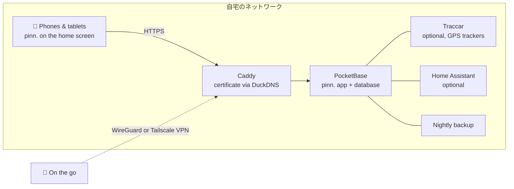

<p align="center">
  
</p>

<p align="center">
  <a href="https://github.com/pinn-shost/pinn/releases/latest"></a>
  <a href="LICENSE"></a>
  
  
  
  <a href="https://ko-fi.com/pinnapp"></a>
</p>

<p align="center">
  <a href="README.md">🇬🇧 English</a> ·
  <a href="README.de.md">🇩🇪 Deutsch</a> ·
  <a href="README.es.md">🇪🇸 Español</a> ·
  <a href="README.fr.md">🇫🇷 Français</a> ·
  <a href="README.it.md">🇮🇹 Italiano</a> ·
  <a href="README.pt.md">🇧🇷 Português</a> ·
  <a href="README.zh.md">🇨🇳 中文</a> ·
  <b>🇯🇵 日本語</b> ·
  <a href="README.ko.md">🇰🇷 한국어</a>
</p>

<p align="center">
  <a href="#screenshots">スクリーンショット</a> ·
  <a href="#what-pinn-does">機能</a> ·
  <a href="#installation">インストール</a> ·
  <a href="#privacy">プライバシー</a> ·
  <a href="#faq">FAQ</a>
</p>

---

pinn.は、家庭を回すためのすべてをまとめたアプリです。共有カレンダー、今週の献立、買い物リスト、ごみ出しの担当、お小遣い、3月に解約しなければならない保険など。**あなた自身のNAS**でDockerを使って動き、家族のすべてのiPhone、iPad、Androidスマートフォンにネイティブアプリのようにインストールできます。

クラウドアカウントは不要。定期購読もありません。広告も追跡もありません。家族のデータは家の外に出ません。

<a id="screenshots"></a>

## スクリーンショット

### iPadで

壁に掛けても、キッチンのテーブルに置いても。共有のiPadが家族全員の様子をいっぺんに映し出します。

<table>
  <tr>
    <td align="center" width="50%">
      <br>
      <sub><b>ダッシュボード</b>：それぞれが自分の写真をタップ、PINは任意</sub>
    </td>
    <td align="center" width="50%">
      <br>
      <sub><b>概要</b>：天気、予定、タスク、食事、家族がひと目でわかる</sub>
    </td>
  </tr>
</table>

### スマートフォンで

いつでも一緒：pinn.は、すべてのiPhoneとAndroidスマートフォンにネイティブアプリのようにインストールできます。

<table>
  <tr>
    <td align="center" width="33%"><br><sub><b>概要</b>：あなたの一日がひと目でわかる</sub></td>
    <td align="center" width="33%"><br><sub><b>カレンダー</b>：iCloudとGoogleをひとつの画面で</sub></td>
    <td align="center" width="33%"><br><sub><b>食事</b>：一週間を計画して、ワンタップで買い物</sub></td>
  </tr>
  <tr>
    <td align="center" width="33%"><br><sub><b>リスト</b>：買い物、ストック、荷造り</sub></td>
    <td align="center" width="33%"><br><sub><b>家計</b>：予算、貯蓄、お小遣い</sub></td>
    <td align="center" width="33%"><br><sub><b>子ども</b>：楽しい毎日の流れ</sub></td>
  </tr>
</table>

<a id="what-pinn-does"></a>

## pinn.でできること

| | |
|---|---|
| 📅 **カレンダー** | 人ごとのiCloudとGoogleカレンダーを、非公開にも家族との共有にもできます。祝日、学校の休み、ごみ回収日、連絡先の誕生日が自動で表示されます。 |
| 🍝 **食事とレシピ** | 一週間を計画し、材料をそのまま買い物リストへ。テキスト、PDF、写真、リンクからレシピを取り込めます（AIの利用は任意）。お気に入りのレシピを同じサーバー上のほかの家族と共有できます。 |
| 🛒 **リスト** | お店ごとの買い物リスト、在庫が減るとリストを補充するストック、テンプレートからの持ち物リスト（旅行、入院バッグ、パーティー）、ギフトリストとほしいものリスト。 |
| ✅ **タスクと家事** | プッシュのリマインダー付きタスク、掃除計画、ごみ箱。さらに、時間帯に合うことだけを表示するアニメーション付きの日課を備えた子どものページ。 |
| 💶 **家計** | 共有または個人の財布、家計の予算、ETFや株式を扱う貯蓄と証券口座、お小遣い、定期的な支払い、解約リマインダー付きの契約。ルームシェアでは費用を分け合い、だれがだれにいくら支払うかを確認できます。 |
| 📄 **書類と乗り物** | レシートと保証、期限リマインダー付きの身分証。車と自転車の車検日、タイヤ交換、燃費、総費用。 |
| 🏡 **住まい** | 借主、所有者、貸主向け：賃貸借または売買契約書、ローン、写真付きの不具合、請求書、リフォーム計画、予測つきの検針、鍵、貸している部屋・家・ガレージの家賃収入。雨が降った日を把握している水やり計画つきの庭と植物。 |
| 📍 **家族と位置情報** | pinn.から直接、一度だけ、または選んだ時間だけ位置情報を共有できます。無料アプリのTraccar Clientを使えばバックグラウンドでも共有できます（pinn.に直接送信、追加サーバー不要）。さらに「帰宅中」モード、位置と緊急番号つきのSOSアラート、緊急カード、場所への到着通知。 |
| 🎒 **学校と保育園** | 子どもごとに：時間割（入力するか、写真を撮るとAIが入力）、送り迎え、子どものページの宿題、期限がリマインダーになる保護者向けのお便り、カレンダーに直接表示される休園・休校日。 |
| 🐾 **ペット** | 犬、猫、うさぎなどのプロフィール。チェックできる食事の時間、散歩、「だれの番？」の当番表、プッシュのリマインダー付きの予防接種と駆虫、体重グラフ、獣医と救急動物病院、共有できるペットシッター用シート、印刷できる「迷子」ポスター、自動給餌器の補充リマインダー。 |
| 🌦️ **天気と休暇** | 天気をタップすると（スマートフォンではタイル、iPadとパソコンでは日付と時刻の横の上部）、14日分と各日の詳細を確認できます。目的地と日程を入れた持ち物リストには休暇中の天気（予報または平年値）が表示され、持っていくものを提案します。 |
| 🏠 **スマートホーム** | タスクからAppleショートカットやHome Assistantのアクションを開始：家事の期日にロボット掃除機がキッチンを掃除し、ロボット芝刈り機と水やりは庭の計画に従い、自動給餌器は空になりそうなときに知らせます。 |
| 🎙️ **音声操作** | 「Hey Siri、pinn」：買い物リストに追加、読み上げ、タスクの作成、今日の予定の確認。Androidでも使えます。 |
| 🔔 **通知** | iPhone、iPad、Androidに届く個人向けのプッシュメッセージと、家族内のあらゆる変更を集めるベル。 |
| 🧩 **そのほか** | 動かせるメモ付きの家族の掲示板、全体検索、自動同期付きのオフラインモード、ダークモード、プロフィールPIN付きのiPadダッシュボード、ゲストアカウント、チャイルドロック。 |

pinn.は **🇬🇧 English、🇩🇪 Deutsch、🇪🇸 Español、🇫🇷 Français、🇮🇹 Italiano、🇧🇷 Português、🇨🇳 中文、🇯🇵 日本語、🇰🇷 한국어** に対応し、通貨と緊急番号をお住まいの地域に合わせ、**家族**と**ルームシェア**の表現を切り替えます。1台のサーバーで複数の家族を運用でき、それぞれに管理者を置けます。

## 1.112.0の新機能

**テキストキー（パート1）：フレーム、ログイン、設定**

- ログイン、メイン管理者、家族ダッシュボード、メニュー、ヘッダー、検索、**設定ページ全体**のテキストが、`pb_public/i18n/` の言語ファイルから読み込まれるようになりました。9言語すべてに対応し、ルームシェアでも同様です。使い方は変わりません。
- 細かな修正：誕生日のある連絡先の件数とプロフィールのないメンバーの案内が、どの言語でも正しい単数・複数で表示されます。スクリーンリーダー用のラベルも翻訳されます。
- 変更：アプリのファイルのみ（`index.html`、`js/` の一部、`i18n/` と `lang/` のすべての言語ファイル）と `.github/`。サーバー側の変更はありません。

以前のバージョンは [Releases](https://github.com/pinn-shost/pinn/releases) をご覧ください。

## しくみ



すべては1台のマシン上でDockerコンテナとして動きます。HTTPSは**ポート開放なし**で動作し、証明書はDNS確認で発行されます。外部からpinn.に接続できるのは、あなた自身のVPN経由のみです。

## 必要なもの

- **Docker**と**Docker Compose 2.17以降**が使えるNASまたはサーバー：UGOSを搭載したUGREEN NASで開発され、Dockerが動くあらゆるLinuxホスト（amd64、arm64、armv7）で動作します
- そのSSHアクセス
- 任意ですが推奨：HTTPS用の無料の[DuckDNS](https://www.duckdns.org)サブドメイン（プッシュ通知とpinn.のアプリとしてのインストールに必要）

<a id="installation"></a>

## インストール

1. [最新リリース](https://github.com/pinn-shost/pinn/releases/latest)のZIPをダウンロードして展開します。
2. NASにフォルダを作成し（例：`/volume1/docker/Pocketbase`）、展開したフォルダ（例：`pinn-1.112.0`または`pinn-main`）をそのまま入れます。
3. SSHでログインして次を実行します：
   ```sh
   cd /volume1/docker/Pocketbase && sudo sh pinn-*/pinn-setup.sh
   ```
   スクリプトがすべてのファイルを所定の場所にコピーし、PDF取り込みと写真の文字認識に必要なライブラリをダウンロードして、pinn.を起動します。
4. `http://<NASのIP>:8090`を開き、**メイン管理者としてログイン** → パスワード`Admin` → 自分のパスワードを設定します。
5. **セットアップアシスタント**が、HTTPS、WireGuardまたはTailscaleでのリモートアクセス、Google、AI、位置情報、Home Assistantといった残りの設定を、9つの言語で順番に案内します。
6. 各スマートフォンでHTTPSアドレスからpinn.を開き、ホーム画面に追加します：
   - **iPhone/iPad（Safari）：** 共有 → *ホーム画面に追加*（通知にはiOS 16.4以降が必要）
   - **Android（Chrome）：** 設定 → 通知 → *pinn.をアプリとしてインストール*、またはChromeのメニュー ⋮ → *アプリをインストール*

   そのあと、各デバイスで**設定 → 通知 → このデバイスで有効にする**から通知をオンにします。

**アップデート：**新しいZIPをダウンロードし、展開したフォルダを同じフォルダに入れて、もう一度`sudo sh pinn-*/pinn-setup.sh`を実行します。置き換えられたファイルは`_alt/`に残り、データには手を付けません。

**バックアップ**は毎晩`./backups`に作成され、14日間保存されます。

<a id="privacy"></a>

## プライバシー

pinn.は、クラウドサービスには決して預けたくないデータのために作られました。銀行の取引明細、健康に関する書類、子どもたちの居場所などです。そのため：

- **すべてのデータはあなたのNASに**、1つのPocketBaseデータベースとして保存されます。pinn.のサーバーはなく、テレメトリもありません。
- **外部サーバーのスクリプトは使いません。**すべてのコードとライブラリはあなたのNASから配信されます。
- **プッシュ通知に内容は含まれません。**Apple、Google、Mozillaは空の起動シグナルを届けるだけで、デバイスがあなたのNASからメッセージを取得します。
- **iCloudとGoogleのパスワード**は、ロックされたコレクションに暗号化して保存されます。
- **インターネットからは接続できません。**リモートアクセスはあなた自身のVPN経由です。

pinn.が外部サービスに接続するのは、それを必要とする機能のときだけです：

| サービス | 用途 | いつ |
|---|---|---|
| [Open-Meteo](https://open-meteo.com) | 天気予報 | 自宅の住所が設定されているとき |
| [OpenStreetMap Nominatim](https://nominatim.openstreetmap.org) | 住所を地図上の位置に変換 | 住所を入力するとき |
| [OpenStreetMapタイル](https://www.openstreetmap.org) | 地図の背景 | 位置情報ページで、あなたのNAS経由で読み込み |
| [Google Fonts](https://fonts.google.com) | 書体 | アプリの読み込み時 |
| [OpenHolidays API](https://www.openholidaysapi.org) | 祝日と学校の休み | 自宅の住所が設定されているとき |
| [DuckDNS](https://www.duckdns.org) | HTTPS証明書とアドレス | 設定した場合 |
| iCloud / Google | カレンダーと連絡先 | 接続したアカウントのみ |
| Google Gemini | レシピと書類の読み取り | APIキーを追加した場合のみ |
| jsDelivr | pdf.jsとTesseractの1回限りのダウンロード | インストール中のみ |

<a id="faq"></a>

## FAQ

<details>
<summary><b>ルーターのポートを開ける必要はありますか？</b></summary>
<br>
いいえ。HTTPS証明書はDNS確認で発行され、リモートアクセスはVPN経由です。FRITZ!BoxではWireGuard、そのほかのルーターではTailscaleを使います。
</details>

<details>
<summary><b>NASがなくても使えますか？</b></summary>
<br>
Dockerが動く常時稼働のマシンなら使えます。ミニPC、Raspberry Pi 4/5、Linuxサーバーなどです。
</details>

<details>
<summary><b>pinn.はApp Storeの「本物」のアプリですか？</b></summary>
<br>
pinn.はホーム画面に追加するWebアプリです。追加するとネイティブアプリのように全画面で開き、オフラインでも動作し、未完了のタスクをバッジで表示し、プッシュ通知も受け取れます。アプリストアは不要です。
</details>

<details>
<summary><b>1つのインストールを複数の家族で使えますか？</b></summary>
<br>
はい。メイン管理者が家族を作成し、各家族に専用の管理者、カレンダー、データが用意されます。レシピは家族間で任意に共有できます。
</details>

<details>
<summary><b>子どもはどうなりますか？</b></summary>
<br>
チャイルドロックのあるプロフィールは自分のタスクだけが見え、何も削除や変更ができません。家計、書類、乗り物は非表示のままです。小さな子どもには、毎日の日課を載せた楽しい専用ページがあります。
</details>

<details>
<summary><b>費用はかかりますか？</b></summary>
<br>
かかりません。pinn.は無料で、MITライセンスのオープンソースです。Gemini AIなどのオプションサービスには無料枠があります。
</details>

## リポジトリの構成

リポジトリは、NAS上のインストールと同じ構成です。すべてのファイルが最終的に置かれる場所にあります：

```
pinn/
├── pb_hooks/            server: *.pb.js hooks and their helper modules (pinn-*.js, calendar-sync.js)
├── pb_public/           web app served by PocketBase
│   ├── index.html       the app page, built from src/ (HTML, start check) – do not edit by hand
│   ├── js/              app code split out of index.html, plain <script> files without a build step
│   │                    (ruhemodus.js, textkern.js, sprachen.js, region.js, grundlagen.js, popups.js, verbindung.js, benutzer.js, mitteilungen.js, serverzugriff.js, tastatur.js, anmeldemaske.js, dashboard.js, dashboardhintergrund.js, profilauswahl.js, pineingabe.js, dashboardsitzung.js, dashboardkonto.js, familienverwalten.js, einrichten.js, exportieren.js, hauptadminseite.js, anmeldung.js, konto.js, profilverwaltung.js, zustand.js, bedienzustand.js, rezeptbilder.js, zusammenfuehren.js, speichern.js, design.js, sprache.js, uebersicht.js, familienkachel.js, wobistdu.js, geburtstagsfeier.js, wetterkachel.js, geburtstage.js, uebersichteinstellungen.js, familiensync.js, bereiche.js, kalenderquellen.js, icsparser.js, zeitleiste.js, termindetails.js, kalenderdatei.js, wetter.js, wohnort.js, feiertage.js, muellkalender.js, mitglieder.js, profilbild.js, mitglied.js, kinderseite.js, kinderroutine.js, sterne.js, kalenderansicht.js, essenplanen.js, rezeptparser.js, rezeptdialog.js, rezeptbild.js, rezeptmengen.js, einkauf.js, einkaufslisten.js, einkaufseingabe.js, rezepte.js, offline.js, aufgabenextras.js, appbadge.js, reisen.js, aufgabendaten.js, haushalt.js, reihum.js, aufgaben.js, smarthome.js, sprachsteuerung.js, termine.js, ansichten.js, versionspruefung.js, sicherungen.js, geraete.js, fehlerprotokoll.js, versionslog.js, einstellungen.js, kalenderkonto.js, finanzen.js, kassen.js, vorrat.js, vorrat2.js, sparen.js, vertraege.js, fahrzeuge.js, zuhause.js, dokumente.js, pdflesen.js, appstart.js, pinnwand.js, listen.js, familie.js, hinweise.js, ausblick.js – ausblick.js always comes last)
│   ├── css/             app styles split out of index.html, plain CSS without a build step (ergaenzung.css, energiesparen.css, basis.css … haustierewetter.css, terminal.css, glocke.css)
│   ├── einrichtung.js   setup assistant · datenexport.js  data export
│   ├── i18n/            texts by key (de, en, fr, es, it, pt, zh, ja, ko) – English is the reference
│   ├── lang/            old dictionaries for parts without keys yet (en, fr, es, it, pt, zh, ja, ko)
│   └── vendor/          pinn.css, pocketbase/ (pdf.js and Tesseract are downloaded by the setup)
├── .github/             GitHub Actions (workflows/check.yml), checks (scripts/), CONTRIBUTING.md, SECURITY.md, images – not installed
├── src/                 sources of index.html (build.js, rahmen.html, teile/) – not installed
├── caddy/Caddyfile      HTTPS reverse proxy
├── docker-compose.yaml  all containers
├── env.txt              template for .env
├── pinn-setup.sh        install & update
├── pinn-wartung.sh      backups & updates (container "wartung")
├── pinn-pocketbase-update.sh
├── index.html           placeholder only, never installed (keeps the update button of 1.38 working)
└── README.md            this page · README.<code>.md in de, es, fr, it, pt, zh, ja, ko
```

`pinn-setup.sh`は、`pb_hooks/`、`pb_public/`、`caddy/Caddyfile`をそのままプロジェクトフォルダにコピーします。データフォルダ（`pb_data/`、`konfig/`、`backups/`、`caddy/data/`など）には決して手を付けません。

## 参加する

不具合の報告、アイデア、翻訳を心から歓迎します。[CONTRIBUTING.md](.github/CONTRIBUTING.md)をご覧ください。セキュリティの問題は、[SECURITY.md](.github/SECURITY.md)の説明に従って非公開で報告してください。プルリクエストの前に`node .github/scripts/check-all.js`を実行してください。同じチェックがGitHubでも自動的に実行されます。

## pinn.を応援する

pinn.は無料で、これからもずっと、すべての人に完全に無料です。私の空き時間に作っています。毎日が少し楽になったなら、ささやかな支援をいただけるとうれしいです。ただし完全に任意です：

<p>
  <a href="https://ko-fi.com/pinnapp"></a>
  <a href="https://buymeacoffee.com/pinn"></a>
</p>

⭐もうれしいです。ほかの家族がpinn.を見つけやすくなります。

## 使用しているもの

[PocketBase](https://pocketbase.io) (MIT) · [Tailwind CSS](https://tailwindcss.com) (MIT) · [pdf.js](https://mozilla.github.io/pdf.js/) (Apache-2.0) · [Tesseract.js](https://tesseract.projectnaptha.com) (Apache-2.0) · [Traccar](https://www.traccar.org) (Apache-2.0) · [Caddy](https://caddyserver.com) (Apache-2.0)

## ライセンス

[MIT](LICENSE)：自由に使い、変更し、共有してください。
