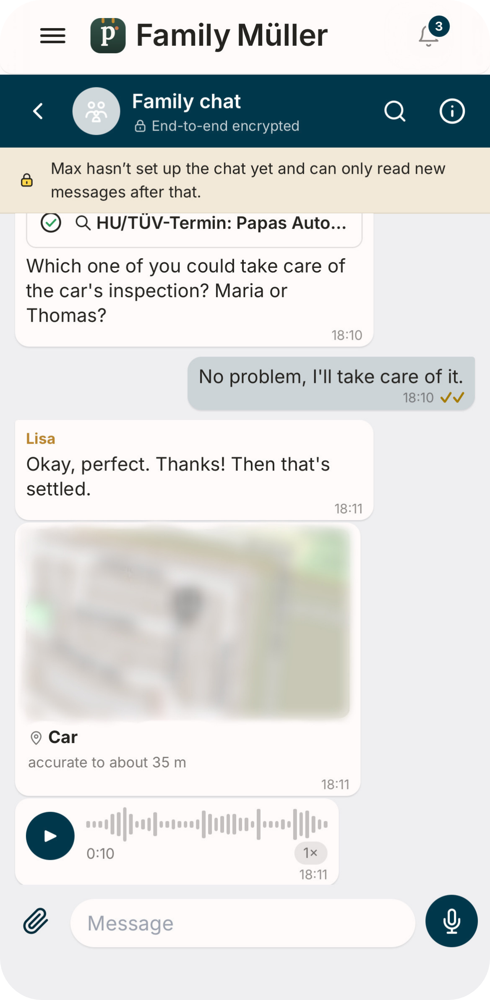
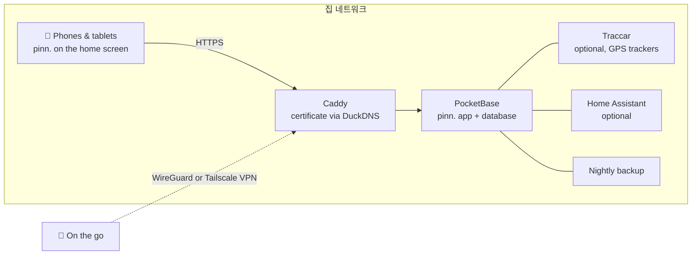

<p align="center">
  
</p>

<p align="center">
  <a href="https://github.com/pinn-shost/pinn/releases/latest"></a>
  <a href="LICENSE"></a>
  
  
  
  <a href="https://ko-fi.com/pinnapp"></a>
</p>

<p align="center">
  <a href="README.md">🇬🇧 English</a> ·
  <a href="README.de.md">🇩🇪 Deutsch</a> ·
  <a href="README.es.md">🇪🇸 Español</a> ·
  <a href="README.fr.md">🇫🇷 Français</a> ·
  <a href="README.it.md">🇮🇹 Italiano</a> ·
  <a href="README.pt.md">🇧🇷 Português</a> ·
  <a href="README.zh.md">🇨🇳 中文</a> ·
  <a href="README.ja.md">🇯🇵 日本語</a> ·
  <a href="README.ru.md">🇷🇺 Русский</a> ·
  <a href="README.nl.md">🇳🇱 Nederlands</a> ·
  <a href="README.tr.md">🇹🇷 Türkçe</a> ·
  <a href="README.pl.md">🇵🇱 Polski</a> ·
  <a href="README.uk.md">🇺🇦 Українська</a> ·
  <a href="README.cs.md">🇨🇿 Čeština</a> ·
  <a href="README.sv.md">🇸🇪 Svenska</a> ·
  <a href="README.da.md">🇩🇰 Dansk</a> ·
  <a href="README.nb.md">🇳🇴 Norsk</a> ·
  <a href="README.fi.md">🇫🇮 Suomi</a> ·
  <a href="README.hu.md">🇭🇺 Magyar</a> ·
  <b>🇰🇷 한국어</b>
</p>

<p align="center">
  <a href="#screenshots">스크린샷</a> ·
  <a href="#what-pinn-does">기능</a> ·
  <a href="#installation">설치</a> ·
  <a href="#privacy">개인정보 보호</a> ·
  <a href="#faq">FAQ</a>
</p>

---

pinn.은 집안을 굴러가게 하는 모든 것을 한곳에 모은 앱이에요. 함께 쓰는 캘린더, 이번 주 식단, 장보기 목록, 쓰레기를 내놓는 사람, 용돈, 3월에 해지해야 하는 보험까지요. **내 NAS**에서 Docker로 실행되고, 가족 모두의 iPhone, iPad, Android 휴대폰에 네이티브 앱처럼 설치돼요.

클라우드 계정도, 구독도 없어요. 광고도, 추적도 없어요. 가족의 데이터는 집 밖으로 나가지 않아요.

<a id="screenshots"></a>

## 스크린샷

### iPad에서

벽에 걸어 두거나 주방 식탁에 올려 두세요. 함께 쓰는 iPad가 온 가족을 한눈에 보여줘요.

<table>
  <tr>
    <td align="center" width="50%">
      <a href=".github/assets/screenshots/dashboard.png"></a><br>
      <sub><b>대시보드</b>: 각자 자기 사진을 누르고, PIN은 선택 사항</sub>
    </td>
    <td align="center" width="50%">
      <a href=".github/assets/screenshots/ipad-overview.png"></a><br>
      <sub><b>개요</b>: 날씨, 일정, 할 일, 식사, 가족을 한눈에</sub>
    </td>
  </tr>
</table>

### 휴대폰에서

언제나 함께: pinn.은 모든 iPhone과 Android 휴대폰에 네이티브 앱처럼 설치돼요.

<table>
  <tr>
    <td align="center" width="33%"><a href=".github/assets/screenshots/home.png"></a><br><sub><b>개요</b>: 오늘 하루를 한눈에</sub></td>
    <td align="center" width="33%"><a href=".github/assets/screenshots/calendar.png"></a><br><sub><b>캘린더</b>: iCloud와 Google을 한 화면에</sub></td>
    <td align="center" width="33%"><a href=".github/assets/screenshots/meals.png"></a><br><sub><b>식단</b>: 한 주를 계획하고 한 번에 장보기</sub></td>
  </tr>
  <tr>
    <td align="center" width="33%"><a href=".github/assets/screenshots/lists.png"></a><br><sub><b>목록</b>: 장보기, 비축품, 짐 싸기</sub></td>
    <td align="center" width="33%"><a href=".github/assets/screenshots/finance.png"></a><br><sub><b>가계</b>: 예산, 저축, 용돈</sub></td>
    <td align="center" width="33%"><a href=".github/assets/screenshots/chat.png"></a><br><sub><b>채팅</b>: 종단 간 암호화, 음성 메시지와 위치 공유</sub></td>
  </tr>
</table>

### 다른 화면

이미지를 누르면 크게 볼 수 있어요.

<details>
<summary><b>스크린샷 더 보기</b></summary>

<br>

<table>
  <tr>
    <td align="center" width="25%"><a href=".github/assets/screenshots/house.png"></a><br><sub><b>집</b> – 집, 비용, 대출, 하자, 계량기를 한곳에서</sub></td>
    <td align="center" width="25%"><a href=".github/assets/screenshots/tasks.png"></a><br><sub><b>할 일</b> – 자동 알림(예: 차검과 타이어 교체)과 바로가기 버튼</sub></td>
    <td align="center" width="25%"><a href=".github/assets/screenshots/vehicles.png"></a><br><sub><b>차량</b> – 차검, 타이어, 주유와 충전</sub></td>
    <td align="center" width="25%"><a href=".github/assets/screenshots/scan_pantry.png"></a><br><sub><b>비축품 스캔</b> – 바코드를 스캔해 보관하거나 소진</sub></td>
  </tr>
  <tr>
    <td align="center" width="25%"><a href=".github/assets/screenshots/weekly_summary_1.png"></a><br><sub><b>주간 미리보기</b> – 날씨와 아직 남은 일</sub></td>
    <td align="center" width="25%"><a href=".github/assets/screenshots/weekly_summary_2.png"></a><br><sub><b>주간 미리보기</b> – 하루씩: 청소, 쓰레기, 결제</sub></td>
    <td align="center" width="25%"><a href=".github/assets/screenshots/weekly_summary_3.png"></a><br><sub><b>지난주 요약</b> – 일정, 식사, 지출 – 그리고 바로가기</sub></td>
    <td align="center" width="25%"><a href=".github/assets/screenshots/kids.png"></a><br><sub><b>아이</b>: 재미있는 하루 일과</sub></td>
  </tr>
</table>

</details>

<sub>📁 <a href=".github/assets/screenshots">모든 이미지는 이 폴더에 있어요</a></sub>

<a id="what-pinn-does"></a>

## pinn.으로 할 수 있는 일

| | |
|---|---|
| 📅 **캘린더** | 사람별 iCloud 및 Google 캘린더를 비공개로 쓰거나 가족과 공유할 수 있어요. 공휴일, 학교 방학, 쓰레기 수거일, 연락처의 생일이 자동으로 표시돼요. |
| 🍝 **식단과 레시피** | 한 주를 계획하고 재료를 바로 장보기 목록으로 보내세요. 텍스트, PDF, 사진, 링크로 레시피를 가져올 수 있고, 원하면 AI도 쓸 수 있어요. 같은 서버의 다른 가족과 즐겨 찾는 레시피를 공유하세요. |
| 🛒 **목록** | 가게별 장보기 목록, 재고가 줄면 목록을 채워 주는 비축품, 템플릿 기반 짐 목록(휴가, 출산 가방, 파티), 선물 목록과 위시리스트(받는 사람에게는 보이지 않는 '누가 무엇을 선물할까' 플래너 포함). |
| ✅ **할 일과 집안일** | 푸시 알림이 있는 할 일, 청소 계획, 쓰레기통 – 그리고 시간대에 맞는 것만 보여주는 애니메이션 일과가 있는 아이 페이지. |
| 💶 **가계** | 공동 또는 개인 자금, 가계 예산, ETF와 주식이 있는 저축 및 증권 계좌, 용돈, 반복 결제, 해지 알림이 있는 계약. 셰어하우스에서는 비용을 나누고 누가 누구에게 얼마를 줘야 하는지 볼 수 있어요. |
| 📄 **문서와 탈것** | 영수증과 보증, 만료 알림이 있는 신분증. 자동차와 자전거의 검사일, 타이어 교체, 연비, 총비용. |
| 🏡 **집** | 세입자, 집주인, 임대인을 위해: 임대차 또는 매매 계약서, 대출, 사진이 있는 하자, 청구서, 리모델링 계획, 예측이 있는 계량기 검침, 열쇠, 임대 주는 아파트·집·차고의 임대 수입. 비가 온 날을 아는 물 주기 계획이 있는 정원과 식물. |
| 📍 **가족과 위치** | pinn.에서 바로 위치를 공유하세요. 한 번만 또는 정한 시간 동안, 그리고 무료 앱 Traccar Client로 백그라운드에서도 공유할 수 있어요(pinn.으로 바로 전송, 추가 서버 없음). ‘집으로 가는 중’ 모드, 위치와 긴급 번호가 담긴 SOS 경보, 응급 카드, 장소 도착 알림도 있어요. |
| 🎒 **학교와 어린이집** | 아이별로: 시간표(입력하거나 사진을 찍으면 AI가 채워 줘요), 등원과 하원, 아이 페이지의 숙제, 기한이 알림이 되는 가정통신문, 캘린더에 바로 표시되는 휴원·휴교일. |
| 🐾 **반려동물** | 강아지, 고양이, 토끼 등의 프로필. 체크할 수 있는 식사 시간, 산책, ‘누구 차례?’ 당번표, 푸시 알림이 있는 예방접종과 구충, 체중 그래프, 수의사와 응급 동물병원, 공유할 수 있는 펫시터용 시트, 인쇄할 수 있는 ‘실종’ 포스터, 자동 급식기 보충 알림. |
| 🌦️ **날씨와 휴가** | 날씨를 누르면(휴대폰에서는 타일, iPad와 컴퓨터에서는 날짜와 시간 옆 상단) 14일과 날마다의 자세한 정보를 볼 수 있어요. 목적지와 날짜가 있는 짐 목록은 휴가지 날씨(예보 또는 평년값)를 보여주고 무엇을 챙길지 추천해 줘요. |
| 🏠 **스마트홈** | 할 일에서 Apple 단축어나 Home Assistant 동작을 시작하세요. 집안일 기한이 되면 로봇청소기가 주방을 청소하고, 로봇 잔디깎이와 물 주기는 정원 계획을 따르고, 자동 급식기는 비어 갈 때 알려줘요. |
| 🎙️ **음성 제어** | “Hey Siri, pinn”: 장보기 목록에 추가하고, 읽어 달라고 하고, 할 일을 만들고, 오늘 일정을 들어요. Android에서도 쓸 수 있어요. |
| 💬 **채팅** | 가족 채팅과 개인 채팅, 종단 간 암호화, 푸시·읽음 체크·답장 지원. |
| 🔔 **알림** | iPhone, iPad, Android에서 받는 개인 푸시 메시지와, 가족의 모든 변경을 모아 주는 알림 벨. |
| 🧩 **그 밖에** | 옮길 수 있는 메모가 있는 가족 게시판, 전체 검색, 자동 동기화되는 오프라인 모드, 다크 모드, 프로필 PIN이 있는 iPad 대시보드, 손님 계정, 아이 보호 잠금. |

pinn.은 **🇬🇧 English, 🇩🇪 Deutsch, 🇪🇸 Español, 🇫🇷 Français, 🇮🇹 Italiano, 🇧🇷 Português, 🇨🇳 中文, 🇯🇵 日本語, 🇰🇷 한국어, 🇷🇺 Русский, 🇳🇱 Nederlands, 🇹🇷 Türkçe, 🇵🇱 Polski, 🇺🇦 Українська, 🇨🇿 Čeština, 🇸🇪 Svenska, 🇩🇰 Dansk, 🇳🇴 Norsk, 🇫🇮 Suomi, 🇭🇺 Magyar**를 지원하고, 통화와 긴급 번호를 사는 지역에 맞추며, **가족**과 **셰어하우스** 용어를 오갈 수 있어요. 서버 한 대에 여러 가족을 둘 수 있고, 가족마다 관리자가 따로 있어요.

## 1.160.0의 새 소식

**헝가리어**

- 새 기능: 헝가리어(Magyar)가 새 앱 언어로 추가됐어요. 앱의 약 7,500개 문장, 설정 도우미, 데이터 내보내기, 서버의 푸시 알림, 헝가리 긴급 전화번호(112)를 지원하고 셰어하우스용 표현(“háztartás”, “lakótárs”)과 헝가리어 어미도 들어 있어요. 설정 → 언어 및 지역에서 고를 수 있어요.
- 참고: 번역은 원어민 검수를 받지 않았어요. 개선 제안은 GitHub 이슈로 보내 주세요. Siri/Android 음성 제어는 아직 헝가리어를 이해하지 못하고 영어로 답해요.
- 변경: `i18n/hu.i18n.js` (new), `README.hu.md` (new), `js/`, `pb_hooks/`, `einrichtung.js`, `datenexport.js`, `.github/scripts/`, `src/`, `index.html`, README.

## 1.159.0의 새 소식

**핀란드어**

- 새 기능: 핀란드어(Suomi)가 새 앱 언어로 추가됐어요. 앱의 약 7,500개 문장, 설정 도우미, 데이터 내보내기, 서버의 푸시 알림, 핀란드 긴급 전화번호(112)를 지원하고 셰어하우스용 표현(“kotitalous”, “asukas”)과 핀란드어 격 어미도 들어 있어요. 설정 → 언어 및 지역에서 고를 수 있어요.
- 참고: 번역은 원어민 검수를 받지 않았어요. 개선 제안은 GitHub 이슈로 보내 주세요. Siri/Android 음성 제어는 아직 핀란드어를 이해하지 못하고 영어로 답해요.
- 변경: `i18n/fi.i18n.js` (new), `README.fi.md` (new), `js/`, `pb_hooks/`, `einrichtung.js`, `datenexport.js`, `.github/scripts/`, `src/`, `index.html`, README.

## 1.158.0의 새 소식

**노르웨이어**

- 새 기능: 노르웨이어(Norsk, 보크몰)가 새 앱 언어로 추가됐어요. 앱의 약 7,500개 문장, 설정 도우미, 데이터 내보내기, 서버의 푸시 알림, 노르웨이 긴급 전화번호(112)를 지원하고 셰어하우스용 표현(“husstand”, “bofelle”)도 들어 있어요. 설정 → 언어 및 지역에서 고를 수 있어요.
- 참고: 번역은 원어민 검수를 받지 않았어요. 개선 제안은 GitHub 이슈로 보내 주세요. Siri/Android 음성 제어는 아직 노르웨이어를 이해하지 못하고 영어로 답해요.
- 변경: `i18n/nb.i18n.js` (new), `README.nb.md` (new), `js/`, `pb_hooks/`, `einrichtung.js`, `datenexport.js`, `.github/scripts/`, `src/`, `index.html`, README.

## 1.157.0의 새 소식

**덴마크어**

- 새 기능: 덴마크어(Dansk)가 새 앱 언어로 추가됐어요. 앱의 약 7,500개 문장, 설정 도우미, 데이터 내보내기, 서버의 푸시 알림, 덴마크 긴급 전화번호(112)를 지원하고 셰어하우스용 표현(“husstand”, “bofælle”)도 들어 있어요. 설정 → 언어 및 지역에서 고를 수 있어요.
- 참고: 번역은 원어민 검수를 받지 않았어요. 개선 제안은 GitHub 이슈로 보내 주세요. Siri/Android 음성 제어는 아직 덴마크어를 이해하지 못하고 영어로 답해요.
- 변경: `i18n/da.i18n.js` (new), `README.da.md` (new), `js/`, `pb_hooks/`, `einrichtung.js`, `datenexport.js`, `.github/scripts/`, `src/`, `index.html`, README.

## 1.156.0의 새 소식

**스웨덴어**

- 새 기능: 스웨덴어(Svenska)가 새 앱 언어로 추가됐어요. 앱의 약 7,500개 문장, 설정 도우미, 데이터 내보내기, 서버의 푸시 알림, 스웨덴 긴급 전화번호(112)를 지원하고 셰어하우스용 표현(“hushåll”, “medboende”)도 들어 있어요. 설정 → 언어 및 지역에서 고를 수 있어요.
- 참고: 번역은 원어민 검수를 받지 않았어요. 개선 제안은 GitHub 이슈로 보내 주세요. Siri/Android 음성 제어는 아직 스웨덴어를 이해하지 못하고 영어로 답해요.
- 변경: `i18n/sv.i18n.js` (new), `README.sv.md` (new), `js/`, `pb_hooks/`, `einrichtung.js`, `datenexport.js`, `.github/scripts/`, `src/`, `index.html`, README.

## 1.155.0의 새 소식

**체코어**

- 새 기능: 체코어(Čeština)가 새 앱 언어로 추가됐어요. 앱의 약 7,500개 문장, 설정 도우미, 데이터 내보내기, 서버의 푸시 알림, 체코 긴급 전화번호(112, 경찰 158, 구급 155, 소방 150)를 지원하고 셰어하우스용 표현도 들어 있어요. 설정 → 언어 및 지역에서 고를 수 있어요.
- 참고: 번역은 원어민 검수를 받지 않았어요. 개선 제안은 GitHub 이슈로 보내 주세요. Siri/Android 음성 제어는 아직 체코어를 이해하지 못하고 영어로 답해요.
- 변경: `i18n/cs.i18n.js` (new), `README.cs.md` (new), `js/`, `pb_hooks/`, `einrichtung.js`, `datenexport.js`, `.github/scripts/`, `src/`, `index.html`, README.

## 1.154.0의 새 소식

**캘린더 주소 보안 수정**

- 수정：캘린더 주소를 이제 검사합니다. iCloud나 Google에서 일정을 삭제·변경·읽을 때 서버는 가족 캘린더의 로그인 정보를 사용하며, 이 정보는 Apple과 Google 서버로만 보낼 수 있습니다. 이전에는 로그인한 프로필이 조작된 요청으로 로그인 정보를 임의의 다른 서버로 보낼 수 있었습니다. 이미 작동하는 캘린더에는 영향이 없습니다.
- 변경: `pb_hooks/calendar-sync.js`, `js/versionslog.js`, `js/sprachen.js`, `i18n/versionslog.en.js`, `src/`, `index.html`, README.

## 1.153.2의 새 소식

**“AQ.”로 시작하는 Gemini 키, 상태 문구, 오류 로그**

- 수정：설정 마법사가 `AQ.`로 시작하는 새 Google Gemini 키(점이 들어 있음)를 받아들입니다. 이전에는 “확인”에서 유효하다고 나오는데 “다음”에서 거부됐습니다.
- 수정：가족 구성원의 상태(“이동 중”, “마지막 위치”)가 항상 독일어였던 문제를 고쳐 모든 언어로 표시됩니다.
- 변경：오류 로그의 메시지는 독일어는 독일어로, 그 밖의 모든 언어는 영어로 표시됩니다.
- 변경: `pb_hooks/pinn-einrichtung.js`, `pb_hooks/pinn-protokoll.js`, `pb_hooks/protokoll.pb.js`, `einrichtung.js`, `js/fehlerprotokoll.js`, `js/familie.js`, `js/familienkachel.js`, `js/versionslog.js`, `js/sprachen.js`, `i18n/`, `src/`, `index.html`, README.

## 1.153.1의 새 소식

**건강: 새 블록 5개, 내 프로필에는 “나” 표시**

- 건강 페이지 신규: **선크림**(집의 오늘 자외선 지수, 맑은 날만 알림), **수면**(취침 전 알림, 아침에 “잘 잤나요?”), **과일 및 채소**(하루 섭취량), **진드기 확인**(4~10월), **건강검진**(치과, 종합 검진 … 주기 설정; 아이는 나이별 독일 U 검진). 아이의 알림은 부모에게도 갑니다.
- 신규: 내 프로필에서는 이름 대신 “나”로 표시 – 캘린더 필터, 작업, 가족 등 모든 곳에서, 문장 안에서도 자연스럽게. 그 밖에: 복원 화살표를 선 아이콘으로, 새 휠 아이콘, 다크 모드에서 노란 안내 문구를 같은 금색으로.
- 변경: `pb_hooks/pinn-gesundheit.js`, `js/gesundheit.js`, `css/gesundheit.css`, `js/mitglieder.js`, `js/symbole.js`, `css/dunkelfarbe.css`, `js/aufgaben.js`, `js/termine.js`, `js/listen.js`, `js/sparen.js`, `js/vertraege.js`, `js/familie.js`, `js/hinweise.js`, `js/kassen.js`, `js/zuhause.js`, `js/dokumente.js`, `js/fahrzeuge.js`, `js/ausblick.js`, `js/sterne.js`, `js/vorrat2.js`, `i18n/`, `js/sprachen.js`, `js/versionslog.js`, `index.html`.

## 1.153.0의 새 소식

**Home Assistant 보안 현황**

- 새 기능: **보안** – 가족 관리자는 설정 → 보안에서 Home Assistant 기기를 이름 있는 그룹으로 묶을 수 있습니다: 창문 및 문, 도어락, 카메라, 차고 문 및 셔터, 연기 및 누수 감지기, 경보 시스템, 동작 감지기. 가족 대시보드 하단에 상태 표시줄이 나타나고(예: “모두 닫힘”, “주방 창문 열림”, “카메라 1대 켜짐”, 경보 시 빨간색), 개요에는 “보안” 타일이 추가되어 성인은 열린 도어락을 잠글 수 있습니다(열기는 불가). 선택 사항 **저녁 점검**: 지정한 시각에 아직 열려 있거나 잠기지 않았거나 경보가 해제된 것이 있으면 모든 관리자에게 푸시 알림이 갑니다. 조건: 설정 → 스마트홈에서 Home Assistant 연결.
- 수정: 다크 모드에서 작업 제목 아래 버튼(스마트홈 시작, 계량기 검침 …)이 파란 바탕에 파란 글씨였던 문제 – 이제 금색입니다.
- 변경: `pb_hooks/pinn-sicherheit.js` (new), `pb_hooks/sicherheit.pb.js` (new), `pb_hooks/pinn-smarthome.js`, `pb_hooks/pinn-schema.js`, `js/sicherheit.js` (new), `css/sicherheit.css` (new), `js/uebersicht.js`, `js/profilauswahl.js`, `js/einstellungen.js`, `css/dunkelfarbe.css`, `i18n/`, `js/sprachen.js`, `js/versionslog.js`, `pinn-setup.sh`, `src/`, `index.html`.

## 1.152.1의 새 소식

**백업 복원이 다시 돼요**

- 수정: 백업 복원(설정 → 시스템 → 백업 및 업데이트)이 데이터만이든 전체든 항상 "백업 확인"에서 멈췄어요. 바로 전에 만드는 현재 상태 백업이 오래된 백업을 정리하면서 선택한 백업의 이름을 덮어써서 찾지 못했기 때문이에요. 실패할 때마다 "복원 전" 백업이 남았는데, 해가 없고 저절로 정리돼요(최근 3개 유지). 업데이트로 `pinn-wartung.sh`가 바뀌고, "wartung" 컨테이너는 저절로 다시 시작해요.
- Portainer 스택: 이제 백업이 제대로 돼요. 저장소에 1.151.0의 일부가 빠져 있어서 스택의 "wartung" 서비스가 시작할 게 없었어요. 이제 이미지에 백업 스크립트가 들어 있고, 스택의 pinn 컨테이너를 스스로 찾아요. 야간 백업, "지금 백업", "복원"(데이터와 설정)이 스크립트 설치와 똑같이 돼요. 업데이트는 계속 Portainer에서 해요. 업데이트 후: Portainer에서 "Update the stack"을 "Re-pull image and redeploy"를 켜고 실행하세요.
- 변경: `pinn-wartung.sh`, `docker/Dockerfile`, `.github/workflows/image.yml`, `pb_hooks/pinn-system.js`, `js/sicherungen.js`, `js/serverzugriff.js`, `i18n/`, `js/versionslog.js`, `js/sprachen.js`, `src/`, `index.html`.

## 1.152.0의 새 소식

**Tailscale 대신 직접 운영하는 리버스 프록시**

- 새 기능: 직접 운영하는 리버스 프록시(Nginx Proxy Manager, Traefik, Cloudflare Tunnel 등)로 인터넷에서 접속 – 설치 항목의 “직접 운영하는 리버스 프록시로 인터넷에서 접속”을 참고하세요. pinn.은 신뢰하는 프록시(`PINN_PROXY_NETZE`)에서 온 방문자 주소만 믿으므로 잘못된 비밀번호 뒤의 잠금을 피할 수 없습니다(IPv6: /64 단위). 인터넷에서는 PocketBase 관리 화면과 자체 로그인 방법이 차단되고, 초기 비밀번호 `Admin`은 통하지 않으며, 추적기 ID 추측은 느려집니다. 이런 시도가 있으면 관리자에게 “🚨 보안 경고” 푸시(주소, 집 네트워크 또는 인터넷, 기기)가 가며, 자세한 내용은 오류 기록의 “보안”에 있습니다. 집 네트워크에서는 바뀌는 것이 없습니다.
- 변경: `pb_hooks/pinn-netz.js` (new), `pb_hooks/netz.pb.js` (new), `pb_hooks/pinn-alarm.js` (new), `pb_hooks/pinn-sitzungen.js`, `pb_hooks/benutzer.pb.js`, `pb_hooks/dashboard.pb.js`, `pb_hooks/zuhause.pb.js`, `pb_hooks/sprache.pb.js`, `pb_hooks/smarthome.pb.js`, `pb_hooks/pinn-ortung.js`, `pb_hooks/pinn-protokoll.js`, `pb_hooks/pinn-pushtext.js`, `js/anmeldemaske.js`, `js/fehlerprotokoll.js`, `js/hinweise.js`, `js/appstart.js`, `i18n/`, `docker/docker-compose.portainer.yaml`, `env.txt`, `js/sprachen.js`, `js/versionslog.js`, `src/`, `index.html`.

## 작동 방식



모든 것이 한 대의 기기에서 Docker 컨테이너로 실행돼요. HTTPS는 **포트 포워딩 없이** 작동하고, 인증서는 DNS 확인으로 발급돼요. 밖에서는 내 VPN을 통해서만 pinn.에 접속할 수 있어요.

## 요구 사항

- **Docker**와 **Docker Compose 2.17+**가 있는 NAS 또는 서버 – UGOS가 설치된 UGREEN NAS에서 개발했고, Docker가 있는 모든 Linux 호스트(amd64, arm64, armv7)에서 실행돼요
- 해당 기기에 대한 SSH 접근
- 선택 사항이지만 권장: HTTPS용 무료 [DuckDNS](https://www.duckdns.org) 서브도메인 – 푸시 알림과 pinn.을 앱으로 설치하는 데 필요해요

<a id="installation"></a>

## 설치

1. [최신 릴리스](https://github.com/pinn-shost/pinn/releases/latest)의 ZIP을 내려받아 압축을 풀어요.
2. NAS에 폴더를 만들고(예: `/volume1/docker/Pocketbase`), 압축을 푼 폴더(예: `pinn-1.160.0` 또는 `pinn-main`)를 그대로 넣어요.
3. SSH로 로그인해서 다음을 실행해요:
   ```sh
   cd /volume1/docker/Pocketbase && sudo sh pinn-*/pinn-setup.sh
   ```
   스크립트가 모든 파일을 제자리에 복사하고, PDF 가져오기와 사진 문자 인식에 필요한 라이브러리를 내려받고, pinn.을 시작해요.
4. `http://<NAS-IP>:8090`을 열고 → **메인 관리자로 로그인** → 비밀번호 `Admin` → 나만의 비밀번호를 정해요.
5. **설정 도우미**가 나머지를 안내해 줘요. HTTPS, WireGuard 또는 Tailscale을 통한 원격 접속, Google, AI, 위치, Home Assistant를 스무 가지 언어로 차례대로요.
6. 각 휴대폰에서 HTTPS 주소로 pinn.을 열고 홈 화면에 추가해요:
   - **iPhone/iPad(Safari):** 공유 → *홈 화면에 추가*(알림에는 iOS 16.4 이상 필요)
   - **Android(Chrome):** 설정 → 알림 → *pinn.을 앱으로 설치*, 또는 Chrome 메뉴 ⋮ → *앱 설치*

   그런 다음 각 기기에서 **설정 → 알림 → 이 기기에서 켜기**로 알림을 켜세요.

**업데이트:** 새 ZIP을 내려받아 압축을 푼 폴더를 같은 폴더에 넣고 `sudo sh pinn-*/pinn-setup.sh`를 다시 실행하세요. 교체된 파일은 `_alt/`에 남고 데이터는 그대로예요.

**백업**은 매일 밤 `./backups`에 만들어지고 14일 동안 보관돼요.

<a id="privacy"></a>

### Portainer 스택 (스크립트 없이)

Portainer가 더 편하신가요? 그렇다면 SSH도 설치 스크립트도 필요 없습니다.

1. Portainer에서 **Stacks → Add stack**을 열고 이름을 `pinn`으로 지정한 뒤 **Web editor**를 선택합니다.
2. [`docker/docker-compose.portainer.yaml`](docker/docker-compose.portainer.yaml)의 내용을 붙여 넣습니다.
3. 선택 사항: **Environment variables**에서 포트(`PINN_PORT`, 기본값 8090)를 바꾸거나 버전을 고정합니다(`PINN_IMAGE_TAG`, 예: `1.151.0`). **Deploy the stack**을 클릭합니다.
4. `http://<NAS-IP>:8090`을 열고 **주 관리자로 로그인** → 설정 도우미로 진행합니다(위의 4~6단계와 동일).

이미지는 `ghcr.io/pinn-shost/pinn`(amd64, arm64)에서 완성된 상태로 제공됩니다. 데이터는 볼륨에 저장되므로 폴더가 필요 없습니다. 스택은 고정된 컨테이너 이름을 쓰지 않으므로 이미 있는 컨테이너와 충돌하지 않습니다. NAS에 Tailscale이 이미 있으면 `tailscale` 블록을 삭제하고, 자체 HTTPS 주소나 리버스 프록시를 쓰면 `caddy`와 `duckdns`도 삭제하세요.

**업데이트:** Stack → Editor → *Update the stack*에서 *Re-pull image and redeploy*를 켭니다. **백업:** 스택의 `wartung` 블록이 매일 밤 백업하고(7일 + 4주 보관) pinn. → 설정 → 시스템의 “지금 백업”과 “복원” 버튼을 뒷받침합니다. 백업은 볼륨 `backups`에 저장되며, `PINN_BACKUP_DIR`(예: `/volume1/docker/pinn-backups`)를 지정하면 NAS 폴더에 저장됩니다. 복원 시 pinn.을 잠시 멈추기 위해 Docker 접근이 필요합니다. 볼륨을 직접 백업한다면 이 블록을 삭제하세요. 업데이트는 버튼이 아니라 Portainer에서 합니다. 선택 사항, 파일 끝에 주석 처리됨(`#`를 지우면 켜짐): Traccar(SIM 카드가 있는 GPS 추적기)와 Home Assistant 우회 — 휴대폰에는 둘 다 필요 없습니다.

### 직접 운영하는 리버스 프록시로 인터넷에서 접속

가족이 Tailscale을 쓰고 싶어 하지 않나요? 그렇다면 pinn.을 리버스 프록시 뒤에 두세요. 프록시가 인터넷에서 오는 요청을 받아 내 도메인으로 HTTPS를 제공하고 pinn.으로 전달합니다.

1. 프록시가 `http://<NAS-IP>:8090`를 가리키게 합니다(Portainer 스택: 포트 `PINN_PORT`). 실시간 업데이트는 일반 HTTP를 사용하므로 websocket은 필요 없고, 응답 버퍼링만 켜지 마세요. 최대 70MB 업로드를 허용하세요(채팅 동영상).
   - **Nginx Proxy Manager:** *Hosts → Proxy Hosts → Add*: 내 도메인, 스킴 `http`, NAS IP, 포트 `8090`; *SSL* 탭: 새 인증서, *Force SSL* 켜기.
   - **Cloudflare Tunnel:** 포트 포워딩 불필요 – *Public hostname* → 서비스 `http://<NAS-IP>:8090`.
   - **Traefik, Caddy 등:** 내 도메인을 `http://<NAS-IP>:8090`로 전달하는 라우터/사이트.
2. 각 휴대폰에서 `https://<domain>`을 열고 로그인한 뒤 홈 화면에 다시 추가하고 알림을 다시 켭니다(앱은 주소별로 따로 동작합니다).
3. Google 캘린더(선택): Google Cloud 콘솔에서 `https://<domain>/api/pinn/google/callback`를 승인된 리디렉션 URI로 추가합니다.

pinn.이 스스로 하는 일: 프록시가 넘겨준 방문자 주소(`X-Forwarded-For`)는 요청이 집 네트워크, Docker 네트워크 또는 Tailscale에서 왔을 때만 믿습니다. 그래서 잘못된 비밀번호 뒤의 잠금을 피할 수 없습니다. 인터넷에서는 PocketBase 관리 화면(`/_/`)이 차단되고 초기 비밀번호 `Admin`은 통하지 않습니다. 프록시가 다른 곳에 있나요(임대 서버, 또는 프록시 앞에 Cloudflare 주황색 구름)? 그렇다면 `PINN_PROXY_NETZE`를 설정하세요(`.env` 또는 스택의 환경 변수). 예: `privat, cloudflare` 또는 `privat, 203.0.113.5`.

**중요:** 그러면 pinn.은 인터넷 전체에서 접속할 수 있습니다. 모든 프로필에 길고 고유한 비밀번호를 주고, 프록시를 최신으로 유지하며, 라우터에서 8090 포트를 직접 열지 마세요. 항상 HTTPS 프록시를 거치게 하세요.

## 개인정보 보호

pinn.은 클라우드 서비스에 절대 맡기고 싶지 않은 데이터를 위해 만들었어요. 은행 거래 내역, 건강 문서, 아이들이 어디에 있는지 같은 것들이죠. 그래서:

- **모든 데이터는 내 NAS에** 하나의 PocketBase 데이터베이스로 저장돼요. pinn. 서버도, 텔레메트리도 없어요.
- **외부 서버의 스크립트를 쓰지 않아요.** 모든 코드와 라이브러리는 내 NAS에서 제공돼요.
- **푸시 알림에는 내용이 없어요.** Apple, Google, Mozilla는 빈 깨우기 신호만 전달하고, 기기가 내 NAS에서 메시지를 가져와요.
- **iCloud와 Google 비밀번호**는 잠긴 컬렉션에 암호화되어 저장돼요.
- **인터넷에서 접근할 수 없어요.** 원격 접속은 내 VPN을 통해 이루어져요.

pinn.은 필요한 기능에서만 외부 서비스에 접속해요:

| 서비스 | 용도 | 시점 |
|---|---|---|
| [Open-Meteo](https://open-meteo.com) | 날씨 예보 | 집 주소를 설정했을 때 |
| [OpenStreetMap Nominatim](https://nominatim.openstreetmap.org) | 주소를 지도 위치로 변환 | 주소를 입력할 때 |
| [OpenStreetMap 타일](https://www.openstreetmap.org) | 지도 배경 | 위치 페이지에서, 내 NAS를 통해 불러옴 |
| [Google Fonts](https://fonts.google.com) | 서체 | 앱을 불러올 때 |
| [OpenHolidays API](https://www.openholidaysapi.org) | 공휴일과 학교 방학 | 집 주소를 설정했을 때 |
| [DuckDNS](https://www.duckdns.org) | HTTPS 인증서와 주소 | 설정한 경우 |
| iCloud / Google | 캘린더와 연락처 | 연결한 계정에 한해서만 |
| Google Gemini | 레시피와 문서 읽기 | API 키를 추가한 경우에만 |
| jsDelivr | pdf.js와 Tesseract 일회성 내려받기 | 설치하는 동안에만 |

<a id="faq"></a>

## FAQ

<details>
<summary><b>공유기에서 포트를 열어야 하나요?</b></summary>
<br>
아니요. HTTPS 인증서는 DNS 확인으로 발급되고 원격 접속은 VPN을 통해 이루어져요. FRITZ!Box에서는 WireGuard, 다른 공유기에서는 Tailscale을 써요.
</details>

<details>
<summary><b>NAS 없이도 되나요?</b></summary>
<br>
Docker가 있는 상시 켜 둔 기기라면 모두 돼요. 미니 PC, Raspberry Pi 4/5, Linux 서버 등이요.
</details>

<details>
<summary><b>pinn.은 App Store의 “진짜” 앱인가요?</b></summary>
<br>
pinn.은 홈 화면에 추가하는 웹 앱이에요. 추가하면 네이티브 앱처럼 전체 화면으로 열리고, 오프라인에서도 작동하고, 열린 할 일을 배지로 보여주고, 푸시 알림도 받아요. 앱 스토어는 필요 없어요.
</details>

<details>
<summary><b>한 번의 설치를 여러 가족이 쓸 수 있나요?</b></summary>
<br>
네. 메인 관리자가 가족을 만들고, 가족마다 자신의 관리자, 캘린더, 데이터가 생겨요. 레시피는 원하면 가족끼리 공유할 수 있어요.
</details>

<details>
<summary><b>아이들은 어떻게 되나요?</b></summary>
<br>
아이 보호 잠금이 있는 프로필은 자신의 할 일만 보이고 아무것도 삭제하거나 바꿀 수 없어요. 가계, 문서, 탈것은 숨겨져요. 어린 아이에게는 하루 일과가 담긴 재미있는 전용 페이지가 있어요.
</details>

<details>
<summary><b>비용은 얼마인가요?</b></summary>
<br>
없어요. pinn.은 무료이고 MIT 라이선스의 오픈 소스예요. Gemini AI 같은 선택 서비스에는 무료 이용량이 있어요.
</details>

## 저장소 구조

저장소는 NAS에 설치한 것과 같은 구조예요. 모든 파일이 최종적으로 놓이는 위치에 있어요:

```
pinn/
├── pb_hooks/            server: *.pb.js hooks and their helper modules (pinn-*.js, calendar-sync.js)
├── pb_public/           web app served by PocketBase
│   ├── index.html       the app page, built from src/ (HTML, start check) – do not edit by hand
│   ├── js/              app code split out of index.html, plain <script> files without a build step
│   │                    (ruhemodus.js, textkern.js, sprachen.js, region.js, grundlagen.js, popups.js, verbindung.js, benutzer.js, mitteilungen.js, serverzugriff.js, tastatur.js, anmeldemaske.js, dashboard.js, dashboardhintergrund.js, profilauswahl.js, pineingabe.js, dashboardsitzung.js, dashboardkonto.js, familienverwalten.js, einrichten.js, exportieren.js, hauptadminseite.js, anmeldung.js, konto.js, profilverwaltung.js, zustand.js, bedienzustand.js, rezeptbilder.js, zusammenfuehren.js, speichern.js, design.js, sprache.js, uebersicht.js, familienkachel.js, wobistdu.js, geburtstagsfeier.js, wetterkachel.js, geburtstage.js, uebersichteinstellungen.js, familiensync.js, bereiche.js, kalenderquellen.js, icsparser.js, zeitleiste.js, termindetails.js, kalenderdatei.js, wetter.js, wohnort.js, feiertage.js, muellkalender.js, mitglieder.js, profilbild.js, mitglied.js, kinderseite.js, kinderroutine.js, sterne.js, kalenderansicht.js, essenplanen.js, rezeptparser.js, rezeptdialog.js, rezeptbild.js, rezeptmengen.js, einkauf.js, einkaufslisten.js, einkaufseingabe.js, rezepte.js, offline.js, aufgabenextras.js, appbadge.js, reisen.js, aufgabendaten.js, haushalt.js, reihum.js, aufgaben.js, smarthome.js, sprachsteuerung.js, termine.js, ansichten.js, versionspruefung.js, sicherungen.js, geraete.js, fehlerprotokoll.js, versionslog.js, einstellungen.js, kalenderkonto.js, finanzen.js, kassen.js, vorrat.js, vorrat2.js, sparen.js, vertraege.js, fahrzeuge.js, zuhause.js, dokumente.js, pdflesen.js, appstart.js, pinnwand.js, listen.js, familie.js, hinweise.js, ausblick.js – ausblick.js always comes last)
│   ├── css/             app styles split out of index.html, plain CSS without a build step (ergaenzung.css, energiesparen.css, basis.css … haustierewetter.css, terminal.css, glocke.css)
│   ├── einrichtung.js   setup assistant · datenexport.js  data export
│   ├── i18n/            texts by key (de, en, fr, es, it, pt, zh, ja, ko) – English is the reference
│   └── vendor/          pinn.css, pocketbase/ (pdf.js and Tesseract are downloaded by the setup)
├── .github/             GitHub Actions (workflows/check.yml), checks (scripts/), CONTRIBUTING.md, SECURITY.md, images – not installed
├── src/                 sources of index.html (build.js, rahmen.html, teile/) – not installed
├── caddy/Caddyfile      HTTPS reverse proxy
├── docker-compose.yaml  all containers
├── env.txt              template for .env
├── pinn-setup.sh        install & update
├── pinn-wartung.sh      backups & updates (container "wartung")
├── pinn-pocketbase-update.sh
├── index.html           placeholder only, never installed (keeps the update button of 1.38 working)
└── README.md            this page · README.<code>.md in de, es, fr, it, pt, zh, ja, ko
```

`pinn-setup.sh`는 `pb_hooks/`, `pb_public/`, `caddy/Caddyfile`을 그대로 프로젝트 폴더에 복사해요. 데이터 폴더(`pb_data/`, `konfig/`, `backups/`, `caddy/data/` 등)는 절대 건드리지 않아요.

## 참여하기

버그 신고, 아이디어, 번역을 언제든 환영해요. [CONTRIBUTING.md](.github/CONTRIBUTING.md)를 참고하세요. 보안 문제는 [SECURITY.md](.github/SECURITY.md)에 설명된 대로 비공개로 알려 주세요. 풀 리퀘스트 전에 `node .github/scripts/check-all.js`를 실행해 주세요. 같은 검사가 GitHub에서도 자동으로 실행돼요.

## pinn. 응원하기

pinn.은 무료이고 앞으로도 모두에게 완전히 무료예요. 제 여가 시간에 만들고 있어요. 일상이 조금이라도 편해졌다면 작은 후원을 해 주시면 정말 기쁘겠지만, 전적으로 자발적이에요:

<p>
  <a href="https://ko-fi.com/pinnapp"></a>
  <a href="https://buymeacoffee.com/pinn"></a>
</p>

⭐ 하나도 도움이 돼요. 다른 가족들이 pinn.을 더 쉽게 찾을 수 있어요.

## 사용한 것들

[PocketBase](https://pocketbase.io) (MIT) · [Tailwind CSS](https://tailwindcss.com) (MIT) · [pdf.js](https://mozilla.github.io/pdf.js/) (Apache-2.0) · [Tesseract.js](https://tesseract.projectnaptha.com) (Apache-2.0) · [Traccar](https://www.traccar.org) (Apache-2.0) · [Caddy](https://caddyserver.com) (Apache-2.0)

## 라이선스

[MIT](LICENSE) – 자유롭게 쓰고, 고치고, 공유하세요.
