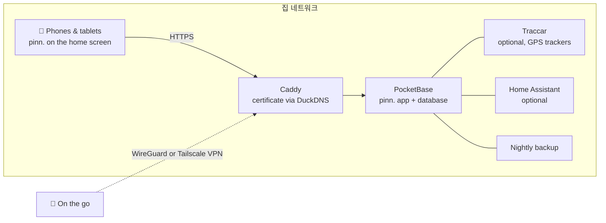

<p align="center">
  
</p>

<p align="center">
  <a href="https://github.com/pinn-shost/pinn/releases/latest"></a>
  <a href="LICENSE"></a>
  
  
  
  <a href="https://ko-fi.com/pinnapp"></a>
</p>

<p align="center">
  <a href="README.md">🇬🇧 English</a> ·
  <a href="README.de.md">🇩🇪 Deutsch</a> ·
  <a href="README.es.md">🇪🇸 Español</a> ·
  <a href="README.fr.md">🇫🇷 Français</a> ·
  <a href="README.it.md">🇮🇹 Italiano</a> ·
  <a href="README.pt.md">🇧🇷 Português</a> ·
  <a href="README.zh.md">🇨🇳 中文</a> ·
  <a href="README.ja.md">🇯🇵 日本語</a> ·
  <b>🇰🇷 한국어</b>
</p>

<p align="center">
  <a href="#screenshots">스크린샷</a> ·
  <a href="#what-pinn-does">기능</a> ·
  <a href="#installation">설치</a> ·
  <a href="#privacy">개인정보 보호</a> ·
  <a href="#faq">FAQ</a>
</p>

---

pinn.은 집안을 굴러가게 하는 모든 것을 한곳에 모은 앱이에요. 함께 쓰는 캘린더, 이번 주 식단, 장보기 목록, 쓰레기를 내놓는 사람, 용돈, 3월에 해지해야 하는 보험까지요. **내 NAS**에서 Docker로 실행되고, 가족 모두의 iPhone, iPad, Android 휴대폰에 네이티브 앱처럼 설치돼요.

클라우드 계정도, 구독도 없어요. 광고도, 추적도 없어요. 가족의 데이터는 집 밖으로 나가지 않아요.

<a id="screenshots"></a>

## 스크린샷

### iPad에서

벽에 걸어 두거나 주방 식탁에 올려 두세요. 함께 쓰는 iPad가 온 가족을 한눈에 보여줘요.

<table>
  <tr>
    <td align="center" width="50%">
      <br>
      <sub><b>대시보드</b>: 각자 자기 사진을 누르고, PIN은 선택 사항</sub>
    </td>
    <td align="center" width="50%">
      <br>
      <sub><b>개요</b>: 날씨, 일정, 할 일, 식사, 가족을 한눈에</sub>
    </td>
  </tr>
</table>

### 휴대폰에서

언제나 함께: pinn.은 모든 iPhone과 Android 휴대폰에 네이티브 앱처럼 설치돼요.

<table>
  <tr>
    <td align="center" width="33%"><br><sub><b>개요</b>: 오늘 하루를 한눈에</sub></td>
    <td align="center" width="33%"><br><sub><b>캘린더</b>: iCloud와 Google을 한 화면에</sub></td>
    <td align="center" width="33%"><br><sub><b>식단</b>: 한 주를 계획하고 한 번에 장보기</sub></td>
  </tr>
  <tr>
    <td align="center" width="33%"><br><sub><b>목록</b>: 장보기, 비축품, 짐 싸기</sub></td>
    <td align="center" width="33%"><br><sub><b>가계</b>: 예산, 저축, 용돈</sub></td>
    <td align="center" width="33%"><br><sub><b>아이</b>: 재미있는 하루 일과</sub></td>
  </tr>
</table>

<a id="what-pinn-does"></a>

## pinn.으로 할 수 있는 일

| | |
|---|---|
| 📅 **캘린더** | 사람별 iCloud 및 Google 캘린더를 비공개로 쓰거나 가족과 공유할 수 있어요. 공휴일, 학교 방학, 쓰레기 수거일, 연락처의 생일이 자동으로 표시돼요. |
| 🍝 **식단과 레시피** | 한 주를 계획하고 재료를 바로 장보기 목록으로 보내세요. 텍스트, PDF, 사진, 링크로 레시피를 가져올 수 있고, 원하면 AI도 쓸 수 있어요. 같은 서버의 다른 가족과 즐겨 찾는 레시피를 공유하세요. |
| 🛒 **목록** | 가게별 장보기 목록, 재고가 줄면 목록을 채워 주는 비축품, 템플릿 기반 짐 목록(휴가, 출산 가방, 파티), 선물 목록과 위시리스트. |
| ✅ **할 일과 집안일** | 푸시 알림이 있는 할 일, 청소 계획, 쓰레기통 – 그리고 시간대에 맞는 것만 보여주는 애니메이션 일과가 있는 아이 페이지. |
| 💶 **가계** | 공동 또는 개인 자금, 가계 예산, ETF와 주식이 있는 저축 및 증권 계좌, 용돈, 반복 결제, 해지 알림이 있는 계약. 셰어하우스에서는 비용을 나누고 누가 누구에게 얼마를 줘야 하는지 볼 수 있어요. |
| 📄 **문서와 탈것** | 영수증과 보증, 만료 알림이 있는 신분증. 자동차와 자전거의 검사일, 타이어 교체, 연비, 총비용. |
| 🏡 **집** | 세입자, 집주인, 임대인을 위해: 임대차 또는 매매 계약서, 대출, 사진이 있는 하자, 청구서, 리모델링 계획, 예측이 있는 계량기 검침, 열쇠, 임대 주는 아파트·집·차고의 임대 수입. 비가 온 날을 아는 물 주기 계획이 있는 정원과 식물. |
| 📍 **가족과 위치** | pinn.에서 바로 위치를 공유하세요. 한 번만 또는 정한 시간 동안, 그리고 무료 앱 Traccar Client로 백그라운드에서도 공유할 수 있어요(pinn.으로 바로 전송, 추가 서버 없음). ‘집으로 가는 중’ 모드, 위치와 긴급 번호가 담긴 SOS 경보, 응급 카드, 장소 도착 알림도 있어요. |
| 🎒 **학교와 어린이집** | 아이별로: 시간표(입력하거나 사진을 찍으면 AI가 채워 줘요), 등원과 하원, 아이 페이지의 숙제, 기한이 알림이 되는 가정통신문, 캘린더에 바로 표시되는 휴원·휴교일. |
| 🐾 **반려동물** | 강아지, 고양이, 토끼 등의 프로필. 체크할 수 있는 식사 시간, 산책, ‘누구 차례?’ 당번표, 푸시 알림이 있는 예방접종과 구충, 체중 그래프, 수의사와 응급 동물병원, 공유할 수 있는 펫시터용 시트, 인쇄할 수 있는 ‘실종’ 포스터, 자동 급식기 보충 알림. |
| 🌦️ **날씨와 휴가** | 날씨를 누르면(휴대폰에서는 타일, iPad와 컴퓨터에서는 날짜와 시간 옆 상단) 14일과 날마다의 자세한 정보를 볼 수 있어요. 목적지와 날짜가 있는 짐 목록은 휴가지 날씨(예보 또는 평년값)를 보여주고 무엇을 챙길지 추천해 줘요. |
| 🏠 **스마트홈** | 할 일에서 Apple 단축어나 Home Assistant 동작을 시작하세요. 집안일 기한이 되면 로봇청소기가 주방을 청소하고, 로봇 잔디깎이와 물 주기는 정원 계획을 따르고, 자동 급식기는 비어 갈 때 알려줘요. |
| 🎙️ **음성 제어** | “Hey Siri, pinn”: 장보기 목록에 추가하고, 읽어 달라고 하고, 할 일을 만들고, 오늘 일정을 들어요. Android에서도 쓸 수 있어요. |
| 🔔 **알림** | iPhone, iPad, Android에서 받는 개인 푸시 메시지와, 가족의 모든 변경을 모아 주는 알림 벨. |
| 🧩 **그 밖에** | 옮길 수 있는 메모가 있는 가족 게시판, 전체 검색, 자동 동기화되는 오프라인 모드, 다크 모드, 프로필 PIN이 있는 iPad 대시보드, 손님 계정, 아이 보호 잠금. |

pinn.은 **🇬🇧 English, 🇩🇪 Deutsch, 🇪🇸 Español, 🇫🇷 Français, 🇮🇹 Italiano, 🇧🇷 Português, 🇨🇳 中文, 🇯🇵 日本語, 🇰🇷 한국어**를 지원하고, 통화와 긴급 번호를 사는 지역에 맞추며, **가족**과 **셰어하우스** 용어를 오갈 수 있어요. 서버 한 대에 여러 가족을 둘 수 있고, 가족마다 관리자가 따로 있어요.

## 1.118.4의 새 소식

**보안: 가족 대시보드가 있으면 PIN 필수 · 캘린더 수정**

- 가족에게 대시보드가 있으면 **모든 프로필에 PIN이 필요해요**(PIN이 없으면 비밀번호로 한 번 로그인하고 바로 설정). 휴대폰에서 레시피에서 돌아올 때 목록 보기 캘린더가 펼쳐진 채로 남던 문제를 고쳤어요.

## 1.118.3의 새 소식

**레시피: 휴지통, 삭제 확인, 이번 주 계획 길게 누르기**

- 레시피를 삭제하기 전에 확인하고, 레시피는 **휴지통에 7일** 동안 남아(목록 아래) 복원할 수 있어요. "이번 주 계획"의 식사를 길게 누르면 보기·편집·옮기기·요리 완료·제거를 고를 수 있어요.

## 1.118.2의 새 소식

**장보기 목록: 메시지 붙여넣기, 재고 표시, 더하기/빼기**

- 메시지(예: WhatsApp)를 입력란에 **붙여넣으면** 인식된 품목과 수량이 표시되고, 재고·식단·이미 목록에 있는 항목이 초록색으로 안내돼요. 더하기/빼기는 수량에 맞춰 바뀌어요.

## 작동 방식



모든 것이 한 대의 기기에서 Docker 컨테이너로 실행돼요. HTTPS는 **포트 포워딩 없이** 작동하고, 인증서는 DNS 확인으로 발급돼요. 밖에서는 내 VPN을 통해서만 pinn.에 접속할 수 있어요.

## 요구 사항

- **Docker**와 **Docker Compose 2.17+**가 있는 NAS 또는 서버 – UGOS가 설치된 UGREEN NAS에서 개발했고, Docker가 있는 모든 Linux 호스트(amd64, arm64, armv7)에서 실행돼요
- 해당 기기에 대한 SSH 접근
- 선택 사항이지만 권장: HTTPS용 무료 [DuckDNS](https://www.duckdns.org) 서브도메인 – 푸시 알림과 pinn.을 앱으로 설치하는 데 필요해요

<a id="installation"></a>

## 설치

1. [최신 릴리스](https://github.com/pinn-shost/pinn/releases/latest)의 ZIP을 내려받아 압축을 풀어요.
2. NAS에 폴더를 만들고(예: `/volume1/docker/Pocketbase`), 압축을 푼 폴더(예: `pinn-1.118.4` 또는 `pinn-main`)를 그대로 넣어요.
3. SSH로 로그인해서 다음을 실행해요:
   ```sh
   cd /volume1/docker/Pocketbase && sudo sh pinn-*/pinn-setup.sh
   ```
   스크립트가 모든 파일을 제자리에 복사하고, PDF 가져오기와 사진 문자 인식에 필요한 라이브러리를 내려받고, pinn.을 시작해요.
4. `http://<NAS-IP>:8090`을 열고 → **메인 관리자로 로그인** → 비밀번호 `Admin` → 나만의 비밀번호를 정해요.
5. **설정 도우미**가 나머지를 안내해 줘요. HTTPS, WireGuard 또는 Tailscale을 통한 원격 접속, Google, AI, 위치, Home Assistant를 아홉 가지 언어로 차례대로요.
6. 각 휴대폰에서 HTTPS 주소로 pinn.을 열고 홈 화면에 추가해요:
   - **iPhone/iPad(Safari):** 공유 → *홈 화면에 추가*(알림에는 iOS 16.4 이상 필요)
   - **Android(Chrome):** 설정 → 알림 → *pinn.을 앱으로 설치*, 또는 Chrome 메뉴 ⋮ → *앱 설치*

   그런 다음 각 기기에서 **설정 → 알림 → 이 기기에서 켜기**로 알림을 켜세요.

**업데이트:** 새 ZIP을 내려받아 압축을 푼 폴더를 같은 폴더에 넣고 `sudo sh pinn-*/pinn-setup.sh`를 다시 실행하세요. 교체된 파일은 `_alt/`에 남고 데이터는 그대로예요.

**백업**은 매일 밤 `./backups`에 만들어지고 14일 동안 보관돼요.

<a id="privacy"></a>

## 개인정보 보호

pinn.은 클라우드 서비스에 절대 맡기고 싶지 않은 데이터를 위해 만들었어요. 은행 거래 내역, 건강 문서, 아이들이 어디에 있는지 같은 것들이죠. 그래서:

- **모든 데이터는 내 NAS에** 하나의 PocketBase 데이터베이스로 저장돼요. pinn. 서버도, 텔레메트리도 없어요.
- **외부 서버의 스크립트를 쓰지 않아요.** 모든 코드와 라이브러리는 내 NAS에서 제공돼요.
- **푸시 알림에는 내용이 없어요.** Apple, Google, Mozilla는 빈 깨우기 신호만 전달하고, 기기가 내 NAS에서 메시지를 가져와요.
- **iCloud와 Google 비밀번호**는 잠긴 컬렉션에 암호화되어 저장돼요.
- **인터넷에서 접근할 수 없어요.** 원격 접속은 내 VPN을 통해 이루어져요.

pinn.은 필요한 기능에서만 외부 서비스에 접속해요:

| 서비스 | 용도 | 시점 |
|---|---|---|
| [Open-Meteo](https://open-meteo.com) | 날씨 예보 | 집 주소를 설정했을 때 |
| [OpenStreetMap Nominatim](https://nominatim.openstreetmap.org) | 주소를 지도 위치로 변환 | 주소를 입력할 때 |
| [OpenStreetMap 타일](https://www.openstreetmap.org) | 지도 배경 | 위치 페이지에서, 내 NAS를 통해 불러옴 |
| [Google Fonts](https://fonts.google.com) | 서체 | 앱을 불러올 때 |
| [OpenHolidays API](https://www.openholidaysapi.org) | 공휴일과 학교 방학 | 집 주소를 설정했을 때 |
| [DuckDNS](https://www.duckdns.org) | HTTPS 인증서와 주소 | 설정한 경우 |
| iCloud / Google | 캘린더와 연락처 | 연결한 계정에 한해서만 |
| Google Gemini | 레시피와 문서 읽기 | API 키를 추가한 경우에만 |
| jsDelivr | pdf.js와 Tesseract 일회성 내려받기 | 설치하는 동안에만 |

<a id="faq"></a>

## FAQ

<details>
<summary><b>공유기에서 포트를 열어야 하나요?</b></summary>
<br>
아니요. HTTPS 인증서는 DNS 확인으로 발급되고 원격 접속은 VPN을 통해 이루어져요. FRITZ!Box에서는 WireGuard, 다른 공유기에서는 Tailscale을 써요.
</details>

<details>
<summary><b>NAS 없이도 되나요?</b></summary>
<br>
Docker가 있는 상시 켜 둔 기기라면 모두 돼요. 미니 PC, Raspberry Pi 4/5, Linux 서버 등이요.
</details>

<details>
<summary><b>pinn.은 App Store의 “진짜” 앱인가요?</b></summary>
<br>
pinn.은 홈 화면에 추가하는 웹 앱이에요. 추가하면 네이티브 앱처럼 전체 화면으로 열리고, 오프라인에서도 작동하고, 열린 할 일을 배지로 보여주고, 푸시 알림도 받아요. 앱 스토어는 필요 없어요.
</details>

<details>
<summary><b>한 번의 설치를 여러 가족이 쓸 수 있나요?</b></summary>
<br>
네. 메인 관리자가 가족을 만들고, 가족마다 자신의 관리자, 캘린더, 데이터가 생겨요. 레시피는 원하면 가족끼리 공유할 수 있어요.
</details>

<details>
<summary><b>아이들은 어떻게 되나요?</b></summary>
<br>
아이 보호 잠금이 있는 프로필은 자신의 할 일만 보이고 아무것도 삭제하거나 바꿀 수 없어요. 가계, 문서, 탈것은 숨겨져요. 어린 아이에게는 하루 일과가 담긴 재미있는 전용 페이지가 있어요.
</details>

<details>
<summary><b>비용은 얼마인가요?</b></summary>
<br>
없어요. pinn.은 무료이고 MIT 라이선스의 오픈 소스예요. Gemini AI 같은 선택 서비스에는 무료 이용량이 있어요.
</details>

## 저장소 구조

저장소는 NAS에 설치한 것과 같은 구조예요. 모든 파일이 최종적으로 놓이는 위치에 있어요:

```
pinn/
├── pb_hooks/            server: *.pb.js hooks and their helper modules (pinn-*.js, calendar-sync.js)
├── pb_public/           web app served by PocketBase
│   ├── index.html       the app page, built from src/ (HTML, start check) – do not edit by hand
│   ├── js/              app code split out of index.html, plain <script> files without a build step
│   │                    (ruhemodus.js, textkern.js, sprachen.js, region.js, grundlagen.js, popups.js, verbindung.js, benutzer.js, mitteilungen.js, serverzugriff.js, tastatur.js, anmeldemaske.js, dashboard.js, dashboardhintergrund.js, profilauswahl.js, pineingabe.js, dashboardsitzung.js, dashboardkonto.js, familienverwalten.js, einrichten.js, exportieren.js, hauptadminseite.js, anmeldung.js, konto.js, profilverwaltung.js, zustand.js, bedienzustand.js, rezeptbilder.js, zusammenfuehren.js, speichern.js, design.js, sprache.js, uebersicht.js, familienkachel.js, wobistdu.js, geburtstagsfeier.js, wetterkachel.js, geburtstage.js, uebersichteinstellungen.js, familiensync.js, bereiche.js, kalenderquellen.js, icsparser.js, zeitleiste.js, termindetails.js, kalenderdatei.js, wetter.js, wohnort.js, feiertage.js, muellkalender.js, mitglieder.js, profilbild.js, mitglied.js, kinderseite.js, kinderroutine.js, sterne.js, kalenderansicht.js, essenplanen.js, rezeptparser.js, rezeptdialog.js, rezeptbild.js, rezeptmengen.js, einkauf.js, einkaufslisten.js, einkaufseingabe.js, rezepte.js, offline.js, aufgabenextras.js, appbadge.js, reisen.js, aufgabendaten.js, haushalt.js, reihum.js, aufgaben.js, smarthome.js, sprachsteuerung.js, termine.js, ansichten.js, versionspruefung.js, sicherungen.js, geraete.js, fehlerprotokoll.js, versionslog.js, einstellungen.js, kalenderkonto.js, finanzen.js, kassen.js, vorrat.js, vorrat2.js, sparen.js, vertraege.js, fahrzeuge.js, zuhause.js, dokumente.js, pdflesen.js, appstart.js, pinnwand.js, listen.js, familie.js, hinweise.js, ausblick.js – ausblick.js always comes last)
│   ├── css/             app styles split out of index.html, plain CSS without a build step (ergaenzung.css, energiesparen.css, basis.css … haustierewetter.css, terminal.css, glocke.css)
│   ├── einrichtung.js   setup assistant · datenexport.js  data export
│   ├── i18n/            texts by key (de, en, fr, es, it, pt, zh, ja, ko) – English is the reference
│   ├── lang/            old dictionaries for parts without keys yet (en, fr, es, it, pt, zh, ja, ko)
│   └── vendor/          pinn.css, pocketbase/ (pdf.js and Tesseract are downloaded by the setup)
├── .github/             GitHub Actions (workflows/check.yml), checks (scripts/), CONTRIBUTING.md, SECURITY.md, images – not installed
├── src/                 sources of index.html (build.js, rahmen.html, teile/) – not installed
├── caddy/Caddyfile      HTTPS reverse proxy
├── docker-compose.yaml  all containers
├── env.txt              template for .env
├── pinn-setup.sh        install & update
├── pinn-wartung.sh      backups & updates (container "wartung")
├── pinn-pocketbase-update.sh
├── index.html           placeholder only, never installed (keeps the update button of 1.38 working)
└── README.md            this page · README.<code>.md in de, es, fr, it, pt, zh, ja, ko
```

`pinn-setup.sh`는 `pb_hooks/`, `pb_public/`, `caddy/Caddyfile`을 그대로 프로젝트 폴더에 복사해요. 데이터 폴더(`pb_data/`, `konfig/`, `backups/`, `caddy/data/` 등)는 절대 건드리지 않아요.

## 참여하기

버그 신고, 아이디어, 번역을 언제든 환영해요. [CONTRIBUTING.md](.github/CONTRIBUTING.md)를 참고하세요. 보안 문제는 [SECURITY.md](.github/SECURITY.md)에 설명된 대로 비공개로 알려 주세요. 풀 리퀘스트 전에 `node .github/scripts/check-all.js`를 실행해 주세요. 같은 검사가 GitHub에서도 자동으로 실행돼요.

## pinn. 응원하기

pinn.은 무료이고 앞으로도 모두에게 완전히 무료예요. 제 여가 시간에 만들고 있어요. 일상이 조금이라도 편해졌다면 작은 후원을 해 주시면 정말 기쁘겠지만, 전적으로 자발적이에요:

<p>
  <a href="https://ko-fi.com/pinnapp"></a>
  <a href="https://buymeacoffee.com/pinn"></a>
</p>

⭐ 하나도 도움이 돼요. 다른 가족들이 pinn.을 더 쉽게 찾을 수 있어요.

## 사용한 것들

[PocketBase](https://pocketbase.io) (MIT) · [Tailwind CSS](https://tailwindcss.com) (MIT) · [pdf.js](https://mozilla.github.io/pdf.js/) (Apache-2.0) · [Tesseract.js](https://tesseract.projectnaptha.com) (Apache-2.0) · [Traccar](https://www.traccar.org) (Apache-2.0) · [Caddy](https://caddyserver.com) (Apache-2.0)

## 라이선스

[MIT](LICENSE) – 자유롭게 쓰고, 고치고, 공유하세요.
