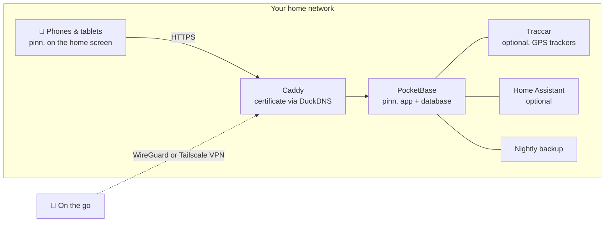

<p align="center">
  
</p>

<p align="center">
  <a href="https://github.com/pinn-shost/pinn/releases/latest"></a>
  <a href="LICENSE"></a>
  
  
  
  <a href="https://ko-fi.com/pinnapp"></a>
</p>

<p align="center">
  <b>🇬🇧 English</b> ·
  <a href="README.de.md">🇩🇪 Deutsch</a> ·
  <a href="README.es.md">🇪🇸 Español</a> ·
  <a href="README.fr.md">🇫🇷 Français</a> ·
  <a href="README.it.md">🇮🇹 Italiano</a> ·
  <a href="README.pt.md">🇧🇷 Português</a> ·
  <a href="README.zh.md">🇨🇳 中文</a> ·
  <a href="README.ja.md">🇯🇵 日本語</a> ·
  <a href="README.ko.md">🇰🇷 한국어</a> ·
  <a href="README.ru.md">🇷🇺 Русский</a> ·
  <a href="README.nl.md">🇳🇱 Nederlands</a> ·
  <a href="README.tr.md">🇹🇷 Türkçe</a> ·
  <a href="README.pl.md">🇵🇱 Polski</a> ·
  <a href="README.uk.md">🇺🇦 Українська</a> ·
  <a href="README.cs.md">🇨🇿 Čeština</a> ·
  <a href="README.sv.md">🇸🇪 Svenska</a> ·
  <a href="README.da.md">🇩🇰 Dansk</a> ·
  <a href="README.nb.md">🇳🇴 Norsk</a> ·
  <a href="README.fi.md">🇫🇮 Suomi</a>
</p>

<p align="center">
  <a href="#screenshots">Screenshots</a> ·
  <a href="#what-pinn-does">Features</a> ·
  <a href="#installation">Installation</a> ·
  <a href="#privacy">Privacy</a> ·
  <a href="#faq">FAQ</a>
</p>

---

pinn. is one app for everything that keeps a household running: the shared calendar, this week's meals, the shopping list, who takes out the bins, the pocket money and the insurance that needs cancelling in March. It runs on **your own NAS** with Docker and installs like a native app on every iPhone, iPad and Android phone in the family.

No cloud account. No subscription. No ads, no tracking. Your family's data never leaves your home.

## Screenshots

### On the iPad

Hung on the wall or lying on the kitchen table: the shared iPad shows the whole family at once.

<table>
  <tr>
    <td align="center" width="50%">
      <a href=".github/assets/screenshots/dashboard.png"></a><br>
      <sub><b>Dashboard</b> – everyone taps their own picture, with an optional PIN</sub>
    </td>
    <td align="center" width="50%">
      <a href=".github/assets/screenshots/ipad-overview.png"></a><br>
      <sub><b>Overview</b> – weather, appointments, tasks, meals and the family at a glance</sub>
    </td>
  </tr>
</table>

### On the phone

Always with you: pinn. installs on every iPhone and Android phone like a native app.

<table>
  <tr>
    <td align="center" width="33%"><a href=".github/assets/screenshots/home.png"></a><br><sub><b>Overview</b> – your day at a glance</sub></td>
    <td align="center" width="33%"><a href=".github/assets/screenshots/calendar.png"></a><br><sub><b>Calendar</b> – iCloud and Google in one view</sub></td>
    <td align="center" width="33%"><a href=".github/assets/screenshots/meals.png"></a><br><sub><b>Meals</b> – plan the week, shop with one tap</sub></td>
  </tr>
  <tr>
    <td align="center" width="33%"><a href=".github/assets/screenshots/lists.png"></a><br><sub><b>Lists</b> – shopping, pantry, packing</sub></td>
    <td align="center" width="33%"><a href=".github/assets/screenshots/finance.png"></a><br><sub><b>Finance</b> – budget, savings, pocket money</sub></td>
    <td align="center" width="33%"><a href=".github/assets/screenshots/chat.png"></a><br><sub><b>Chat</b> – end-to-end encrypted, with voice messages and locations</sub></td>
  </tr>
</table>

### More screens

Tap any picture to open it in full size.

<details>
<summary><b>Show more screenshots</b></summary>

<br>

<table>
  <tr>
    <td align="center" width="25%"><a href=".github/assets/screenshots/house.png"></a><br><sub><b>Home</b> – house, costs, loan, defects and meters in one place</sub></td>
    <td align="center" width="25%"><a href=".github/assets/screenshots/tasks.png"></a><br><sub><b>Tasks</b> – automatic reminders, e.g. inspection and tyre change, with a shortcut button</sub></td>
    <td align="center" width="25%"><a href=".github/assets/screenshots/vehicles.png"></a><br><sub><b>Vehicles</b> – inspection, tyres, fuelling and charging</sub></td>
    <td align="center" width="25%"><a href=".github/assets/screenshots/scan_pantry.png"></a><br><sub><b>Pantry scan</b> – scan the barcode, put away or use up</sub></td>
  </tr>
  <tr>
    <td align="center" width="25%"><a href=".github/assets/screenshots/weekly_summary_1.png"></a><br><sub><b>Weekly preview</b> – weather and what is still open</sub></td>
    <td align="center" width="25%"><a href=".github/assets/screenshots/weekly_summary_2.png"></a><br><sub><b>Weekly preview</b> – day by day: cleaning, bins, payments</sub></td>
    <td align="center" width="25%"><a href=".github/assets/screenshots/weekly_summary_3.png"></a><br><sub><b>Last week in brief</b> – events, meals, spending – and shortcuts</sub></td>
    <td align="center" width="25%"><a href=".github/assets/screenshots/kids.png"></a><br><sub><b>Kids</b> – a playful daily routine</sub></td>
  </tr>
</table>

</details>

<sub>📁 <a href=".github/assets/screenshots">All pictures in one folder</a></sub>

## What pinn. does

| | |
|---|---|
| 📅 **Calendar** | iCloud and Google calendars per person, private or shared with the family. Public and school holidays, waste collection dates and birthdays from your contacts appear automatically. |
| 🍝 **Meals & recipes** | Plan the week, then send the ingredients straight to the shopping list. Import recipes from text, PDF, photos or a link – optionally with AI. Share favourite recipes with other families on your server. |
| 🛒 **Lists** | Shopping lists per shop, a pantry that refills the list when stock runs low, packing lists from templates (holiday, hospital bag, party), gift and wish lists with a “who gives what” planner that the recipient never sees. |
| ✅ **Tasks & household** | Tasks with push reminders, cleaning plans and bins – plus a kids' page with animated routines that only shows what fits the time of day. |
| 💶 **Finance** | Shared or private funds, a household budget, savings and depots with ETFs and shares, pocket money, recurring payments and contracts with cancellation reminders. Flatshares can split costs and see who owes whom. |
| 📄 **Documents & vehicles** | Receipts and warranties, IDs with expiry reminders. Cars and bikes with inspection dates, tyre changes, fuel use and total cost. |
| 🏡 **Home** | For tenants, owners and landlords: tenancy or purchase contract, loan, defects with photos, receipts, renovation plan, meter readings with forecast, keys, and rental income for flats, houses and garages you let out. Garden & plants with a watering plan that knows when it rained. |
| 📍 **Family & location** | Share your location right from pinn. – once or for a chosen time – and in the background via the free Traccar Client app (sends straight to pinn., no extra server). Plus a "way home" mode, an SOS alert with position and emergency numbers, emergency cards and arrival notifications for places. |
| 🎒 **School & daycare** | Per child: timetable (type it in or snap a photo – the AI fills it in), drop-off and pick-up, homework on the kids' page, parent letters with deadlines that turn into reminders, and closure days straight in the calendar. |
| 🐾 **Pets** | Profiles for dogs, cats, rabbits & co. with feeding times to tick off, walks, a "whose turn is it" rota, vaccinations and deworming with push reminders, weight chart, vet and emergency vet, a pet-sitter sheet to share, a printable "missing" poster and a pet feeder refill reminder. |
| 🌦️ **Weather & holidays** | Tap the weather (a tile on the phone, at the top next to date and time on iPad and computer) for 14 days with details for every day. Packing lists with destination and dates show the holiday weather – forecast or typical values – and suggest what to pack. |
| 🏠 **Smart home** | Start Apple Shortcuts or Home Assistant actions from a task – the robot vacuum cleans the kitchen when the chore is due, the robot mower and the watering follow the garden plan, the pet feeder reports when it runs empty. |
| 🎙️ **Voice control** | "Hey Siri, pinn": add to the shopping list, read it out, create tasks and hear what's on today – also on Android. |
| 💬 **Chat** | Family chat and private chats, end-to-end encrypted, with push, read ticks and replies. |
| 🔔 **Notifications** | Personal push messages on iPhone, iPad and Android, plus a notification bell that collects every change in the family. |
| 🧩 **Everything else** | Family board with movable notes, global search, offline mode with automatic sync, dark mode, iPad dashboard with profile PINs, guest account, child lock. |

pinn. speaks **🇬🇧 English, 🇩🇪 Deutsch, 🇪🇸 Español, 🇫🇷 Français, 🇮🇹 Italiano, 🇧🇷 Português, 🇨🇳 中文, 🇯🇵 日本語, 🇰🇷 한국어, 🇷🇺 Русский, 🇳🇱 Nederlands, 🇹🇷 Türkçe, 🇵🇱 Polski, 🇺🇦 Українська, 🇨🇿 Čeština, 🇸🇪 Svenska, 🇩🇰 Dansk, 🇳🇴 Norsk and 🇫🇮 Suomi**, adapts currency and emergency numbers to your region, and switches between **family** and **flatshare** wording. One server can host several families, each with its own admins.

## What's new in 1.159.0

**Finnish**

- New: Finnish (Suomi) is a new app language – all roughly 7,500 texts of the app, the setup assistant, the data export, the push messages from the server and the Finnish emergency number (112). The flat-share wording is included too (“kotitalous”, “asukas”), with Finnish case endings. Choose it under Settings → Language and region.
- Note: the translation has not been checked by native speakers – suggestions are welcome as a GitHub issue. Voice control via Siri/Android does not understand Finnish yet and answers in English.
- Changed: `i18n/fi.i18n.js` (new), `README.fi.md` (new), `js/`, `pb_hooks/`, `einrichtung.js`, `datenexport.js`, `.github/scripts/`, `src/`, `index.html`, README.

## What's new in 1.158.0

**Norwegian**

- New: Norwegian (Norsk, Bokmål) is a new app language – all roughly 7,500 texts of the app, the setup assistant, the data export, the push messages from the server and the Norwegian emergency number (112). The flat-share wording is included too (“husstand”, “bofelle”). Choose it under Settings → Language and region.
- Note: the translation has not been checked by native speakers – suggestions are welcome as a GitHub issue. Voice control via Siri/Android does not understand Norwegian yet and answers in English.
- Changed: `i18n/nb.i18n.js` (new), `README.nb.md` (new), `js/`, `pb_hooks/`, `einrichtung.js`, `datenexport.js`, `.github/scripts/`, `src/`, `index.html`, README.

## What's new in 1.157.0

**Danish**

- New: Danish (Dansk) is a new app language – all roughly 7,500 texts of the app, the setup assistant, the data export, the push messages from the server and the Danish emergency number (112). The flat-share wording is included too (“husstand”, “bofælle”). Choose it under Settings → Language and region.
- Note: the translation has not been checked by native speakers – suggestions are welcome as a GitHub issue. Voice control via Siri/Android does not understand Danish yet and answers in English.
- Changed: `i18n/da.i18n.js` (new), `README.da.md` (new), `js/`, `pb_hooks/`, `einrichtung.js`, `datenexport.js`, `.github/scripts/`, `src/`, `index.html`, README.

## What's new in 1.156.0

**Swedish**

- New: Swedish (Svenska) is a new app language – all roughly 7,500 texts of the app, the setup assistant, the data export, the push messages from the server and the Swedish emergency number (112). The flat-share wording is included too (“hushåll”, “medboende”). Choose it under Settings → Language and region.
- Note: the translation has not been checked by native speakers – suggestions are welcome as a GitHub issue. Voice control via Siri/Android does not understand Swedish yet and answers in English.
- Changed: `i18n/sv.i18n.js` (new), `README.sv.md` (new), `js/`, `pb_hooks/`, `einrichtung.js`, `datenexport.js`, `.github/scripts/`, `src/`, `index.html`, README.

## What's new in 1.155.0

**Czech**

- New: Czech (Čeština) is a new app language – all roughly 7,500 texts of the app, the setup assistant, the data export, the push messages from the server and the Czech emergency numbers (112, police 158, ambulance 155, fire brigade 150). The flat-share wording is included too. Choose it under Settings → Language and region.
- Note: the translation has not been checked by native speakers – suggestions are welcome as a GitHub issue. Voice control via Siri/Android does not understand Czech yet and answers in English.
- Changed: `i18n/cs.i18n.js` (new), `README.cs.md` (new), `js/`, `pb_hooks/`, `einrichtung.js`, `datenexport.js`, `.github/scripts/`, `src/`, `index.html`, README.

## What's new in 1.154.0

**Security fix for calendar addresses**

- Fixed: calendar addresses are now checked. When an event is deleted, changed or read in iCloud or Google, the server uses the family's calendar login and may send it only to the servers of Apple and Google. Before, a signed-in profile could have sent the login to any other server with a manipulated request. Calendars that already work are not affected.
- Changed: `pb_hooks/calendar-sync.js`, `js/versionslog.js`, `js/sprachen.js`, `i18n/versionslog.en.js`, `src/`, `index.html`, README.

## What's new in 1.153.2

**Gemini keys with “AQ.”, status texts, error log**

- Fixed: the set-up wizard accepts the new Google Gemini keys that start with `AQ.` (they contain a dot). Before, “Check” said the key was valid but “Next” refused it.
- Fixed: the status of a family member (“on the way”, “last seen”) was always German – now it is in every language.
- Changed: the error log shows its messages in German for German and in English for every other language.
- Changed: `pb_hooks/pinn-einrichtung.js`, `pb_hooks/pinn-protokoll.js`, `pb_hooks/protokoll.pb.js`, `einrichtung.js`, `js/fehlerprotokoll.js`, `js/familie.js`, `js/familienkachel.js`, `js/versionslog.js`, `js/sprachen.js`, `i18n/`, `src/`, `index.html`, README.

## What's new in 1.153.1

**Health: five new blocks, “Me” in your own profile**

- New on the health page: **sunscreen** (today's UV index at home, reminder only on sunny days), **sleep** (bedtime reminder, “How did you sleep?” in the morning), **fruit & vegetables** (portions per day), **tick check** (April–October) and **check-ups** (dentist, check-up … with an interval; for children the German U examinations by age). For children the reminders go to the parents too.
- New: in your own profile pinn. says “Me” instead of your name – calendar filter, tasks, family and everywhere else, inflected to fit in sentences. Plus: line icon for the restore arrow, new rim icon, same gold for yellow hints in dark mode.
- Changed: `pb_hooks/pinn-gesundheit.js`, `js/gesundheit.js`, `css/gesundheit.css`, `js/mitglieder.js`, `js/symbole.js`, `css/dunkelfarbe.css`, `js/aufgaben.js`, `js/termine.js`, `js/listen.js`, `js/sparen.js`, `js/vertraege.js`, `js/familie.js`, `js/hinweise.js`, `js/kassen.js`, `js/zuhause.js`, `js/dokumente.js`, `js/fahrzeuge.js`, `js/ausblick.js`, `js/sterne.js`, `js/vorrat2.js`, `i18n/`, `js/sprachen.js`, `js/versionslog.js`, `index.html`.

## What's new in 1.153.0

**Security from Home Assistant**

- New: **Security** – family admins put Home Assistant devices into named groups under Settings → Security: windows & doors, door locks, cameras, garage door & shutters, smoke & water detectors, alarm system, motion detectors. The family dashboard shows a bar at the bottom (e.g. “All closed”, “Kitchen window is open”, “1 camera is on”, red for an alarm), the overview gets a “Security” tile where adults can lock an unlocked door lock (never unlock). Optional **evening check**: at a time you choose, all admins get a push if something is still open, unlocked or the alarm system is disarmed. Needs Home Assistant connected under Settings → Smart home.
- Fixed: in dark mode the buttons below the title of a task (smart home start, meter reading …) were blue on blue – now gold.
- Changed: `pb_hooks/pinn-sicherheit.js` (new), `pb_hooks/sicherheit.pb.js` (new), `pb_hooks/pinn-smarthome.js`, `pb_hooks/pinn-schema.js`, `js/sicherheit.js` (new), `css/sicherheit.css` (new), `js/uebersicht.js`, `js/profilauswahl.js`, `js/einstellungen.js`, `css/dunkelfarbe.css`, `i18n/`, `js/sprachen.js`, `js/versionslog.js`, `pinn-setup.sh`, `src/`, `index.html`.

## What's new in 1.152.1

**Restoring backups works again**

- Fixed: restoring a backup (Settings → System → Backups & updates) always stopped at “Check backup”, no matter whether only data or everything was chosen. The backup of the current state made just before cleaned up old backups and in doing so overwrote the name of the chosen backup, which was then not found. Each failed attempt left a backup “Before a restore” behind – these are harmless and are cleaned up by themselves (the last 3 are kept). Needs an update of `pinn-wartung.sh`; the container “wartung” restarts by itself.
- Portainer stack: backups really work now. The service “wartung” of the stack had nothing to start, because part of 1.151.0 was missing in the repository. Now the image contains the backup script, which finds the pinn container of the stack by itself – nightly backups, “Back up now” and “Restore” (data and set-up) work as in the script installation. Updates stay in Portainer. After the update: in Portainer “Update the stack” with “Re-pull image and redeploy”.
- Changed: `pinn-wartung.sh`, `docker/Dockerfile`, `.github/workflows/image.yml`, `pb_hooks/pinn-system.js`, `js/sicherungen.js`, `js/serverzugriff.js`, `i18n/`, `js/versionslog.js`, `js/sprachen.js`, `src/`, `index.html`.

## What's new in 1.152.0

**Your own reverse proxy instead of Tailscale**

- New: access from the internet through your own reverse proxy (Nginx Proxy Manager, Traefik, Cloudflare Tunnel …) – see “Access from the internet with your own reverse proxy” under Installation. pinn. now only believes the visitor address from trusted proxies (`PINN_PROXY_NETZE`), so the lock after wrong passwords cannot be dodged (IPv6: per /64). From the internet the PocketBase administration and PocketBase's own sign-in ways are blocked, the start password `Admin` does not work, and guessing tracker IDs is slowed down. Admins get a push “🚨 Security warning” for such attempts (address, home network or internet, device); all details are in the error log under “Security”. Nothing changes in the home network.
- Changed: `pb_hooks/pinn-netz.js` (new), `pb_hooks/netz.pb.js` (new), `pb_hooks/pinn-alarm.js` (new), `pb_hooks/pinn-sitzungen.js`, `pb_hooks/benutzer.pb.js`, `pb_hooks/dashboard.pb.js`, `pb_hooks/zuhause.pb.js`, `pb_hooks/sprache.pb.js`, `pb_hooks/smarthome.pb.js`, `pb_hooks/pinn-ortung.js`, `pb_hooks/pinn-protokoll.js`, `pb_hooks/pinn-pushtext.js`, `js/anmeldemaske.js`, `js/fehlerprotokoll.js`, `js/hinweise.js`, `js/appstart.js`, `i18n/`, `docker/docker-compose.portainer.yaml`, `env.txt`, `js/sprachen.js`, `js/versionslog.js`, `src/`, `index.html`.

## What's new in 1.151.0

**Portainer stack, ready-made image**

- New: pinn. can be installed from the Portainer Stack UI without SSH and without the setup script. A ready-made image (amd64, arm64) is built on every release and published at `ghcr.io/pinn-shost/pinn`; the new file `docker/docker-compose.portainer.yaml` uses it with volumes and no fixed container names (no more clash with an existing Tailscale container). The stack also has a backup service (nightly backups, “Back up now” and “Restore” in the app; updates stay in Portainer) and optional, commented-out blocks for Traccar and the Home Assistant detour. See “Portainer stack (no script)” under Installation.
- Changed: `docker/` (new), `.github/workflows/image.yml` (new), `pinn-wartung.sh`, `pb_hooks/pinn-system.js`, `js/sicherungen.js`, `i18n/`, `js/sprachen.js`, `js/versionslog.js`, `src/`, `index.html`.

## What's new in 1.150.11

**Icons and small fixes**

- Comb icon for “Comb hair” on the kids page; no emoji field next to the depot name any more; fund drop-down lists without emoji; the tool is now an open-end spanner; “Menus for guests” with the two-people icon; a tap on the logo next to the family name leads to the overview; the Notifications card is filled first so “Activate on this device” always shows; shortcut icons are grey in dark mode.
- Changed: `js/symbole.js`, `js/symbole3.js`, `js/ansichten.js`, `js/konto.js`, `css/dunkelfarbe.css`, `js/sprachen.js`, `js/versionslog.js`, `i18n/versionslog.en.js`, `src/`, `index.html`.

## What's new in 1.150.10

**Dark mode, more icons, new pets banner, pet diary**

- **Dark mode.** Blue text is now gold (devices, lists, “Plan shopping”, ticks for pets, health and tasks); the bars in Household have the colour of the room; chat banner and notes, contract hints and “In view” texts are readable. **More icons instead of emoji:** profile pictures (baby, boy, girl, man, woman, grandpa, grandma), family and flat share, animals (dog, cat, rabbit, hamster, bird, chick, fish, horse, turtle, snake) – also for the hospital bag, the gift list “Easter”, checklists and finance categories; drop-down lists show the text only. **New pets banner** with colourful animals. **Pet diary:** a ticked-off check-up appears in the diary, a × undoes an accidental tick.
- Changed: `css/dunkelfarbe.css` (new), `js/symbole3.js` (new), `js/symbole.js`, `js/szenen.js`, `js/familie.js`, `js/haushalt.js`, `css/symbolfarbe.css`, `css/haustierewetter.css`, `js/sprachen.js`, `js/versionslog.js`, `i18n/`, `src/`, `pinn-setup.sh`, `index.html`.

## What's new in 1.150.9

**Colour for the icons, vehicle and plant icons**

- **Colour by day.** The icons are lightly coloured in now (white fills, sun yellow, rain blue, car red, tools grey, plants green) in the same line style; dark mode stays as it was. **Vehicle icons:** pick a line icon (saloon, SUV, taxi, van, pickup, tractor, caravan, bicycle, e-bike …) instead of the car emoji. **Plant icons** are picked from the app too, with new icons for cactus, palm, tulip, sunflower, rose and more. In the banners of Vehicles and Home the cars only glow at night – yellowish at the front, red at the back.
- Changed: `js/symbole2.js`, `css/symbolfarbe.css` (new), `js/symbole.js`, `js/wetterlogos.js`, `js/symbolwahl.js`, `js/fahrzeuge.js`, `js/zuhause.js`, `js/dokumente.js`, `css/fahrzeuge.css`, `js/sprachen.js`, `js/versionslog.js`, `i18n/`, `src/`, `pinn-setup.sh`, `index.html`.

## What's new in 1.150.8

**Icons everywhere, picked from the app**

- **Own icons everywhere.** Food, household, vehicles, plants, clothes, toys and sports now have our own line icons too (rooms, waste types, vehicle types, garden, alarm clock, calendar switch, countdown). **Category icons** in Finances, Contracts, Documents and Pantry are picked from about 150 ready-made icons instead of the emoji keyboard, and the same kind of category has the same icon everywhere. The scenes of Home and Vehicles show new colourful vehicles. Small fixes: weather “Now” without the dashed border, dashboard clock font, meal-plan list icon, icons sit on the text line.
- Changed: `js/szenen.js`, `js/symbolwahl.js` (new), `js/symbole.js`, `css/wetterlogos.css`, `js/zustand.js`, `js/zuhause.js`, `js/fahrzeuge.js`, `js/gesundheit.js`, `js/finanzen.js`, `js/vertraege.js`, `js/dokumente.js`, `js/vorrat.js`, `js/vorrat2.js`, `js/einkauf.js`, `js/profilauswahl.js`, `js/sprachen.js`, `js/versionslog.js`, `i18n/`, `src/`, `pinn-setup.sh`, `index.html`.

## How it works



Everything runs as Docker containers on one machine. HTTPS works **without port forwarding** – the certificate is issued via a DNS check. From outside, pinn. is only reachable through your own VPN.

## Requirements

- A NAS or server with **Docker** and **Docker Compose 2.17+** – developed on a UGREEN NAS with UGOS, runs on any Linux Docker host (amd64, arm64, armv7)
- SSH access to it
- Optional but recommended: a free [DuckDNS](https://www.duckdns.org) subdomain for HTTPS – required for push notifications and installing pinn. as an app

## Installation

1. Download the ZIP of the [latest release](https://github.com/pinn-shost/pinn/releases/latest) and unzip it.
2. Create a folder on the NAS, e.g. `/volume1/docker/Pocketbase`, and put the unzipped folder (e.g. `pinn-1.159.0` or `pinn-main`) into it as it is.
3. Log in via SSH and run:
   ```sh
   cd /volume1/docker/Pocketbase && sudo sh pinn-*/pinn-setup.sh
   ```
   The script copies every file into place, downloads the libraries for PDF import and photo text recognition, and starts pinn.
4. Open `http://<NAS-IP>:8090` → **Log in as main admin** → password `Admin` → choose your own password.
5. The **setup assistant** walks you through the rest – HTTPS, remote access via WireGuard or Tailscale, Google, AI, location and Home Assistant – step by step, in nineteen languages.
6. Open pinn. via its HTTPS address on each phone and add it to the home screen:
   - **iPhone/iPad (Safari):** Share → *Add to Home Screen* (iOS 16.4 or later for notifications)
   - **Android (Chrome):** Settings → Notifications → *Install pinn. as an app*, or Chrome menu ⋮ → *Install app*

   Then turn on notifications on each device under **Settings → Notifications → Activate on this device**.

**Updating:** download the new ZIP, put the unzipped folder into the same folder and run `sudo sh pinn-*/pinn-setup.sh` again. Replaced files are kept in `_alt/`, your data stays untouched.

**Backups** run every night into `./backups` and are kept for 14 days.

### Portainer stack (no script)

Prefer Portainer? Then you need neither SSH nor the setup script:

1. In Portainer open **Stacks → Add stack**, name it `pinn` and choose **Web editor**.
2. Paste the contents of [`docker/docker-compose.portainer.yaml`](docker/docker-compose.portainer.yaml).
3. Optional: under **Environment variables** change the port (`PINN_PORT`, default 8090) or pin a version (`PINN_IMAGE_TAG`, e.g. `1.151.0`). Click **Deploy the stack**.
4. Open `http://<NAS-IP>:8090` → **Log in as main admin** → the setup assistant, as in steps 4–6 above.

The image comes ready-made from `ghcr.io/pinn-shost/pinn` (amd64 and arm64). Data lives in volumes, no folders needed. The stack uses no fixed container names, so it does not clash with containers you already have. If Tailscale already runs on your NAS, delete the `tailscale` block; if you use your own HTTPS address or reverse proxy, delete `caddy` and `duckdns` as well.

**Updating:** Stack → Editor → *Update the stack* with *Re-pull image and redeploy*. **Backups:** the `wartung` block of the stack makes a backup every night (7 days + 4 weeks kept) and powers the buttons “Back up now” and “Restore” in pinn. → Settings → System. The backups land in the volume `backups` – or in a NAS folder if you set `PINN_BACKUP_DIR` (e.g. `/volume1/docker/pinn-backups`). It needs the Docker socket to stop pinn. briefly for a restore; delete the block if you back up the volumes yourself. Updates are done in Portainer, not by button. Optional, commented out at the end of the file (remove the `#` to switch on): Traccar (GPS trackers with a SIM card) and the Home Assistant detour – phones need neither.

### Access from the internet with your own reverse proxy

Your family does not want to use Tailscale? Then put pinn. behind a reverse proxy: it takes the requests from the internet, provides HTTPS for your own domain and passes them on to pinn.

1. Point the proxy to `http://<NAS-IP>:8090` (Portainer stack: the port `PINN_PORT`). Live updates use normal HTTP – no websockets needed, just leave response buffering off. Allow uploads of up to 70 MB (chat videos).
   - **Nginx Proxy Manager:** *Hosts → Proxy Hosts → Add*: your domain, scheme `http`, NAS IP, port `8090`; tab *SSL*: new certificate, *Force SSL* on.
   - **Cloudflare Tunnel:** no port forwarding needed – *Public hostname* → service `http://<NAS-IP>:8090`.
   - **Traefik, Caddy and others:** a router/site for your domain that forwards to `http://<NAS-IP>:8090`.
2. Open `https://<domain>` on every phone, sign in, add it to the home screen again and turn notifications on again (the app belongs to its address).
3. Google calendars (optional): add `https://<domain>/api/pinn/google/callback` as an authorized redirect URI in the Google Cloud console.

What pinn. does by itself: it only believes the visitor address passed on by the proxy (`X-Forwarded-For`) if the request comes from the home network, a Docker network or Tailscale – so the lock after wrong passwords cannot be dodged. From the internet, the PocketBase administration (`/_/`) is blocked and the start password `Admin` does not work. Is your proxy somewhere else (a rented server, or Cloudflare's orange cloud in front of your proxy)? Then set `PINN_PROXY_NETZE` (in `.env` or the stack's environment variables), e.g. `privat, cloudflare` or `privat, 203.0.113.5`.

**Important:** pinn. is then reachable for everyone on the internet. Give every profile a long password of its own, keep the proxy up to date and never forward port 8090 directly in the router – always go through the proxy with HTTPS.

## Privacy

pinn. was built for data you would never hand to a cloud service: bank statements, health documents, where your children are. That's why:

- **All data lives on your NAS** in a single PocketBase database. There is no pinn. server and no telemetry.
- **No scripts from third-party servers.** All code and libraries are served from your NAS.
- **Push notifications carry no content.** Apple, Google and Mozilla only deliver an empty wake-up signal; the device then fetches the message from your NAS.
- **Passwords for iCloud and Google** are stored encrypted in a locked collection.
- **Not reachable from the internet.** Remote access goes through your own VPN.

pinn. only contacts outside services for features that need them:

| Service | Used for | When |
|---|---|---|
| [Open-Meteo](https://open-meteo.com) | Weather forecast | when a home address is set |
| [OpenStreetMap Nominatim](https://nominatim.openstreetmap.org) | Turning addresses into map positions | when entering addresses |
| [OpenStreetMap tiles](https://www.openstreetmap.org) | Map background | on the location page, loaded through your NAS |
| [Google Fonts](https://fonts.google.com) | Typefaces | when the app loads |
| [OpenHolidays API](https://www.openholidaysapi.org) | Public and school holidays | when a home address is set |
| [DuckDNS](https://www.duckdns.org) | HTTPS certificate and address | if configured |
| iCloud / Google | Calendars and contacts | only for accounts you connect |
| Google Gemini | Reading recipes and documents | only if you add an API key |
| jsDelivr | One-time download of pdf.js and Tesseract | during installation only |

## FAQ

<details>
<summary><b>Do I need to open ports on my router?</b></summary>
<br>
No. The HTTPS certificate is issued via a DNS check, and remote access runs through a VPN – WireGuard on a FRITZ!Box, or Tailscale for any other router.
</details>

<details>
<summary><b>Does it work without a NAS?</b></summary>
<br>
Any always-on machine with Docker works: a mini PC, a Raspberry Pi 4/5 or a Linux server.
</details>

<details>
<summary><b>Is pinn. a "real" app from the App Store?</b></summary>
<br>
pinn. is a web app that you add to the home screen. It then opens full-screen like a native app, works offline, shows a badge with open tasks and receives push notifications – without any app store.
</details>

<details>
<summary><b>Can several families use one installation?</b></summary>
<br>
Yes. The main admin creates families, each family gets its own admins, calendars and data. Recipes can optionally be shared between families.
</details>

<details>
<summary><b>What about children?</b></summary>
<br>
Profiles with child lock only see their own tasks and can't delete or change anything. Finance, documents and vehicles stay hidden. Younger children get their own playful page with daily routines.
</details>

<details>
<summary><b>What does it cost?</b></summary>
<br>
Nothing – pinn. is free and open source under the MIT license. Optional services like the Gemini AI have free tiers.
</details>

## Repository layout

The repository has the same layout as an installation on the NAS – every file lies where it ends up:

```
pinn/
├── pb_hooks/            server: *.pb.js hooks and their helper modules (pinn-*.js, calendar-sync.js)
├── pb_public/           web app served by PocketBase
│   ├── index.html       the app page, built from src/ (HTML, start check) – do not edit by hand
│   ├── js/              app code split out of index.html, plain <script> files without a build step
│   │                    (ruhemodus.js, textkern.js, sprachen.js, region.js, grundlagen.js, popups.js, verbindung.js, benutzer.js, mitteilungen.js, serverzugriff.js, tastatur.js, anmeldemaske.js, dashboard.js, dashboardhintergrund.js, profilauswahl.js, pineingabe.js, dashboardsitzung.js, dashboardkonto.js, familienverwalten.js, einrichten.js, exportieren.js, hauptadminseite.js, anmeldung.js, konto.js, profilverwaltung.js, zustand.js, bedienzustand.js, rezeptbilder.js, zusammenfuehren.js, speichern.js, design.js, sprache.js, uebersicht.js, familienkachel.js, wobistdu.js, geburtstagsfeier.js, wetterkachel.js, geburtstage.js, uebersichteinstellungen.js, familiensync.js, bereiche.js, kalenderquellen.js, icsparser.js, zeitleiste.js, termindetails.js, kalenderdatei.js, wetter.js, wohnort.js, feiertage.js, muellkalender.js, mitglieder.js, profilbild.js, mitglied.js, kinderseite.js, kinderroutine.js, sterne.js, kalenderansicht.js, essenplanen.js, rezeptparser.js, rezeptdialog.js, rezeptbild.js, rezeptmengen.js, einkauf.js, einkaufslisten.js, einkaufseingabe.js, rezepte.js, offline.js, aufgabenextras.js, appbadge.js, reisen.js, aufgabendaten.js, haushalt.js, reihum.js, aufgaben.js, smarthome.js, sprachsteuerung.js, termine.js, ansichten.js, versionspruefung.js, sicherungen.js, geraete.js, fehlerprotokoll.js, versionslog.js, einstellungen.js, kalenderkonto.js, finanzen.js, kassen.js, vorrat.js, vorrat2.js, sparen.js, vertraege.js, fahrzeuge.js, zuhause.js, dokumente.js, pdflesen.js, appstart.js, pinnwand.js, listen.js, familie.js, hinweise.js, ausblick.js – ausblick.js always comes last)
│   ├── css/             app styles split out of index.html, plain CSS without a build step (ergaenzung.css, energiesparen.css, basis.css … haustierewetter.css, terminal.css, glocke.css)
│   ├── einrichtung.js   setup assistant · datenexport.js  data export
│   ├── i18n/            texts by key (de, en, fr, es, it, pt, zh, ja, ko) – English is the reference
│   └── vendor/          pinn.css, pocketbase/ (pdf.js and Tesseract are downloaded by the setup)
├── .github/             GitHub Actions (workflows/check.yml), checks (scripts/), CONTRIBUTING.md, SECURITY.md, images – not installed
├── src/                 sources of index.html (build.js, rahmen.html, teile/) – not installed
├── caddy/Caddyfile      HTTPS reverse proxy
├── docker-compose.yaml  all containers
├── env.txt              template for .env
├── pinn-setup.sh        install & update
├── pinn-wartung.sh      backups & updates (container "wartung")
├── pinn-pocketbase-update.sh
├── index.html           placeholder only, never installed (keeps the update button of 1.38 working)
└── README.md            this page · README.<code>.md in de, es, fr, it, pt, zh, ja, ko
```

`pinn-setup.sh` copies `pb_hooks/`, `pb_public/` and `caddy/Caddyfile` 1:1 into the project folder; data folders (`pb_data/`, `konfig/`, `backups/`, `caddy/data/` …) are never touched.

## Contributing

Bug reports, ideas and translations are very welcome – see [CONTRIBUTING.md](.github/CONTRIBUTING.md). Please report security issues privately as described in [SECURITY.md](.github/SECURITY.md). Before a pull request, please run `node .github/scripts/check-all.js` – the same checks run automatically on GitHub.

## Support pinn.

pinn. is free and stays free – completely, for everyone. It's built in my spare time. If it makes your everyday life a little easier, a small contribution is very welcome, but entirely voluntary:

<p>
  <a href="https://ko-fi.com/pinnapp"></a>
  <a href="https://buymeacoffee.com/pinn"></a>
</p>

A ⭐ helps too – it makes pinn. easier to find for other families.

## Built with

[PocketBase](https://pocketbase.io) (MIT) · [Tailwind CSS](https://tailwindcss.com) (MIT) · [pdf.js](https://mozilla.github.io/pdf.js/) (Apache-2.0) · [Tesseract.js](https://tesseract.projectnaptha.com) (Apache-2.0) · [Traccar](https://www.traccar.org) (Apache-2.0) · [Caddy](https://caddyserver.com) (Apache-2.0)

## License

[MIT](LICENSE) – use it, change it, share it.
