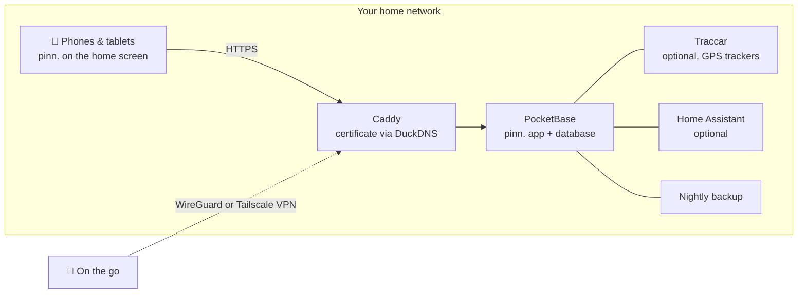

<p align="center">
  
</p>

<p align="center">
  <a href="https://github.com/pinn-shost/pinn/releases/latest"></a>
  <a href="LICENSE"></a>
  
  
  
  <a href="https://ko-fi.com/pinnapp"></a>
</p>

<p align="center">
  <b>🇬🇧 English</b> ·
  <a href="README.de.md">🇩🇪 Deutsch</a> ·
  <a href="README.es.md">🇪🇸 Español</a> ·
  <a href="README.fr.md">🇫🇷 Français</a> ·
  <a href="README.it.md">🇮🇹 Italiano</a> ·
  <a href="README.pt.md">🇧🇷 Português</a> ·
  <a href="README.zh.md">🇨🇳 中文</a> ·
  <a href="README.ja.md">🇯🇵 日本語</a> ·
  <a href="README.ko.md">🇰🇷 한국어</a> ·
  <a href="README.ru.md">🇷🇺 Русский</a> ·
  <a href="README.nl.md">🇳🇱 Nederlands</a> ·
  <a href="README.tr.md">🇹🇷 Türkçe</a> ·
  <a href="README.pl.md">🇵🇱 Polski</a> ·
  <a href="README.uk.md">🇺🇦 Українська</a>
</p>

<p align="center">
  <a href="#screenshots">Screenshots</a> ·
  <a href="#what-pinn-does">Features</a> ·
  <a href="#installation">Installation</a> ·
  <a href="#privacy">Privacy</a> ·
  <a href="#faq">FAQ</a>
</p>

---

pinn. is one app for everything that keeps a household running: the shared calendar, this week's meals, the shopping list, who takes out the bins, the pocket money and the insurance that needs cancelling in March. It runs on **your own NAS** with Docker and installs like a native app on every iPhone, iPad and Android phone in the family.

No cloud account. No subscription. No ads, no tracking. Your family's data never leaves your home.

## Screenshots

### On the iPad

Hung on the wall or lying on the kitchen table: the shared iPad shows the whole family at once.

<table>
  <tr>
    <td align="center" width="50%">
      <a href=".github/assets/screenshots/dashboard.png"></a><br>
      <sub><b>Dashboard</b> – everyone taps their own picture, with an optional PIN</sub>
    </td>
    <td align="center" width="50%">
      <a href=".github/assets/screenshots/ipad-overview.png"></a><br>
      <sub><b>Overview</b> – weather, appointments, tasks, meals and the family at a glance</sub>
    </td>
  </tr>
</table>

### On the phone

Always with you: pinn. installs on every iPhone and Android phone like a native app.

<table>
  <tr>
    <td align="center" width="33%"><a href=".github/assets/screenshots/home.png"></a><br><sub><b>Overview</b> – your day at a glance</sub></td>
    <td align="center" width="33%"><a href=".github/assets/screenshots/calendar.png"></a><br><sub><b>Calendar</b> – iCloud and Google in one view</sub></td>
    <td align="center" width="33%"><a href=".github/assets/screenshots/meals.png"></a><br><sub><b>Meals</b> – plan the week, shop with one tap</sub></td>
  </tr>
  <tr>
    <td align="center" width="33%"><a href=".github/assets/screenshots/lists.png"></a><br><sub><b>Lists</b> – shopping, pantry, packing</sub></td>
    <td align="center" width="33%"><a href=".github/assets/screenshots/finance.png"></a><br><sub><b>Finance</b> – budget, savings, pocket money</sub></td>
    <td align="center" width="33%"><a href=".github/assets/screenshots/chat.png"></a><br><sub><b>Chat</b> – end-to-end encrypted, with voice messages and locations</sub></td>
  </tr>
</table>

### More screens

Tap any picture to open it in full size.

<details>
<summary><b>Show more screenshots</b></summary>

<br>

<table>
  <tr>
    <td align="center" width="25%"><a href=".github/assets/screenshots/house.png"></a><br><sub><b>Home</b> – house, costs, loan, defects and meters in one place</sub></td>
    <td align="center" width="25%"><a href=".github/assets/screenshots/tasks.png"></a><br><sub><b>Tasks</b> – automatic reminders, e.g. inspection and tyre change, with a shortcut button</sub></td>
    <td align="center" width="25%"><a href=".github/assets/screenshots/vehicles.png"></a><br><sub><b>Vehicles</b> – inspection, tyres, fuelling and charging</sub></td>
    <td align="center" width="25%"><a href=".github/assets/screenshots/scan_pantry.png"></a><br><sub><b>Pantry scan</b> – scan the barcode, put away or use up</sub></td>
  </tr>
  <tr>
    <td align="center" width="25%"><a href=".github/assets/screenshots/weekly_summary_1.png"></a><br><sub><b>Weekly preview</b> – weather and what is still open</sub></td>
    <td align="center" width="25%"><a href=".github/assets/screenshots/weekly_summary_2.png"></a><br><sub><b>Weekly preview</b> – day by day: cleaning, bins, payments</sub></td>
    <td align="center" width="25%"><a href=".github/assets/screenshots/weekly_summary_3.png"></a><br><sub><b>Last week in brief</b> – events, meals, spending – and shortcuts</sub></td>
    <td align="center" width="25%"><a href=".github/assets/screenshots/kids.png"></a><br><sub><b>Kids</b> – a playful daily routine</sub></td>
  </tr>
</table>

</details>

<sub>📁 <a href=".github/assets/screenshots">All pictures in one folder</a></sub>

## What pinn. does

| | |
|---|---|
| 📅 **Calendar** | iCloud and Google calendars per person, private or shared with the family. Public and school holidays, waste collection dates and birthdays from your contacts appear automatically. |
| 🍝 **Meals & recipes** | Plan the week, then send the ingredients straight to the shopping list. Import recipes from text, PDF, photos or a link – optionally with AI. Share favourite recipes with other families on your server. |
| 🛒 **Lists** | Shopping lists per shop, a pantry that refills the list when stock runs low, packing lists from templates (holiday, hospital bag, party), gift and wish lists. |
| ✅ **Tasks & household** | Tasks with push reminders, cleaning plans and bins – plus a kids' page with animated routines that only shows what fits the time of day. |
| 💶 **Finance** | Shared or private funds, a household budget, savings and depots with ETFs and shares, pocket money, recurring payments and contracts with cancellation reminders. Flatshares can split costs and see who owes whom. |
| 📄 **Documents & vehicles** | Receipts and warranties, IDs with expiry reminders. Cars and bikes with inspection dates, tyre changes, fuel use and total cost. |
| 🏡 **Home** | For tenants, owners and landlords: tenancy or purchase contract, loan, defects with photos, receipts, renovation plan, meter readings with forecast, keys, and rental income for flats, houses and garages you let out. Garden & plants with a watering plan that knows when it rained. |
| 📍 **Family & location** | Share your location right from pinn. – once or for a chosen time – and in the background via the free Traccar Client app (sends straight to pinn., no extra server). Plus a "way home" mode, an SOS alert with position and emergency numbers, emergency cards and arrival notifications for places. |
| 🎒 **School & daycare** | Per child: timetable (type it in or snap a photo – the AI fills it in), drop-off and pick-up, homework on the kids' page, parent letters with deadlines that turn into reminders, and closure days straight in the calendar. |
| 🐾 **Pets** | Profiles for dogs, cats, rabbits & co. with feeding times to tick off, walks, a "whose turn is it" rota, vaccinations and deworming with push reminders, weight chart, vet and emergency vet, a pet-sitter sheet to share, a printable "missing" poster and a pet feeder refill reminder. |
| 🌦️ **Weather & holidays** | Tap the weather (a tile on the phone, at the top next to date and time on iPad and computer) for 14 days with details for every day. Packing lists with destination and dates show the holiday weather – forecast or typical values – and suggest what to pack. |
| 🏠 **Smart home** | Start Apple Shortcuts or Home Assistant actions from a task – the robot vacuum cleans the kitchen when the chore is due, the robot mower and the watering follow the garden plan, the pet feeder reports when it runs empty. |
| 🎙️ **Voice control** | "Hey Siri, pinn": add to the shopping list, read it out, create tasks and hear what's on today – also on Android. |
| 💬 **Chat** | Family chat and private chats, end-to-end encrypted, with push, read ticks and replies. |
| 🔔 **Notifications** | Personal push messages on iPhone, iPad and Android, plus a notification bell that collects every change in the family. |
| 🧩 **Everything else** | Family board with movable notes, global search, offline mode with automatic sync, dark mode, iPad dashboard with profile PINs, guest account, child lock. |

pinn. speaks **🇬🇧 English, 🇩🇪 Deutsch, 🇪🇸 Español, 🇫🇷 Français, 🇮🇹 Italiano, 🇧🇷 Português, 🇨🇳 中文, 🇯🇵 日本語, 🇰🇷 한국어, 🇷🇺 Русский, 🇳🇱 Nederlands, 🇹🇷 Türkçe, 🇵🇱 Polski and 🇺🇦 Українська**, adapts currency and emergency numbers to your region, and switches between **family** and **flatshare** wording. One server can host several families, each with its own admins.

## What's new in 1.138.0

**Automatic dark mode and automatic updates**

- **Dark mode.** Under Settings → Appearance, pinn. can now switch to dark mode by time of day (e.g. 8 pm to 7 am) or from sunset to sunrise. The sun times are calculated on the device for the home address of the family (otherwise the weather location) – no location access needed. Switching by hand applies until the next automatic change. The setting belongs to your profile and applies on all your devices.
- **Automatic updates.** Under Settings → System → Backups & updates, pinn. can check for a new version at a set time, daily or once a week, create a backup first and then install the update. Pre-releases are never installed automatically, and if the backup fails nothing is installed. Result and next run are shown in the same window, errors in the error log. Only for admins who may install updates.
- **Pets.** Several feeding times per pet: in the pet editor you add as many times as you like (up to 12) with a time picker and an optional note for amount or food (e.g. “1 cup dry food”). The note shows on the feeding button and in the food card. New banner on the Pets page: a meadow with a fence where the pets of your family walk by – at night with stars.
- Changed: `js/dunkelzeit.js` (new), `js/design.js`, `js/familie.js`, `css/haustierewetter.css`, `js/einstellungen.js`, `js/sicherungen.js`, `js/sprachen.js`, `js/versionslog.js`, `i18n/` (19 new texts in all fourteen languages), `src/` (`index.html`), `pinn-setup.sh`, `.github/scripts/check-hooks.js`, all READMEs. Server (replace the hooks, PocketBase restarts): `pb_hooks/pinn-system.js`, `pb_hooks/system.pb.js`.

## What's new in 1.137.0

**Voice control in Turkish, Polish and Ukrainian**

- **Voice control.** “Hey Siri, pinn” (on Android HTTP Shortcuts) now also understands Turkish, Polish and Ukrainian and answers in the language of your profile: add things to the shopping list (with quantity and shop), read the list, create a task and hear what is on today or tomorrow. Siri no longer answers in English for Ukrainian. Setting up the shortcut stays the same.
- Changed: `js/sprachen.js`, `js/versionslog.js`, `i18n/versionslog.en.js`, `src/` (`index.html`), `.github/scripts/check-hooks.js`, all READMEs. Server (replace the hook, PocketBase restarts): `pb_hooks/pinn-sprache.js`.

## What's new in 1.136.0

**Ukrainian enabled**

- **Ukrainian.** Ukrainian is now available for everyone: choose Українська under Settings → Language & region; if your browser is set to Ukrainian, pinn. selects it automatically. All 6994 texts, the push notifications, the setup wizard and the data export are in Ukrainian; Ukrainian emergency numbers are 102, 103, 101 and 112. pinn. now speaks fourteen languages. Siri still answers in English for Ukrainian.
- Changed: `js/sprachen.js`, `js/versionslog.js`, `i18n/versionslog.en.js`, `src/` (`index.html`), all READMEs (language list, “fourteen languages”). Since 1.134.0 also: `i18n/uk.i18n.js`, `js/textkern.js`, `js/region.js`, `einrichtung.js`, `datenexport.js`, `js/einrichten.js`, `js/exportieren.js`, `.github/scripts/`. Server (replace the hooks, PocketBase restarts): `pb_hooks/pinn-textkern.js`, `pinn-pushtext.js`, `pinn-aufgaben.js`, `pinn-ausblick.js`, `pinn-chat.js`, `pinn-einrichtung.js`, `pinn-familie-geburtstag.js`, `pinn-haustiere.js`, `pinn-ortung.js`, `pinn-packliste.js`, `pinn-wobistdu.js`.

## What's new in 1.135.17

**Ukrainian – stage 18**

- **Ukrainian.** The set-up wizard and the data export now speak Ukrainian: all step-by-step guides (home network, DuckDNS, VPN, Google, AI, location, Home Assistant, apps) and every export text. Ukrainian emergency numbers (102, 103, 101 and 112) double-checked. A short `README.uk.md` is new. The language is still hidden – nothing changes in the app.
- Changed: `einrichtung.js`, `datenexport.js`, `js/einrichten.js`, `js/exportieren.js`, `js/sprachen.js`, `js/versionslog.js`, `i18n/versionslog.en.js`, `src/` (`index.html`), `README.uk.md`. No server part.

## What's new in 1.135.16

**Ukrainian – stage 17**

- **Ukrainian.** All 6994 texts are now translated, including the push notifications (server texts, flat-share terms and country Ukraine in the notification hooks). The language is still hidden – nothing changes in the app.
- Changed: `i18n/uk.i18n.js`, `js/sprachen.js`, `js/versionslog.js`, `i18n/versionslog.en.js`, `src/` (`index.html`), `.github/scripts/check-hooks.js`. Server (replace the hooks, PocketBase restarts): `pb_hooks/pinn-pushtext.js`, `pinn-aufgaben.js`, `pinn-ausblick.js`, `pinn-chat.js`, `pinn-einrichtung.js`, `pinn-familie-geburtstag.js`, `pinn-haustiere.js`, `pinn-ortung.js`, `pinn-packliste.js`, `pinn-wobistdu.js`.

## What's new in 1.135.15

**Ukrainian – stage 16**

- **Ukrainian.** Ukrainian is translated further: outlook, help & tutorial, family tile, members, server messages, SOS, voice control and the remaining small areas (6847 of 6994 texts). The language is still hidden – nothing changes in the app.
- Changed: `i18n/uk.i18n.js`, `js/sprachen.js`, `js/versionslog.js`, `i18n/versionslog.en.js`, `src/` (`index.html`). No server part.

## What's new in 1.135.14

**Ukrainian – stage 15**

- **Ukrainian.** Ukrainian is translated further: school & daycare, family (emergency cards, locations) and pin board (6404 of 6994 texts). The language is still hidden – nothing changes in the app.
- Changed: `i18n/uk.i18n.js`, `js/sprachen.js`, `js/versionslog.js`, `i18n/versionslog.en.js`, `src/` (`index.html`). No server part.

## What's new in 1.135.13

**Ukrainian – stage 14**

- **Ukrainian.** Ukrainian is translated further: chat (rest), pets and places (location sharing, GPS trackers) (5958 of 6994 texts). The language is still hidden – nothing changes in the app.
- Changed: `i18n/uk.i18n.js`, `js/sprachen.js`, `js/versionslog.js`, `i18n/versionslog.en.js`, `src/` (`index.html`). No server part.

## What's new in 1.135.12

**Ukrainian – stage 13**

- **Ukrainian.** Ukrainian is translated further: notifications (activity, way home, SOS) and chat, part 1 (5508 of 6994 texts). The language is still hidden – nothing changes in the app.
- Changed: `i18n/uk.i18n.js`, `js/sprachen.js`, `js/versionslog.js`, `i18n/versionslog.en.js`, `src/` (`index.html`). No server part.

## What's new in 1.135.11

**Ukrainian – stage 12**

- **Ukrainian.** Ukrainian is translated further: smart home, documents and PDF reading (5208 of 6994 texts). The language is still hidden – nothing changes in the app.
- Changed: `i18n/uk.i18n.js`, `js/sprachen.js`, `js/versionslog.js`, `i18n/versionslog.en.js`, `src/` (`index.html`). No server part.

## What's new in 1.135.10

**Ukrainian – stage 11**

- **Ukrainian.** Ukrainian is translated further: vehicles (fuelling & charging, consumption, workshop, tyres, MOT/service, insurance plate, calculators) (4760 of 6994 texts). The language is still hidden – nothing changes in the app.
- Changed: `i18n/uk.i18n.js`, `js/sprachen.js`, `js/versionslog.js`, `i18n/versionslog.en.js`, `src/` (`index.html`). No server part.

## How it works



Everything runs as Docker containers on one machine. HTTPS works **without port forwarding** – the certificate is issued via a DNS check. From outside, pinn. is only reachable through your own VPN.

## Requirements

- A NAS or server with **Docker** and **Docker Compose 2.17+** – developed on a UGREEN NAS with UGOS, runs on any Linux Docker host (amd64, arm64, armv7)
- SSH access to it
- Optional but recommended: a free [DuckDNS](https://www.duckdns.org) subdomain for HTTPS – required for push notifications and installing pinn. as an app

## Installation

1. Download the ZIP of the [latest release](https://github.com/pinn-shost/pinn/releases/latest) and unzip it.
2. Create a folder on the NAS, e.g. `/volume1/docker/Pocketbase`, and put the unzipped folder (e.g. `pinn-1.138.0` or `pinn-main`) into it as it is.
3. Log in via SSH and run:
   ```sh
   cd /volume1/docker/Pocketbase && sudo sh pinn-*/pinn-setup.sh
   ```
   The script copies every file into place, downloads the libraries for PDF import and photo text recognition, and starts pinn.
4. Open `http://<NAS-IP>:8090` → **Log in as main admin** → password `Admin` → choose your own password.
5. The **setup assistant** walks you through the rest – HTTPS, remote access via WireGuard or Tailscale, Google, AI, location and Home Assistant – step by step, in fourteen languages.
6. Open pinn. via its HTTPS address on each phone and add it to the home screen:
   - **iPhone/iPad (Safari):** Share → *Add to Home Screen* (iOS 16.4 or later for notifications)
   - **Android (Chrome):** Settings → Notifications → *Install pinn. as an app*, or Chrome menu ⋮ → *Install app*

   Then turn on notifications on each device under **Settings → Notifications → Activate on this device**.

**Updating:** download the new ZIP, put the unzipped folder into the same folder and run `sudo sh pinn-*/pinn-setup.sh` again. Replaced files are kept in `_alt/`, your data stays untouched.

**Backups** run every night into `./backups` and are kept for 14 days.

## Privacy

pinn. was built for data you would never hand to a cloud service: bank statements, health documents, where your children are. That's why:

- **All data lives on your NAS** in a single PocketBase database. There is no pinn. server and no telemetry.
- **No scripts from third-party servers.** All code and libraries are served from your NAS.
- **Push notifications carry no content.** Apple, Google and Mozilla only deliver an empty wake-up signal; the device then fetches the message from your NAS.
- **Passwords for iCloud and Google** are stored encrypted in a locked collection.
- **Not reachable from the internet.** Remote access goes through your own VPN.

pinn. only contacts outside services for features that need them:

| Service | Used for | When |
|---|---|---|
| [Open-Meteo](https://open-meteo.com) | Weather forecast | when a home address is set |
| [OpenStreetMap Nominatim](https://nominatim.openstreetmap.org) | Turning addresses into map positions | when entering addresses |
| [OpenStreetMap tiles](https://www.openstreetmap.org) | Map background | on the location page, loaded through your NAS |
| [Google Fonts](https://fonts.google.com) | Typefaces | when the app loads |
| [OpenHolidays API](https://www.openholidaysapi.org) | Public and school holidays | when a home address is set |
| [DuckDNS](https://www.duckdns.org) | HTTPS certificate and address | if configured |
| iCloud / Google | Calendars and contacts | only for accounts you connect |
| Google Gemini | Reading recipes and documents | only if you add an API key |
| jsDelivr | One-time download of pdf.js and Tesseract | during installation only |

## FAQ

<details>
<summary><b>Do I need to open ports on my router?</b></summary>
<br>
No. The HTTPS certificate is issued via a DNS check, and remote access runs through a VPN – WireGuard on a FRITZ!Box, or Tailscale for any other router.
</details>

<details>
<summary><b>Does it work without a NAS?</b></summary>
<br>
Any always-on machine with Docker works: a mini PC, a Raspberry Pi 4/5 or a Linux server.
</details>

<details>
<summary><b>Is pinn. a "real" app from the App Store?</b></summary>
<br>
pinn. is a web app that you add to the home screen. It then opens full-screen like a native app, works offline, shows a badge with open tasks and receives push notifications – without any app store.
</details>

<details>
<summary><b>Can several families use one installation?</b></summary>
<br>
Yes. The main admin creates families, each family gets its own admins, calendars and data. Recipes can optionally be shared between families.
</details>

<details>
<summary><b>What about children?</b></summary>
<br>
Profiles with child lock only see their own tasks and can't delete or change anything. Finance, documents and vehicles stay hidden. Younger children get their own playful page with daily routines.
</details>

<details>
<summary><b>What does it cost?</b></summary>
<br>
Nothing – pinn. is free and open source under the MIT license. Optional services like the Gemini AI have free tiers.
</details>

## Repository layout

The repository has the same layout as an installation on the NAS – every file lies where it ends up:

```
pinn/
├── pb_hooks/            server: *.pb.js hooks and their helper modules (pinn-*.js, calendar-sync.js)
├── pb_public/           web app served by PocketBase
│   ├── index.html       the app page, built from src/ (HTML, start check) – do not edit by hand
│   ├── js/              app code split out of index.html, plain <script> files without a build step
│   │                    (ruhemodus.js, textkern.js, sprachen.js, region.js, grundlagen.js, popups.js, verbindung.js, benutzer.js, mitteilungen.js, serverzugriff.js, tastatur.js, anmeldemaske.js, dashboard.js, dashboardhintergrund.js, profilauswahl.js, pineingabe.js, dashboardsitzung.js, dashboardkonto.js, familienverwalten.js, einrichten.js, exportieren.js, hauptadminseite.js, anmeldung.js, konto.js, profilverwaltung.js, zustand.js, bedienzustand.js, rezeptbilder.js, zusammenfuehren.js, speichern.js, design.js, sprache.js, uebersicht.js, familienkachel.js, wobistdu.js, geburtstagsfeier.js, wetterkachel.js, geburtstage.js, uebersichteinstellungen.js, familiensync.js, bereiche.js, kalenderquellen.js, icsparser.js, zeitleiste.js, termindetails.js, kalenderdatei.js, wetter.js, wohnort.js, feiertage.js, muellkalender.js, mitglieder.js, profilbild.js, mitglied.js, kinderseite.js, kinderroutine.js, sterne.js, kalenderansicht.js, essenplanen.js, rezeptparser.js, rezeptdialog.js, rezeptbild.js, rezeptmengen.js, einkauf.js, einkaufslisten.js, einkaufseingabe.js, rezepte.js, offline.js, aufgabenextras.js, appbadge.js, reisen.js, aufgabendaten.js, haushalt.js, reihum.js, aufgaben.js, smarthome.js, sprachsteuerung.js, termine.js, ansichten.js, versionspruefung.js, sicherungen.js, geraete.js, fehlerprotokoll.js, versionslog.js, einstellungen.js, kalenderkonto.js, finanzen.js, kassen.js, vorrat.js, vorrat2.js, sparen.js, vertraege.js, fahrzeuge.js, zuhause.js, dokumente.js, pdflesen.js, appstart.js, pinnwand.js, listen.js, familie.js, hinweise.js, ausblick.js – ausblick.js always comes last)
│   ├── css/             app styles split out of index.html, plain CSS without a build step (ergaenzung.css, energiesparen.css, basis.css … haustierewetter.css, terminal.css, glocke.css)
│   ├── einrichtung.js   setup assistant · datenexport.js  data export
│   ├── i18n/            texts by key (de, en, fr, es, it, pt, zh, ja, ko) – English is the reference
│   └── vendor/          pinn.css, pocketbase/ (pdf.js and Tesseract are downloaded by the setup)
├── .github/             GitHub Actions (workflows/check.yml), checks (scripts/), CONTRIBUTING.md, SECURITY.md, images – not installed
├── src/                 sources of index.html (build.js, rahmen.html, teile/) – not installed
├── caddy/Caddyfile      HTTPS reverse proxy
├── docker-compose.yaml  all containers
├── env.txt              template for .env
├── pinn-setup.sh        install & update
├── pinn-wartung.sh      backups & updates (container "wartung")
├── pinn-pocketbase-update.sh
├── index.html           placeholder only, never installed (keeps the update button of 1.38 working)
└── README.md            this page · README.<code>.md in de, es, fr, it, pt, zh, ja, ko
```

`pinn-setup.sh` copies `pb_hooks/`, `pb_public/` and `caddy/Caddyfile` 1:1 into the project folder; data folders (`pb_data/`, `konfig/`, `backups/`, `caddy/data/` …) are never touched.

## Contributing

Bug reports, ideas and translations are very welcome – see [CONTRIBUTING.md](.github/CONTRIBUTING.md). Please report security issues privately as described in [SECURITY.md](.github/SECURITY.md). Before a pull request, please run `node .github/scripts/check-all.js` – the same checks run automatically on GitHub.

## Support pinn.

pinn. is free and stays free – completely, for everyone. It's built in my spare time. If it makes your everyday life a little easier, a small contribution is very welcome, but entirely voluntary:

<p>
  <a href="https://ko-fi.com/pinnapp"></a>
  <a href="https://buymeacoffee.com/pinn"></a>
</p>

A ⭐ helps too – it makes pinn. easier to find for other families.

## Built with

[PocketBase](https://pocketbase.io) (MIT) · [Tailwind CSS](https://tailwindcss.com) (MIT) · [pdf.js](https://mozilla.github.io/pdf.js/) (Apache-2.0) · [Tesseract.js](https://tesseract.projectnaptha.com) (Apache-2.0) · [Traccar](https://www.traccar.org) (Apache-2.0) · [Caddy](https://caddyserver.com) (Apache-2.0)

## License

[MIT](LICENSE) – use it, change it, share it.
