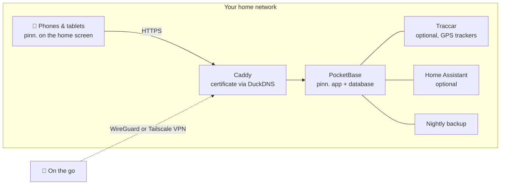

<p align="center">
  
</p>

<p align="center">
  <a href="https://github.com/pinn-shost/pinn/releases/latest"></a>
  <a href="LICENSE"></a>
  
  
  
  <a href="https://ko-fi.com/pinnapp"></a>
</p>

<p align="center">
  <b>🇬🇧 English</b> ·
  <a href="README.de.md">🇩🇪 Deutsch</a> ·
  <a href="README.es.md">🇪🇸 Español</a> ·
  <a href="README.fr.md">🇫🇷 Français</a> ·
  <a href="README.it.md">🇮🇹 Italiano</a> ·
  <a href="README.pt.md">🇧🇷 Português</a> ·
  <a href="README.zh.md">🇨🇳 中文</a> ·
  <a href="README.ja.md">🇯🇵 日本語</a> ·
  <a href="README.ko.md">🇰🇷 한국어</a>
</p>

<p align="center">
  <a href="#screenshots">Screenshots</a> ·
  <a href="#what-pinn-does">Features</a> ·
  <a href="#installation">Installation</a> ·
  <a href="#privacy">Privacy</a> ·
  <a href="#faq">FAQ</a>
</p>

---

pinn. is one app for everything that keeps a household running: the shared calendar, this week's meals, the shopping list, who takes out the bins, the pocket money and the insurance that needs cancelling in March. It runs on **your own NAS** with Docker and installs like a native app on every iPhone, iPad and Android phone in the family.

No cloud account. No subscription. No ads, no tracking. Your family's data never leaves your home.

## Screenshots

### On the iPad

Hung on the wall or lying on the kitchen table: the shared iPad shows the whole family at once.

<table>
  <tr>
    <td align="center" width="50%">
      <br>
      <sub><b>Dashboard</b> – everyone taps their own picture, with an optional PIN</sub>
    </td>
    <td align="center" width="50%">
      <br>
      <sub><b>Overview</b> – weather, appointments, tasks, meals and the family at a glance</sub>
    </td>
  </tr>
</table>

### On the phone

Always with you: pinn. installs on every iPhone and Android phone like a native app.

<table>
  <tr>
    <td align="center" width="33%"><br><sub><b>Overview</b> – your day at a glance</sub></td>
    <td align="center" width="33%"><br><sub><b>Calendar</b> – iCloud and Google in one view</sub></td>
    <td align="center" width="33%"><br><sub><b>Meals</b> – plan the week, shop with one tap</sub></td>
  </tr>
  <tr>
    <td align="center" width="33%"><br><sub><b>Lists</b> – shopping, pantry, packing</sub></td>
    <td align="center" width="33%"><br><sub><b>Finance</b> – budget, savings, pocket money</sub></td>
    <td align="center" width="33%"><br><sub><b>Kids</b> – a playful daily routine</sub></td>
  </tr>
</table>

## What pinn. does

| | |
|---|---|
| 📅 **Calendar** | iCloud and Google calendars per person, private or shared with the family. Public and school holidays, waste collection dates and birthdays from your contacts appear automatically. |
| 🍝 **Meals & recipes** | Plan the week, then send the ingredients straight to the shopping list. Import recipes from text, PDF, photos or a link – optionally with AI. Share favourite recipes with other families on your server. |
| 🛒 **Lists** | Shopping lists per shop, a pantry that refills the list when stock runs low, packing lists from templates (holiday, hospital bag, party), gift and wish lists. |
| ✅ **Tasks & household** | Tasks with push reminders, cleaning plans and bins – plus a kids' page with animated routines that only shows what fits the time of day. |
| 💶 **Finance** | Shared or private funds, a household budget, savings and depots with ETFs and shares, pocket money, recurring payments and contracts with cancellation reminders. Flatshares can split costs and see who owes whom. |
| 📄 **Documents & vehicles** | Receipts and warranties, IDs with expiry reminders. Cars and bikes with inspection dates, tyre changes, fuel use and total cost. |
| 🏡 **Home** | For tenants, owners and landlords: tenancy or purchase contract, loan, defects with photos, receipts, renovation plan, meter readings with forecast, keys, and rental income for flats, houses and garages you let out. Garden & plants with a watering plan that knows when it rained. |
| 📍 **Family & location** | Share your location right from pinn. – once or for a chosen time – and in the background via the free Traccar Client app (sends straight to pinn., no extra server). Plus a "way home" mode, an SOS alert with position and emergency numbers, emergency cards and arrival notifications for places. |
| 🎒 **School & daycare** | Per child: timetable (type it in or snap a photo – the AI fills it in), drop-off and pick-up, homework on the kids' page, parent letters with deadlines that turn into reminders, and closure days straight in the calendar. |
| 🐾 **Pets** | Profiles for dogs, cats, rabbits & co. with feeding times to tick off, walks, a "whose turn is it" rota, vaccinations and deworming with push reminders, weight chart, vet and emergency vet, a pet-sitter sheet to share, a printable "missing" poster and a pet feeder refill reminder. |
| 🌦️ **Weather & holidays** | Tap the weather (a tile on the phone, at the top next to date and time on iPad and computer) for 14 days with details for every day. Packing lists with destination and dates show the holiday weather – forecast or typical values – and suggest what to pack. |
| 🏠 **Smart home** | Start Apple Shortcuts or Home Assistant actions from a task – the robot vacuum cleans the kitchen when the chore is due, the robot mower and the watering follow the garden plan, the pet feeder reports when it runs empty. |
| 🎙️ **Voice control** | "Hey Siri, pinn": add to the shopping list, read it out, create tasks and hear what's on today – also on Android. |
| 🔔 **Notifications** | Personal push messages on iPhone, iPad and Android, plus a notification bell that collects every change in the family. |
| 🧩 **Everything else** | Family board with movable notes, global search, offline mode with automatic sync, dark mode, iPad dashboard with profile PINs, guest account, child lock. |

pinn. speaks **🇬🇧 English, 🇩🇪 Deutsch, 🇪🇸 Español, 🇫🇷 Français, 🇮🇹 Italiano, 🇧🇷 Português, 🇨🇳 中文, 🇯🇵 日本語 and 🇰🇷 한국어**, adapts currency and emergency numbers to your region, and switches between **family** and **flatshare** wording. One server can host several families, each with its own admins.

## What's new in 1.115.0

**Text keys, part 6: finances, funds and contracts**

- **Finances** (expenses with budget, evaluation, history and the entry popup, recurring entries with the “from when?” question, finance settings and CSV export), the **funds** including *Complete shopping*, guests and *Who owes whom*, **contracts** with deadlines, costs, documents and the cancellation letter, **savings** with depots, positions, import and savings plans, **pocket money** (also on the kids' page) and reading invoices from PDFs now take their texts from the language files in `pb_public/i18n/` – in all nine languages and as a flatshare. Nothing changes in how you use it.
- Small things: dates, weekdays and month names in the finances follow your language; texts like *Compared with last week* or *New recurring expense* are now complete sentences in every language instead of pieced-together words; numbers like “1 transaction” or “1 person” use the correct singular or plural.
- Next: family, location, home, vehicles and documents follow with 1.116.0.
- Changed: app files only (`index.html`, `js/finanzen.js`, `js/kassen.js`, `js/vertraege.js`, `js/sparen.js`, `js/vorrat2.js`, `js/pdflesen.js`, `js/sprachen.js`, `js/versionslog.js`, all language files in `i18n/` and `lang/`) – nothing changes on the server. Install as usual (`sudo sh pinn-*/pinn-setup.sh` or the update button).

## What's new in 1.114.0

**Text keys, part 5: lists, pantry and recipes**

- **Lists** (shopping with main shop, special lists and *Plan shopping*, packing, gifts, wishes, checklists, ideas), the **pantry** with barcode scanning and *What can I cook?*, **recipes** with public recipes, **meal planning**, the **search** and the category editor now take their texts from the language files in `pb_public/i18n/` – in all nine languages and as a flatshare. Nothing changes in how you use the app.
- **Templates in every language:** a new list from a template (holiday, hospital, birth, party …) is created in your language with about 400 translated entries; generic shops such as pharmacy, bakery or butcher get the right name. Existing lists stay as they are.
- Small fixes: dates and prices in lists, pantry and recipes follow the format of your region; recipe recognition also finds ingredients and method under headings in the other languages; numbers such as “1 recipe” or “1 entry” use the right singular or plural.
- Next: finances and cash boxes follow in 1.115.0.
- Changed: app files only (`index.html`, `js/einkauf.js`, `js/einkaufslisten.js`, `js/einkaufseingabe.js`, `js/listen.js`, `js/vorrat.js`, `js/vorrat2.js`, `js/rezepte.js`, `js/rezeptdialog.js`, `js/rezeptmengen.js`, `js/rezeptbild.js`, `js/rezeptbilder.js`, `js/rezeptparser.js`, `js/essenplanen.js`, `js/einstellungen.js`, `js/hinweise.js`, `js/finanzen.js`, `js/bedienzustand.js`, `js/sprachen.js`, `js/versionslog.js`, all language files in `i18n/` and `lang/`) – nothing changes on the server. Install as usual (`sudo sh pinn-*/pinn-setup.sh` or the update button).

## What's new in 1.113.1

**Text keys, part 4: calendar settings and smart home**

- **Settings → Calendar** (your own iCloud and Google accounts, calendars “For me” and “Family”, the form *Add calendar*, the former family connection), the **waste calendar**, the **home address** with public holidays and school holidays, and the whole **smart home** popup (devices, Apple Shortcuts, Home Assistant, robot vacuum with rooms and modes) now take their texts from the language files in `pb_public/i18n/` – in all nine languages and as a flatshare. Nothing changes in how you use the app.
- Small fixes: German federal states, dates and times in these settings follow the format of your language; suggestions for a new smart home device (name and actions) appear in your language, and the robot vacuum mode and robot mower command are detected reliably; numbers such as “1 device” or “1 room” use the right singular or plural.
- Next: lists, pantry and recipes follow in 1.114.0.
- Changed: app files only (`index.html`, `js/kalenderkonto.js`, `js/smarthome.js`, `js/sprachen.js`, `js/versionslog.js`, all language files in `i18n/` and `lang/`) – nothing changes on the server. Install as usual (`sudo sh pinn-*/pinn-setup.sh` or the update button).

## What's new in 1.113.0

**Text keys, part 3: calendar, tasks and household**

- The **calendar** (day, week, month, year and list), the event popup and event details, **tasks** and the **household** page with rooms, bins, cleaning tasks, “Take turns” and “Who does how much?” now take their texts from the language files in `pb_public/i18n/` – in all nine languages and as a flatshare. Nothing changes in how you use the app.
- Weekday names, month names and dates in the calendar, in public holidays and in tasks now follow the format of your language.
- Small fixes: “Every [n] weeks” in the event repeat, “None” and “To” are now right in every language, and numbers such as “3 tasks created” or “1 done” use the right singular or plural.
- Next: calendar settings (iCloud/Google, waste calendar, home) and smart home follow in 1.113.1.
- Changed: app files only (`index.html`, `js/kalenderansicht.js`, `js/termine.js`, `js/termindetails.js`, `js/kalenderquellen.js`, `js/kalenderdatei.js`, `js/feiertage.js`, `js/muellkalender.js`, `js/aufgaben.js`, `js/aufgabendaten.js`, `js/aufgabenextras.js`, `js/haushalt.js`, `js/reihum.js`, `js/zustand.js`, `js/sprachen.js`, `js/versionslog.js`, all language files in `i18n/` and `lang/`) – nothing changes on the server. Install as usual (`sudo sh pinn-*/pinn-setup.sh` or the update button).

## What's new in 1.112.1

**Text keys, part 2: account, devices, backups and error log**

- The **account page** (profile, notifications, dashboard PIN and devices, profiles, guest menus, dashboard background), the **device management**, **Backups & updates** and the **error log** now take their texts from the language files in `pb_public/i18n/` – in all nine languages and as a flatshare. The status lines under Settings → System (synchronisation, backups, error log) are included. Nothing changes in how you use the app.
- Numbers now use the right singular or plural in every language, e.g. “1 open error”, “3 backups”, “2 other devices”.
- Small fixes: the lock time after wrong passwords in the devices popup no longer ends with a double full stop, dashboard devices show the date in the format of your language, and the roles “Admin”, “Member” and “Guest” are translated everywhere.
- For contributors: keys starting with `maint.` get no flatshare variant – backups and updates always concern every family on the server.
- Changed: app files only (`index.html`, `js/konto.js`, `js/profilverwaltung.js`, `js/dashboard.js`, `js/dashboardkonto.js`, `js/dashboardsitzung.js`, `js/mitteilungen.js`, `js/geraete.js`, `js/fehlerprotokoll.js`, `js/sicherungen.js`, `js/speichern.js`, `js/sprachen.js`, `js/versionslog.js`, all language files in `i18n/` and `lang/`) and `.github/` (CONTRIBUTING.md, `i18n-keys.js`) – nothing changes on the server. Install as usual (`sudo sh pinn-*/pinn-setup.sh` or the update button).

## What's new in 1.112.0

**Text keys, part 1: frame, sign-in and settings**

- Sign-in, main admin, family dashboard, menu, header, search and the **whole settings page** now take their texts from the language files in `pb_public/i18n/` – in all nine languages and as a flatshare. Nothing changes in how you use the app.
- Small fixes along the way: the number of contacts with a birthday and the hint about members without a profile now use the right singular or plural in every language, and labels for screen readers (e.g. “Open/close menu”) are translated too.
- For contributors: texts in the HTML are filled in once, right before the app scripts start – scripts may change them afterwards. `i18n-keys.js` now keeps emojis and symbols at the start or end of a text. Account, devices, backups and the error log follow in the next step.
- Changed: app files only (`index.html`, `js/sprachen.js`, `js/anmeldemaske.js`, `js/anmeldung.js`, `js/hauptadminseite.js`, `js/profilauswahl.js`, `js/pineingabe.js`, `js/verbindung.js`, `js/zustand.js`, `js/ansichten.js`, `js/einstellungen.js`, `js/uebersichteinstellungen.js`, `js/versionslog.js`, all language files in `i18n/` and `lang/`) and `.github/` (CONTRIBUTING.md, `i18n-keys.js`) – nothing changes on the server. Install as usual (`sudo sh pinn-*/pinn-setup.sh` or the update button).

## What's new in 1.111.0

**Translations with text keys – the foundation**

- Step 6 of the roadmap begins: texts are looked up by a **key** (e.g. `settings.region.title`) instead of by their German original. Every language has its own file in `pb_public/i18n/` – German included, English is the reference. The first part to use it is **Settings → Language & region**; everything else is translated as before until its turn comes. Nothing changes in how you use the app.
- **Plurals done right:** one shared rule table (`js/textkern.js`, on the server `pinn-textkern.js`) picks the right plural form in the app and in push messages – also for languages with three forms. **Russian** is prepared, but not offered yet.
- For contributors: `tk('key')` in JavaScript, `data-tk="key"` in HTML. `.github/scripts/i18n-keys.js` moves existing translations under a key without retyping them, `check-keys.js` checks every language, placeholder and plural form – see [CONTRIBUTING.md](.github/CONTRIBUTING.md#texts).
- Changed: app files (`index.html`, `js/sprachen.js`, `js/sprache.js`, `js/versionslog.js`, `js/textkern.js` (new), all language files in `lang/` and `i18n/` (new)), `pinn-setup.sh` and on the server `pb_hooks/sw.pb.js` and `pinn-textkern.js` (new), plus `.github/` (checks, workflow, CONTRIBUTING.md). Install as usual (`sudo sh pinn-*/pinn-setup.sh` or the update button).

## How it works



Everything runs as Docker containers on one machine. HTTPS works **without port forwarding** – the certificate is issued via a DNS check. From outside, pinn. is only reachable through your own VPN.

## Requirements

- A NAS or server with **Docker** and **Docker Compose 2.17+** – developed on a UGREEN NAS with UGOS, runs on any Linux Docker host (amd64, arm64, armv7)
- SSH access to it
- Optional but recommended: a free [DuckDNS](https://www.duckdns.org) subdomain for HTTPS – required for push notifications and installing pinn. as an app

## Installation

1. Download the ZIP of the [latest release](https://github.com/pinn-shost/pinn/releases/latest) and unzip it.
2. Create a folder on the NAS, e.g. `/volume1/docker/Pocketbase`, and put the unzipped folder (e.g. `pinn-1.115.0` or `pinn-main`) into it as it is.
3. Log in via SSH and run:
   ```sh
   cd /volume1/docker/Pocketbase && sudo sh pinn-*/pinn-setup.sh
   ```
   The script copies every file into place, downloads the libraries for PDF import and photo text recognition, and starts pinn.
4. Open `http://<NAS-IP>:8090` → **Log in as main admin** → password `Admin` → choose your own password.
5. The **setup assistant** walks you through the rest – HTTPS, remote access via WireGuard or Tailscale, Google, AI, location and Home Assistant – step by step, in nine languages.
6. Open pinn. via its HTTPS address on each phone and add it to the home screen:
   - **iPhone/iPad (Safari):** Share → *Add to Home Screen* (iOS 16.4 or later for notifications)
   - **Android (Chrome):** Settings → Notifications → *Install pinn. as an app*, or Chrome menu ⋮ → *Install app*

   Then turn on notifications on each device under **Settings → Notifications → Activate on this device**.

**Updating:** download the new ZIP, put the unzipped folder into the same folder and run `sudo sh pinn-*/pinn-setup.sh` again. Replaced files are kept in `_alt/`, your data stays untouched.

**Backups** run every night into `./backups` and are kept for 14 days.

## Privacy

pinn. was built for data you would never hand to a cloud service: bank statements, health documents, where your children are. That's why:

- **All data lives on your NAS** in a single PocketBase database. There is no pinn. server and no telemetry.
- **No scripts from third-party servers.** All code and libraries are served from your NAS.
- **Push notifications carry no content.** Apple, Google and Mozilla only deliver an empty wake-up signal; the device then fetches the message from your NAS.
- **Passwords for iCloud and Google** are stored encrypted in a locked collection.
- **Not reachable from the internet.** Remote access goes through your own VPN.

pinn. only contacts outside services for features that need them:

| Service | Used for | When |
|---|---|---|
| [Open-Meteo](https://open-meteo.com) | Weather forecast | when a home address is set |
| [OpenStreetMap Nominatim](https://nominatim.openstreetmap.org) | Turning addresses into map positions | when entering addresses |
| [OpenStreetMap tiles](https://www.openstreetmap.org) | Map background | on the location page, loaded through your NAS |
| [Google Fonts](https://fonts.google.com) | Typefaces | when the app loads |
| [OpenHolidays API](https://www.openholidaysapi.org) | Public and school holidays | when a home address is set |
| [DuckDNS](https://www.duckdns.org) | HTTPS certificate and address | if configured |
| iCloud / Google | Calendars and contacts | only for accounts you connect |
| Google Gemini | Reading recipes and documents | only if you add an API key |
| jsDelivr | One-time download of pdf.js and Tesseract | during installation only |

## FAQ

<details>
<summary><b>Do I need to open ports on my router?</b></summary>
<br>
No. The HTTPS certificate is issued via a DNS check, and remote access runs through a VPN – WireGuard on a FRITZ!Box, or Tailscale for any other router.
</details>

<details>
<summary><b>Does it work without a NAS?</b></summary>
<br>
Any always-on machine with Docker works: a mini PC, a Raspberry Pi 4/5 or a Linux server.
</details>

<details>
<summary><b>Is pinn. a "real" app from the App Store?</b></summary>
<br>
pinn. is a web app that you add to the home screen. It then opens full-screen like a native app, works offline, shows a badge with open tasks and receives push notifications – without any app store.
</details>

<details>
<summary><b>Can several families use one installation?</b></summary>
<br>
Yes. The main admin creates families, each family gets its own admins, calendars and data. Recipes can optionally be shared between families.
</details>

<details>
<summary><b>What about children?</b></summary>
<br>
Profiles with child lock only see their own tasks and can't delete or change anything. Finance, documents and vehicles stay hidden. Younger children get their own playful page with daily routines.
</details>

<details>
<summary><b>What does it cost?</b></summary>
<br>
Nothing – pinn. is free and open source under the MIT license. Optional services like the Gemini AI have free tiers.
</details>

## Repository layout

The repository has the same layout as an installation on the NAS – every file lies where it ends up:

```
pinn/
├── pb_hooks/            server: *.pb.js hooks and their helper modules (pinn-*.js, calendar-sync.js)
├── pb_public/           web app served by PocketBase
│   ├── index.html       the app page, built from src/ (HTML, start check) – do not edit by hand
│   ├── js/              app code split out of index.html, plain <script> files without a build step
│   │                    (ruhemodus.js, textkern.js, sprachen.js, region.js, grundlagen.js, popups.js, verbindung.js, benutzer.js, mitteilungen.js, serverzugriff.js, tastatur.js, anmeldemaske.js, dashboard.js, dashboardhintergrund.js, profilauswahl.js, pineingabe.js, dashboardsitzung.js, dashboardkonto.js, familienverwalten.js, einrichten.js, exportieren.js, hauptadminseite.js, anmeldung.js, konto.js, profilverwaltung.js, zustand.js, bedienzustand.js, rezeptbilder.js, zusammenfuehren.js, speichern.js, design.js, sprache.js, uebersicht.js, familienkachel.js, wobistdu.js, geburtstagsfeier.js, wetterkachel.js, geburtstage.js, uebersichteinstellungen.js, familiensync.js, bereiche.js, kalenderquellen.js, icsparser.js, zeitleiste.js, termindetails.js, kalenderdatei.js, wetter.js, wohnort.js, feiertage.js, muellkalender.js, mitglieder.js, profilbild.js, mitglied.js, kinderseite.js, kinderroutine.js, sterne.js, kalenderansicht.js, essenplanen.js, rezeptparser.js, rezeptdialog.js, rezeptbild.js, rezeptmengen.js, einkauf.js, einkaufslisten.js, einkaufseingabe.js, rezepte.js, offline.js, aufgabenextras.js, appbadge.js, reisen.js, aufgabendaten.js, haushalt.js, reihum.js, aufgaben.js, smarthome.js, sprachsteuerung.js, termine.js, ansichten.js, versionspruefung.js, sicherungen.js, geraete.js, fehlerprotokoll.js, versionslog.js, einstellungen.js, kalenderkonto.js, finanzen.js, kassen.js, vorrat.js, vorrat2.js, sparen.js, vertraege.js, fahrzeuge.js, zuhause.js, dokumente.js, pdflesen.js, appstart.js, pinnwand.js, listen.js, familie.js, hinweise.js, ausblick.js – ausblick.js always comes last)
│   ├── css/             app styles split out of index.html, plain CSS without a build step (ergaenzung.css, energiesparen.css, basis.css … haustierewetter.css, terminal.css, glocke.css)
│   ├── einrichtung.js   setup assistant · datenexport.js  data export
│   ├── i18n/            texts by key (de, en, fr, es, it, pt, zh, ja, ko) – English is the reference
│   ├── lang/            old dictionaries for parts without keys yet (en, fr, es, it, pt, zh, ja, ko)
│   └── vendor/          pinn.css, pocketbase/ (pdf.js and Tesseract are downloaded by the setup)
├── .github/             GitHub Actions (workflows/check.yml), checks (scripts/), CONTRIBUTING.md, SECURITY.md, images – not installed
├── src/                 sources of index.html (build.js, rahmen.html, teile/) – not installed
├── caddy/Caddyfile      HTTPS reverse proxy
├── docker-compose.yaml  all containers
├── env.txt              template for .env
├── pinn-setup.sh        install & update
├── pinn-wartung.sh      backups & updates (container "wartung")
├── pinn-pocketbase-update.sh
├── index.html           placeholder only, never installed (keeps the update button of 1.38 working)
└── README.md            this page · README.<code>.md in de, es, fr, it, pt, zh, ja, ko
```

`pinn-setup.sh` copies `pb_hooks/`, `pb_public/` and `caddy/Caddyfile` 1:1 into the project folder; data folders (`pb_data/`, `konfig/`, `backups/`, `caddy/data/` …) are never touched.

## Contributing

Bug reports, ideas and translations are very welcome – see [CONTRIBUTING.md](.github/CONTRIBUTING.md). Please report security issues privately as described in [SECURITY.md](.github/SECURITY.md). Before a pull request, please run `node .github/scripts/check-all.js` – the same checks run automatically on GitHub.

## Support pinn.

pinn. is free and stays free – completely, for everyone. It's built in my spare time. If it makes your everyday life a little easier, a small contribution is very welcome, but entirely voluntary:

<p>
  <a href="https://ko-fi.com/pinnapp"></a>
  <a href="https://buymeacoffee.com/pinn"></a>
</p>

A ⭐ helps too – it makes pinn. easier to find for other families.

## Built with

[PocketBase](https://pocketbase.io) (MIT) · [Tailwind CSS](https://tailwindcss.com) (MIT) · [pdf.js](https://mozilla.github.io/pdf.js/) (Apache-2.0) · [Tesseract.js](https://tesseract.projectnaptha.com) (Apache-2.0) · [Traccar](https://www.traccar.org) (Apache-2.0) · [Caddy](https://caddyserver.com) (Apache-2.0)

## License

[MIT](LICENSE) – use it, change it, share it.
