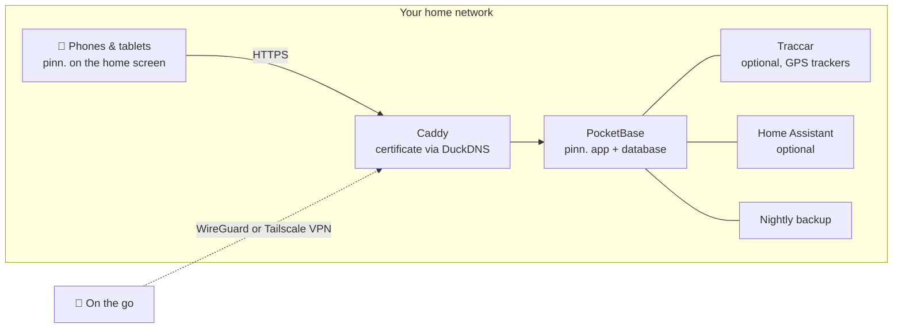

<p align="center">
  
</p>

<p align="center">
  <a href="https://github.com/pinn-shost/pinn/releases/latest"></a>
  <a href="LICENSE"></a>
  
  
  
  <a href="https://ko-fi.com/pinnapp"></a>
</p>

<p align="center">
  <b>🇬🇧 English</b> ·
  <a href="README.de.md">🇩🇪 Deutsch</a> ·
  <a href="README.es.md">🇪🇸 Español</a> ·
  <a href="README.fr.md">🇫🇷 Français</a> ·
  <a href="README.it.md">🇮🇹 Italiano</a> ·
  <a href="README.pt.md">🇧🇷 Português</a> ·
  <a href="README.zh.md">🇨🇳 中文</a> ·
  <a href="README.ja.md">🇯🇵 日本語</a> ·
  <a href="README.ko.md">🇰🇷 한국어</a>
</p>

<p align="center">
  <a href="#screenshots">Screenshots</a> ·
  <a href="#what-pinn-does">Features</a> ·
  <a href="#installation">Installation</a> ·
  <a href="#privacy">Privacy</a> ·
  <a href="#faq">FAQ</a>
</p>

---

pinn. is one app for everything that keeps a household running: the shared calendar, this week's meals, the shopping list, who takes out the bins, the pocket money and the insurance that needs cancelling in March. It runs on **your own NAS** with Docker and installs like a native app on every iPhone, iPad and Android phone in the family.

No cloud account. No subscription. No ads, no tracking. Your family's data never leaves your home.

## Screenshots

### On the iPad

Hung on the wall or lying on the kitchen table: the shared iPad shows the whole family at once.

<table>
  <tr>
    <td align="center" width="50%">
      <br>
      <sub><b>Dashboard</b> – everyone taps their own picture, with an optional PIN</sub>
    </td>
    <td align="center" width="50%">
      <br>
      <sub><b>Overview</b> – weather, appointments, tasks, meals and the family at a glance</sub>
    </td>
  </tr>
</table>

### On the phone

Always with you: pinn. installs on every iPhone and Android phone like a native app.

<table>
  <tr>
    <td align="center" width="33%"><br><sub><b>Overview</b> – your day at a glance</sub></td>
    <td align="center" width="33%"><br><sub><b>Calendar</b> – iCloud and Google in one view</sub></td>
    <td align="center" width="33%"><br><sub><b>Meals</b> – plan the week, shop with one tap</sub></td>
  </tr>
  <tr>
    <td align="center" width="33%"><br><sub><b>Lists</b> – shopping, pantry, packing</sub></td>
    <td align="center" width="33%"><br><sub><b>Finance</b> – budget, savings, pocket money</sub></td>
    <td align="center" width="33%"><br><sub><b>Kids</b> – a playful daily routine</sub></td>
  </tr>
</table>

## What pinn. does

| | |
|---|---|
| 📅 **Calendar** | iCloud and Google calendars per person, private or shared with the family. Public and school holidays, waste collection dates and birthdays from your contacts appear automatically. |
| 🍝 **Meals & recipes** | Plan the week, then send the ingredients straight to the shopping list. Import recipes from text, PDF, photos or a link – optionally with AI. Share favourite recipes with other families on your server. |
| 🛒 **Lists** | Shopping lists per shop, a pantry that refills the list when stock runs low, packing lists from templates (holiday, hospital bag, party), gift and wish lists. |
| ✅ **Tasks & household** | Tasks with push reminders, cleaning plans and bins – plus a kids' page with animated routines that only shows what fits the time of day. |
| 💶 **Finance** | Shared or private funds, a household budget, savings and depots with ETFs and shares, pocket money, recurring payments and contracts with cancellation reminders. Flatshares can split costs and see who owes whom. |
| 📄 **Documents & vehicles** | Receipts and warranties, IDs with expiry reminders. Cars and bikes with inspection dates, tyre changes, fuel use and total cost. |
| 🏡 **Home** | For tenants, owners and landlords: tenancy or purchase contract, loan, defects with photos, receipts, renovation plan, meter readings with forecast, keys, and rental income for flats, houses and garages you let out. Garden & plants with a watering plan that knows when it rained. |
| 📍 **Family & location** | Share your location right from pinn. – once or for a chosen time – and in the background via the free Traccar Client app (sends straight to pinn., no extra server). Plus a "way home" mode, an SOS alert with position and emergency numbers, emergency cards and arrival notifications for places. |
| 🎒 **School & daycare** | Per child: timetable (type it in or snap a photo – the AI fills it in), drop-off and pick-up, homework on the kids' page, parent letters with deadlines that turn into reminders, and closure days straight in the calendar. |
| 🐾 **Pets** | Profiles for dogs, cats, rabbits & co. with feeding times to tick off, walks, a "whose turn is it" rota, vaccinations and deworming with push reminders, weight chart, vet and emergency vet, a pet-sitter sheet to share, a printable "missing" poster and a pet feeder refill reminder. |
| 🌦️ **Weather & holidays** | Tap the weather (a tile on the phone, at the top next to date and time on iPad and computer) for 14 days with details for every day. Packing lists with destination and dates show the holiday weather – forecast or typical values – and suggest what to pack. |
| 🏠 **Smart home** | Start Apple Shortcuts or Home Assistant actions from a task – the robot vacuum cleans the kitchen when the chore is due, the robot mower and the watering follow the garden plan, the pet feeder reports when it runs empty. |
| 🎙️ **Voice control** | "Hey Siri, pinn": add to the shopping list, read it out, create tasks and hear what's on today – also on Android. |
| 🔔 **Notifications** | Personal push messages on iPhone, iPad and Android, plus a notification bell that collects every change in the family. |
| 🧩 **Everything else** | Family board with movable notes, global search, offline mode with automatic sync, dark mode, iPad dashboard with profile PINs, guest account, child lock. |

pinn. speaks **🇬🇧 English, 🇩🇪 Deutsch, 🇪🇸 Español, 🇫🇷 Français, 🇮🇹 Italiano, 🇧🇷 Português, 🇨🇳 中文, 🇯🇵 日本語 and 🇰🇷 한국어**, adapts currency and emergency numbers to your region, and switches between **family** and **flatshare** wording. One server can host several families, each with its own admins.

## What's new in 1.119.3

**Clean-up: the old translator is gone**

- Every text of pinn. now comes straight from the language files in `i18n/`. The old dictionaries (folder `pb_public/lang/`, about 4 MB) and the translator that rewrote the screen while you used the app are gone – pinn. starts faster and needs less memory, especially on older phones and tablets.
- The update moves the old files to `_alt/<date>/` on the NAS (nothing is deleted) and removes the empty `lang/` folder.
- Small things: date and time on the home screen, the dashboard, the week view, in Finances and under “Home” are formatted for your language directly; “Saved” in the outlook settings is translated; in a flat share the menu, overview tile and settings show the flatmates icon 🧑‍🤝‍🧑; texts you wrote yourself (e.g. a note “Hello family” on the board) are no longer changed in a flat share.
- For contributors: `check-lang.js`, `translate.js` and the “Translate” workflow are gone; `i18n-keys.js` now writes new texts in every language (`put`, `set`, `remove`, `format`).
- Next: Russian, step by step (hidden until complete).
- Changed: `index.html`, `js/sprachen.js`, `js/zustand.js`, `js/uebersicht.js`, `js/familie.js`, `js/listen.js`, `js/sterne.js`, `js/ausblick.js`, `js/grundlagen.js`, `js/profilauswahl.js`, `js/wohnort.js`, `js/finanzen.js`, `js/einstellungen.js`, `js/smarthome.js`, `js/versionslog.js`, `i18n/versionslog.en.js`, `pinn-setup.sh`, `.github/` – removed: `pb_public/lang/` – nothing changes on the server. Install as usual (`sudo sh pinn-*/pinn-setup.sh` or the update button).

## What's new in 1.119.2

**Pantry scanner: photo instead of live camera**

- If pinn. is opened via `http://…` instead of its HTTPS address, browsers do not release the live camera – on iPhone and iPad never. The scanner used to show a black picture with “The camera isn’t available here”; it now explains that the live camera needs the HTTPS address and offers **📷 Take a photo of the barcode**: take a picture and pinn. reads the barcode from it. This also works when the camera is blocked or does not start.
- Tip: open pinn. via its HTTPS address (set up in the setup assistant) – then the live camera and push notifications work as well.
- Next: 1.119.3 removes the old translator and `lang/`.
- Changed: `index.html`, `js/vorrat2.js`, `js/sprachen.js`, `js/versionslog.js`, `i18n/versionslog.en.js`, all language files in `i18n/`, for contributors `.github/scripts/check-keys.js` (the text-key check skips translated version logs) – nothing changes on the server. Install as usual (`sudo sh pinn-*/pinn-setup.sh` or the update button).

## What's new in 1.119.1

**Standard names, server messages and the version log in your language**

- **Predefined names** – categories of recipes, pantry, shopping, documents, finance and contracts, storage places, kitchen appliances, units like “can” or “pack” (with singular and plural), the household fund and the titles of automatic household tasks – now appear in your language. Nothing changes in your data; renamed and own names stay as they are.
- About 40 **messages from the server** (e.g. “Profile not found”, notes on backups, updates and devices) follow your language.
- The **version log** now exists in German and English only: every other language shows English, older entries without a translation stay German. The English part loads only when you open it, and the terminal speaks German or English.
- Next: 1.119.2 removes the old translator and `lang/`.
- Changed: `index.html`, `js/standardnamen.js` (new), `i18n/versionslog.en.js` (new), `js/serverzugriff.js`, `js/versionslog.js`, `js/hinweise.js` and 22 more files in `js/`, all language files in `i18n/`, `pinn-setup.sh` – nothing changes on the server. Install as usual (`sudo sh pinn-*/pinn-setup.sh` or the update button).

## What's new in 1.119.0

**Translations with text keys: the board and the last areas**

- The **board** (notes, lists, polls, photos, thanks, countdown, archive and replies), the **weekly and monthly outlook**, **voice control** including the iPhone and Android guide, the **family management** of the main admin, **profile picture cropping** and the **dashboard background** now take their texts from the language files in `pb_public/i18n/` – in all nine languages and as a flatshare.
- Small things: messages without a connection, “sign-in expired”, child lock notices, device names under “Devices & sign-in” and avatar names follow your language; the start check (“pinn. cannot start”) is now in plain English. The **child lock** now recognises delete buttons in every language (before only in German). On the board, votes, countdown days and “+ 2 more” use the right singular or plural, and dates follow your language.
- Next: 1.119.1 puts the standard names (categories, storage places, units), server messages and the version log on keys; 1.119.2 removes the old translator and `lang/`.
- Changed: `index.html`, `js/pinnwand.js`, `js/ausblick.js`, `js/sprachsteuerung.js`, `js/familienverwalten.js`, `js/profilbild.js`, `js/dashboardhintergrund.js`, `js/offline.js`, `js/dashboard.js`, `js/verbindung.js`, `js/vertraege.js`, `js/zustand.js`, `js/mitglieder.js`, `js/appstart.js`, `js/serverzugriff.js`, `js/popups.js`, `js/wetter.js`, `js/einrichten.js`, `js/exportieren.js`, `js/finanzen.js`, `js/sparen.js`, `js/vorrat2.js`, `js/einkaufseingabe.js`, `js/benutzer.js`, `js/icsparser.js`, `js/sprachen.js`, `js/versionslog.js`, all language files in `i18n/` and `lang/` – nothing changes on the server. Install as usual (`sudo sh pinn-*/pinn-setup.sh` or the update button).

## What's new in 1.118.4

**Security: PIN required with a family dashboard · calendar fix**

- **PIN required:** as soon as the family has a dashboard (e.g. the iPad in the kitchen), every profile needs a PIN. A profile without one shows a 🔑 on the dashboard and opens **once with its password** – right after that, the app asks for the new PIN. On own phones and computers the PIN entry also appears right after the start ("Log out" instead of "Cancel"). The own PIN cannot be removed while the dashboard exists; an admin can still reset someone's PIN (that person then logs in with the password once more). Guests still open with a tap. Wrong passwords count towards the same lock as wrong PINs.
- **Calendar on the phone:** after going back from a recipe in the overview, the list view was "unfolded" as high as the timeline – it now keeps its height.
- Changed: `index.html`, `js/profilauswahl.js`, `js/pineingabe.js`, `js/dashboardkonto.js`, `js/appstart.js`, `js/uebersicht.js`, `css/dashboard.css`, `js/sprachen.js`, `js/versionslog.js`, all language files and on the server `dashboard.pb.js`, `pinn-dashboard.js`.

## What's new in 1.118.3

**Recipes: recycle bin, "really delete?", long press in the week slider**

- **Recycle bin:** deleting a recipe now asks first. The recipe then stays in the **recycle bin for 7 days** (button below the recipe list) – on every device of the family, together with its planned meals and its favourite mark. Restore it with one tap or delete it for good; after 7 days it disappears by itself.
- **Long press** on a meal in "Planned this week" (overview and recipes tab) shows options: view recipe, edit recipe, move or change the meal (day, meal, servings, another recipe), plan it again, mark as cooked, remove it from the meal plan. With the child lock only "view" is offered.
- Changed: `index.html`, `js/rezepte.js`, `js/rezeptaktionen.js` (new), `js/essenplanen.js`, `js/zustand.js`, `js/speichern.js`, `js/familiensync.js`, `css/basis.css`, `js/sprachen.js`, `js/versionslog.js`, all language files, `pinn-setup.sh` and on the server `pinn-bereiche.js`, `pinn-hinweise.js`.

## What's new in 1.118.2

**Shopping list: paste a message, pantry hints, plus/minus**

- **Paste a message:** copy a message like “Can you grab milk, 2 packs of butter and bread” (e.g. from WhatsApp) and paste it into the input bar – a popup shows the recognised items with quantity. Green notes show what is in the pantry, also in the meal plan or already on the list. Several items typed with commas work the same way.
- **Pantry items** on a shopping list now have the note “🥫 Pantry · … in stock” below the name – like the meal-planning items.
- **Plus/minus** follows the amount: 30 ml minus becomes 20 ml (it used to jump to 50 ml); small amounts in steps of 5/10, large ones in steps of 50.
- Pantry items without an own shop now land on the **main shop** instead of the meal-planning list.
- Changed: `index.html`, `js/einkauf.js`, `js/einkaufseingabe.js`, `js/einkaufslisten.js`, `js/vorrat.js`, `css/listen.css`, `js/sprachen.js`, `js/versionslog.js`, all language files – nothing changes on the server.

## What's new in 1.118.1

**Update notice for admins**

- Admins who may install updates now get **one push message per new pinn. version** (switch: Account → Notifications → Updates) and a **card in the bell** that comes back every day until the update is installed – dismissing it only hides it for today.
- Tapping the message or the card opens **Settings → System** directly with the update popup.
- Changed: `index.html`, `js/sicherungen.js`, `js/mitteilungen.js`, `js/hinweise.js`, `js/appstart.js`, `js/sprachen.js`, `js/versionslog.js`, all language files, on the server `pb_hooks/system.pb.js`, `pinn-system.js`, `pinn-hinweise.js`, `pinn-push.js`, `pinn-pushtext.js`. Install as usual (`sudo sh pinn-*/pinn-setup.sh` or the update button).

## What's new in 1.118.0

**Fahrenheit and translation polish**

- **Temperature in °F or °C:** Settings → Language & region has a new **Temperature** setting. *Automatic* follows the country (USA: °F, otherwise °C); you can also choose Celsius or Fahrenheit by hand. It applies to the weather tile, the header, the weather view, holiday weather, the weekly preview and the garden tips.
- **Overview:** cancellation deadlines can now be swiped away like birthdays; bring them back under Settings → Overview.
- **Translations:** weather, birthday (“turns 30”) and contract tiles (“1 coming up”), the depot (“paid in”, “withdrawn”, imported purchases and sales), tyre tasks (storage place, “From pinn. → Vehicles”), “Assigned to:” in event notes, holiday weather of packing lists and tasks in the weekly preview. The weekly and monthly outlook now also exist in Japanese and Korean.
- Changed: `index.html`, `js/region.js`, `js/sprache.js`, `js/design.js`, `js/wetterkachel.js`, `js/geburtstage.js`, `js/uebersicht.js`, `js/uebersichteinstellungen.js`, `js/vertraege.js`, `js/sparen.js`, `js/finanzen.js`, `js/familie.js`, `js/ausblick.js`, `js/zuhause.js`, `js/fahrzeuge.js`, `js/mitglieder.js`, `js/aufgaben.js`, `js/termindetails.js`, `js/grundlagen.js`, `js/profilauswahl.js`, `js/sprachen.js`, `js/versionslog.js`, all language files in `i18n/` and `lang/` – nothing changes on the server. Install as usual (`sudo sh pinn-*/pinn-setup.sh` or the update button).

## What's new in 1.117.0

**Text keys, part 9: the bell and the push messages of the server**

- The **bell** (way home, open shopping trips, family news, the empty notice) and the **“Going shopping?”** notice now take their texts from the language files in `pb_public/i18n/` – in all nine languages and as a flatshare. “Going shopping?” now also exists in Japanese and Korean.
- **Push messages from the server:** the translations are no longer written into the server code. The server reads the same language files as the app (keys `push.…`) through `pinn-textkern.js` – singular, plural and the flatshare terms work exactly as in the app.
- Small things: English now says “Fit winter tyres” instead of “Fit Winter tyres” (likewise for summer tyres and in the other languages); dates and times in the bell follow your language; numbers like “1 item” use the right singular or plural; doubled quotation marks in Japanese notices are gone.
- Next: 1.118.0 tidies up – the old translator and `lang/` are removed.
- Changed: `index.html`, `js/hinweise.js`, `js/fahrzeuge.js`, `js/sprachen.js`, `js/versionslog.js`, all language files in `i18n/` and `lang/` and on the server `pb_hooks/pinn-pushtext.js`. Install as usual (`sudo sh pinn-*/pinn-setup.sh` or the update button).

## How it works



Everything runs as Docker containers on one machine. HTTPS works **without port forwarding** – the certificate is issued via a DNS check. From outside, pinn. is only reachable through your own VPN.

## Requirements

- A NAS or server with **Docker** and **Docker Compose 2.17+** – developed on a UGREEN NAS with UGOS, runs on any Linux Docker host (amd64, arm64, armv7)
- SSH access to it
- Optional but recommended: a free [DuckDNS](https://www.duckdns.org) subdomain for HTTPS – required for push notifications and installing pinn. as an app

## Installation

1. Download the ZIP of the [latest release](https://github.com/pinn-shost/pinn/releases/latest) and unzip it.
2. Create a folder on the NAS, e.g. `/volume1/docker/Pocketbase`, and put the unzipped folder (e.g. `pinn-1.119.3` or `pinn-main`) into it as it is.
3. Log in via SSH and run:
   ```sh
   cd /volume1/docker/Pocketbase && sudo sh pinn-*/pinn-setup.sh
   ```
   The script copies every file into place, downloads the libraries for PDF import and photo text recognition, and starts pinn.
4. Open `http://<NAS-IP>:8090` → **Log in as main admin** → password `Admin` → choose your own password.
5. The **setup assistant** walks you through the rest – HTTPS, remote access via WireGuard or Tailscale, Google, AI, location and Home Assistant – step by step, in nine languages.
6. Open pinn. via its HTTPS address on each phone and add it to the home screen:
   - **iPhone/iPad (Safari):** Share → *Add to Home Screen* (iOS 16.4 or later for notifications)
   - **Android (Chrome):** Settings → Notifications → *Install pinn. as an app*, or Chrome menu ⋮ → *Install app*

   Then turn on notifications on each device under **Settings → Notifications → Activate on this device**.

**Updating:** download the new ZIP, put the unzipped folder into the same folder and run `sudo sh pinn-*/pinn-setup.sh` again. Replaced files are kept in `_alt/`, your data stays untouched.

**Backups** run every night into `./backups` and are kept for 14 days.

## Privacy

pinn. was built for data you would never hand to a cloud service: bank statements, health documents, where your children are. That's why:

- **All data lives on your NAS** in a single PocketBase database. There is no pinn. server and no telemetry.
- **No scripts from third-party servers.** All code and libraries are served from your NAS.
- **Push notifications carry no content.** Apple, Google and Mozilla only deliver an empty wake-up signal; the device then fetches the message from your NAS.
- **Passwords for iCloud and Google** are stored encrypted in a locked collection.
- **Not reachable from the internet.** Remote access goes through your own VPN.

pinn. only contacts outside services for features that need them:

| Service | Used for | When |
|---|---|---|
| [Open-Meteo](https://open-meteo.com) | Weather forecast | when a home address is set |
| [OpenStreetMap Nominatim](https://nominatim.openstreetmap.org) | Turning addresses into map positions | when entering addresses |
| [OpenStreetMap tiles](https://www.openstreetmap.org) | Map background | on the location page, loaded through your NAS |
| [Google Fonts](https://fonts.google.com) | Typefaces | when the app loads |
| [OpenHolidays API](https://www.openholidaysapi.org) | Public and school holidays | when a home address is set |
| [DuckDNS](https://www.duckdns.org) | HTTPS certificate and address | if configured |
| iCloud / Google | Calendars and contacts | only for accounts you connect |
| Google Gemini | Reading recipes and documents | only if you add an API key |
| jsDelivr | One-time download of pdf.js and Tesseract | during installation only |

## FAQ

<details>
<summary><b>Do I need to open ports on my router?</b></summary>
<br>
No. The HTTPS certificate is issued via a DNS check, and remote access runs through a VPN – WireGuard on a FRITZ!Box, or Tailscale for any other router.
</details>

<details>
<summary><b>Does it work without a NAS?</b></summary>
<br>
Any always-on machine with Docker works: a mini PC, a Raspberry Pi 4/5 or a Linux server.
</details>

<details>
<summary><b>Is pinn. a "real" app from the App Store?</b></summary>
<br>
pinn. is a web app that you add to the home screen. It then opens full-screen like a native app, works offline, shows a badge with open tasks and receives push notifications – without any app store.
</details>

<details>
<summary><b>Can several families use one installation?</b></summary>
<br>
Yes. The main admin creates families, each family gets its own admins, calendars and data. Recipes can optionally be shared between families.
</details>

<details>
<summary><b>What about children?</b></summary>
<br>
Profiles with child lock only see their own tasks and can't delete or change anything. Finance, documents and vehicles stay hidden. Younger children get their own playful page with daily routines.
</details>

<details>
<summary><b>What does it cost?</b></summary>
<br>
Nothing – pinn. is free and open source under the MIT license. Optional services like the Gemini AI have free tiers.
</details>

## Repository layout

The repository has the same layout as an installation on the NAS – every file lies where it ends up:

```
pinn/
├── pb_hooks/            server: *.pb.js hooks and their helper modules (pinn-*.js, calendar-sync.js)
├── pb_public/           web app served by PocketBase
│   ├── index.html       the app page, built from src/ (HTML, start check) – do not edit by hand
│   ├── js/              app code split out of index.html, plain <script> files without a build step
│   │                    (ruhemodus.js, textkern.js, sprachen.js, region.js, grundlagen.js, popups.js, verbindung.js, benutzer.js, mitteilungen.js, serverzugriff.js, tastatur.js, anmeldemaske.js, dashboard.js, dashboardhintergrund.js, profilauswahl.js, pineingabe.js, dashboardsitzung.js, dashboardkonto.js, familienverwalten.js, einrichten.js, exportieren.js, hauptadminseite.js, anmeldung.js, konto.js, profilverwaltung.js, zustand.js, bedienzustand.js, rezeptbilder.js, zusammenfuehren.js, speichern.js, design.js, sprache.js, uebersicht.js, familienkachel.js, wobistdu.js, geburtstagsfeier.js, wetterkachel.js, geburtstage.js, uebersichteinstellungen.js, familiensync.js, bereiche.js, kalenderquellen.js, icsparser.js, zeitleiste.js, termindetails.js, kalenderdatei.js, wetter.js, wohnort.js, feiertage.js, muellkalender.js, mitglieder.js, profilbild.js, mitglied.js, kinderseite.js, kinderroutine.js, sterne.js, kalenderansicht.js, essenplanen.js, rezeptparser.js, rezeptdialog.js, rezeptbild.js, rezeptmengen.js, einkauf.js, einkaufslisten.js, einkaufseingabe.js, rezepte.js, offline.js, aufgabenextras.js, appbadge.js, reisen.js, aufgabendaten.js, haushalt.js, reihum.js, aufgaben.js, smarthome.js, sprachsteuerung.js, termine.js, ansichten.js, versionspruefung.js, sicherungen.js, geraete.js, fehlerprotokoll.js, versionslog.js, einstellungen.js, kalenderkonto.js, finanzen.js, kassen.js, vorrat.js, vorrat2.js, sparen.js, vertraege.js, fahrzeuge.js, zuhause.js, dokumente.js, pdflesen.js, appstart.js, pinnwand.js, listen.js, familie.js, hinweise.js, ausblick.js – ausblick.js always comes last)
│   ├── css/             app styles split out of index.html, plain CSS without a build step (ergaenzung.css, energiesparen.css, basis.css … haustierewetter.css, terminal.css, glocke.css)
│   ├── einrichtung.js   setup assistant · datenexport.js  data export
│   ├── i18n/            texts by key (de, en, fr, es, it, pt, zh, ja, ko) – English is the reference
│   └── vendor/          pinn.css, pocketbase/ (pdf.js and Tesseract are downloaded by the setup)
├── .github/             GitHub Actions (workflows/check.yml), checks (scripts/), CONTRIBUTING.md, SECURITY.md, images – not installed
├── src/                 sources of index.html (build.js, rahmen.html, teile/) – not installed
├── caddy/Caddyfile      HTTPS reverse proxy
├── docker-compose.yaml  all containers
├── env.txt              template for .env
├── pinn-setup.sh        install & update
├── pinn-wartung.sh      backups & updates (container "wartung")
├── pinn-pocketbase-update.sh
├── index.html           placeholder only, never installed (keeps the update button of 1.38 working)
└── README.md            this page · README.<code>.md in de, es, fr, it, pt, zh, ja, ko
```

`pinn-setup.sh` copies `pb_hooks/`, `pb_public/` and `caddy/Caddyfile` 1:1 into the project folder; data folders (`pb_data/`, `konfig/`, `backups/`, `caddy/data/` …) are never touched.

## Contributing

Bug reports, ideas and translations are very welcome – see [CONTRIBUTING.md](.github/CONTRIBUTING.md). Please report security issues privately as described in [SECURITY.md](.github/SECURITY.md). Before a pull request, please run `node .github/scripts/check-all.js` – the same checks run automatically on GitHub.

## Support pinn.

pinn. is free and stays free – completely, for everyone. It's built in my spare time. If it makes your everyday life a little easier, a small contribution is very welcome, but entirely voluntary:

<p>
  <a href="https://ko-fi.com/pinnapp"></a>
  <a href="https://buymeacoffee.com/pinn"></a>
</p>

A ⭐ helps too – it makes pinn. easier to find for other families.

## Built with

[PocketBase](https://pocketbase.io) (MIT) · [Tailwind CSS](https://tailwindcss.com) (MIT) · [pdf.js](https://mozilla.github.io/pdf.js/) (Apache-2.0) · [Tesseract.js](https://tesseract.projectnaptha.com) (Apache-2.0) · [Traccar](https://www.traccar.org) (Apache-2.0) · [Caddy](https://caddyserver.com) (Apache-2.0)

## License

[MIT](LICENSE) – use it, change it, share it.
