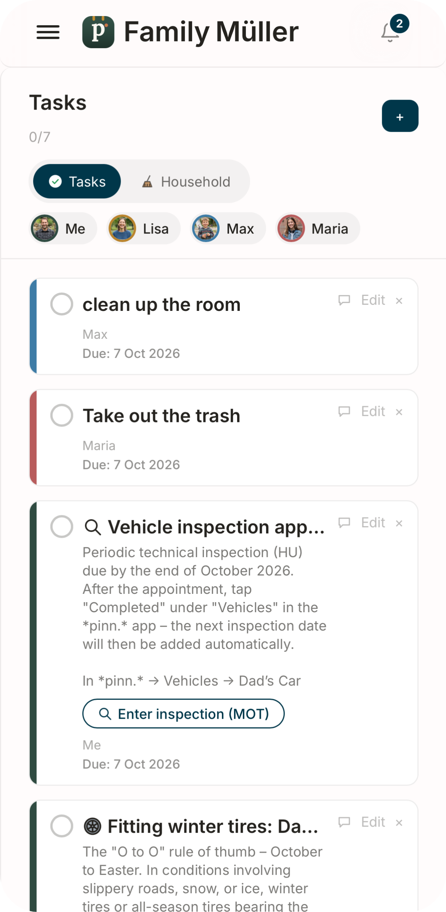
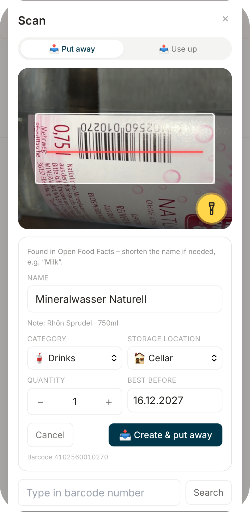

<p align="center">
  
</p>

<p align="center">
  <a href="https://github.com/pinn-shost/pinn/releases/latest"></a>
  <a href="LICENSE"></a>
  
  
  
  <a href="https://ko-fi.com/pinnapp"></a>
</p>

<p align="center">
  <a href="README.md">🇬🇧 English</a> ·
  <a href="README.de.md">🇩🇪 Deutsch</a> ·
  <a href="README.es.md">🇪🇸 Español</a> ·
  <a href="README.fr.md">🇫🇷 Français</a> ·
  <a href="README.it.md">🇮🇹 Italiano</a> ·
  <a href="README.pt.md">🇧🇷 Português</a> ·
  <a href="README.zh.md">🇨🇳 中文</a> ·
  <a href="README.ja.md">🇯🇵 日本語</a> ·
  <a href="README.ko.md">🇰🇷 한국어</a> ·
  <a href="README.ru.md">🇷🇺 Русский</a> ·
  <a href="README.nl.md">🇳🇱 Nederlands</a> ·
  <a href="README.tr.md">🇹🇷 Türkçe</a> ·
  <a href="README.pl.md">🇵🇱 Polski</a> ·
  <a href="README.uk.md">🇺🇦 Українська</a> ·
  <a href="README.cs.md">🇨🇿 Čeština</a> ·
  <a href="README.sv.md">🇸🇪 Svenska</a> ·
  <a href="README.da.md">🇩🇰 Dansk</a> ·
  <b>🇳🇴 Norsk</b> ·
  <a href="README.fi.md">🇫🇮 Suomi</a> ·
  <a href="README.hu.md">🇭🇺 Magyar</a>
</p>

---

pinn. er én app for alt som holder hjemmet i gang: en felles kalender, ukens middag, handlelisten, hvem som setter ut søpla, lommepenger og forsikringen som må sies opp før mars. Den kjører i Docker på **din egen NAS** og installeres som en ekte app på hver iPhone, iPad og Android-telefon i familien.

Ingen skykonto. Ikke noe abonnement. Ingen reklame og ingen sporing. Familiens data forlater aldri hjemmet ditt.

> Dette er en kort introduksjon. Den fullstendige beskrivelsen med FAQ og repo-struktur finner du i [English README](README.md) og [Deutsch](README.de.md).

<a id="screenshots"></a>

## Skjermbilder

### På iPad

En delt iPad på veggen eller på kjøkkenbordet viser hele familien med et enkelt blikk.

<table>
  <tr>
    <td align="center" width="50%"><a href=".github/assets/screenshots/dashboard.png"></a><br><sub><b>Dashbord</b> – velg deg selv med ett trykk</sub></td>
    <td align="center" width="50%"><a href=".github/assets/screenshots/ipad-overview.png"></a><br><sub><b>Oversikt</b> – vær, kalender og oppgaver på én skjerm</sub></td>
  </tr>
</table>

### På telefonen

Alltid med deg: pinn. installeres på hver iPhone og Android-telefon som en ekte app.

<table>
  <tr>
    <td align="center" width="33%"><a href=".github/assets/screenshots/home.png"></a><br><sub><b>Hjem</b> – dagen med et enkelt blikk</sub></td>
    <td align="center" width="33%"><a href=".github/assets/screenshots/calendar.png"></a><br><sub><b>Kalender</b> – iCloud og Google i én visning</sub></td>
    <td align="center" width="33%"><a href=".github/assets/screenshots/meals.png"></a><br><sub><b>Måltider</b> – planlegg uken, handle med ett trykk</sub></td>
  </tr>
  <tr>
    <td align="center" width="33%"><a href=".github/assets/screenshots/lists.png"></a><br><sub><b>Lister</b> – handling, spiskammer, pakkelister</sub></td>
    <td align="center" width="33%"><a href=".github/assets/screenshots/finance.png"></a><br><sub><b>Økonomi</b> – budsjett, sparing, lommepenger</sub></td>
    <td align="center" width="33%"><a href=".github/assets/screenshots/chat.png"></a><br><sub><b>Chat</b> – ende-til-ende-kryptert, med talemeldinger og posisjon</sub></td>
  </tr>
</table>

### Flere skjermer

Trykk på et bilde for å åpne det i full størrelse.

<details>
<summary><b>Vis flere skjermbilder</b></summary>

<br>

<table>
  <tr>
    <td align="center" width="25%"><a href=".github/assets/screenshots/house.png"></a><br><sub><b>Hjem</b> – bolig, kostnader, lån, feil og mangler og måleravlesninger på ett sted</sub></td>
    <td align="center" width="25%"><a href=".github/assets/screenshots/tasks.png"></a><br><sub><b>Oppgaver</b> – automatiske påminnelser, f.eks. EU-kontroll og dekkskift, med snarvei</sub></td>
    <td align="center" width="25%"><a href=".github/assets/screenshots/vehicles.png"></a><br><sub><b>Kjøretøy</b> – EU-kontroll, dekk, drivstoff og lading</sub></td>
    <td align="center" width="25%"><a href=".github/assets/screenshots/scan_pantry.png"></a><br><sub><b>Skann spiskammeret</b> – skann koden, legg i spiskammeret eller bruk opp</sub></td>
  </tr>
  <tr>
    <td align="center" width="25%"><a href=".github/assets/screenshots/weekly_summary_1.png"></a><br><sub><b>Ukesforhåndsvisning</b> – været og hva som skal gjøres</sub></td>
    <td align="center" width="25%"><a href=".github/assets/screenshots/weekly_summary_2.png"></a><br><sub><b>Ukesforhåndsvisning</b> – dag for dag: rengjøring, søppel, betalinger</sub></td>
    <td align="center" width="25%"><a href=".github/assets/screenshots/weekly_summary_3.png"></a><br><sub><b>Forrige uke kort fortalt</b> – avtaler, måltider, utgifter – og snarveier</sub></td>
    <td align="center" width="25%"><a href=".github/assets/screenshots/kids.png"></a><br><sub><b>Barn</b> – daglige rutiner på en lekende måte</sub></td>
  </tr>
</table>

</details>

<sub>📁 <a href=".github/assets/screenshots">Alle bildene i én mappe</a></sub>

## Hva pinn. kan

- 📅 **Kalender** – felles familiekalender, tilkobling til iCloud og Google, helligdager og skoleferier
- ✅ **Oppgaver og husholdning** – oppgaver, rotasjon, søppel, rengjøring, «Hvem gjør hvor mye?»
- 🍽️ **Måltider** – ukemeny, oppskriftsimport, spiskammer med skanner, handleliste
- 💶 **Økonomi** – utgifter, budsjett, kasser med oppgjør, kontrakter med oppsigelsesfrister, lommepenger
- 👨‍👩‍👧 **Familie** – nødkort, posisjon, SOS, «På vei hjem», kjæledyr, skole og barnehage
- 🏠 **Hjem og kjøretøy** – måleravlesninger, kostnader, feil og mangler, biler med drivstoff og EU-kontroll, smarthjem
- 🎙️ **Stemmestyring** – «Hei Siri, pinn»: sett noe på handlelisten, les den opp, opprett oppgaver, hør dagens program (Siri svarer foreløpig på engelsk)
- 💬 **Chat** – familie- og privatchat med ende-til-ende-kryptering, push-varsler og lesebekreftelser
- 🔔 **Varsler** – personlige push-varsler på iPhone, iPad og Android samt en klokke som samler alle endringer i familien

pinn. snakker **🇬🇧 English, 🇩🇪 Deutsch, 🇪🇸 Español, 🇫🇷 Français, 🇮🇹 Italiano, 🇧🇷 Português, 🇨🇳 中文, 🇯🇵 日本語, 🇰🇷 한국어, 🇷🇺 Русский, 🇳🇱 Nederlands, 🇹🇷 Türkçe, 🇵🇱 Polski, 🇺🇦 Українська, 🇨🇿 Čeština, 🇸🇪 Svenska, 🇩🇰 Dansk, 🇳🇴 Norsk, 🇫🇮 Suomi og 🇭🇺 Magyar**, tilpasser valuta og nødnumre til regionen din og bytter mellom begrepene **familie** og **husstand**. Én server kan rumme flere familier, hver med egne administratorer.

## Nyheter i 1.160.1

**Rettelse: uoversatte tekster**

- Rettet: dokumentkategoriene (f.eks. «Kvitteringer og garanti») og merknaden «utbetalt» under Økonomi → Lommepenger vises nå overalt på appens språk.

## Nyheter i 1.160.0

**Ungarsk**

- Nytt: ungarsk (Magyar) er et nytt appspråk – alle omtrent 7 500 tekstene i appen, oppsettsveiviseren, dataeksporten, push-varslene fra serveren og det ungarske nødnummeret (112). Varianten for bofellesskap er også med («háztartás», «lakótárs») med ungarske endelser. Velg det under Innstillinger → Språk og region.
- Merk: oversettelsen er ikke kontrollert av morsmålsbrukere – forslag til forbedringer er velkomne som GitHub-issue. Stemmestyringen via Siri/Android forstår ennå ikke ungarsk og svarer på engelsk.
- Endret: `i18n/hu.i18n.js` (new), `README.hu.md` (new), `js/`, `pb_hooks/`, `einrichtung.js`, `datenexport.js`, `.github/scripts/`, `src/`, `index.html`, README.

## Krav

- En NAS eller mini-PC med **Docker** og **Docker Compose** installert (f.eks. Synology, UGREEN, QNAP eller en vanlig Linux-server)
- SSH-tilgang
- for tilgang utenfra: VPN (WireGuard eller Tailscale) eller et eget domene med HTTPS

## Installasjon

1. Last ned og pakk ut ZIP-filen til [den nyeste versjonen](https://github.com/pinn-shost/pinn/releases/latest).
2. Opprett en mappe på NAS-en, f.eks. `/volume1/docker/Pocketbase`, og legg den utpakkede mappen (f.eks. `pinn-1.160.1` eller `pinn-main`) i den uten endringer.
3. Koble til via SSH og kjør:
   ```sh
   cd /volume1/docker/Pocketbase && sudo sh pinn-*/pinn-setup.sh
   ```
4. Åpne `http://<NAS-ens IP-adresse>:8090` → **Logg inn som hovedadministrator** → passord `Admin` → velg ditt eget passord.
5. **Oppsettsveiviseren** fører deg gjennom resten trinn for trinn – HTTPS, tilgang utenfra, Google, KI, posisjon og Home Assistant – på 20 språk.
6. Åpne pinn. på hver telefon via HTTPS-adressen og legg den til på hjem-skjermen:
   - **iPhone/iPad (Safari):** «Del» → *Legg til på Hjem-skjerm* (for varsler kreves iOS 16.4 eller nyere)
   - **Android (Chrome):** Innstillinger → Varsler → *installer pinn. som app* eller Chrome-menyen ⋮ → *Installer app*

**Oppdatering:** Last ned den nye ZIP-filen, legg den utpakkede mappen i samme mappe og kjør `sudo sh pinn-*/pinn-setup.sh` på nytt. Endrede filer havner i mappen `_alt/`, dataene dine forblir urørt. **Sikkerhetskopier** opprettes hver natt i mappen `./backups` og beholdes i 14 dager.

### Portainer-stack (uten skript)

Foretrekker du Portainer? Da trenger du verken SSH eller oppsettsskript:

1. Åpne **Stacks → Add stack** i Portainer, kall den `pinn` og velg **Web editor**.
2. Lim inn innholdet i [`docker/docker-compose.portainer.yaml`](docker/docker-compose.portainer.yaml).
3. Valgfritt: Endre porten under **Environment variables** (`PINN_PORT`, standard 8090), eller lås en versjon (`PINN_IMAGE_TAG`, f.eks. `1.151.0`). Klikk på **Deploy the stack**.
4. Åpne `http://<NAS-IP>:8090` → **Logg inn som hovedadministrator** → oppsettsveiviseren som i trinn 4–6 ovenfor.

Det ferdige imaget hentes fra `ghcr.io/pinn-shost/pinn` (amd64 og arm64). Dataene lagres i volumer, du trenger ingen mapper. Stacken bruker ingen faste containernavn og kolliderer derfor ikke med eksisterende. Kjører Tailscale allerede på NAS-en din, fjerner du blokken `tailscale`; med en egen HTTPS-adresse eller omvendt proxy fjerner du også `caddy` og `duckdns`.

**Oppdatering:** Stack → Editor → *Update the stack* med *Re-pull image and redeploy* slått på. **Sikkerhetskopier:** Blokken `wartung` i stacken tar en kopi hver natt (beholder 7 dager + 4 uker) og ligger bak knappene «Ta sikkerhetskopi nå» og «Gjenopprett» i pinn. → Innstillinger → System. Kopiene ligger i volumet `backups` – eller i en NAS-mappe hvis du setter `PINN_BACKUP_DIR` (f.eks. `/volume1/docker/pinn-backups`). For gjenoppretting må den ha Docker-tilgang for å stoppe pinn. kortvarig; sikkerhetskopierer du volumene selv, fjerner du blokken. Oppdateringer gjøres i Portainer, ikke med knappen.

### Tilgang fra internett via en egen omvendt proxy

Vil ikke familien bruke Tailscale? Da setter du pinn. bak en omvendt proxy: Den tar imot kall fra internett, tar seg av HTTPS for domenet ditt og sender videre til pinn.

1. Pek proxyen mot `http://<NAS-IP>:8090` (Portainer-stack: porten `PINN_PORT`). Live-oppdateringer går over vanlig HTTP – websockets trengs ikke, bare slå av buffering av svar. Tillat opplastinger opptil 70 MB (videoer i chatten).
   - **Nginx Proxy Manager:** *Hosts → Proxy Hosts → Add*: domenet ditt, skjema `http`, NAS-IP, port `8090`; fanen *SSL*: nytt sertifikat, *Force SSL* slått på.
   - **Cloudflare Tunnel:** ingen portviderekobling nødvendig – *Public hostname* → tjeneste `http://<NAS-IP>:8090`.
   - **Traefik, Caddy med flere:** en ruter/vert for domenet ditt som videresender til `http://<NAS-IP>:8090`.
2. Åpne `https://<domene>` på hver telefon, logg inn, legg til på hjem-skjermen på nytt og slå på varsler igjen (appen er knyttet til adressen sin).
3. Google-kalendere (valgfritt): Legg til `https://<domene>/api/pinn/google/callback` som tillatt omdirigerings-URI i Google Cloud-konsollen.

Hva pinn. selv gjør: Den stoler bare på den besøkendes adresse fra proxyen (`X-Forwarded-For`) når kallet kom fra hjemmenettverket, Docker-nettverket eller Tailscale – sperren etter feil passord kan derfor ikke omgås. Fra internett er PocketBase-administrasjonen (`/_/`) stengt, og startpassordet `Admin` fungerer ikke. Står proxyen et annet sted (leid server eller Cloudflares oransje sky foran proxyen din)? Da angir du `PINN_PROXY_NETZE` (i `.env` eller miljøvariablene til stacken), f.eks. `privat, cloudflare` eller `privat, 203.0.113.5`.

**Viktig:** pinn. er da tilgjengelig for hele internett. Gi hver profil et langt eget passord, hold proxyen oppdatert, og åpne aldri port 8090 direkte i ruteren – bare via proxy med HTTPS.

## Personvern

Alle data blir på NAS-en din i én enkelt PocketBase-database. Det finnes ingen pinn.-server og ingen telemetri. All kode og alle biblioteker kommer fra din egen NAS. Push-varsler bærer ikke noe innhold: Apple, Google og Mozilla formidler bare et tomt signal, og selve meldingen henter enheten fra NAS-en din.

## Støtt pinn.

pinn. er gratis og åpen. Hvis det gjør nytte for seg, kan du støtte prosjektet via [Ko-fi](https://ko-fi.com/pinnapp).

## Lisens

[MIT](LICENSE)
