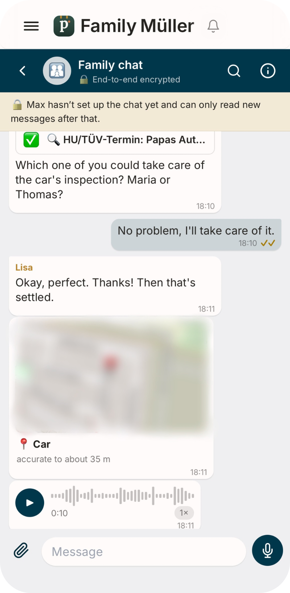

<p align="center">
  
</p>

<p align="center">
  <a href="https://github.com/pinn-shost/pinn/releases/latest"></a>
  <a href="LICENSE"></a>
  
  
  
  <a href="https://ko-fi.com/pinnapp"></a>
</p>

<p align="center">
  <a href="README.md">🇬🇧 English</a> ·
  <a href="README.de.md">🇩🇪 Deutsch</a> ·
  <a href="README.es.md">🇪🇸 Español</a> ·
  <a href="README.fr.md">🇫🇷 Français</a> ·
  <a href="README.it.md">🇮🇹 Italiano</a> ·
  <a href="README.pt.md">🇧🇷 Português</a> ·
  <a href="README.zh.md">🇨🇳 中文</a> ·
  <a href="README.ja.md">🇯🇵 日本語</a> ·
  <a href="README.ko.md">🇰🇷 한국어</a> ·
  <a href="README.ru.md">🇷🇺 Русский</a> ·
  <b>🇳🇱 Nederlands</b> ·
  <a href="README.tr.md">🇹🇷 Türkçe</a> ·
  <a href="README.pl.md">🇵🇱 Polski</a> ·
  <a href="README.uk.md">🇺🇦 Українська</a>
</p>

---

pinn. is één app voor alles wat een huishouden draaiende houdt: de gedeelde agenda, het menu van de week, de boodschappenlijst, wie de afvalbakken buiten zet, het zakgeld en de verzekering die in maart opgezegd moet worden. De app draait op **jouw NAS** in Docker en wordt als gewone app geïnstalleerd op elke iPhone, iPad en Android-telefoon.

Geen cloudaccount. Geen abonnement. Geen advertenties, geen tracking. De gegevens van je gezin verlaten je huis nooit.

> Dit is een korte beschrijving. De volledige beschrijving met FAQ en de opbouw van de repository staat in de [English README](README.md) en in het [Deutsch](README.de.md).

<a id="screenshots"></a>

## Screenshots

### Op de iPad

Aan de muur of op de keukentafel: de gedeelde iPad toont het hele gezin in één keer.

<table>
  <tr>
    <td align="center" width="50%"><a href=".github/assets/screenshots/dashboard.png"></a><br><sub><b>Dashboard</b> – iedereen tikt op zijn eigen plaatje, desgewenst met pincode</sub></td>
    <td align="center" width="50%"><a href=".github/assets/screenshots/ipad-overview.png"></a><br><sub><b>Overzicht</b> – weer, afspraken, taken, maaltijden en gezin in één oogopslag</sub></td>
  </tr>
</table>

### Op de telefoon

Altijd bij je: pinn. installeer je op elke iPhone en Android-telefoon als een gewone app.

<table>
  <tr>
    <td align="center" width="33%"><a href=".github/assets/screenshots/home.png"></a><br><sub><b>Overzicht</b> – jouw dag in één oogopslag</sub></td>
    <td align="center" width="33%"><a href=".github/assets/screenshots/calendar.png"></a><br><sub><b>Agenda</b> – iCloud en Google in één weergave</sub></td>
    <td align="center" width="33%"><a href=".github/assets/screenshots/meals.png"></a><br><sub><b>Maaltijden</b> – plan de week, doe boodschappen met één tik</sub></td>
  </tr>
  <tr>
    <td align="center" width="33%"><a href=".github/assets/screenshots/lists.png"></a><br><sub><b>Lijsten</b> – boodschappen, voorraad, paklijsten</sub></td>
    <td align="center" width="33%"><a href=".github/assets/screenshots/finance.png"></a><br><sub><b>Financiën</b> – budget, sparen, zakgeld</sub></td>
    <td align="center" width="33%"><a href=".github/assets/screenshots/chat.png"></a><br><sub><b>Chat</b> – end-to-end versleuteld, met spraakberichten en locatie</sub></td>
  </tr>
</table>

### Meer schermen

Tik op een plaatje om het op volledige grootte te openen.

<details>
<summary><b>Meer screenshots tonen</b></summary>

<br>

<table>
  <tr>
    <td align="center" width="25%"><a href=".github/assets/screenshots/house.png"></a><br><sub><b>Huis</b> – woning, kosten, lening, gebreken en meterstanden op één plek</sub></td>
    <td align="center" width="25%"><a href=".github/assets/screenshots/tasks.png"></a><br><sub><b>Taken</b> – automatische herinneringen, bijvoorbeeld voor de APK en het wisselen van banden, met een snelkoppeling</sub></td>
    <td align="center" width="25%"><a href=".github/assets/screenshots/vehicles.png"></a><br><sub><b>Voertuigen</b> – APK, banden, tanken en laden</sub></td>
    <td align="center" width="25%"><a href=".github/assets/screenshots/scan_pantry.png"></a><br><sub><b>Voorraad scannen</b> – scan de barcode, berg het op of boek het af</sub></td>
  </tr>
  <tr>
    <td align="center" width="25%"><a href=".github/assets/screenshots/weekly_summary_1.png"></a><br><sub><b>Weekoverzicht</b> – het weer en wat er nog moet gebeuren</sub></td>
    <td align="center" width="25%"><a href=".github/assets/screenshots/weekly_summary_2.png"></a><br><sub><b>Weekoverzicht</b> – dag voor dag: schoonmaak, afval, betalingen</sub></td>
    <td align="center" width="25%"><a href=".github/assets/screenshots/weekly_summary_3.png"></a><br><sub><b>Vorige week in het kort</b> – afspraken, maaltijden, uitgaven – en snelkoppelingen</sub></td>
    <td align="center" width="25%"><a href=".github/assets/screenshots/kids.png"></a><br><sub><b>Kinderen</b> – een speelse dagroutine</sub></td>
  </tr>
</table>

</details>

<sub>📁 <a href=".github/assets/screenshots">Alle plaatjes in één map</a></sub>

## Wat pinn. kan

- 📅 **Agenda** – gedeelde gezinsagenda, iCloud en Google koppelen, feestdagen en schoolvakanties
- ✅ **Taken & huishouden** – taken, beurtenrooster, afval, schoonmaak, “Wie doet hoeveel?”
- 🍽️ **Maaltijden** – weekmenu, recepten importeren, voorraadkast met scanner, boodschappenlijst
- 💶 **Financiën** – uitgaven, budget, kassen met verrekening, contracten met opzegtermijnen, zakgeld
- 👨‍👩‍👧 **Gezin** – noodpassen, locatie, SOS, “Ik ga naar huis”, huisdieren, school en opvang
- 🏠 **Huis & voertuigen** – meterstanden, kosten, renovatie, auto’s met tanken en APK, slim huis
- 🎙️ **Spraakbesturing** – “Hé Siri, pinn”: toevoegen aan de boodschappenlijst, voorlezen, taken maken, horen wat er vandaag op het programma staat (met de app in het Nederlands antwoordt Siri voorlopig nog in het Engels)
- 💬 **Chat** – gezins- en privéchat, end-to-end versleuteld, met push en leesvinkjes
- 🔔 **Meldingen** – persoonlijke pushberichten op iPhone, iPad en Android en een meldingenbel met alle wijzigingen in het gezin

pinn. spreekt **🇬🇧 English, 🇩🇪 Deutsch, 🇪🇸 Español, 🇫🇷 Français, 🇮🇹 Italiano, 🇧🇷 Português, 🇨🇳 中文, 🇯🇵 日本語, 🇰🇷 한국어, 🇷🇺 Русский, 🇳🇱 Nederlands, 🇹🇷 Türkçe, 🇵🇱 Polski en 🇺🇦 Українська**, past valuta en alarmnummers aan je regio aan en schakelt tussen de termen **gezin** en **woongroep**. Eén server kan meerdere gezinnen bedienen, elk met eigen beheerders.

## Nieuw in 1.148.2

**Een andere familie op het dashboardapparaat**

- **Inloggen met een andere familie.** Log je op een dashboardapparaat via “Inloggen met wachtwoord” in met een profiel van een andere familie, dan is dat nu een gewone sessie: de dashboardknop ontbreekt en “Uitloggen” beëindigt haar. Eerder bracht de knop je terug naar het dashboard van de eerste familie.
- **Duidelijke melding in de instellingen.** Het dashboardgedeelte zegt nu dat dit apparaat het dashboard van een andere familie is – een apparaat kan maar één dashboard zijn.
- Gewijzigd: `js/dashboard.js`, `js/anmeldung.js`, `js/profilauswahl.js`, `js/dashboardkonto.js`, `js/sprachen.js`, `js/versionslog.js`, `i18n/`, `src/`, `index.html`, alle README's. Geen serverdeel.

## Nieuw in 1.148.1

**Recept blijft open op het dashboard**

- **Familiedashboard.** Na „Naar profielkeuze“ en de pincode is een geopend recept nu echt weer open. De eerste schermwissel na het starten (bijv. als de iPad de app weer toont) bouwde de pagina opnieuw op en sloot het recept – opgelost.
- **Ook als iOS de app sluit.** Op een dashboard blijft de notitie bewaard, ook als iOS de app sluit terwijl die op de profielkeuze wacht (hooguit 12 uur). Een overgebleven toevoeging in het adres houdt het niet meer tegen.
- **De iPad draaien** houdt een geopend recept open, met aantal personen en leesplek.
- Gewijzigd: `js/fortsetzen.js`, `js/ansichten.js`, `js/appstart.js`, `js/sprachen.js`, `js/versionslog.js`, `src/`, `index.html`, alle README's. Geen serverdeel.

## Nieuw in 1.148.0

**Verder waar je gebleven was**

- **Familiedashboard.** Open je je profiel na een pauze opnieuw met de pincode, dan kom je uit waar je gebleven was en niet meer op het overzicht. Een geopend recept is weer open, met het gekozen aantal personen en op de plek tot waar je gelezen had.
- **Niet alleen recepten.** Ook de pagina (bijv. Lijsten, Taken, Financiën), de geopende lijst, het tabblad in Thuis en bij Voertuigen en op de telefoon het tabblad van het overzicht worden onthouden. Elk profiel heeft zijn eigen plek.
- **Hoe lang.** Zolang de app open blijft (ook op de achtergrond), hooguit 12 uur. Na het sluiten van de app, na „Afmelden“ op je eigen apparaat of via een link uit een melding start je zoals gewoonlijk. Ook op je eigen apparaat blijft de pagina behouden als de app opnieuw laadt, bijv. na een update.
- Gewijzigd: `js/fortsetzen.js` (nieuw), `js/appstart.js`, `js/dashboard.js`, `js/anmeldung.js`, `js/rezepte.js`, `js/sprachen.js`, `js/versionslog.js`, `src/`, `index.html`, `pinn-setup.sh`, alle README's. Geen serverdeel.

## Nieuw in 1.147.1

**Apparaten één keer in de lijst, link in de handleidingen**

- **Aangemelde apparaten.** Een apparaat dat zich twee keer tegelijk had aangemeld (bijv. het familiedashboard op een Mac) stond twee keer met hetzelfde ID in de lijst. Nu staat het er één keer, telt het één keer mee en „Afmelden“ verwijdert het helemaal.
- **Geen „Alleen meldingen“ meer.** Een overgebleven meldingsadres van een apparaat dat al is aangemeld wordt automatisch verwijderd, zodat niets dubbel aankomt.
- **Spraakbesturing & widgets.** De persoonlijke link staat nu direct in de velden „Siri-opdracht“ en „Android“ (met kopieerknop) in plaats van in het algemene overzicht.
- Gewijzigd: `js/geraete.js`, `js/sprachsteuerung.js`, `js/sprachen.js`, `pb_hooks/pinn-sitzungen.js`, `src/`, `index.html`, `i18n/`, alle README's. Servergedeelte: hooks installeren, PocketBase start opnieuw.

## Nieuw in 1.147.0

**Face ID & vingerafdruk, apparaten goed herkend, widget met huis & tuin**

- **Face ID, Touch ID, vingerafdruk.** Onder Account kun je pinn. per apparaat vergrendelen: bij het openen en na een pauze vraagt het apparaat om je gezicht of vinger. Het apparaat controleert zelf, er wordt niets verstuurd.
- **Aangemelde apparaten.** Juiste naam en soort (geen „Browser” met laptop-icoon meer op de telefoon), korte ID, eigen naam met ✏️; apparaten die alleen meldingen krijgen staan nu in de lijst.
- **Widget.** Lege cirkel voor open taken, vinkje voor afgeronde, nieuwe groep „Huis & tuin”. Kopieer het script één keer opnieuw.
- **Seizoenen.** Onder Weergave → Seizoenen kies je voor Winter en Kerstmis de periode en elk onderdeel (sneeuw, sneeuwval, lichtjes, Kerstman …); „Spraakbesturing & widgets” met dichtgeklapte handleidingen. Serverdeel: hooks installeren.

## Nieuw in 1.146.1

**Sneeuw op elke letter, winter op het dashboard**

- **Sneeuw zoals echte sneeuw.** De sneeuw ligt nu op elke letter afzonderlijk, alleen helemaal bovenop: een laagje op vlakke randen (bovenste balk van B of L, beide bovenste uiteinden van de K), een klodder in het midden van rondingen (O), niets op steile zijkanten, op de voet van de L of in de tussenruimtes. Emoji blijven vrij. Ook de familienaam in de kopregel krijgt sneeuw, die zich aanpast als de naam verandert.
- **Winter op het gezinsdashboard.** Sneeuw op de familienaam, de klok en de temperatuur, een sneeuwkapje op elke tegel (elk een beetje anders) en onderaan een klein winterlandschap.
- **De Kerstman** vliegt nog maar half zo vaak (elke 10–18 minuten, op kerstavond elke 4–6).
- Gewijzigd: `js/winterzeit.js`, `css/winterzeit.css`, `src/`, `index.html`, alle README’s. Geen serverdeel.

## Nieuw in 1.146.0

**Sneeuw op maat van elke kop, updatetijd per regio**

- **Sneeuw op maat.** pinn. meet elke letter van een kop in het echte lettertype en legt de sneeuw er precies bovenop – hoger op hoge letters, lager op kleine, met bultjes en hier en daar een druppel. Ruimtes tussen woorden blijven vrij, emoji krijgen geen sneeuw, niets wordt uitgerekt en het werkt in elke taal en elk schrift.
- **Automatische updates per regio.** De gekozen tijd geldt nu in de tijdzone van het apparaat waarop hij wordt opgeslagen (zomer- en wintertijd inbegrepen), niet meer altijd in Duitse tijd. De instellingen tonen welke tijdzone geldt.
- **Vergrendeld dashboard laadt nieuwe versies zelf.** Een iPad met vergrendeld gezinsdashboard (of het inlogscherm) laadt ongeveer een minuut na een update opnieuw als niemand aan het typen is. De app toont „wacht” als er op dat moment een back-up loopt.
- Gewijzigd: `js/winterzeit.js`, `css/winterzeit.css`, `js/versionspruefung.js`, `js/sicherungen.js`, `pb_hooks/pinn-system.js`, `pb_hooks/system.pb.js`, `i18n/`, `src/`, `index.html`, alle README’s. Serverdeel: hooks kopiëren, PocketBase start opnieuw.

## Nieuw in 1.145.0

**Winter- en kerstlook**

- **Winterlook van 1 december tot 6 januari.** Sneeuw op het pinn.-logo, op de koppen en onderaan de zijbalk, plus een korte sneeuwbui als je de app opent. Tik op het logo voor meer sneeuw.
- **Kerstextra’s tot 26 december.** Lichtjes onder de kopregel, een kerstmuts op het logo, hulst bij de koppen en de bel, een boompje in de zijbalk – en af en toe vliegt de kerstman met slee en rendieren voorbij.
- **Standaard aan, per profiel uit te zetten** onder Instellingen → Weergave; „Voorbeeld” toont het altijd een minuut lang. Zuinig met de batterij en een eigen laag: in rustmodus beweegt niets en er verschuift niets in de opmaak.
- Gewijzigd: `js/winterzeit.js` (nieuw), `css/winterzeit.css` (nieuw), `js/design.js`, `js/sprachen.js`, `js/versionslog.js`, `i18n/versionslog.en.js`, `i18n/`, `src/`, `pinn-setup.sh`, `index.html`, alle README’s. Geen serverdeel.

## Vereisten

- NAS of mini-pc met **Docker** en **Docker Compose** (bijvoorbeeld Synology, UGREEN, QNAP of een gewone Linux-server)
- SSH-toegang
- Voor toegang van buitenaf: een VPN (WireGuard of Tailscale) of een eigen domein met HTTPS

## Installatie

1. Download de ZIP van de [nieuwste release](https://github.com/pinn-shost/pinn/releases/latest) en pak hem uit.
2. Maak op de NAS een map, bijvoorbeeld `/volume1/docker/Pocketbase`, en zet de uitgepakte map (bijvoorbeeld `pinn-1.148.2` of `pinn-main`) er ongewijzigd in.
3. Maak verbinding via SSH en voer uit:
   ```sh
   cd /volume1/docker/Pocketbase && sudo sh pinn-*/pinn-setup.sh
   ```
4. Open `http://<IP-adres van de NAS>:8090` → **Inloggen als hoofdbeheerder** → wachtwoord `Admin` → stel je eigen wachtwoord in.
5. De **installatiewizard** leidt je door de rest – HTTPS, toegang op afstand, Google, AI, locatie en Home Assistant – stap voor stap, in veertien talen.
6. Open pinn. op elke telefoon via het HTTPS-adres en voeg het toe aan het beginscherm:
   - **iPhone/iPad (Safari):** “Deel” → *Zet op beginscherm* (voor meldingen is iOS 16.4 of nieuwer nodig)
   - **Android (Chrome):** Instellingen → Meldingen → *pinn. als app installeren* of Chrome-menu ⋮ → *App installeren*

**Updaten:** download de nieuwe ZIP, zet de uitgepakte map in dezelfde map en voer opnieuw `sudo sh pinn-*/pinn-setup.sh` uit. Vervangen bestanden blijven in `_alt/` staan, je gegevens blijven onaangeroerd. **Back-ups** worden elke nacht gemaakt in `./backups` en 14 dagen bewaard.

## Privacy

Alle gegevens blijven op je NAS in één PocketBase-database. Er is geen pinn.-server en geen telemetrie. Alle code en alle bibliotheken komen van je eigen NAS. Pushmeldingen bevatten geen inhoud: Apple, Google en Mozilla bezorgen alleen een leeg signaal, het bericht zelf haalt het apparaat bij je NAS op.

## pinn. steunen

pinn. is gratis en open. Als het je helpt, kun je het project steunen via [Ko-fi](https://ko-fi.com/pinnapp).

## Licentie

[MIT](LICENSE)
