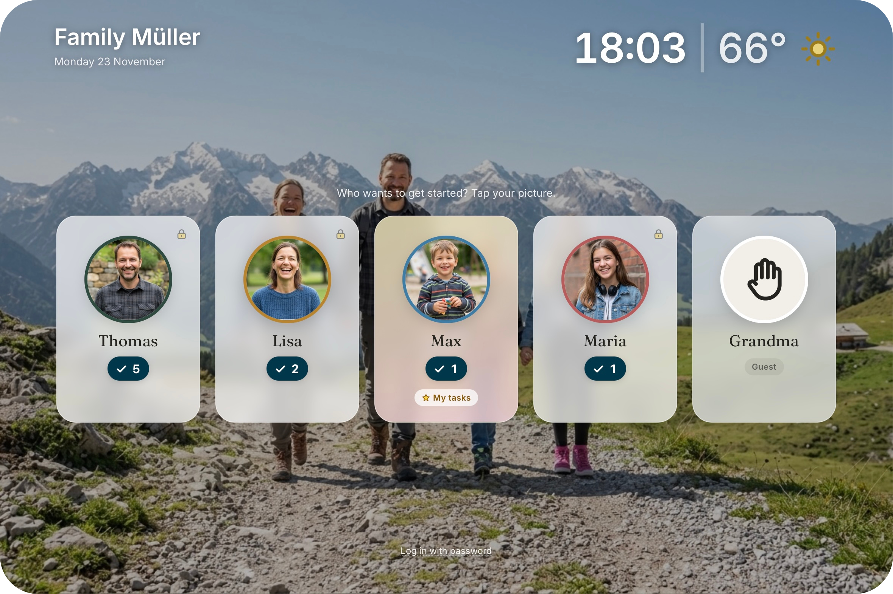
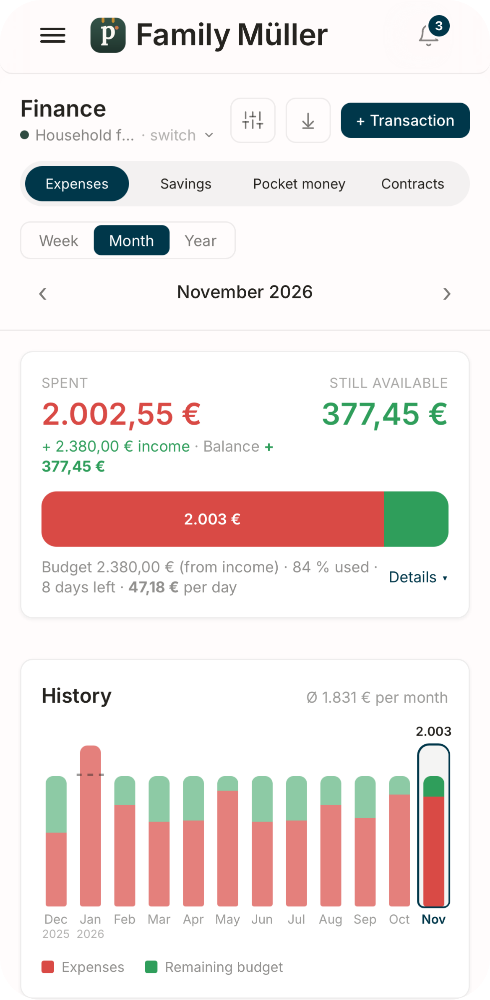

<p align="center">
  
</p>

<p align="center">
  <a href="https://github.com/pinn-shost/pinn/releases/latest"></a>
  <a href="LICENSE"></a>
  
  
  
  <a href="https://ko-fi.com/pinnapp"></a>
</p>

<p align="center">
  <a href="README.md">🇬🇧 English</a> ·
  <a href="README.de.md">🇩🇪 Deutsch</a> ·
  <a href="README.es.md">🇪🇸 Español</a> ·
  <a href="README.fr.md">🇫🇷 Français</a> ·
  <a href="README.it.md">🇮🇹 Italiano</a> ·
  <a href="README.pt.md">🇧🇷 Português</a> ·
  <a href="README.zh.md">🇨🇳 中文</a> ·
  <a href="README.ja.md">🇯🇵 日本語</a> ·
  <a href="README.ko.md">🇰🇷 한국어</a> ·
  <a href="README.ru.md">🇷🇺 Русский</a> ·
  <b>🇳🇱 Nederlands</b> ·
  <a href="README.tr.md">🇹🇷 Türkçe</a> ·
  <a href="README.pl.md">🇵🇱 Polski</a> ·
  <a href="README.uk.md">🇺🇦 Українська</a>
</p>

---

pinn. is één app voor alles wat een huishouden draaiende houdt: de gedeelde agenda, het menu van de week, de boodschappenlijst, wie de afvalbakken buiten zet, het zakgeld en de verzekering die in maart opgezegd moet worden. De app draait op **jouw NAS** in Docker en wordt als gewone app geïnstalleerd op elke iPhone, iPad en Android-telefoon.

Geen cloudaccount. Geen abonnement. Geen advertenties, geen tracking. De gegevens van je gezin verlaten je huis nooit.

> Dit is een korte beschrijving. De volledige beschrijving met FAQ en de opbouw van de repository staat in de [English README](README.md) en in het [Deutsch](README.de.md).

<a id="screenshots"></a>

## Screenshots

### Op de iPad

Aan de muur of op de keukentafel: de gedeelde iPad toont het hele gezin in één keer.

<table>
  <tr>
    <td align="center" width="50%"><a href=".github/assets/screenshots/dashboard.png"></a><br><sub><b>Dashboard</b> – iedereen tikt op zijn eigen plaatje, desgewenst met pincode</sub></td>
    <td align="center" width="50%"><a href=".github/assets/screenshots/ipad-overview.png"></a><br><sub><b>Overzicht</b> – weer, afspraken, taken, maaltijden en gezin in één oogopslag</sub></td>
  </tr>
</table>

### Op de telefoon

Altijd bij je: pinn. installeer je op elke iPhone en Android-telefoon als een gewone app.

<table>
  <tr>
    <td align="center" width="33%"><a href=".github/assets/screenshots/home.png"></a><br><sub><b>Overzicht</b> – jouw dag in één oogopslag</sub></td>
    <td align="center" width="33%"><a href=".github/assets/screenshots/calendar.png"></a><br><sub><b>Agenda</b> – iCloud en Google in één weergave</sub></td>
    <td align="center" width="33%"><a href=".github/assets/screenshots/meals.png"></a><br><sub><b>Maaltijden</b> – plan de week, doe boodschappen met één tik</sub></td>
  </tr>
  <tr>
    <td align="center" width="33%"><a href=".github/assets/screenshots/lists.png"></a><br><sub><b>Lijsten</b> – boodschappen, voorraad, paklijsten</sub></td>
    <td align="center" width="33%"><a href=".github/assets/screenshots/finance.png"></a><br><sub><b>Financiën</b> – budget, sparen, zakgeld</sub></td>
    <td align="center" width="33%"><a href=".github/assets/screenshots/chat.png"></a><br><sub><b>Chat</b> – end-to-end versleuteld, met spraakberichten en locatie</sub></td>
  </tr>
</table>

### Meer schermen

Tik op een plaatje om het op volledige grootte te openen.

<details>
<summary><b>Meer screenshots tonen</b></summary>

<br>

<table>
  <tr>
    <td align="center" width="25%"><a href=".github/assets/screenshots/house.png"></a><br><sub><b>Huis</b> – woning, kosten, lening, gebreken en meterstanden op één plek</sub></td>
    <td align="center" width="25%"><a href=".github/assets/screenshots/tasks.png"></a><br><sub><b>Taken</b> – automatische herinneringen, bijvoorbeeld voor de APK en het wisselen van banden, met een snelkoppeling</sub></td>
    <td align="center" width="25%"><a href=".github/assets/screenshots/vehicles.png"></a><br><sub><b>Voertuigen</b> – APK, banden, tanken en laden</sub></td>
    <td align="center" width="25%"><a href=".github/assets/screenshots/scan_pantry.png"></a><br><sub><b>Voorraad scannen</b> – scan de barcode, berg het op of boek het af</sub></td>
  </tr>
  <tr>
    <td align="center" width="25%"><a href=".github/assets/screenshots/weekly_summary_1.png"></a><br><sub><b>Weekoverzicht</b> – het weer en wat er nog moet gebeuren</sub></td>
    <td align="center" width="25%"><a href=".github/assets/screenshots/weekly_summary_2.png"></a><br><sub><b>Weekoverzicht</b> – dag voor dag: schoonmaak, afval, betalingen</sub></td>
    <td align="center" width="25%"><a href=".github/assets/screenshots/weekly_summary_3.png"></a><br><sub><b>Vorige week in het kort</b> – afspraken, maaltijden, uitgaven – en snelkoppelingen</sub></td>
    <td align="center" width="25%"><a href=".github/assets/screenshots/kids.png"></a><br><sub><b>Kinderen</b> – een speelse dagroutine</sub></td>
  </tr>
</table>

</details>

<sub>📁 <a href=".github/assets/screenshots">Alle plaatjes in één map</a></sub>

## Wat pinn. kan

- 📅 **Agenda** – gedeelde gezinsagenda, iCloud en Google koppelen, feestdagen en schoolvakanties
- ✅ **Taken & huishouden** – taken, beurtenrooster, afval, schoonmaak, “Wie doet hoeveel?”
- 🍽️ **Maaltijden** – weekmenu, recepten importeren, voorraadkast met scanner, boodschappenlijst
- 💶 **Financiën** – uitgaven, budget, kassen met verrekening, contracten met opzegtermijnen, zakgeld
- 👨‍👩‍👧 **Gezin** – noodpassen, locatie, SOS, “Ik ga naar huis”, huisdieren, school en opvang
- 🏠 **Huis & voertuigen** – meterstanden, kosten, renovatie, auto’s met tanken en APK, slim huis
- 🎙️ **Spraakbesturing** – “Hé Siri, pinn”: toevoegen aan de boodschappenlijst, voorlezen, taken maken, horen wat er vandaag op het programma staat (met de app in het Nederlands antwoordt Siri voorlopig nog in het Engels)
- 💬 **Chat** – gezins- en privéchat, end-to-end versleuteld, met push en leesvinkjes
- 🔔 **Meldingen** – persoonlijke pushberichten op iPhone, iPad en Android en een meldingenbel met alle wijzigingen in het gezin

pinn. spreekt **🇬🇧 English, 🇩🇪 Deutsch, 🇪🇸 Español, 🇫🇷 Français, 🇮🇹 Italiano, 🇧🇷 Português, 🇨🇳 中文, 🇯🇵 日本語, 🇰🇷 한국어, 🇷🇺 Русский, 🇳🇱 Nederlands, 🇹🇷 Türkçe, 🇵🇱 Polski en 🇺🇦 Українська**, past valuta en alarmnummers aan je regio aan en schakelt tussen de termen **gezin** en **woongroep**. Eén server kan meerdere gezinnen bedienen, elk met eigen beheerders.

## Nieuw in 1.150.10

**Donkere modus, meer pictogrammen, nieuwe dierenbanner, dierendagboek**

- **Donkere modus.** Blauwe tekst is nu goud (apparaten, lijsten, “Boodschappen plannen”, vinkjes bij dieren, gezondheid en taken); de balken bij Huishouden hebben de kleur van de kamer; meldingen in de chat, bij contracten en “In één oogopslag” zijn leesbaar. **Meer pictogrammen i.p.v. emoji:** profielfoto’s (baby, jongen, meisje, man, vrouw, opa, oma), gezin en woongroep, dieren (hond, kat, konijn, hamster, vogel, kuiken, vis, paard, schildpad, slang); keuzelijsten tonen alleen tekst. **Nieuwe dierenbanner** met kleurrijke dieren. **Dierendagboek:** een afgevinkte controle staat in het dagboek, met de × maak je een per ongeluk vinkje ongedaan.
- Gewijzigd: `css/dunkelfarbe.css` (new), `js/symbole3.js` (new), `js/symbole.js`, `js/szenen.js`, `js/familie.js`, `js/haushalt.js`, `css/symbolfarbe.css`, `css/haustierewetter.css`, `js/sprachen.js`, `js/versionslog.js`, `i18n/`, `src/`, `pinn-setup.sh`, `index.html`.

## Nieuw in 1.150.9

**Kleur in de pictogrammen, voertuig- en plantenpictogrammen**

- **Kleur overdag.** De pictogrammen zijn nu licht ingekleurd (witte vlakken, zon geel, regen blauw, auto rood, gereedschap grijs, planten groen) in dezelfde lijnstijl; de donkere modus blijft zoals hij was. **Voertuigpictogrammen:** in plaats van de auto-emoji kies je een lijnpictogram (sedan, SUV, taxi, bestelbus, pick-up, tractor, caravan, fiets, e-bike …). Ook de **plantenpictogrammen** kies je in de app, met nieuwe pictogrammen voor cactus, palm, tulp, zonnebloem, roos en meer. In de banners van Voertuigen en Thuis lichten de auto’s alleen ’s nachts op: geelachtig voor, rood achter.
- Gewijzigd: `js/symbole2.js`, `css/symbolfarbe.css` (new), `js/symbole.js`, `js/wetterlogos.js`, `js/symbolwahl.js`, `js/fahrzeuge.js`, `js/zuhause.js`, `js/dokumente.js`, `css/fahrzeuge.css`, `js/sprachen.js`, `js/versionslog.js`, `i18n/`, `src/`, `pinn-setup.sh`, `index.html`.

## Nieuw in 1.150.8

**Pictogrammen overal, te kiezen in de app**

- **Eigen pictogrammen overal.** Ook eten, huishouden, voertuigen, planten, kleding, speelgoed en sport hebben nu eigen lijnpictogrammen (kamers, afvalsoorten, voertuigsoorten, tuin, wekker, kalenderschakelaar, aftelling). De **categoriepictogrammen** in Financiën, Contracten, Documenten en Voorraad kies je uit ongeveer 150 kant-en-klare pictogrammen in plaats van met het emoji-toetsenbord, en dezelfde soort categorie heeft overal hetzelfde pictogram. De scènes van Thuis en Voertuigen tonen nieuwe kleurrijke voertuigen. Kleinigheden: weer “Nu” zonder gestippelde rand, lettertype van de klok op het dashboard, pictogram van de maaltijdplanlijst, pictogrammen op de tekstregel.
- Gewijzigd: `js/szenen.js`, `js/symbolwahl.js` (new), `js/symbole.js`, `css/wetterlogos.css`, `js/zustand.js`, `js/zuhause.js`, `js/fahrzeuge.js`, `js/gesundheit.js`, `js/finanzen.js`, `js/vertraege.js`, `js/dokumente.js`, `js/vorrat.js`, `js/vorrat2.js`, `js/einkauf.js`, `js/profilauswahl.js`, `js/sprachen.js`, `js/versionslog.js`, `i18n/`, `src/`, `pinn-setup.sh`, `index.html`.

## Nieuw in 1.150.7

**Eigen weericonen**

- **Weericonen.** De weerweergaven hebben nu eigen, eenvoudige lijnpictogrammen in plaats van de Apple-emoji, in dezelfde stijl als de shortcut-pictogrammen: zon, maan, wolken, regen, sneeuw, onweer, wind, UV, zonsopkomst, water en de kledingtips. In de donkere modus kleuren ze mee.
- **Eigen pictogrammen overal.** Zo’n 150 eenvoudige lijnpictogrammen vervangen nu de Apple-emoji in de hele app (sterren, vinkjes, waarschuwingen, plaatsen, cadeaus, klok, agenda, slot, post, gereedschap, gezondheid, huis, geld en meer). Dieren, eten, kleding, planten, voertuigen, sport en speelgoed, zelf gekozen of getypte emoji (profielfoto’s, chatteksten, invoervelden) en pushberichten blijven emoji.
- Gewijzigd: `js/symbole.js` (new), `js/wetterlogos.js`, `css/wetterlogos.css` (new), `js/familie.js`, `js/grundlagen.js`, `js/profilauswahl.js`, `js/wetterkachel.js`, `js/sprachen.js`, `js/versionslog.js`, `i18n/`, `src/`, `pinn-setup.sh`, `index.html`.

## Nieuw in 1.150.6

**Face ID ontgrendelt weer vanzelf**

- **Face ID.** pinn. vraagt bij het openen weer vanzelf om Face ID, zoals vóór 1.150.5. iOS toont altijd eerst zijn eigen venster „Toegangssleutel gebruiken” – één tik erop, daarna Face ID; het web kan dat niet overslaan, en de extra knop betekende alleen een tweede tik. De grote knop onderaan blijft, voor als je het venster wegveegt.
- Gewijzigd: `js/entsperren.js`, `js/sprachen.js`, `js/versionslog.js`, `i18n/`, `src/`, `index.html`.

## Nieuw in 1.150.5

**Nieuwe gezondheidsbanner · drinken opgeruimd**

- **Gezondheidsbanner.** De gezondheidspagina en de pagina van elke persoon hebben weer een banner: water dat stijgt met wat je vandaag dronk, belletjes, een hartslaglijn en zwevende dingen – ’s nachts sterren.
- **Drinken.** Doel, de drankjes van vandaag en de herinnering staan nu in een uitklapbaar veld „Instellingen” onder de knop.
- **Face ID.** Ontgrendelen start alleen nog met de knop (geen venster „Toegangssleutel gebruiken” meer); de knop zit onderaan, binnen bereik van je duim.
- Gewijzigd: `js/gesundheit.js`, `css/gesundheit.css`, `js/entsperren.js`, `js/sprachen.js`, `js/versionslog.js`, `i18n/`, `src/`, `index.html`.

## Nieuw in 1.150.4

**Meldingen blijven aan na updates**

- **Push overleeft updates.** Kon de server zijn push-sleutel tijdens een update even niet lezen, dan maakte hij een nieuwe aan – en waren alle apparaten afgemeld voor meldingen. De sleutel wordt nu nooit vervangen zolang hij bestaat, wordt veilig opgeslagen en daarnaast als reservekopie bewaard.
- **Eén tik is genoeg.** Raakt een apparaat zijn aanmelding toch kwijt (bijv. omdat iOS die heeft teruggezet), dan meldt pinn. het zelf opnieuw aan – of toont onderaan „Weer inschakelen”, zonder omweg via de instellingen.
- Gewijzigd: `pb_hooks/pinn-push.js`, `pb_hooks/push.pb.js`, `pb_hooks/pinn-sitzungen.js`, `js/mitteilungen.js`, `js/appstart.js`, `js/sprachen.js`, `js/versionslog.js`, `i18n/`, `src/`, `index.html`.

## Nieuw in 1.150.3

**Alle herinneringen op jouw tijd · ouders herinneren mee**

- **Alle herinneringen op jouw tijd.** Verjaardagen, huisdieren, paklijst, voorraad, contracten, documenten, weekoverzicht, maandvooruitblik en jaaroverzicht, afspraakherinneringen, dagoverzicht, taak- en afvalherinneringen, prikbord, spraakbesturing, smarthome en locatiemeldingen volgen nu de tijdzone van je apparaat, inclusief zomer- en wintertijd. Niets in te stellen.
- **Ouders herinneren mee.** Bij kinderen krijgen ook de ouders de herinneringen voor drinken, medicijnen en handen wassen, met de naam van het kind ervoor. Schakelaar “Ook de ouders herinneren” per kind (standaard: aan).
- **Shortcuts zonder kop.** De tegel op het overzicht toont alleen de apps, gescheiden door de lijn.
- Gewijzigd: alle herinneringsmodules in `pb_hooks/` (`pinn-zeit.js` en 13 andere), `js/gesundheit.js`, `js/sprachen.js`, `js/versionslog.js`, `i18n/`, `src/`, `index.html`, README (+ 1.150.2).

## Vereisten

- NAS of mini-pc met **Docker** en **Docker Compose** (bijvoorbeeld Synology, UGREEN, QNAP of een gewone Linux-server)
- SSH-toegang
- Voor toegang van buitenaf: een VPN (WireGuard of Tailscale) of een eigen domein met HTTPS

## Installatie

1. Download de ZIP van de [nieuwste release](https://github.com/pinn-shost/pinn/releases/latest) en pak hem uit.
2. Maak op de NAS een map, bijvoorbeeld `/volume1/docker/Pocketbase`, en zet de uitgepakte map (bijvoorbeeld `pinn-1.150.10` of `pinn-main`) er ongewijzigd in.
3. Maak verbinding via SSH en voer uit:
   ```sh
   cd /volume1/docker/Pocketbase && sudo sh pinn-*/pinn-setup.sh
   ```
4. Open `http://<IP-adres van de NAS>:8090` → **Inloggen als hoofdbeheerder** → wachtwoord `Admin` → stel je eigen wachtwoord in.
5. De **installatiewizard** leidt je door de rest – HTTPS, toegang op afstand, Google, AI, locatie en Home Assistant – stap voor stap, in veertien talen.
6. Open pinn. op elke telefoon via het HTTPS-adres en voeg het toe aan het beginscherm:
   - **iPhone/iPad (Safari):** “Deel” → *Zet op beginscherm* (voor meldingen is iOS 16.4 of nieuwer nodig)
   - **Android (Chrome):** Instellingen → Meldingen → *pinn. als app installeren* of Chrome-menu ⋮ → *App installeren*

**Updaten:** download de nieuwe ZIP, zet de uitgepakte map in dezelfde map en voer opnieuw `sudo sh pinn-*/pinn-setup.sh` uit. Vervangen bestanden blijven in `_alt/` staan, je gegevens blijven onaangeroerd. **Back-ups** worden elke nacht gemaakt in `./backups` en 14 dagen bewaard.

## Privacy

Alle gegevens blijven op je NAS in één PocketBase-database. Er is geen pinn.-server en geen telemetrie. Alle code en alle bibliotheken komen van je eigen NAS. Pushmeldingen bevatten geen inhoud: Apple, Google en Mozilla bezorgen alleen een leeg signaal, het bericht zelf haalt het apparaat bij je NAS op.

## pinn. steunen

pinn. is gratis en open. Als het je helpt, kun je het project steunen via [Ko-fi](https://ko-fi.com/pinnapp).

## Licentie

[MIT](LICENSE)
