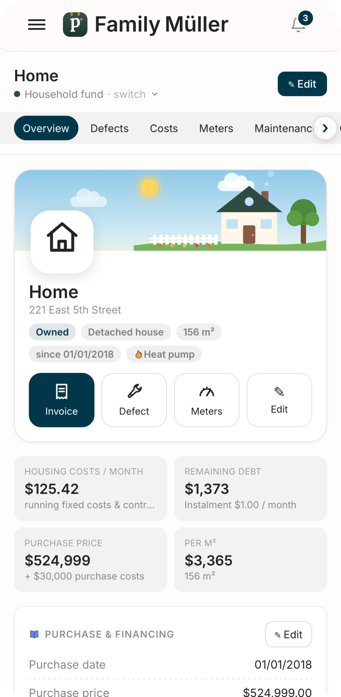

<p align="center">
  
</p>

<p align="center">
  <a href="https://github.com/pinn-shost/pinn/releases/latest"></a>
  <a href="LICENSE"></a>
  
  
  
  <a href="https://ko-fi.com/pinnapp"></a>
</p>

<p align="center">
  <a href="README.md">🇬🇧 English</a> ·
  <a href="README.de.md">🇩🇪 Deutsch</a> ·
  <a href="README.es.md">🇪🇸 Español</a> ·
  <a href="README.fr.md">🇫🇷 Français</a> ·
  <a href="README.it.md">🇮🇹 Italiano</a> ·
  <a href="README.pt.md">🇧🇷 Português</a> ·
  <a href="README.zh.md">🇨🇳 中文</a> ·
  <a href="README.ja.md">🇯🇵 日本語</a> ·
  <a href="README.ko.md">🇰🇷 한국어</a> ·
  <a href="README.ru.md">🇷🇺 Русский</a> ·
  <a href="README.nl.md">🇳🇱 Nederlands</a> ·
  <a href="README.tr.md">🇹🇷 Türkçe</a> ·
  <b>🇵🇱 Polski</b> ·
  <a href="README.uk.md">🇺🇦 Українська</a> ·
  <a href="README.cs.md">🇨🇿 Čeština</a> ·
  <a href="README.sv.md">🇸🇪 Svenska</a> ·
  <a href="README.da.md">🇩🇰 Dansk</a> ·
  <a href="README.nb.md">🇳🇴 Norsk</a> ·
  <a href="README.fi.md">🇫🇮 Suomi</a> ·
  <a href="README.hu.md">🇭🇺 Magyar</a>
</p>

---

pinn. to jedna aplikacja do wszystkiego, co utrzymuje dom w ruchu: wspólny kalendarz, posiłki na ten tydzień, lista zakupów, kto wyniesie śmieci, kieszonkowe i ubezpieczenie, które trzeba wypowiedzieć do marca. Działa w Dockerze na **twoim własnym NAS-ie** i instaluje się na każdym iPhonie, iPadzie i telefonie z Androidem w rodzinie jak prawdziwa aplikacja.

Bez konta w chmurze. Bez abonamentu. Bez reklam i śledzenia. Dane rodziny nigdy nie opuszczają twojego domu.

> To krótkie wprowadzenie. Pełny opis z FAQ i układem repozytorium znajdziesz w [English README](README.md) i [Deutsch](README.de.md).

<a id="screenshots"></a>

## Zrzuty ekranu

### Na iPadzie

Wspólny iPad na ścianie albo na kuchennym stole pokazuje całą rodzinę jednym rzutem oka.

<table>
  <tr>
    <td align="center" width="50%"><a href=".github/assets/screenshots/dashboard.png"></a><br><sub><b>Panel</b> – każdy dotyka swojego zdjęcia, opcjonalnie z kodem PIN</sub></td>
    <td align="center" width="50%"><a href=".github/assets/screenshots/ipad-overview.png"></a><br><sub><b>Przegląd</b> – pogoda, wydarzenia, zadania, posiłki i rodzina w jednym miejscu</sub></td>
  </tr>
</table>

### Na telefonie

Zawsze przy tobie: pinn. instaluje się na każdym iPhonie i telefonie z Androidem jak prawdziwa aplikacja.

<table>
  <tr>
    <td align="center" width="33%"><a href=".github/assets/screenshots/home.png"></a><br><sub><b>Przegląd</b> – twój dzień w skrócie</sub></td>
    <td align="center" width="33%"><a href=".github/assets/screenshots/calendar.png"></a><br><sub><b>Kalendarz</b> – iCloud i Google w jednym widoku</sub></td>
    <td align="center" width="33%"><a href=".github/assets/screenshots/meals.png"></a><br><sub><b>Posiłki</b> – zaplanuj tydzień, zakupy jednym dotknięciem</sub></td>
  </tr>
  <tr>
    <td align="center" width="33%"><a href=".github/assets/screenshots/lists.png"></a><br><sub><b>Listy</b> – zakupy, spiżarnia, listy pakowania</sub></td>
    <td align="center" width="33%"><a href=".github/assets/screenshots/finance.png"></a><br><sub><b>Finanse</b> – budżet, oszczędności, kieszonkowe</sub></td>
    <td align="center" width="33%"><a href=".github/assets/screenshots/chat.png"></a><br><sub><b>Czat</b> – szyfrowany end-to-end, z wiadomościami głosowymi i lokalizacją</sub></td>
  </tr>
</table>

### Więcej ekranów

Dotknij obrazu, aby otworzyć go w pełnym rozmiarze.

<details>
<summary><b>Pokaż więcej zrzutów ekranu</b></summary>

<br>

<table>
  <tr>
    <td align="center" width="25%"><a href=".github/assets/screenshots/house.png"></a><br><sub><b>Dom</b> – mieszkanie, koszty, kredyt, usterki i odczyty liczników w jednym miejscu</sub></td>
    <td align="center" width="25%"><a href=".github/assets/screenshots/tasks.png"></a><br><sub><b>Zadania</b> – automatyczne przypomnienia, np. o przeglądzie i zmianie opon, ze skrótem</sub></td>
    <td align="center" width="25%"><a href=".github/assets/screenshots/vehicles.png"></a><br><sub><b>Pojazdy</b> – przegląd, opony, paliwo i ładowanie</sub></td>
    <td align="center" width="25%"><a href=".github/assets/screenshots/scan_pantry.png"></a><br><sub><b>Skanowanie spiżarni</b> – zeskanuj kod, dodaj do spiżarni lub zdejmij ze stanu</sub></td>
  </tr>
  <tr>
    <td align="center" width="25%"><a href=".github/assets/screenshots/weekly_summary_1.png"></a><br><sub><b>Podgląd tygodnia</b> – pogoda i to, co jest do zrobienia</sub></td>
    <td align="center" width="25%"><a href=".github/assets/screenshots/weekly_summary_2.png"></a><br><sub><b>Podgląd tygodnia</b> – dzień po dniu: sprzątanie, śmieci, płatności</sub></td>
    <td align="center" width="25%"><a href=".github/assets/screenshots/weekly_summary_3.png"></a><br><sub><b>Miniony tydzień w skrócie</b> – wydarzenia, posiłki, wydatki – i skróty</sub></td>
    <td align="center" width="25%"><a href=".github/assets/screenshots/kids.png"></a><br><sub><b>Dzieci</b> – codzienna rutyna w zabawnej formie</sub></td>
  </tr>
</table>

</details>

<sub>📁 <a href=".github/assets/screenshots">Wszystkie obrazy w jednym folderze</a></sub>

## Co potrafi pinn.

- 📅 **Kalendarz** – wspólny kalendarz rodzinny, połączenie z iCloud i Google, święta państwowe i ferie szkolne
- ✅ **Zadania i obowiązki domowe** – zadania, kolejność dyżurów, odpady, sprzątanie, „Kto ile robi?”
- 🍽️ **Posiłki** – tygodniowy plan posiłków, import przepisów, spiżarnia ze skanerem, lista zakupów
- 💶 **Finanse** – wydatki, budżet, kasy z rozliczeniami, umowy z terminami wypowiedzenia, kieszonkowe
- 👨‍👩‍👧 **Rodzina** – karty awaryjne, lokalizacja, SOS, „Wracam do domu”, zwierzęta domowe, szkoła i opieka
- 🏠 **Dom i pojazdy** – odczyty liczników, koszty, remonty, samochody z paliwem i przeglądami, inteligentny dom
- 🎙️ **Sterowanie głosem** – „Hey Siri, pinn”: dodaj do listy zakupów, przeczytaj na głos, utwórz zadanie, posłuchaj dzisiejszego planu (gdy aplikacja jest po polsku, Siri na razie odpowiada po angielsku)
- 💬 **Czat** – czat rodzinny i prywatny, szyfrowany end-to-end, z powiadomieniami push i potwierdzeniem odczytu
- 🔔 **Powiadomienia** – osobiste powiadomienia push na iPhonie, iPadzie i Androidzie oraz dzwonek powiadomień ze wszystkimi zmianami w rodzinie

pinn. mówi w językach: **🇬🇧 English, 🇩🇪 Deutsch, 🇪🇸 Español, 🇫🇷 Français, 🇮🇹 Italiano, 🇧🇷 Português, 🇨🇳 中文, 🇯🇵 日本語, 🇰🇷 한국어, 🇷🇺 Русский, 🇳🇱 Nederlands, 🇹🇷 Türkçe, 🇵🇱 Polski, 🇺🇦 Українська, 🇨🇿 Čeština, 🇸🇪 Svenska, 🇩🇰 Dansk, 🇳🇴 Norsk, 🇫🇮 Suomi i 🇭🇺 Magyar**; dostosowuje walutę i numery alarmowe do twojego regionu i przełącza się między określeniami **rodzina** i **wspólne mieszkanie**. Jeden serwer może obsługiwać wiele rodzin, każdą z własnymi administratorami.

## Nowości w 1.160.0

**Węgierski**

- Nowe: węgierski (Magyar) to nowy język aplikacji – wszystkie około 7 500 tekstów aplikacji, kreator konfiguracji, eksport danych, wiadomości push z serwera i węgierski numer alarmowy (112). Jest też wariant dla wspólnego mieszkania („háztartás”, „lakótárs”) z węgierskimi końcówkami. Wybierzesz go w Ustawienia → Język i region.
- Uwaga: tłumaczenie nie zostało sprawdzone przez native speakerów – propozycje poprawek mile widziane jako GitHub issue. Sterowanie głosowe przez Siri/Android jeszcze nie rozumie węgierskiego i odpowiada po angielsku.
- Zmieniono: `i18n/hu.i18n.js` (new), `README.hu.md` (new), `js/`, `pb_hooks/`, `einrichtung.js`, `datenexport.js`, `.github/scripts/`, `src/`, `index.html`, README.

## Nowości w 1.159.0

**Fiński**

- Nowe: fiński (Suomi) to nowy język aplikacji – wszystkie około 7 500 tekstów aplikacji, kreator konfiguracji, eksport danych, wiadomości push z serwera i fiński numer alarmowy (112). Jest też wariant dla wspólnego mieszkania („kotitalous”, „asukas”) z fińskimi końcówkami przypadków. Wybierzesz go w Ustawienia → Język i region.
- Uwaga: tłumaczenie nie zostało sprawdzone przez native speakerów – propozycje poprawek mile widziane jako GitHub issue. Sterowanie głosowe przez Siri/Android jeszcze nie rozumie fińskiego i odpowiada po angielsku.
- Zmieniono: `i18n/fi.i18n.js` (new), `README.fi.md` (new), `js/`, `pb_hooks/`, `einrichtung.js`, `datenexport.js`, `.github/scripts/`, `src/`, `index.html`, README.

## Nowości w 1.158.0

**Norweski**

- Nowe: norweski (Norsk, bokmål) to nowy język aplikacji – wszystkie około 7 500 tekstów aplikacji, kreator konfiguracji, eksport danych, wiadomości push z serwera i norweski numer alarmowy (112). Jest też wariant dla wspólnego mieszkania („husstand”, „bofelle”). Wybierzesz go w Ustawienia → Język i region.
- Uwaga: tłumaczenie nie zostało sprawdzone przez native speakerów – propozycje poprawek mile widziane jako GitHub issue. Sterowanie głosowe przez Siri/Android jeszcze nie rozumie norweskiego i odpowiada po angielsku.
- Zmieniono: `i18n/nb.i18n.js` (new), `README.nb.md` (new), `js/`, `pb_hooks/`, `einrichtung.js`, `datenexport.js`, `.github/scripts/`, `src/`, `index.html`, README.

## Nowości w 1.157.0

**Duński**

- Nowe: duński (Dansk) to nowy język aplikacji – wszystkie około 7 500 tekstów aplikacji, kreator konfiguracji, eksport danych, wiadomości push z serwera i duński numer alarmowy (112). Jest też wariant dla wspólnego mieszkania („husstand”, „bofælle”). Wybierzesz go w Ustawienia → Język i region.
- Uwaga: tłumaczenie nie zostało sprawdzone przez native speakerów – propozycje poprawek mile widziane jako GitHub issue. Sterowanie głosowe przez Siri/Android jeszcze nie rozumie duńskiego i odpowiada po angielsku.
- Zmieniono: `i18n/da.i18n.js` (new), `README.da.md` (new), `js/`, `pb_hooks/`, `einrichtung.js`, `datenexport.js`, `.github/scripts/`, `src/`, `index.html`, README.

## Nowości w 1.156.0

**Szwedzki**

- Nowe: szwedzki (Svenska) to nowy język aplikacji – wszystkie około 7 500 tekstów aplikacji, kreator konfiguracji, eksport danych, wiadomości push z serwera i szwedzki numer alarmowy (112). Jest też wariant dla wspólnego mieszkania („hushåll”, „medboende”). Wybierzesz go w Ustawienia → Język i region.
- Uwaga: tłumaczenie nie zostało sprawdzone przez native speakerów – propozycje poprawek mile widziane jako GitHub issue. Sterowanie głosowe przez Siri/Android jeszcze nie rozumie szwedzkiego i odpowiada po angielsku.
- Zmieniono: `i18n/sv.i18n.js` (new), `README.sv.md` (new), `js/`, `pb_hooks/`, `einrichtung.js`, `datenexport.js`, `.github/scripts/`, `src/`, `index.html`, README.

## Nowości w 1.155.0

**Czeski**

- Nowe: czeski (Čeština) to nowy język aplikacji – wszystkie około 7 500 tekstów aplikacji, kreator konfiguracji, eksport danych, wiadomości push z serwera i czeskie numery alarmowe (112, policja 158, pogotowie 155, straż pożarna 150). Jest też wariant dla wspólnego mieszkania. Wybierzesz go w Ustawienia → Język i region.
- Uwaga: tłumaczenie nie zostało sprawdzone przez native speakerów – propozycje poprawek mile widziane jako GitHub issue. Sterowanie głosowe przez Siri/Android jeszcze nie rozumie czeskiego i odpowiada po angielsku.
- Zmieniono: `i18n/cs.i18n.js` (new), `README.cs.md` (new), `js/`, `pb_hooks/`, `einrichtung.js`, `datenexport.js`, `.github/scripts/`, `src/`, `index.html`, README.

## Nowości w 1.154.0

**Poprawka bezpieczeństwa dla adresów kalendarza**

- Naprawiono: adresy kalendarza są teraz sprawdzane. Przy usuwaniu, zmianie lub odczycie wydarzenia w iCloud albo Google serwer używa danych logowania kalendarza rodzinnego i może je wysyłać tylko do serwerów Apple i Google. Wcześniej zalogowany profil mógł zmanipulowanym żądaniem wysłać te dane na dowolny inny serwer. Kalendarze, które już działają, nie są dotknięte.
- Zmieniono: `pb_hooks/calendar-sync.js`, `js/versionslog.js`, `js/sprachen.js`, `i18n/versionslog.en.js`, `src/`, `index.html`, README.

## Nowości w 1.153.2

**Klucze Gemini z „AQ.”, teksty statusu, dziennik błędów**

- Naprawiono: kreator konfiguracji przyjmuje nowe klucze Google Gemini zaczynające się od `AQ.` (zawierają kropkę). Wcześniej „Sprawdź” mówiło, że klucz jest prawidłowy, ale „Dalej” go odrzucało.
- Naprawiono: status członka rodziny („w drodze”, „ostatnio”) był zawsze po niemiecku – teraz jest w każdym języku.
- Zmieniono: dziennik błędów pokazuje komunikaty po niemiecku dla języka niemieckiego i po angielsku dla wszystkich pozostałych.
- Zmieniono: `pb_hooks/pinn-einrichtung.js`, `pb_hooks/pinn-protokoll.js`, `pb_hooks/protokoll.pb.js`, `einrichtung.js`, `js/fehlerprotokoll.js`, `js/familie.js`, `js/familienkachel.js`, `js/versionslog.js`, `js/sprachen.js`, `i18n/`, `src/`, `index.html`, README.

## Wymagania

- NAS lub mini PC z zainstalowanym **Dockerem** i **Docker Compose** (np. Synology, UGREEN, QNAP albo zwykły serwer z Linuksem)
- dostęp przez SSH
- do dostępu z zewnątrz: VPN (WireGuard lub Tailscale) albo własna domena z HTTPS

## Instalacja

1. Pobierz i rozpakuj plik ZIP [najnowszej wersji](https://github.com/pinn-shost/pinn/releases/latest).
2. Utwórz na NAS-ie folder, np. `/volume1/docker/Pocketbase`, i umieść w nim rozpakowany folder (np. `pinn-1.160.0` lub `pinn-main`) bez zmian.
3. Połącz się przez SSH i uruchom:
   ```sh
   cd /volume1/docker/Pocketbase && sudo sh pinn-*/pinn-setup.sh
   ```
4. Otwórz `http://<adres IP NAS-a>:8090` → **Zaloguj się jako główny administrator** → hasło `Admin` → ustaw własne hasło.
5. **Kreator konfiguracji** poprowadzi cię krok po kroku przez resztę – HTTPS, dostęp z zewnątrz, Google, sztuczną inteligencję, lokalizację i Home Assistant – w 20 językach.
6. Otwórz pinn. na każdym telefonie pod adresem HTTPS i dodaj do ekranu głównego:
   - **iPhone/iPad (Safari):** „Udostępnij” → *Dodaj do ekranu początkowego* (powiadomienia wymagają iOS 16.4 lub nowszego)
   - **Android (Chrome):** Ustawienia → Powiadomienia → *zainstaluj pinn. jako aplikację* albo menu Chrome ⋮ → *Zainstaluj aplikację*

**Aktualizacja:** pobierz nowy plik ZIP, umieść rozpakowany folder w tym samym folderze i uruchom ponownie `sudo sh pinn-*/pinn-setup.sh`. Zmienione pliki trafiają do folderu `_alt/`, twoje dane pozostają nietknięte. **Kopie zapasowe** powstają co noc w folderze `./backups` i są przechowywane przez 14 dni.

### Stos Portainera (bez skryptu)

Wolisz Portainera? Wtedy nie potrzebujesz ani SSH, ani skryptu instalacyjnego:

1. W Portainerze otwórz **Stacks → Add stack**, nazwij go `pinn` i wybierz **Web editor**.
2. Wklej zawartość [`docker/docker-compose.portainer.yaml`](docker/docker-compose.portainer.yaml).
3. Opcjonalnie: w **Environment variables** zmień port (`PINN_PORT`, domyślnie 8090) lub przypnij wersję (`PINN_IMAGE_TAG`, np. `1.151.0`). Kliknij **Deploy the stack**.
4. Otwórz `http://<IP-NAS>:8090` → **Zaloguj się jako główny administrator** → kreator konfiguracji, jak w krokach 4–6 powyżej.

Obraz jest gotowy w `ghcr.io/pinn-shost/pinn` (amd64 i arm64). Dane leżą w woluminach, foldery nie są potrzebne. Stos nie używa stałych nazw kontenerów, więc nie koliduje z kontenerami, które już masz. Jeśli Tailscale działa już na Twoim NAS-ie, usuń blok `tailscale`; przy własnym adresie HTTPS lub reverse proxy usuń też `caddy` i `duckdns`.

**Aktualizacja:** Stack → Editor → *Update the stack* z włączonym *Re-pull image and redeploy*. **Kopie zapasowe:** blok `wartung` stosu robi kopię co noc (zachowywane 7 dni + 4 tygodnie) i stoi za przyciskami „Zrób kopię teraz” i „Przywróć” w pinn. → Ustawienia → System. Kopie trafiają do woluminu `backups` – albo do folderu na NAS, jeśli ustawisz `PINN_BACKUP_DIR` (np. `/volume1/docker/pinn-backups`). Do przywracania potrzebuje dostępu do Dockera, by na chwilę zatrzymać pinn.; jeśli kopiujesz woluminy sam, usuń ten blok. Aktualizacje robisz w Portainerze, nie przyciskiem. Opcjonalnie, zakomentowane na końcu pliku (usuń `#`, aby włączyć): Traccar (lokalizatory GPS z kartą SIM) i objazd do Home Assistanta – telefony nie potrzebują żadnego z nich.

### Dostęp z internetu przez własny reverse proxy

Twoja rodzina nie chce używać Tailscale? Wtedy postaw pinn. za reverse proxy: przyjmuje on zapytania z internetu, zapewnia HTTPS dla Twojej domeny i przekazuje je do pinn.

1. Skieruj proxy na `http://<NAS-IP>:8090` (stos Portainera: port `PINN_PORT`). Aktualizacje na żywo idą zwykłym HTTP – websockety nie są potrzebne, wystarczy nie włączać buforowania odpowiedzi. Zezwól na przesyłanie do 70 MB (filmy z czatu).
   - **Nginx Proxy Manager:** *Hosts → Proxy Hosts → Add*: Twoja domena, schemat `http`, IP NAS, port `8090`; karta *SSL*: nowy certyfikat, *Force SSL* włączone.
   - **Cloudflare Tunnel:** bez przekierowania portów – *Public hostname* → usługa `http://<NAS-IP>:8090`.
   - **Traefik, Caddy i inne:** router/strona dla Twojej domeny przekazująca do `http://<NAS-IP>:8090`.
2. Na każdym telefonie otwórz `https://<domain>`, zaloguj się, ponownie dodaj do ekranu głównego i znów włącz powiadomienia (aplikacja należy do swojego adresu).
3. Kalendarze Google (opcjonalnie): dodaj `https://<domain>/api/pinn/google/callback` jako autoryzowany URI przekierowania w konsoli Google Cloud.

Co pinn. robi sam: wierzy adresowi odwiedzającego przekazanemu przez proxy (`X-Forwarded-For`) tylko wtedy, gdy zapytanie przychodzi z sieci domowej, sieci Dockera lub Tailscale – dzięki temu blokady po błędnych hasłach nie da się obejść. Z internetu panel PocketBase (`/_/`) jest zablokowany, a hasło startowe `Admin` nie działa. Twój proxy stoi gdzie indziej (wynajęty serwer albo pomarańczowa chmura Cloudflare przed Twoim proxy)? Ustaw wtedy `PINN_PROXY_NETZE` (w `.env` lub zmiennych środowiskowych stosu), np. `privat, cloudflare` albo `privat, 203.0.113.5`.

**Ważne:** pinn. jest wtedy dostępny dla całego internetu. Daj każdemu profilowi długie, własne hasło, aktualizuj proxy i nigdy nie otwieraj portu 8090 bezpośrednio w routerze – zawsze przez proxy z HTTPS.

## Prywatność

Wszystkie dane zostają na twoim NAS-ie w jednej bazie PocketBase. Nie ma serwera pinn. ani telemetrii. Cały kod i wszystkie biblioteki pochodzą z twojego własnego NAS-a. Powiadomienia push nie niosą treści: Apple, Google i Mozilla przekazują tylko pusty sygnał, a samą wiadomość urządzenie pobiera z twojego NAS-a.

## Wesprzyj pinn.

pinn. jest darmowy i otwarty. Jeśli ci się przydaje, możesz wesprzeć projekt przez [Ko-fi](https://ko-fi.com/pinnapp).

## Licencja

[MIT](LICENSE)
