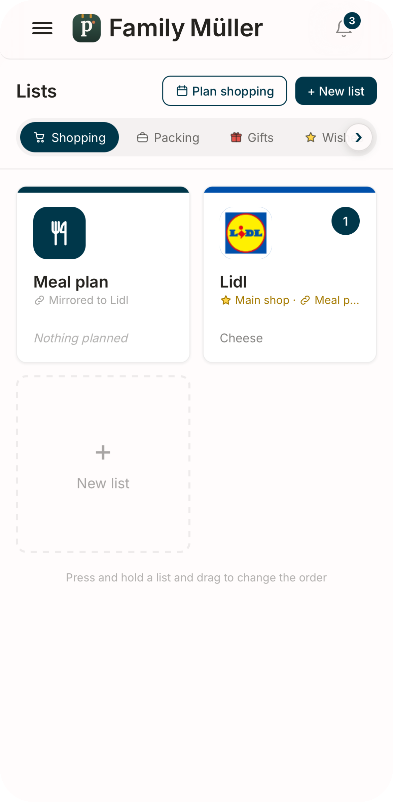
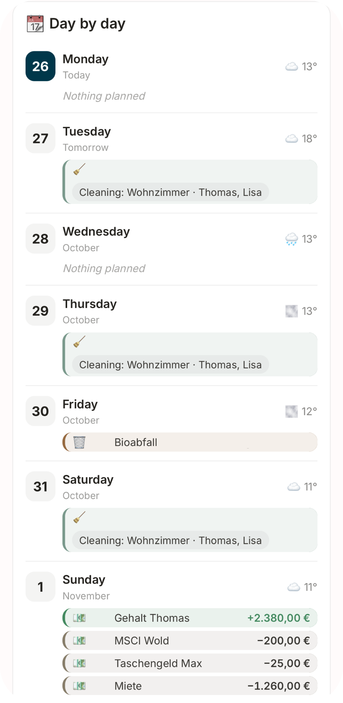

<p align="center">
  
</p>

<p align="center">
  <a href="https://github.com/pinn-shost/pinn/releases/latest"></a>
  <a href="LICENSE"></a>
  
  
  
  <a href="https://ko-fi.com/pinnapp"></a>
</p>

<p align="center">
  <a href="README.md">🇬🇧 English</a> ·
  <a href="README.de.md">🇩🇪 Deutsch</a> ·
  <a href="README.es.md">🇪🇸 Español</a> ·
  <a href="README.fr.md">🇫🇷 Français</a> ·
  <a href="README.it.md">🇮🇹 Italiano</a> ·
  <a href="README.pt.md">🇧🇷 Português</a> ·
  <a href="README.zh.md">🇨🇳 中文</a> ·
  <a href="README.ja.md">🇯🇵 日本語</a> ·
  <a href="README.ko.md">🇰🇷 한국어</a> ·
  <a href="README.ru.md">🇷🇺 Русский</a> ·
  <a href="README.nl.md">🇳🇱 Nederlands</a> ·
  <a href="README.tr.md">🇹🇷 Türkçe</a> ·
  <b>🇵🇱 Polski</b> ·
  <a href="README.uk.md">🇺🇦 Українська</a>
</p>

---

pinn. to jedna aplikacja do wszystkiego, co utrzymuje dom w ruchu: wspólny kalendarz, posiłki na ten tydzień, lista zakupów, kto wyniesie śmieci, kieszonkowe i ubezpieczenie, które trzeba wypowiedzieć do marca. Działa w Dockerze na **twoim własnym NAS-ie** i instaluje się na każdym iPhonie, iPadzie i telefonie z Androidem w rodzinie jak prawdziwa aplikacja.

Bez konta w chmurze. Bez abonamentu. Bez reklam i śledzenia. Dane rodziny nigdy nie opuszczają twojego domu.

> To krótkie wprowadzenie. Pełny opis z FAQ i układem repozytorium znajdziesz w [English README](README.md) i [Deutsch](README.de.md).

<a id="screenshots"></a>

## Zrzuty ekranu

### Na iPadzie

Wspólny iPad na ścianie albo na kuchennym stole pokazuje całą rodzinę jednym rzutem oka.

<table>
  <tr>
    <td align="center" width="50%"><a href=".github/assets/screenshots/dashboard.png"></a><br><sub><b>Panel</b> – każdy dotyka swojego zdjęcia, opcjonalnie z kodem PIN</sub></td>
    <td align="center" width="50%"><a href=".github/assets/screenshots/ipad-overview.png"></a><br><sub><b>Przegląd</b> – pogoda, wydarzenia, zadania, posiłki i rodzina w jednym miejscu</sub></td>
  </tr>
</table>

### Na telefonie

Zawsze przy tobie: pinn. instaluje się na każdym iPhonie i telefonie z Androidem jak prawdziwa aplikacja.

<table>
  <tr>
    <td align="center" width="33%"><a href=".github/assets/screenshots/home.png"></a><br><sub><b>Przegląd</b> – twój dzień w skrócie</sub></td>
    <td align="center" width="33%"><a href=".github/assets/screenshots/calendar.png"></a><br><sub><b>Kalendarz</b> – iCloud i Google w jednym widoku</sub></td>
    <td align="center" width="33%"><a href=".github/assets/screenshots/meals.png"></a><br><sub><b>Posiłki</b> – zaplanuj tydzień, zakupy jednym dotknięciem</sub></td>
  </tr>
  <tr>
    <td align="center" width="33%"><a href=".github/assets/screenshots/lists.png"></a><br><sub><b>Listy</b> – zakupy, spiżarnia, listy pakowania</sub></td>
    <td align="center" width="33%"><a href=".github/assets/screenshots/finance.png"></a><br><sub><b>Finanse</b> – budżet, oszczędności, kieszonkowe</sub></td>
    <td align="center" width="33%"><a href=".github/assets/screenshots/chat.png"></a><br><sub><b>Czat</b> – szyfrowany end-to-end, z wiadomościami głosowymi i lokalizacją</sub></td>
  </tr>
</table>

### Więcej ekranów

Dotknij obrazu, aby otworzyć go w pełnym rozmiarze.

<details>
<summary><b>Pokaż więcej zrzutów ekranu</b></summary>

<br>

<table>
  <tr>
    <td align="center" width="25%"><a href=".github/assets/screenshots/house.png"></a><br><sub><b>Dom</b> – mieszkanie, koszty, kredyt, usterki i odczyty liczników w jednym miejscu</sub></td>
    <td align="center" width="25%"><a href=".github/assets/screenshots/tasks.png"></a><br><sub><b>Zadania</b> – automatyczne przypomnienia, np. o przeglądzie i zmianie opon, ze skrótem</sub></td>
    <td align="center" width="25%"><a href=".github/assets/screenshots/vehicles.png"></a><br><sub><b>Pojazdy</b> – przegląd, opony, paliwo i ładowanie</sub></td>
    <td align="center" width="25%"><a href=".github/assets/screenshots/scan_pantry.png"></a><br><sub><b>Skanowanie spiżarni</b> – zeskanuj kod, dodaj do spiżarni lub zdejmij ze stanu</sub></td>
  </tr>
  <tr>
    <td align="center" width="25%"><a href=".github/assets/screenshots/weekly_summary_1.png"></a><br><sub><b>Podgląd tygodnia</b> – pogoda i to, co jest do zrobienia</sub></td>
    <td align="center" width="25%"><a href=".github/assets/screenshots/weekly_summary_2.png"></a><br><sub><b>Podgląd tygodnia</b> – dzień po dniu: sprzątanie, śmieci, płatności</sub></td>
    <td align="center" width="25%"><a href=".github/assets/screenshots/weekly_summary_3.png"></a><br><sub><b>Miniony tydzień w skrócie</b> – wydarzenia, posiłki, wydatki – i skróty</sub></td>
    <td align="center" width="25%"><a href=".github/assets/screenshots/kids.png"></a><br><sub><b>Dzieci</b> – codzienna rutyna w zabawnej formie</sub></td>
  </tr>
</table>

</details>

<sub>📁 <a href=".github/assets/screenshots">Wszystkie obrazy w jednym folderze</a></sub>

## Co potrafi pinn.

- 📅 **Kalendarz** – wspólny kalendarz rodzinny, połączenie z iCloud i Google, święta państwowe i ferie szkolne
- ✅ **Zadania i obowiązki domowe** – zadania, kolejność dyżurów, odpady, sprzątanie, „Kto ile robi?”
- 🍽️ **Posiłki** – tygodniowy plan posiłków, import przepisów, spiżarnia ze skanerem, lista zakupów
- 💶 **Finanse** – wydatki, budżet, kasy z rozliczeniami, umowy z terminami wypowiedzenia, kieszonkowe
- 👨‍👩‍👧 **Rodzina** – karty awaryjne, lokalizacja, SOS, „Wracam do domu”, zwierzęta domowe, szkoła i opieka
- 🏠 **Dom i pojazdy** – odczyty liczników, koszty, remonty, samochody z paliwem i przeglądami, inteligentny dom
- 🎙️ **Sterowanie głosem** – „Hey Siri, pinn”: dodaj do listy zakupów, przeczytaj na głos, utwórz zadanie, posłuchaj dzisiejszego planu (gdy aplikacja jest po polsku, Siri na razie odpowiada po angielsku)
- 💬 **Czat** – czat rodzinny i prywatny, szyfrowany end-to-end, z powiadomieniami push i potwierdzeniem odczytu
- 🔔 **Powiadomienia** – osobiste powiadomienia push na iPhonie, iPadzie i Androidzie oraz dzwonek powiadomień ze wszystkimi zmianami w rodzinie

pinn. mówi w językach: **🇬🇧 English, 🇩🇪 Deutsch, 🇪🇸 Español, 🇫🇷 Français, 🇮🇹 Italiano, 🇧🇷 Português, 🇨🇳 中文, 🇯🇵 日本語, 🇰🇷 한국어, 🇷🇺 Русский, 🇳🇱 Nederlands, 🇹🇷 Türkçe, 🇵🇱 Polski i 🇺🇦 Українська**; dostosowuje walutę i numery alarmowe do twojego regionu i przełącza się między określeniami **rodzina** i **wspólne mieszkanie**. Jeden serwer może obsługiwać wiele rodzin, każdą z własnymi administratorami.

## Nowości w 1.151.0

**Stos Portainera, gotowy obraz**

- Nowość: pinn. można zainstalować z interfejsu stosów Portainera, bez SSH i bez skryptu instalacyjnego. Przy każdym wydaniu powstaje gotowy obraz (amd64, arm64) publikowany w `ghcr.io/pinn-shost/pinn`; nowy plik `docker/docker-compose.portainer.yaml` używa go z woluminami i bez stałych nazw kontenerów (koniec kolizji z istniejącym kontenerem Tailscale). W aplikacji „Kopie i aktualizacje” odsyła do Portainera, gdy pinn. działa jako obraz. Zobacz „Stos Portainera (bez skryptu)” w Instalacji.
- Zmieniono: `docker/` (new), `.github/workflows/image.yml` (new), `pb_hooks/pinn-system.js`, `js/sicherungen.js`, `i18n/`, `js/sprachen.js`, `js/versionslog.js`, `src/`, `index.html`.

## Nowości w 1.150.11

**Ikony i drobne poprawki**

- Ikona grzebienia przy „Czesaniu włosów” na stronie dziecięcej; brak już pola emoji obok nazwy depozytu; listy wyboru kas bez emoji; narzędzie to teraz klucz płaski; „Menu dla gości” z ikoną dwóch osób; dotknięcie logo obok nazwy rodziny prowadzi do przeglądu; karta Powiadomienia wypełnia się jako pierwsza, więc „Włącz na tym urządzeniu” zawsze się pojawia; ikony skrótów są szare w trybie ciemnym.
- Zmieniono: `js/symbole.js`, `js/symbole3.js`, `js/ansichten.js`, `js/konto.js`, `css/dunkelfarbe.css`, `js/sprachen.js`, `js/versionslog.js`, `i18n/versionslog.en.js`, `src/`, `index.html`.

## Nowości w 1.150.10

**Tryb ciemny, więcej ikon, nowy baner zwierząt, dziennik zwierząt**

- **Tryb ciemny.** Niebieski tekst jest teraz złoty (urządzenia, listy, „Zaplanuj zakupy”, ptaszki przy zwierzętach, zdrowiu i zadaniach); paski w Gospodarstwie mają kolor pokoju; komunikaty w czacie, przy umowach i „W skrócie” są czytelne. **Więcej ikon zamiast emoji:** zdjęcia profilowe (niemowlę, chłopiec, dziewczynka, mężczyzna, kobieta, dziadek, babcia), rodzina i wspólne mieszkanie, zwierzęta (pies, kot, królik, chomik, ptak, kurczak, ryba, koń, żółw, wąż); listy rozwijane pokazują tylko tekst. **Nowy baner zwierząt** z kolorowymi zwierzętami. **Dziennik zwierząt:** odhaczona kontrola pojawia się w dzienniku, a × cofa przypadkowe odhaczenie.
- Zmieniono: `css/dunkelfarbe.css` (new), `js/symbole3.js` (new), `js/symbole.js`, `js/szenen.js`, `js/familie.js`, `js/haushalt.js`, `css/symbolfarbe.css`, `css/haustierewetter.css`, `js/sprachen.js`, `js/versionslog.js`, `i18n/`, `src/`, `pinn-setup.sh`, `index.html`.

## Nowości w 1.150.9

**Kolor ikon, ikony pojazdów i roślin**

- **Kolor w dzień.** Ikony są teraz lekko wypełnione kolorem (białe pola, słońce żółte, deszcz niebieski, auto czerwone, narzędzia szare, rośliny zielone) w tym samym stylu linii; tryb ciemny bez zmian. **Ikony pojazdów:** zamiast emoji samochodu wybierasz ikonę liniową (sedan, SUV, taksówka, van, pickup, traktor, przyczepa kempingowa, rower, e-bike …). **Ikony roślin** też wybierasz w aplikacji, z nowymi ikonami kaktusa, palmy, tulipana, słonecznika, róży i innych. W banerach Pojazdów i Domu auta świecą tylko nocą: z przodu żółtawo, z tyłu na czerwono.
- Zmienione: `js/symbole2.js`, `css/symbolfarbe.css` (new), `js/symbole.js`, `js/wetterlogos.js`, `js/symbolwahl.js`, `js/fahrzeuge.js`, `js/zuhause.js`, `js/dokumente.js`, `css/fahrzeuge.css`, `js/sprachen.js`, `js/versionslog.js`, `i18n/`, `src/`, `pinn-setup.sh`, `index.html`.

## Nowości w 1.150.8

**Ikony wszędzie, wybierane w aplikacji**

- **Własne ikony wszędzie.** Jedzenie, dom, pojazdy, rośliny, ubrania, zabawki i sport mają teraz również własne ikony liniowe (pokoje, rodzaje odpadów, rodzaje pojazdów, ogród, budzik, przełącznik kalendarza, odliczanie). **Ikony kategorii** w Finansach, Umowach, Dokumentach i Spiżarni wybierasz spośród około 150 gotowych ikon zamiast z klawiatury emoji, a ten sam rodzaj kategorii ma wszędzie tę samą ikonę. Sceny Domu i Pojazdów pokazują nowe, kolorowe pojazdy. Drobiazgi: pogoda „Teraz” bez przerywanej ramki, czcionka zegara na pulpicie, ikona listy planu posiłków, ikony na linii tekstu.
- Zmienione: `js/szenen.js`, `js/symbolwahl.js` (new), `js/symbole.js`, `css/wetterlogos.css`, `js/zustand.js`, `js/zuhause.js`, `js/fahrzeuge.js`, `js/gesundheit.js`, `js/finanzen.js`, `js/vertraege.js`, `js/dokumente.js`, `js/vorrat.js`, `js/vorrat2.js`, `js/einkauf.js`, `js/profilauswahl.js`, `js/sprachen.js`, `js/versionslog.js`, `i18n/`, `src/`, `pinn-setup.sh`, `index.html`.

## Nowości w 1.150.7

**Własne ikony pogody**

- **Ikony pogody.** Widoki pogody mają teraz własne, proste ikony liniowe zamiast emoji Apple, w tym samym stylu co ikony skrótów: słońce, księżyc, chmury, deszcz, śnieg, burza, wiatr, UV, wschód słońca, woda i wskazówki dotyczące ubioru. W trybie ciemnym zmieniają kolor.
- **Własne ikony wszędzie.** Około 150 prostych ikon liniowych zastępuje teraz emoji Apple w całej aplikacji (gwiazdki, ptaszki, ostrzeżenia, miejsca, prezenty, zegar, kalendarz, kłódka, poczta, narzędzia, zdrowie, dom, pieniądze i więcej). Zwierzęta, jedzenie, ubrania, rośliny, pojazdy, sport i zabawki, emoji wybrane lub wpisane samodzielnie (zdjęcia członków, teksty czatu, pola wpisywania) oraz powiadomienia push pozostają emoji.
- Zmienione: `js/symbole.js` (new), `js/wetterlogos.js`, `css/wetterlogos.css` (new), `js/familie.js`, `js/grundlagen.js`, `js/profilauswahl.js`, `js/wetterkachel.js`, `js/sprachen.js`, `js/versionslog.js`, `i18n/`, `src/`, `pinn-setup.sh`, `index.html`.

## Nowości w 1.150.6

**Face ID znów odblokowuje samo**

- **Face ID.** pinn. znów samo prosi o Face ID przy otwarciu, jak przed 1.150.5. iOS zawsze najpierw pokazuje własne okno „Użyj klucza dostępu” – jedno stuknięcie w nie, potem Face ID; aplikacja webowa nie może go pominąć, a dodatkowy przycisk oznaczał tylko drugie stuknięcie. Duży przycisk na dole zostaje, na wypadek gdybyś zamknął okno.
- Zmienione: `js/entsperren.js`, `js/sprachen.js`, `js/versionslog.js`, `i18n/`, `src/`, `index.html`.

## Nowości w 1.150.5

**Nowy baner zdrowia · picie uporządkowane**

- **Baner zdrowia.** Strona zdrowia i strona każdej osoby znów mają baner: woda, która podnosi się z tym, co wypito, bąbelki, linia tętna i unoszące się przedmioty – nocą gwiazdy.
- **Picie.** Cel, dzisiejsze napoje i przypomnienie są teraz w rozwijanej sekcji „Ustawienia” pod przyciskiem.
- **Face ID.** Odblokowanie startuje tylko przyciskiem (bez okna „Użyj klucza dostępu”); przycisk jest na dole, w zasięgu kciuka.
- Zmienione: `js/gesundheit.js`, `css/gesundheit.css`, `js/entsperren.js`, `js/sprachen.js`, `js/versionslog.js`, `i18n/`, `src/`, `index.html`.

## Wymagania

- NAS lub mini PC z zainstalowanym **Dockerem** i **Docker Compose** (np. Synology, UGREEN, QNAP albo zwykły serwer z Linuksem)
- dostęp przez SSH
- do dostępu z zewnątrz: VPN (WireGuard lub Tailscale) albo własna domena z HTTPS

## Instalacja

1. Pobierz i rozpakuj plik ZIP [najnowszej wersji](https://github.com/pinn-shost/pinn/releases/latest).
2. Utwórz na NAS-ie folder, np. `/volume1/docker/Pocketbase`, i umieść w nim rozpakowany folder (np. `pinn-1.151.0` lub `pinn-main`) bez zmian.
3. Połącz się przez SSH i uruchom:
   ```sh
   cd /volume1/docker/Pocketbase && sudo sh pinn-*/pinn-setup.sh
   ```
4. Otwórz `http://<adres IP NAS-a>:8090` → **Zaloguj się jako główny administrator** → hasło `Admin` → ustaw własne hasło.
5. **Kreator konfiguracji** poprowadzi cię krok po kroku przez resztę – HTTPS, dostęp z zewnątrz, Google, sztuczną inteligencję, lokalizację i Home Assistant – w 14 językach.
6. Otwórz pinn. na każdym telefonie pod adresem HTTPS i dodaj do ekranu głównego:
   - **iPhone/iPad (Safari):** „Udostępnij” → *Dodaj do ekranu początkowego* (powiadomienia wymagają iOS 16.4 lub nowszego)
   - **Android (Chrome):** Ustawienia → Powiadomienia → *zainstaluj pinn. jako aplikację* albo menu Chrome ⋮ → *Zainstaluj aplikację*

**Aktualizacja:** pobierz nowy plik ZIP, umieść rozpakowany folder w tym samym folderze i uruchom ponownie `sudo sh pinn-*/pinn-setup.sh`. Zmienione pliki trafiają do folderu `_alt/`, twoje dane pozostają nietknięte. **Kopie zapasowe** powstają co noc w folderze `./backups` i są przechowywane przez 14 dni.

### Stos Portainera (bez skryptu)

Wolisz Portainera? Wtedy nie potrzebujesz ani SSH, ani skryptu instalacyjnego:

1. W Portainerze otwórz **Stacks → Add stack**, nazwij go `pinn` i wybierz **Web editor**.
2. Wklej zawartość [`docker/docker-compose.portainer.yaml`](docker/docker-compose.portainer.yaml).
3. Opcjonalnie: w **Environment variables** zmień port (`PINN_PORT`, domyślnie 8090) lub przypnij wersję (`PINN_IMAGE_TAG`, np. `1.151.0`). Kliknij **Deploy the stack**.
4. Otwórz `http://<IP-NAS>:8090` → **Zaloguj się jako główny administrator** → kreator konfiguracji, jak w krokach 4–6 powyżej.

Obraz jest gotowy w `ghcr.io/pinn-shost/pinn` (amd64 i arm64). Dane leżą w woluminach, foldery nie są potrzebne. Stos nie używa stałych nazw kontenerów, więc nie koliduje z kontenerami, które już masz. Jeśli Tailscale działa już na Twoim NAS-ie, usuń blok `tailscale`; przy własnym adresie HTTPS lub reverse proxy usuń też `caddy` i `duckdns`.

**Aktualizacja:** Stack → Editor → *Update the stack* z włączonym *Re-pull image and redeploy*. **Kopie zapasowe:** Portainer sam nie tworzy kopii woluminów – regularnie kopiuj woluminy `data` i `konfig` (np. migawka NAS lub narzędzie do kopii woluminów). W aplikacji „Kopie i aktualizacje” pokazuje wskazówkę zamiast przycisków. Nie ma w stosie: Traccara (lokalizatory GPS z kartą SIM) i objazdu do Home Assistanta – telefony nie potrzebują żadnego z nich.

## Prywatność

Wszystkie dane zostają na twoim NAS-ie w jednej bazie PocketBase. Nie ma serwera pinn. ani telemetrii. Cały kod i wszystkie biblioteki pochodzą z twojego własnego NAS-a. Powiadomienia push nie niosą treści: Apple, Google i Mozilla przekazują tylko pusty sygnał, a samą wiadomość urządzenie pobiera z twojego NAS-a.

## Wesprzyj pinn.

pinn. jest darmowy i otwarty. Jeśli ci się przydaje, możesz wesprzeć projekt przez [Ko-fi](https://ko-fi.com/pinnapp).

## Licencja

[MIT](LICENSE)
