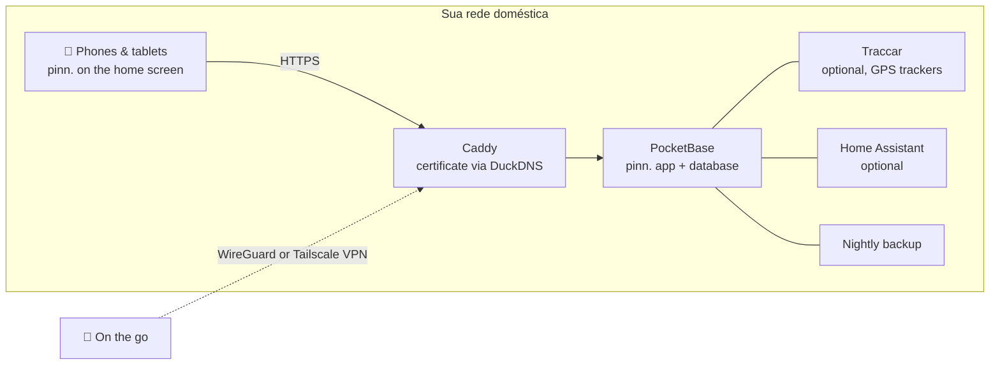

<p align="center">
  
</p>

<p align="center">
  <a href="https://github.com/pinn-shost/pinn/releases/latest"></a>
  <a href="LICENSE"></a>
  
  
  
  <a href="https://ko-fi.com/pinnapp"></a>
</p>

<p align="center">
  <a href="README.md">🇬🇧 English</a> ·
  <a href="README.de.md">🇩🇪 Deutsch</a> ·
  <a href="README.es.md">🇪🇸 Español</a> ·
  <a href="README.fr.md">🇫🇷 Français</a> ·
  <a href="README.it.md">🇮🇹 Italiano</a> ·
  <b>🇧🇷 Português</b> ·
  <a href="README.zh.md">🇨🇳 中文</a> ·
  <a href="README.ja.md">🇯🇵 日本語</a> ·
  <a href="README.ko.md">🇰🇷 한국어</a>
</p>

<p align="center">
  <a href="#screenshots">Capturas de tela</a> ·
  <a href="#what-pinn-does">Recursos</a> ·
  <a href="#installation">Instalação</a> ·
  <a href="#privacy">Privacidade</a> ·
  <a href="#faq">FAQ</a>
</p>

---

O pinn. é um único app para tudo o que mantém uma casa funcionando: o calendário compartilhado, as refeições da semana, a lista de compras, quem leva o lixo para fora, a mesada e o seguro que precisa ser cancelado em março. Ele roda no **seu próprio NAS** com Docker e se instala como um app nativo em todos os iPhones, iPads e celulares Android da família.

Sem conta na nuvem. Sem assinatura. Sem anúncios, sem rastreamento. Os dados da sua família nunca saem da sua casa.

<a id="screenshots"></a>

## Capturas de tela

### No iPad

Pendurado na parede ou apoiado na mesa da cozinha: o iPad compartilhado mostra a família inteira de uma vez.

<table>
  <tr>
    <td align="center" width="50%">
      <br>
      <sub><b>Painel</b> – cada um toca na própria foto, com PIN opcional</sub>
    </td>
    <td align="center" width="50%">
      <br>
      <sub><b>Visão geral</b> – clima, compromissos, tarefas, refeições e a família num relance</sub>
    </td>
  </tr>
</table>

### No celular

Sempre com você: o pinn. se instala em todo iPhone e celular Android como um app nativo.

<table>
  <tr>
    <td align="center" width="33%"><br><sub><b>Visão geral</b> – o seu dia num relance</sub></td>
    <td align="center" width="33%"><br><sub><b>Calendário</b> – iCloud e Google numa só visualização</sub></td>
    <td align="center" width="33%"><br><sub><b>Refeições</b> – planeje a semana, faça as compras com um toque</sub></td>
  </tr>
  <tr>
    <td align="center" width="33%"><br><sub><b>Listas</b> – compras, despensa, mala</sub></td>
    <td align="center" width="33%"><br><sub><b>Finanças</b> – orçamento, poupança, mesada</sub></td>
    <td align="center" width="33%"><br><sub><b>Crianças</b> – uma rotina diária divertida</sub></td>
  </tr>
</table>

<a id="what-pinn-does"></a>

## O que o pinn. faz

| | |
|---|---|
| 📅 **Calendário** | Calendários do iCloud e do Google por pessoa, privados ou compartilhados com a família. Feriados, recessos escolares, datas de coleta de lixo e aniversários dos seus contatos aparecem automaticamente. |
| 🍝 **Refeições e receitas** | Planeje a semana e envie os ingredientes direto para a lista de compras. Importe receitas de texto, PDF, fotos ou um link – opcionalmente com IA. Compartilhe receitas favoritas com outras famílias do seu servidor. |
| 🛒 **Listas** | Listas de compras por loja, uma despensa que reabastece a lista quando o estoque acaba, listas de bagagem a partir de modelos (férias, mala da maternidade, festa), listas de presentes e de desejos. |
| ✅ **Tarefas e casa** | Tarefas com lembretes push, planos de limpeza e lixeiras – além de uma página das crianças com rotinas animadas que mostra só o que combina com o horário do dia. |
| 💶 **Finanças** | Caixas compartilhadas ou privadas, um orçamento doméstico, poupança e carteiras com ETFs e ações, mesada, pagamentos recorrentes e contratos com lembretes de cancelamento. Repúblicas podem dividir custos e ver quem deve a quem. |
| 📄 **Documentos e veículos** | Recibos e garantias, documentos de identidade com lembrete de validade. Carros e bicicletas com datas de inspeção, trocas de pneu, consumo e custo total. |
| 🏡 **Casa** | Para inquilinos, proprietários e locadores: contrato de aluguel ou de compra, financiamento, defeitos com fotos, recibos, plano de reforma, leituras de medidores com previsão, chaves e receita de aluguel de apartamentos, casas e garagens que você aluga. Jardim e plantas com um plano de rega que sabe quando choveu. |
| 📍 **Família e localização** | Compartilhe sua localização direto no pinn. – uma vez ou por um tempo escolhido – e em segundo plano pelo app gratuito Traccar Client (envia direto ao pinn., sem servidor extra). Além disso, um modo “voltando para casa”, um alerta SOS com posição e números de emergência, fichas de emergência e avisos de chegada em lugares. |
| 🎒 **Escola e creche** | Por criança: horário de aulas (digite ou tire uma foto – a IA preenche), entrega e busca, lição de casa na página das crianças, comunicados aos pais com prazos que viram lembretes e dias sem aula direto no calendário. |
| 🐾 **Pets** | Perfis para cães, gatos, coelhos e outros com horários de alimentação para marcar, passeios, um rodízio de “de quem é a vez?”, vacinas e vermifugação com lembretes push, gráfico de peso, veterinário e plantão veterinário, uma ficha para o pet sitter compartilhar, um cartaz de “desaparecido” para imprimir e um lembrete para reabastecer o alimentador automático. |
| 🌦️ **Clima e férias** | Toque no clima (um bloco no celular, no alto ao lado de data e hora no iPad e no computador) para ver 14 dias com detalhes de cada dia. As listas de bagagem com destino e datas mostram o clima das férias – previsão ou valores típicos – e sugerem o que levar. |
| 🏠 **Casa inteligente** | Inicie Atalhos da Apple ou ações do Home Assistant a partir de uma tarefa – o robô aspirador limpa a cozinha quando a tarefa vence, o robô cortador de grama e a rega seguem o plano do jardim, o alimentador automático avisa quando está acabando. |
| 🎙️ **Controle por voz** | “Ei Siri, pinn”: adicione à lista de compras, ouça a lista, crie tarefas e saiba o que há hoje – também no Android. |
| 🔔 **Notificações** | Mensagens push pessoais no iPhone, iPad e Android, além de um sino que reúne cada mudança na família. |
| 🧩 **E mais** | Mural da família com notas móveis, busca global, modo offline com sincronização automática, modo escuro, painel no iPad com PINs de perfil, conta de convidado, bloqueio infantil. |

O pinn. fala **🇬🇧 English, 🇩🇪 Deutsch, 🇪🇸 Español, 🇫🇷 Français, 🇮🇹 Italiano, 🇧🇷 Português, 🇨🇳 中文, 🇯🇵 日本語 e 🇰🇷 한국어**, adapta moeda e números de emergência à sua região e alterna entre os termos **família** e **casa compartilhada**. Um servidor pode hospedar várias famílias, cada uma com seus próprios administradores.

## Novidades da 1.120.1

**Russo – segunda etapa**

- Traduzidos para russo: a conta (senha, PIN, perfis, convidados, notificações, painel da família), dispositivos e login, o registro de erros e backups e atualizações – agora 874 de 6714 textos, de novo com as três formas de plural e os termos de casa compartilhada.
- O russo continua **oculto** até tudo estar traduzido (dá para ativar em um dispositivo como descrito na 1.120.0).
- A seguir: outras etapas do russo (calendário, tarefas, casa …).
- Alterados: `index.html`, `js/sprachen.js`, `js/versionslog.js`, `i18n/ru.i18n.js`, `i18n/versionslog.en.js` – nada muda no servidor. Instale como sempre (`sudo sh pinn-*/pinn-setup.sh` ou botão de atualização).

## Novidades da 1.120.0

**Russo – primeira etapa**

- O pinn. está sendo traduzido para o **russo** passo a passo. A primeira etapa cobre o login, o painel, o menu, a página do administrador principal e todas as configurações, além do assistente de configuração completo e da exportação de dados – cerca de 500 textos, com as três formas de plural do russo e os termos de casa compartilhada.
- O russo continua **oculto** até que tudo esteja traduzido. Para testar em um dispositivo, digite `localStorage.setItem('pinn.sprachen.alle', '1')` no console do navegador e escolha Русский; os textos ainda não traduzidos aparecem em inglês.
- Servidor: a configuração agora também aceita o russo como idioma (`pb_hooks/pinn-einrichtung.js`).
- A seguir: mais etapas do russo (calendário, tarefas, casa …).
- Alterado: `index.html`, `js/sprachen.js`, `js/einrichten.js`, `js/exportieren.js`, `js/versionslog.js`, `einrichtung.js`, `datenexport.js`, `i18n/ru.i18n.js` (novo), `i18n/versionslog.en.js`, `pb_hooks/pinn-einrichtung.js`, `.github/`. Instale como de costume (`sudo sh pinn-*/pinn-setup.sh` ou botão de atualização).

## Novidades da 1.119.3

**Faxina: o tradutor antigo saiu**

- Todos os textos do pinn. agora vêm diretamente dos arquivos de idioma em `i18n/`. Os dicionários antigos (pasta `pb_public/lang/`, cerca de 4 MB) e o tradutor que reescrevia a tela durante o uso foram removidos: o pinn. inicia mais rápido e usa menos memória, principalmente em celulares e tablets mais antigos.
- A atualização move os arquivos antigos para `_alt/<data>/` no NAS (nada é apagado) e remove a pasta vazia `lang/`.
- Detalhes: data e hora na tela inicial, no dashboard, na visão semanal, em Finanças e em “Casa” aparecem direto no formato do seu idioma; “Salvo” nas configurações da previsão está traduzido; numa casa compartilhada, o menu, o bloco da visão geral e as configurações mostram o ícone 🧑‍🤝‍🧑; textos escritos por você (por ex. um bilhete “Hallo Familie” no mural) não são mais alterados numa casa compartilhada.
- A seguir: russo, passo a passo (oculto até ficar completo).
- Alterado: `index.html`, `js/sprachen.js`, `js/zustand.js`, `js/uebersicht.js`, `js/familie.js`, `js/listen.js`, `js/sterne.js`, `js/ausblick.js`, `js/grundlagen.js`, `js/profilauswahl.js`, `js/wohnort.js`, `js/finanzen.js`, `js/einstellungen.js`, `js/smarthome.js`, `js/versionslog.js`, `i18n/versionslog.en.js`, `pinn-setup.sh`, `.github/` – removido: `pb_public/lang/` – nada muda no servidor. Instalar como sempre (`sudo sh pinn-*/pinn-setup.sh` ou botão de atualização).

## Novidades da 1.119.2

**Leitor da despensa: foto em vez da câmera ao vivo**

- Se o pinn. for aberto por `http://…` em vez do endereço HTTPS, os navegadores não liberam a câmera ao vivo – no iPhone e no iPad nunca. Antes o leitor mostrava uma imagem preta; agora explica que a câmera ao vivo precisa do endereço HTTPS e oferece **📷 Fotografar o código de barras**: tire uma foto e o pinn. lê o código. Também funciona se a câmera estiver bloqueada ou não iniciar.
- A seguir: 1.119.3 remove o tradutor antigo e `lang/`.
- Alterado: `index.html`, `js/vorrat2.js`, `js/sprachen.js`, `js/versionslog.js`, `i18n/versionslog.en.js`, todos os arquivos de idioma em `i18n/`, para contribuidores `.github/scripts/check-keys.js` – nada muda no servidor.

## Novidades da 1.119.1

**Nomes padrão, mensagens do servidor e registro de versões no seu idioma**

- Os **nomes predefinidos** – categorias de receitas, despensa, compras, documentos, finanças e contratos, locais de armazenamento, eletrodomésticos, unidades como “lata” ou “pacote” (no singular e no plural), a caixa da casa e os títulos das tarefas domésticas automáticas – agora aparecem no seu idioma. Seus dados não mudam; nomes renomeados ou próprios ficam como estão.
- Cerca de 40 **mensagens do servidor** (por exemplo “Perfil não encontrado”, avisos sobre backups, atualizações e dispositivos) seguem o seu idioma.
- O **registro de versões** agora existe só em alemão e inglês: os outros idiomas mostram inglês, e entradas antigas sem tradução ficam em alemão. A parte em inglês só carrega ao abrir.
- Próximo passo: a 1.119.2 remove o tradutor antigo e `lang/`.
- Alterado: `index.html`, `js/standardnamen.js` (novo), `i18n/versionslog.en.js` (novo), `js/serverzugriff.js`, `js/versionslog.js`, `js/hinweise.js` e mais 22 arquivos em `js/`, todos os arquivos de idioma em `i18n/`, `pinn-setup.sh` – nada muda no servidor. Instalação como sempre (`sudo sh pinn-*/pinn-setup.sh` ou o botão de atualização).

## Como funciona



Tudo roda como contêineres Docker em uma única máquina. O HTTPS funciona **sem redirecionamento de portas** – o certificado é emitido por uma verificação de DNS. De fora, o pinn. só é acessível pela sua própria VPN.

## Requisitos

- Um NAS ou servidor com **Docker** e **Docker Compose 2.17+** – desenvolvido em um NAS UGREEN com UGOS, roda em qualquer host Linux com Docker (amd64, arm64, armv7)
- Acesso SSH a ele
- Opcional, mas recomendado: um subdomínio gratuito do [DuckDNS](https://www.duckdns.org) para HTTPS – necessário para notificações push e para instalar o pinn. como app

<a id="installation"></a>

## Instalação

1. Baixe o ZIP da [última versão](https://github.com/pinn-shost/pinn/releases/latest) e descompacte.
2. Crie uma pasta no NAS, por exemplo `/volume1/docker/Pocketbase`, e coloque nela a pasta descompactada (por exemplo `pinn-1.120.1` ou `pinn-main`) do jeito que está.
3. Entre via SSH e execute:
   ```sh
   cd /volume1/docker/Pocketbase && sudo sh pinn-*/pinn-setup.sh
   ```
   O script copia cada arquivo para o lugar certo, baixa as bibliotecas para importação de PDF e reconhecimento de texto em fotos e inicia o pinn.
4. Abra `http://<IP-do-NAS>:8090` → **Entrar como administrador principal** → senha `Admin` → escolha a sua própria senha.
5. O **assistente de configuração** guia você pelo resto – HTTPS, acesso remoto por WireGuard ou Tailscale, Google, IA, localização e Home Assistant – passo a passo, em nove idiomas.
6. Abra o pinn. pelo endereço HTTPS em cada celular e adicione-o à tela inicial:
   - **iPhone/iPad (Safari):** Compartilhar → *Adicionar à Tela de Início* (iOS 16.4 ou posterior para notificações)
   - **Android (Chrome):** Configurações → Notificações → *Instalar o pinn. como app*, ou menu do Chrome ⋮ → *Instalar app*

   Depois ative as notificações em cada dispositivo em **Configurações → Notificações → Ativar neste dispositivo**.

**Atualização:** baixe o novo ZIP, coloque a pasta descompactada na mesma pasta e execute `sudo sh pinn-*/pinn-setup.sh` novamente. Os arquivos substituídos ficam em `_alt/`, seus dados não são alterados.

Os **backups** rodam toda noite em `./backups` e são mantidos por 14 dias.

<a id="privacy"></a>

## Privacidade

O pinn. foi criado para dados que você nunca entregaria a um serviço de nuvem: extratos bancários, documentos de saúde, onde seus filhos estão. Por isso:

- **Todos os dados ficam no seu NAS** em um único banco de dados PocketBase. Não existe servidor do pinn. nem telemetria.
- **Nenhum script de servidores de terceiros.** Todo o código e todas as bibliotecas são servidos pelo seu NAS.
- **As notificações push não carregam conteúdo.** Apple, Google e Mozilla só entregam um sinal de despertar vazio; o dispositivo então busca a mensagem no seu NAS.
- **As senhas do iCloud e do Google** ficam armazenadas criptografadas em uma coleção bloqueada.
- **Não é acessível pela internet.** O acesso remoto passa pela sua própria VPN.

O pinn. só contata serviços externos para recursos que precisam deles:

| Serviço | Usado para | Quando |
|---|---|---|
| [Open-Meteo](https://open-meteo.com) | Previsão do tempo | quando um endereço de casa está definido |
| [OpenStreetMap Nominatim](https://nominatim.openstreetmap.org) | Transformar endereços em posições no mapa | ao digitar endereços |
| [Blocos do OpenStreetMap](https://www.openstreetmap.org) | Fundo do mapa | na página de localização, carregados pelo seu NAS |
| [Google Fonts](https://fonts.google.com) | Fontes | quando o app carrega |
| [OpenHolidays API](https://www.openholidaysapi.org) | Feriados e recessos escolares | quando um endereço de casa está definido |
| [DuckDNS](https://www.duckdns.org) | Certificado HTTPS e endereço | se configurado |
| iCloud / Google | Calendários e contatos | apenas para contas que você conectar |
| Google Gemini | Leitura de receitas e documentos | apenas se você adicionar uma chave de API |
| jsDelivr | Download único de pdf.js e Tesseract | apenas durante a instalação |

<a id="faq"></a>

## FAQ

<details>
<summary><b>Preciso abrir portas no roteador?</b></summary>
<br>
Não. O certificado HTTPS é emitido por uma verificação de DNS e o acesso remoto passa por uma VPN – WireGuard em uma FRITZ!Box ou Tailscale para qualquer outro roteador.
</details>

<details>
<summary><b>Funciona sem NAS?</b></summary>
<br>
Qualquer máquina sempre ligada com Docker serve: um mini PC, um Raspberry Pi 4/5 ou um servidor Linux.
</details>

<details>
<summary><b>O pinn. é um app “de verdade” da App Store?</b></summary>
<br>
O pinn. é um app web que você adiciona à tela inicial. Depois ele abre em tela cheia como um app nativo, funciona offline, mostra um selo com as tarefas em aberto e recebe notificações push – sem nenhuma loja de apps.
</details>

<details>
<summary><b>Várias famílias podem usar uma instalação?</b></summary>
<br>
Sim. O administrador principal cria as famílias; cada família tem seus próprios administradores, calendários e dados. As receitas podem ser compartilhadas opcionalmente entre famílias.
</details>

<details>
<summary><b>E as crianças?</b></summary>
<br>
Perfis com bloqueio infantil só veem as próprias tarefas e não podem excluir nem alterar nada. Finanças, documentos e veículos ficam ocultos. Crianças menores têm uma página própria e divertida com rotinas diárias.
</details>

<details>
<summary><b>Quanto custa?</b></summary>
<br>
Nada – o pinn. é gratuito e de código aberto sob a licença MIT. Serviços opcionais como a IA Gemini têm planos gratuitos.
</details>

## Estrutura do repositório

O repositório tem a mesma estrutura de uma instalação no NAS – cada arquivo fica onde vai parar:

```
pinn/
├── pb_hooks/            server: *.pb.js hooks and their helper modules (pinn-*.js, calendar-sync.js)
├── pb_public/           web app served by PocketBase
│   ├── index.html       the app page, built from src/ (HTML, start check) – do not edit by hand
│   ├── js/              app code split out of index.html, plain <script> files without a build step
│   │                    (ruhemodus.js, textkern.js, sprachen.js, region.js, grundlagen.js, popups.js, verbindung.js, benutzer.js, mitteilungen.js, serverzugriff.js, tastatur.js, anmeldemaske.js, dashboard.js, dashboardhintergrund.js, profilauswahl.js, pineingabe.js, dashboardsitzung.js, dashboardkonto.js, familienverwalten.js, einrichten.js, exportieren.js, hauptadminseite.js, anmeldung.js, konto.js, profilverwaltung.js, zustand.js, bedienzustand.js, rezeptbilder.js, zusammenfuehren.js, speichern.js, design.js, sprache.js, uebersicht.js, familienkachel.js, wobistdu.js, geburtstagsfeier.js, wetterkachel.js, geburtstage.js, uebersichteinstellungen.js, familiensync.js, bereiche.js, kalenderquellen.js, icsparser.js, zeitleiste.js, termindetails.js, kalenderdatei.js, wetter.js, wohnort.js, feiertage.js, muellkalender.js, mitglieder.js, profilbild.js, mitglied.js, kinderseite.js, kinderroutine.js, sterne.js, kalenderansicht.js, essenplanen.js, rezeptparser.js, rezeptdialog.js, rezeptbild.js, rezeptmengen.js, einkauf.js, einkaufslisten.js, einkaufseingabe.js, rezepte.js, offline.js, aufgabenextras.js, appbadge.js, reisen.js, aufgabendaten.js, haushalt.js, reihum.js, aufgaben.js, smarthome.js, sprachsteuerung.js, termine.js, ansichten.js, versionspruefung.js, sicherungen.js, geraete.js, fehlerprotokoll.js, versionslog.js, einstellungen.js, kalenderkonto.js, finanzen.js, kassen.js, vorrat.js, vorrat2.js, sparen.js, vertraege.js, fahrzeuge.js, zuhause.js, dokumente.js, pdflesen.js, appstart.js, pinnwand.js, listen.js, familie.js, hinweise.js, ausblick.js – ausblick.js always comes last)
│   ├── css/             app styles split out of index.html, plain CSS without a build step (ergaenzung.css, energiesparen.css, basis.css … haustierewetter.css, terminal.css, glocke.css)
│   ├── einrichtung.js   setup assistant · datenexport.js  data export
│   ├── i18n/            texts by key (de, en, fr, es, it, pt, zh, ja, ko) – English is the reference
│   └── vendor/          pinn.css, pocketbase/ (pdf.js and Tesseract are downloaded by the setup)
├── .github/             GitHub Actions (workflows/check.yml), checks (scripts/), CONTRIBUTING.md, SECURITY.md, images – not installed
├── src/                 sources of index.html (build.js, rahmen.html, teile/) – not installed
├── caddy/Caddyfile      HTTPS reverse proxy
├── docker-compose.yaml  all containers
├── env.txt              template for .env
├── pinn-setup.sh        install & update
├── pinn-wartung.sh      backups & updates (container "wartung")
├── pinn-pocketbase-update.sh
├── index.html           placeholder only, never installed (keeps the update button of 1.38 working)
└── README.md            this page · README.<code>.md in de, es, fr, it, pt, zh, ja, ko
```

O `pinn-setup.sh` copia `pb_hooks/`, `pb_public/` e `caddy/Caddyfile` 1:1 para a pasta do projeto; as pastas de dados (`pb_data/`, `konfig/`, `backups/`, `caddy/data/` …) nunca são tocadas.

## Contribuir

Relatos de erros, ideias e traduções são muito bem-vindos – veja [CONTRIBUTING.md](.github/CONTRIBUTING.md). Relate problemas de segurança em particular, como descrito em [SECURITY.md](.github/SECURITY.md). Antes de um pull request, execute `node .github/scripts/check-all.js` – as mesmas verificações rodam automaticamente no GitHub.

## Apoie o pinn.

O pinn. é gratuito e continua gratuito – totalmente, para todos. Ele é feito no meu tempo livre. Se ele facilita um pouco o seu dia a dia, uma pequena contribuição é muito bem-vinda, mas totalmente voluntária:

<p>
  <a href="https://ko-fi.com/pinnapp"></a>
  <a href="https://buymeacoffee.com/pinn"></a>
</p>

Uma ⭐ também ajuda – assim outras famílias encontram o pinn. com mais facilidade.

## Feito com

[PocketBase](https://pocketbase.io) (MIT) · [Tailwind CSS](https://tailwindcss.com) (MIT) · [pdf.js](https://mozilla.github.io/pdf.js/) (Apache-2.0) · [Tesseract.js](https://tesseract.projectnaptha.com) (Apache-2.0) · [Traccar](https://www.traccar.org) (Apache-2.0) · [Caddy](https://caddyserver.com) (Apache-2.0)

## Licença

[MIT](LICENSE) – use, modifique, compartilhe.
