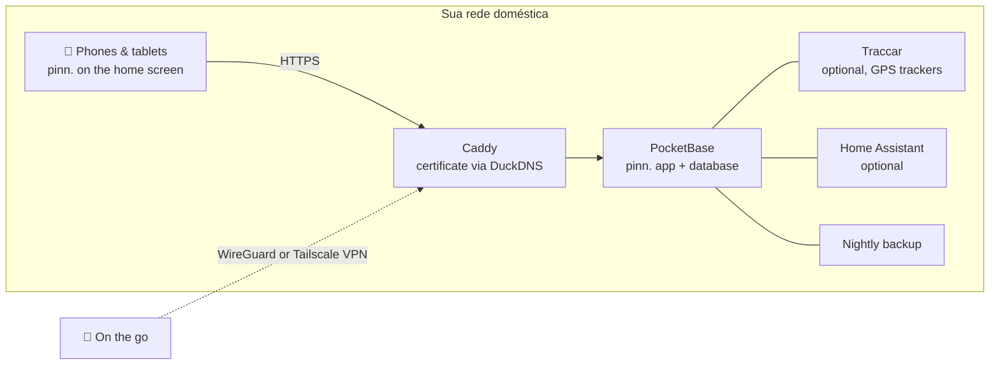

<p align="center">
  
</p>

<p align="center">
  <a href="https://github.com/pinn-shost/pinn/releases/latest"></a>
  <a href="LICENSE"></a>
  
  
  
  <a href="https://ko-fi.com/pinnapp"></a>
</p>

<p align="center">
  <a href="README.md">🇬🇧 English</a> ·
  <a href="README.de.md">🇩🇪 Deutsch</a> ·
  <a href="README.es.md">🇪🇸 Español</a> ·
  <a href="README.fr.md">🇫🇷 Français</a> ·
  <a href="README.it.md">🇮🇹 Italiano</a> ·
  <b>🇧🇷 Português</b> ·
  <a href="README.zh.md">🇨🇳 中文</a> ·
  <a href="README.ja.md">🇯🇵 日本語</a> ·
  <a href="README.ko.md">🇰🇷 한국어</a> ·
  <a href="README.ru.md">🇷🇺 Русский</a> ·
  <a href="README.nl.md">🇳🇱 Nederlands</a> ·
  <a href="README.tr.md">🇹🇷 Türkçe</a> ·
  <a href="README.pl.md">🇵🇱 Polski</a> ·
  <a href="README.uk.md">🇺🇦 Українська</a>
</p>

<p align="center">
  <a href="#screenshots">Capturas de tela</a> ·
  <a href="#what-pinn-does">Recursos</a> ·
  <a href="#installation">Instalação</a> ·
  <a href="#privacy">Privacidade</a> ·
  <a href="#faq">FAQ</a>
</p>

---

O pinn. é um único app para tudo o que mantém uma casa funcionando: o calendário compartilhado, as refeições da semana, a lista de compras, quem leva o lixo para fora, a mesada e o seguro que precisa ser cancelado em março. Ele roda no **seu próprio NAS** com Docker e se instala como um app nativo em todos os iPhones, iPads e celulares Android da família.

Sem conta na nuvem. Sem assinatura. Sem anúncios, sem rastreamento. Os dados da sua família nunca saem da sua casa.

<a id="screenshots"></a>

## Capturas de tela

### No iPad

Pendurado na parede ou apoiado na mesa da cozinha: o iPad compartilhado mostra a família inteira de uma vez.

<table>
  <tr>
    <td align="center" width="50%">
      <a href=".github/assets/screenshots/dashboard.png"></a><br>
      <sub><b>Painel</b> – cada um toca na própria foto, com PIN opcional</sub>
    </td>
    <td align="center" width="50%">
      <a href=".github/assets/screenshots/ipad-overview.png"></a><br>
      <sub><b>Visão geral</b> – clima, compromissos, tarefas, refeições e a família num relance</sub>
    </td>
  </tr>
</table>

### No celular

Sempre com você: o pinn. se instala em todo iPhone e celular Android como um app nativo.

<table>
  <tr>
    <td align="center" width="33%"><a href=".github/assets/screenshots/home.png"></a><br><sub><b>Visão geral</b> – o seu dia num relance</sub></td>
    <td align="center" width="33%"><a href=".github/assets/screenshots/calendar.png"></a><br><sub><b>Calendário</b> – iCloud e Google numa só visualização</sub></td>
    <td align="center" width="33%"><a href=".github/assets/screenshots/meals.png"></a><br><sub><b>Refeições</b> – planeje a semana, faça as compras com um toque</sub></td>
  </tr>
  <tr>
    <td align="center" width="33%"><a href=".github/assets/screenshots/lists.png"></a><br><sub><b>Listas</b> – compras, despensa, mala</sub></td>
    <td align="center" width="33%"><a href=".github/assets/screenshots/finance.png"></a><br><sub><b>Finanças</b> – orçamento, poupança, mesada</sub></td>
    <td align="center" width="33%"><a href=".github/assets/screenshots/chat.png"></a><br><sub><b>Chat</b> – criptografado de ponta a ponta, com mensagens de voz e localização</sub></td>
  </tr>
</table>

### Mais telas

Toque em qualquer imagem para abri-la em tamanho real.

<details>
<summary><b>Mostrar mais capturas</b></summary>

<br>

<table>
  <tr>
    <td align="center" width="25%"><a href=".github/assets/screenshots/house.png"></a><br><sub><b>Casa</b> – casa, custos, financiamento, defeitos e medidores num só lugar</sub></td>
    <td align="center" width="25%"><a href=".github/assets/screenshots/tasks.png"></a><br><sub><b>Tarefas</b> – lembretes automáticos, p. ex. inspeção veicular e troca de pneus, com botão direto</sub></td>
    <td align="center" width="25%"><a href=".github/assets/screenshots/vehicles.png"></a><br><sub><b>Veículos</b> – inspeção, pneus, abastecimento e recarga</sub></td>
    <td align="center" width="25%"><a href=".github/assets/screenshots/scan_pantry.png"></a><br><sub><b>Escanear a despensa</b> – escaneie o código de barras, guarde ou consuma</sub></td>
  </tr>
  <tr>
    <td align="center" width="25%"><a href=".github/assets/screenshots/weekly_summary_1.png"></a><br><sub><b>Prévia da semana</b> – tempo e o que ainda está em aberto</sub></td>
    <td align="center" width="25%"><a href=".github/assets/screenshots/weekly_summary_2.png"></a><br><sub><b>Prévia da semana</b> – dia a dia: limpeza, lixo, pagamentos</sub></td>
    <td align="center" width="25%"><a href=".github/assets/screenshots/weekly_summary_3.png"></a><br><sub><b>A semana passada em resumo</b> – compromissos, refeições, gastos – e atalhos</sub></td>
    <td align="center" width="25%"><a href=".github/assets/screenshots/kids.png"></a><br><sub><b>Crianças</b> – uma rotina diária divertida</sub></td>
  </tr>
</table>

</details>

<sub>📁 <a href=".github/assets/screenshots">Todas as imagens numa pasta</a></sub>

<a id="what-pinn-does"></a>

## O que o pinn. faz

| | |
|---|---|
| 📅 **Calendário** | Calendários do iCloud e do Google por pessoa, privados ou compartilhados com a família. Feriados, recessos escolares, datas de coleta de lixo e aniversários dos seus contatos aparecem automaticamente. |
| 🍝 **Refeições e receitas** | Planeje a semana e envie os ingredientes direto para a lista de compras. Importe receitas de texto, PDF, fotos ou um link – opcionalmente com IA. Compartilhe receitas favoritas com outras famílias do seu servidor. |
| 🛒 **Listas** | Listas de compras por loja, uma despensa que reabastece a lista quando o estoque acaba, listas de bagagem a partir de modelos (férias, mala da maternidade, festa), listas de presentes e de desejos com um planejador “quem dá o quê” que quem recebe nunca vê. |
| ✅ **Tarefas e casa** | Tarefas com lembretes push, planos de limpeza e lixeiras – além de uma página das crianças com rotinas animadas que mostra só o que combina com o horário do dia. |
| 💶 **Finanças** | Caixas compartilhadas ou privadas, um orçamento doméstico, poupança e carteiras com ETFs e ações, mesada, pagamentos recorrentes e contratos com lembretes de cancelamento. Repúblicas podem dividir custos e ver quem deve a quem. |
| 📄 **Documentos e veículos** | Recibos e garantias, documentos de identidade com lembrete de validade. Carros e bicicletas com datas de inspeção, trocas de pneu, consumo e custo total. |
| 🏡 **Casa** | Para inquilinos, proprietários e locadores: contrato de aluguel ou de compra, financiamento, defeitos com fotos, recibos, plano de reforma, leituras de medidores com previsão, chaves e receita de aluguel de apartamentos, casas e garagens que você aluga. Jardim e plantas com um plano de rega que sabe quando choveu. |
| 📍 **Família e localização** | Compartilhe sua localização direto no pinn. – uma vez ou por um tempo escolhido – e em segundo plano pelo app gratuito Traccar Client (envia direto ao pinn., sem servidor extra). Além disso, um modo “voltando para casa”, um alerta SOS com posição e números de emergência, fichas de emergência e avisos de chegada em lugares. |
| 🎒 **Escola e creche** | Por criança: horário de aulas (digite ou tire uma foto – a IA preenche), entrega e busca, lição de casa na página das crianças, comunicados aos pais com prazos que viram lembretes e dias sem aula direto no calendário. |
| 🐾 **Pets** | Perfis para cães, gatos, coelhos e outros com horários de alimentação para marcar, passeios, um rodízio de “de quem é a vez?”, vacinas e vermifugação com lembretes push, gráfico de peso, veterinário e plantão veterinário, uma ficha para o pet sitter compartilhar, um cartaz de “desaparecido” para imprimir e um lembrete para reabastecer o alimentador automático. |
| 🌦️ **Clima e férias** | Toque no clima (um bloco no celular, no alto ao lado de data e hora no iPad e no computador) para ver 14 dias com detalhes de cada dia. As listas de bagagem com destino e datas mostram o clima das férias – previsão ou valores típicos – e sugerem o que levar. |
| 🏠 **Casa inteligente** | Inicie Atalhos da Apple ou ações do Home Assistant a partir de uma tarefa – o robô aspirador limpa a cozinha quando a tarefa vence, o robô cortador de grama e a rega seguem o plano do jardim, o alimentador automático avisa quando está acabando. |
| 🎙️ **Controle por voz** | “Ei Siri, pinn”: adicione à lista de compras, ouça a lista, crie tarefas e saiba o que há hoje – também no Android. |
| 💬 **Chat** | Chat da família e privado com criptografia de ponta a ponta, push, vistos de leitura e respostas. |
| 🔔 **Notificações** | Mensagens push pessoais no iPhone, iPad e Android, além de um sino que reúne cada mudança na família. |
| 🧩 **E mais** | Mural da família com notas móveis, busca global, modo offline com sincronização automática, modo escuro, painel no iPad com PINs de perfil, conta de convidado, bloqueio infantil. |

O pinn. fala **🇬🇧 English, 🇩🇪 Deutsch, 🇪🇸 Español, 🇫🇷 Français, 🇮🇹 Italiano, 🇧🇷 Português, 🇨🇳 中文, 🇯🇵 日本語, 🇰🇷 한국어, 🇷🇺 Русский, 🇳🇱 Nederlands, 🇹🇷 Türkçe, 🇵🇱 Polski e 🇺🇦 Українська**, adapta moeda e números de emergência à sua região e alterna entre os termos **família** e **casa compartilhada**. Um servidor pode hospedar várias famílias, cada uma com seus próprios administradores.

## Novidades da 1.147.1

**Dispositivos listados uma vez, link dentro dos guias**

- **Dispositivos conectados.** Um dispositivo que entrou duas vezes no mesmo instante (p. ex. o painel da família num Mac) aparecia duas vezes com o mesmo ID. Agora aparece uma vez, conta uma vez e «Sair» o remove por completo.
- **Chega de «Só notificações».** Um endereço de notificação restante de um dispositivo já conectado é removido automaticamente, para que nada chegue em duplicidade.
- **Controle por voz e widgets.** O link pessoal agora fica dentro dos campos «Atalho da Siri» e «Android» (com o botão de copiar) em vez da visão geral.
- Alterado: `js/geraete.js`, `js/sprachsteuerung.js`, `js/sprachen.js`, `pb_hooks/pinn-sitzungen.js`, `src/`, `index.html`, `i18n/`, todos os README. Parte do servidor: instalar os hooks, o PocketBase reinicia.

## Novidades da 1.147.0

**Face ID e digital, aparelhos bem reconhecidos, widget com casa e jardim**

- **Face ID, Touch ID, digital.** Em Conta você pode bloquear o pinn. em cada aparelho: ao abrir e depois de uma pausa o aparelho pede rosto ou dedo. O próprio aparelho verifica, nada é enviado.
- **Aparelhos.** Nome e tipo corretos (sem «Navegador» com ícone de notebook no celular), ID curto, nome próprio com ✏️; aparelhos que só recebem notificações aparecem na lista.
- **Widget.** Círculo vazio para tarefas abertas, visto para as concluídas, novo grupo «Casa e jardim». Copie o script de novo.
- **Estações.** Em Aparência → Estações você escolhe o período e cada parte (neve, nevada, pisca-pisca, Papai Noel …) para Inverno e Natal; «Controle por voz e widgets» com os guias fechados. Parte do servidor: instalar os hooks.

## Novidades da 1.146.1

**Neve em cada letra, inverno no painel**

- **Neve como a verdadeira.** A neve assenta agora em cada letra, só no topo: uma camada nas bordas planas (barra de cima do B ou do L, as duas pontas de cima do K), um montinho no meio das curvas (O), nada nos lados íngremes, no pé do L ou nos espaços. Os emoji ficam livres. O apelido da família no cabeçalho também recebe neve, que se adapta quando muda.
- **Inverno no painel da família.** Neve no apelido, nas horas e na temperatura, um chapéu de neve em cada cartão (cada um um pouco diferente) e em baixo uma pequena paisagem de inverno.
- **O Pai Natal** passa só metade das vezes (a cada 10–18 minutos, a cada 4–6 na véspera de Natal).
- Alterado: `js/winterzeit.js`, `css/winterzeit.css`, `src/`, `index.html`, todos os README. Sem parte do servidor.

## Novidades da 1.146.0

**Neve à medida de cada título, hora das atualizações conforme a região**

- **Neve à medida.** O pinn. mede cada letra de um título com a fonte real e coloca a neve mesmo por cima – mais alta nas letras altas, mais baixa nas pequenas, com montinhos e uma ou outra gota. Os espaços entre palavras ficam livres, os emoji não têm neve, nada é esticado e funciona em todas as línguas e escritas.
- **Atualizações automáticas conforme a região.** A hora escolhida aplica-se agora no fuso horário do dispositivo onde é guardada (horário de verão e inverno incluídos), e já não sempre na hora alemã. As definições mostram que fuso horário se aplica.
- **O painel bloqueado carrega sozinho as novas versões.** Um iPad com o painel da família bloqueado (ou o ecrã de início de sessão) recarrega cerca de um minuto após uma atualização se ninguém estiver a escrever. A app mostra «a aguardar» se a essa hora estiver a decorrer uma cópia de segurança.
- Alterado: `js/winterzeit.js`, `css/winterzeit.css`, `js/versionspruefung.js`, `js/sicherungen.js`, `pb_hooks/pinn-system.js`, `pb_hooks/system.pb.js`, `i18n/`, `src/`, `index.html`, todos os README. Parte do servidor: copiar os hooks, o PocketBase reinicia.

## Novidades da 1.145.0

**Visual de inverno e Natal**

- **Visual de inverno de 1 de dezembro a 6 de janeiro.** Neve no logótipo do pinn., nos títulos e no fundo da barra lateral, e um breve nevão ao abrir a app. Toca no logótipo para mais neve.
- **Extras de Natal até 26 de dezembro.** Luzes por baixo do cabeçalho, gorro do Pai Natal no logótipo, azevinho nos títulos e no sino, uma pequena árvore na barra lateral – e de vez em quando o Pai Natal passa a voar com o trenó e as renas.
- **Ligado por defeito, desligável por perfil** em Definições → Aparência; «Pré-visualizar» mostra-o durante um minuto a qualquer altura. Poupa bateria e é uma camada própria: em repouso nada se move e nada muda de lugar.
- Alterado: `js/winterzeit.js` (novo), `css/winterzeit.css` (novo), `js/design.js`, `js/sprachen.js`, `js/versionslog.js`, `i18n/versionslog.en.js`, `i18n/`, `src/`, `pinn-setup.sh`, `index.html`, todos os README. Sem parte de servidor.

## Novidades da 1.144.2

**Atualizações automáticas: também para hoje**

- **Mesmo dia possível.** Se a hora escolhida ainda não chegou, o pinn. verifica no mesmo dia – mesmo que já tenha verificado hoje. Assim uma nova definição pode ser testada logo. Uma hora já passada ao guardar vale a partir de amanhã; «Próxima verificação» mostra-o corretamente.
- Alterado: `pb_hooks/pinn-system.js`, `.github/scripts/check-hooks.js`, `js/sprachen.js`, `js/versionslog.js`, `i18n/versionslog.en.js`, `src/`, `index.html`, todos os README. Servidor (substituir os hooks, o PocketBase reinicia): `pb_hooks/pinn-system.js`.

## Novidades da 1.144.1

**Correção: atualizações automáticas na hora certa**

- **As atualizações automáticas** não corriam à hora escolhida: o servidor calculava em UTC em vez da hora de Europe/Berlin e falhava uma a duas horas; «Próxima verificação» também mostrava uma hora errada. Agora a hora funciona como em todos os outros lembretes (horário de verão e de inverno incluídos).
- Alterado: `pb_hooks/pinn-system.js`, `.github/scripts/check-hooks.js`, `js/sprachen.js`, `js/versionslog.js`, `i18n/versionslog.en.js`, `src/`, `index.html`, todos os README. Servidor (substituir os hooks, o PocketBase reinicia): `pb_hooks/pinn-system.js`.

## Novidades da 1.144.0

**Painel: conversas não lidas e tarefas em aberto sob cada pessoa**

- **Dois números sob cada pessoa.** Na seleção de perfis do painel da família (iPad), um balão mostra as mensagens de chat não lidas e um visto as tarefas em aberto e vencidas – visíveis sem iniciar sessão. Com 0 desaparece, acima de 9 mostra 9⁺. Os números são atualizados a cada minuto.
- **Ativado por padrão.** A opção da 1.143.0 estava desligada e mostrava só tarefas; agora os dois números estão ativos em todas as famílias. Um admin pode desligá-los em Conta → “Tarefas e conversas no painel”. Conversas silenciadas não contam; as marcadas como não lidas contam uma – como o número ao lado de “Chat” no menu.
- Alterado: `js/profilauswahl.js`, `js/dashboardkonto.js`, `js/zustand.js`, `js/speichern.js`, `js/familiensync.js`, `css/dashboard.css`, `js/sprachen.js`, `js/versionslog.js`, `i18n/versionslog.en.js`, `i18n/` (1 texto novo e 4 alterados nas catorze línguas), `src/` (versão, página da conta), `index.html`, todos os README. Servidor (substituir os hooks, o PocketBase reinicia): `pb_hooks/pinn-chat.js`, `pb_hooks/pinn-dashboard.js`, `pb_hooks/dashboard.pb.js`, `pb_hooks/pinn-bereiche.js`.

## Novidades da 1.143.0

**Painel: tarefas em aberto sob a foto de perfil e chat no iPad**

- **Tarefas em aberto sob a foto.** Na seleção de perfil do painel familiar, o pinn. pode mostrar sob a foto de cada pessoa o número das suas tarefas em aberto e vencidas – como o número no ícone do app no iPhone. Um admin ativa isso em Conta → “Tarefas em aberto no painel”; vale para todos os painéis da família.
- **Chat no painel.** Quem abriu o seu perfil no painel com o PIN agora também pode usar o chat. Convidados e crianças com “só página infantil” não. Na primeira vez no aparelho, o chat pede o código de recuperação como de costume.
- Alterado: `pb_hooks/pinn-push.js`, `pb_hooks/pinn-dashboard.js`, `pb_hooks/dashboard.pb.js`, `pb_hooks/pinn-bereiche.js`, `js/profilauswahl.js`, `js/dashboard.js`, `js/dashboardkonto.js`, `js/konto.js`, `js/zustand.js`, `js/speichern.js`, `js/familiensync.js`, `css/dashboard.css`, `js/sprachen.js`, `js/versionslog.js`, `i18n/versionslog.en.js`, `i18n/` (5 textos novos nas catorze línguas), `src/` (versão, página da conta), `index.html`, todos os README. Servidor (substituir os hooks, o PocketBase reinicia): `pb_hooks/pinn-push.js`, `pb_hooks/pinn-dashboard.js`, `pb_hooks/dashboard.pb.js`, `pb_hooks/pinn-bereiche.js`.

## Novidades da 1.142.2

**Resumo do ano: receitas, compromissos, tarefas, aniversários e fotos de viagens**

- **Mais no resumo do ano.** Por baixo das despesas vês agora também as receitas e o saldo. Novos cartões mostram os compromissos (com o mês mais cheio), as tarefas concluídas (com a parte da casa) e os aniversários celebrados (incluindo os especiais, como 18, 30, 40 …). Cada viagem mostra as fotos do quadro publicadas durante a viagem.
- **O servidor conta as tarefas concluídas,** porque são apagadas ao fim de um ou dois dias. Neste ano a contagem começa no dia da atualização.
- Alterado: `js/ausblick.js`, `css/hinweise.css`, `js/sprachen.js`, `js/versionslog.js`, `i18n/versionslog.en.js`, `i18n/` (14 textos novos e um alterado nas catorze línguas), `src/` (versão), `index.html`, todos os README. Servidor (substituir os hooks, o PocketBase reinicia): `pb_hooks/pinn-ausblick.js`, `pb_hooks/pinn-aufgaben.js`, `pb_hooks/ausblick.pb.js`.

## Novidades da 1.142.1

**Aviso ao apagar a lista de bagagem de uma viagem**

- **Aviso ao apagar.** Se apagar uma lista de bagagem com destino e datas, o pinn. avisa agora que a viagem também desaparece do calendário e do resumo do ano.
- Alterado: `js/listen.js`, `js/sprachen.js`, `js/versionslog.js`, `i18n/versionslog.en.js`, `i18n/` (um texto novo nas catorze línguas), `src/` (versão), `index.html`, todos os README. Sem parte de servidor.

## Novidades da 1.142.0

**Resumo do ano: despesas, refeições cozinhadas e viagens**

- **Resumo do ano.** A 28 de dezembro, a partir das 18:00 (e a qualquer momento em Definições → Previsão), o pinn. mostra o vosso ano num relance: despesas com barras mensais, categorias e a maior despesa individual, refeições cozinhadas com as favoritas e todas as viagens com os dias fora. Com as setas no topo volta a anos anteriores.
- **Aviso e push como nas outras previsões.** Um aviso no topo até 10 de janeiro e uma notificação push que pode desativar nas definições. As despesas só são visíveis com acesso às finanças; os convidados não recebem a notificação push.
- Alterado: `js/ausblick.js`, `js/hinweise.js`, `css/hinweise.css`, `js/sprachen.js`, `js/versionslog.js`, `i18n/versionslog.en.js`, `i18n/` (32 textos novos e alterados nas catorze línguas), `src/` (versão, definições), `index.html`, todos os README. Servidor (substituir os hooks, o PocketBase reinicia): `pb_hooks/pinn-ausblick.js`, `pb_hooks/ausblick.pb.js`.

## Como funciona



Tudo roda como contêineres Docker em uma única máquina. O HTTPS funciona **sem redirecionamento de portas** – o certificado é emitido por uma verificação de DNS. De fora, o pinn. só é acessível pela sua própria VPN.

## Requisitos

- Um NAS ou servidor com **Docker** e **Docker Compose 2.17+** – desenvolvido em um NAS UGREEN com UGOS, roda em qualquer host Linux com Docker (amd64, arm64, armv7)
- Acesso SSH a ele
- Opcional, mas recomendado: um subdomínio gratuito do [DuckDNS](https://www.duckdns.org) para HTTPS – necessário para notificações push e para instalar o pinn. como app

<a id="installation"></a>

## Instalação

1. Baixe o ZIP da [última versão](https://github.com/pinn-shost/pinn/releases/latest) e descompacte.
2. Crie uma pasta no NAS, por exemplo `/volume1/docker/Pocketbase`, e coloque nela a pasta descompactada (por exemplo `pinn-1.147.1` ou `pinn-main`) do jeito que está.
3. Entre via SSH e execute:
   ```sh
   cd /volume1/docker/Pocketbase && sudo sh pinn-*/pinn-setup.sh
   ```
   O script copia cada arquivo para o lugar certo, baixa as bibliotecas para importação de PDF e reconhecimento de texto em fotos e inicia o pinn.
4. Abra `http://<IP-do-NAS>:8090` → **Entrar como administrador principal** → senha `Admin` → escolha a sua própria senha.
5. O **assistente de configuração** guia você pelo resto – HTTPS, acesso remoto por WireGuard ou Tailscale, Google, IA, localização e Home Assistant – passo a passo, em catorze idiomas.
6. Abra o pinn. pelo endereço HTTPS em cada celular e adicione-o à tela inicial:
   - **iPhone/iPad (Safari):** Compartilhar → *Adicionar à Tela de Início* (iOS 16.4 ou posterior para notificações)
   - **Android (Chrome):** Configurações → Notificações → *Instalar o pinn. como app*, ou menu do Chrome ⋮ → *Instalar app*

   Depois ative as notificações em cada dispositivo em **Configurações → Notificações → Ativar neste dispositivo**.

**Atualização:** baixe o novo ZIP, coloque a pasta descompactada na mesma pasta e execute `sudo sh pinn-*/pinn-setup.sh` novamente. Os arquivos substituídos ficam em `_alt/`, seus dados não são alterados.

Os **backups** rodam toda noite em `./backups` e são mantidos por 14 dias.

<a id="privacy"></a>

## Privacidade

O pinn. foi criado para dados que você nunca entregaria a um serviço de nuvem: extratos bancários, documentos de saúde, onde seus filhos estão. Por isso:

- **Todos os dados ficam no seu NAS** em um único banco de dados PocketBase. Não existe servidor do pinn. nem telemetria.
- **Nenhum script de servidores de terceiros.** Todo o código e todas as bibliotecas são servidos pelo seu NAS.
- **As notificações push não carregam conteúdo.** Apple, Google e Mozilla só entregam um sinal de despertar vazio; o dispositivo então busca a mensagem no seu NAS.
- **As senhas do iCloud e do Google** ficam armazenadas criptografadas em uma coleção bloqueada.
- **Não é acessível pela internet.** O acesso remoto passa pela sua própria VPN.

O pinn. só contata serviços externos para recursos que precisam deles:

| Serviço | Usado para | Quando |
|---|---|---|
| [Open-Meteo](https://open-meteo.com) | Previsão do tempo | quando um endereço de casa está definido |
| [OpenStreetMap Nominatim](https://nominatim.openstreetmap.org) | Transformar endereços em posições no mapa | ao digitar endereços |
| [Blocos do OpenStreetMap](https://www.openstreetmap.org) | Fundo do mapa | na página de localização, carregados pelo seu NAS |
| [Google Fonts](https://fonts.google.com) | Fontes | quando o app carrega |
| [OpenHolidays API](https://www.openholidaysapi.org) | Feriados e recessos escolares | quando um endereço de casa está definido |
| [DuckDNS](https://www.duckdns.org) | Certificado HTTPS e endereço | se configurado |
| iCloud / Google | Calendários e contatos | apenas para contas que você conectar |
| Google Gemini | Leitura de receitas e documentos | apenas se você adicionar uma chave de API |
| jsDelivr | Download único de pdf.js e Tesseract | apenas durante a instalação |

<a id="faq"></a>

## FAQ

<details>
<summary><b>Preciso abrir portas no roteador?</b></summary>
<br>
Não. O certificado HTTPS é emitido por uma verificação de DNS e o acesso remoto passa por uma VPN – WireGuard em uma FRITZ!Box ou Tailscale para qualquer outro roteador.
</details>

<details>
<summary><b>Funciona sem NAS?</b></summary>
<br>
Qualquer máquina sempre ligada com Docker serve: um mini PC, um Raspberry Pi 4/5 ou um servidor Linux.
</details>

<details>
<summary><b>O pinn. é um app “de verdade” da App Store?</b></summary>
<br>
O pinn. é um app web que você adiciona à tela inicial. Depois ele abre em tela cheia como um app nativo, funciona offline, mostra um selo com as tarefas em aberto e recebe notificações push – sem nenhuma loja de apps.
</details>

<details>
<summary><b>Várias famílias podem usar uma instalação?</b></summary>
<br>
Sim. O administrador principal cria as famílias; cada família tem seus próprios administradores, calendários e dados. As receitas podem ser compartilhadas opcionalmente entre famílias.
</details>

<details>
<summary><b>E as crianças?</b></summary>
<br>
Perfis com bloqueio infantil só veem as próprias tarefas e não podem excluir nem alterar nada. Finanças, documentos e veículos ficam ocultos. Crianças menores têm uma página própria e divertida com rotinas diárias.
</details>

<details>
<summary><b>Quanto custa?</b></summary>
<br>
Nada – o pinn. é gratuito e de código aberto sob a licença MIT. Serviços opcionais como a IA Gemini têm planos gratuitos.
</details>

## Estrutura do repositório

O repositório tem a mesma estrutura de uma instalação no NAS – cada arquivo fica onde vai parar:

```
pinn/
├── pb_hooks/            server: *.pb.js hooks and their helper modules (pinn-*.js, calendar-sync.js)
├── pb_public/           web app served by PocketBase
│   ├── index.html       the app page, built from src/ (HTML, start check) – do not edit by hand
│   ├── js/              app code split out of index.html, plain <script> files without a build step
│   │                    (ruhemodus.js, textkern.js, sprachen.js, region.js, grundlagen.js, popups.js, verbindung.js, benutzer.js, mitteilungen.js, serverzugriff.js, tastatur.js, anmeldemaske.js, dashboard.js, dashboardhintergrund.js, profilauswahl.js, pineingabe.js, dashboardsitzung.js, dashboardkonto.js, familienverwalten.js, einrichten.js, exportieren.js, hauptadminseite.js, anmeldung.js, konto.js, profilverwaltung.js, zustand.js, bedienzustand.js, rezeptbilder.js, zusammenfuehren.js, speichern.js, design.js, sprache.js, uebersicht.js, familienkachel.js, wobistdu.js, geburtstagsfeier.js, wetterkachel.js, geburtstage.js, uebersichteinstellungen.js, familiensync.js, bereiche.js, kalenderquellen.js, icsparser.js, zeitleiste.js, termindetails.js, kalenderdatei.js, wetter.js, wohnort.js, feiertage.js, muellkalender.js, mitglieder.js, profilbild.js, mitglied.js, kinderseite.js, kinderroutine.js, sterne.js, kalenderansicht.js, essenplanen.js, rezeptparser.js, rezeptdialog.js, rezeptbild.js, rezeptmengen.js, einkauf.js, einkaufslisten.js, einkaufseingabe.js, rezepte.js, offline.js, aufgabenextras.js, appbadge.js, reisen.js, aufgabendaten.js, haushalt.js, reihum.js, aufgaben.js, smarthome.js, sprachsteuerung.js, termine.js, ansichten.js, versionspruefung.js, sicherungen.js, geraete.js, fehlerprotokoll.js, versionslog.js, einstellungen.js, kalenderkonto.js, finanzen.js, kassen.js, vorrat.js, vorrat2.js, sparen.js, vertraege.js, fahrzeuge.js, zuhause.js, dokumente.js, pdflesen.js, appstart.js, pinnwand.js, listen.js, familie.js, hinweise.js, ausblick.js – ausblick.js always comes last)
│   ├── css/             app styles split out of index.html, plain CSS without a build step (ergaenzung.css, energiesparen.css, basis.css … haustierewetter.css, terminal.css, glocke.css)
│   ├── einrichtung.js   setup assistant · datenexport.js  data export
│   ├── i18n/            texts by key (de, en, fr, es, it, pt, zh, ja, ko) – English is the reference
│   └── vendor/          pinn.css, pocketbase/ (pdf.js and Tesseract are downloaded by the setup)
├── .github/             GitHub Actions (workflows/check.yml), checks (scripts/), CONTRIBUTING.md, SECURITY.md, images – not installed
├── src/                 sources of index.html (build.js, rahmen.html, teile/) – not installed
├── caddy/Caddyfile      HTTPS reverse proxy
├── docker-compose.yaml  all containers
├── env.txt              template for .env
├── pinn-setup.sh        install & update
├── pinn-wartung.sh      backups & updates (container "wartung")
├── pinn-pocketbase-update.sh
├── index.html           placeholder only, never installed (keeps the update button of 1.38 working)
└── README.md            this page · README.<code>.md in de, es, fr, it, pt, zh, ja, ko
```

O `pinn-setup.sh` copia `pb_hooks/`, `pb_public/` e `caddy/Caddyfile` 1:1 para a pasta do projeto; as pastas de dados (`pb_data/`, `konfig/`, `backups/`, `caddy/data/` …) nunca são tocadas.

## Contribuir

Relatos de erros, ideias e traduções são muito bem-vindos – veja [CONTRIBUTING.md](.github/CONTRIBUTING.md). Relate problemas de segurança em particular, como descrito em [SECURITY.md](.github/SECURITY.md). Antes de um pull request, execute `node .github/scripts/check-all.js` – as mesmas verificações rodam automaticamente no GitHub.

## Apoie o pinn.

O pinn. é gratuito e continua gratuito – totalmente, para todos. Ele é feito no meu tempo livre. Se ele facilita um pouco o seu dia a dia, uma pequena contribuição é muito bem-vinda, mas totalmente voluntária:

<p>
  <a href="https://ko-fi.com/pinnapp"></a>
  <a href="https://buymeacoffee.com/pinn"></a>
</p>

Uma ⭐ também ajuda – assim outras famílias encontram o pinn. com mais facilidade.

## Feito com

[PocketBase](https://pocketbase.io) (MIT) · [Tailwind CSS](https://tailwindcss.com) (MIT) · [pdf.js](https://mozilla.github.io/pdf.js/) (Apache-2.0) · [Tesseract.js](https://tesseract.projectnaptha.com) (Apache-2.0) · [Traccar](https://www.traccar.org) (Apache-2.0) · [Caddy](https://caddyserver.com) (Apache-2.0)

## Licença

[MIT](LICENSE) – use, modifique, compartilhe.
