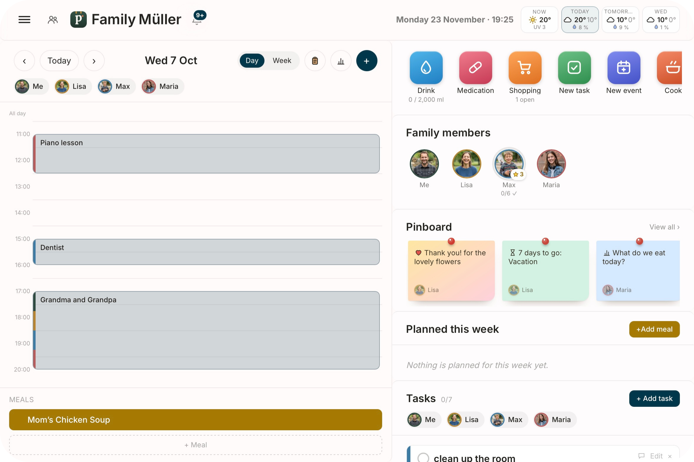

<p align="center">
  
</p>

<p align="center">
  <a href="https://github.com/pinn-shost/pinn/releases/latest"></a>
  <a href="LICENSE"></a>
  
  
  
  <a href="https://ko-fi.com/pinnapp"></a>
</p>

<p align="center">
  <a href="README.md">🇬🇧 English</a> ·
  <a href="README.de.md">🇩🇪 Deutsch</a> ·
  <a href="README.es.md">🇪🇸 Español</a> ·
  <a href="README.fr.md">🇫🇷 Français</a> ·
  <a href="README.it.md">🇮🇹 Italiano</a> ·
  <a href="README.pt.md">🇧🇷 Português</a> ·
  <a href="README.zh.md">🇨🇳 中文</a> ·
  <a href="README.ja.md">🇯🇵 日本語</a> ·
  <a href="README.ko.md">🇰🇷 한국어</a> ·
  <b>🇷🇺 Русский</b> ·
  <a href="README.nl.md">🇳🇱 Nederlands</a> ·
  <a href="README.tr.md">🇹🇷 Türkçe</a> ·
  <a href="README.pl.md">🇵🇱 Polski</a> ·
  <a href="README.uk.md">🇺🇦 Українська</a> ·
  <a href="README.cs.md">🇨🇿 Čeština</a> ·
  <a href="README.sv.md">🇸🇪 Svenska</a> ·
  <a href="README.da.md">🇩🇰 Dansk</a> ·
  <a href="README.nb.md">🇳🇴 Norsk</a> ·
  <a href="README.fi.md">🇫🇮 Suomi</a> ·
  <a href="README.hu.md">🇭🇺 Magyar</a>
</p>

---

pinn. – это одно приложение для всего, что нужно дому: общий календарь, меню на неделю, список покупок, чья очередь выносить мусор, карманные деньги и страховка, которую нужно расторгнуть в марте. Оно работает на **вашем NAS** в Docker и устанавливается как обычное приложение на каждый iPhone, iPad и телефон с Android.

Никаких облачных аккаунтов. Никаких подписок. Ни рекламы, ни слежки. Данные вашей семьи не покидают ваш дом.

> Это краткое описание. Полное описание с FAQ и структурой репозитория – в [English README](README.md) и [Deutsch](README.de.md).

<a id="screenshots"></a>

## Скриншоты

### На iPad

На стене или на кухонном столе: общий iPad показывает всю семью сразу.

<table>
  <tr>
    <td align="center" width="50%"><a href=".github/assets/screenshots/dashboard.png"></a><br><sub><b>Панель</b> – каждый нажимает на свою картинку, при желании с PIN</sub></td>
    <td align="center" width="50%"><a href=".github/assets/screenshots/ipad-overview.png"></a><br><sub><b>Обзор</b> – погода, встречи, задачи, еда и семья одним взглядом</sub></td>
  </tr>
</table>

### На телефоне

Всегда под рукой: pinn. устанавливается на любой iPhone и телефон с Android как обычное приложение.

<table>
  <tr>
    <td align="center" width="33%"><a href=".github/assets/screenshots/home.png"></a><br><sub><b>Обзор</b> – ваш день одним взглядом</sub></td>
    <td align="center" width="33%"><a href=".github/assets/screenshots/calendar.png"></a><br><sub><b>Календарь</b> – iCloud и Google в одном виде</sub></td>
    <td align="center" width="33%"><a href=".github/assets/screenshots/meals.png"></a><br><sub><b>Еда</b> – планируйте неделю, покупайте в одно касание</sub></td>
  </tr>
  <tr>
    <td align="center" width="33%"><a href=".github/assets/screenshots/lists.png"></a><br><sub><b>Списки</b> – покупки, кладовая, сборы</sub></td>
    <td align="center" width="33%"><a href=".github/assets/screenshots/finance.png"></a><br><sub><b>Финансы</b> – бюджет, сбережения, карманные деньги</sub></td>
    <td align="center" width="33%"><a href=".github/assets/screenshots/chat.png"></a><br><sub><b>Чат</b> – сквозное шифрование, голосовые сообщения и местоположение</sub></td>
  </tr>
</table>

### Другие экраны

Нажмите на картинку, чтобы открыть её в полном размере.

<details>
<summary><b>Показать другие скриншоты</b></summary>

<br>

<table>
  <tr>
    <td align="center" width="25%"><a href=".github/assets/screenshots/house.png"></a><br><sub><b>Дом</b> – жильё, расходы, кредит, дефекты и счётчики в одном месте</sub></td>
    <td align="center" width="25%"><a href=".github/assets/screenshots/tasks.png"></a><br><sub><b>Задачи</b> – автоматические напоминания, например о техосмотре и смене шин, с кнопкой быстрого перехода</sub></td>
    <td align="center" width="25%"><a href=".github/assets/screenshots/vehicles.png"></a><br><sub><b>Транспорт</b> – техосмотр, шины, заправка и зарядка</sub></td>
    <td align="center" width="25%"><a href=".github/assets/screenshots/scan_pantry.png"></a><br><sub><b>Скан кладовой</b> – отсканируйте штрихкод, уберите на склад или спишите</sub></td>
  </tr>
  <tr>
    <td align="center" width="25%"><a href=".github/assets/screenshots/weekly_summary_1.png"></a><br><sub><b>Обзор недели</b> – погода и то, что ещё не сделано</sub></td>
    <td align="center" width="25%"><a href=".github/assets/screenshots/weekly_summary_2.png"></a><br><sub><b>Обзор недели</b> – день за днём: уборка, мусор, платежи</sub></td>
    <td align="center" width="25%"><a href=".github/assets/screenshots/weekly_summary_3.png"></a><br><sub><b>Прошлая неделя вкратце</b> – события, еда, расходы – и быстрые переходы</sub></td>
    <td align="center" width="25%"><a href=".github/assets/screenshots/kids.png"></a><br><sub><b>Дети</b> – игровой распорядок дня</sub></td>
  </tr>
</table>

</details>

<sub>📁 <a href=".github/assets/screenshots">Все картинки в одной папке</a></sub>

## Что умеет pinn.

- 📅 **Календарь** – общий календарь семьи, подключение iCloud и Google, праздники и школьные каникулы. Голосование за дату: предложите несколько дат, каждый профиль отвечает «Да / Нет / Может быть», а выбранная дата становится событием календаря.
- ✅ **Задачи и дом** – задачи, очередь по кругу, мусор, уборка, «Кто сколько делает?». Список одолженного записывает, кто что у кого взял (соседи по квартире или третьи лица), и напоминает пушем, пока вещь не вернут.
- 🍽️ **Еда** – меню на неделю, рецепты с импортом, кладовая со сканером, список покупок
- 💶 **Финансы** – расходы, бюджет, кассы с взаиморасчётами, договоры со сроками, карманные деньги. Банковские выписки можно импортировать в CSV: доходы и расходы распознаются и сортируются по категориям сами; похожие уже внесённые операции (та же сумма в пределах 7 дней) показываются, чтобы вы импортировали или пропустили их, а период файла можно выбрать.
- 👨‍👩‍👧 **Семья** – аварийные карточки, геопозиция, SOS, «Я иду домой», питомцы, школа и детский сад
- 🏠 **Дом и транспорт** – счётчики, расходы, ремонт, автомобили с заправками и техосмотром, умный дом
- 🎙️ **Голосовое управление** – «Привет, Siri, pinn»: добавить в список покупок, прочитать список, создать задачу, узнать планы на сегодня – теперь и по-русски
- 💬 **Чат** – семейный и личные чаты со сквозным шифрованием, push и галочками прочтения
- 🔔 **Уведомления** – личные push-сообщения на iPhone, iPad и Android и колокольчик со всеми изменениями в семье
- 🔒 Отдельные разделы можно закрыть с помощью Face ID, отпечатка пальца или PIN-кода.

pinn. говорит на **🇬🇧 English, 🇩🇪 Deutsch, 🇪🇸 Español, 🇫🇷 Français, 🇮🇹 Italiano, 🇧🇷 Português, 🇨🇳 中文, 🇯🇵 日本語, 🇰🇷 한국어, 🇷🇺 Русский, 🇳🇱 Nederlands, 🇹🇷 Türkçe, 🇵🇱 Polski, 🇺🇦 Українська, 🇨🇿 Čeština, 🇸🇪 Svenska, 🇩🇰 Dansk, 🇳🇴 Norsk, 🇫🇮 Suomi и 🇭🇺 Magyar**, подстраивает валюту и номера экстренных служб под ваш регион и переключается между терминами **«семья»** и **«совместная квартира»**. Один сервер может вести несколько семей, у каждой свои администраторы.

## Требования

- NAS или мини-ПК с **Docker** и **Docker Compose** (например, Synology, UGREEN, QNAP или обычный Linux-сервер)
- Доступ по SSH
- Для доступа снаружи – VPN (WireGuard или Tailscale) или собственный домен с HTTPS

## Установка

1. Скачайте ZIP [последнего релиза](https://github.com/pinn-shost/pinn/releases/latest) и распакуйте его.
2. Создайте на NAS папку, например `/volume1/docker/Pocketbase`, и положите в неё распакованную папку (например, `pinn-1.161.0` или `pinn-main`) как есть.
3. Подключитесь по SSH и выполните:
   ```sh
   cd /volume1/docker/Pocketbase && sudo sh pinn-*/pinn-setup.sh
   ```
4. Откройте `http://<IP-адрес NAS>:8090` → **Войти как главный администратор** → пароль `Admin` → задайте свой пароль.
5. **Мастер настройки** проведёт вас дальше – HTTPS, удалённый доступ, Google, ИИ, геопозиция и Home Assistant – шаг за шагом, на двадцати языках.
6. Откройте pinn. по HTTPS-адресу на каждом телефоне и добавьте на экран «Домой»:
   - **iPhone/iPad (Safari):** «Поделиться» → *На экран «Домой»* (для уведомлений нужна iOS 16.4 или новее)
   - **Android (Chrome):** Настройки → Уведомления → *Установить pinn. как приложение* или меню Chrome ⋮ → *Установить приложение*

**Обновление:** скачайте новый ZIP, положите распакованную папку в ту же папку и снова выполните `sudo sh pinn-*/pinn-setup.sh`. Заменённые файлы остаются в `_alt/`, ваши данные не затрагиваются. **Резервные копии** создаются каждую ночь в `./backups` и хранятся 14 дней.

### Стек Portainer (без скрипта)

Предпочитаете Portainer? Тогда не нужны ни SSH, ни установочный скрипт:

1. В Portainer откройте **Stacks → Add stack**, назовите его `pinn` и выберите **Web editor**.
2. Вставьте содержимое [`docker/docker-compose.portainer.yaml`](docker/docker-compose.portainer.yaml).
3. По желанию: в **Environment variables** измените порт (`PINN_PORT`, по умолчанию 8090) или закрепите версию (`PINN_IMAGE_TAG`, например `1.151.0`). Нажмите **Deploy the stack**.
4. Откройте `http://<IP-NAS>:8090` → **Войти как главный администратор** → мастер настройки, как в шагах 4–6 выше.

Готовый образ берётся с `ghcr.io/pinn-shost/pinn` (amd64 и arm64). Данные хранятся в томах, папки не нужны. Стек не использует фиксированные имена контейнеров, поэтому не конфликтует с уже имеющимися. Если на NAS уже работает Tailscale, удалите блок `tailscale`; при собственном HTTPS-адресе или обратном прокси удалите также `caddy` и `duckdns`.

**Обновление:** Stack → Editor → *Update the stack* с включённым *Re-pull image and redeploy*. **Резервные копии:** блок `wartung` стека делает копию каждую ночь (хранятся 7 дней + 4 недели) и стоит за кнопками «Сохранить сейчас» и «Восстановить» в pinn. → Настройки → Система. Копии лежат в томе `backups` – или в папке NAS, если задать `PINN_BACKUP_DIR` (например, `/volume1/docker/pinn-backups`). Для восстановления ему нужен доступ к Docker, чтобы ненадолго остановить pinn.; если копируете тома сами, удалите блок. Обновления делаются в Portainer, а не кнопкой. Необязательно, закомментировано в конце файла (уберите `#`, чтобы включить): Traccar (GPS-трекеры с SIM-картой) и обход к Home Assistant – телефонам не нужно ни то, ни другое.

### Доступ из интернета через собственный обратный прокси

Семья не хочет пользоваться Tailscale? Тогда поставьте pinn. за обратный прокси: он принимает запросы из интернета, обеспечивает HTTPS для вашего домена и передаёт их pinn.

1. Направьте прокси на `http://<NAS-IP>:8090` (стек Portainer: порт `PINN_PORT`). Обновления в реальном времени идут по обычному HTTP – websockets не нужны, только не включайте буферизацию ответов. Разрешите загрузки до 70 МБ (видео в чате).
   - **Nginx Proxy Manager:** *Hosts → Proxy Hosts → Add*: ваш домен, схема `http`, IP NAS, порт `8090`; вкладка *SSL*: новый сертификат, *Force SSL* включено.
   - **Cloudflare Tunnel:** проброс портов не нужен – *Public hostname* → сервис `http://<NAS-IP>:8090`.
   - **Traefik, Caddy и другие:** маршрутизатор/сайт для вашего домена с переадресацией на `http://<NAS-IP>:8090`.
2. На каждом телефоне откройте `https://<domain>`, войдите, снова добавьте на главный экран и снова включите уведомления (приложение привязано к своему адресу).
3. Календари Google (необязательно): добавьте `https://<domain>/api/pinn/google/callback` как разрешённый URI перенаправления в консоли Google Cloud.

Что pinn. делает сам: адресу посетителя от прокси (`X-Forwarded-For`) он верит, только если запрос пришёл из домашней сети, сети Docker или Tailscale – так блокировку после неверных паролей не обойти. Из интернета администрирование PocketBase (`/_/`) закрыто, а стартовый пароль `Admin` не работает. Прокси стоит в другом месте (арендованный сервер или оранжевое облако Cloudflare перед вашим прокси)? Тогда задайте `PINN_PROXY_NETZE` (в `.env` или переменных окружения стека), например `privat, cloudflare` или `privat, 203.0.113.5`.

**Важно:** pinn. тогда доступен всему интернету. Дайте каждому профилю длинный собственный пароль, обновляйте прокси и никогда не открывайте порт 8090 в роутере напрямую – только через прокси с HTTPS.

## Конфиденциальность

Все данные остаются на вашем NAS в одной базе PocketBase. Сервера pinn. не существует, телеметрии нет. Весь код и все библиотеки отдаёт ваш NAS. Push-уведомления не содержат содержимого: Apple, Google и Mozilla доставляют только пустой сигнал, а само сообщение устройство забирает с вашего NAS.

## Поддержать pinn.

pinn. бесплатен и открыт. Если он вам полезен, можно поддержать проект на [Ko-fi](https://ko-fi.com/pinnapp).

## Лицензия

[MIT](LICENSE)
