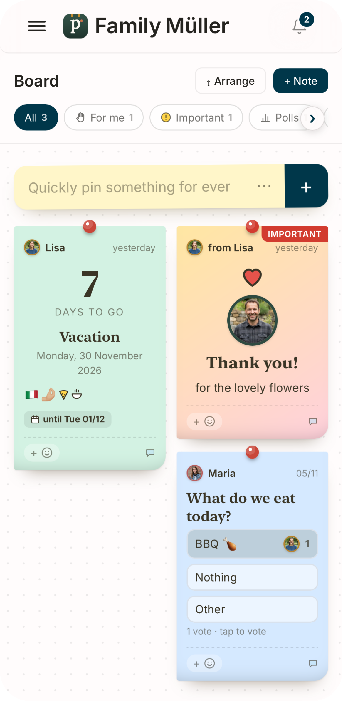
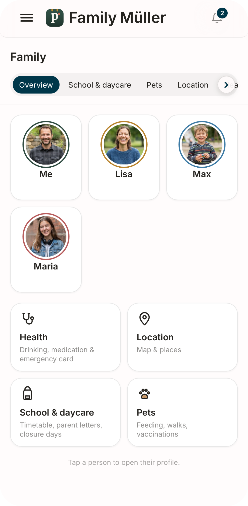
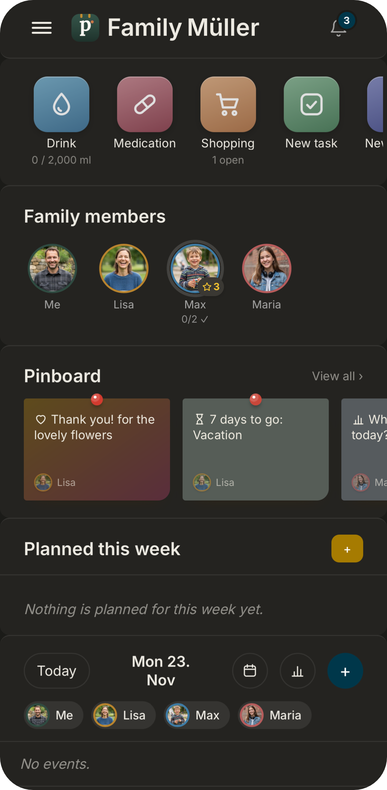
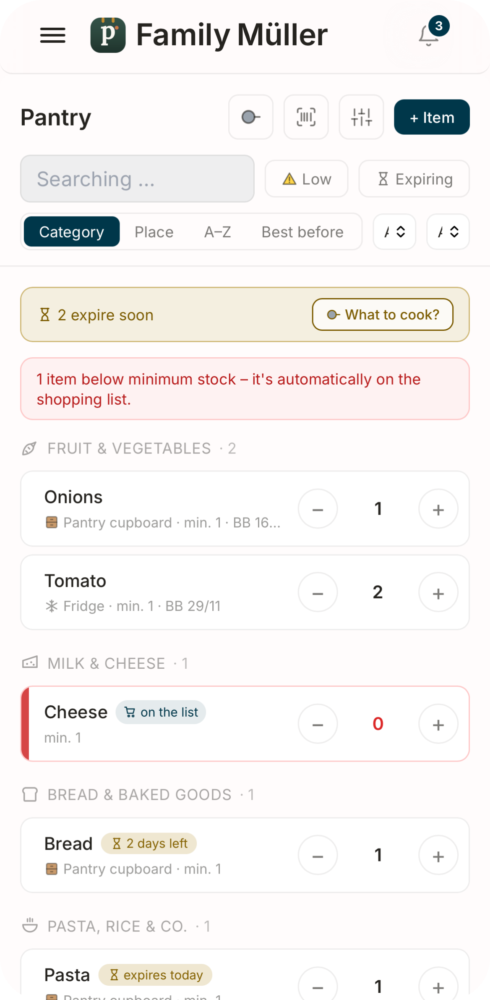
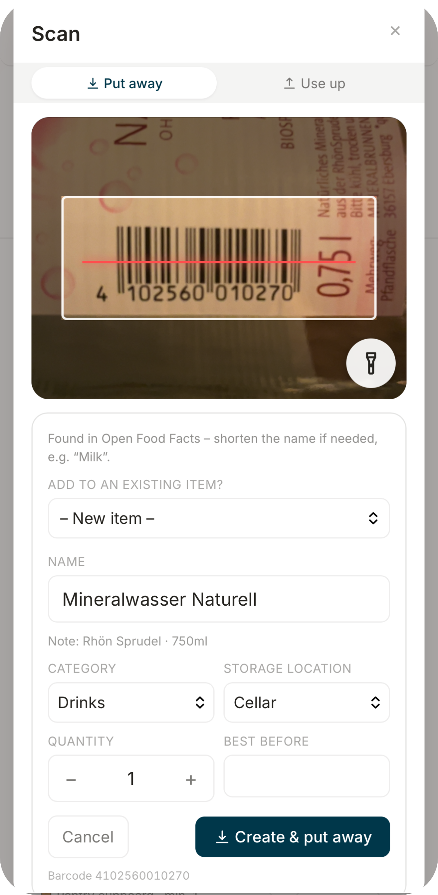
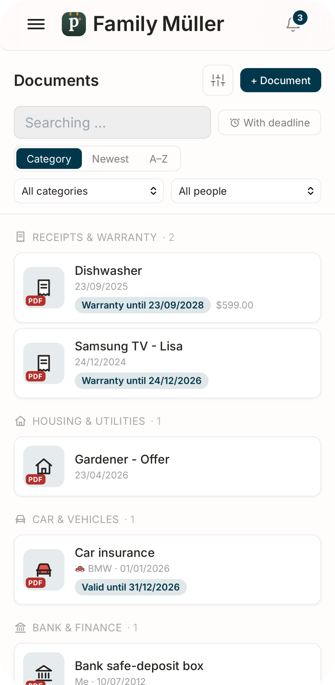

<p align="center">
  
</p>

<p align="center">
  <a href="https://github.com/pinn-shost/pinn/releases/latest"></a>
  <a href="LICENSE"></a>
  
  
  
  <a href="https://ko-fi.com/pinnapp"></a>
</p>

<p align="center">
  <a href="README.md">🇬🇧 English</a> ·
  <a href="README.de.md">🇩🇪 Deutsch</a> ·
  <a href="README.es.md">🇪🇸 Español</a> ·
  <a href="README.fr.md">🇫🇷 Français</a> ·
  <a href="README.it.md">🇮🇹 Italiano</a> ·
  <a href="README.pt.md">🇧🇷 Português</a> ·
  <a href="README.zh.md">🇨🇳 中文</a> ·
  <a href="README.ja.md">🇯🇵 日本語</a> ·
  <a href="README.ko.md">🇰🇷 한국어</a> ·
  <a href="README.ru.md">🇷🇺 Русский</a> ·
  <a href="README.nl.md">🇳🇱 Nederlands</a> ·
  <a href="README.tr.md">🇹🇷 Türkçe</a> ·
  <a href="README.pl.md">🇵🇱 Polski</a> ·
  <b>🇺🇦 Українська</b> ·
  <a href="README.cs.md">🇨🇿 Čeština</a> ·
  <a href="README.sv.md">🇸🇪 Svenska</a> ·
  <a href="README.da.md">🇩🇰 Dansk</a> ·
  <a href="README.nb.md">🇳🇴 Norsk</a> ·
  <a href="README.fi.md">🇫🇮 Suomi</a> ·
  <a href="README.hu.md">🇭🇺 Magyar</a>
</p>

---

pinn. – це один застосунок для всього, що тримає дім у русі: спільний календар, страви на цей тиждень, список покупок, хто виносить сміття, кишенькові гроші та страхування, яке треба розірвати до березня. Він працює в Docker на **твоєму власному NAS** і встановлюється на кожен iPhone, iPad і телефон Android у сім’ї як справжній застосунок.

Без хмарного облікового запису. Без підписки. Без реклами й стеження. Дані сім’ї ніколи не залишають твій дім.

> Це короткий вступ. Повний опис із FAQ і структурою репозиторію ти знайдеш в [English README](README.md) та [Deutsch](README.de.md).

<a id="screenshots"></a>

## Знімки екрана

### На iPad

Спільний iPad на стіні або на кухонному столі показує всю сім’ю одним поглядом.

<table>
  <tr>
    <td align="center" width="50%"><a href=".github/assets/screenshots/dashboard.png"></a><br><sub><b>Панель</b> – обери себе одним дотиком</sub></td>
    <td align="center" width="50%"><a href=".github/assets/screenshots/ipad-overview.png"></a><br><sub><b>Огляд</b> – погода, календар і завдання на одному екрані</sub></td>
  </tr>
</table>

### На телефоні

Завжди з тобою: pinn. встановлюється на кожен iPhone і телефон Android як справжній застосунок.

<table>
  <tr>
    <td align="center" width="33%"><a href=".github/assets/screenshots/home.png"></a><br><sub><b>Головна</b> – сьогодні одним поглядом</sub></td>
    <td align="center" width="33%"><a href=".github/assets/screenshots/calendar.png"></a><br><sub><b>Календар</b> – iCloud і Google в одному вигляді</sub></td>
    <td align="center" width="33%"><a href=".github/assets/screenshots/chat.png"></a><br><sub><b>Чат</b> – наскрізне шифрування, з голосовими повідомленнями та місцезнаходженням</sub></td>
  </tr>
  <tr>
    <td align="center" width="33%"><a href=".github/assets/screenshots/meals.png"></a><br><sub><b>Страви</b> – сплануй тиждень, покупки одним дотиком</sub></td>
    <td align="center" width="33%"><a href=".github/assets/screenshots/lists.png"></a><br><sub><b>Списки</b> – покупки, запаси, списки речей</sub></td>
    <td align="center" width="33%"><a href=".github/assets/screenshots/finance.png"></a><br><sub><b>Фінанси</b> – бюджет, заощадження, кишенькові гроші</sub></td>
  </tr>
</table>

### Більше екранів

Торкнись зображення, щоб відкрити його в повному розмірі.

<details>
<summary><b>Показати більше знімків екрана</b></summary>

<br>

<table>
  <tr>
    <td align="center" width="20%"><a href=".github/assets/screenshots/tasks.png"></a><br><sub><b>Завдання</b> – автоматичні нагадування, наприклад про техогляд і заміну шин, зі швидким переходом</sub></td>
    <td align="center" width="20%"><a href=".github/assets/screenshots/board.png"></a><br><sub><b>Дошка</b> – записки, відліки, подяки та опитування</sub></td>
    <td align="center" width="20%"><a href=".github/assets/screenshots/family.png"></a><br><sub><b>Родина</b> – профілі, здоров’я, школа, тварини та місцезнаходження</sub></td>
    <td align="center" width="20%"><a href=".github/assets/screenshots/kids.png"></a><br><sub><b>Діти</b> – щоденна рутина в ігровій формі</sub></td>
    <td align="center" width="20%"><a href=".github/assets/screenshots/home_darkmode.png"></a><br><sub><b>Темний режим</b> – автоматично або коли захочеш</sub></td>
  </tr>
  <tr>
    <td align="center" width="20%"><a href=".github/assets/screenshots/pantry.png"></a><br><sub><b>Запаси</b> – залишки, мінімальні кількості та терміни придатності</sub></td>
    <td align="center" width="20%"><a href=".github/assets/screenshots/pantry_scan.png"></a><br><sub><b>Сканування запасів</b> – скануй код, поклади в запаси або спиши</sub></td>
    <td align="center" width="20%"><a href=".github/assets/screenshots/house.png"></a><br><sub><b>Дім</b> – квартира, витрати, кредит, дефекти та показання лічильників в одному місці</sub></td>
    <td align="center" width="20%"><a href=".github/assets/screenshots/vehicles.png"></a><br><sub><b>Транспорт</b> – техогляд, шини, пальне й заряджання</sub></td>
    <td align="center" width="20%"><a href=".github/assets/screenshots/documents.png"></a><br><sub><b>Документи</b> – чеки, гарантії та договори з термінами</sub></td>
  </tr>
</table>

</details>

<sub>📁 <a href=".github/assets/screenshots">Усі зображення в одній теці</a></sub>

## Що вміє pinn.

- 📅 **Календар** – спільний сімейний календар, підключення до iCloud і Google, державні свята й шкільні канікули. Голосування за дату: запропонуйте кілька дат, кожен профіль відповідає «Так / Ні / Можливо», а обрана дата стає подією календаря.
- ✅ **Завдання та домашні справи** – завдання, черга виконання, сміття, прибирання, «Хто скільки робить?». Список позиченого записує, хто що в кого взяв (сусіди по квартирі або треті особи), і нагадує пушем, доки річ не повернуть.
- 🍽️ **Страви** – тижневий план страв, імпорт рецептів, запаси зі сканером, список покупок
- 💶 **Фінанси** – витрати, бюджет, каси з розрахунками, договори зі строками розірвання, кишенькові гроші. Банківські виписки можна імпортувати як CSV: доходи й витрати розпізнаються та сортуються за категоріями самі; схожі вже внесені операції (та сама сума в межах 7 днів) показуються, щоб ви імпортували або пропустили їх, а період файлу можна обрати.
- 👨‍👩‍👧 **Сім’я** – екстрені картки, місцезнаходження, SOS, «Я йду додому», домашні улюбленці, школа та догляд
- 🏠 **Дім і транспорт** – показання лічильників, витрати, ремонти, автомобілі з пальним і техоглядами, розумний дім
- 🎙️ **Голосове керування** – «Hey Siri, pinn»: додати до списку покупок, прочитати вголос, створити завдання, послухати плани на сьогодні (поки застосунок українською, Siri відповідає англійською)
- 💬 **Чат** – сімейний і приватний чат із наскрізним шифруванням, push-сповіщеннями та підтвердженням прочитання
- 🔔 **Сповіщення** – особисті push-сповіщення на iPhone, iPad і Android та дзвінок сповіщень з усіма змінами в сім’ї
- 🔒 Окремі розділи можна заблокувати за допомогою Face ID, відбитка пальця або PIN-коду.

pinn. говорить мовами: **🇬🇧 English, 🇩🇪 Deutsch, 🇪🇸 Español, 🇫🇷 Français, 🇮🇹 Italiano, 🇧🇷 Português, 🇨🇳 中文, 🇯🇵 日本語, 🇰🇷 한국어, 🇷🇺 Русский, 🇳🇱 Nederlands, 🇹🇷 Türkçe, 🇵🇱 Polski, 🇺🇦 Українська, 🇨🇿 Čeština, 🇸🇪 Svenska, 🇩🇰 Dansk, 🇳🇴 Norsk, 🇫🇮 Suomi та 🇭🇺 Magyar**; він підлаштовує валюту й екстрені номери під твій регіон і перемикається між поняттями **сім’я** та **спільна квартира**. Один сервер може обслуговувати кілька сімей, кожну зі своїми адміністраторами.

## Вимоги

- NAS або міні-ПК із встановленими **Docker** і **Docker Compose** (наприклад, Synology, UGREEN, QNAP або звичайний сервер Linux)
- доступ через SSH
- для доступу ззовні: VPN (WireGuard або Tailscale) чи власний домен із HTTPS

## Встановлення

1. Завантаж і розпакуй ZIP [останньої версії](https://github.com/pinn-shost/pinn/releases/latest).
2. Створи на NAS теку, наприклад `/volume1/docker/Pocketbase`, і поклади в неї розпаковану теку (наприклад, `pinn-1.161.0` або `pinn-main`) без змін.
3. Підключись через SSH і виконай:
   ```sh
   cd /volume1/docker/Pocketbase && sudo sh pinn-*/pinn-setup.sh
   ```
4. Відкрий `http://<IP-адреса NAS>:8090` → **Увійти як головний адміністратор** → пароль `Admin` → встанови власний пароль.
5. **Майстер конфігурації** проведе тебе крок за кроком через решту – HTTPS, доступ ззовні, Google, штучний інтелект, місцезнаходження та Home Assistant – 20 мовами.
6. Відкрий pinn. на кожному телефоні за адресою HTTPS і додай на головний екран:
   - **iPhone/iPad (Safari):** «Поділитися» → *На початковий екран* (для сповіщень потрібна iOS 16.4 або новіша)
   - **Android (Chrome):** Налаштування → Сповіщення → *установити pinn. як застосунок* або меню Chrome ⋮ → *Установити застосунок*

**Оновлення:** завантаж новий ZIP, поклади розпаковану теку в ту саму теку й знову виконай `sudo sh pinn-*/pinn-setup.sh`. Змінені файли потрапляють у теку `_alt/`, твої дані залишаються недоторканими. **Резервні копії** створюються щоночі в теці `./backups` і зберігаються 14 днів.

### Стек Portainer (без скрипта)

Віддаєш перевагу Portainer? Тоді не потрібні ні SSH, ні інсталяційний скрипт:

1. У Portainer відкрий **Stacks → Add stack**, назви його `pinn` і вибери **Web editor**.
2. Встав вміст [`docker/docker-compose.portainer.yaml`](docker/docker-compose.portainer.yaml).
3. За бажанням: у **Environment variables** зміни порт (`PINN_PORT`, типово 8090) або закріпи версію (`PINN_IMAGE_TAG`, наприклад `1.151.0`). Натисни **Deploy the stack**.
4. Відкрий `http://<IP-NAS>:8090` → **Увійти як головний адміністратор** → майстер налаштування, як у кроках 4–6 вище.

Готовий образ береться з `ghcr.io/pinn-shost/pinn` (amd64 і arm64). Дані зберігаються в томах, теки не потрібні. Стек не використовує фіксованих імен контейнерів, тому не конфліктує з наявними. Якщо на NAS уже працює Tailscale, видали блок `tailscale`; зі своєю HTTPS-адресою чи зворотним проксі видали також `caddy` і `duckdns`.

**Оновлення:** Stack → Editor → *Update the stack* з увімкненим *Re-pull image and redeploy*. **Резервні копії:** блок `wartung` стека робить копію щоночі (зберігаються 7 днів + 4 тижні) і стоїть за кнопками «Зберегти зараз» та «Відновити» в pinn. → Налаштування → Система. Копії лежать у томі `backups` – або в теці NAS, якщо задати `PINN_BACKUP_DIR` (наприклад, `/volume1/docker/pinn-backups`). Для відновлення йому потрібен доступ до Docker, щоб ненадовго зупинити pinn.; якщо копіюєш томи сам, видали блок. Оновлення роблять у Portainer, а не кнопкою. Необов’язково, закоментовано в кінці файлу (прибери `#`, щоб увімкнути): Traccar (GPS-трекери з SIM-карткою) і обхід до Home Assistant – телефонам не потрібне ні те, ні інше.

### Доступ з інтернету через власний зворотний проксі

Родина не хоче користуватися Tailscale? Тоді постав pinn. за зворотний проксі: він приймає запити з інтернету, забезпечує HTTPS для твого домену й передає їх pinn.

1. Спрямуй проксі на `http://<NAS-IP>:8090` (стек Portainer: порт `PINN_PORT`). Оновлення наживо йдуть звичайним HTTP – websockets не потрібні, лише не вмикай буферизацію відповідей. Дозволь завантаження до 70 МБ (відео в чаті).
   - **Nginx Proxy Manager:** *Hosts → Proxy Hosts → Add*: твій домен, схема `http`, IP NAS, порт `8090`; вкладка *SSL*: новий сертифікат, *Force SSL* увімкнено.
   - **Cloudflare Tunnel:** переадресація портів не потрібна – *Public hostname* → сервіс `http://<NAS-IP>:8090`.
   - **Traefik, Caddy та інші:** маршрутизатор/сайт для твого домену з переадресацією на `http://<NAS-IP>:8090`.
2. На кожному телефоні відкрий `https://<domain>`, увійди, знову додай на головний екран і знову ввімкни сповіщення (застосунок прив’язаний до своєї адреси).
3. Календарі Google (необов’язково): додай `https://<domain>/api/pinn/google/callback` як дозволений URI переспрямування в консолі Google Cloud.

Що pinn. робить сам: адресі відвідувача від проксі (`X-Forwarded-For`) він вірить, лише якщо запит прийшов із домашньої мережі, мережі Docker або Tailscale – тож блокування після хибних паролів не обійти. З інтернету адміністрування PocketBase (`/_/`) закрите, а стартовий пароль `Admin` не працює. Проксі стоїть деінде (орендований сервер або помаранчева хмара Cloudflare перед твоїм проксі)? Тоді задай `PINN_PROXY_NETZE` (у `.env` або змінних середовища стека), наприклад `privat, cloudflare` чи `privat, 203.0.113.5`.

**Важливо:** pinn. тоді доступний усьому інтернету. Дай кожному профілю довгий власний пароль, оновлюй проксі й ніколи не відкривай порт 8090 у роутері напряму – лише через проксі з HTTPS.

## Конфіденційність

Усі дані залишаються на твоєму NAS в одній базі PocketBase. Немає сервера pinn. і телеметрії. Увесь код і всі бібліотеки надходять з твого власного NAS. Push-сповіщення не несуть вмісту: Apple, Google і Mozilla передають лише порожній сигнал, а саме повідомлення пристрій отримує з твого NAS.

## Підтримай pinn.

pinn. безкоштовний і відкритий. Якщо він тобі корисний, можеш підтримати проєкт через [Ko-fi](https://ko-fi.com/pinnapp).

## Ліцензія

[MIT](LICENSE)
