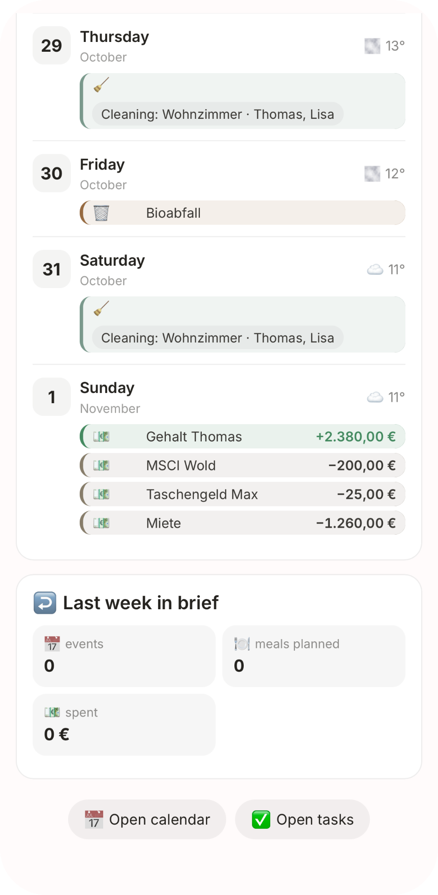

<p align="center">
  
</p>

<p align="center">
  <a href="https://github.com/pinn-shost/pinn/releases/latest"></a>
  <a href="LICENSE"></a>
  
  
  
  <a href="https://ko-fi.com/pinnapp"></a>
</p>

<p align="center">
  <a href="README.md">🇬🇧 English</a> ·
  <a href="README.de.md">🇩🇪 Deutsch</a> ·
  <a href="README.es.md">🇪🇸 Español</a> ·
  <a href="README.fr.md">🇫🇷 Français</a> ·
  <a href="README.it.md">🇮🇹 Italiano</a> ·
  <a href="README.pt.md">🇧🇷 Português</a> ·
  <a href="README.zh.md">🇨🇳 中文</a> ·
  <a href="README.ja.md">🇯🇵 日本語</a> ·
  <a href="README.ko.md">🇰🇷 한국어</a> ·
  <a href="README.ru.md">🇷🇺 Русский</a> ·
  <a href="README.nl.md">🇳🇱 Nederlands</a> ·
  <a href="README.tr.md">🇹🇷 Türkçe</a> ·
  <a href="README.pl.md">🇵🇱 Polski</a> ·
  <b>🇺🇦 Українська</b>
</p>

---

pinn. – це один застосунок для всього, що тримає дім у русі: спільний календар, страви на цей тиждень, список покупок, хто виносить сміття, кишенькові гроші та страхування, яке треба розірвати до березня. Він працює в Docker на **твоєму власному NAS** і встановлюється на кожен iPhone, iPad і телефон Android у сім’ї як справжній застосунок.

Без хмарного облікового запису. Без підписки. Без реклами й стеження. Дані сім’ї ніколи не залишають твій дім.

> Це короткий вступ. Повний опис із FAQ і структурою репозиторію ти знайдеш в [English README](README.md) та [Deutsch](README.de.md).

<a id="screenshots"></a>

## Знімки екрана

### На iPad

Спільний iPad на стіні або на кухонному столі показує всю сім’ю одним поглядом.

<table>
  <tr>
    <td align="center" width="50%"><a href=".github/assets/screenshots/dashboard.png"></a><br><sub><b>Панель</b> – обери себе одним дотиком</sub></td>
    <td align="center" width="50%"><a href=".github/assets/screenshots/ipad-overview.png"></a><br><sub><b>Огляд</b> – погода, календар і завдання на одному екрані</sub></td>
  </tr>
</table>

### На телефоні

Завжди з тобою: pinn. встановлюється на кожен iPhone і телефон Android як справжній застосунок.

<table>
  <tr>
    <td align="center" width="33%"><a href=".github/assets/screenshots/home.png"></a><br><sub><b>Головна</b> – сьогодні одним поглядом</sub></td>
    <td align="center" width="33%"><a href=".github/assets/screenshots/calendar.png"></a><br><sub><b>Календар</b> – iCloud і Google в одному вигляді</sub></td>
    <td align="center" width="33%"><a href=".github/assets/screenshots/meals.png"></a><br><sub><b>Страви</b> – сплануй тиждень, покупки одним дотиком</sub></td>
  </tr>
  <tr>
    <td align="center" width="33%"><a href=".github/assets/screenshots/lists.png"></a><br><sub><b>Списки</b> – покупки, запаси, списки речей</sub></td>
    <td align="center" width="33%"><a href=".github/assets/screenshots/finance.png"></a><br><sub><b>Фінанси</b> – бюджет, заощадження, кишенькові гроші</sub></td>
    <td align="center" width="33%"><a href=".github/assets/screenshots/chat.png"></a><br><sub><b>Чат</b> – наскрізне шифрування, з голосовими повідомленнями та місцезнаходженням</sub></td>
  </tr>
</table>

### Більше екранів

Торкнись зображення, щоб відкрити його в повному розмірі.

<details>
<summary><b>Показати більше знімків екрана</b></summary>

<br>

<table>
  <tr>
    <td align="center" width="25%"><a href=".github/assets/screenshots/house.png"></a><br><sub><b>Дім</b> – квартира, витрати, кредит, дефекти та показання лічильників в одному місці</sub></td>
    <td align="center" width="25%"><a href=".github/assets/screenshots/tasks.png"></a><br><sub><b>Завдання</b> – автоматичні нагадування, наприклад про техогляд і заміну шин, зі швидким переходом</sub></td>
    <td align="center" width="25%"><a href=".github/assets/screenshots/vehicles.png"></a><br><sub><b>Транспорт</b> – техогляд, шини, пальне й заряджання</sub></td>
    <td align="center" width="25%"><a href=".github/assets/screenshots/scan_pantry.png"></a><br><sub><b>Сканування запасів</b> – скануй код, поклади в запаси або спиши</sub></td>
  </tr>
  <tr>
    <td align="center" width="25%"><a href=".github/assets/screenshots/weekly_summary_1.png"></a><br><sub><b>Попередній перегляд тижня</b> – погода й те, що потрібно зробити</sub></td>
    <td align="center" width="25%"><a href=".github/assets/screenshots/weekly_summary_2.png"></a><br><sub><b>Попередній перегляд тижня</b> – день за днем: прибирання, сміття, платежі</sub></td>
    <td align="center" width="25%"><a href=".github/assets/screenshots/weekly_summary_3.png"></a><br><sub><b>Минулий тиждень коротко</b> – події, страви, витрати – і швидкі переходи</sub></td>
    <td align="center" width="25%"><a href=".github/assets/screenshots/kids.png"></a><br><sub><b>Діти</b> – щоденна рутина в ігровій формі</sub></td>
  </tr>
</table>

</details>

<sub>📁 <a href=".github/assets/screenshots">Усі зображення в одній теці</a></sub>

## Що вміє pinn.

- 📅 **Календар** – спільний сімейний календар, підключення до iCloud і Google, державні свята й шкільні канікули
- ✅ **Завдання та домашні справи** – завдання, черга виконання, сміття, прибирання, «Хто скільки робить?»
- 🍽️ **Страви** – тижневий план страв, імпорт рецептів, запаси зі сканером, список покупок
- 💶 **Фінанси** – витрати, бюджет, каси з розрахунками, договори зі строками розірвання, кишенькові гроші
- 👨‍👩‍👧 **Сім’я** – екстрені картки, місцезнаходження, SOS, «Я йду додому», домашні улюбленці, школа та догляд
- 🏠 **Дім і транспорт** – показання лічильників, витрати, ремонти, автомобілі з пальним і техоглядами, розумний дім
- 🎙️ **Голосове керування** – «Hey Siri, pinn»: додати до списку покупок, прочитати вголос, створити завдання, послухати плани на сьогодні (поки застосунок українською, Siri відповідає англійською)
- 💬 **Чат** – сімейний і приватний чат із наскрізним шифруванням, push-сповіщеннями та підтвердженням прочитання
- 🔔 **Сповіщення** – особисті push-сповіщення на iPhone, iPad і Android та дзвінок сповіщень з усіма змінами в сім’ї

pinn. говорить мовами: **🇬🇧 English, 🇩🇪 Deutsch, 🇪🇸 Español, 🇫🇷 Français, 🇮🇹 Italiano, 🇧🇷 Português, 🇨🇳 中文, 🇯🇵 日本語, 🇰🇷 한국어, 🇷🇺 Русский, 🇳🇱 Nederlands, 🇹🇷 Türkçe, 🇵🇱 Polski та 🇺🇦 Українська**; він підлаштовує валюту й екстрені номери під твій регіон і перемикається між поняттями **сім’я** та **спільна квартира**. Один сервер може обслуговувати кілька сімей, кожну зі своїми адміністраторами.

## Що нового в 1.153.2

**Ключі Gemini з «AQ.», тексти статусу, журнал помилок**

- Виправлено: майстер налаштування приймає нові ключі Google Gemini, що починаються з `AQ.` (вони містять крапку). Раніше «Перевірити» казало, що ключ дійсний, а «Далі» його відхиляло.
- Виправлено: статус члена родини («у дорозі», «востаннє») завжди був німецькою – тепер він усіма мовами.
- Змінено: журнал помилок показує повідомлення німецькою для німецької мови та англійською для всіх інших.
- Змінено: `pb_hooks/pinn-einrichtung.js`, `pb_hooks/pinn-protokoll.js`, `pb_hooks/protokoll.pb.js`, `einrichtung.js`, `js/fehlerprotokoll.js`, `js/familie.js`, `js/familienkachel.js`, `js/versionslog.js`, `js/sprachen.js`, `i18n/`, `src/`, `index.html`, README.

## Що нового в 1.153.1

**Здоров'я: п'ять нових блоків, «Я» у власному профілі**

- Нове на сторінці здоров'я: **сонцезахисний крем** (УФ-індекс удома на сьогодні, нагадування лише в сонячні дні), **сон** (нагадування перед сном, вранці «Як спалося?»), **фрукти та овочі** (порції на день), **перевірка на кліщів** (квітень–жовтень) і **профогляди** (стоматолог, загальний огляд … з інтервалом; для дітей німецькі обстеження U за віком). Для дітей нагадування отримують і батьки.
- Нове: у власному профілі pinn. показує «Я» замість імені – фільтр календаря, завдання, родина й усюди, у реченнях у потрібній формі. А ще: лінійна іконка для стрілки відновлення, нова іконка диска, той самий золотий для жовтих підказок у темній темі.
- Змінено: `pb_hooks/pinn-gesundheit.js`, `js/gesundheit.js`, `css/gesundheit.css`, `js/mitglieder.js`, `js/symbole.js`, `css/dunkelfarbe.css`, `js/aufgaben.js`, `js/termine.js`, `js/listen.js`, `js/sparen.js`, `js/vertraege.js`, `js/familie.js`, `js/hinweise.js`, `js/kassen.js`, `js/zuhause.js`, `js/dokumente.js`, `js/fahrzeuge.js`, `js/ausblick.js`, `js/sterne.js`, `js/vorrat2.js`, `i18n/`, `js/sprachen.js`, `js/versionslog.js`, `index.html`.

## Що нового в 1.153.0

**Безпека з Home Assistant**

- Нове: **Безпека** – адміни родини об'єднують пристрої з Home Assistant в іменовані групи в Налаштування → Безпека: вікна та двері, дверні замки, камери, гараж і ролети, датчики диму та протікання, сигналізація, датчики руху. Сімейна панель показує внизу смугу (напр. «Усе зачинено», «Вікно кухня: відчинено», «Увімкнено 1 камеру», червоним при тривозі), а в огляді з'являється плитка «Безпека», де дорослі можуть замкнути відчинений замок (відімкнути – ніколи). Необов'язкова **вечірня перевірка**: у вибраний час усі адміни отримують push, якщо щось ще відчинене, не замкнене або сигналізацію знято з охорони. Умова: Home Assistant підключено в Налаштування → Розумний дім.
- Виправлено: у темній темі кнопки під назвою завдання (запуск розумного дому, зняття показників …) були синіми на синьому – тепер золоті.
- Змінено: `pb_hooks/pinn-sicherheit.js` (new), `pb_hooks/sicherheit.pb.js` (new), `pb_hooks/pinn-smarthome.js`, `pb_hooks/pinn-schema.js`, `js/sicherheit.js` (new), `css/sicherheit.css` (new), `js/uebersicht.js`, `js/profilauswahl.js`, `js/einstellungen.js`, `css/dunkelfarbe.css`, `i18n/`, `js/sprachen.js`, `js/versionslog.js`, `pinn-setup.sh`, `src/`, `index.html`.

## Що нового в 1.152.1

**Відновлення з резервної копії знову працює**

- Виправлено: відновлення резервної копії (Налаштування → Система → Резервні копії та оновлення) завжди зупинялося на кроці «Перевірити копію» — байдуже, чи вибрано лише дані, чи все. Копія поточного стану, яка робиться безпосередньо перед цим, прибирала старі копії й при цьому перезаписувала назву вибраної копії, яку потім не вдавалося знайти. Кожна невдала спроба залишала копію «Перед відновленням» — вони нешкідливі й прибираються самі (залишаються останні 3). Оновлення замінює `pinn-wartung.sh`; контейнер «wartung» перезапускається сам.
- Стек Portainer: резервні копії тепер справді працюють. Сервісу «wartung» у стеку не було чого запускати, бо в репозиторії бракувало частини версії 1.151.0. Тепер скрипт резервного копіювання вбудовано в образ, і він сам знаходить контейнер pinn у стеку — нічна копія, «Створити копію зараз» і «Відновити» (дані та налаштування) працюють так само, як в інсталяції скриптом. Оновлення й далі через Portainer. Після оновлення: у Portainer «Update the stack» з «Re-pull image and redeploy».
- Змінено: `pinn-wartung.sh`, `docker/Dockerfile`, `.github/workflows/image.yml`, `pb_hooks/pinn-system.js`, `js/sicherungen.js`, `js/serverzugriff.js`, `i18n/`, `js/versionslog.js`, `js/sprachen.js`, `src/`, `index.html`.

## Що нового в 1.152.0

**Власний зворотний проксі замість Tailscale**

- Нове: доступ з інтернету через власний зворотний проксі (Nginx Proxy Manager, Traefik, Cloudflare Tunnel …) – див. «Доступ з інтернету через власний зворотний проксі» в розділі «Встановлення». pinn. вірить адресі відвідувача лише від довірених проксі (`PINN_PROXY_NETZE`), тож блокування після хибних паролів не обійти (IPv6: за /64). З інтернету закриті адміністрування PocketBase і його власні способи входу, стартовий пароль `Admin` не працює, а підбір ID трекерів сповільнюється. При таких спробах адміністратори отримують сповіщення «🚨 Попередження безпеки» (адреса, домашня мережа чи інтернет, пристрій); усі подробиці – в журналі помилок у розділі «Безпека». У домашній мережі нічого не змінюється.
- Змінено: `pb_hooks/pinn-netz.js` (new), `pb_hooks/netz.pb.js` (new), `pb_hooks/pinn-alarm.js` (new), `pb_hooks/pinn-sitzungen.js`, `pb_hooks/benutzer.pb.js`, `pb_hooks/dashboard.pb.js`, `pb_hooks/zuhause.pb.js`, `pb_hooks/sprache.pb.js`, `pb_hooks/smarthome.pb.js`, `pb_hooks/pinn-ortung.js`, `pb_hooks/pinn-protokoll.js`, `pb_hooks/pinn-pushtext.js`, `js/anmeldemaske.js`, `js/fehlerprotokoll.js`, `js/hinweise.js`, `js/appstart.js`, `i18n/`, `docker/docker-compose.portainer.yaml`, `env.txt`, `js/sprachen.js`, `js/versionslog.js`, `src/`, `index.html`.

## Що нового в 1.151.0

**Стек Portainer, готовий образ**

- Нове: pinn. можна встановити через інтерфейс стеків Portainer – без SSH і без інсталяційного скрипта. З кожним випуском збирається готовий образ (amd64, arm64) і публікується в `ghcr.io/pinn-shost/pinn`; новий файл `docker/docker-compose.portainer.yaml` використовує його з томами й без фіксованих імен контейнерів (більше немає конфлікту з наявним контейнером Tailscale). Стек також містить службу резервного копіювання (нічна копія, «Зберегти зараз» і «Відновити» в застосунку; оновлення лишаються в Portainer) та необов’язкові закоментовані блоки для Traccar і обходу до Home Assistant. Див. «Стек Portainer (без скрипта)» у розділі «Встановлення».
- Змінено: `docker/` (new), `.github/workflows/image.yml` (new), `pinn-wartung.sh`, `pb_hooks/pinn-system.js`, `js/sicherungen.js`, `i18n/`, `js/sprachen.js`, `js/versionslog.js`, `src/`, `index.html`.

## Що нового в 1.150.11

**Значки та дрібні виправлення**

- Значок гребінця біля «Розчесати волосся» на дитячій сторінці; поруч із назвою депо більше немає поля для емодзі; у списках вибору кас немає емодзі; інструмент тепер ріжковий ключ; «Меню для гостей» зі значком двох людей; дотик до логотипа поруч із назвою родини веде до огляду; картка «Сповіщення» заповнюється першою, тож «Увімкнути на цьому пристрої» завжди видно; значки ярликів сірі в темній темі.
- Змінено: `js/symbole.js`, `js/symbole3.js`, `js/ansichten.js`, `js/konto.js`, `css/dunkelfarbe.css`, `js/sprachen.js`, `js/versionslog.js`, `i18n/versionslog.en.js`, `src/`, `index.html`.

## Що нового в 1.150.10

**Темна тема, більше значків, новий банер улюбленців, щоденник улюбленців**

- **Темна тема.** Синій текст тепер золотий (пристрої, списки, «Планувати покупки», позначки в улюбленців, здоров’ї та завданнях); смуги в розділі «Дім» мають колір кімнати; повідомлення в чаті, договорах і «Головне» читабельні. **Більше значків замість емодзі:** фото профілю (немовля, хлопчик, дівчинка, чоловік, жінка, дідусь, бабуся), сім’я та спільне житло, тварини (собака, кіт, кролик, хом’як, птах, курча, риба, кінь, черепаха, змія); у випадних списках лишається тільки текст. **Новий банер улюбленців** з кольоровими тваринами. **Щоденник улюбленців:** позначений огляд з’являється в щоденнику, а × скасовує випадкову позначку.
- Змінено: `css/dunkelfarbe.css` (new), `js/symbole3.js` (new), `js/symbole.js`, `js/szenen.js`, `js/familie.js`, `js/haushalt.js`, `css/symbolfarbe.css`, `css/haustierewetter.css`, `js/sprachen.js`, `js/versionslog.js`, `i18n/`, `src/`, `pinn-setup.sh`, `index.html`.

## Вимоги

- NAS або міні-ПК із встановленими **Docker** і **Docker Compose** (наприклад, Synology, UGREEN, QNAP або звичайний сервер Linux)
- доступ через SSH
- для доступу ззовні: VPN (WireGuard або Tailscale) чи власний домен із HTTPS

## Встановлення

1. Завантаж і розпакуй ZIP [останньої версії](https://github.com/pinn-shost/pinn/releases/latest).
2. Створи на NAS теку, наприклад `/volume1/docker/Pocketbase`, і поклади в неї розпаковану теку (наприклад, `pinn-1.153.2` або `pinn-main`) без змін.
3. Підключись через SSH і виконай:
   ```sh
   cd /volume1/docker/Pocketbase && sudo sh pinn-*/pinn-setup.sh
   ```
4. Відкрий `http://<IP-адреса NAS>:8090` → **Увійти як головний адміністратор** → пароль `Admin` → встанови власний пароль.
5. **Майстер конфігурації** проведе тебе крок за кроком через решту – HTTPS, доступ ззовні, Google, штучний інтелект, місцезнаходження та Home Assistant – 14 мовами.
6. Відкрий pinn. на кожному телефоні за адресою HTTPS і додай на головний екран:
   - **iPhone/iPad (Safari):** «Поділитися» → *На початковий екран* (для сповіщень потрібна iOS 16.4 або новіша)
   - **Android (Chrome):** Налаштування → Сповіщення → *установити pinn. як застосунок* або меню Chrome ⋮ → *Установити застосунок*

**Оновлення:** завантаж новий ZIP, поклади розпаковану теку в ту саму теку й знову виконай `sudo sh pinn-*/pinn-setup.sh`. Змінені файли потрапляють у теку `_alt/`, твої дані залишаються недоторканими. **Резервні копії** створюються щоночі в теці `./backups` і зберігаються 14 днів.

### Стек Portainer (без скрипта)

Віддаєш перевагу Portainer? Тоді не потрібні ні SSH, ні інсталяційний скрипт:

1. У Portainer відкрий **Stacks → Add stack**, назви його `pinn` і вибери **Web editor**.
2. Встав вміст [`docker/docker-compose.portainer.yaml`](docker/docker-compose.portainer.yaml).
3. За бажанням: у **Environment variables** зміни порт (`PINN_PORT`, типово 8090) або закріпи версію (`PINN_IMAGE_TAG`, наприклад `1.151.0`). Натисни **Deploy the stack**.
4. Відкрий `http://<IP-NAS>:8090` → **Увійти як головний адміністратор** → майстер налаштування, як у кроках 4–6 вище.

Готовий образ береться з `ghcr.io/pinn-shost/pinn` (amd64 і arm64). Дані зберігаються в томах, теки не потрібні. Стек не використовує фіксованих імен контейнерів, тому не конфліктує з наявними. Якщо на NAS уже працює Tailscale, видали блок `tailscale`; зі своєю HTTPS-адресою чи зворотним проксі видали також `caddy` і `duckdns`.

**Оновлення:** Stack → Editor → *Update the stack* з увімкненим *Re-pull image and redeploy*. **Резервні копії:** блок `wartung` стека робить копію щоночі (зберігаються 7 днів + 4 тижні) і стоїть за кнопками «Зберегти зараз» та «Відновити» в pinn. → Налаштування → Система. Копії лежать у томі `backups` – або в теці NAS, якщо задати `PINN_BACKUP_DIR` (наприклад, `/volume1/docker/pinn-backups`). Для відновлення йому потрібен доступ до Docker, щоб ненадовго зупинити pinn.; якщо копіюєш томи сам, видали блок. Оновлення роблять у Portainer, а не кнопкою. Необов’язково, закоментовано в кінці файлу (прибери `#`, щоб увімкнути): Traccar (GPS-трекери з SIM-карткою) і обхід до Home Assistant – телефонам не потрібне ні те, ні інше.

### Доступ з інтернету через власний зворотний проксі

Родина не хоче користуватися Tailscale? Тоді постав pinn. за зворотний проксі: він приймає запити з інтернету, забезпечує HTTPS для твого домену й передає їх pinn.

1. Спрямуй проксі на `http://<NAS-IP>:8090` (стек Portainer: порт `PINN_PORT`). Оновлення наживо йдуть звичайним HTTP – websockets не потрібні, лише не вмикай буферизацію відповідей. Дозволь завантаження до 70 МБ (відео в чаті).
   - **Nginx Proxy Manager:** *Hosts → Proxy Hosts → Add*: твій домен, схема `http`, IP NAS, порт `8090`; вкладка *SSL*: новий сертифікат, *Force SSL* увімкнено.
   - **Cloudflare Tunnel:** переадресація портів не потрібна – *Public hostname* → сервіс `http://<NAS-IP>:8090`.
   - **Traefik, Caddy та інші:** маршрутизатор/сайт для твого домену з переадресацією на `http://<NAS-IP>:8090`.
2. На кожному телефоні відкрий `https://<domain>`, увійди, знову додай на головний екран і знову ввімкни сповіщення (застосунок прив’язаний до своєї адреси).
3. Календарі Google (необов’язково): додай `https://<domain>/api/pinn/google/callback` як дозволений URI переспрямування в консолі Google Cloud.

Що pinn. робить сам: адресі відвідувача від проксі (`X-Forwarded-For`) він вірить, лише якщо запит прийшов із домашньої мережі, мережі Docker або Tailscale – тож блокування після хибних паролів не обійти. З інтернету адміністрування PocketBase (`/_/`) закрите, а стартовий пароль `Admin` не працює. Проксі стоїть деінде (орендований сервер або помаранчева хмара Cloudflare перед твоїм проксі)? Тоді задай `PINN_PROXY_NETZE` (у `.env` або змінних середовища стека), наприклад `privat, cloudflare` чи `privat, 203.0.113.5`.

**Важливо:** pinn. тоді доступний усьому інтернету. Дай кожному профілю довгий власний пароль, оновлюй проксі й ніколи не відкривай порт 8090 у роутері напряму – лише через проксі з HTTPS.

## Конфіденційність

Усі дані залишаються на твоєму NAS в одній базі PocketBase. Немає сервера pinn. і телеметрії. Увесь код і всі бібліотеки надходять з твого власного NAS. Push-сповіщення не несуть вмісту: Apple, Google і Mozilla передають лише порожній сигнал, а саме повідомлення пристрій отримує з твого NAS.

## Підтримай pinn.

pinn. безкоштовний і відкритий. Якщо він тобі корисний, можеш підтримати проєкт через [Ko-fi](https://ko-fi.com/pinnapp).

## Ліцензія

[MIT](LICENSE)
