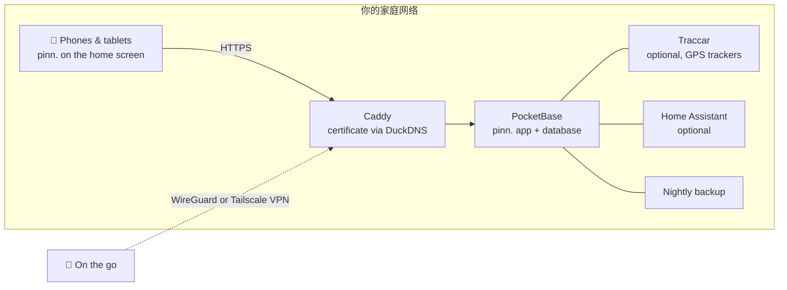

<p align="center">
  
</p>

<p align="center">
  <a href="https://github.com/pinn-shost/pinn/releases/latest"></a>
  <a href="LICENSE"></a>
  
  
  
  <a href="https://ko-fi.com/pinnapp"></a>
</p>

<p align="center">
  <a href="README.md">🇬🇧 English</a> ·
  <a href="README.de.md">🇩🇪 Deutsch</a> ·
  <a href="README.es.md">🇪🇸 Español</a> ·
  <a href="README.fr.md">🇫🇷 Français</a> ·
  <a href="README.it.md">🇮🇹 Italiano</a> ·
  <a href="README.pt.md">🇧🇷 Português</a> ·
  <b>🇨🇳 中文</b> ·
  <a href="README.ja.md">🇯🇵 日本語</a> ·
  <a href="README.ko.md">🇰🇷 한국어</a> ·
  <a href="README.ru.md">🇷🇺 Русский</a> ·
  <a href="README.nl.md">🇳🇱 Nederlands</a> ·
  <a href="README.tr.md">🇹🇷 Türkçe</a> ·
  <a href="README.pl.md">🇵🇱 Polski</a> ·
  <a href="README.uk.md">🇺🇦 Українська</a>
</p>

<p align="center">
  <a href="#screenshots">截图</a> ·
  <a href="#what-pinn-does">功能</a> ·
  <a href="#installation">安装</a> ·
  <a href="#privacy">隐私</a> ·
  <a href="#faq">常见问题</a>
</p>

---

pinn. 是一个管理家庭日常的应用：共享日历、本周餐食、购物清单、谁来倒垃圾、零花钱，以及三月要退掉的保险。它通过 Docker 运行在**你自己的 NAS** 上，可以像原生应用一样安装在家人的每台 iPhone、iPad 和 Android 手机上。

没有云账户。没有订阅。没有广告，没有跟踪。你家的数据永远不会离开你的家。

<a id="screenshots"></a>

## 截图

### 在 iPad 上

挂在墙上或放在厨房餐桌上：共享的 iPad 让全家人的信息一目了然。

<table>
  <tr>
    <td align="center" width="50%">
      <a href=".github/assets/screenshots/dashboard.png"></a><br>
      <sub><b>仪表板</b>：每个人点击自己的头像，可选 PIN 码</sub>
    </td>
    <td align="center" width="50%">
      <a href=".github/assets/screenshots/ipad-overview.png"></a><br>
      <sub><b>概览</b>：天气、日程、任务、餐食和家人一目了然</sub>
    </td>
  </tr>
</table>

### 在手机上

随身携带：pinn. 可以像原生应用一样安装在每台 iPhone 和 Android 手机上。

<table>
  <tr>
    <td align="center" width="33%"><a href=".github/assets/screenshots/home.png"></a><br><sub><b>概览</b>：你的一天一目了然</sub></td>
    <td align="center" width="33%"><a href=".github/assets/screenshots/calendar.png"></a><br><sub><b>日历</b>：iCloud 和 Google 合在一个视图</sub></td>
    <td align="center" width="33%"><a href=".github/assets/screenshots/meals.png"></a><br><sub><b>餐食</b>：规划一周，一键购物</sub></td>
  </tr>
  <tr>
    <td align="center" width="33%"><a href=".github/assets/screenshots/lists.png"></a><br><sub><b>清单</b>：购物、储备、打包</sub></td>
    <td align="center" width="33%"><a href=".github/assets/screenshots/finance.png"></a><br><sub><b>财务</b>：预算、储蓄、零花钱</sub></td>
    <td align="center" width="33%"><a href=".github/assets/screenshots/chat.png"></a><br><sub><b>聊天</b>：端到端加密，支持语音消息和位置</sub></td>
  </tr>
</table>

### 更多界面

点击任意图片可查看大图。

<details>
<summary><b>显示更多截图</b></summary>

<br>

<table>
  <tr>
    <td align="center" width="25%"><a href=".github/assets/screenshots/house.png"></a><br><sub><b>住宅</b> – 房屋、费用、贷款、缺陷和读表集中管理</sub></td>
    <td align="center" width="25%"><a href=".github/assets/screenshots/tasks.png"></a><br><sub><b>任务</b> – 自动提醒，例如车检和换轮胎，带快捷按钮</sub></td>
    <td align="center" width="25%"><a href=".github/assets/screenshots/vehicles.png"></a><br><sub><b>车辆</b> – 车检、轮胎、加油和充电</sub></td>
    <td align="center" width="25%"><a href=".github/assets/screenshots/scan_pantry.png"></a><br><sub><b>扫描储物</b> – 扫描条形码，入库或用完</sub></td>
  </tr>
  <tr>
    <td align="center" width="25%"><a href=".github/assets/screenshots/weekly_summary_1.png"></a><br><sub><b>每周预览</b> – 天气和尚未完成的事项</sub></td>
    <td align="center" width="25%"><a href=".github/assets/screenshots/weekly_summary_2.png"></a><br><sub><b>每周预览</b> – 逐日查看：清洁、垃圾、付款</sub></td>
    <td align="center" width="25%"><a href=".github/assets/screenshots/weekly_summary_3.png"></a><br><sub><b>上周回顾</b> – 日程、餐食、支出——以及快捷入口</sub></td>
    <td align="center" width="25%"><a href=".github/assets/screenshots/kids.png"></a><br><sub><b>儿童</b>：有趣的每日作息</sub></td>
  </tr>
</table>

</details>

<sub>📁 <a href=".github/assets/screenshots">所有图片都在这个文件夹里</a></sub>

<a id="what-pinn-does"></a>

## pinn. 能做什么

| | |
|---|---|
| 📅 **日历** | 每人可使用 iCloud 和 Google 日历，可设为私人或与家人共享。公共假日、学校假期、垃圾回收日期和通讯录中的生日会自动显示。 |
| 🍝 **餐食与食谱** | 规划一周餐食，然后把食材直接发送到购物清单。可从文字、PDF、照片或链接导入食谱，还可选用 AI。与服务器上的其他家庭分享喜爱的食谱。 |
| 🛒 **清单** | 按商店分类的购物清单、库存不足时自动补充清单的储备柜、基于模板的打包清单（度假、待产包、派对），以及礼物和心愿清单（带有收礼的人看不到的“谁送什么”策划功能）。 |
| ✅ **任务与家务** | 带推送提醒的任务、清洁计划和垃圾桶——还有带动画作息的儿童页面，只显示符合当前时段的内容。 |
| 💶 **财务** | 共享或私人资金、家庭预算、储蓄以及含 ETF 和股票的证券账户、零花钱、定期付款和带解约提醒的合同。合租者可以分摊费用并查看谁欠谁多少。 |
| 📄 **文档与车辆** | 收据和保修、带到期提醒的证件。汽车和自行车的检验日期、换胎、油耗和总费用。 |
| 🏡 **住所** | 面向租客、业主和房东：租赁或购买合同、贷款、带照片的缺陷、发票、翻新计划、带预测的表读数、钥匙，以及出租的公寓、房屋和车库的租金收入。花园与植物，浇水计划知道什么时候下过雨。 |
| 📍 **家庭与位置** | 直接在 pinn. 中共享位置——一次性或在选定时间内——也可通过免费的 Traccar Client 应用在后台共享（直接发送到 pinn.，无需额外服务器）。还有“回家路上”模式、含位置和紧急号码的 SOS 警报、急救卡以及地点到达通知。 |
| 🎒 **学校与托儿所** | 每个孩子：课程表（输入或拍照——AI 自动填写）、接送、儿童页面上的作业、带截止日期并可转为提醒的家长通知，以及直接显示在日历中的停课日。 |
| 🐾 **宠物** | 为狗、猫、兔子等建立档案，含可勾选的喂食时间、遛狗、“轮到谁了”的轮值表、带推送提醒的疫苗和驱虫、体重曲线、兽医和急诊兽医、可分享的宠物保姆资料页、可打印的“寻宠”海报，以及喂食器补充提醒。 |
| 🌦️ **天气与假期** | 点按天气（手机上是一个磁贴，iPad 和电脑上位于日期和时间旁边的顶部），查看 14 天及每天的详情。带目的地和日期的打包清单会显示假期天气——预报或典型值——并建议带什么。 |
| 🏠 **智能家居** | 从任务启动 Apple 快捷指令或 Home Assistant 动作——家务到期时扫地机器人清扫厨房，割草机器人和浇水按花园计划运行，喂食器快空时会提醒。 |
| 🎙️ **语音控制** | “嘿 Siri，pinn”：添加到购物清单、朗读清单、创建任务并听取今天的安排——Android 上也可使用。 |
| 💬 **聊天** | 家庭群聊和私聊,端到端加密,支持推送、已读勾和回复。 |
| 🔔 **通知** | iPhone、iPad 和 Android 上的个人推送消息，以及汇总家庭中每项变动的通知铃。 |
| 🧩 **其他功能** | 带可移动便签的家庭公告板、全局搜索、带自动同步的离线模式、深色模式、带个人 PIN 的 iPad 仪表板、访客账户、儿童锁。 |

pinn. 支持 **🇬🇧 English、🇩🇪 Deutsch、🇪🇸 Español、🇫🇷 Français、🇮🇹 Italiano、🇧🇷 Português、🇨🇳 中文、🇯🇵 日本語、🇰🇷 한국어、🇷🇺 Русский、🇳🇱 Nederlands、🇹🇷 Türkçe、🇵🇱 Polski和 🇺🇦 Українська**，会根据你所在的地区调整货币和紧急号码，并可在**家庭**和**合租**两种用语之间切换。一台服务器可以托管多个家庭，每个家庭有各自的管理员。

## 1.149.1 新功能

**推送提醒**

- **健康提醒。** 在健康页可为每个模块开启推送提醒：药物和维生素按设定时间，喝水在每天两个时间点之间按间隔提醒（附上还差的量），洗手在固定时间提醒。
- **只发给本人。** 提醒只会发到本人的设备，不会发给其他家庭成员。点按消息会打开健康页；喝水则直接打开饮品窗口。
- 更改： `pb_hooks/pinn-gesundheit.js`, `pb_hooks/gesundheit.pb.js`, `js/gesundheit.js`, `css/gesundheit.css`, `js/hinweise.js`, `js/fortsetzen.js`, `js/sprachen.js`, `js/versionslog.js`, `i18n/`, `src/`, `index.html`、所有 README。包含 1.149.0。

## 1.149.0 新功能

**健康**

- **“家庭”中的健康。** “紧急”标签现在叫“健康”，家庭概览中的按钮也一样。每个人都有自己的健康页，像“家居”一样由模块组成：喝水、药物和维生素、洗手、数值、疫苗接种和就诊预约。
- **喝水。** 设定每日目标，点“记录饮水”：先选饮品（水、果汁、咖啡、茶、牛奶、汽水），再以杯子的满度选择分量。pinn. 自动累计，并提示还差多少、进度是否正常。
- **整合急救卡。** 在健康页勾选即可启用；空白的急救卡会立即打开填写表单。已有的急救卡全部保留，全家可见，离线也可用。
- **私密。** 健康数据只有本人可见，儿童的数据成年人也可见。推送提醒将在 1.149.1 中推出。
- 更改：`js/gesundheit.js`, `css/gesundheit.css`, `pb_hooks/gesundheit.pb.js`, `pb_hooks/pinn-gesundheit.js`, `pb_hooks/pinn-schema.js`, `js/familie.js`, `js/serverzugriff.js`, `js/sprachen.js`, `js/versionslog.js`, `i18n/`, `src/`, `index.html`, `pinn-setup.sh`、所有 README。含服务器部分（新数据集“gesundheit”）。包含 1.148.2。

## 1.148.2 新功能

**在仪表盘设备上登录另一个家庭**

- **用另一个家庭登录。** 在仪表盘设备上通过“使用密码登录”以另一个家庭的成员登录时，现在是一次普通会话：仪表盘按钮不再出现，点“退出登录”即结束。之前该按钮会返回第一个家庭的仪表盘。
- **设置中的明确提示。** 仪表盘部分现在会说明此设备是另一个家庭的仪表盘——一台设备只能是一个仪表盘。
- 更改：`js/dashboard.js`, `js/anmeldung.js`, `js/profilauswahl.js`, `js/dashboardkonto.js`, `js/sprachen.js`, `js/versionslog.js`, `i18n/`, `src/`, `index.html`、所有 README。无服务器部分。

## 1.148.1 新功能

**仪表板上的食谱保持打开**

- **家庭仪表板。** 点击“返回选择个人资料”并输入 PIN 后，之前打开的食谱现在会真正重新打开。启动后的第一次屏幕变化（例如 iPad 重新显示应用时）会重建页面并关闭食谱——已修复。
- **即使 iOS 关闭了应用。** 在仪表板上，即使应用在个人资料选择界面等待时被 iOS 关闭，记录也会保留（最长 12 小时）。地址中残留的附加内容不再阻止继续。
- **旋转 iPad** 时食谱保持打开，份量和阅读位置不变。
- 更改：`js/fortsetzen.js`, `js/ansichten.js`, `js/appstart.js`, `js/sprachen.js`, `js/versionslog.js`, `src/`, `index.html`、所有 README。无服务器部分。

## 1.148.0 新功能

**从上次离开的地方继续**

- **家庭看板。** 休息之后用 PIN 重新打开自己的个人资料时，会回到上次离开的地方，而不再是总览。打开的食谱仍然打开着——保留所选的份数，并停在你读到的位置。
- **不只是食谱。** 还会记住页面（例如清单、任务、财务）、打开的清单、“住家”和“车辆”里的标签页，以及手机上总览的标签页。每个个人资料都有自己的位置。
- **保留多久。** 只要应用保持打开（包括在后台），最长 12 小时。关闭应用后、在自己的设备上“退出登录”后，或从通知里的链接进入时，照常从头开始。在自己的设备上，应用重新加载时（例如更新之后）也会保留页面。
- 已更改：`js/fortsetzen.js`（新增）、`js/appstart.js`、`js/dashboard.js`、`js/anmeldung.js`、`js/rezepte.js`、`js/sprachen.js`、`js/versionslog.js`、`src/`、`index.html`、`pinn-setup.sh`、所有 README。没有服务器部分。

## 1.147.1 新功能

**设备只显示一次，链接放进说明里**

- **已登录设备。** 同时登录两次的设备（例如 Mac 上的家庭看板）以前会以相同 ID 出现两次。现在只显示一次、只计一次，“退出登录”会彻底移除它。
- **不再有“仅通知”。** 已登录设备遗留的通知地址会被自动移除，避免通知重复到达。
- **语音控制与小组件。** 个人链接现在位于“Siri 快捷指令”和“Android”栏内（带复制按钮），不再放在总览里。
- 已更改：`js/geraete.js`、`js/sprachsteuerung.js`、`js/sprachen.js`、`pb_hooks/pinn-sitzungen.js`、`src/`、`index.html`、`i18n/`、所有 README。服务器部分：安装 hooks，PocketBase 会重启。

## 1.147.0 新功能

**面容 ID 与指纹、正确识别设备、小组件新增房屋与花园**

- **面容 ID、触控 ID、指纹。** 在“账户”中可按设备锁定 pinn.：打开时和离开一段时间后，设备会要求验证面容或指纹。由设备自行验证，不会发送任何信息。
- **已登录设备。** 名称和类型正确（手机上不再显示带笔记本图标的“浏览器”），显示简短 ID，可用 ✏️ 重命名；仅接收通知的设备也会列出。
- **小组件。** 未完成任务显示空心圆，已完成显示对勾，新增“房屋与花园”分组。请重新复制一次脚本。
- **季节。** 在“外观 → 季节”中可为冬季和圣诞节选择时间段并单独开关各项（雪、飘雪、彩灯、圣诞老人……）；“语音控制与小组件”中的指南默认收起。服务器部分：安装 hooks。

## 1.146.1 新功能

**每个字母上的雪，仪表板上的冬天**

- **像真雪一样。** 雪现在单独落在每个字母上，而且只在最顶端：平的边缘上一层（B 或 L 的上横、K 的两个上端），圆弧中间一小堆（O），陡峭的侧边、L 的底脚和空隙处都没有雪。表情符号保持干净。页眉中的家庭名称也有雪，改名后会自动适应。
- **家庭仪表板上的冬天。** 家庭名称、时钟和温度上有雪，每个卡片顶上一顶雪帽（各不相同），底部还有一小片冬季风景。
- **圣诞老人**飞过的频率减半（每 10–18 分钟一次，平安夜每 4–6 分钟一次）。
- 更改：`js/winterzeit.js`, `css/winterzeit.css`, `src/`, `index.html`，所有 README。无服务器部分。

## 1.146.0 新功能

**雪花贴合每个标题，更新时间按地区**

- **量身定制的雪。** pinn. 用真实字体测量标题的每个字符，把雪正好铺在上面——高的字母上更高，矮的字母上更低，还有小雪团和偶尔的雪滴。词与词之间留空，表情符号上没有雪，不做拉伸，适用于所有语言和文字。
- **按地区的自动更新。** 所选时间现在按保存它的设备所在时区计算（含夏令时和冬令时），不再固定为德国时间。设置中会显示所用时区。
- **锁定的仪表板会自行加载新版本。** 锁定家庭仪表板（或登录界面）的 iPad 在更新后约一分钟、无人输入时自动重新加载。若更新时间正在进行备份，应用会显示“等待中”。
- 更改：`js/winterzeit.js`, `css/winterzeit.css`, `js/versionspruefung.js`, `js/sicherungen.js`, `pb_hooks/pinn-system.js`, `pb_hooks/system.pb.js`, `i18n/`, `src/`, `index.html`，所有 README。服务器部分：复制 hooks，PocketBase 会重启。

## 1.145.0 新功能

**冬季与圣诞主题**

- **12 月 1 日至 1 月 6 日的冬季主题。** pinn. 标志、标题和侧边栏底部都有积雪，打开应用时会下一阵小雪。点按标志可以下更多雪。
- **圣诞装饰持续到 12 月 26 日。** 页眉下方的彩灯、标志上的圣诞帽、标题和铃铛上的冬青、侧边栏里的小圣诞树——圣诞老人还会不时驾着雪橇和驯鹿从上方飞过。
- **默认开启，可按个人资料关闭**：设置 → 外观；“预览”随时展示一分钟。省电且是独立的一层：待机时不会动，布局也不会移动。
- 已更改：`js/winterzeit.js` （新）, `css/winterzeit.css` （新）, `js/design.js`, `js/sprachen.js`, `js/versionslog.js`, `i18n/versionslog.en.js`, `i18n/`, `src/`, `pinn-setup.sh`, `index.html`，所有 README。无服务器部分。

## 1.144.2 新功能

**自动更新：也可安排在今天**

- **当天即可。** 如果所选时间还没到，即使今天已经检查过，pinn. 也会在当天检查。这样新设置可以立即试用。保存时已过去的时间从明天起生效；“下次检查”会正确显示。
- 已更改：`pb_hooks/pinn-system.js`, `.github/scripts/check-hooks.js`, `js/sprachen.js`, `js/versionslog.js`, `i18n/versionslog.en.js`, `src/`, `index.html`，所有 README。服务器（替换 hooks，PocketBase 会重启）：`pb_hooks/pinn-system.js`。

## 1.144.1 新功能

**问题修复：自动更新按设定时间运行**

- **自动更新**未在设定的时间运行：服务器按 UTC 而不是 Europe/Berlin 时间计算，相差一到两小时；“下次检查”显示的时间也不对。现在时间与其他所有提醒一样准确（含夏令时和冬令时）。
- 已更改：`pb_hooks/pinn-system.js`, `.github/scripts/check-hooks.js`, `js/sprachen.js`, `js/versionslog.js`, `i18n/versionslog.en.js`, `src/`, `index.html`，所有 README。服务器（替换 hooks，PocketBase 会重启）：`pb_hooks/pinn-system.js`。

## 工作原理



所有组件都以 Docker 容器的形式运行在同一台机器上。HTTPS **无需端口转发**——证书通过 DNS 验证签发。从外部只能通过你自己的 VPN 访问 pinn.。

## 系统要求

- 装有 **Docker** 和 **Docker Compose 2.17+** 的 NAS 或服务器——在搭载 UGOS 的 UGREEN NAS 上开发，可在任何 Linux Docker 主机上运行（amd64、arm64、armv7）
- 对它的 SSH 访问权限
- 可选但推荐：一个免费的 [DuckDNS](https://www.duckdns.org) 子域名用于 HTTPS——推送通知和把 pinn. 安装为应用都需要它

<a id="installation"></a>

## 安装

1. 下载[最新版本](https://github.com/pinn-shost/pinn/releases/latest)的 ZIP 并解压。
2. 在 NAS 上创建一个文件夹，例如 `/volume1/docker/Pocketbase`，把解压后的文件夹（例如 `pinn-1.149.1` 或 `pinn-main`）原样放进去。
3. 通过 SSH 登录并运行：
   ```sh
   cd /volume1/docker/Pocketbase && sudo sh pinn-*/pinn-setup.sh
   ```
   脚本会把每个文件复制到位，下载 PDF 导入和照片文字识别所需的库，并启动 pinn.。
4. 打开 `http://<NAS-IP>:8090` → **以主管理员身份登录** → 密码 `Admin` → 设置你自己的密码。
5. **设置向导**会带你完成其余步骤——HTTPS、通过 WireGuard 或 Tailscale 远程访问、Google、AI、位置和 Home Assistant——一步一步，支持十四种语言。
6. 在每部手机上通过 HTTPS 地址打开 pinn.，并添加到主屏幕：
   - **iPhone/iPad（Safari）：** 分享 → *添加到主屏幕*（通知需要 iOS 16.4 或更高版本）
   - **Android（Chrome）：** 设置 → 通知 → *将 pinn. 安装为应用*，或 Chrome 菜单 ⋮ → *安装应用*

   然后在每台设备上通过**设置 → 通知 → 在此设备上启用**打开通知。

**更新：**下载新的 ZIP，把解压后的文件夹放进同一个文件夹，再次运行 `sudo sh pinn-*/pinn-setup.sh`。被替换的文件会保留在 `_alt/` 中，你的数据不会被改动。

**备份**每晚运行并保存到 `./backups`，保留 14 天。

<a id="privacy"></a>

## 隐私

pinn. 为那些你绝不会交给云服务的数据而生：银行对账单、健康文件、孩子所在的位置。因此：

- **所有数据都保存在你的 NAS 上**，存放在单个 PocketBase 数据库中。没有 pinn. 服务器，也没有遥测。
- **没有来自第三方服务器的脚本。**所有代码和库都由你的 NAS 提供。
- **推送通知不含内容。**Apple、Google 和 Mozilla 只传递一个空的唤醒信号；设备随后从你的 NAS 获取消息。
- **iCloud 和 Google 的密码**加密存放在受保护的集合中。
- **无法从互联网访问。**远程访问通过你自己的 VPN。

只有需要外部服务的功能，pinn. 才会联系外部服务：

| 服务 | 用途 | 何时 |
|---|---|---|
| [Open-Meteo](https://open-meteo.com) | 天气预报 | 设置了家庭地址时 |
| [OpenStreetMap Nominatim](https://nominatim.openstreetmap.org) | 把地址转换为地图位置 | 输入地址时 |
| [OpenStreetMap 瓦片](https://www.openstreetmap.org) | 地图背景 | 在位置页面，通过你的 NAS 加载 |
| [Google Fonts](https://fonts.google.com) | 字体 | 应用加载时 |
| [OpenHolidays API](https://www.openholidaysapi.org) | 公共假日和学校假期 | 设置了家庭地址时 |
| [DuckDNS](https://www.duckdns.org) | HTTPS 证书和地址 | 如已配置 |
| iCloud / Google | 日历和联系人 | 仅限你连接的账户 |
| Google Gemini | 读取食谱和文档 | 仅在你添加 API 密钥时 |
| jsDelivr | 一次性下载 pdf.js 和 Tesseract | 仅在安装期间 |

<a id="faq"></a>

## 常见问题

<details>
<summary><b>我需要在路由器上开放端口吗？</b></summary>
<br>
不需要。HTTPS 证书通过 DNS 验证签发，远程访问通过 VPN——FRITZ!Box 上用 WireGuard，其他路由器用 Tailscale。
</details>

<details>
<summary><b>没有 NAS 也能用吗？</b></summary>
<br>
任何长期开机并装有 Docker 的设备都可以：迷你电脑、Raspberry Pi 4/5 或 Linux 服务器。
</details>

<details>
<summary><b>pinn. 是 App Store 里的“正式”应用吗？</b></summary>
<br>
pinn. 是一个添加到主屏幕的网页应用。之后它像原生应用一样全屏打开，支持离线使用，显示未完成任务的角标，并接收推送通知——完全不需要应用商店。
</details>

<details>
<summary><b>多个家庭可以共用一个安装吗？</b></summary>
<br>
可以。主管理员创建家庭，每个家庭有自己的管理员、日历和数据。食谱可以选择在家庭之间共享。
</details>

<details>
<summary><b>孩子怎么办？</b></summary>
<br>
开启儿童锁的档案只能看到自己的任务，无法删除或更改任何内容。财务、文档和车辆保持隐藏。年幼的孩子有自己的趣味页面，里面是每日作息。
</details>

<details>
<summary><b>费用是多少？</b></summary>
<br>
免费——pinn. 是基于 MIT 许可证的免费开源软件。Gemini AI 等可选服务有免费额度。
</details>

## 仓库结构

仓库的结构与 NAS 上的安装完全相同——每个文件都放在最终所在的位置：

```
pinn/
├── pb_hooks/            server: *.pb.js hooks and their helper modules (pinn-*.js, calendar-sync.js)
├── pb_public/           web app served by PocketBase
│   ├── index.html       the app page, built from src/ (HTML, start check) – do not edit by hand
│   ├── js/              app code split out of index.html, plain <script> files without a build step
│   │                    (ruhemodus.js, textkern.js, sprachen.js, region.js, grundlagen.js, popups.js, verbindung.js, benutzer.js, mitteilungen.js, serverzugriff.js, tastatur.js, anmeldemaske.js, dashboard.js, dashboardhintergrund.js, profilauswahl.js, pineingabe.js, dashboardsitzung.js, dashboardkonto.js, familienverwalten.js, einrichten.js, exportieren.js, hauptadminseite.js, anmeldung.js, konto.js, profilverwaltung.js, zustand.js, bedienzustand.js, rezeptbilder.js, zusammenfuehren.js, speichern.js, design.js, sprache.js, uebersicht.js, familienkachel.js, wobistdu.js, geburtstagsfeier.js, wetterkachel.js, geburtstage.js, uebersichteinstellungen.js, familiensync.js, bereiche.js, kalenderquellen.js, icsparser.js, zeitleiste.js, termindetails.js, kalenderdatei.js, wetter.js, wohnort.js, feiertage.js, muellkalender.js, mitglieder.js, profilbild.js, mitglied.js, kinderseite.js, kinderroutine.js, sterne.js, kalenderansicht.js, essenplanen.js, rezeptparser.js, rezeptdialog.js, rezeptbild.js, rezeptmengen.js, einkauf.js, einkaufslisten.js, einkaufseingabe.js, rezepte.js, offline.js, aufgabenextras.js, appbadge.js, reisen.js, aufgabendaten.js, haushalt.js, reihum.js, aufgaben.js, smarthome.js, sprachsteuerung.js, termine.js, ansichten.js, versionspruefung.js, sicherungen.js, geraete.js, fehlerprotokoll.js, versionslog.js, einstellungen.js, kalenderkonto.js, finanzen.js, kassen.js, vorrat.js, vorrat2.js, sparen.js, vertraege.js, fahrzeuge.js, zuhause.js, dokumente.js, pdflesen.js, appstart.js, pinnwand.js, listen.js, familie.js, hinweise.js, ausblick.js – ausblick.js always comes last)
│   ├── css/             app styles split out of index.html, plain CSS without a build step (ergaenzung.css, energiesparen.css, basis.css … haustierewetter.css, terminal.css, glocke.css)
│   ├── einrichtung.js   setup assistant · datenexport.js  data export
│   ├── i18n/            texts by key (de, en, fr, es, it, pt, zh, ja, ko) – English is the reference
│   └── vendor/          pinn.css, pocketbase/ (pdf.js and Tesseract are downloaded by the setup)
├── .github/             GitHub Actions (workflows/check.yml), checks (scripts/), CONTRIBUTING.md, SECURITY.md, images – not installed
├── src/                 sources of index.html (build.js, rahmen.html, teile/) – not installed
├── caddy/Caddyfile      HTTPS reverse proxy
├── docker-compose.yaml  all containers
├── env.txt              template for .env
├── pinn-setup.sh        install & update
├── pinn-wartung.sh      backups & updates (container "wartung")
├── pinn-pocketbase-update.sh
├── index.html           placeholder only, never installed (keeps the update button of 1.38 working)
└── README.md            this page · README.<code>.md in de, es, fr, it, pt, zh, ja, ko
```

`pinn-setup.sh` 会把 `pb_hooks/`、`pb_public/` 和 `caddy/Caddyfile` 原样复制到项目文件夹；数据文件夹（`pb_data/`、`konfig/`、`backups/`、`caddy/data/` …）绝不会被改动。

## 参与贡献

非常欢迎错误报告、想法和翻译——请参阅 [CONTRIBUTING.md](.github/CONTRIBUTING.md)。请按 [SECURITY.md](.github/SECURITY.md) 中的说明私下报告安全问题。提交 Pull Request 前，请运行 `node .github/scripts/check-all.js`——相同的检查也会在 GitHub 上自动运行。

## 支持 pinn.

pinn. 是免费的，并将一直免费——完全免费，面向所有人。它是我在业余时间做的。如果它让你的日常生活轻松了一点，非常欢迎你给予一点小小的支持，但完全出于自愿：

<p>
  <a href="https://ko-fi.com/pinnapp"></a>
  <a href="https://buymeacoffee.com/pinn"></a>
</p>

一个 ⭐ 也有帮助——让其他家庭更容易找到 pinn.。

## 使用的开源项目

[PocketBase](https://pocketbase.io) (MIT) · [Tailwind CSS](https://tailwindcss.com) (MIT) · [pdf.js](https://mozilla.github.io/pdf.js/) (Apache-2.0) · [Tesseract.js](https://tesseract.projectnaptha.com) (Apache-2.0) · [Traccar](https://www.traccar.org) (Apache-2.0) · [Caddy](https://caddyserver.com) (Apache-2.0)

## 许可证

[MIT](LICENSE)——随意使用、修改和分享。
