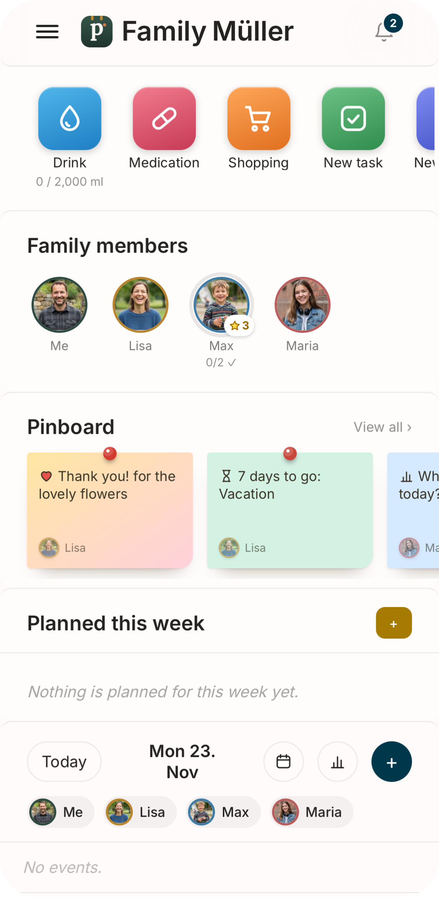
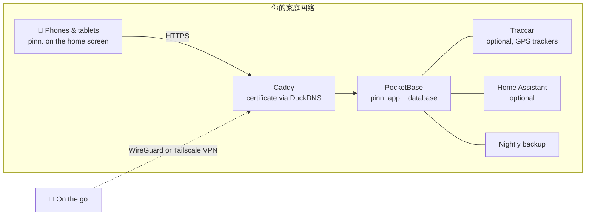

<p align="center">
  
</p>

<p align="center">
  <a href="https://github.com/pinn-shost/pinn/releases/latest"></a>
  <a href="LICENSE"></a>
  
  
  
  <a href="https://ko-fi.com/pinnapp"></a>
</p>

<p align="center">
  <a href="README.md">🇬🇧 English</a> ·
  <a href="README.de.md">🇩🇪 Deutsch</a> ·
  <a href="README.es.md">🇪🇸 Español</a> ·
  <a href="README.fr.md">🇫🇷 Français</a> ·
  <a href="README.it.md">🇮🇹 Italiano</a> ·
  <a href="README.pt.md">🇧🇷 Português</a> ·
  <b>🇨🇳 中文</b> ·
  <a href="README.ja.md">🇯🇵 日本語</a> ·
  <a href="README.ko.md">🇰🇷 한국어</a> ·
  <a href="README.ru.md">🇷🇺 Русский</a> ·
  <a href="README.nl.md">🇳🇱 Nederlands</a> ·
  <a href="README.tr.md">🇹🇷 Türkçe</a> ·
  <a href="README.pl.md">🇵🇱 Polski</a> ·
  <a href="README.uk.md">🇺🇦 Українська</a> ·
  <a href="README.cs.md">🇨🇿 Čeština</a> ·
  <a href="README.sv.md">🇸🇪 Svenska</a> ·
  <a href="README.da.md">🇩🇰 Dansk</a> ·
  <a href="README.nb.md">🇳🇴 Norsk</a>
</p>

<p align="center">
  <a href="#screenshots">截图</a> ·
  <a href="#what-pinn-does">功能</a> ·
  <a href="#installation">安装</a> ·
  <a href="#privacy">隐私</a> ·
  <a href="#faq">常见问题</a>
</p>

---

pinn. 是一个管理家庭日常的应用：共享日历、本周餐食、购物清单、谁来倒垃圾、零花钱，以及三月要退掉的保险。它通过 Docker 运行在**你自己的 NAS** 上，可以像原生应用一样安装在家人的每台 iPhone、iPad 和 Android 手机上。

没有云账户。没有订阅。没有广告，没有跟踪。你家的数据永远不会离开你的家。

<a id="screenshots"></a>

## 截图

### 在 iPad 上

挂在墙上或放在厨房餐桌上：共享的 iPad 让全家人的信息一目了然。

<table>
  <tr>
    <td align="center" width="50%">
      <a href=".github/assets/screenshots/dashboard.png"></a><br>
      <sub><b>仪表板</b>：每个人点击自己的头像，可选 PIN 码</sub>
    </td>
    <td align="center" width="50%">
      <a href=".github/assets/screenshots/ipad-overview.png"></a><br>
      <sub><b>概览</b>：天气、日程、任务、餐食和家人一目了然</sub>
    </td>
  </tr>
</table>

### 在手机上

随身携带：pinn. 可以像原生应用一样安装在每台 iPhone 和 Android 手机上。

<table>
  <tr>
    <td align="center" width="33%"><a href=".github/assets/screenshots/home.png"></a><br><sub><b>概览</b>：你的一天一目了然</sub></td>
    <td align="center" width="33%"><a href=".github/assets/screenshots/calendar.png"></a><br><sub><b>日历</b>：iCloud 和 Google 合在一个视图</sub></td>
    <td align="center" width="33%"><a href=".github/assets/screenshots/meals.png"></a><br><sub><b>餐食</b>：规划一周，一键购物</sub></td>
  </tr>
  <tr>
    <td align="center" width="33%"><a href=".github/assets/screenshots/lists.png"></a><br><sub><b>清单</b>：购物、储备、打包</sub></td>
    <td align="center" width="33%"><a href=".github/assets/screenshots/finance.png"></a><br><sub><b>财务</b>：预算、储蓄、零花钱</sub></td>
    <td align="center" width="33%"><a href=".github/assets/screenshots/chat.png"></a><br><sub><b>聊天</b>：端到端加密，支持语音消息和位置</sub></td>
  </tr>
</table>

### 更多界面

点击任意图片可查看大图。

<details>
<summary><b>显示更多截图</b></summary>

<br>

<table>
  <tr>
    <td align="center" width="25%"><a href=".github/assets/screenshots/house.png"></a><br><sub><b>住宅</b> – 房屋、费用、贷款、缺陷和读表集中管理</sub></td>
    <td align="center" width="25%"><a href=".github/assets/screenshots/tasks.png"></a><br><sub><b>任务</b> – 自动提醒，例如车检和换轮胎，带快捷按钮</sub></td>
    <td align="center" width="25%"><a href=".github/assets/screenshots/vehicles.png"></a><br><sub><b>车辆</b> – 车检、轮胎、加油和充电</sub></td>
    <td align="center" width="25%"><a href=".github/assets/screenshots/scan_pantry.png"></a><br><sub><b>扫描储物</b> – 扫描条形码，入库或用完</sub></td>
  </tr>
  <tr>
    <td align="center" width="25%"><a href=".github/assets/screenshots/weekly_summary_1.png"></a><br><sub><b>每周预览</b> – 天气和尚未完成的事项</sub></td>
    <td align="center" width="25%"><a href=".github/assets/screenshots/weekly_summary_2.png"></a><br><sub><b>每周预览</b> – 逐日查看：清洁、垃圾、付款</sub></td>
    <td align="center" width="25%"><a href=".github/assets/screenshots/weekly_summary_3.png"></a><br><sub><b>上周回顾</b> – 日程、餐食、支出——以及快捷入口</sub></td>
    <td align="center" width="25%"><a href=".github/assets/screenshots/kids.png"></a><br><sub><b>儿童</b>：有趣的每日作息</sub></td>
  </tr>
</table>

</details>

<sub>📁 <a href=".github/assets/screenshots">所有图片都在这个文件夹里</a></sub>

<a id="what-pinn-does"></a>

## pinn. 能做什么

| | |
|---|---|
| 📅 **日历** | 每人可使用 iCloud 和 Google 日历，可设为私人或与家人共享。公共假日、学校假期、垃圾回收日期和通讯录中的生日会自动显示。 |
| 🍝 **餐食与食谱** | 规划一周餐食，然后把食材直接发送到购物清单。可从文字、PDF、照片或链接导入食谱，还可选用 AI。与服务器上的其他家庭分享喜爱的食谱。 |
| 🛒 **清单** | 按商店分类的购物清单、库存不足时自动补充清单的储备柜、基于模板的打包清单（度假、待产包、派对），以及礼物和心愿清单（带有收礼的人看不到的“谁送什么”策划功能）。 |
| ✅ **任务与家务** | 带推送提醒的任务、清洁计划和垃圾桶——还有带动画作息的儿童页面，只显示符合当前时段的内容。 |
| 💶 **财务** | 共享或私人资金、家庭预算、储蓄以及含 ETF 和股票的证券账户、零花钱、定期付款和带解约提醒的合同。合租者可以分摊费用并查看谁欠谁多少。 |
| 📄 **文档与车辆** | 收据和保修、带到期提醒的证件。汽车和自行车的检验日期、换胎、油耗和总费用。 |
| 🏡 **住所** | 面向租客、业主和房东：租赁或购买合同、贷款、带照片的缺陷、发票、翻新计划、带预测的表读数、钥匙，以及出租的公寓、房屋和车库的租金收入。花园与植物，浇水计划知道什么时候下过雨。 |
| 📍 **家庭与位置** | 直接在 pinn. 中共享位置——一次性或在选定时间内——也可通过免费的 Traccar Client 应用在后台共享（直接发送到 pinn.，无需额外服务器）。还有“回家路上”模式、含位置和紧急号码的 SOS 警报、急救卡以及地点到达通知。 |
| 🎒 **学校与托儿所** | 每个孩子：课程表（输入或拍照——AI 自动填写）、接送、儿童页面上的作业、带截止日期并可转为提醒的家长通知，以及直接显示在日历中的停课日。 |
| 🐾 **宠物** | 为狗、猫、兔子等建立档案，含可勾选的喂食时间、遛狗、“轮到谁了”的轮值表、带推送提醒的疫苗和驱虫、体重曲线、兽医和急诊兽医、可分享的宠物保姆资料页、可打印的“寻宠”海报，以及喂食器补充提醒。 |
| 🌦️ **天气与假期** | 点按天气（手机上是一个磁贴，iPad 和电脑上位于日期和时间旁边的顶部），查看 14 天及每天的详情。带目的地和日期的打包清单会显示假期天气——预报或典型值——并建议带什么。 |
| 🏠 **智能家居** | 从任务启动 Apple 快捷指令或 Home Assistant 动作——家务到期时扫地机器人清扫厨房，割草机器人和浇水按花园计划运行，喂食器快空时会提醒。 |
| 🎙️ **语音控制** | “嘿 Siri，pinn”：添加到购物清单、朗读清单、创建任务并听取今天的安排——Android 上也可使用。 |
| 💬 **聊天** | 家庭群聊和私聊,端到端加密,支持推送、已读勾和回复。 |
| 🔔 **通知** | iPhone、iPad 和 Android 上的个人推送消息，以及汇总家庭中每项变动的通知铃。 |
| 🧩 **其他功能** | 带可移动便签的家庭公告板、全局搜索、带自动同步的离线模式、深色模式、带个人 PIN 的 iPad 仪表板、访客账户、儿童锁。 |

pinn. 支持 **🇬🇧 English、🇩🇪 Deutsch、🇪🇸 Español、🇫🇷 Français、🇮🇹 Italiano、🇧🇷 Português、🇨🇳 中文、🇯🇵 日本語、🇰🇷 한국어、🇷🇺 Русский、🇳🇱 Nederlands、🇹🇷 Türkçe、🇵🇱 Polski、🇺🇦 Українська、🇨🇿 Čeština、🇸🇪 Svenska、🇩🇰 Dansk和 🇳🇴 Norsk**，会根据你所在的地区调整货币和紧急号码，并可在**家庭**和**合租**两种用语之间切换。一台服务器可以托管多个家庭，每个家庭有各自的管理员。

## 1.158.0 新功能

**挪威语**

- 新增：挪威语（Norsk，书面挪威语 Bokmål）成为新的应用语言——应用的约 7,500 条文字、设置向导、数据导出、服务器推送消息以及挪威紧急电话（112）。同时包含合租版用语（“husstand”“bofelle”）。可在设置 → 语言和地区中选择。
- 说明：该翻译尚未经母语者审校，欢迎通过 GitHub issue 提出改进建议。通过 Siri/Android 的语音控制暂不支持挪威语，会用英语回答。
- 变更: `i18n/nb.i18n.js` (new), `README.nb.md` (new), `js/`, `pb_hooks/`, `einrichtung.js`, `datenexport.js`, `.github/scripts/`, `src/`, `index.html`, README.

## 1.157.0 新功能

**丹麦语**

- 新增：丹麦语（Dansk）成为新的应用语言——应用的约 7,500 条文字、设置向导、数据导出、服务器推送消息以及丹麦紧急电话（112）。同时包含合租版用语（“husstand”“bofælle”）。可在设置 → 语言和地区中选择。
- 说明：该翻译尚未经母语者审校，欢迎通过 GitHub issue 提出改进建议。通过 Siri/Android 的语音控制暂不支持丹麦语，会用英语回答。
- 变更: `i18n/da.i18n.js` (new), `README.da.md` (new), `js/`, `pb_hooks/`, `einrichtung.js`, `datenexport.js`, `.github/scripts/`, `src/`, `index.html`, README.

## 1.156.0 新功能

**瑞典语**

- 新增：瑞典语（Svenska）成为新的应用语言——应用的约 7,500 条文字、设置向导、数据导出、服务器推送消息以及瑞典紧急电话（112）。同时包含合租版用语（“hushåll”“medboende”）。可在设置 → 语言和地区中选择。
- 说明：该翻译尚未经母语者审校，欢迎通过 GitHub issue 提出改进建议。通过 Siri/Android 的语音控制暂不支持瑞典语，会用英语回答。
- 变更: `i18n/sv.i18n.js` (new), `README.sv.md` (new), `js/`, `pb_hooks/`, `einrichtung.js`, `datenexport.js`, `.github/scripts/`, `src/`, `index.html`, README.

## 1.155.0 新功能

**捷克语**

- 新增：捷克语（Čeština）成为新的应用语言——应用的约 7,500 条文字、设置向导、数据导出、服务器推送消息以及捷克紧急电话（112、警察 158、救护车 155、消防 150）。同时包含合租版用语。可在设置 → 语言和地区中选择。
- 说明：该翻译尚未经母语者审校，欢迎通过 GitHub issue 提出改进建议。通过 Siri/Android 的语音控制暂不支持捷克语，会用英语回答。
- 变更: `i18n/cs.i18n.js` (new), `README.cs.md` (new), `js/`, `pb_hooks/`, `einrichtung.js`, `datenexport.js`, `.github/scripts/`, `src/`, `index.html`, README.

## 1.154.0 新功能

**日历地址的安全修复**

- 修复：现在会检查日历地址。在 iCloud 或 Google 中删除、修改或读取日程时，服务器会使用家庭日历的登录信息，且只能把它发送给 Apple 和 Google 的服务器。以前，已登录的档案可以通过伪造的请求把登录信息发送到任意其他服务器。已正常工作的日历不受影响。
- 更改: `pb_hooks/calendar-sync.js`, `js/versionslog.js`, `js/sprachen.js`, `i18n/versionslog.en.js`, `src/`, `index.html`, README.

## 1.153.2 新功能

**以 “AQ.” 开头的 Gemini 密钥、状态文字、错误日志**

- 修复：设置向导现在接受以 `AQ.` 开头的新版 Google Gemini 密钥（其中含有一个点）。之前“检查”提示密钥有效，但“下一步”却拒绝它。
- 修复：家庭成员的状态（“在路上”“最后位置”）一直是德语，现在所有语言都能正确显示。
- 更改：错误日志的消息对德语显示德语，对其他所有语言显示英语。
- 更改: `pb_hooks/pinn-einrichtung.js`, `pb_hooks/pinn-protokoll.js`, `pb_hooks/protokoll.pb.js`, `einrichtung.js`, `js/fehlerprotokoll.js`, `js/familie.js`, `js/familienkachel.js`, `js/versionslog.js`, `js/sprachen.js`, `i18n/`, `src/`, `index.html`, README.

## 1.153.1 新功能

**健康：五个新模块，自己的资料显示“我”**

- 健康页新增：**防晒霜**（住址今日紫外线指数，仅晴天提醒）、**睡眠**（就寝前提醒，早上询问“睡得怎么样？”）、**水果和蔬菜**（每日份数）、**蜱虫检查**（4–10 月）和**体检**（牙医、全面体检 … 按周期；儿童按年龄的德国 U 检查）。儿童的提醒同样发送给父母。
- 新增：在自己的资料中，pinn. 显示“我”而不是自己的名字——日历筛选、任务、家庭及其他各处，句子中会相应调整。另外：恢复箭头改为线条图标、新的轮毂图标、深色模式下黄色提示使用相同的金色。
- 更改: `pb_hooks/pinn-gesundheit.js`, `js/gesundheit.js`, `css/gesundheit.css`, `js/mitglieder.js`, `js/symbole.js`, `css/dunkelfarbe.css`, `js/aufgaben.js`, `js/termine.js`, `js/listen.js`, `js/sparen.js`, `js/vertraege.js`, `js/familie.js`, `js/hinweise.js`, `js/kassen.js`, `js/zuhause.js`, `js/dokumente.js`, `js/fahrzeuge.js`, `js/ausblick.js`, `js/sterne.js`, `js/vorrat2.js`, `i18n/`, `js/sprachen.js`, `js/versionslog.js`, `index.html`.

## 1.153.0 新功能

**来自 Home Assistant 的安全概览**

- 新增：**安全** – 家庭管理员可在 设置 → 安全 中把 Home Assistant 设备分成命名的分组：门窗、门锁、摄像头、车库门和卷帘、烟雾和漏水探测器、报警系统、人体感应器。家庭看板底部显示一条状态栏（例如“全部关闭”“厨房窗户 未关”“1 个摄像头已开启”，报警时为红色），概览新增“安全”卡片，成人可在此锁上未锁的门锁（从不开锁）。可选**晚间检查**：在设定时间，如仍有东西未关、未上锁或报警系统未布防，所有管理员都会收到推送。前提：已在 设置 → 智能家居 中连接 Home Assistant。
- 修复：深色模式下任务标题下方的按钮（智能家居启动、抄表 …）是蓝底蓝字——现在为金色。
- 更改: `pb_hooks/pinn-sicherheit.js` (new), `pb_hooks/sicherheit.pb.js` (new), `pb_hooks/pinn-smarthome.js`, `pb_hooks/pinn-schema.js`, `js/sicherheit.js` (new), `css/sicherheit.css` (new), `js/uebersicht.js`, `js/profilauswahl.js`, `js/einstellungen.js`, `css/dunkelfarbe.css`, `i18n/`, `js/sprachen.js`, `js/versionslog.js`, `pinn-setup.sh`, `src/`, `index.html`.

## 1.152.1 新功能

**恢复备份重新可用**

- 已修复：恢复备份（设置 → 系统 → 备份与更新）总是在“检查备份”这一步失败，无论选择仅数据还是全部。恢复前对当前状态的备份会清理旧备份，同时覆盖了所选备份的文件名，导致找不到该备份。每次失败都会留下一个“恢复前”备份——它们无害，会自动清理（保留最近 3 个）。此更新会替换 `pinn-wartung.sh`；“wartung”容器会自动重启。
- Portainer 堆栈：备份现在真正可用了。由于仓库中缺少 1.151.0 的一部分，堆栈的“wartung”服务此前无法启动。现在镜像中包含备份脚本，它会自动找到堆栈中的 pinn 容器——夜间备份、“立即备份”和“恢复”（数据和设置）与脚本安装方式一样可用。更新仍在 Portainer 中进行。更新后：在 Portainer 中点“Update the stack”并勾选“Re-pull image and redeploy”。
- 更改: `pinn-wartung.sh`, `docker/Dockerfile`, `.github/workflows/image.yml`, `pb_hooks/pinn-system.js`, `js/sicherungen.js`, `js/serverzugriff.js`, `i18n/`, `js/versionslog.js`, `js/sprachen.js`, `src/`, `index.html`.

## 1.152.0 新功能

**用自己的反向代理代替 Tailscale**

- 新功能：通过自己的反向代理（Nginx Proxy Manager、Traefik、Cloudflare Tunnel 等）从互联网访问——见安装部分的“通过自己的反向代理从互联网访问”。pinn. 只相信来自受信任代理（`PINN_PROXY_NETZE`）的访客地址，因此无法绕过密码错误后的锁定（IPv6：按 /64 计算）。来自互联网时，PocketBase 管理界面及其自带的登录方式被屏蔽，初始密码 `Admin` 无效，猜测追踪器 ID 会被减速。遇到这类尝试时，管理员会收到“🚨 安全警告”推送（地址、家庭网络或互联网、设备）；完整信息在错误日志的“安全”分类中。家庭网络中一切照旧。
- 已更改: `pb_hooks/pinn-netz.js` (new), `pb_hooks/netz.pb.js` (new), `pb_hooks/pinn-alarm.js` (new), `pb_hooks/pinn-sitzungen.js`, `pb_hooks/benutzer.pb.js`, `pb_hooks/dashboard.pb.js`, `pb_hooks/zuhause.pb.js`, `pb_hooks/sprache.pb.js`, `pb_hooks/smarthome.pb.js`, `pb_hooks/pinn-ortung.js`, `pb_hooks/pinn-protokoll.js`, `pb_hooks/pinn-pushtext.js`, `js/anmeldemaske.js`, `js/fehlerprotokoll.js`, `js/hinweise.js`, `js/appstart.js`, `i18n/`, `docker/docker-compose.portainer.yaml`, `env.txt`, `js/sprachen.js`, `js/versionslog.js`, `src/`, `index.html`.

## 1.151.0 新功能

**Portainer 堆栈，现成镜像**

- 新功能：无需 SSH 和安装脚本，即可通过 Portainer 堆栈界面安装 pinn.。每次发布都会构建现成的镜像（amd64、arm64）并发布到 `ghcr.io/pinn-shost/pinn`；新文件 `docker/docker-compose.portainer.yaml` 使用该镜像，采用卷且不使用固定容器名（不再与已有的 Tailscale 容器冲突）。堆栈还包含备份服务（每晚备份，应用中的“立即备份”和“恢复”；更新仍在 Portainer 中进行），以及已注释的可选块：Traccar 和通往 Home Assistant 的绕行。见安装部分的“Portainer 堆栈（无需脚本）”。
- 已更改: `docker/` (new), `.github/workflows/image.yml` (new), `pinn-wartung.sh`, `pb_hooks/pinn-system.js`, `js/sicherungen.js`, `i18n/`, `js/sprachen.js`, `js/versionslog.js`, `src/`, `index.html`.

## 1.150.11 新功能

**图标与小修复**

- 儿童页面“梳头发”使用梳子图标；储蓄账户名称旁不再有表情符号输入框；资金账户下拉列表不再显示表情符号；工具图标改为开口扳手；“访客菜单”使用双人图标；点击家庭名称旁的标志可回到概览；“通知”卡片优先加载，确保始终显示“在此设备上启用”；深色模式下快捷方式图标为灰色。
- 已更改: `js/symbole.js`, `js/symbole3.js`, `js/ansichten.js`, `js/konto.js`, `css/dunkelfarbe.css`, `js/sprachen.js`, `js/versionslog.js`, `i18n/versionslog.en.js`, `src/`, `index.html`.

## 工作原理



所有组件都以 Docker 容器的形式运行在同一台机器上。HTTPS **无需端口转发**——证书通过 DNS 验证签发。从外部只能通过你自己的 VPN 访问 pinn.。

## 系统要求

- 装有 **Docker** 和 **Docker Compose 2.17+** 的 NAS 或服务器——在搭载 UGOS 的 UGREEN NAS 上开发，可在任何 Linux Docker 主机上运行（amd64、arm64、armv7）
- 对它的 SSH 访问权限
- 可选但推荐：一个免费的 [DuckDNS](https://www.duckdns.org) 子域名用于 HTTPS——推送通知和把 pinn. 安装为应用都需要它

<a id="installation"></a>

## 安装

1. 下载[最新版本](https://github.com/pinn-shost/pinn/releases/latest)的 ZIP 并解压。
2. 在 NAS 上创建一个文件夹，例如 `/volume1/docker/Pocketbase`，把解压后的文件夹（例如 `pinn-1.158.0` 或 `pinn-main`）原样放进去。
3. 通过 SSH 登录并运行：
   ```sh
   cd /volume1/docker/Pocketbase && sudo sh pinn-*/pinn-setup.sh
   ```
   脚本会把每个文件复制到位，下载 PDF 导入和照片文字识别所需的库，并启动 pinn.。
4. 打开 `http://<NAS-IP>:8090` → **以主管理员身份登录** → 密码 `Admin` → 设置你自己的密码。
5. **设置向导**会带你完成其余步骤——HTTPS、通过 WireGuard 或 Tailscale 远程访问、Google、AI、位置和 Home Assistant——一步一步，支持十八种语言。
6. 在每部手机上通过 HTTPS 地址打开 pinn.，并添加到主屏幕：
   - **iPhone/iPad（Safari）：** 分享 → *添加到主屏幕*（通知需要 iOS 16.4 或更高版本）
   - **Android（Chrome）：** 设置 → 通知 → *将 pinn. 安装为应用*，或 Chrome 菜单 ⋮ → *安装应用*

   然后在每台设备上通过**设置 → 通知 → 在此设备上启用**打开通知。

**更新：**下载新的 ZIP，把解压后的文件夹放进同一个文件夹，再次运行 `sudo sh pinn-*/pinn-setup.sh`。被替换的文件会保留在 `_alt/` 中，你的数据不会被改动。

**备份**每晚运行并保存到 `./backups`，保留 14 天。

<a id="privacy"></a>

### Portainer 堆栈（无需脚本）

更喜欢 Portainer？那么既不需要 SSH，也不需要安装脚本：

1. 在 Portainer 中打开 **Stacks → Add stack**，命名为 `pinn`，选择 **Web editor**。
2. 粘贴 [`docker/docker-compose.portainer.yaml`](docker/docker-compose.portainer.yaml) 的内容。
3. 可选：在 **Environment variables** 中修改端口（`PINN_PORT`，默认 8090）或固定版本（`PINN_IMAGE_TAG`，例如 `1.151.0`）。点击 **Deploy the stack**。
4. 打开 `http://<NAS-IP>:8090` → **以主管理员身份登录** → 进入设置向导，同上面的第 4–6 步。

镜像由 `ghcr.io/pinn-shost/pinn` 现成提供（amd64 和 arm64）。数据保存在卷中，无需文件夹。堆栈不使用固定的容器名称，因此不会与你已有的容器冲突。如果 NAS 上已有 Tailscale，请删除 `tailscale` 块；如果使用自己的 HTTPS 地址或反向代理，也请删除 `caddy` 和 `duckdns`。

**更新：** Stack → Editor → *Update the stack*，并打开 *Re-pull image and redeploy*。**备份：** 堆栈中的 `wartung` 块每晚自动备份（保留 7 天 + 4 周），也是 pinn. → 设置 → 系统 中“立即备份”和“恢复”按钮的后台。备份保存在卷 `backups` 中；如果设置了 `PINN_BACKUP_DIR`（例如 `/volume1/docker/pinn-backups`），则保存在 NAS 文件夹中。恢复时它需要 Docker 访问权限来短暂停止 pinn.；如果你自己备份卷，可删除该块。更新在 Portainer 中进行，而不是通过按钮。可选，已在文件末尾注释（去掉 `#` 即可启用）：Traccar（带 SIM 卡的 GPS 追踪器）和通往 Home Assistant 的绕行——手机不需要它们。

### 通过自己的反向代理从互联网访问

家人不想用 Tailscale？那就把 pinn. 放在反向代理后面：它接收来自互联网的请求，为你自己的域名提供 HTTPS，再转发给 pinn.。

1. 让代理指向 `http://<NAS-IP>:8090`（Portainer 堆栈：端口 `PINN_PORT`）。实时更新使用普通 HTTP——不需要 websocket，只要不开启响应缓冲。允许最大 70 MB 的上传（聊天视频）。
   - **Nginx Proxy Manager：** *Hosts → Proxy Hosts → Add*：你的域名，协议 `http`，NAS IP，端口 `8090`；*SSL* 选项卡：新证书，打开 *Force SSL*。
   - **Cloudflare Tunnel：** 无需端口转发——*Public hostname* → 服务 `http://<NAS-IP>:8090`。
   - **Traefik、Caddy 等：** 为你的域名建立一个转发到 `http://<NAS-IP>:8090` 的路由/站点。
2. 在每部手机上打开 `https://<domain>`，登录，重新添加到主屏幕并重新开启通知（应用与其地址绑定）。
3. Google 日历（可选）：在 Google Cloud 控制台中把 `https://<domain>/api/pinn/google/callback` 添加为已授权的重定向 URI。

pinn. 自己会做的事：只有当请求来自家庭网络、Docker 网络或 Tailscale 时，它才相信代理传来的访客地址（`X-Forwarded-For`）——因此无法绕过密码错误后的锁定。来自互联网时，PocketBase 管理界面（`/_/`）被屏蔽，初始密码 `Admin` 无效。你的代理在别处（租用的服务器，或代理前面有 Cloudflare 的橙色云）？那就设置 `PINN_PROXY_NETZE`（在 `.env` 或堆栈的环境变量中），例如 `privat, cloudflare` 或 `privat, 203.0.113.5`。

**重要：** 这样 pinn. 对整个互联网都可访问。请为每个档案设置一个长且独立的密码，保持代理为最新版本，并且绝不要在路由器中直接开放 8090 端口——始终通过带 HTTPS 的代理。

## 隐私

pinn. 为那些你绝不会交给云服务的数据而生：银行对账单、健康文件、孩子所在的位置。因此：

- **所有数据都保存在你的 NAS 上**，存放在单个 PocketBase 数据库中。没有 pinn. 服务器，也没有遥测。
- **没有来自第三方服务器的脚本。**所有代码和库都由你的 NAS 提供。
- **推送通知不含内容。**Apple、Google 和 Mozilla 只传递一个空的唤醒信号；设备随后从你的 NAS 获取消息。
- **iCloud 和 Google 的密码**加密存放在受保护的集合中。
- **无法从互联网访问。**远程访问通过你自己的 VPN。

只有需要外部服务的功能，pinn. 才会联系外部服务：

| 服务 | 用途 | 何时 |
|---|---|---|
| [Open-Meteo](https://open-meteo.com) | 天气预报 | 设置了家庭地址时 |
| [OpenStreetMap Nominatim](https://nominatim.openstreetmap.org) | 把地址转换为地图位置 | 输入地址时 |
| [OpenStreetMap 瓦片](https://www.openstreetmap.org) | 地图背景 | 在位置页面，通过你的 NAS 加载 |
| [Google Fonts](https://fonts.google.com) | 字体 | 应用加载时 |
| [OpenHolidays API](https://www.openholidaysapi.org) | 公共假日和学校假期 | 设置了家庭地址时 |
| [DuckDNS](https://www.duckdns.org) | HTTPS 证书和地址 | 如已配置 |
| iCloud / Google | 日历和联系人 | 仅限你连接的账户 |
| Google Gemini | 读取食谱和文档 | 仅在你添加 API 密钥时 |
| jsDelivr | 一次性下载 pdf.js 和 Tesseract | 仅在安装期间 |

<a id="faq"></a>

## 常见问题

<details>
<summary><b>我需要在路由器上开放端口吗？</b></summary>
<br>
不需要。HTTPS 证书通过 DNS 验证签发，远程访问通过 VPN——FRITZ!Box 上用 WireGuard，其他路由器用 Tailscale。
</details>

<details>
<summary><b>没有 NAS 也能用吗？</b></summary>
<br>
任何长期开机并装有 Docker 的设备都可以：迷你电脑、Raspberry Pi 4/5 或 Linux 服务器。
</details>

<details>
<summary><b>pinn. 是 App Store 里的“正式”应用吗？</b></summary>
<br>
pinn. 是一个添加到主屏幕的网页应用。之后它像原生应用一样全屏打开，支持离线使用，显示未完成任务的角标，并接收推送通知——完全不需要应用商店。
</details>

<details>
<summary><b>多个家庭可以共用一个安装吗？</b></summary>
<br>
可以。主管理员创建家庭，每个家庭有自己的管理员、日历和数据。食谱可以选择在家庭之间共享。
</details>

<details>
<summary><b>孩子怎么办？</b></summary>
<br>
开启儿童锁的档案只能看到自己的任务，无法删除或更改任何内容。财务、文档和车辆保持隐藏。年幼的孩子有自己的趣味页面，里面是每日作息。
</details>

<details>
<summary><b>费用是多少？</b></summary>
<br>
免费——pinn. 是基于 MIT 许可证的免费开源软件。Gemini AI 等可选服务有免费额度。
</details>

## 仓库结构

仓库的结构与 NAS 上的安装完全相同——每个文件都放在最终所在的位置：

```
pinn/
├── pb_hooks/            server: *.pb.js hooks and their helper modules (pinn-*.js, calendar-sync.js)
├── pb_public/           web app served by PocketBase
│   ├── index.html       the app page, built from src/ (HTML, start check) – do not edit by hand
│   ├── js/              app code split out of index.html, plain <script> files without a build step
│   │                    (ruhemodus.js, textkern.js, sprachen.js, region.js, grundlagen.js, popups.js, verbindung.js, benutzer.js, mitteilungen.js, serverzugriff.js, tastatur.js, anmeldemaske.js, dashboard.js, dashboardhintergrund.js, profilauswahl.js, pineingabe.js, dashboardsitzung.js, dashboardkonto.js, familienverwalten.js, einrichten.js, exportieren.js, hauptadminseite.js, anmeldung.js, konto.js, profilverwaltung.js, zustand.js, bedienzustand.js, rezeptbilder.js, zusammenfuehren.js, speichern.js, design.js, sprache.js, uebersicht.js, familienkachel.js, wobistdu.js, geburtstagsfeier.js, wetterkachel.js, geburtstage.js, uebersichteinstellungen.js, familiensync.js, bereiche.js, kalenderquellen.js, icsparser.js, zeitleiste.js, termindetails.js, kalenderdatei.js, wetter.js, wohnort.js, feiertage.js, muellkalender.js, mitglieder.js, profilbild.js, mitglied.js, kinderseite.js, kinderroutine.js, sterne.js, kalenderansicht.js, essenplanen.js, rezeptparser.js, rezeptdialog.js, rezeptbild.js, rezeptmengen.js, einkauf.js, einkaufslisten.js, einkaufseingabe.js, rezepte.js, offline.js, aufgabenextras.js, appbadge.js, reisen.js, aufgabendaten.js, haushalt.js, reihum.js, aufgaben.js, smarthome.js, sprachsteuerung.js, termine.js, ansichten.js, versionspruefung.js, sicherungen.js, geraete.js, fehlerprotokoll.js, versionslog.js, einstellungen.js, kalenderkonto.js, finanzen.js, kassen.js, vorrat.js, vorrat2.js, sparen.js, vertraege.js, fahrzeuge.js, zuhause.js, dokumente.js, pdflesen.js, appstart.js, pinnwand.js, listen.js, familie.js, hinweise.js, ausblick.js – ausblick.js always comes last)
│   ├── css/             app styles split out of index.html, plain CSS without a build step (ergaenzung.css, energiesparen.css, basis.css … haustierewetter.css, terminal.css, glocke.css)
│   ├── einrichtung.js   setup assistant · datenexport.js  data export
│   ├── i18n/            texts by key (de, en, fr, es, it, pt, zh, ja, ko) – English is the reference
│   └── vendor/          pinn.css, pocketbase/ (pdf.js and Tesseract are downloaded by the setup)
├── .github/             GitHub Actions (workflows/check.yml), checks (scripts/), CONTRIBUTING.md, SECURITY.md, images – not installed
├── src/                 sources of index.html (build.js, rahmen.html, teile/) – not installed
├── caddy/Caddyfile      HTTPS reverse proxy
├── docker-compose.yaml  all containers
├── env.txt              template for .env
├── pinn-setup.sh        install & update
├── pinn-wartung.sh      backups & updates (container "wartung")
├── pinn-pocketbase-update.sh
├── index.html           placeholder only, never installed (keeps the update button of 1.38 working)
└── README.md            this page · README.<code>.md in de, es, fr, it, pt, zh, ja, ko
```

`pinn-setup.sh` 会把 `pb_hooks/`、`pb_public/` 和 `caddy/Caddyfile` 原样复制到项目文件夹；数据文件夹（`pb_data/`、`konfig/`、`backups/`、`caddy/data/` …）绝不会被改动。

## 参与贡献

非常欢迎错误报告、想法和翻译——请参阅 [CONTRIBUTING.md](.github/CONTRIBUTING.md)。请按 [SECURITY.md](.github/SECURITY.md) 中的说明私下报告安全问题。提交 Pull Request 前，请运行 `node .github/scripts/check-all.js`——相同的检查也会在 GitHub 上自动运行。

## 支持 pinn.

pinn. 是免费的，并将一直免费——完全免费，面向所有人。它是我在业余时间做的。如果它让你的日常生活轻松了一点，非常欢迎你给予一点小小的支持，但完全出于自愿：

<p>
  <a href="https://ko-fi.com/pinnapp"></a>
  <a href="https://buymeacoffee.com/pinn"></a>
</p>

一个 ⭐ 也有帮助——让其他家庭更容易找到 pinn.。

## 使用的开源项目

[PocketBase](https://pocketbase.io) (MIT) · [Tailwind CSS](https://tailwindcss.com) (MIT) · [pdf.js](https://mozilla.github.io/pdf.js/) (Apache-2.0) · [Tesseract.js](https://tesseract.projectnaptha.com) (Apache-2.0) · [Traccar](https://www.traccar.org) (Apache-2.0) · [Caddy](https://caddyserver.com) (Apache-2.0)

## 许可证

[MIT](LICENSE)——随意使用、修改和分享。
